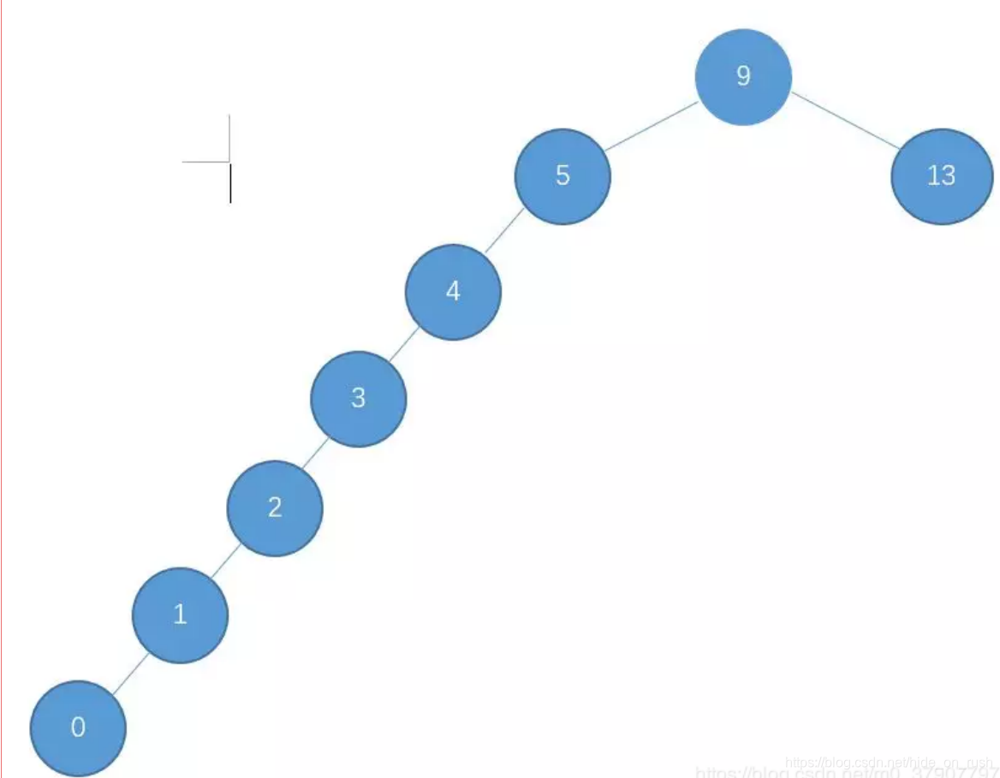
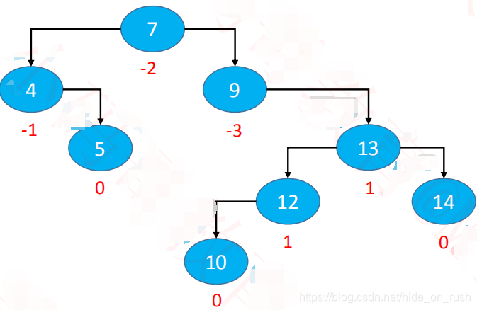

> 迁移来源 [博客园原文](https://www.cnblogs.com/xiuzhublog/p/12608544.html) · 原文发布于 `2020-03-28 15:12:00`（UTC+8）
> 同文另见 [CSDN版本](https://blog.csdn.net/hide_on_rush/article/details/105143130)。

二插搜索树在使用过程中可能会出现接近于线性表的情况。如图：



这种情况的出现可能是一开始就是这样的结构，也有可能是在进行了删除操作后变成了这样。但是不管何种原因，这样的二插搜索树算法复杂度已经由O(logn)变得无限接近O(n)。退化成了链表结构。

这种情况下自然希望减小树的高度，使二插搜索树恢复平衡的状态。

### 平衡二叉搜索树（Balanced Binary Search Tree）

英文简称为：BBST

经典常见的平衡二叉搜索树有  
 **AVL树**  
 Windows NT 内核中广泛使用  
**红黑树**  
 C++ STL（比如 map、set ）  
 Java 的 TreeMap、TreeSet、HashMap、HashSet  
Linux 的进程调度  
Ngix 的 timer 管理  
一般也称它们为：**自平衡的二叉搜索树（Self-balancing Binary Search Tree）**

下面是详细介绍：

## 1.AVL树

AVL树是最早发明的自平衡二叉搜索树之一AVL 取名于两位发明者的名字G. M. Adelson-Velsky 和 E. M. Landis（来自苏联的科学家）

**平衡因子（Balance Factor）：某结点的左右子树的高度差.例如：**



```java
//定义节点
class AvlNode {
 int data;
 AvlNode lchild;//左孩⼦
 AvlNode rchild;//右孩⼦
 int height;//记录节点的⾼度
}
//在这⾥定义各种操作
public class AVLTree{
 //计算节点的⾼度
 static int height(AvlNode T) {
 if (T == null) {
 return -1;
 }else{
 return T.height;
 }
 }
 //左左型，右旋操作
 static AvlNode R_Rotate(AvlNode K2) {
 AvlNode K1;
 //进⾏旋转
 K1 = K2.lchild;
 K2.lchild = K1.rchild;
 K1.rchild = K2;
 //重新计算节点的⾼度
 K2.height = Math.max(height(K2.lchild), height(K2.rchild)) + 1;
 K1.height = Math.max(height(K1.lchild), height(K1.rchild)) + 1;
 return K1;
 }
 //进⾏左旋
 static AvlNode L_Rotate(AvlNode K2) {
 AvlNode K1;
 K1 = K2.rchild;
 K2.rchild = K1.lchild;
 K1.lchild = K2;
 //重新计算⾼度
 K2.height = Math.max(height(K2.lchild), height(K2.rchild)) + 1;
 K1.height = Math.max(height(K1.lchild), height(K1.rchild)) + 1;
 return K1;
 }
 //左-右型，进⾏左旋，再右旋
 static AvlNode R_L_Rotate(AvlNode K3) {
 //先对其孩⼦进⾏左旋
 K3.lchild = R_Rotate(K3.lchild);
 //再进⾏右旋
 return L_Rotate(K3);
 }
 //右-左型，先进⾏右旋，再左旋
 static AvlNode L_R_Rotate(AvlNode K3) {
 //先对孩⼦进⾏右旋
 K3.rchild = L_Rotate(K3.rchild);
 //在左旋
 return R_Rotate(K3);
 }
 //插⼊数值操作
 static AvlNode insert(int data, AvlNode T) {
 if (T == null) {
 T = new AvlNode();
 T.data = data;
 T.lchild = T.rchild = null;
 } else if(data < T.data) {
 //向左孩⼦递归插⼊
 T.lchild = insert(data, T.lchild);
 //进⾏调整操作
 //如果左孩⼦的⾼度⽐右孩⼦⼤2
 if (height(T.lchild) - height(T.rchild) == 2) {
 //左-左型
 if (data < T.lchild.data) {
 T = R_Rotate(T);
 } else {
 //左-右型
 T = R_L_Rotate(T);
 }
 }
 } else if (data > T.data) {
 T.rchild = insert(data, T.rchild);
 //进⾏调整
 //右孩⼦⽐左孩⼦⾼度⼤2
 if(height(T.rchild) - height(T.lchild) == 2)
 //右-右型
 if (data > T.rchild.data) {
 T = L_Rotate(T);
 } else {
 T = L_R_Rotate(T);
 }
 }
 //否则，这个节点已经在书上存在了，我们什么也不做
 
 //重新计算T的⾼度
 T.height = Math.max(height(T.lchild), height(T.rchild)) + 1;
 return T;
 }
}
```
