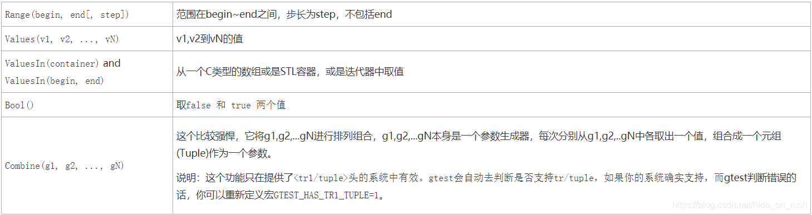
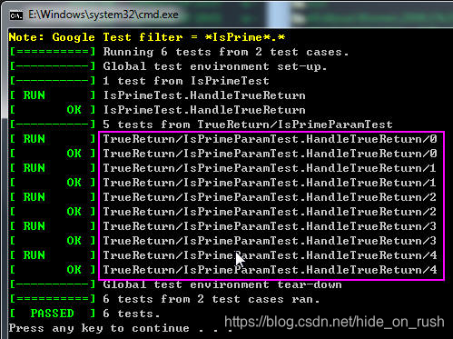
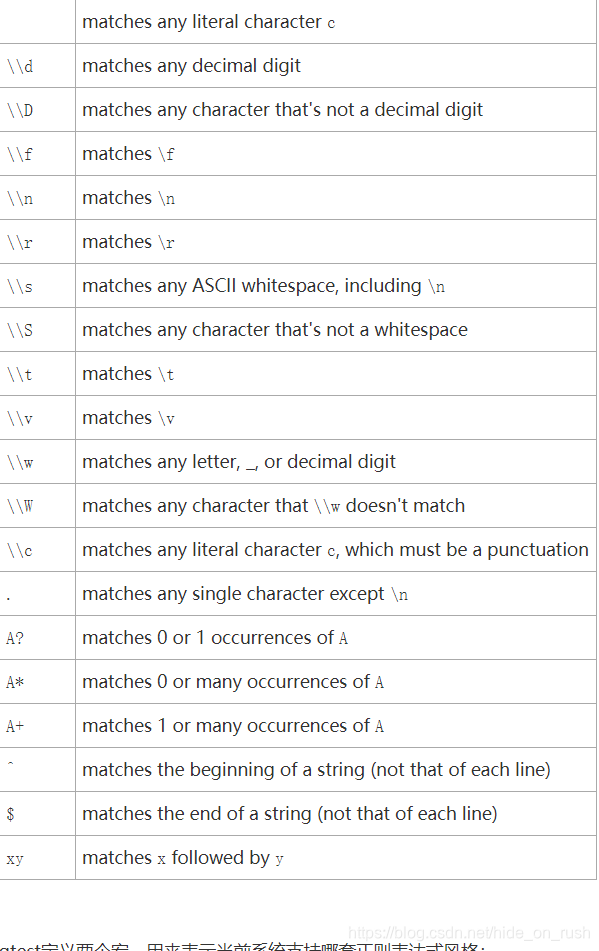
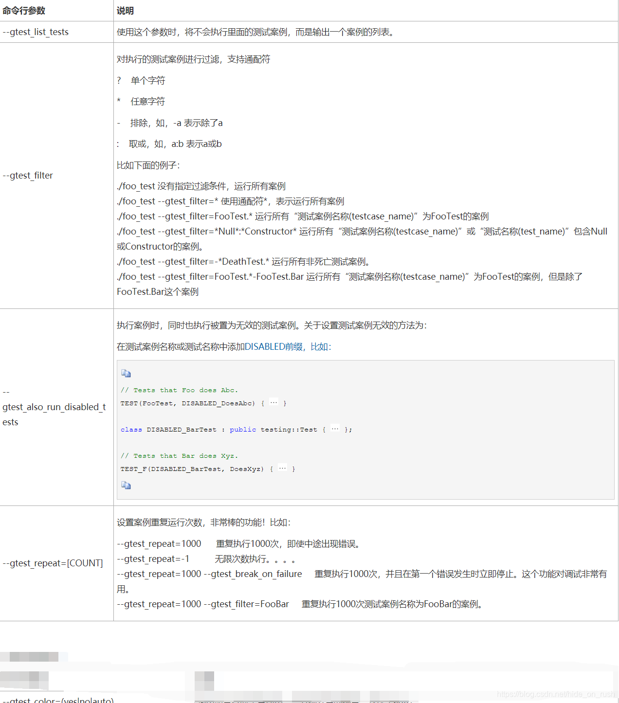
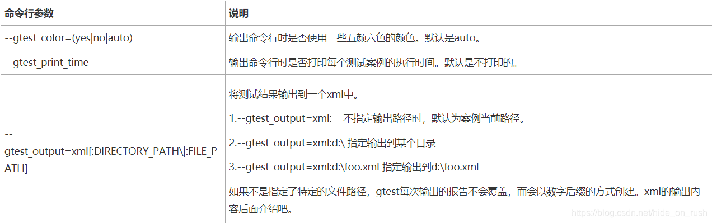
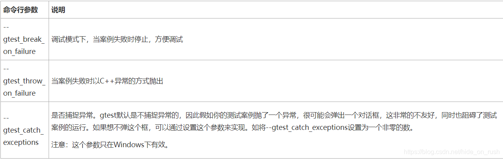
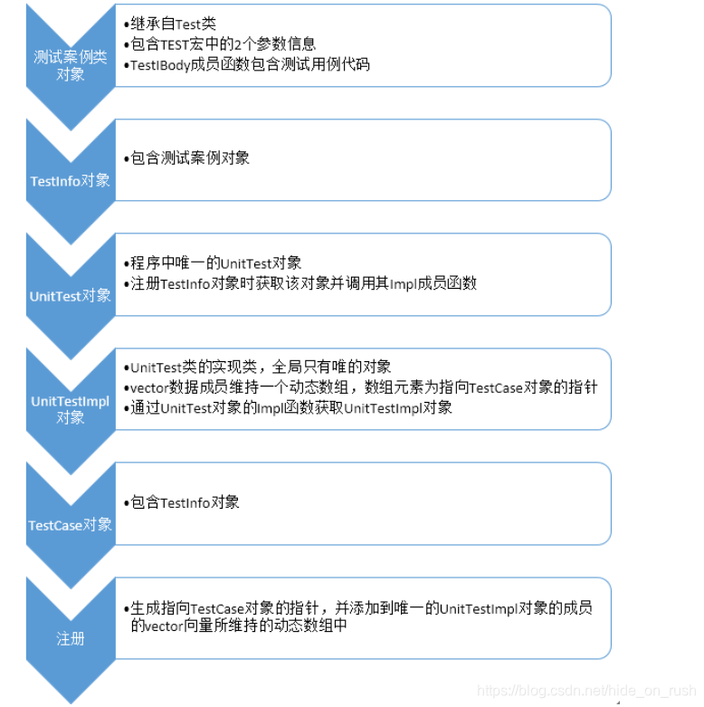

> 迁移来源 [博客园原文](https://www.cnblogs.com/xiuzhublog/p/13672796.html) · 原文发布于 `2020-09-15 14:16:00`（UTC+8）
> 旧文归档，文中的依赖和运行环境以当年版本为准。

## 什么是GTest

Google test是一款开源的、跨平台的(Liunx、Mac OS X、Windows、Cygwin、Windows CE and Symbian)C++白盒单元测试框架。由google公司发布。gtest是为在不同平台上为编写C++测试而生成的。它提供了丰富的断言、致命和非致命判断、参数化、”死亡测试”等等。

> **白盒测试及其基本方法**  
> 白盒测试也称结构测试或逻辑驱动测试，它是按照程序内部的结构测试程序，通过测试来检测产品内部动作是否按照设计规格说明书的规定正常进行，检验程序中的每条通路是否都能按预定要求正确工作。 这一方法是把测试对象看作一个打开的盒子，测试人员依据程序内部逻辑结构相关信息，设计或选择测试用例，对程序所有逻辑路径进行测试，通过在不同点检查程序的状态，确定实际的状态是否与预期的状态一致。  
> **基本方法**  
> 强度由低到高:语句覆盖、判定覆盖、条件覆盖、判定条件覆盖、条件组合覆盖、路径覆盖。  
> （1）语句覆盖：就是设计若干个测试用例，运行被测程序，使得每一可执行语句至少执行一次。  
> （2）判定覆盖：使设计的测试用例保证程序中每个判断的每个取值分支至少经历一次。  
> （3）条件覆盖：条件覆盖是指选择足够的测试用例，使得运行这些测试用例时，判定中每个条件的所有可能结果至少出现一次，但未必能覆盖全部分支  
> （4）判定条件覆盖：判定-条件覆盖就是设计足够的测试用例，使得判断中每个条件的所有可能取值至少执行一次，同时每个判断的所有可能判断结果至少执行，即要求各个判断的所有可能的条件取值组合至少执行一次。  
> （5）条件组合覆盖：在白盒测试法中，选择足够的测试用例，使所有判定中各条件判断结果的所有组合至少出现一次，满足这种覆盖标准成为条件组合覆盖。  
> （6）路径覆盖：是每条可能执行到的路径至少执行一次。  
> 补充：（1）语句覆盖在所有的测试方法中是一种最弱的覆盖。  
> （2）判定覆盖和条件覆盖比语句覆盖强，满足判定/条件覆盖标准的测试用例一定也满足判定覆盖、条件覆盖和语句覆盖（3）路径覆盖也是一种比较强的覆盖，但未必考虑判定条件结果的组合，并不能代替条件覆盖和条件组合覆盖。  
> **优缺点**
>
> 1. 优点  
>    a.迫使测试人员去仔细思考软件的实现  
>    b.可以检测代码中的每条分支和路径  
>    c.揭示隐藏在代码中的错误  
>    d.对代码的测试比较彻底  
>    e.最优化
> 2. 缺点  
>    a.代价昂贵  
>    b.无法检测代码中遗漏的路径和数据敏感性错误  
>    c.不验证规格的正确性

## 使用

### 断言

#### 1.前言

gtest中，断言的宏可以理解为分为两类，一类是ASSERT系列，一类是EXPECT系列。一个直观的解释就是：

1. ASSERT\_\* 系列的断言，当检查点失败时，退出当前函数（注意：并非退出当前案例）。
2. EXPECT\_\* 系列的断言，当检查点失败时，继续往下执行。

#### 2.示例

```cpp
// int型比较，预期值：3，实际值：Add(1, 2)
EXPECT_EQ(3, Add(1, 2))
//
```

假如你的Add(1, 2) 结果为4的话，会在结果中输出：

```cpp
g:\myproject\c++\gtestdemo\gtestdemo\gtestdemo.cpp(16): error: Value of: Add(1, 2)
  Actual: 4
Expected:3
```

如果你对自动输出的出错信息不满意的话，你还可以通过操作符<<将一些自定义的信息输出，通常，这对于调试或是对一些检查点的补充说明来说，非常有用！

下面举个例子：

如果不使用<<操作符自定义输出的话：

```cpp
for (int i = 0; i < x.size(); ++i)
{
    EXPECT_EQ(x[i], y[i]);
}
```

看到的结果将是这样的，你根本不知道出错时 i 等于几：

```cpp
g:\myproject\c++\gtestdemo\gtestdemo\gtestdemo.cpp(25): error: Value of: y[i]
  Actual: 4
Expected: x[i]
Which is: 3
```

如果使用<<操作符将一些重要信息输出的话：

```cpp
for (int i = 0; i < x.size(); ++i)
{
    EXPECT_EQ(x[i], y[i]) << "Vectors x and y differ at index " << i;
}
```

从输出结果中就可以定位到在 i = 2 时出现了错误。这样的输出结果看起来更加有用，容易理解：

```cpp
g:\myproject\c++\gtestdemo\gtestdemo\gtestdemo.cpp(25): error: Value of: y[i]
  Actual: 4
Expected: x[i]
Which is: 3
Vectors x and y differ at index 2
```

#### 3.布尔值检查

| Fatal assertion | Nonfatal assertion | Verifies |
| --- | --- | --- |
| ASSERT\_TRUE(condition); | EXPECT\_TRUE(condition); | condition is true |
| ASSERT\_FALSE(condition); | EXPECT\_FALSE(condition); | condition is false |

#### 4.数值型数据检查

| Fatal assertion | Nonfatal assertion | Verifies |
| --- | --- | --- |
| ASSERT\_EQ(expected, actual); | EXPECT\_EQ(expected, actual); | expected == actual |
| ASSERT\_NE(val1, val2); | EXPECT\_NE(val1, val2); | val1 != val2 |
| ASSERT\_LT(val1, val2); | EXPECT\_LT(val1, val2); | val1 < val2 |
| ASSERT\_LE(val1, val2); | EXPECT\_LE(val1, val2); | val1 <= val2 |
| ASSERT\_GT(val1, val2); | EXPECT\_GT(val1, val2); | val1 > val2 |
| ASSERT\_GE(val1, val2); | EXPECT\_GE(val1, val2); | val1 >= val2 |

#### 5.字符串检查

| Fatal assertion | Nonfatal assertion | Verifies |
| --- | --- | --- |
| ASSERT\_STREQ(expected\_str, actual\_str); | EXPECT\_STREQ(expected\_str, actual\_str); | the two C strings have the same content |
| ASSERT\_STRNE(str1, str2); | EXPECT\_STRNE(str1, str2); | the two C strings have different content |
| ASSERT\_STRCASEEQ(expected\_str, actual\_str); | EXPECT\_STRCASEEQ(expected\_str, actual\_str); | the two C strings have the same content, ignoring case |
| ASSERT\_STRCASENE(str1, str2); | EXPECT\_STRCASENE(str1, str2); | the two C strings have different content, ignoring case |
| *STREQ*和*STRNE*同时支持char*和wchar\_t*类型的，*STRCASEEQ*和*STRCASENE*却只接收char\*，估计是不常用吧。下面是几个例子： |  |  |

```cpp
TEST(StringCmpTest, Demo)
{
    char* pszCoderZh = "CoderZh";
    wchar_t* wszCoderZh = L"CoderZh";
    std::string strCoderZh = "CoderZh";
    std::wstring wstrCoderZh = L"CoderZh";

    EXPECT_STREQ("CoderZh", pszCoderZh);
    EXPECT_STREQ(L"CoderZh", wszCoderZh);

    EXPECT_STRNE("CnBlogs", pszCoderZh);
    EXPECT_STRNE(L"CnBlogs", wszCoderZh);

    EXPECT_STRCASEEQ("coderzh", pszCoderZh);
    //EXPECT_STRCASEEQ(L"coderzh", wszCoderZh);    不支持

    EXPECT_STREQ("CoderZh", strCoderZh.c_str());
    EXPECT_STREQ(L"CoderZh", wstrCoderZh.c_str());
}
```

#### 6.显示返回成功或失败

直接返回成功：SUCCEED();

返回失败：

| Fatal assertion | Nonfatal assertion |
| --- | --- |
| FAIL(); | ADD\_FAILURE(); |

```cpp
TEST(ExplicitTest, Demo)
{
    ADD_FAILURE() << "Sorry"; // None Fatal Asserton，继续往下执行。

    //FAIL(); // Fatal Assertion，不往下执行该案例。

    SUCCEED();
}
```

#### 7.异常检查

| Fatal assertion | Nonfatal assertion | Verifies |
| --- | --- | --- |
| ASSERT\_THROW(statement, exception\_type); | EXPECT\_THROW(statement, exception\_type); | statement throws an exception of the given type |
| ASSERT\_ANY\_THROW(statement); | EXPECT\_ANY\_THROW(statement); | tatement throws an exception of any type |
| ASSERT\_NO\_THROW(statement); | EXPECT\_NO\_THROW(statement); | statement doesn't throw any exception |

例如：

```cpp
int Foo(int a, int b)
{
    if (a == 0 || b == 0)
    {
        throw "don't do that";
    }
    int c = a % b;
    if (c == 0)
        return b;
    return Foo(b, c);
}

TEST(FooTest, HandleZeroInput)
{
    EXPECT_ANY_THROW(Foo(10, 0));
    EXPECT_THROW(Foo(0, 5), char*);
}
```

#### 8.Predicate Assertions

在使用EXPECT\_TRUE或ASSERT\_TRUE时，有时希望能够输出更加详细的信息，比如检查一个函数的返回值TRUE还是FALSE时，希望能够输出传入的参数是什么，以便失败后好跟踪。因此提供了如下的断言：

| Fatal assertion | Nonfatal assertion | Verifies |
| --- | --- | --- |
| ASSERT\_PRED1(pred1, val1); | EXPECT\_PRED1(pred1, val1); | pred1(val1) returns true |
| ASSERT\_PRED2(pred2, val1, val2); | EXPECT\_PRED2(pred2, val1, val2); | pred2(val1, val2) returns true |
| ... | ... | ... |
| Google人说了，他们只提供<=5个参数的，如果需要测试更多的参数，直接告诉他们。下面看看这个东西怎么用。 |  |  |

```cpp
bool MutuallyPrime(int m, int n)
{
    return Foo(m , n) > 1;
}

TEST(PredicateAssertionTest, Demo)
{
    int m = 5, n = 6;
    EXPECT_PRED2(MutuallyPrime, m, n);
}
```

当失败时，返回错误信息：

error: MutuallyPrime(m, n) evaluates to false, where  
m evaluates to 5  
n evaluates to 6

如果对这样的输出不满意的话，还可以自定义输出格式，通过如下：

| Fatal assertion | Nonfatal assertion | Verifies |
| --- | --- | --- |
| ASSERT\_PRED\_FORMAT1(pred\_format1, val1);` | EXPECT\_PRED\_FORMAT1(pred\_format1, val1); | pred\_format1(val1) is successful |
| ASSERT\_PRED\_FORMAT2(pred\_format2, val1, val2); | EXPECT\_PRED\_FORMAT2(pred\_format2, val1, val2); | pred\_format2(val1, val2) is successful |
| ... | ... | ... |

用法示例：

```cpp
testing::AssertionResult AssertFoo(const char* m_expr, const char* n_expr, const char* k_expr, int m, int n, int k) {
    if (Foo(m, n) == k)
        return testing::AssertionSuccess();
    testing::Message msg;
    msg << m_expr << " 和 " << n_expr << " 的最大公约数应该是：" << Foo(m, n) << " 而不是：" << k_expr;
    return testing::AssertionFailure(msg);
}

TEST(AssertFooTest, HandleFail)
{
    EXPECT_PRED_FORMAT3(AssertFoo, 3, 6, 2);
}
```

失败时，输出信息：

error: 3 和 6 的最大公约数应该是：3 而不是：2

是不是更温馨呢，呵呵。

#### 9.浮点型检查

| Fatal assertion | Nonfatal assertion | Verifies |
| --- | --- | --- |
| ASSERT\_FLOAT\_EQ(expected, actual); | EXPECT\_FLOAT\_EQ(expected, actual); | the two float values are almost equal |
| ASSERT\_DOUBLE\_EQ(expected, actual); | EXPECT\_DOUBLE\_EQ(expected, actual); | the two double values are almost equal |

对相邻的两个数进行比较

| Fatal assertion | Nonfatal assertion | Verifies |
| --- | --- | --- |
| ASSERT\_NEAR(val1, val2, abs\_error); | EXPECT\_NEAR(val1, val2, abs\_error); | the difference between val1 and val2 doesn't exceed the given absolute error |

#### 10.Windows HRESULT assertions

| Fatal assertion | Nonfatal assertion | Verifies |
| --- | --- | --- |
| ASSERT\_HRESULT\_SUCCEEDED(expression); | EXPECT\_HRESULT\_SUCCEEDED(expression); | expression is a success HRESULT |
| ASSERT\_HRESULT\_FAILED(expression); | EXPECT\_HRESULT\_FAILED(expression); | expression is a failure HRESULT |

例如：

```cpp
CComPtr shell;
ASSERT_HRESULT_SUCCEEDED(shell.CoCreateInstance(L"Shell.Application"));
CComVariant empty;
ASSERT_HRESULT_SUCCEEDED(shell->ShellExecute(CComBSTR(url), empty, empty, empty, empty));
```

#### 11.类型检查

类型检查失败时，直接导致代码编不过，难得用处就在这？看下面的例子：

```cpp
template <typename T> class FooType {
public:
    void Bar() { testing::StaticAssertTypeEq<int, T>(); }
};

TEST(TypeAssertionTest, Demo)
{
    FooType<bool> fooType;
    fooType.Bar();
}
```

### 事件机制

#### 1.前言

gtest提供了多种事件机制，非常方便我们在案例之前或之后做一些操作。总结一下gtest的事件一共有3种：

1. 全局的，所有案例执行前后。
2. TestSuite级别的，在某一批案例中第一个案例前，最后一个案例执行后。
3. TestCase级别的，每个TestCase前后。

#### 2.全局事件

要实现全局事件，必须写一个类，继承testing::Environment类，实现里面的SetUp和TearDown方法。

1. SetUp()方法在所有案例执行前执行
2. TearDown()方法在所有案例执行后执行

```cpp
class FooEnvironment : public testing::Environment
{
public:
    virtual void SetUp()
    {
        std::cout << "Foo FooEnvironment SetUP" << std::endl;
    }
    virtual void TearDown()
    {
        std::cout << "Foo FooEnvironment TearDown" << std::endl;
    }
};
```

当然，这样还不够，我们还需要告诉gtest添加这个全局事件，我们需要在main函数中通过testing::AddGlobalTestEnvironment方法将事件挂进来，也就是说，我们可以写很多个这样的类，然后将他们的事件都挂上去。

```cpp
int _tmain(int argc, _TCHAR* argv[])
{
    testing::AddGlobalTestEnvironment(new FooEnvironment);
    testing::InitGoogleTest(&argc, argv);
    return RUN_ALL_TESTS();
}
```

#### 3.TestSuite事件

我们需要写一个类，继承testing::Test，然后实现两个静态方法

1. SetUpTestCase() 方法在第一个TestCase之前执行
2. TearDownTestCase() 方法在最后一个TestCase之后执行

```cpp
class FooTest : public testing::Test {
 protected:
  static void SetUpTestCase() {
    shared_resource_ = new ;
  }
  static void TearDownTestCase() {
    delete shared_resource_;
    shared_resource_ = NULL;
  }
  // Some expensive resource shared by all tests.
  static T* shared_resource_;
};
```

在编写测试案例时，我们需要使用TEST\_F这个宏，第一个参数必须是我们上面类的名字，代表一个TestSuite。

```cpp
TEST_F(FooTest, Test1)
 {
    // you can refer to shared_resource here 
}
TEST_F(FooTest, Test2)
 {
    // you can refer to shared_resource here 
}
```

#### 4.TestCase事件

TestCase事件是挂在每个案例执行前后的，实现方式和上面的几乎一样，不过需要实现的是SetUp方法和TearDown方法：

1. SetUp()方法在每个TestCase之前执行
2. TearDown()方法在每个TestCase之后执行

```cpp
class FooCalcTest:public testing::Test
{
protected:
    virtual void SetUp()
    {
        m_foo.Init();
    }
    virtual void TearDown()
    {
        m_foo.Finalize();
    }

    FooCalc m_foo;
};

TEST_F(FooCalcTest, HandleNoneZeroInput)
{
    EXPECT_EQ(4, m_foo.Calc(12, 16));
}

TEST_F(FooCalcTest, HandleNoneZeroInput_Error)
{
    EXPECT_EQ(5, m_foo.Calc(12, 16));
}
```

#### 5.总结

gtest提供的这三种事件机制还是非常的简单和灵活的。同时，通过继承Test类，使用TEST\_F宏，我们可以在案例之间共享一些通用方法，共享资源。使得我们的案例更加的简洁，清晰。

### 参数化

#### 1.前言

gtest提供的这三种事件机制还是非常的简单和灵活的。同时，通过继承Test类，使用TEST\_F宏，我们可以在案例之间共享一些通用方法，共享资源。使得我们的案例更加的简洁，清晰。

#### 2. 旧的方案

为了对比，我还是把旧的方案提一下。首先我先把被测函数IsPrime帖过来(在gtest的example1.cc中)，这个函数是用来判断传入的数值是否为质数的。

```cpp
// Returns true iff n is a prime number.
bool IsPrime(int n)
{
    // Trivial case 1: small numbers 
    if (n <= 1) return false;
    // Trivial case 2: even numbers
    if (n % 2 == 0) return n == 2;
    // Now, we have that n is odd and n >= 3.
    // Try to divide n by every odd number i, starting from 3                    
    for (int i = 3; ; i += 2) {
         // We only have to try i up to the squre root of n        
         if (i > n/i) break;       
         // Now, we have i <= n/i < n.        
         // If n is divisible by i, n is not prime.       
          if (n % i == 0) return false;   
        }   
         // n has no integer factor in the range (1, n), and thus is prime.   
     return true;
}
```

假如我要编写判断结果为True的测试案例，我需要传入一系列数值让函数IsPrime去判断是否为True（当然，即使传入再多值也无法确保函数正确，呵呵），因此我需要这样编写如下的测试案例：

```cpp
TEST(IsPrimeTest, HandleTrueReturn)
{    
 	EXPECT_TRUE(IsPrime(3));    
 	EXPECT_TRUE(IsPrime(5));    
 	EXPECT_TRUE(IsPrime(11));    
 	EXPECT_TRUE(IsPrime(23));    
 	EXPECT_TRUE(IsPrime(17));
 }
```

我们注意到，在这个测试案例中，我至少复制粘贴了4次，假如参数有50个，100个，怎么办？同时，上面的写法产生的是1个测试案例，里面有5个检查点，假如我要把5个检查变成5个单独的案例，将会更加累人。

接下来，就来看看gtest是如何为我们解决这些问题的。

#### 3.使用参数化后的方案

1. 告诉gtest你的参数类型是什么  
   你必须添加一个类，继承testing::TestWithParam，其中T就是你需要参数化的参数类型，比如上面的例子，我需要参数化一个int型的参数

```cpp
class IsPrimeParamTest : public::testing::TestWithParam<int>
{

};
```

2. 告诉gtest你拿到参数的值后，具体做些什么样的测试  
   这里，我们要使用一个新的宏（嗯，挺兴奋的）：TEST\_P，关于这个"P"的含义，Google给出的答案非常幽默，就是说你可以理解为”parameterized" 或者 "pattern"。我更倾向于 ”parameterized"的解释，呵呵。在TEST\_P宏里，使用GetParam()获取当前的参数的具体值。

```cpp
TEST_P(IsPrimeParamTest, HandleTrueReturn)
{
    int n =  GetParam();
    EXPECT_TRUE(IsPrime(n));
}
```

嗯，非常的简洁！

3. 告诉gtest你想要测试的参数范围是什么

使用INSTANTIATE\_TEST\_CASE\_P这宏来告诉gtest你要测试的参数范围：`INSTANTIATE_TEST_CASE_P(TrueReturn, IsPrimeParamTest, testing::Values(3, 5, 11, 23, 17));`  
第一个参数是测试案例的前缀，可以任意取。

第二个参数是测试案例的名称，需要和之前定义的参数化的类的名称相同，如：IsPrimeParamTest

第三个参数是可以理解为参数生成器，上面的例子使用test::Values表示使用括号内的参数。Google提供了一系列的参数生成的函数：  


#### 4.参数化后的测试案例名

因为使用了参数化的方式执行案例，我非常想知道运行案例时，每个案例名称是如何命名的。我执行了上面的代码，输出如下：  
  
从上面的框框中的案例名称大概能够看出案例的命名规则，对于需要了解每个案例的名称的我来说，这非常重要。 命名规则大概为：  
prefix/test\_case\_name.test.name/index

#### 5.类型参数化

gtest还提供了应付各种不同类型的数据时的方案，以及参数化类型的方案。我个人感觉这个方案有些复杂。首先要了解一下类型化测试，就用gtest里的例子了。

首先定义一个模版类，继承testing::Test：

```cpp
template <typename T>
class FooTest : public testing::Test { 
	public: 
	...
   typedef std::list<T> List; 
   static T shared_;  
   T value_;};
```

接着我们定义需要测试到的具体数据类型，比如下面定义了需要测试char,int和unsigned int ：

```cpp
typedef testing::Types<char, int, unsigned int> MyTypes;
TYPED_TEST_CASE(FooTest, MyTypes);
```

又是一个新的宏，来完成我们的测试案例，在声明模版的数据类型时，使用TypeParam

```cpp
TYPED_TEST(FooTest, DoesBlah) {
  // Inside a test, refer to the special name TypeParam to get the type  
  // parameter.  Since we are inside a derived class template, C++ requires  
  // us to visit the members of FooTest via 'this'. 
   TypeParam n = this->value_;  
   
   // To visit static members of the fixture, add the 'TestFixture::'  
   // prefix.  
   n += TestFixture::shared_;  
   // To refer to typedefs in the fixture, add the 'typename TestFixture::'  
   // prefix.  The 'typename' is required to satisfy the compiler. 
    typename TestFixture::List values; 
    values.push_back(n);  }
```

上面的例子看上去也像是类型的参数化，但是还不够灵活，因为需要事先知道类型的列表。gtest还提供一种更加灵活的类型参数化的方式，允许你在完成测试的逻辑代码之后再去考虑需要参数化的类型列表，并且还可以重复的使用这个类型列表。下面也是官方的例子：

```cpp
template <typename T>
class FooTest : public testing::Test {  
...
};

TYPED_TEST_CASE_P(FooTest);
```

接着又是一个新的宏TYPED\_TEST\_P类完成我们的测试案例：

```cpp
TYPED_TEST_P(FooTest, DoesBlah) { 
 // Inside a test, refer to TypeParam to get the type parameter.  TypeParam n = 0;
 ...
}
TYPED_TEST_P(FooTest, HasPropertyA) { ... }
```

接着，我们需要我们上面的案例，使用REGISTER\_TYPED\_TEST\_CASE\_P宏，第一个参数是testcase的名称，后面的参数是test的名称

```cpp
REGISTER_TYPED_TEST_CASE_P(FooTest, DoesBlah, HasPropertyA);
```

接着指定需要的类型列表：

```cpp
typedef testing::Types<char, int, unsigned int> MyTypes;
INSTANTIATE_TYPED_TEST_CASE_P(My, FooTest, MyTypes);
```

这种方案相比之前的方案提供更加好的灵活度，当然，框架越灵活，复杂度也会随之增加。

### 死亡测试

#### 1.前言

“死亡测试”名字比较恐怖，这里的“死亡”指的的是程序的崩溃。通常在测试过程中，我们需要考虑各种各样的输入，有的输入可能直接导致程序崩溃，这时我们就需要检查程序是否按照预期的方式挂掉，这也就是所谓的“死亡测试”。gtest的死亡测试能做到在一个安全的环境下执行崩溃的测试案例，同时又对崩溃结果进行验证。

#### 2.使用的宏

| Fatal assertion | Nonfatal assertion | Verifies |
| --- | --- | --- |
| ASSERT\_DEATH(statement, regex`); | EXPECT\_DEATH(statement, regex) ； | statement crashes with the given error |
| ASSERT\_EXIT(statement, predicate, regex`); | EXPECT\_EXIT(statement, predicate, regex); | statement exits with the given error and its exit code matches predicate |

由于有些异常只在Debug下抛出，因此还提供了\*\_DEBUG\_DEATH，用来处理Debug和Realease下的不同。

#### 3.1. \*\_DEATH(statement, regex`)

1. statement是被测试的代码语句
2. regex是一个正则表达式，用来匹配异常时在stderr中输出的内容  
   如下面的例子:

```cpp
void Foo()
{
    int *pInt = 0;
    *pInt = 42 ;
}

TEST(FooDeathTest, Demo)
{
    EXPECT_DEATH(Foo(), "");
}
```

重要：编写死亡测试案例时，TEST的第一个参数，即testcase\_name，请使用DeathTest后缀。原因是gtest会优先运行死亡测试案例，应该是为线程安全考虑。

#### 4.\*\_EXIT(statement, predicate, regex`)

1. statement是被测试的代码语句
2. predicate 在这里必须是一个委托，接收int型参数，并返回bool。只有当返回值为true时，死亡测试案例才算通过。gtest提供了一些常用的predicate：

```cpp
testing::ExitedWithCode(exit_code)
```

如果程序正常退出并且退出码与exit\_code相同则返回 true

```cpp
testing::KilledBySignal(signal_number)  // Windows下不支持
```

3. regex是一个正则表达式，用来匹配异常时在stderr中输出的内容  
   这里， 要说明的是，*\_DEATH其实是对*\_EXIT进行的一次包装，\*\_DEATH的predicate判断进程是否以非0退出码退出或被一个信号杀死。  
   例子：

```cpp
TEST(ExitDeathTest, Demo)
{
    EXPECT_EXIT(_exit(1),  testing::ExitedWithCode(1),  "");
}
```

#### 5.\*\_DEBUG\_DEATH

先来看定义：

```cpp
#ifdef NDEBUG
#define EXPECT_DEBUG_DEATH(statement, regex) \ 
 do { statement; } while (false)
 #define ASSERT_DEBUG_DEATH(statement, regex) \
   do { statement; } while (false)

#else
#define EXPECT_DEBUG_DEATH(statement, regex) \  
EXPECT_DEATH(statement, regex)
#define ASSERT_DEBUG_DEATH(statement, regex) \  
ASSERT_DEATH(statement, regex)
#endif  // NDEBUG for EXPECT_DEBUG_DEATH
```

可以看到，在Debug版和Release版本下， \*\_DEBUG\_DEATH的定义不一样。因为很多异常只会在Debug版本下抛出，而在Realease版本下不会抛出，所以针对Debug和Release分别做了不同的处理。看gtest里自带的例子就明白了：

```cpp
int DieInDebugElse12(int* sideeffect) { 
   if (sideeffect) *sideeffect = 12;
#ifndef NDEBUG    
  GTEST_LOG_(FATAL, "debug death inside DieInDebugElse12()");
  #endif  // NDEBUG   
   return 12;
  }
  	TEST(TestCase, TestDieOr12WorksInDgbAndOpt)
{    
		int sideeffect = 0;    
		// Only asserts in dbg.    		  EXPECT_DEBUG_DEATH(DieInDebugElse12(&sideeffect), "death");    			#ifdef NDEBUG    // opt-mode has sideeffect visible.    EXPECT_EQ(12, sideeffect);    
	#else    // dbg-mode no visible sideeffect.    
	EXPECT_EQ(0, sideeffect);    
	#endif
}
```

#### 6.关于正则表达式

在POSIX系统（Linux, Cygwin, 和 Mac）中，gtest的死亡测试中使用的是POSIX风格的正则表达式，想了解POSIX风格表达式可参考：

1. POSIX extended regular expression
2. Wikipedia entry.
3. 在Windows系统中，gtest的死亡测试中使用的是gtest自己实现的简单的正则表达式语法。 相比POSIX风格，gtest的简单正则表达式少了很多内容，比如 ("x|y"), ("(xy)"), ("[xy]") 和("x{5,7}")都不支持。  
   下面是简单正则表达式支持的一些内容：  
     
   gtest定义两个宏，用来表示当前系统支持哪套正则表达式风格：
4. POSIX风格：GTEST\_USES\_POSIX\_RE = 1
5. Simple风格：GTEST\_USES\_SIMPLE\_RE=1

#### 7.死亡测试运行方式

1.fast方式（默认的方式）

```cpp
testing::FLAGS_gtest_death_test_style = "fast";
```

2. threadsafe方式

```cpp
testing::FLAGS_gtest_death_test_style = "threadsafe";
```

你可以在 main() 里为所有的死亡测试设置测试形式，也可以为某次测试单独设置。Google Test会在每次测试之前保存这个标记并在测试完成后恢复，所以你不需要去管这部分工作 。如：

```cpp
TEST(MyDeathTest, TestOne) { 
 testing::FLAGS_gtest_death_test_style = "threadsafe"; 
  // This test is run in the "threadsafe" style:      			ASSERT_DEATH(ThisShouldDie(), "");
}

TEST(MyDeathTest, TestTwo) {  
 	// This test is run in the "fast" style:  	
 	ASSERT_DEATH(ThisShouldDie(), "");
}
int main(int argc, char** argv) {  
	testing::InitGoogleTest(&argc, argv);  	
	testing::FLAGS_gtest_death_test_style = "fast";  
		return RUN_ALL_TESTS();
}
```

#### 8.注意事项

1. 不要在死亡测试里释放内存。
2. 在父进程里再次释放内存。
3. 不要在程序中使用内存堆检查。

### 运行参数

#### 1.前言

使用gtest编写的测试案例通常本身就是一个可执行文件，因此运行起来非常方便。同时，gtest也为我们提供了一系列的运行参数（环境变量、命令行参数或代码里指定），使得我们可以对案例的执行进行一些有效的控制。

#### 2.基本介绍

前面提到，对于运行参数，gtest提供了三种设置的途径：

1. 系统环境变量
2. 命令行参数
3. 代码中指定FLAG  
   因为提供了三种途径，就会有优先级的问题， 有一个原则是，最后设置的那个会生效。不过总结一下，通常情况下，比较理想的优先级为：  
   命令行参数 > 代码中指定FLAG > 系统环境变量

为什么我们编写的测试案例能够处理这些命令行参数呢？是因为我们在main函数中，将命令行参数交给了gtest，由gtest来搞定命令行参数的问题。

```cpp
int _tmain(int argc, _TCHAR* argv[])
{
    testing::InitGoogleTest(&argc, argv);
    return RUN_ALL_TESTS();
}
```

这样，我们就拥有了接收和响应gtest命令行参数的能力。如果需要在代码中指定FLAG，可以使用testing::GTEST\_FLAG这个宏来设置。比如相对于命令行参数--gtest\_output，可以使用testing::GTEST\_FLAG(output) = "xml:";来设置。注意到了，不需要加--gtest前缀了。同时，推荐将这句放置InitGoogleTest之前，这样就可以使得对于同样的参数，命令行参数优先级高于代码中指定。

```cpp
int _tmain(int argc, _TCHAR* argv[])
{
    testing::GTEST_FLAG(output) = "xml:";
    testing::InitGoogleTest(&argc, argv);
    return RUN_ALL_TESTS();
}
```

最后再来说下第一种设置方式-系统环境变量。如果需要gtest的设置系统环境变量，必须注意的是：

1. 系统环境变量全大写，比如对于--gtest\_output，响应的系统环境变量为：GTEST\_OUTPUT
2. 有一个命令行参数例外，那就是--gtest\_list\_tests，它是不接受系统环境变量的。（只是用来罗列测试案例名称）

#### 3.参数列表

了解了上面的内容，我这里就直接将所有命令行参数总结和罗列一下。如果想要获得详细的命令行说明，直接运行你的案例，输入命令行参数：/? 或 --help 或 -help

1. 测试案例集合  
     
   2.测试案例输出  
     
   3.对案例的异常处理·  
   

## 运行机制

下面主要分析gtest是如何调用被测接口，如何输出测试结果。

### 1. 举例

就拿平常项目中用的最简单的一个测试demo（test\_foo.cpp）来说：

```cpp
int foo(int a, int b)
{
    return a + b;
}
 
class TestWidget : public testing::Environment
{
public:
    virtual void SetUp();
    virtual void TearDown();
};
 
TEST(Test_foo, test_normal)
{
    EXPECT_EQ(2, foo(1, 1)); 
}
 
int main(int argc, char const *argv[])
{
    testing::AddGlobalTestEnvironment(new TestSysdbg);
    testing::InitGoogleTest(&argc, argv);
    return RUN_ALL_TESTS();
    return 0;
}
```

### 2.分析

#### 2.1从预处理开始

用过gtest框架的都知道，我们所编写的每一个测试用例都是一个TEST宏，想知道背后的运行机制，就得知道那些TEST宏展开后是什么样的，而所有的宏、包含的头文件、inline函数都是在预处理阶段被预处理器展开的，然后才是经过编译器编译成汇编代码，接着汇编器把汇编代码生成可重定位的目标文件，然后链接器再把可重定位的目标文件链接成可执行文件的目标文件。

所以本文从预处理开始介绍。

需要提到的是Gtest中用到了许多的宏技巧以及c++的模板技巧。先不看源码中TEST宏的定义，直接用下面指令单独调用预处理器对源文件进行预处理：

```cpp
cpp test_foo.cpp test_foo.i –I/ gtest/gtest-1.6/
```

打开生成的经过预处理的文件test\_foo.i

```cpp
class Test_foo_test_normal_Test : public ::testing::Test
{
public:
    Test_foo_test_normal_Test() {}
  
private:
    virtual void TestBody();
public:
    virtual void SetUp();
    virtual void TearDown();
};
 
class Test_foo_test_normal_Test : public ::testing::Test
{
public:
    Test_foo_test_normal_Test() {}
 
private:
    virtual void TestBody();
    static ::testing::TestInfo* const test_info_ __attribute__ ((unused));
    Test_foo_test_normal_Test(Test_foo_test_normal_Test const &);
    void operator=(Test_foo_test_normal_Test const &);
};
 
::testing::TestInfo* const Test_foo_test_normal_Test
  ::test_info_ =
    ::testing::internal::MakeAndRegisterTestInfo(
      "Test_foo", "test_normal", __null, __null,
        (::testing::internal::GetTestTypeId()),
        ::testing::Test::SetUpTestCase,
        ::testing::Test::TearDownTestCase,
new ::testing::internal::TestFactoryImpl<Test_foo_test_normal_Test>);
 
void Test_foo_test_normal_Test::TestBody()
{
  switch (0)
    case 0:
    default:
      if (const ::testing::AssertionResult gtest_ar =
        (::testing::internal::
        EqHelper<(sizeof(::testing::internal::IsNullLiteralHelper(2)) == 1) >
        ::Compare("2", "foo(1, 1)", 2, foo(1, 1)))) ;
      else
        ::testing::internal::AssertHelper(::testing::TestPartResult::kNonFatalFailure,
        "test_foo.cpp", 17, gtest_ar.failure_message()) = ::testing::Message();
}
 
int main(int argc, char *argv[])
{
    testing::AddGlobalTestEnvironment(new TestWidget);
    testing::InitGoogleTest(&argc, argv);
    return (::testing::UnitTest::GetInstance()->Run());
    return 0;
}
```

可以看到TEST宏经过预处理器处理后展开为：

- 定义了一个继承自::testing::test类的新类Test\_foo\_test\_normal\_Test，该类的名字为TEST宏两个形参的拼接而成。
- TEST宏中的测试代码被展开并定义为生成类的成员函数TestBody的函数体。
- 生成类的静态数据成员test\_info\_被初始化为函MakeAndRegisterTestInfo的返回值。具体意义后面介绍。

#### 2.2MakeAndRegisterTestInfo函数

从上面来看MakeAndRegisterTestInfo函数是一个比较关键的函数了，从字面意思上看就是生成并注册该测试案例的信息，在头文件gtest.cc中可以找到关于它的定义，他是一个testing命名空间中的嵌套命名空间internal中的非成员函数：

```cpp
TestInfo* MakeAndRegisterTestInfo(
    const char* test_case_name, const char* name,
    const char* type_param,
    const char* value_param,
    TypeId fixture_class_id,
    SetUpTestCaseFunc set_up_tc,
    TearDownTestCaseFunc tear_down_tc,
    TestFactoryBase* factory) {
  TestInfo* const test_info =
      new TestInfo(test_case_name, name, type_param, value_param,
                   fixture_class_id, factory);
  GetUnitTestImpl()->AddTestInfo(set_up_tc, tear_down_tc, test_info);
  return test_info;
}
```

其中形参的意义如下：

- test\_case\_name：测试套名称，即TEST宏中的第一个形参。
- name：测试案例名称。
- type\_param：测试套的附加信息。默认为无
- value\_param：测试案例的附加信息。默认为无
- fixture\_class\_id：test fixture类的id
- set\_up\_tc ：函数指针，指向函数SetUpTestCaseFunc
- tear\_down\_tc：函数指针，指向函数TearDownTestCaseFunc
- factory：指向工厂对象的指针，该工厂对象创建上面TEST宏生成的测试类的对象

我们看到在MakeAndRegisterTestInfo函数体中定义了一个TestInfo对象，该对象包含了一个TEST宏中标识的测试案例的测试套名称、测试案例名称、测试套附加信息、测试案例附加信息、创建测试案例类对象的工厂对象的指针这些信息。

下面大家可能就会比较好奇所谓的工厂对象，可以在gtest-internal.h中找带它的定义

```cpp
template <class TestClass>
class TestFactoryImpl : public TestFactoryBase {
 public:
  virtual Test* CreateTest() { return new TestClass; }
};
```

从上面代码可以看出其实并不是一开始猜测的设置Test\_Info对象的信息，而是判断包含Test\_info对象中的测试套名称、测试案例名称等信息的TestCase对象的指针是否在一个vector向量中，若存在就返回这个指针；若不存在就把创建一个包含这些信息的TestCase对象的指针加入到vector向量中，并返回这个指针。

至于vector向量test\_cases\_，它是UnitTestImpl中的私有数据成员，在这个向量中存放了整个测试项目中所有包含测试套、测试案例等信息的TestCase对象的指针。

紧接着我们看到从GetTestCase返回的TestCase指针调用TestCase类中的成员函数AddTestInfo，在gtest.cc中可以找到它的定义如下：

```cpp
void TestCase::AddTestInfo(TestInfo * test_info) {
  test_info_list_.push_back(test_info);
  test_indices_.push_back(static_cast<int>(test_indices_.size()));
}
```

调用这个函数的目的是在于将Test\_info对象添加到test\_info\_list\_中，而test\_info\_list\_是类TestCase中的私有数据成员，它也是一个vector向量。原型为

```cpp
std::vector<TestInfo*> test_info_list_;
```

该向量保存着整个项目中所有包含测试案例对象各种信息的Test\_Info对象的指针。

而test\_indices\_也是类TestCase中的私有数据成员，保存着test\_info\_list中每个元素的索引号。它仍然是一个vector向量，原型为

```cpp
std::vector<int> test_indices_;
```

#### 2.3TEST宏

此时，我们再来看看TEST宏的具体定义实现：

```cpp
#if !GTEST_DONT_DEFINE_TEST
# define TEST(test_case_name, test_name) GTEST_TEST(test_case_name, test_name)
#endif
 
#define GTEST_TEST(test_case_name, test_name)\
  GTEST_TEST_(test_case_name, test_name, \
              ::testing::Test, ::testing::internal::GetTestTypeId())
 
#define TEST_F(test_fixture, test_name)\
  GTEST_TEST_(test_fixture, test_name, test_fixture, \
              ::testing::internal::GetTypeId<test_fixture>())
```

可以看到，TEST宏和事件机制对于的TEST\_F宏都是调用了GTEST\_TEST\_宏，我们再追踪这个宏的定义

```cpp
#define GTEST_TEST_(test_case_name, test_name, parent_class, parent_id)\
class GTEST_TEST_CLASS_NAME_(test_case_name, test_name) : public parent_class {\
 public:\
  GTEST_TEST_CLASS_NAME_(test_case_name, test_name)() {}\
 private:\
  virtual void TestBody();\
  static ::testing::TestInfo* const test_info_ GTEST_ATTRIBUTE_UNUSED_;\
  GTEST_DISALLOW_COPY_AND_ASSIGN_(\
      GTEST_TEST_CLASS_NAME_(test_case_name, test_name));\
};\
\
::testing::TestInfo* const GTEST_TEST_CLASS_NAME_(test_case_name, test_name)\
  ::test_info_ =\
    ::testing::internal::MakeAndRegisterTestInfo(\
        #test_case_name, #test_name, NULL, NULL, \
        (parent_id), \
        parent_class::SetUpTestCase, \
        parent_class::TearDownTestCase, \
        new ::testing::internal::TestFactoryImpl<\
            GTEST_TEST_CLASS_NAME_(test_case_name, test_name)>);\
void GTEST_TEST_CLASS_NAME_(test_case_name, test_name)::TestBody()
```

我们终于看到了在预处理展开中得到的案例类的定义和注册案例类对象信息的定义代码啦。唯一的疑问在于类的名字是GTEST\_TEST\_CLASS\_NAME\_，从字面意思可以知道这宏就是获得类的名字

```cpp
#define GTEST_TEST_CLASS_NAME_(tvest_case_name, test_name) \
  test_case_name##_##test_name##_Test
```

果不其然，宏GTEST\_TEST\_CLASS\_NAME的功能就是把两个参数拼接为一个参数。

#### 2.4 RUN\_ALL\_TESTS宏

我们的测试程序就是从main函数中的RUN\_ALL\_TEST的调用开始的，在gtest.h中可以找到该宏的定义

```cpp
#define RUN_ALL_TESTS()\
  (::testing::UnitTest::GetInstance()->Run())
```

RUN\_ALL\_TESTS就是简单的调用UnitTest的成员函数GetInstance，我们知道GetInstance就是返回一个单例(Singleton)UnitTest对象，该对象调用成员函数Run

```cpp
int UnitTest::Run() {
  impl()->set_catch_exceptions(GTEST_FLAG(catch_exceptions));
 
  return internal::HandleExceptionsInMethodIfSupported(
      impl(),
      &internal::UnitTestImpl::RunAllTests,
     "auxiliary test code (environments or event listeners)") ? 0 : 1;
}
```

Run函数也是简单的调用HandleExceptionsInMethodIfSupported函数，追踪它的实现

```cpp
template <class T, typename Result>
Result HandleExceptionsInMethodIfSupported(
    T* object, Result (T::*method)(), const char* location) {
 
    if (internal::GetUnitTestImpl()->catch_exceptions()) {
     ......  //异常处理省略
     } else {
     return (object->*method)();
   }
 }
```

HandleExceptionsInMethodIfSupported是一个模板函数，他的模板形参具现化为调用它的UnitTestImpl和int，也就是T = UnitTestImpl， Result = int。在函数体里调用UnitTestImpl类的成员函数RunAllTests

```cpp
bool UnitTestImpl::RunAllTests() {
    ......
    const TimeInMillis start = GetTimeInMillis();  //开始计时
    if (has_tests_to_run && GTEST_FLAG(shuffle)) {
       random()->Reseed(random_seed_);
       ShuffleTests();
     }
     repeater->OnTestIterationStart(*parent_, i);
 
     if (has_tests_to_run) {
       //初始化全局的SetUp事件
       repeater->OnEnvironmentsSetUpStart(*parent_);
       //顺序遍历注册全局SetUp事件
       ForEach(environments_, SetUpEnvironment);
       //初始化全局TearDown事件
       repeater->OnEnvironmentsSetUpEnd(*parent_);
       //
       // set-up.
       if (!Test::HasFatalFailure()) {
         for (int test_index = 0; test_index < total_test_case_count();
              test_index++) {
           GetMutableTestCase(test_index)->Run(); //TestCase::Run
         }
       }
      // 反向遍历取消所有全局事件.
      repeater->OnEnvironmentsTearDownStart(*parent_);
     std::for_each(environments_.rbegin(), environments_.rend(),
                    TearDownEnvironment);
      repeater->OnEnvironmentsTearDownEnd(*parent_);
    }
    elapsed_time_ = GetTimeInMillis() - start; //停止计时
    ......
}
```

如上面代码所示，UnitTestImpl::RunAllTests主要进行全局事件的初始化，以及变量注册。而真正的执行部分在于调用GetMutableTestCase

```cpp
TestCase* UnitTest::GetMutableTestCase(int i) {
  return impl()->GetMutableTestCase(i); //impl返回UnitTestImpl类型指针
}
 
TestCase* UnitTestImpl:: GetMutableTestCase(int i) {
    const int index = GetElementOr(test_case_indices_, i, -1);
    return index < 0 ? NULL : test_cases_[index];
}
```

经过两次调用返回vector向量test\_cases\_中的元素，它的元素类型为TestCase类型。然后调用TestCase::Run

```cpp
void TestCase::Run() {
  ......  //省略
  const internal::TimeInMillis start = internal::GetTimeInMillis();
  for (int i = 0; i < total_test_count(); i++) {
    GetMutableTestInfo(i)->Run(); //调用TestCase::GetMutableTestInfo
  }                                     //以及Test_Info::Run
  ...... //省略
}
 
TestInfo* TestCase::GetMutableTestInfo(int i) {
  const int index = GetElementOr(test_indices_, i, -1);
  return index < 0 ? NULL : test_info_list_[index];
}
```

看到又转向调用TestCase::GetMutableTestInfo，返回向量test\_info\_list\_的元素。而它的元素类型为Test\_info。进而又转向了Test\_info::Run

```cpp
void TestInfo::Run() {
  ......  //省略
  Test* const test = internal::HandleExceptionsInMethodIfSupported(
      factory_, &internal::TestFactoryBase::CreateTest,
      "the test fixture's constructor");
  ......  //省略
    test->Run();  // Test::Run
  ......   //省略
  }
```

在TestInfo::Run中调用了HandleExceptionsInMethodIfSupported，通过上文中的分析可以得知该函数在这个地方最终的作用是调用internal::TestFactoryBase::CreateTest将factor\_所指的工厂对象创建的测试案例对象的地址赋给Test类型的指针test。所以最后调用了Test::Run。

```cpp
void Test::Run() {
  if (!HasSameFixtureClass()) return;
 
  internal::UnitTestImpl* const impl = internal::GetUnitTestImpl();
  impl->os_stack_trace_getter()->UponLeavingGTest();
  internal::HandleExceptionsInMethodIfSupported(this, &Test::SetUp, "SetUp()");
  // We will run the test only if SetUp() was successful.
  if (!HasFatalFailure()) {
    impl->os_stack_trace_getter()->UponLeavingGTest();
    internal::HandleExceptionsInMethodIfSupported(
        this, &Test::TestBody, "the test body");
  }
 
  // However, we want to clean up as much as possible.  Hence we will
  // always call TearDown(), even if SetUp() or the test body has
  // failed.
  impl->os_stack_trace_getter()->UponLeavingGTest();
  internal::HandleExceptionsInMethodIfSupported(
      this, &Test::TearDown, "TearDown()");
}
```

在Test::Run函数体中我们看到通过HandleExceptionsInMethodIfSupported调用了TestBody，先来看看Test中TestBody的原型声明

```cpp
virtual void TestBody() = 0;
```

TestBody被声明为纯虚函数。一切都明朗了，在上文中通过test调用Test::Run，进而通过test::调用TestBody，而test实际上是指向继承自Test类的案例类对象，进而发生了多态，调用的是Test\_foo\_test\_normal\_Test::TestBody，也就是我们最初在TEST或者TEST\_F宏中所写的测试代码。

如此遍历，就是顺序执行测试demo程序中所写的每一个TEST宏的函数体啦。

### 3.总结

经过对预处理得到的TEST宏进行逆向跟踪，到正向跟踪RUN\_ALL\_TESTS宏，了解了gtest的整个运行过程，里面涉及到一下GOF设计模式的运用，比如工厂函数、Singleton、Impl等。仔细推敲便可发现gtest设计层层跳转，虽然有些复杂，但也非常巧妙，很多地方非常值得我们自己写代码的时候学习的。

另外本文没有提到的地方如断言宏，输出log日志等，因为比较简单就略过了。断言宏和输出log就是在每次遍历调用TestBody的时候进行相应的判断和输出打印，有兴趣的童鞋可以自行研究啦。

下图是一个简单的TEST宏展开后的流程图

  
最后再简单将gtest的运行过程简述一遍：

1. 整个测试项目只有一个UnitTest对象，因而整个项目也只有一个UnitTestImpl对象。
2. 每一个TEST宏生成一个测试案例类，继承自Test类。
3. 对于每一个测试案例类，由一个工厂类对象创建该类对象。
4. 由该测试案例类对象创建一个Test\_Info类对象。
5. 由Test\_Info类对象创建一个Test\_case对象
6. 创建Test\_case对象的指针，并将其插入到UnitTestImpl对象的数据成员vector向量的末尾位置。
7. 对每一个TEST宏进行2-6步骤，那么对于唯一一个UnitTestImpl对象来说，它的数据成员vector向量中的元素按顺序依次指向每一个包含测试案例对象信息的TestCase对象。
8. 执行RUN\_ALL\_TESTS宏，开始执行用例。从头往后依次遍历UnitTestImpl对象中vector向量的中的元素，对于其中的每一个元素指针，经过一系列间接的方式最终调用其所对应的测试案例对象的TestBody成员函数，即测试用例代码。

参考：<https://www.cnblogs.com/liyuan989/p/4136099.html>  
<https://www.cnblogs.com/coderzh/archive/2009/04/06/1426755.html>
