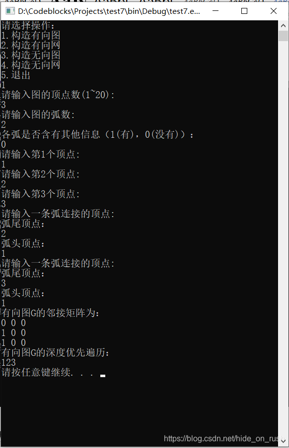

> 迁移来源 [博客园原文](https://www.cnblogs.com/xiuzhublog/p/12608581.html) · 原文发布于 `2019-06-09 10:42:00`（UTC+8）
> 同文另见 [CSDN版本](https://blog.csdn.net/hide_on_rush/article/details/91350755)。

**实验目的：**

      1. 掌握图的邻接矩阵和邻接表的存储结构；

      2. 验证图在不同存储结构下遍历操作的实现。

      3. 掌握图的实际应用

**实验内容：**

采用邻接矩阵/邻接表建立图**（**无向图，有向图，无向网络，有向网络**）；** 

采用深度优先/广度优先搜索方式遍历图**；**

```cpp
#include <iostream>

#include <stdio.h>

#include <stdlib.h>

#include <string.h>

//#include <LIMITS.H>

using namespace std;

#define Status int

#define VRType int

#define InfoType char

#define VertexType char

#define ERROR 0

#define OK 1

#define TRUE 1

#define FALSE 0

#define INFINITY 0 //最大值

#define MAX_VERTEX_NUM 20 //最大顶点个数

bool visited[MAX_VERTEX_NUM];//访问标志数组

typedef struct ArcCell//邻接矩阵(元素)类型

{

    VRType adj; //顶点关系(边或弧),图用1\0表示是否相邻,网为权值

    InfoType *info; //边或弧的相关信息指针

} ArcCell, AdjMatrix[MAX_VERTEX_NUM][MAX_VERTEX_NUM];

typedef struct//图的邻接矩阵类型

{

    VertexType vexs[MAX_VERTEX_NUM]; //顶点向量

    AdjMatrix arcs; //邻接矩阵

    int vexnum,arcnum; //图的顶点数和边或弧数

} Mgraph;

void (*VisitFunc)(Mgraph G,int v);//函数变量

void Input(InfoType *info)//录入弧

{

    info=(char*)malloc(sizeof(char));

    scanf("%c",&*info);

}

Status LocateVex(Mgraph &G,VertexType u)//若G中存在点u,则返回该点在图中的位置

{

    int Loc;

    for(Loc=0; Loc<G.vexnum; Loc++)

    {

        if(G.vexs[Loc]==u)

        {

            return Loc;

        }

    }

    return -1;

}

Status CreateDG(Mgraph &G)//采用邻接矩阵表示法，构造有向图G

{

    int IncInfo,i,j,k;

    char v1,v2;

    printf("请输入图的顶点数(1~20):\n");

    scanf("%d",&G.vexnum);

    getchar();

    printf("请输入图的弧数:\n");

    scanf("%d",&G.arcnum);

    getchar();

    printf("各弧是否含有其他信息（1(有)，0(没有)）：\n");

    scanf("%d",&IncInfo);

    getchar();

    for(i=0; i<G.vexnum; i++)

    {

        printf("请输入第%d个顶点:\n",i+1);

        scanf("%c",&G.vexs[i]);

        getchar();

    }

    for(i=0; i<G.vexnum; i++)

    {

        for(j=0; j<G.vexnum; j++)

        {

            G.arcs[i][j].adj=INFINITY;

            G.arcs[i][j].info=NULL;

        }

    }

    for(k=0; k<G.arcnum; k++)

    {

        printf("请输入一条弧连接的顶点:\n");

        printf("弧尾顶点：\n");//输入一条弧依附的顶点

        scanf("%c",&v1);

        getchar();

        printf("弧头顶点：\n");

        scanf("%c",&v2);

        getchar();

        i=LocateVex(G,v1);

        j=LocateVex(G,v2);//确定v1和v2在G中的位置

        G.arcs[i][j].adj=1;//v1和v2的连接关系

        if(IncInfo)

        {

            Input(G.arcs[i][j].info);//若弧含有相关信息，则输入

        }

    }

    return OK;

}//CreateDG

Status CreateDN(Mgraph &G)//采用邻接矩阵表示法，构造有向网G

{

    int IncInfo,i,j,k,w;

    char v1,v2;

    printf("请输入图的顶点数(1~20):\n");

    scanf("%d",&G.vexnum);

    getchar();

    printf("请输入图的弧数:\n");

    scanf("%d",&G.arcnum);

    getchar();

    printf("各弧是否含有其他信息（1(有)，0(没有)）\n");

    scanf("%d",&IncInfo);

    getchar();

    for(i=0; i<G.vexnum; ++i) //构造顶点向量

    {

        printf("请输入第%d个顶点：",i+1);

        scanf("%c",&G.vexs[i]);

        getchar();

    }

    for(i=0; i<G.vexnum; ++i) //初始化邻接矩阵

    {

        for(j=0; j<G.vexnum; ++j)

        {

            G.arcs[i][j].adj=INFINITY;

            G.arcs[i][j].info=NULL;

        }

    }

    for(k=0; k<G.arcnum; ++k) //构造邻接矩阵

    {

        printf("请输入一条弧连接的顶点及权值\n");

        printf("弧尾顶点：\n");//输入一条弧连接的顶点及权值

        scanf("%c",&v1);

        getchar();

        printf("弧头顶点：\n");

        scanf("%c",&v2);

        getchar();

        printf("权值：\n");

        scanf("%d",&w);

        getchar();

        i=LocateVex(G,v1);

        j=LocateVex(G,v2);//确定v1和v2在G中的位置

        G.arcs[i][j].adj=w;//弧<v1,v2>的权值

        if(IncInfo)

        {

            Input(G.arcs[i][j].info);//若弧含有相关信息，则输入

        }

    }

    return OK;

}//CreateDN

Status CreateUDG(Mgraph &G)//采用邻接矩阵表示法，构造无向图G

{

    int IncInfo,i,j,k;

    char v1,v2;

    printf("请输入图的顶点数(1~20):\n");

    scanf("%d",&G.vexnum);

    getchar();

    printf("请输入图的弧数:\n");

    scanf("%d",&G.arcnum);

    getchar();

    printf("各弧是否含有其他信息（1(有)，0(没有)）\n");

    scanf("%d",&IncInfo);

    getchar();

    for(i=0; i<G.vexnum; ++i) //构造顶点向量

    {

        printf("请输入第%d个顶点：",i+1);

        scanf("%c",&G.vexs[i]);

        getchar();

    }

    for(i=0; i<G.vexnum; ++i) //初始化邻接矩阵

    {

        for(j=0; j<G.vexnum; ++j)

        {

            G.arcs[i][j].adj=INFINITY;

            G.arcs[i][j].info=NULL;

        }

    }

    for(k=0; k<G.arcnum; ++k) //构造邻接矩阵

    {

        printf("请输入一条弧连接的顶点\n");

        printf("弧尾顶点：\n");//输入一条弧依附的顶点

        scanf("%c",&v1);

        getchar();

        printf("弧头顶点：\n");

        scanf("%c",&v2);

        getchar();

        i=LocateVex(G,v1);

        j=LocateVex(G,v2);//确定v1和v2在G中的位置

        G.arcs[i][j].adj=1;//v1和v2的连接关系

        if(IncInfo)

        {

            Input(G.arcs[i][j].info);//若弧含有相关信息，则输入

        }

        G.arcs[j][i]=G.arcs[i][j];//置<v1,v2>的对称弧<v2,v1>

    }

    return OK;

}//CreateUDG

Status CreateUDN(Mgraph &G)//采用邻接矩阵表示法，构造无向网G

{

    int IncInfo,i,j,k,w;

    char v1,v2;

    printf("请输入图的顶点数(1~20):\n");

    scanf("%d",&G.vexnum);

    getchar();

    printf("请输入图的弧数:\n");

    scanf("%d",&G.arcnum);

    getchar();

    printf("各弧是否含有其他信息（1(有)，0(没有)）:\n");

    scanf("%d",&IncInfo);

    getchar();

    for(i=0; i<G.vexnum; ++i)

    {

        printf("请输入第%d个顶点：",i+1);

        scanf("%c",&G.vexs[i]);

        getchar();

    }//构造顶点向量

    for(i=0; i<G.vexnum; ++i)

    {

        for(j=0; j<G.vexnum; ++j)

        {

            G.arcs[i][j].adj=INFINITY;

            G.arcs[i][j].info=NULL;

        }

    }//初始化邻接矩阵

    for(k=0; k<G.arcnum; ++k) //构造邻接矩阵

    {

        printf("请输入一条弧连接的顶点及权值\n");

        printf("弧尾顶点：\n");//输入一条弧连接的顶点及权值

        scanf("%c",&v1);

        getchar();

        printf("弧头顶点：\n");

        scanf("%c",&v2);

        getchar();

        printf("权值：\n");

        scanf("%d",&w);

        getchar();

        i=LocateVex(G,v1);

        j=LocateVex(G,v2);//确定v1和v2在G中的位置

        G.arcs[i][j].adj=w;//弧<v1,v2>的权值

        if(IncInfo)

        {

            Input(G.arcs[i][j].info);//若弧含有相关信息，则输入

        }

        G.arcs[j][i]=G.arcs[i][j];//置<v1,v2>的对称弧<v2,v1>

    }

    return OK;

}//CreateUDN

Status FirstAdjVex(Mgraph G,int v)//返回v的第一个邻接顶点

{

    int i;

    if(v>=0&&v<G.vexnum)

    {

        for(i=0; i<G.vexnum; i++)

        {

            if(G.arcs[v][i].adj)

            {

                return i;

            }

        }

    }

    return -1;

}//FirstAdjVex

Status NextAdjVex(Mgraph G,int v,int w)//返回v的（相对于w的）下一个邻接顶点

{

    int i;

    if(v>=0 && v<G.vexnum)

    {

        if(w>=0 && w<G.vexnum)

        {

            for(i=w+1; i<G.vexnum; i++)

            {

                if(G.arcs[v][i].adj)

                {

                    return i;

                }

            }

        }

    }

    return -1;

}//NextAdjVex

void Print_JZ(Mgraph G)//打印矩阵

{

    int i,j;

    for(i=0; i<G.vexnum; i++)

    {

        for(j=0; j<G.vexnum; j++)

        {

            printf("%d ",G.arcs[i][j].adj);

        }

        printf("\n");

    }

}

void Print(Mgraph G,int v)

{

    printf("%c",G.vexs[v]);

}

void DFS(Mgraph G,int v)

{

    //从第v个顶点出发递归地深度优先遍历图G

    int w;

    visited[v]=TRUE;

    VisitFunc(G,v);//访问第v个顶点

    for(w=FirstAdjVex(G,v); w>0; w=NextAdjVex(G,v,w))

    {

        if(!visited[w])

        {

            DFS(G,w);//对v的尚未访问的邻接顶点w递归调用DFS

        }

    }

}//DFS

void DFSTraverse(Mgraph G,void (*Print)(Mgraph G,int v))

{

    //对图G做深度优先遍历

    int v;

    VisitFunc=Print;//使用全局变量VisitFunc，使DFS不必设函数指针参数

    for(v=0; v<G.vexnum; ++v)

    {

        visited[v]=FALSE;//访问标志数组初始化

    }

    for(v=0; v<G.vexnum; ++v)

    {

        if(!visited[v])

        {

            DFS(G,v);//对尚未访问的顶点调用DFS

        }

    }

}//DFSTraverse
```


**int main()  
{  
    char Ch;  
    Mgraph G;  
    while(1)  
    {  
        system("cls");  
        printf("请选择操作：\n");  
        printf("1.构造有向图\n2.构造有向网\n3.构造无向图\n4.构造无向网\n5.退出\n");  
        scanf("%c",&Ch);  
        getchar();  
        switch(Ch)  
        {  
        case '1':  
            CreateDG(G);//构造有向图G  
            printf("有向图G的邻接矩阵为：\n");  
            Print\_JZ(G);  
            printf("有向图G的深度优先遍历：\n");  
            DFSTraverse(G,Print);  
            getchar();  
            system("pause");  
            break;  
        case '2':  
            CreateDN(G);//构造有向网G  
            printf("有向网G的邻接矩阵为：\n");  
            Print\_JZ(G);  
            printf("有向网G的深度优先遍历：\n");  
            DFSTraverse(G,Print);  
            getchar();  
            system("pause");  
            break;  
        case '3':  
            CreateUDG(G);//构造无向图G  
            printf("无向图G的邻接矩阵为：\n");  
            Print\_JZ(G);  
            printf("无向图G的深度优先遍历：\n");  
            DFSTraverse(G,Print);  
            getchar();  
            system("pause");  
            break;  
        case '4':  
            CreateUDN(G);//构造无向网G  
            printf("无向网G的邻接矩阵为：\n");  
            Print\_JZ(G);  
            printf("无向网G的深度优先遍历：\n");  
            DFSTraverse(G,Print);  
            getchar();  
            system("pause");  
            break;  
        case '5':  
            exit(0);  
            break;  
        default:  
            printf("选择错误！\n");  
            system("pause");  
        }  
        return 0;  
    }  
}**  
  
运行效果如图：



使用了邻接矩阵和深度优先算法
