> 迁移来源 [博客园原文](https://www.cnblogs.com/xiuzhublog/p/15008866.html) · 原文发布于 `2021-07-13 22:57:00`（UTC+8）

## 简介

  k-d树（k-dimensional），是一种分割k维数据空间的数据结构（对数据点在k维空间中划分的一种数据结构），主要应用于多维空间关键数据的搜索（如：范围搜索和最近邻搜索）。

## 举例

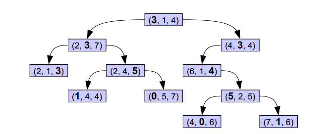  
  上图就是一颗kdtree，可以看出kdtree是二叉搜索树的变种。  
  kdtree的性质：

- kdtree具有平衡的特质，两树叶的高度差不超过1。(树越平衡代表着分割得越平均，搜索的时间越少)
- 数据只存放在叶子结点，而根结点和中间结点存放一些空间划分信息（例如划分维度、划分值）。
- 将每一个元组按0排序（第一项序号为0，第二项序号为1，第三项序号为2），在树的第n层，第 n%3 项被用粗体显示，而这些被粗体显示的树就是作为二叉搜索树的key值，比如，根节点的左子树中的每一个节点的第一个项均小于根节点的的第一项，右子树的节点中第一项均大于根节点的第一项，子树依次类推。

## 分割的作用

### 一维

  对于一个标准的BSTree，每个节点只有一个key值。  
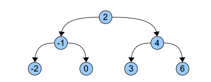

  将key值对应到一维的坐标轴上。  
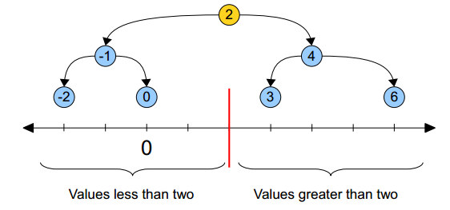

  根节点对应的就是2，左子树都在2的左边，右子树都在2的右边，整个一维空间就被根节点分割成了两个部分，当要查找结点0的时候，由于是在2的左边，所以可以放心的只搜索左子树的部分。整个搜索的过程可以看成不断分割搜索区间的过程，直到找到目标节点。

### 二维

这样的分割可以扩展到二维甚至更多维的情况。

但是问题来了，二维的节点怎么比较大小？

在BSTree中，节点分割的是一维数轴，那么在二维中，就应当是分割平面了，就像这样：

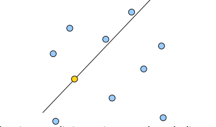  
黄色的点作为根节点，上面的点归左子树，下面的点归右子树，接下来再不断地划分，最后得到一棵树就是赫赫有名的BSPTree（binary space partitioning tree）. 分割的那条线叫做**分割超平面**（splitting hyperplane），在一维中是一个点，二维中是线，三维的是面。

### n维

KDTree就是超平面都垂直于轴的BSPTree。同样的数据集，用KDTree划分之后就是这样：  
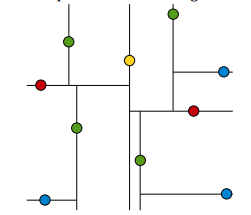

黄色节点就是Root节点，下一层是红色，再下一层是绿色，再下一层是蓝色。为了更好的理解KDTree的分割，我们在图形中来看一下搜索的过程，假设现在需要搜寻右下角的一个点，首先要做的就是比较这个点的x坐标和root点的x坐标值，由于x坐标值大于root节点的x坐标，所以只需要在右边搜寻，接下来，要比较该节点和右边红色节点y值得大小...后面依此类推。整个过程如下图：  
1.  
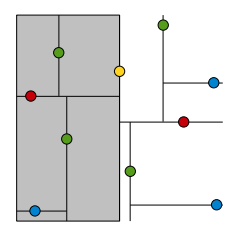  
2.  
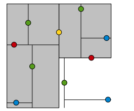  
3.  
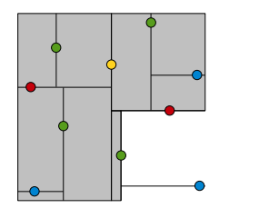

## 关于kdtree的重要问题

### 一.树的建立

#### 1.节点的数据结构

定义：  
Node-data - 数据矢量， 数据集中某个数据点，是n维矢量（这里也就是k维）  
Range - 空间矢量， 该节点所代表的空间范围  
split - 整数， 垂直于分割超平面的方向轴序号  
Left - k-d树， 由位于该节点分割超平面左子空间内所有数据点所构成的k-d树  
Right - k-d树， 由位于该节点分割超平面右子空间内所有数据点所构成的k-d树  
parent - k-d树， 父节点

#### 2. 优化

##### 1.切分维度优化

构建开始前，对比数据点在各维度的分布情况，数据点在某一维度坐标值的方差越大分布越分散，方差越小分布越集中。从方差大的维度开始切分可以取得很好的切分效果及平衡性。

##### 2.中值选择优化

第一种，算法开始前，对原始数据点在所有维度进行一次排序，存储下来，然后在后续的中值选择中，无须每次都对其子集进行排序，提升了性能。

第二种，从原始数据点中随机选择固定数目的点，然后对其进行排序，每次从这些样本点中取中值，来作为分割超平面。该方式在实践中被证明可以取得很好性能及很好的平衡性。

### 2.最近邻域搜索（Nearest-Neighbor Lookup）

给定一个KDTree和一个节点，求KDTree中离这个节点最近的节点.(这个节点就是最临近点)

这里距离的求法用的是欧式距离。  
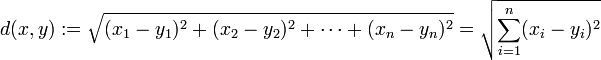  
基本的思路很简单：首先通过二叉树搜索（比较待查询节点和分裂节点的分裂维的值，小于等于就进入左子树分支，等于就进入右子树分支直到叶子结点），顺着“搜索路径”很快能找到最近邻的近似点，也就是与待查询点处于同一个子空间的叶子结点；然后再回溯搜索路径，并判断搜索路径上的结点的其他子结点空间中是否可能有距离查询点更近的数据点，如果有可能，则需要跳到其他子结点空间中去搜索（将其他子结点加入到搜索路径）。重复这个过程直到搜索路径为空。

这里还有几个细节需要注意一下，如下图，假设标记为星星的点是 test point， 绿色的点是找到的近似点，在回溯过程中，需要用到一个队列，存储需要回溯的点，在判断其他子节点空间中是否有可能有距离查询点更近的数据点时，做法是以查询点为圆心，以当前的最近距离为半径画圆，这个圆称为候选超球（candidate hypersphere），如果圆与回溯点的轴相交，则需要将轴另一边的节点都放到回溯队列里面来。

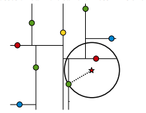  
判断轴是否与候选超球相交的方法可以参考下图：  
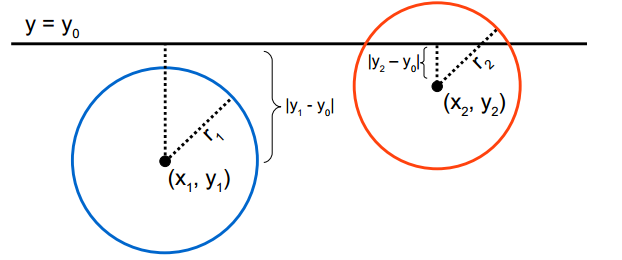

## 关键代码

构建KDTree

```cpp
void KDTree::buildKdTree(KDTree *tree, vector<vector<double>> data, unsigned int depth)
{
    //样本的数量
    unsigned long samplesNum = data.size();
    //终止条件
    if (samplesNum == 0)
    {
        return;
    }
    if (samplesNum == 1)
    {
        tree->root = data[0];
        return;
    }
    //样本的维度
    unsigned long k = data[0].size();//坐标轴个数
    vector<vector<double> > transData = Transpose(data);
    //选择切分属性
    unsigned splitAttribute = depth % k;
    vector<double> splitAttributeValues = transData[splitAttribute];
    //选择切分值
    double splitValue = findMiddleValue(splitAttributeValues);
    //cout << "splitValue" << splitValue  << endl;

    // 根据选定的切分属性和切分值，将数据集分为两个子集
    vector<vector<double> > subset1;
    vector<vector<double> > subset2;
    for (unsigned i = 0; i < samplesNum; ++i)
    {
        if (splitAttributeValues[i] == splitValue && tree->root.empty())
            tree->root = data[i];
        else
        {
            if (splitAttributeValues[i] < splitValue)
                subset1.push_back(data[i]);
            else
                subset2.push_back(data[i]);
        }
    }

    //子集递归调用buildKdTree函数
    tree->left_child = new KDTree;
    tree->left_child->parent = tree;
    tree->right_child = new KDTree;
    tree->right_child->parent = tree;
    buildKdTree(tree->left_child, subset1, depth + 1);
    buildKdTree(tree->right_child, subset2, depth + 1);
}
```

查询目标点的最近邻点

```cpp
vector<double> KDTree::searchNearestNeighbor(vector<double> goal, KDTree *tree)
{
    /*第一步：在kd树中找出包含目标点的叶子结点：从根结点出发，
    递归的向下访问kd树，若目标点的当前维的坐标小于切分点的
    坐标，则移动到左子结点，否则移动到右子结点，直到子结点为
    叶结点为止,以此叶子结点为“当前最近点”
    */
    unsigned long k = tree->root.size();//计算出数据的维数
    unsigned d = 0;//维度初始化为0，即从第1维开始
    KDTree* currentTree = tree;
    vector<double> currentNearest = currentTree->root;
    while(!currentTree->is_leaf())
    {
        unsigned index = d % k;//计算当前维
        if (currentTree->right_child->is_empty() || goal[index] < currentNearest[index])
        {
            currentTree = currentTree->left_child;
        }
        else
        {
            currentTree = currentTree->right_child;
        }
        ++d;
    }
    currentNearest = currentTree->root;

    /*第二步：递归地向上回退， 在每个结点进行如下操作：
    (a)如果该结点保存的实例比当前最近点距离目标点更近，则以该例点为“当前最近点”
    (b)当前最近点一定存在于某结点一个子结点对应的区域，检查该子结点的父结点的另
    一子结点对应区域是否有更近的点（即检查另一子结点对应的区域是否与以目标点为球
    心、以目标点与“当前最近点”间的距离为半径的球体相交）；如果相交，可能在另一
    个子结点对应的区域内存在距目标点更近的点，移动到另一个子结点，接着递归进行最
    近邻搜索；如果不相交，向上回退*/

    //当前最近邻与目标点的距离
    double currentDistance = measureDistance(goal, currentNearest, 0);

    //如果当前子kd树的根结点是其父结点的左孩子，则搜索其父结点的右孩子结点所代表
    //的区域，反之亦反
    KDTree* searchDistrict;
    if (currentTree->is_left())
    {
        if (currentTree->parent->right_child == nullptr)
            searchDistrict = currentTree;
        else
            searchDistrict = currentTree->parent->right_child;
    }
    else
    {
        searchDistrict = currentTree->parent->left_child;
    }

    //如果搜索区域对应的子kd树的根结点不是整个kd树的根结点，继续回退搜索
    while (searchDistrict->parent != nullptr)
    {
        //搜索区域与目标点的最近距离
        double districtDistance = abs(goal[(d+1)%k] - searchDistrict->parent->root[(d+1)%k]);

        //如果“搜索区域与目标点的最近距离”比“当前最近邻与目标点的距离”短，表明搜索
        //区域内可能存在距离目标点更近的点
        if (districtDistance < currentDistance )//&& !searchDistrict->isEmpty()
        {

            double parentDistance = measureDistance(goal, searchDistrict->parent->root, 0);

            if (parentDistance < currentDistance)
            {
                currentDistance = parentDistance;
                currentTree = searchDistrict->parent;
                currentNearest = currentTree->root;
            }
            if (!searchDistrict->is_empty())
            {
                double rootDistance = measureDistance(goal, searchDistrict->root, 0);
                if (rootDistance < currentDistance)
                {
                    currentDistance = rootDistance;
                    currentTree = searchDistrict;
                    currentNearest = currentTree->root;
                }
            }
            if (searchDistrict->left_child != nullptr)
            {
                double leftDistance = measureDistance(goal, searchDistrict->left_child->root, 0);
                if (leftDistance < currentDistance)
                {
                    currentDistance = leftDistance;
                    currentTree = searchDistrict;
                    currentNearest = currentTree->root;
                }
            }
            if (searchDistrict->right_child != nullptr)
            {
                double rightDistance = measureDistance(goal, searchDistrict->right_child->root, 0);
                if (rightDistance < currentDistance)
                {
                    currentDistance = rightDistance;
                    currentTree = searchDistrict;
                    currentNearest = currentTree->root;
                }
            }
        }//end if

        if (searchDistrict->parent->parent != nullptr)
        {
            searchDistrict = searchDistrict->parent->is_left()?
                            searchDistrict->parent->parent->right_child:
                            searchDistrict->parent->parent->left_child;
        }
        else
        {
            searchDistrict = searchDistrict->parent;
        }
        ++d;
    }//end while
    return currentNearest;
}
```

完整代码下载地址：[KDTreeC++实现](https://download.csdn.net/download/m0_51800912/20250292)  
参考：  
<https://blog.csdn.net/silangquan/article/details/41483689>

<https://leileiluoluo.com/posts/kdtree-algorithm-and-implementation.html>
