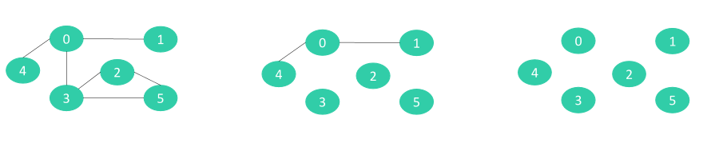
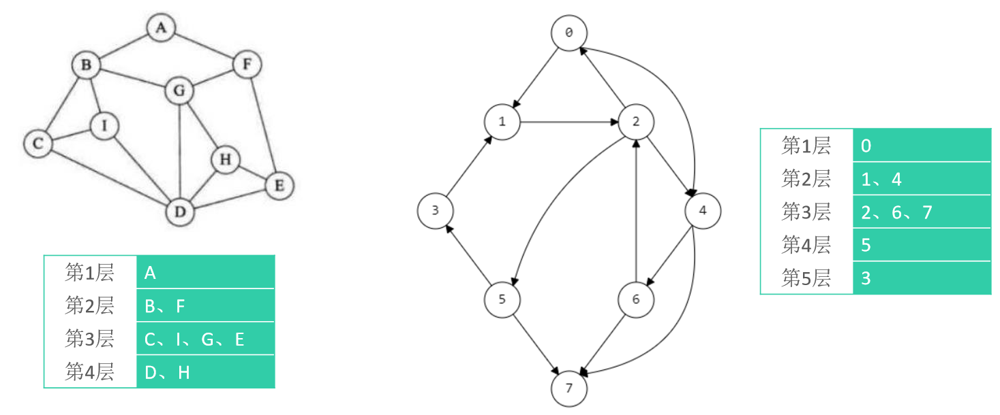
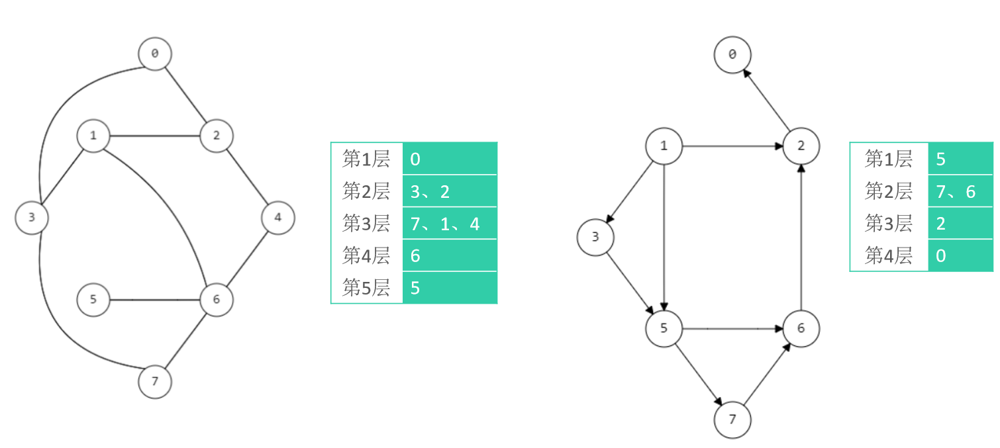
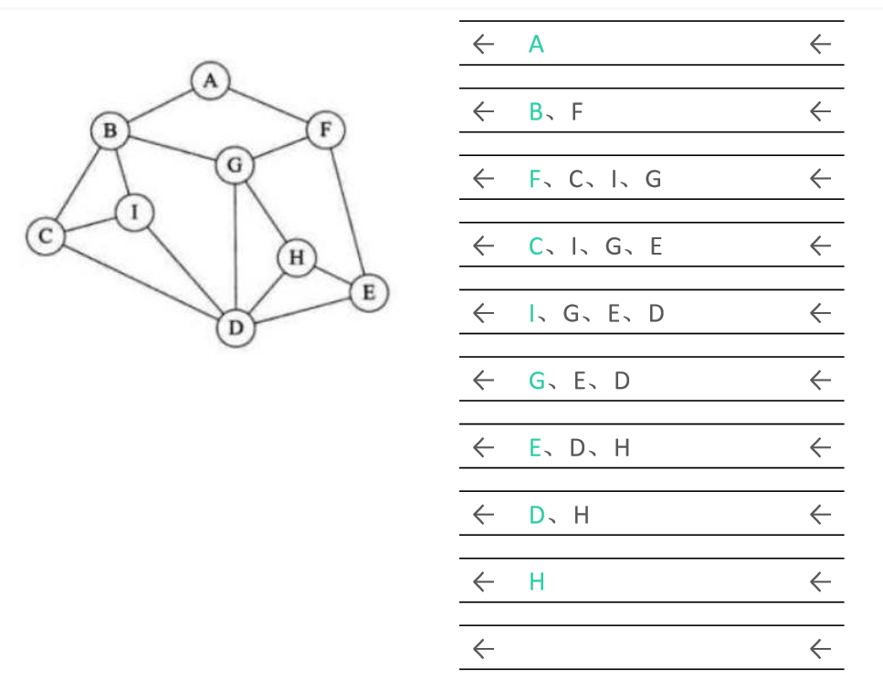
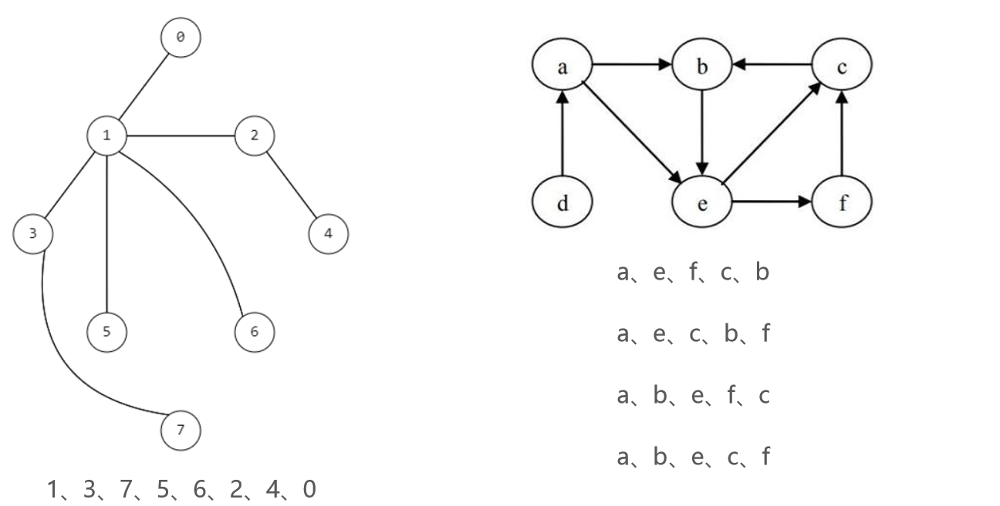
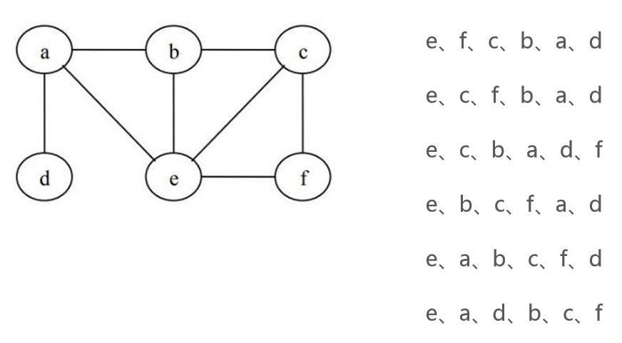

> 迁移来源 [博客园原文](https://www.cnblogs.com/xiuzhublog/p/12747100.html) · 原文发布于 `2020-04-21 19:14:00`（UTC+8）

## 图的基本概念

图由顶点（vertex）和边（edge）组成，通常表示为G=（V，E）  
G表示一个图，V是顶点集，E是边集1顶点集V有穷且非空  
任意两个顶点之间都可以用边来表示它们之间的关系，边集E可以是空的



## 广度优先搜索BFS

广度优先搜索的过程是一层一层的遍历，在选定起始点以后，第一次找到与起始点距离为一的点，然后在找到除起始点以外与第一次获取的点距离为一的点，不断递归直到完全遍历。二叉树的层序遍历就是一种广度优先搜索。

举几个例子：





 在实现BFS的过程中使用的是**队列（Queue,FIFO）**。大致流程是先将顶点放入队列之中，然后找到与顶点相距为一的点加入队列，然后将顶点取出队列，把顶点标记为已访问。再接着重复这个流程直到队列为空。例如对于第一个图，流程如下：



代码：

```
public void bfs(V begin, VertexVisitor<V> visitor) {
        if (visitor == null) return;
        Vertex<V, E> beginVertex = vertices.get(begin);
        if (beginVertex == null) return;
        
        Set<Vertex<V, E>> visitedVertices = new HashSet<>();
        Queue<Vertex<V, E>> queue = new LinkedList<>();
        queue.offer(beginVertex);
        visitedVertices.add(beginVertex);
        
        while (!queue.isEmpty()) {
            Vertex<V, E> vertex = queue.poll();
            if (visitor.visit(vertex.value)) return;
            
            for (Edge<V, E> edge : vertex.outEdges) {
                if (visitedVertices.contains(edge.to)) continue;
                queue.offer(edge.to);
                visitedVertices.add(edge.to);
            }
        }
    }
```

## 深度优先搜索DFS

深度优先搜索是从顶点开始，先不断向最左边的顶点一直查询到尽头，在返回顶点接着查询。二叉树的前序遍历就是深度优先搜索的一种。

举例：





 实现的方法是递归和栈。

使用递归：

```
private void dfs(Vertex<V,E> vertex, Set<Vertex<V,E>> visitedVertices){
      System. out. printin(vertex. value); 
      visitedVertices. add(vertex); 
      for (Edge<V,E> edge: vertex. outEdges){
            if (visitedVertices. contains(edge. to)) continue; 
            dfs(edge. to, visitedVertices);
}
```

使用栈：

```
public void dfs(V begin, VertexVisitor<V> visitor) {
        if (visitor == null) return;
        Vertex<V, E> beginVertex = vertices.get(begin);
        if (beginVertex == null) return;

        Set<Vertex<V, E>> visitedVertices = new HashSet<>();
        Stack<Vertex<V, E>> stack = new Stack<>();
        
        // 先访问起点
        stack.push(beginVertex);
        visitedVertices.add(beginVertex);
        if (visitor.visit(begin)) return;
        
        while (!stack.isEmpty()) {
            Vertex<V, E> vertex = stack.pop();
            
            for (Edge<V, E> edge : vertex.outEdges) {
                if (visitedVertices.contains(edge.to)) continue;
                
                stack.push(edge.from);
                stack.push(edge.to);
                visitedVertices.add(edge.to);
                if (visitor.visit(edge.to.value)) return;
                
                break;
            }
        }
    }
```
