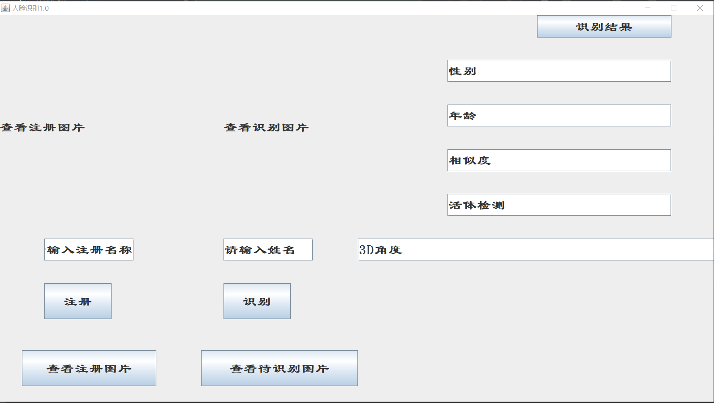
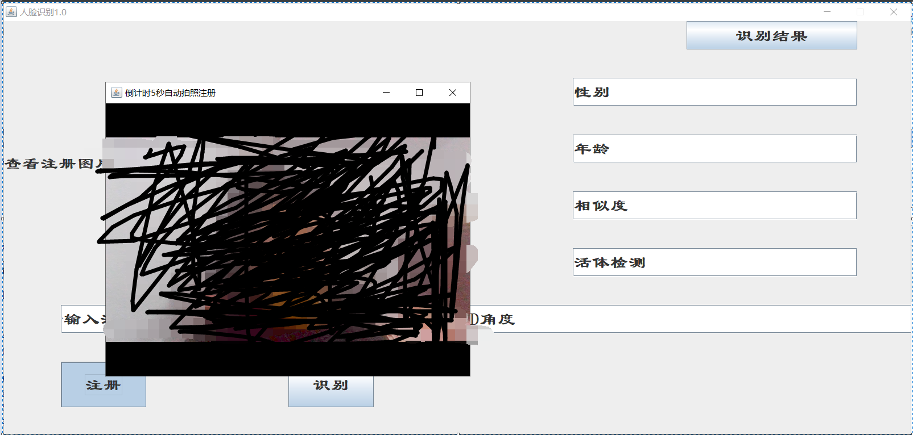
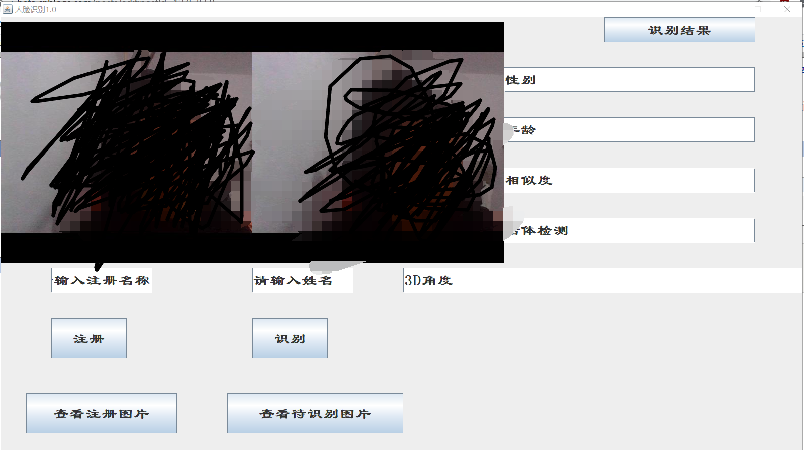
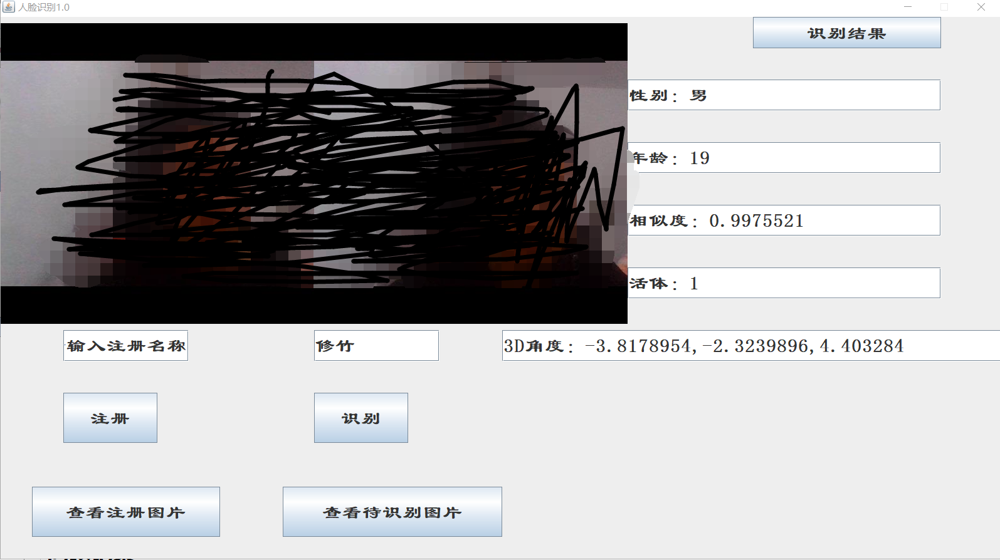
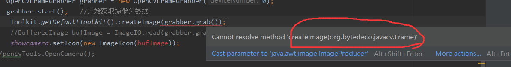
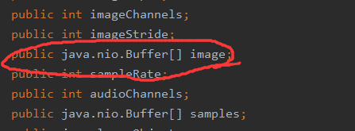
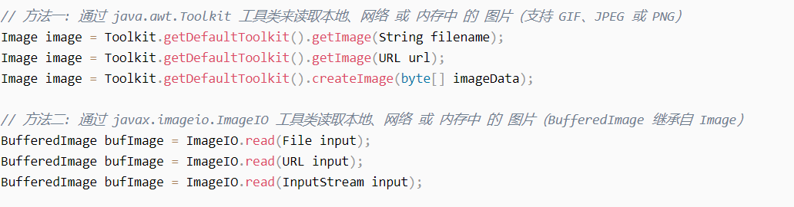
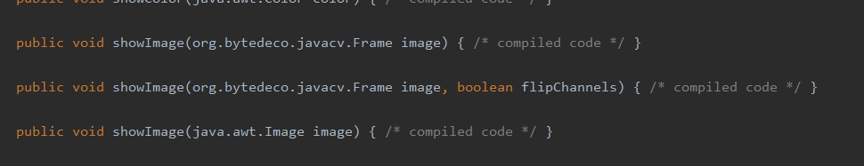

> 迁移来源 [博客园原文](https://www.cnblogs.com/xiuzhublog/p/12757559.html) · 原文发布于 `2020-04-23 21:05:00`（UTC+8）
> 旧文归档，文中的依赖和运行环境以当年版本为准。

## 结果

基本实现了识别的功能。基本的界面如下



界面长得比较丑，主要是JavaSwing写界面比较麻烦，写个菜单栏都要那么多代码。目前不打算改了。

实现的思路是：使用opencv中自带的OpenCVFrameGrabber获取摄像头的数据，CanvasFrame来显示摄像头捕获的画面。



点击注册和识别都会在捕获的视频流自动抓取一帧图片，点下面的按钮可以查看拍摄效果



 当输入想要比对的身份，点击识别之后，会与注册保存的数据进行比对



准确率还行。

附上部分代码

```
public static void OpenCamera()throws Exception, InterruptedException{
        OpenCVFrameGrabber grabber = new OpenCVFrameGrabber(0);//0表示本机摄像头  当然这里也可以换成网络摄像头地址
        grabber.start();   //开始获取摄像头数据
        CanvasFrame canvas = new CanvasFrame("倒计时5秒自动拍照注册");//新建一个窗口
        canvas.setDefaultCloseOperation(JFrame.DISPOSE_ON_CLOSE);//窗口关闭时程序运行结束
        canvas.setAlwaysOnTop(true);
        int i=0;
        while(true){
            if(i==30){//窗口是否关闭
                System.out.println("已关闭");
                grabber.stop();//停止抓取
                canvas.dispose();
                //System.exit(2);//退出
            }
            canvas.showImage(grabber.grab());//获取摄像头图像并放到窗口上显示， 这里的Frame frame=grabber.grab(); frame表示一帧视频图像
            //调用doExecuteFrame()方法，将截取的图片保存在本地
            if(i==1)CatchPhoto(grabber.grabFrame(),"./register"+"/"+ MainWindow.ID +".jpg");
            Thread.sleep(50);//50毫秒刷新一次图像
            i++;
        }
    }
```

```
 //人脸检测
        ImageInfo imageInfo = getRGBData(new File(register));
        List<FaceInfo> faceInfoList = new ArrayList<FaceInfo>();
        errorCode = faceEngine.detectFaces(imageInfo.getImageData(), imageInfo.getWidth(), imageInfo.getHeight(), imageInfo.getImageFormat(), faceInfoList);
        System.out.println(faceInfoList);

        //特征提取
        FaceFeature faceFeature = new FaceFeature();
        errorCode = faceEngine.extractFaceFeature(imageInfo.getImageData(), imageInfo.getWidth(), imageInfo.getHeight(), imageInfo.getImageFormat(), faceInfoList.get(0), faceFeature);
        System.out.println("特征值大小：" + faceFeature.getFeatureData().length);

        //人脸检测2
        ImageInfo imageInfo2 = getRGBData(new File(discern));
        List<FaceInfo> faceInfoList2 = new ArrayList<FaceInfo>();
        errorCode = faceEngine.detectFaces(imageInfo2.getImageData(), imageInfo2.getWidth(), imageInfo2.getHeight(),imageInfo.getImageFormat(), faceInfoList2);
        System.out.println(faceInfoList);

        //特征提取2
        FaceFeature faceFeature2 = new FaceFeature();
        errorCode = faceEngine.extractFaceFeature(imageInfo2.getImageData(), imageInfo2.getWidth(), imageInfo2.getHeight(), imageInfo.getImageFormat(), faceInfoList2.get(0), faceFeature2);
        System.out.println("特征值大小：" + faceFeature.getFeatureData().length);

        //特征比对
        FaceFeature targetFaceFeature = new FaceFeature();
        targetFaceFeature.setFeatureData(faceFeature.getFeatureData());
        FaceFeature sourceFaceFeature = new FaceFeature();
        sourceFaceFeature.setFeatureData(faceFeature2.getFeatureData());
        FaceSimilar faceSimilar = new FaceSimilar();

        errorCode = faceEngine.compareFaceFeature(targetFaceFeature, sourceFaceFeature, faceSimilar);

        //System.out.println("相似度：" + faceSimilar.getScore());
        MainWindow.Similarity.setText("相似度：" + faceSimilar.getScore());

        //设置活体测试
        errorCode = faceEngine.setLivenessParam(0.5f, 0.7f);
        //人脸属性检测
        FunctionConfiguration configuration = new FunctionConfiguration();
        configuration.setSupportAge(true);
        configuration.setSupportFace3dAngle(true);
        configuration.setSupportGender(true);
        configuration.setSupportLiveness(true);
        errorCode = faceEngine.process(imageInfo.getImageData(), imageInfo.getWidth(), imageInfo.getHeight(), imageInfo.getImageFormat(), faceInfoList, configuration);


        //性别检测
        List<GenderInfo> genderInfoList = new ArrayList<GenderInfo>();
        errorCode = faceEngine.getGender(genderInfoList);
        //System.out.println("性别：" + genderInfoList.get(0).getGender());
        if(genderInfoList.get(0).getGender()==0){
            MainWindow.Sex.setText("性别：男" );
        }
        else if(genderInfoList.get(0).getGender()==1){
            MainWindow.Sex.setText("性别：女" );
        }
        else{
            MainWindow.Sex.setText("性别：未知" );
        }
        //MainWindow.Sex.setText("性别：" + genderInfoList.get(0).getGender());

        //年龄检测
        List<AgeInfo> ageInfoList = new ArrayList<AgeInfo>();
        errorCode = faceEngine.getAge(ageInfoList);
        //System.out.println("年龄：" + ageInfoList.get(0).getAge());
        MainWindow.Age.setText("年龄：" + ageInfoList.get(0).getAge());


        //3D信息检测
        List<Face3DAngle> face3DAngleList = new ArrayList<Face3DAngle>();
        errorCode = faceEngine.getFace3DAngle(face3DAngleList);
        System.out.println("3D角度：" + face3DAngleList.get(0).getPitch() + "," + face3DAngleList.get(0).getRoll() + "," + face3DAngleList.get(0).getYaw());
        MainWindow.Angle.setText("3D角度：" + face3DAngleList.get(0).getPitch() + "," + face3DAngleList.get(0).getRoll() + "," + face3DAngleList.get(0).getYaw());

        //活体检测
        List<LivenessInfo> livenessInfoList = new ArrayList<LivenessInfo>();
        errorCode = faceEngine.getLiveness(livenessInfoList);
        //System.out.println("活体：" + livenessInfoList.get(0).getLiveness());
        MainWindow.LiVing.setText("活体：" + livenessInfoList.get(0).getLiveness());

        //IR属性处理
        ImageInfo imageInfoGray = getGrayData(new File("C:\\Users\\user\\Desktop\\test\\photo\\1.jpg"));
        List<FaceInfo> faceInfoListGray = new ArrayList<FaceInfo>();
        errorCode = faceEngine.detectFaces(imageInfoGray.getImageData(), imageInfoGray.getWidth(), imageInfoGray.getHeight(), imageInfoGray.getImageFormat(), faceInfoListGray);

        FunctionConfiguration configuration2 = new FunctionConfiguration();
        configuration2.setSupportIRLiveness(true);
        errorCode = faceEngine.processIr(imageInfoGray.getImageData(), imageInfoGray.getWidth(), imageInfoGray.getHeight(), imageInfoGray.getImageFormat(), faceInfoListGray, configuration2);
        //IR活体检测
        List<IrLivenessInfo> irLivenessInfo = new ArrayList<>();
        errorCode = faceEngine.getLivenessIr(irLivenessInfo);
        System.out.println("IR活体：" + irLivenessInfo.get(0).getLiveness());

        ImageInfoEx imageInfoEx = new ImageInfoEx();
        imageInfoEx.setHeight(imageInfo.getHeight());
        imageInfoEx.setWidth(imageInfo.getWidth());
        imageInfoEx.setImageFormat(imageInfo.getImageFormat());
        imageInfoEx.setImageDataPlanes(new byte[][]{imageInfo.getImageData()});
        imageInfoEx.setImageStrides(new int[]{imageInfo.getWidth() * 3});
        List<FaceInfo> faceInfoList1 = new ArrayList<>();
        errorCode = faceEngine.detectFaces(imageInfoEx, DetectModel.ASF_DETECT_MODEL_RGB, faceInfoList1);

        FunctionConfiguration fun = new FunctionConfiguration();
        fun.setSupportAge(true);
        errorCode = faceEngine.process(imageInfoEx, faceInfoList1, functionConfiguration);
        List<AgeInfo> ageInfoList1 = new ArrayList<>();
        int age = faceEngine.getAge(ageInfoList1);
        System.out.println("年龄：" + ageInfoList1.get(0).getAge());

        FaceFeature feature = new FaceFeature();
        errorCode = faceEngine.extractFaceFeature(imageInfoEx, faceInfoList1.get(0), feature);
```

## 问题记录

### 1.捕获视频流

网上找到了很多方法，比如JMF、ffmpeg等。JMF以前用过，过于老旧了，而且只支持32位系统，想用的话还得用32位的IDE，所以忽略。然后发现用opencv集成了ffmpeg，通过grabber.grab()方法就可以获取。很简单。

### 2.视频显示

一开始的想法，grabber.grab()获取的是一帧一帧的图片，那么可以再frame里加一个显示图片的label，每过十毫秒刷新一次图片，这样就起到了播放视频的效果。但是遇到了问题

使用java.awt.Image 中的方法无法获取grabber.grab（）中的数据，强制类型转换无效。后来查看OpenCVFrameGrabber的源码。最后在Frame.Class里发现image的类型

 NIO与IO之间是有一些区别的，NIO要更优秀一点，可惜Java界面没有



所以转换思路，没办法在主窗口播放，那就在新建一个窗口，看起来有点别扭，但受限于技术水平，还是先把功能实现了。

javacv里有一个简单的新建窗口方式

```
CanvasFrame canvas = new CanvasFrame("Camera");//新建一个窗口
```

通过源码可以看到CanvasFrame是继承了javax.swing.JFrame类的。使用这个类主要是它里面的showimage方法



 里面有适合的数据类型。

### 3.窗口问题

 使用新建窗口显示视频时，关闭视频播放窗口，主窗口也会关闭。

原来关闭窗口使用的是System.exit(0);这个方法直接终止了虚拟机。后来改成了dispose（）方法（需要.setDefaultCloseOperation设置为JFrame.DISPOSE\_ON\_CLOSE）

##
