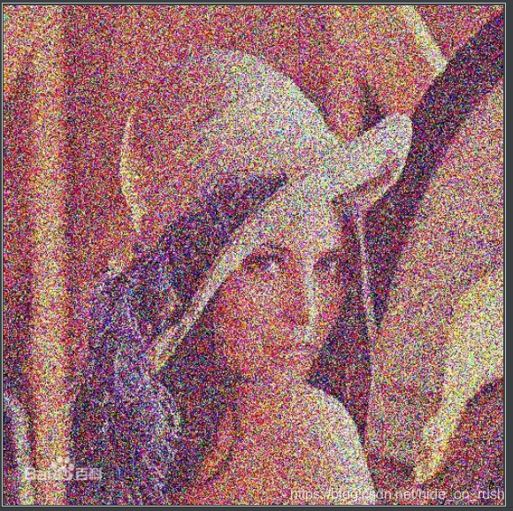

> 迁移来源 [博客园原文](https://www.cnblogs.com/xiuzhublog/p/12605013.html) · 原文发布于 `2020-03-31 14:28:00`（UTC+8）
> 同文另见 [CSDN版本](https://blog.csdn.net/hide_on_rush/article/details/105074377)。
> 旧文归档，文中的依赖和运行环境以当年版本为准。

高斯模糊也叫作高斯平滑，这里主要用来实现图像降噪。官方有入门教程：<http://opencv-java-tutorials.readthedocs.io/en/latest/>

实现代码如下：

```java
package part;


import org.opencv.core.*;
import org.opencv.imgcodecs.*;
import org.opencv.imgproc.Imgproc;

public class GaussianBlur {

    public static void main(String[] args) {
        try{
            System.loadLibrary(Core.NATIVE_LIBRARY_NAME);

            Mat src=Imgcodecs.imread("data/lenna.jpg");
            //读取图像到矩阵中
            if(src.empty()){
                throw new Exception("no file");
            }

            Mat dst = src.clone();
            //复制矩阵进入dst

            Imgproc.GaussianBlur(src,dst,new Size(13,13),10,10);
            //图像模糊化处理11
            Imgcodecs.imwrite("./data/gaussianblur1.jpg", dst);

            Imgproc.GaussianBlur(src,dst,new Size(31,5),80,3);
            //图像模糊化处理33
            Imgcodecs.imwrite("./data/gaussianblur2.jpg", dst);
        }catch(Exception e){
            System.out.println("例外：" + e);
        }

    }

}
```

效果：

原图：

​

处理后的效果：

​

​

参考资料：<https://www.cnblogs.com/invisible2/p/9177018.html>
