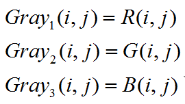
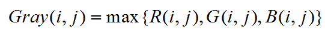
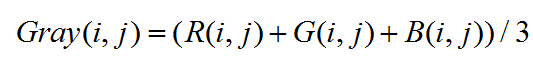
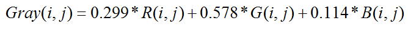
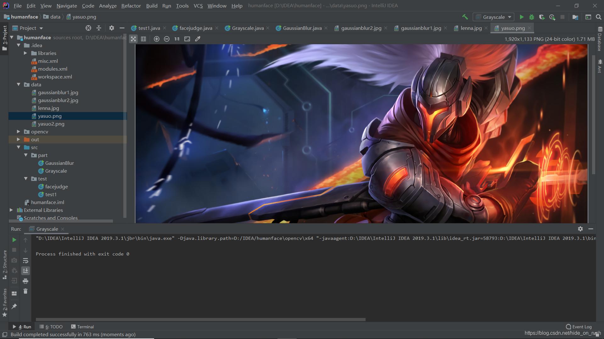
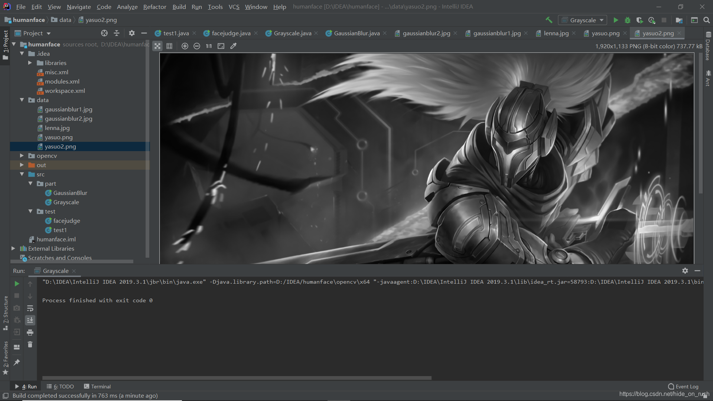

> 迁移来源 [博客园原文](https://www.cnblogs.com/xiuzhublog/p/12608548.html) · 原文发布于 `2020-03-24 16:52:00`（UTC+8）
> 同文另见 [CSDN版本](https://blog.csdn.net/hide_on_rush/article/details/105075583)。
> 旧文归档，文中的依赖和运行环境以当年版本为准。

灰度图像上每个像素的颜色值又称为灰度，指黑白图像中点的颜色深度，范围一般从0到255，白色为255，黑色为0。所谓灰度值是指色彩的浓淡程度，灰度直方图是指一幅数字图像中，对应每一个灰度值统计出具有该灰度值的象素数。

　　灰度就是没有色彩，RGB色彩分量全部相等。如果是一个二值灰度图象，它的象素值只能为0或1，我们说它的灰度级为2。用个例子来说明吧：一个256级灰度的图象，如果RGB三个量相同时，如：RGB(100,100,100)就代表灰度为100，RGB(50,50,50)代表灰度为50。

　　现在大部分的彩色图像都是采用RGB[颜色模式](http://zhidao.baidu.com/search?word=%E9%A2%9C%E8%89%B2%E6%A8%A1%E5%BC%8F&fr=qb_search_exp&ie=utf8)，处理图像的时候，要分别对RGB三种分量进行处理，实际上RGB并不能反映图像的形态特征，只是从光学的原理上进行颜色的调配。

　　图像灰度化处理可以作为图像处理的预处理步骤，为之后的图像分割、图像识别和图像分析等上层操作做准备。

---

　　图像灰度化处理有以下几种方式：

**1. 分量法**

　　将彩色图像中的三分量的亮度作为三个灰度图像的灰度值，可根据应用需要选取一种灰度图像。



**2. 最大值法**

　　将彩色图像中的三分量亮度的最大值作为灰度图的灰度值。



**3. 平均值法**

　　将彩色图像中的三分量亮度求平均得到一个灰度值。



**4. 加权平均法**

　　根据重要性及其它指标，将三个分量以不同的权值进行加权平均。由于人眼对绿色的敏感最高，对蓝色敏感最低，因此，按下式对RGB三分量进行加权平均能得到较合理的灰度图像。



代码实现：

```java
package part;

import org.opencv.core.Core;
import org.opencv.core.Mat;
import org.opencv.imgcodecs.Imgcodecs;
import org.opencv.imgproc.Imgproc;

public class Grayscale {
    public static void main(String[] args) {
            transform();
    }
   private static void transform(){
       System.loadLibrary(Core.NATIVE_LIBRARY_NAME);
       Mat srcImage = Imgcodecs.imread("./data/yasuo.png");
       Mat dstImage = new Mat();
       Imgproc.cvtColor(srcImage, dstImage, Imgproc.COLOR_BGR2GRAY,0);
       Imgcodecs.imwrite("./data/yasuo2.png", dstImage);
   }

}
```

效果：

原图



处理后


