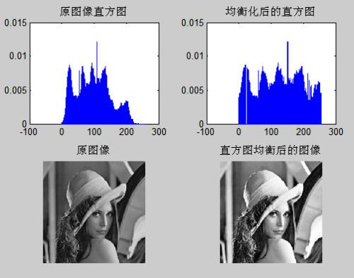
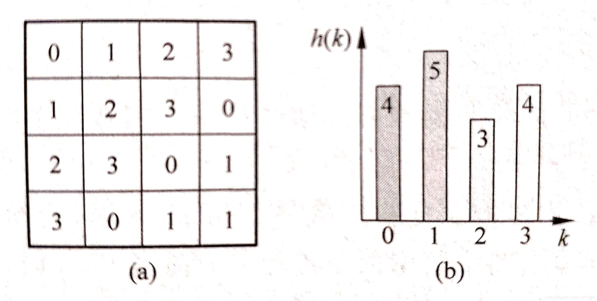
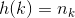
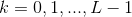
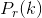
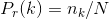
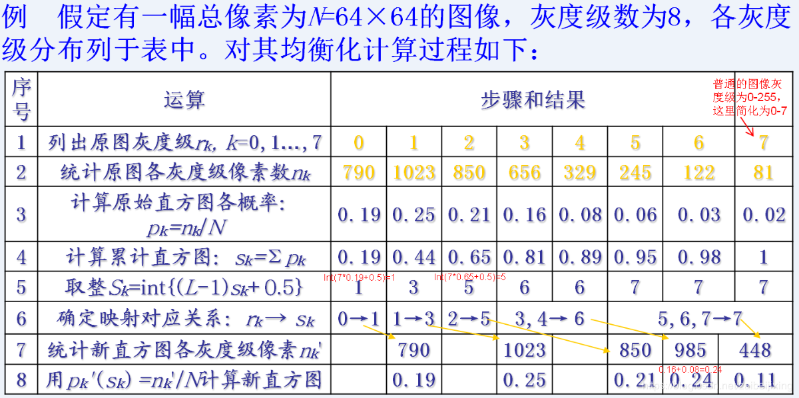
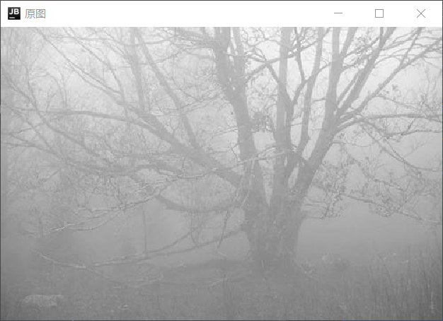
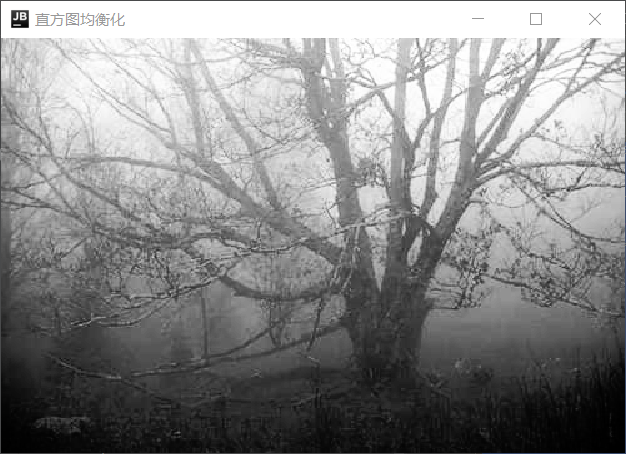

> 迁移来源 [博客园原文](https://www.cnblogs.com/xiuzhublog/p/12605594.html) · 原文发布于 `2020-03-31 15:36:00`（UTC+8）
> 旧文归档，文中的依赖和运行环境以当年版本为准。

什么是直方图均衡化？

直方图均衡化是一种简单有效的图像增强技术，通过改变图像的直方图来改变图像中各像素的灰度，主要用于增强动态范围偏小的图像的对比度。原始图像由于其灰度分布可能集中在较窄的区间，造成图像不够清晰。例如，过曝光图像的灰度级集中在高亮度范围内，而曝光不足将使图像灰度级集中在低亮度范围内。采用直方图均衡化，可以把原始图像的直方图变换为均匀分布（均衡）的形式，这样就增加了像素之间灰度值差别的动态范围，从而达到增强图像整体对比度的效果。换言之，直方图均衡化的基本原理是：对在图像中像素个数多的灰度值（即对画面起主要作用的灰度值）进行展宽，而对像素个数少的灰度值（即对画面不起主要作用的灰度值）进行归并，从而增大对比度，使图像清晰，达到增强的目的。举个例子，如图中所示，左图为原始图像，右图为直方图均衡化后的图像。

**个人的理解是，直方图可以提高图像的对比度，对于原本对比度较低的图像效果比较明显。**



直方图的概念

对一幅灰度图像，其直方图反映了该图像中不同灰度级出现的统计情况。图2给出了一个直方图的示例，其中图(a)是一幅图像，其灰度直方图可表示为图(b)，其中横轴表示图像的各灰度级，纵轴表示图像中各灰度级像素的个数。（需要注意，灰度直方图表示了在图像中各个单独灰度级的分布，而图像对比度则取决于相邻近像素之间灰度级的关系。）



严格地说，图像的灰度直方图是一个一维的离散函数，可写成：

                 （公式1）

式中，是图像中灰度级为的像素的个数。直方图的每一列（称为bin）的高度对应。直方图提供了原图中各种灰度值分布的情况，也可以说直方图给出了一幅图像所有灰度值的整体描述。直方图的均值和方差也是图像灰度的均值和方差。图像的视觉效果与其直方图有对应关系，或者说，直方图的形状和改变对图像有很大的影响。

在直方图的基础上，进一步定义归一化的直方图为灰度级出现的相对频率。即：

      （公式2）

式中，表示图像的像素的总数，是图像中灰度级为的像素的个数。

直方图均衡化的步骤



 使用java实现直方图均衡化

```
import java.util.LinkedList;
import java.util.List;

import org.opencv.core.Core;
import org.opencv.core.CvType;
import org.opencv.core.Mat;
import org.opencv.core.MatOfFloat;
import org.opencv.core.MatOfInt;
import org.opencv.core.Scalar;
import org.opencv.highgui.HighGui;
import org.opencv.imgcodecs.Imgcodecs;
import org.opencv.imgproc.Imgproc;
public class huiduhua {


        //静态代码块加载动态链接库
        static {
            System.loadLibrary(Core.NATIVE_LIBRARY_NAME);
        }

        public static void main(String[] args) {

            /*
             * IMREAD_UNCHANGED = -1 ：不进行转化，比如保存为了16位的图片，读取出来仍然为16位。
             * IMREAD_GRAYSCALE = 0 ：进行转化为灰度图，比如保存为了16位的图片，读取出来为8位，类型为CV_8UC1。
             * IMREAD_COLOR = 1 ：进行转化为三通道图像。
             * IMREAD_ANYDEPTH = 2 ：如果图像深度为16位则读出为16位，32位则读出为32位，其余的转化为8位。
             * IMREAD_ANYCOLOR = 4 ：图像以任何可能的颜色格式读取
             * IMREAD_LOAD_GDAL = 8 ：使用GDAL驱动读取文件，GDAL(Geospatial Data Abstraction
             * Library)是一个在X/MIT许可协议下的开源栅格空间数据转换库。它利用抽象数据模型来表达所支持的各种文件格式。
             *    它还有一系列命令行工具来进行数据转换和处理。
             */

            Mat src = Imgcodecs.imread("./data/huiduhua.png",0);
            //Imgproc.resize(src, src, new Size(src.cols()/2,src.rows()/2));

            HighGui.imshow("原图", src);
            HighGui.waitKey();

            ImgCalcHist(src,"原图直方图");

            Mat dst = new Mat();
            //直方图均衡化,该算法对亮度进行归一化并增加图像的对比度。
            Imgproc.equalizeHist(src,dst);
            HighGui.imshow("直方图均衡化", dst);
            HighGui.waitKey();

            ImgCalcHist(dst,"直方图均衡化后的直方图");

        }

        /**
         * 直方图
         * @param src
         * @param windowName
         */
        public static void ImgCalcHist(Mat src,String windowName) {

            List<Mat> matList = new LinkedList<Mat>();
            matList.add(src);

            Mat histogram = new Mat();

            MatOfFloat ranges=new MatOfFloat(0,256);
            MatOfInt histSize = new MatOfInt(300);

            /*
             * 计算直方图
             * List<Mat> images：输入图像
             * MatOfInt channels：需要统计直方图的第几通道
             * Mat mask：掩膜，，计算掩膜内的直方图
             * Mat hist:输出的直方图数组
             * MatOfInt histSize：指的是直方图分成多少个区间，就是bin的个数
             * MatOfFloat ranges： 统计像素值得区间
             */
            Imgproc.calcHist(matList,new MatOfInt(0),new Mat(),histogram,histSize ,ranges);
            //创建直方图面板
            Mat histImage = Mat.zeros( 150, (int)histSize.get(0, 0)[0], CvType.CV_8UC1);
            //归一化直方图 详见https://blog.csdn.net/ren365880/article/details/103923813
            Core.normalize(histogram, histogram, 1, histImage.rows() , Core.NORM_MINMAX, -1, new Mat() );
            //绘制直线 详见：https://blog.csdn.net/ren365880/article/details/103952856
            for( int i = 0; i < (int)histSize.get(0, 0)[0]; i++ ){
                Imgproc.line(histImage,new org.opencv.core.Point(i, histImage.rows()),new org.opencv.core.Point(i, histImage.rows()-Math.round( histogram.get(i,0)[0])) ,new Scalar( 255, 255, 255),1, 8, 0 );
            }
            HighGui.imshow(windowName, histImage);
            HighGui.waitKey();
        }


    }
```

效果：





参考资料：<https://blog.csdn.net/qq_15971883/article/details/88699218>

<https://blog.csdn.net/zaibeijixing/article/details/96336864>
