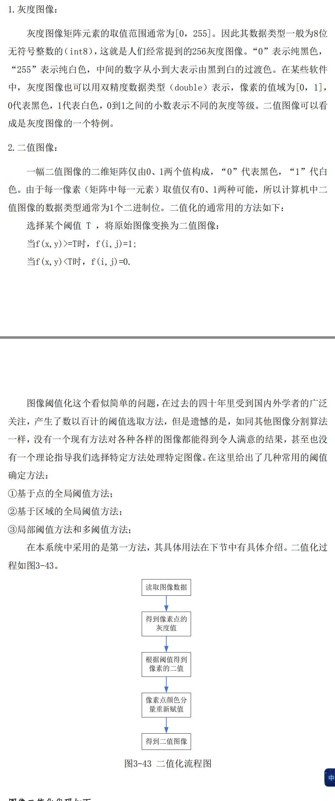
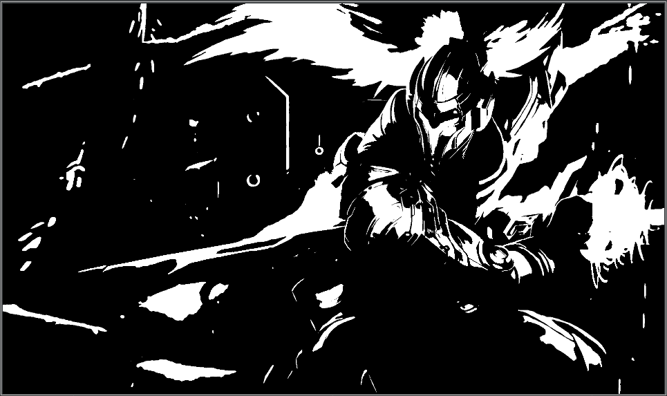
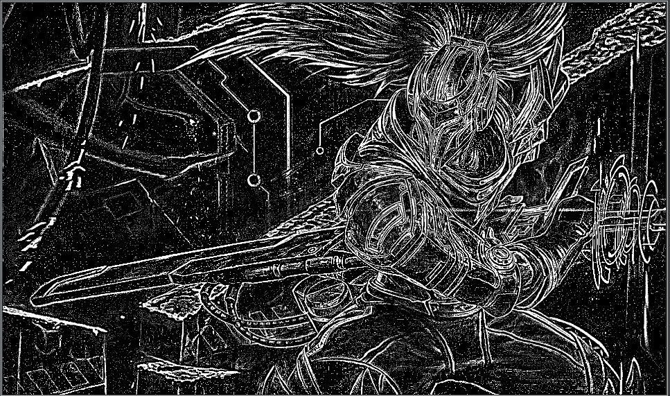

> 迁移来源 [博客园原文](https://www.cnblogs.com/xiuzhublog/p/12606184.html) · 原文发布于 `2020-03-31 16:41:00`（UTC+8）
> 旧文归档，文中的依赖和运行环境以当年版本为准。

书里的解释：



其他的没找到什么资料，直接参考百度百科

<https://baike.baidu.com/item/%E5%9B%BE%E5%83%8F%E4%BA%8C%E5%80%BC%E5%8C%96/1748870?fr=aladdin#2>

具体是先实现灰度化，然后实现二值化。

里面提到了opencv里的两个接口

1.Imgproc.threshold(Mat src, Mat dst, double thresh, double maxval, int type)

参数：  
src 原图  
dst 输入图像  
thresh 当前阈值  
maxval 最大阈值一般为255  
type 阈值类型

2.Imgproc.adaptiveThreshold(Mat src, Mat dst, double maxValue, int adaptiveMethod, int thresholdType, int blockSize, double C)

参数：  
src 要二值化的灰度图  
dst 二值化后的图  
maxValue 二值化后要设置的那个值  
adaptiveMethod 块计算的方法  
thresholdType 二值化类型  
blockSize 块大小（奇数，大于1）  
C 差值（负值也可以）

实现代码如下：

```
package part;
import org.opencv.core.Core;
import org.opencv.core.Mat;
import org.opencv.imgcodecs.Imgcodecs;
import org.opencv.imgproc.Imgproc;
//二值化
public class Threshold {

        public static void main(String[] args) {
            System.loadLibrary(Core.NATIVE_LIBRARY_NAME);
            // 加载时灰度
            Mat src = Imgcodecs.imread("./data/yasuo.png", Imgcodecs.IMREAD_GRAYSCALE);
            // 保存灰度
            Imgcodecs.imwrite("./data/yasuo_1.png", src);
            Mat target = new Mat();
            // 二值化处理
            Imgproc.threshold(src, target, 0, 255, Imgproc.THRESH_BINARY | Imgproc.THRESH_OTSU);//灰度图像二值化
            // 保存二值化后图片
            Imgcodecs.imwrite("./data/yasuo_2.png", target);
            Imgproc.adaptiveThreshold(src, target, 255, Imgproc.ADAPTIVE_THRESH_MEAN_C, Imgproc.THRESH_BINARY, 5, 0);
            // 保存二值化后图片
            Imgcodecs.imwrite("./data/yasuo_3.png", target);
        }

    }
```

这里两个接口的效果都进行了测试：

原图


```
threshold方法处理：  

```

```
adaptiveThreshold方法处理：  

```

```
 
```

```
 
```
