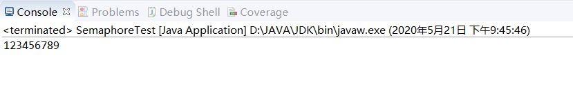

> 迁移来源 [博客园原文](https://www.cnblogs.com/xiuzhublog/p/12933790.html) · 原文发布于 `2020-05-21 21:53:00`（UTC+8）

Semaphore位于java.util.concurrent包下。其中有两个重要的方法acquire()和release()。acquire用来获取一个信号量，并且是阻塞型的，如果当前还有可用的信号量，则获取成功，可用信号量减1，使用完后可用release释放信号量。  
下面的例子有ABC三个线程。A负责输出1 4 7 B负责输出2 5 8 C负责3 6 9。要求通过信号量机制 控制这三个线程按照顺序输出。

```java
package test;
import java.util.concurrent.ExecutorService;
import java.util.concurrent.Executors;
import java.util.concurrent.Semaphore;
public class SemaphoreTest {
	public int i=1;
	 //设置信号量，用来控制可以同时访问的线程数量
	public Semaphore s1 = new Semaphore(1);
    public Semaphore s2 = new Semaphore(0);
    public Semaphore s3 = new Semaphore(0);
    public static void main(String[] args) {
		new SemaphoreTest().Print();
	}
    public void Print() {
    	//创建一个可缓存线程池
    	ExecutorService exe = Executors.newCachedThreadPool();
    	Thread t1 = new Thread(){
            @Override
            public void run() {
                while(i<7) {
                    try {
                        s1.acquire();//获取信号量，s1 - 1
                        System.out.print(i);
                        i++;
                        //方便看到运行结果
                        Thread.sleep(1000);
                        s2.release();//释放信号量，s2 + 1
                    } catch (InterruptedException e) {
                        // TODO Auto-generated catch block
                        e.printStackTrace();
                    }
                }
            }
        };
        Thread t2 = new Thread(){
            @Override
            public void run() {
                while(i<8) {
                    try {
                        s2.acquire();//获取信号量，s2 - 1
                        System.out.print(i);
                        i++;
                        Thread.sleep(1000);
                        s3.release();//释放信号量，s3 + 1
                    } catch (InterruptedException e) {
                        // TODO Auto-generated catch block
                        e.printStackTrace();
                    }
                }
            }
        };

        Thread t3 = new Thread(){
            @Override
            public void run() {
                while(i<9) {
                    try {
                        s3.acquire();//获取信号量，s3 - 1
                        System.out.print(i);
                        i++;
                        Thread.sleep(1000);
                        s1.release();//释放信号量，s1 + 1
                    } catch (InterruptedException e) {
                        // TODO Auto-generated catch block
                        e.printStackTrace();
                    }
                }
            }
        };
        exe.execute(t1);
        exe.execute(t2);
        exe.execute(t3);
    }
}
```

运行结果：  
  
相关的博客：  
[Semaphore的工作原理及实例](https://blog.csdn.net/carson0408/article/details/79475723?utm_medium=distribute.pc_relevant.none-task-blog-BlogCommendFromMachineLearnPai2-1.nonecase&depth_1-utm_source=distribute.pc_relevant.none-task-blog-BlogCommendFromMachineLearnPai2-1.nonecase)  
[java并发编程之Semaphore原理分析与实例](https://blog.csdn.net/zhaojianting/article/details/80395085?utm_medium=distribute.pc_relevant.none-task-blog-BlogCommendFromMachineLearnPai2-12.nonecase&depth_1-utm_source=distribute.pc_relevant.none-task-blog-BlogCommendFromMachineLearnPai2-12.nonecase)  
[Java并发33:Semaphore基本方法与应用场景实例](https://blog.csdn.net/hanchao5272/article/details/79780045?utm_medium=distribute.pc_relevant.none-task-blog-BlogCommendFromMachineLearnPai2-1.nonecase&depth_1-utm_source=distribute.pc_relevant.none-task-blog-BlogCommendFromMachineLearnPai2-1.nonecase)
