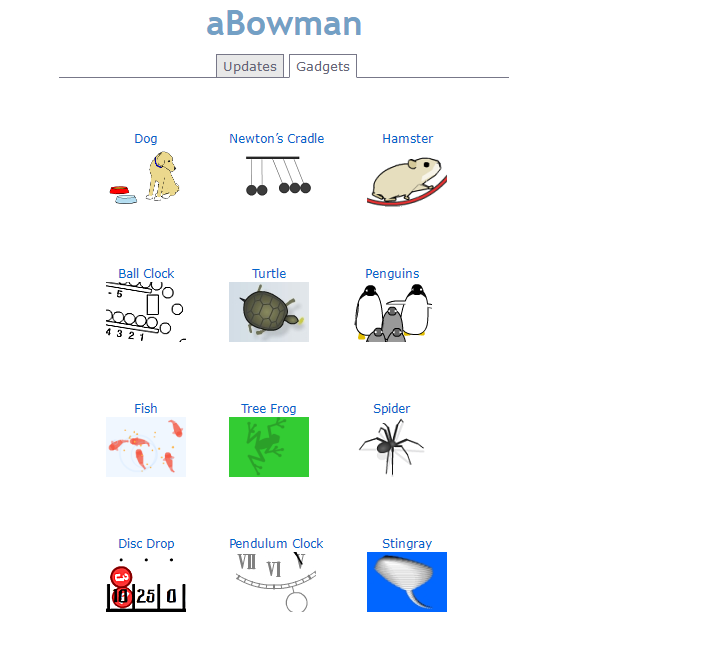
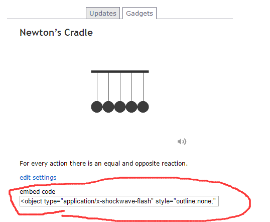

> 迁移来源 [博客园原文](https://www.cnblogs.com/xiuzhublog/p/12596604.html) · 原文发布于 `2020-03-30 10:40:00`（UTC+8）
> 旧文归档，保留当时的记录。

csdn使用了很久，广告什么的可以插件屏蔽，但是最近写文章总是崩溃，图片上传不了。所以新的记录转到博客园了。

第一步就是自定义界面，因为自己前端会的不多，所以参考了一个github上的开源项目。

出处：<https://github.com/BNDong/Cnblogs-Theme-SimpleMemory/tree/v1.2.8>

**注意：需要申请JS权限才可以显示动态效果！！！**

本来还想再加一些动态控件，鼠标点击效果之类的，但是个人感觉实际效果并不好，界面上的动效太多反而会影响阅读。

但是每个人的想法都是不一样的，所以把我参考过的链接放上，大家自行选择。

会交互的控件：<https://www.cnblogs.com/hean/p/11167216.html>

小老鼠：<https://www.cnblogs.com/javaIOException/p/7521849.html>

动效及背景图片：<https://www.cnblogs.com/ECJTUACM-873284962/p/7628894.html>

更新：偶然找到了小老鼠的来源http://abowman.com/google-modules/hamster/

里面还有很多控件

 随便点一个可以看到相应的代码

