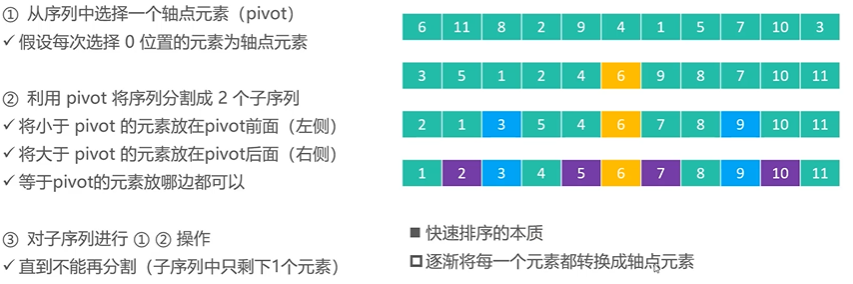
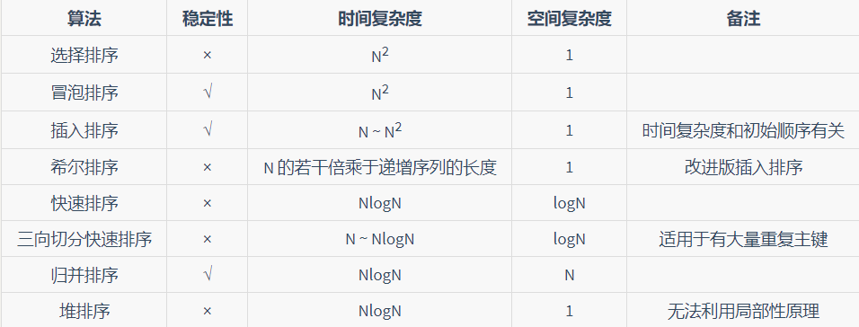

> 迁移来源 [博客园原文](https://www.cnblogs.com/xiuzhublog/p/12604171.html) · 原文发布于 `2020-03-31 11:56:00`（UTC+8）
> 旧文归档，保留当时的记录。

这篇文章记录一下常用的算法及java代码实现。

算法思想：

[分治法](https://mp.weixin.qq.com/s?__biz=MzUyNjQxNjYyMg==&mid=2247485228&idx=1&sn=9f48aee51dcb2b98b56b1827cc658439&chksm=fa0e68adcd79e1bbcd0183ef30a79ede4e46c5835ce05ee6644169c3cc9454073019ccd85d3d&scene=21#wechat_redirect)

[动态规划](https://mp.weixin.qq.com/s?__biz=MzUyNjQxNjYyMg==&mid=2247485228&idx=1&sn=9f48aee51dcb2b98b56b1827cc658439&chksm=fa0e68adcd79e1bbcd0183ef30a79ede4e46c5835ce05ee6644169c3cc9454073019ccd85d3d&scene=21#wechat_redirect)

[贪心算法](/posts/legacy-cnblogs-12620003/)

1.排序

写到一半发现了一篇优秀的文章，后面不写了<https://www.cxyxiaowu.com/725.html>

1. [冒泡排序](#maopaopaixu)
2. [选择排序](#xuanzepaixu)
3. 插入排序
4. 希尔排序
5. 归并排序
6. [快速排序](#kuaisupaixu)
7. 堆排序
8. [性能比较](#paixubijiao)

2.[并查集](#bichaji)

**冒泡排序**：

从左到右不断交换相邻逆序的元素，在一轮的循环之后，可以让未排序的最大元素上浮到右侧。

```
public class 冒泡排序 {
    public static void main(String[] args) {
        int[] array= {8,6,2,21,45,26,35};
        BubbleSort(array);
    }
    public static void BubbleSort(int[]nums) {  
//每次交换后数组的最后一个位置就排好序了，下一次不再参与
        for(int end=nums.length-1;end>0;end--) {  
//里面的循环是每次的交换操作，由于end每次减一，所以是<=end
            for(int begin=1;begin<=end;begin++) {
                if(nums[begin]<nums[begin-1]) {
                    int temp=nums[begin];
                    nums[begin]=nums[begin-1];
                    nums[begin-1]=temp;
                }
            }
        }
        for(int i=0;i<nums.length;i++) {
            System.out.print(nums[i]+"-");
        }
    }
}
```

**选择排序**

原理是找到数组中最大的数，不断的与数组中最后一个位置的数交换，然后最后一个位置的元素不再参与交换。

还有一种思路是找到数组中最小的数，与最前面的数交换，原理是一样的。public class 选择排序 {

```
public static void main(String[] args) {
        int [] a= {6,4,5,2,98,12,102,55,16,0};
        Selectionsort(a);
    }
     public static void Selectionsort(int []nums) {
         for(int end=nums.length-1;end>0;end--) {  

             int maxIndex =0;
             for(int begin=1;begin<=end;begin++) {
                 if(nums[maxIndex]<=nums[begin]) {
                     maxIndex=begin;
                 }
             }
             int temp=nums[maxIndex];
             nums[maxIndex]=nums[end];
             nums[end]=temp;
         }
         for(int i=0;i<nums.length;i++) {
             System.out.print(nums[i]+"-");
         }
     }
     
}
```

**快速排序：**

快速排序执行流程：



```
public class QuickSort<T extends Comparable<T>> extends Sort<T> {

    @Override
    protected void sort() {
        sort(0, array.length);
    }

    /**
     * 对 [begin, end) 范围的元素进行快速排序
     * @param begin
     * @param end
     */
    private void sort(int begin, int end) { 
        if (end - begin < 2) return;
        
        // 确定轴点位置 O(n)
        int mid = pivotIndex(begin, end);
        // 对子序列进行快速排序
        sort(begin, mid); 
        sort(mid + 1, end); 
    } 
    
    /**
     * 构造出 [begin, end) 范围的轴点元素
     * @return 轴点元素的最终位置
     */
    private int pivotIndex(int begin, int end) {
        // 随机选择一个元素跟begin位置进行交换
        swap(begin, begin + (int)(Math.random() * (end - begin)));
        
        // 备份begin位置的元素
        T pivot = array[begin];
        // end指向最后一个元素
        end--;
        
        while (begin < end) {
            while (begin < end) {
                if (cmp(pivot, array[end]) < 0) { // 右边元素 > 轴点元素
                    end--;
                } else { // 右边元素 <= 轴点元素
                    array[begin++] = array[end];
                    break;
                }
            }
            while (begin < end) {
                if (cmp(pivot, array[begin]) > 0) { // 左边元素 < 轴点元素
                    begin++;
                } else { // 左边元素 >= 轴点元素
                    array[end--] = array[begin];
                    break;
                }
            }
        }
        
        // 将轴点元素放入最终的位置
        array[begin] = pivot;
        // 返回轴点元素的位置
        return begin;
    }
}
```

排序算法的比较：



快速排序是最快的通用排序算法，它的内循环的指令很少，而且它还能利用缓存，因为它总是顺序地访问数据。它的运行时间近似为 ~cNlogN，这里的 c 比其它线性对数级别的排序算法都要小。

使用三向切分快速排序，实际应用中可能出现的某些分布的输入能够达到线性级别，而其它排序算法仍然需要线性对数时间。

Java 主要排序方法为 java.util.Arrays.sort()，对于原始数据类型使用三向切分的快速排序，对于引用类型使用归并排序。

**并查集**

并查集算法有两种，一种QuickFind,一种QuickUnion。看名字就知道一个查找快，一个结合快。原理参考这篇博客<https://blog.csdn.net/niushuai666/article/details/6662911>，讲的很有意思，也很清晰。

实现：

```
public abstract class UF {

    protected int[] id;

    public UF(int N) {//构建一个大小为N的并查集
        id = new int[N];
        for (int i = 0; i < N; i++) {
            id[i] = i;
        }
    }

    public boolean connected(int p, int q) {//判断P和q是否连通
        return find(p) == find(q);
    }

    public abstract int find(int p);//查找P所在的连通分量编号

    public abstract void union(int p, int q);//连通pq两个节点
}
```

QuickFind（快速判断是否连通）

```
public class QuickFindUF extends UF {

    public QuickFindUF(int N) {
        super(N);
    }


    @Override
    public int find(int p) {
        return id[p];
    }


    @Override
    public void union(int p, int q) {
        int pID = find(p);
        int qID = find(q);

        if (pID == qID) {
            return;
        }

        for (int i = 0; i < id.length; i++) {
            if (id[i] == pID) {
                id[i] = qID;
            }
        }
    }
}
```

QuickUnion（快速Union，只用修改一个节点，也就是“换掌门”）

```
public class QuickUnionUF extends UF {

    public QuickUnionUF(int N) {
        super(N);
    }


    @Override
    public int find(int p) {
        while (p != id[p]) {
            p = id[p];
        }
        return p;
    }


    @Override
    public void union(int p, int q) {
        int pRoot = find(p);
        int qRoot = find(q);

        if (pRoot != qRoot) {
            id[pRoot] = qRoot;
        }
    }
}
```

QuickUnion加权（主要是为了控制树的高度，理论上树深度在logN以内）

```
public class WeightedQuickUnionUF extends UF {

    // 保存节点的数量信息
    private int[] sz;


    public WeightedQuickUnionUF(int N) {
        super(N);
        this.sz = new int[N];
        for (int i = 0; i < N; i++) {
            this.sz[i] = 1;
        }
    }


    @Override
    public int find(int p) {
        while (p != id[p]) {
            p = id[p];
        }
        return p;
    }


    @Override
    public void union(int p, int q) {

        int i = find(p);
        int j = find(q);

        if (i == j) return;

        if (sz[i] < sz[j]) {
            id[i] = j;
            sz[j] += sz[i];
        } else {
            id[j] = i;
            sz[i] += sz[j];
        }
    }
}
```

路径压缩的加权QuickUnion（检查节点的时候直接连到根节点上）

具体实现find里加一个循环就可以

```
public class WeightedQuickUnionUF extends UF {

    // 保存节点的数量信息
    private int[] sz;


    public WeightedQuickUnionUF(int N) {
        super(N);
        this.sz = new int[N];
        for (int i = 0; i < N; i++) {
            this.sz[i] = 1;
        }
    }


    @Override
    public int find(int p) {
        int son，temp；
        son=p；
        while (p != id[p]) {
            p = id[p];
        }
       while(son != p) //路径压缩
    {
        temp = id[son];
        id[son] = p;
        son = temp;
    }
        return p;
    }


    @Override
    public void union(int p, int q) {

        int i = find(p);
        int j = find(q);

        if (i == j) return;

        if (sz[i] < sz[j]) {
            id[i] = j;
            sz[j] += sz[i];
        } else {
            id[j] = i;
            sz[i] += sz[j];
        }
    }
}
```
