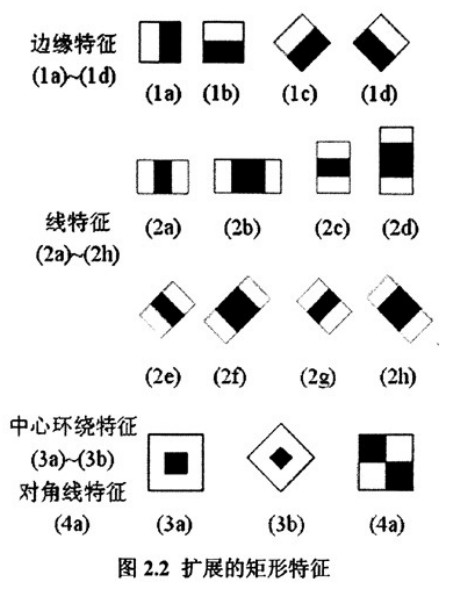
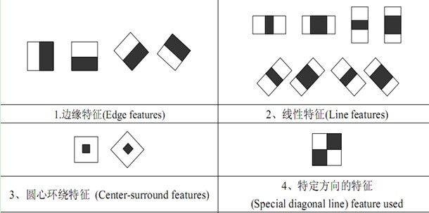
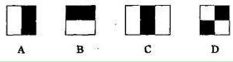
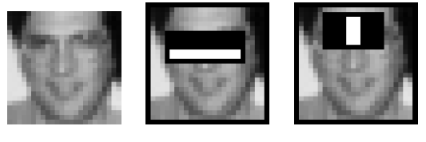
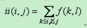
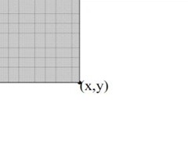
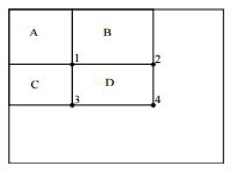
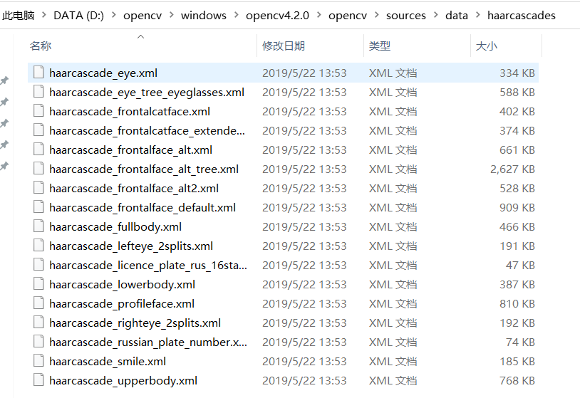
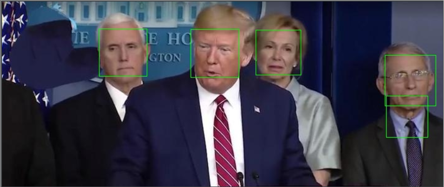

> 迁移来源 [博客园原文](https://www.cnblogs.com/xiuzhublog/p/12608507.html) · 原文发布于 `2020-03-31 21:15:00`（UTC+8）
> 旧文归档，保留当时的记录。

Haar特征原理综述  
Haar特征是一种**反映图像的灰度变化的，像素分模块求差值的一种特征**。它分为三类：边缘特征、线性特征、中心特征和对角线特征。如下所示：



**Haar-like矩形特征拓展**

**Lienhart R．等对Haar-like矩形特征库作了进一步扩展，加入了旋转45。角的矩形特征。扩展后的特征大致分为4种类型：边缘特征、线特征环、中心环绕特征和对角线特征：**

********

可是这些所谓的特征不就是一堆堆带条纹的矩形么，到底是干什么用的？我的理解是，将上面的任意一个矩形放到人脸区域上，然后，将白色区域的像素和减去黑色区域的像素和，得到的值我们暂且称之为人脸特征值，如果你把这个矩形放到一个非人脸区域，那么计算出的特征值应该和人脸特征值是不一样的，而且越不一样越好，所以这些方块的目的就是把人脸特征量化，以区分人脸和非人脸。

用黑白两种矩形框组合成特征模板，在特征模板内用 黑色矩形像素和 减去 白色矩形像素和来表示这个模版的特征值。例如：脸部的一些特征能由矩形模块差值特征简单的描述，如：眼睛要比脸颊颜色要深，鼻梁两侧比鼻梁颜色要深，嘴巴比周围颜色要深等。但矩形特征只对一些简单的图形结构，如边缘、线段较敏感，所以只能描述在特定方向（水平、垂直、对角）上有明显像素模块梯度变化的图像结构。



如上图A、B、D模块的图像Haar特征为：v=Sum白-Sum黑  
C 模块的图像Haar特征为：v=Sum白(左)+Sum白(右)-2\*Sum黑  
这里要保证白色矩形模块中的像素与黑色矩形的模块的像素数相同，所以乘2

对于一幅图像来说，可以通过通过改变特征模板的大小和位置，可穷举出大量的特征来表示一幅图像。上图的特征模板称为“特征原型”；特征原型在图像子窗口中扩展（平移伸缩）得到的特征称为“矩形特征”；矩形特征的值称为“特征值”。例如在24\*24大小的图像中可以以坐标（0，0）开始宽为20高为20矩形模版计算上图A特征，也可以以坐标（0，2）开始宽为20高为20矩形模版计算上图A特征，也可以以坐标（0，0）开始宽为22高为22矩形模版计算上图A特征，这样矩形特征值随着类别、大小和位置的变化，使得很小的一幅很小的图像含有非常多的矩形特征。矩形特征值是矩形模版类别、矩形位置和矩形大小这三个因素的函数。  
**总结来说，**

**特征 = 某个区域的像素点经过某种四则运算之后得到的结果。**

**这个结果可以是一个具体的值也可以是一个向量，矩阵，多维。实际上就是矩阵运算**

**使用特征可以识别一张图片里有没有人脸，人脸上五官的位置。**

****

**haar特征的计算（积分图法）：**

**首先要解决一个问题，什么是积分图？**

       积分图就是只遍历一次图像就可以求出图像中所有区域像素和的快速算法，大大的提高了图像特征值计算的效率。

       积分图主要的思想是将图像从起点开始到各个点所形成的矩形区域像素之和作为一个数组的元素保存在内存中，当要计算某个区域的像素和时可以直接索引数组的元素，不用重新计算这个区域的像素和，从而加快了计算（这有个相应的称呼，叫做动态规划算法）。积分图能够在多种尺度下，使用相同的时间（常数时间）来计算不同的特征，因此大大提高了检测速度。

       我们来看看它是怎么做到的。

       积分图是一种能够描述全局信息的矩阵表示方法。积分图的构造方式是位置（i,j）处的值ii(i,j)是原图像(i,j)左上角方向所有像素的和：





 在特征值的计算过程中，黑色区域的权值为负值，白色区域的权值为正值。而且权值与矩形面积成反比（使两种矩形区域中像素数目一致）；

积分图构建算法：

1）用s(i,j)表示行方向的累加和，初始化s(i,-1)=0;

2）用ii(i,j)表示一个积分图像，初始化ii(-1,i)=0；

3）逐行扫描图像，递归计算每个像素(i,j)行方向的累加和s(i,j)和积分图像ii(i,j)的值

s(i,j)=s(i,j-1)+f(i,j)

ii(i,j)=ii(i-1,j)+s(i,j)

4）扫描图像一遍，当到达图像右下角像素时，积分图像ii就构造好了。

积分图构造好之后，图像中任何矩阵区域的像素累加和都可以通过简单运算得到如图所示。



 公式：Sum(D)=ii(x4,y4)−ii(x2,y2)−ii(x3,y3)+ii(x1,y1)

**了解了原理及算法，接下来就是如何利用haar特征实现人脸检测了。**

opencv里面提供了Haar特征分类器。Haar特征分类器说白了就是一个个的xml文件，不同的xml里面描述人体各个部位的特征值，比如人脸、眼睛等等。OpenCV4.2.0中提供了如下特征文件：



通过加载不同的特征文件，就能达到相应的检测效果。

OpenCV4.2.0中detectMultiScale函数参数说明：  
detectMultiScale(Mat image, MatOfRect objects, double scaleFactor, int minNeighbors, int flags, Size minSize, Size maxSize)  
image：待检测图片，一般为灰度图（提高效率）  
objects：被检测物体的矩形框向量组  
scaleFactor：前后两次相继的扫描中，搜索窗口的比例系数。默认为1.1即每次搜索窗口依次扩大10%  
minNeighbors：构成检测目标的相邻矩形的最小个数(默认为3个)  
flags：要么使用默认值，要么使用CV\_HAAR\_DO\_CANNY\_PRUNING，如果设置为CV\_HAAR\_DO\_CANNY\_PRUNING，那么函数将会使用Canny边缘检测来排除边缘过多或过少的区域，因此这些区域通常不会是人脸所在区域  
minSize：得到的目标区域的最小范围  
maxSize：得到的目标区域的最大范围

java实现代码如下：

```
package part;
import org.opencv.core.Core;
import org.opencv.core.Mat;
import org.opencv.core.MatOfRect;
import org.opencv.core.Point;
import org.opencv.core.Rect;
import org.opencv.core.Scalar;
import org.opencv.imgcodecs.Imgcodecs;
import org.opencv.imgproc.Imgproc;
import org.opencv.objdetect.CascadeClassifier;
public class HaarFaceDetect {


        public static void main(String[] args)
        {
            // TODO Auto-generated method stub
            System.loadLibrary(Core.NATIVE_LIBRARY_NAME);
            System.out.println("\nRunning FaceDetector");
            CascadeClassifier faceDetector = new CascadeClassifier();
            faceDetector.load(
                    //这里是你opencv的安装地址
                    "D:\\opencv\\windows\\opencv4.2.0\\opencv\\sources\\data\\haarcascades\\haarcascade_frontalface_alt.xml");
            Mat image = Imgcodecs.imread("./data/facedetect.jpg");

            MatOfRect faceDetections = new MatOfRect();
            faceDetector.detectMultiScale(image, faceDetections);
            System.out.println(String.format("Detected %s faces", faceDetections.toArray().length));
            for (Rect rect : faceDetections.toArray())
            {
                Imgproc.rectangle(image, new Point(rect.x, rect.y),
                        new Point(rect.x + rect.width, rect.y + rect.height), new Scalar(0, 255, 0));
            }

            String filename = "./data/facedetect_2.jpg";
            Imgcodecs.imwrite(filename, image);
        }

}
```

**效果展示：**

**原图**

****

**效果图**

********

****可以看到效果还不错，但是还是有瑕疵的，并不是百分之百识别。****

 参考资料：<https://blog.csdn.net/u012507022/article/details/54138299>

<https://blog.csdn.net/lanxueCC/article/details/52222369?depth_1-utm_source=distribute.pc_relevant.none-task&utm_source=distribute.pc_relevant.none-task>

<https://blog.csdn.net/zylxadz/article/details/46602263>
