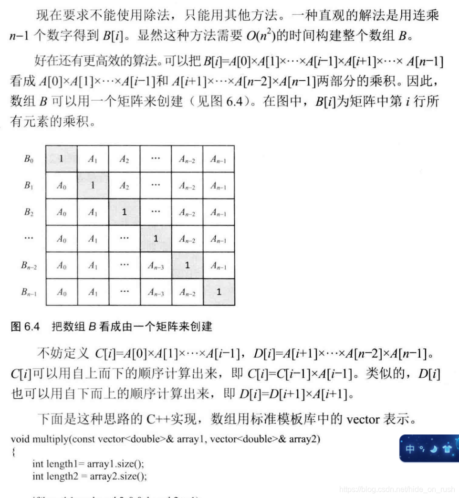

> 迁移来源 [博客园原文](https://www.cnblogs.com/xiuzhublog/p/12608540.html) · 原文发布于 `2020-03-30 16:55:00`（UTC+8）
> 旧文归档，保留当时的记录。

因为不能用除法，开始的想法是用一个循环嵌套，复杂度是O（n²）。剑指offer里的方法更好。



代码：

```java
/*给定一个数组A[0,1,...,n-1],请构建一个数组B[0,1,...,n-1],其中B中的元素B[i]=A[0]*A[1]*...*A[i-1]*A[i+1]*...*A[n-1]。
不能使用除法。（注意：规定B[0] = A[1] * A[2] * ... * A[n-1]，B[n-1] = A[0] * A[1] * ... * A[n-2];）*/
public class 构建乘积数组 {
	public int[] multiply(int[] A) {
		int length=A.length;
		int []B=new int[length];
		if(length!=0) {
		B[0]=1;
		//计算下三角连乘
		for (int i = 1; i < length; i++) {
			B[i]=B[i-1]*A[i-1];
			}
		}
		int temp=1;
		//计算上三角
		for(int j=length-2;j>=0;j--) {
			temp*=A[j+1];
			B[j]*=temp;
		}
		return B;
	}
}
```
