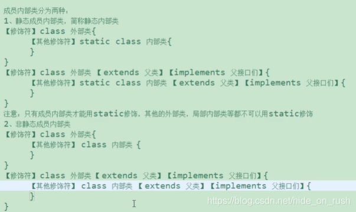
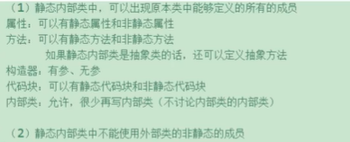
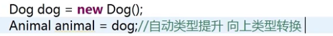
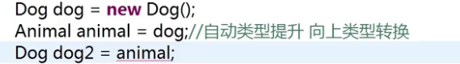
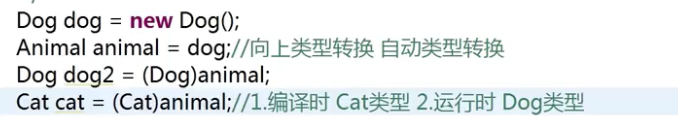
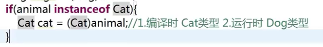

> 迁移来源 [博客园原文](https://www.cnblogs.com/xiuzhublog/p/12608546.html) · 原文发布于 `2020-03-27 10:24:00`（UTC+8）
> 旧文归档，保留当时的记录。

**面向对象简称 OO（Object Oriented）**，20 世纪 80 年代以后，有了面向对象分析（OOA）、 面向对象设计（OOD）、面向对象程序设计（OOP）等新的系统开发方式模型的研究。对语言来说，一切皆是对象。把现实世界中的对象抽象地体现在编程世界中，一个对象代表了某个具体的操作。一个个对象最终组成了完整的程序设计，这些对象可以是独立存在的，也可以是从别的对象继承过来的。对象之间通过相互作用传递信息，实现程序开发。

**面向对象和面向过程的区别：**

|  |  |
| --- | --- |
| 面向过程 | 面向对象 |
| - 一种较早的编程思想，顾名思义就是该思想是站着过程的角度思考问题，强调的就是功能行为，功能的执行过程，即先后顺序，而每一个功能我们都使用函数（类似于方法）把这些步骤一步一步实现。使用的时候依次调用函数就可以了。 - 面向过程的设计： 最小的程序单元是函数，每个函数负责完成某一个功能，用于接受输入数据，函数对输入数据进行处理，然后输出结果数据，整个软件系统由一个个的函数组成，其中作为程序入口的函数称之为主函数，主函数依次调用其他函数，普通函数之间可以相互调用，从而实现整个系统功能。   面向过程最大的问题在于随着系统的膨胀，面向过程将无法应付，最终导致系统的崩溃。为了解决这一种软件危机，我们提出面向对象思想。 - 面向过程的缺陷： 是采用指定而下的设计模式，在设计阶段就需要考虑每一个模块应该分解成哪些子模块，每一个子模块又细分为更小的子模块，如此类推，直到将模块细化为一个个函数。 - 存在的问题  ​ 设计不够直观，与人类的思维习惯不一致 系统软件适应新差，可拓展性差，维护性低 | - 一种基于面向过程的新编程思想，顾名思义就是该思想是站在对象的角度思考问题，我们把多个功能合理放到不同对象里，强调的是具备某些功能的对象。    具备某种功能的实体，称为对象。面向对象最小的程序单元是：类。面向对象更加符合常规的思维方式，稳定性好，可重用性强，易于开发大型软件产品，有良好的可维护性。     在软件工程上，面向对象可以使工程更加模块化，实现更低的耦合和更高的内聚 |

**什么是对象？**

所谓对象就是真实世界中的实体，对象与实体是一一对应的，也就是说现实世界中每一个实体都是一个对象，它是一种具体的概念。对象具有以下特点：

- 对象具有属性和行为。
- 对象具有变化的状态。
- 对象具有唯一性。
- 对象都是某个类别的实例。
- 一切皆为对象，真实世界中的所有事物都可以视为对象。

#### 封装

在面向对象程式设计方法中，**封装（英语：Encapsulation）**是指一种将抽象性函式接口的实现细节部份包装、隐藏起来的方法。封装可以被认为是一个保护屏障，防止该类的代码和数据被外部类定义的代码随机访问。要访问该类的代码和数据，必须通过严格的接口控制。封装最主要的功能在于我们能修改自己的实现代码，而不用修改那些调用我们代码的程序片段。适当的封装可以让程式码更容易理解与维护，也加强了程式码的安全性。

**为什么使用封装？**

1. 良好的封装能够减少耦合。
2. 类内部的结构可以自由修改。
3. 可以对成员变量进行更精确的控制。
4. 隐藏信息，实现细节。

具体来说，使用封装减少了代码量，与此同时，随着代码量的减少，代码的可读性提高了，更重要的是，更加的安全。因为使用封装后外部无法访问和修改内部的核心代码。

**如何实现封装？**

首先需要修改属性和方法的可见性，为属性和方法添加修饰符。之后创建getter和setter方法并在其中添加控制语句。

要点：

1.访问修饰符

|  |  |  |  |  |
| --- | --- | --- | --- | --- |
| 访问修饰符 | 本类 | 同包 | 子类 | 其他 |
| 默认 | √ | √ |  |  |
| private | √ |  |  |  |
| protected | √ | √ | √ |  |
| public | √ | √ | √ | √ |

2.this关键字

       this.属性 操作当前对象的属性

　　this.方法 调用当前对象的方法

也就是说，那个对象调用了this所在的函数，this就代表了某个对象。封装对象的属性的时候，经常会使用this关键字。

当getter和setter函数参数名和成员函数名重合的时候。

3.内部类：

**内部类（ Inner Class ）**就是定义在另外一个类里面的类。与之对应，包含内部类的类被称为外部类。

**为什么要使用内部类？**

       1. 内部类提供了**更好的封装**，可以把内部类**隐藏**在外部类之内，**不允许**同一个包中的其他类访问该类。

　　2. 内部类的方法可以**直接访问外部类的所有数据**，包括**私有的数据**。

　　3. 内部类所实现的功能使用外部类同样可以实现，只是有时使用内部类更方便。

内部类的种类：

1.匿名内部类

语法格式：  
      new   父类名（【实参列表】）{  
           类的成员列表

}  
说明：如果你子类调用的是父类的无参构造，那么（）中实参列表不用写，如果子类调用的是父类的有参构造，那么就在（）中传入实参列表  
**声明匿名内部类与创建它的对象是一起完成的。即匿名内部类只有唯一的对象。**

2.成员内部类：

什么情况下会用到成员内部类（方法外声明的）？  
当描述一个事物时，发现它的内部还有一个完整的结构需要用一个卖来描述，并且发现这内部的结构，如果独立存在是没有意义的，必须在这个外部类中才有意义，而且这个内部结构只为这个外部类服务。  
例如，Body身体，发现它内部还有完整的结构，例如，心脏发现心脏单独创建对象没有意义，只有在Body对象中才有意义，而且只为Body对象服务。

分类：

3.静态内部类

4.方法内部类

#### **继承**

**为什么使用继承？**

子类拥有父类的所有属性和方法（除了private修饰的属性不能拥有）从而实现了实现代码的复用；

程序中的继承性是指子类拥有父类数据结构的方法和机制，这是类之间的一种关系；继承只能是单继承（例如一个儿子只有一个爸爸，二叉树中一个叶子节点只有一个父节点）

**补充：Java中的继承只能单继承，但是可以通过内部类继承其他类来实现多继承。**

对应的语法规则：

1.继承的初始化顺序

　　1、初始化父类再初始化子类

　　2、先执行初始化对象中属性，再执行构造方法中的初始化。

　基于上面两点，我们就知道实例化一个子类，java程序的执行顺序是：

**父类对象属性初始化---->父类对象构造方法---->子类对象属性初始化--->子类对象构造方法**

2.方法的重写

　子类如果对继承的父类的方法不满意（不适合），可以自己编写继承的方法，这种方式就称为**方法的重写。当调用方法时会优先调用子类的方法。**

**重写要注意：**

　   a、返回值类型

　　b、方法名

　　c、参数类型及个数

　都要与父类继承的方法相同，才叫方法的重写。

补充：

重写与重载的区别：

Java中的方法重载发生在同一个类里面两个或者是多个方法的方法名相同但是参数不同的情况。与此相对，方法覆盖是说子类重新定义了父类的方法。方法覆盖必须有相同的方法名，参数列表和返回类型。覆盖者可能不会限制它所覆盖的方法的访问。

3.final关键字

　使用final关键字做标识有“最终的”含义。

　　1. final 修饰类，则该类**不允许被继承。**

　　2. final 修饰方法，则该方法不允许被**覆盖(重写)**。

　　3. final 修饰属性，则该类的该属性不会进行隐式的初始化，所以 该final 属性的**初始化属性必须有值**，或在\*\*构造方法中赋值(但只能选其一，且必须选其一，因为没有默认值！)，\*\*且初始化之后就不能改了，**只能赋值一次**。

　　4. final 修饰变量，则该变量的值只能赋一次值，在声明变量的时候才能赋值，即变为**常量**。

4.super关键字

　在对象的内部使用，可以代表父类对象。

　　1、访问父类的属性：super.age

　　 2、访问父类的方法：super.eat()

　super的应用：

　首先我们知道子类的构造的过程当中必须调用父类的构造方法。其实这个过程已经隐式地使用了我们的super关键字。

　这是因为如果子类的构造方法中没有显示调用父类的构造方法，则系统默认调用父类无参的构造方法。

　那么如果自己用super关键字在子类里调用父类的构造方法，则必须在子类的构造方法中的**第一行**。

**要注意的是：如果子类构造方法中既没有显示调用父类的构造方法，而父类没有无参的构造方法，则编译出错。**

（补充说明，虽然没有显示声明父类的无参的构造方法，系统会自动默认生成一个无参构造方法，但是，如果你声明了一个有参的构造方法，而没有声明无参的构造方法，这时系统不会动默认生成一个无参构造方法，此时称为父类有没有无参的构造方法。）

#### **多态**

**什么是多态？**

面向对象的多态性，即“一个接口，多个方法”。多态性体现在父类中定义的属性和方法被子类继承后，可以具有不同的属性或表现方式。多态性允许一个接口被多个同类使用，弥补了单继承的不足。

**多态的优点：**

可替换性（substitutability）。多态对已存在代码具有可替换性。例如，多态对圆Circle类工作，对其他任何圆形几何体，如圆环，也同样工作。

可扩充性（extensibility）。多态对代码具有可扩充性。增加新的子类不影响已存在类的多态性、继承性，以及其他特性的运行和操作。实际上新加子类更容易获得多态功能。例如，在实现了圆锥、半圆锥以及半球体的多态基础上，很容易增添球体类的多态性。

接口性（interface-ability）。多态是超类通过方法签名，向子类提供了一个共同接口，由子类来完善或者覆盖它而实现的。

灵活性（flexibility）。它在应用中体现了灵活多样的操作，提高了使用效率。

简化性（simplicity）。多态简化对应用软件的代码编写和修改过程，尤其在处理大量对象的运算和操作时，这个特点尤为突出和重要。

**使用多态是一种好习惯**

多态方式声明是一种好的习惯。当我们创建的类，使用时，只用到它的超类或接口定义的方法时，我们可以将其索引声明为它的超类或接口类型。它的好处是，如果某天我们对这个接口方法的实现方式变了，对这个接口又有一个新的实现类，我们的程序也需要使用最新的实现方式，此时只要将对象实现修改一下，索引无需变化。

**多态的应用：**

**1.**引用多态

　　父类的引用可以指向本类的对象；

　　父类的引用可以指向子类的对象；

2.方法多态

　　根据上述创建的两个对象：本类对象和子类对象，同样都是父类的引用，当我们指向不同的对象时，它们调用的方法也是多态的。

　　创建本类对象时，调用的方法为本类方法；

　　创建子类对象时，调用的方法为子类重写的方法或者继承的方法；

　　使用多态的时候要注意：**如果我们在子类中编写一个独有的方法（没有继承父类的方法），此时就不能通过父类的引用创建的子类对象来调用该方法！！！**

**注意： 继承是多态的基础。**

**3.**

引用类型转换

　了解了多态的含义后，我们在日常使用多态的特性时经常需要进行引用类型转换。

　引用类型转换：

**1.向上类型转换(隐式/自动类型转换)，是小类型转换到大类型**

　 就以上述的父类Animal和一个子类Dog来说明，当父类的引用可以指向子类的对象时，就是**向上类型转换**。如：

**2. 向下类型转换(强制类型转换)，是大类型转换到小类型(有风险,可能出现数据溢出)。**

　　将上述代码再加上一行，我们再次将父类转换为子类引用，那么会出现错误，编译器不允许我们直接这么做\*\*，**虽然我们知道这个父类引用指向的就是子类对象，但是编译器认为这种转换是存在风险的**。\*\*如：

　　那么我们该怎么解决这个问题呢，我们可以在animal前加上（Dog）来强制类型转换。如：

　　但是如果父类引用没有指向**该子类的对象**，则不能向下类型转换，虽然编译器不会报错，但是运行的时候程序会出错，如：

　　其实这就是上面所说的子类的引用指向父类的对象，而强制转换类型也不能转换！！

　　还有一种情况是父类的引用指向**其他子类的对象**，则不能通过强制转为**该子类的对象**。如：

　　这是因为我们在编译的时候进行了强制类型转换，编译时的类型是我们强制转换的类型，所以编译器不会报错，而当我们运行的时候，程序给animal开辟的是Dog类型的内存空间，这与Cat类型内存空间不匹配，所以无法正常转换。这两种情况出错的本质是一样的，所以我们在使用强制类型转换的时候要特别注意这两种错误！！下面有个更安全的方式来实现向下类型转换。。。。

**3. instanceof运算符，来解决引用对象的类型，避免类型转换的安全性问题。**

**instanceof**是Java的一个二元操作符，和==，>，<是同一类东东。由于它是由字母组成的，所以也是Java的保留关键字。**它的作用是测试它左边的对象是否是它右边的类的实例**，返回boolean类型的数据。

　　我们来使用instanceof运算符来规避上面的错误，代码修改如下：

　　利用if语句和instanceof运算符来判断两个对象的类型是否一致。

　　\*\*补充说明：\*\*在比较一个对象是否和另一个对象属于同一个类实例的时候，我们通常可以采用instanceof和getClass两种方法通过两者是否相等来判断，但是两者在判断上面是有差别的。Instanceof进行类型检查规则是:**你属于该类吗？或者你属于该类的派生类吗？**而通过getClass获得类型信息采用==来进行检查是否相等的操作是**严格的判断**,**不会存在继承方面的考虑**；

　　\*\*总结：\*\*在写程序的时候，如果要进行类型转换，我们最好使用instanceof运算符来判断它左边的对象是否是它右边的类的实例，再进行强制转换。

参考：<https://github.com/h2pl>

<https://www.nowcoder.com/ta/review-java>
