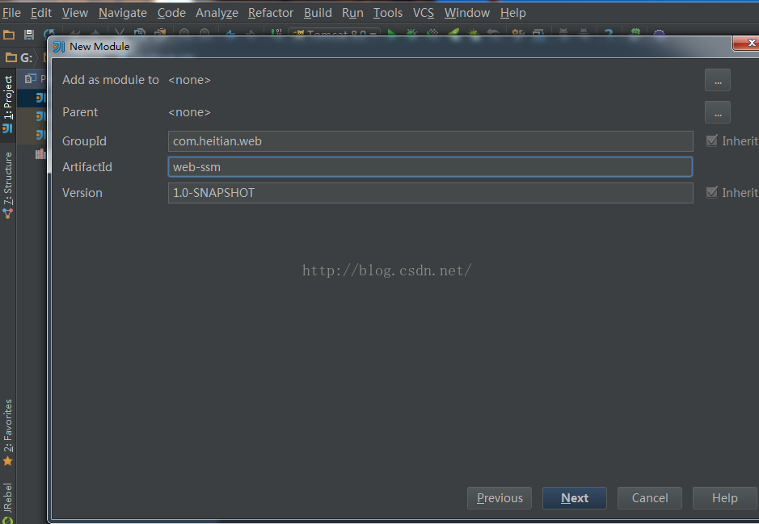

> 迁移来源 [博客园原文](https://www.cnblogs.com/xiuzhublog/p/12608568.html) · 原文发布于 `2019-11-08 23:35:00`（UTC+8）
> 旧文归档，保留当时的记录。

详细教程如下：[https://blog.csdn.net/GallenZhang/article/details/5193215](https://blog.csdn.net/GallenZhang/article/details/51932152)

<https://blog.csdn.net/qq_28008917/article/details/79755935>

安装过程中遇见的问题：

1.第一次创建项目在maven生成骨架时非常慢，最后还失败了。后来在下图

界面中，在Properties中添加一个参数 archetypeCatalog=internal，问题解决。具体的原因是：

archetypeCatalog表示插件使用的archetype元数据，不加这个参数时默认为remote，local，即中央仓库archetype元数据，由于中央仓库的archetype太多了所以导致很慢，指定internal来表示仅使用内部元数据。

2.Could not autowire. No beans of 'xxxx' type found错误。

在 Idea 的 spring 工程里，经常会遇到 Could not autowire. No beans of ‘xxxx' type found 的错误提示。但程序的编译和运行都是没有问题的，这个错误提示并不会产生影响。

第一个可能的情况是是 Intellij IDEA 本身工具的问题。

解决办法：

（1）不理它。

（2）在注解上加上：

`@Autowired``(required =` `false``)`

（3）降低 Autowired 检测的级别，将 Severity 的级别由之前的 error 改成 warning 或其它可以忽略的级别。

第二个可能的情况是是导入 @Service 包的时候导入包错误造成的。

spring auto scan 配置，在编辑情况下，无法找不到对应的bean，于是提示找不到对应 bean 的错误。常见于 mybatis 的 mapper，如下：

`<!-- mapper scanner configurer -->`

`<``bean` `id``=``"mapperScannerConfig"` `class``=``"org.mybatis.spring.mapper.MapperScannerConfigurer"``>`

`<``property` `name``=``"basePackage"` `value``=``"com.adu.spring_test.mybatis.dao"` `/>`

`<``property` `name``=``"sqlSessionFactoryBeanName"` `value``=``"sqlSessionFactory"` `/>`

`</``bean``>`

`错误导包： import com.alibaba.dubbo.config.annotation.Service;`

正确的包应该是下面这个:

`import org.springframework.stereotype.Service;`
