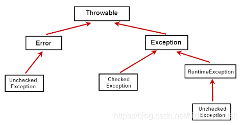
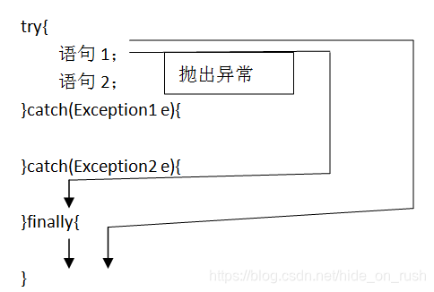

> 迁移来源 [博客园原文](https://www.cnblogs.com/xiuzhublog/p/12608569.html) · 原文发布于 `2019-10-31 21:38:00`（UTC+8）
> 旧文归档，保留当时的记录。

在写代码的时候，会有一些意料之外的情况发生。使用异常处理可以避免程序的崩溃。

**异常(Exception)的概念：**

      异常指程序运行过程中出现的非正常现象，比如向某个硬盘存文件，但是硬盘的空间已经满了；用户错误输入等。

**异常分类：**

      JDK 中定义了很多异常类，这些类对应了各种各样可能出现的异常事件，所有异常对象都是派生于Throwable类的一个实例。如果内置的异常类不能够满足需要，还可以创建自己的异常类。

Java异常类层次结构图：



**Error与Exception的区别：**

        Error是程序无法处理的错误，表示运行应用程序中较严重问题。大多数错误与代码编写者执行的操作无关，而表示代码运行时 JVM(Java 虚拟机)出现的问题。 Error表明系统JVM已经处于不可恢复的崩溃状态中。

        例如播放视频，Exception相当于点击暂停键，而Error相当于直接将播放窗口关闭。

**RuntimeException运行时异常：**

  派生于RuntimeException的异常，如被 0 除、数组下标越界、空指针等，其产生比较频繁，处理麻烦，如果显式的声明或捕获将会对程序可读性和运行效率影响很大。 因此由系统自动检测并将它们交给缺省的异常处理程序(用户可不必对其处理)。

      这类异常通常是由编程错误导致的，所以在编写程序时，并不要求必须使用异常处理机制来处理这类异常,经常需要通过增加“逻辑处理来避免这些异常”。

**CheckedException已检查异常：**

所有不是RuntimeException的异常，统称为Checked Exception，又被称为“已检查异常”，如IOException、SQLException等以及用户自定义的Exception异常。 这类异常在编译时就必须做出处理，否则无法通过编译。

**异常的处理方式之一：捕获异常：**

  捕获异常是通过3个关键词来实现的：try-catch-finally。用try来执行一段程序，如果出现异常，系统抛出一个异常，可以通过它的类型来捕捉(catch)并处理它，最后一步是通过finally语句为异常处理提供一个统一的出口，finally所指定的代码都要被执行(catch语句可有多条;finally语句最多只能有一条，根据自己的需要可有可无)。如图所示。



**上面过程详细解析：**

**1. try：**

      try语句指定了一段代码，该段代码就是异常捕获并处理的范围。在执行过程中，当任意一条语句产生异常时，就会跳过该条语句中后面的代码。代码中可能会产生并抛出一种或几种类型的异常对象，它后面的catch语句要分别对这些异常做相应的处理。

      一个try语句必须带有至少一个catch语句块或一个finally语句块 。

**注意事项**

      当异常处理的代码执行结束以后，不会回到try语句去执行尚未执行的代码。

**2. catch：**

      n-每个try语句块可以伴随一个或多个catch语句，用于处理可能产生的不同类型的异常对象。

      n-常用方法，这些方法均继承自Throwable类 。

          u-toString ()方法，显示异常的类名和产生异常的原因

          u-getMessage()方法，只显示产生异常的原因，但不显示类名。

          u-printStackTrace()方法，用来跟踪异常事件发生时堆栈的内容。

      n-catch捕获异常时的捕获顺序：

          u-如果异常类之间有继承关系，在顺序安排上需注意。越是顶层的类，越放在下面，再不然就直接把多余的catch省略掉。 也就是先捕获子类异常再捕获父类异常。

**2. finally：**

      n-有些语句，不管是否发生了异常，都必须要执行，那么就可以把这样的语句放到finally语句块中。

      n-通常在finally中关闭程序块已打开的资源，比如：关闭文件流、释放数据库连接等。

**try-catch-finally语句块的执行过程：**

      try-catch-finally程序块的执行流程以及执行结果比较复杂。

      基本执行过程如下：

      程序首先执行可能发生异常的try语句块。如果try语句没有出现异常则执行完后跳至finally语句块执行;如果try语句出现异常，则中断执行并根据发生的异常类型跳至相应的catch语句块执行处理。catch语句块可以有多个，分别捕获不同类型的异常。catch语句块执行完后程序会继续执行finally语句块。finally语句是可选的，如果有的话，则不管是否发生异常，finally语句都会被执行。

**注意事项**

    1. 即使try和catch块中存在return语句，finally语句也会执行。是在执行完finally语句后再通过return退出。

    2. finally语句块只有一种情况是不会执行的，那就是在执行finally之前遇到了System.exit(0)结束程序运行。

**异常的处理方式之二：声明异常(throws子句)：**

在方法中使用try-catch-finally是由这个方法来处理异常。但是在一些情况下，当前方法并不需要处理发生的异常，而是向上传递给调用它的方法处理。

      如果一个方法中可能产生某种异常，但是并不能确定如何处理这种异常，则应根据异常规范在方法的首部声明该方法可能抛出的异常。

      如果一个方法抛出多个已检查异常，就必须在方法的首部列出所有的异常，之间以逗号隔开。

```java
import java.io.FileNotFoundException;
import java.io.FileReader;
import java.io.IOException;
 
public class Test9 {
    public static void main(String[] args) {
        try {
            readFile("joke.txt");
        } catch (FileNotFoundException e) {
            System.out.println("所需文件不存在！");
        } catch (IOException e) {
            System.out.println("文件读写错误！");
        }
    }  
    public static void readFile(String fileName) throws FileNotFoundException,          
    IOException {
        FileReader in = new FileReader(fileName);
        int tem = 0;
        try {
            tem = in.read();
            while (tem != -1) {
                System.out.print((char) tem);
                tem = in.read();
            }
        } finally {
            in.close();
        }
    }
}
```
