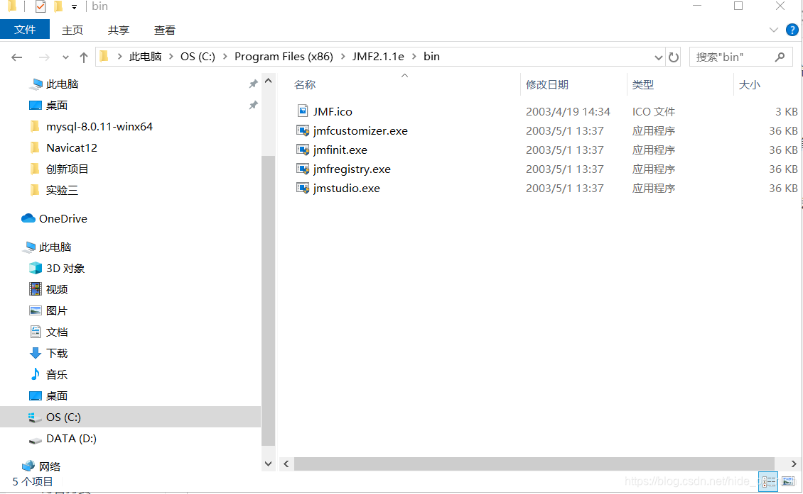

> 迁移来源 [博客园原文](https://www.cnblogs.com/xiuzhublog/p/12608572.html) · 原文发布于 `2019-10-30 21:29:00`（UTC+8）
> 旧文归档，保留当时的记录。

JMF已经非常古老了。最近由于做实验的需要，不得不使用JMF处理视频。开发使用win10系统和eclipse。使用中的问题如下：

1.首先想要使用JMF需要必须安装32位JDK，同时编译软件也需要是32位的。

2.安装JMFStudio后摄像头无法完成注册，即每次使用JMF调用摄像头都需要重新检测一遍，才能在JMFStudio中使用摄像头。同时在eclipse中使用代码无法识别摄像头。

关于这个问题，网上所有的解决方法都试了一遍，更换摄像头驱动，装32位系统都无效。最后发现原因是JMF不支持win10.将下列程序使用兼容模式运行，问题解决。过程如下：

上面所有程序都设置兼容模式运行，兼容模式选择windowsXP service pack3

3.捕获视频时，整个窗口为粉色背景，无图像显示。这个问题目前还没有好的解决方法，只能将视频窗口与电脑显示屏左侧对齐，可以正常显示。
