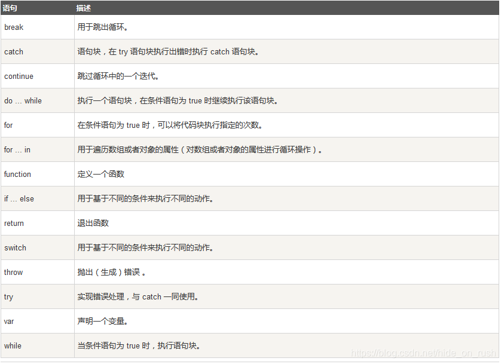

> 迁移来源 [博客园原文](https://www.cnblogs.com/xiuzhublog/p/12608576.html) · 原文发布于 `2019-09-16 18:44:00`（UTC+8）
> 旧文归档，保留当时的记录。

用法：

HTML 中的脚本必须位于 `<script>` 与 `</script>` 标签之间。

脚本可被放置在 HTML 页面的 <body> 和 <head> 部分中。

如需在 HTML 页面中插入 JavaScript，请使用 `<script>` 标签。

`<script>` 和 `</script>` 会告诉 JavaScript 在何处开始和结束。

`<script>` 和 `</script>` 之间的代码行包含了 JavaScript:

### 输出：

JavaScript 没有任何打印或者输出的函数。

JavaScript 可以通过不同的方式来输出数据：

- 使用 **window.alert()** 弹出警告框。

  ```javascript
  <!DOCTYPE html>
  <html>
  <head>
  <meta charset="utf-8">
  <title>js学习</title>
  </head>
  <body>
  	
  <h1>js输出</h1>
  <p>使用 window.alert() 弹出警告框。</p>
  <script>
  window.alert("some thing is wrong");
  </script>
  	
  </body>
  </html>
  ```
- 使用 **document.write()** 方法将内容写到 HTML 文档中。

  ```html
  <!DOCTYPE html>
  <html>
  <head>
  <meta charset="utf-8">
  <title>js学习</title>
  </head>
  <body>
  	
  <h1>js输出</h1>
  <p>使用 document.write() 方法将内容写到 HTML 文档中。</p>
  <script>
  document.write(Date());
  </script>
  	
  </body>
  </html>
  ```
- 使用 **innerHTML** 写入到 HTML 元素。

  ```html
  <!DOCTYPE html>
  <html>
  <head>
  <meta charset="utf-8">
  <title>js学习</title>
  </head>
  <body>
  	
  <h1>js输出</h1>
  <p id="demo">使用 innerHTML 写入到 HTML 元素。</p>
  <script>
  document.getElementById("demo").innerHTML="段落已修改。";
  </script>
  	
  </body>
  </html>
  ```
- 使用 **console.log()** 写入到浏览器的控制台。

  ```html
  <!DOCTYPE html>
  <html>
  <head>
  <meta charset="utf-8">
  <title>js学习</title>
  </head>
  <body>
  	
  <h1>js输出</h1>
  <p>
  	使用 console.log() 写入到浏览器的控制台。
  </p>
  <script>
  a = 1;
  b = 2;
  c = a + b;
  console.log(c);
  </script>
  	
  </body>
  </html>
  ```

  浏览器中使用 F12 来启用调试模式， 在调试窗口中点击 "Console" 菜单，就可以看到运行结果。

### 语法：

js对大小写敏感，使用Unicode字符集。其余语法与其它编程语言类似。

关于Unicode的完整介绍[：HTML Unicode（UTF-8） 参考手册](https://www.runoob.com/charsets/ref-html-utf8.html)

### 语句：

1.分号用于分隔 JavaScript 语句。通常我们在每条可执行的语句结尾添加分号。使用分号的另一用处是在一行中编写多条语句。

2.JavaScript 代码是 JavaScript 语句的序列。浏览器按照编写顺序依次执行每条语句。

3.JavaScript 可以分批地组合起来。代码块以左花括号开始，以右花括号结束。代码块的作用是一并地执行语句序列。

4.JavaScript 会忽略多余的空格。您可以向脚本添加空格，来提高其可读性。

5.JavaScript 语句通常以一个 **语句标识符** 为开始，并执行该语句。语句标识符是保留关键字不能作为变量名使用。js语句标识符如下



6.可以在文本**字符串**中使用反斜杠对代码行进行换行。例如;document.write("你好 \世界!");

### 变量：

- 变量必须以字母开头
- 变量也能以 $ 和 \_ 符号开头（不推荐）
- 变量名称对大小写敏感（y 和 Y 是不同的变量）

声明变量：1.声明单个变量：var carname="a";

                  2.声明多个变量：var lastname="Rookie", age=20, job="coder";

                     或者横跨多行：var lastname="Doe",  
                                                    age=30,  
                                                    job="carpenter";

                  3一条语句中声明的多个不可以赋同一个值:例如对于语句var x,y,z=1; x,y 的值为 undefined， z 的值为 1。

 （在计算机程序中，经常会声明无值的变量。未使用值来声明的变量，其值实际上是 undefined。例如在执行过以下语句后，变量 carname 的值将是 undefined：var carname;）

### 数据类型：

**值类型(基本类型)**：字符串（String）、数字(Number)、布尔(Boolean)、对空（Null）、未定义（Undefined）、Symbol。（Symbol 是 ES6 引入了一种新的原始数据类型，表示独一无二的值。）

**引用数据类型**：对象(Object)、数组(Array)、函数(Function)。

JavaScript 拥有动态类型。这意味着相同的变量可用作不同的类型：

var x;               // x 为 undefined  
var x = 5;           // 现在 x 为数字  
var x = "John";      // 现在 x 为字符串

**字符串：**

字符串是存储字符的变量。

字符串可以是引号中的任意文本。可以使用单引号或双引号：var carname="Volvo XC60";  
                                                                                                 var carname='Volvo XC60';

您可以在字符串中使用引号，只要不匹配包围字符串的引号即可：var answer="It's alright";  
                                                                                                        var answer="He is called 'Johnny'";  
                                                                                                        var answer='He is called "Johnny"';

###
