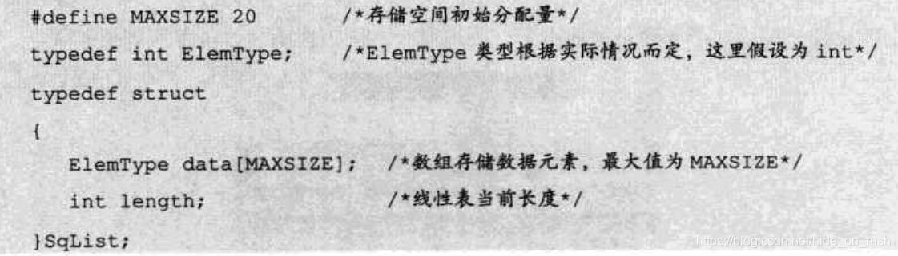
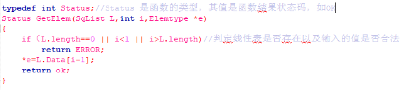

> 迁移来源 [博客园原文](https://www.cnblogs.com/xiuzhublog/p/12608580.html) · 原文发布于 `2019-06-09 10:43:00`（UTC+8）
> 旧文归档，保留当时的记录。

## 一.线性表的顺序存储结构

代码  
  
需要注意的问题：数据长度是指用来存放线性表的存储空间的长度，与线性表的长度不是一个概念。  
***获得元素的操作***  
  
***插入元素***
