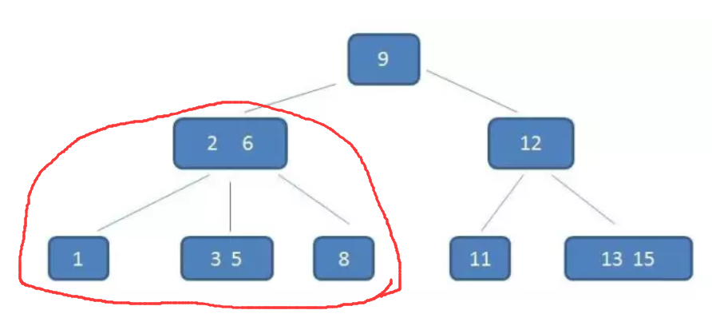
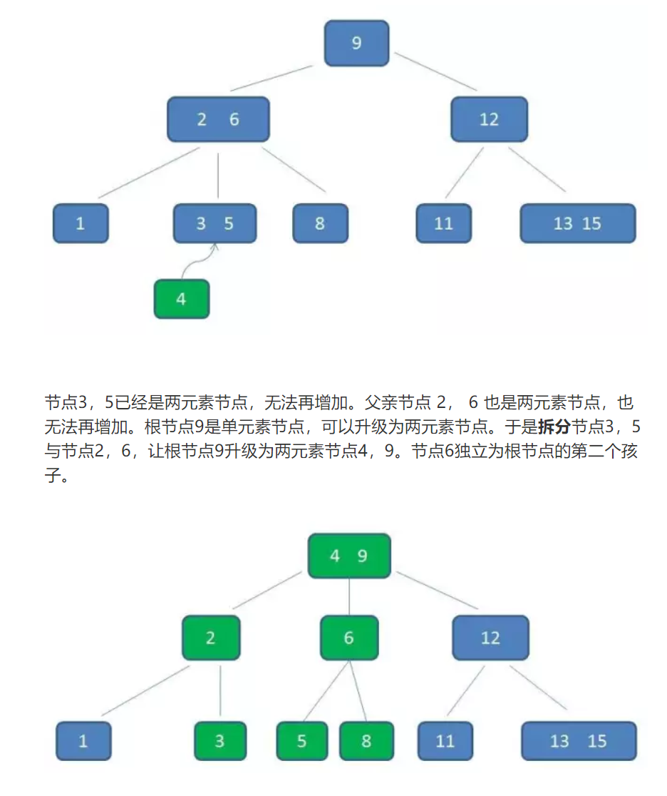
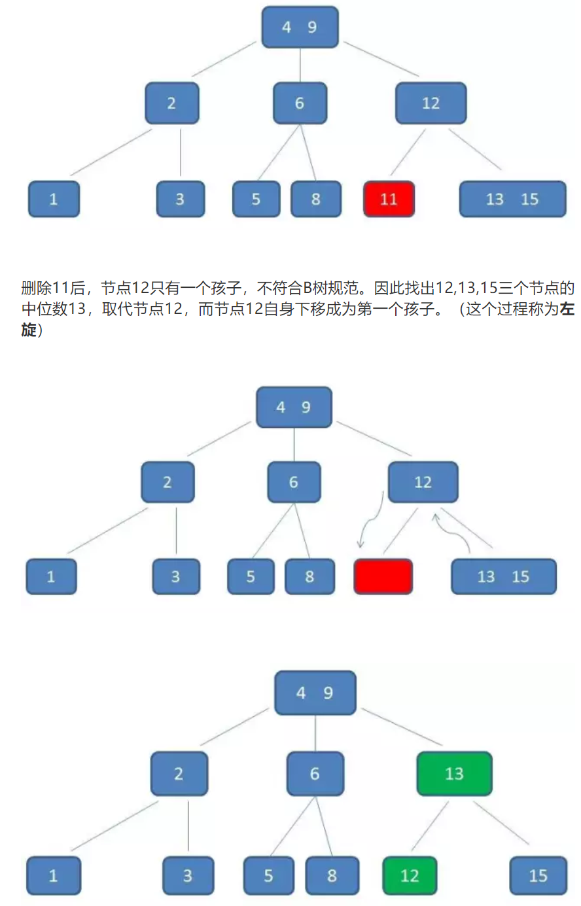
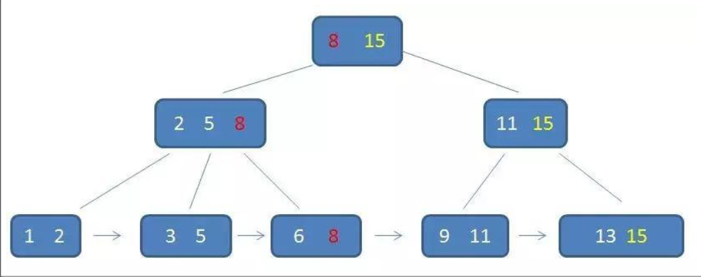

> 迁移来源 [博客园原文](https://www.cnblogs.com/xiuzhublog/p/12618172.html) · 原文发布于 `2020-04-02 10:51:00`（UTC+8）
> 旧文归档，保留当时的记录。

[B-树](#Bshu)

[B+树](#Bjiashu)

[红黑树](https://www.cxyxiaowu.com/7374.html)

B-树

[Trie树](https://www.cxyxiaowu.com/1873.html)

[相关链接](https://mp.weixin.qq.com/s?__biz=MzUyNjQxNjYyMg==&mid=2247487737&idx=2&sn=7931571c4647c709cd07fbcbaa3d6f32&chksm=fa0e7f78cd79f66e331b35437185bb890f6e2f039aeed41d8d823749b5812e5d6b9247d09266&scene=21#wechat_redirect "硬核挑战——从零开始动手图解 B 树")

**这个就念B树，不念B减树**。

B-树（Balance Tree）是一种多路平衡查找树，一个m阶的B树具有如下几个特征：

1.根结点至少有两个子女。

2.每个中间节点都包含k-1个元素和k个孩子，其中 m/2 <= k <= m

3.每一个叶子节点都包含k-1个元素，其中 m/2 <= k <= m

4.所有的叶子结点都位于同一层。

5.每个节点中的元素从小到大排列，节点当中k-1个元素正好是k个孩子包含的元素的值域分划。

举例：对于一个3阶B树

 插入操作：

 删除操作：

 优势：算法上来说二叉查找树的查找速度和比较次数最小，但是对于数据库索引来说，还要考虑磁盘IO。磁盘IO的次数取决于索引树的深度。使用B树可以将索引树的深度减小。

B-树主要用于文件系统及部分数据库索引，比如非关系型数据库MongoDB。

B+树

一个 m 阶的 B + 树相较于B-树具有如下几个特征：

1. 有 k 个子树的中间节点包含有 k 个元素（B 树中是 k-1 个元素），每个元素不保存数据，只用来索引，所有数据都保存在叶子节点。

2. 所有的叶子结点中包含了全部元素的信息，及指向含这些元素记录的指针，且叶子结点本身依关键字的大小自小而大顺序链接。

3. 所有的中间节点元素都同时存在于子节点，在子节点元素中是最大（或最小）元素。

另一种解释：

1. 所有的数据都存储在叶子节点，中间节点不存放数据
2. 中间节点的元素数量和子树数量一致，而B树子树数量比元素数量多1
3. 叶子节点是一个链表，可以通过指针顺序查找

 卫星数据：指索引元素所指向的数据记录

对比：

B - 树中的卫星数据（Satellite Information）：

[此处原图未能恢复，可查看源文章](https://www.cnblogs.com/xiuzhublog/p/12618172.html)

B + 树中的卫星数据（Satellite Information）：

[此处原图未能恢复，可查看源文章](https://www.cnblogs.com/xiuzhublog/p/12618172.html)

**B+树的优势：**

1.查询性能更好：相较于B树，B+树的中间节点没有卫星数据，同样大小的磁盘页可以容纳更多的节点数据。在数据量相同的情况下，IO次数更少。

2.查询性能更稳定：之前提到过，B+树的信息都保存在叶子节点，所以每次查找都必须到叶子节点为止，而B-树只用找到匹配元素即可，所以最好情况（根节点）和最坏情况（叶子节点）差距过大。

3.所有叶子节点形成有序链表，便于范围查询。

 参考：

<https://mp.weixin.qq.com/s?__biz=MzIxMjE5MTE1Nw==&mid=2653190965&idx=1&sn=53f78fa037386f85531832cd5322d2a0&chksm=8c9909efbbee80f90512f0c36356c31cc74c388c46388dc2317d43c8f8597298f233ca9c29e9&scene=21#wechat_redirect>
