> 迁移来源 [博客园原文](https://www.cnblogs.com/xiuzhublog/p/12682049.html) · 原文发布于 `2020-04-11 20:34:00`（UTC+8）
> 旧文归档，保留当时的记录。

## 1.基础知识

### 体系结构

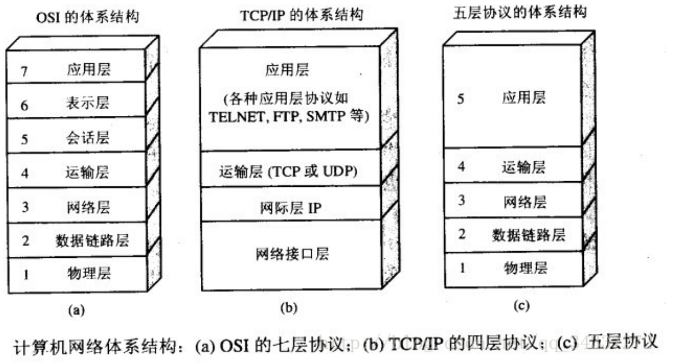

[OSI七层体系结构](https://blog.csdn.net/yaopeng_2005/article/details/7064869)

五层体系结构：

**物理层**

在物理层上所传送的数据单位是比特。**物理层（physical layer）的作用是实现相邻计算机节点之间比特流的透明传送，尽可能屏蔽掉具体传输介质和物理设备的差异。使其上面的数据链路层不必考虑网络的具体传输介质是什么。**“透明传送比特流”表示经实际电路传送后的比特流没有发生变化，对传送的比特流来说，这个电路好像是看不见的。

**数据链路层**

**数据链路层（data link layer）通常简称为链路层。两台主机之间的数据传输，总是在一段一段的链路上传送的，这就需要使用专门的链路层的协议。**在两个相邻节点之间传送数据时，**数据链路层将网络层交下来的IP数据报组装成帧，在两个相邻节点间的链路上传送帧。**每一帧包括数据和必要的控制信息（如同步信息，地址信息，差错控制等）。  
在接收数据时，控制信息使接收端能够知道一个帧从哪个比特开始和到哪个比特结束。这样，数据链路层在收到一个帧后，就可从中提出数据部分，上交给网络层。控制信息还使接收端能够检测到所收到的帧中有误差错。如果发现差错，数据链路层就简单地丢弃这个出了差错的帧，以避免继续在网络中传送下去白白浪费网络资源。如果需要改正数据在链路层传输时出现差错（这就是说，数据链路层不仅要检错，而且还要纠错），那么就要采用可靠性传输协议来纠正出现的差错。这种方法会使链路层的协议复杂些。

**网络层**

**在计算机网络中进行通信的两个计算机之间可能会经过很多个数据链路，也可能还要经过很多通信子网。网络层的任务就是选择合适的网间路由和交换结点，确保数据及时传送。**在发送数据时，网络层把运输层产生的报文段或用户数据报封装成分组和包进行传送。在TCP/IP体系结构中，由于网络层使用**IP协议**，因此分组也叫**IP数据报**，简称**数据报**。  
**这里要注意：不要把运输层的“用户数据报UDP”和网络层的“IP数据报”弄混。另外，无论是哪一层的数据单元，都可笼统地用“分组”来表示。**  
这里强调指出，网络层中的“网络”二字已经不是我们通常谈到的具体网络，而是指计算机网络体系结构模型中第三层的名称。  
互联网是由大量的异构（heterogeneous）网络通过路由器（router）相互连接起来的。互联网使用的网络层协议是无连接的网际协议（Intert Protocol）和许多路由选择协议，因此互联网的网络层也叫做**网际层**或**IP层**。

**运输层**

**运输层（transportlayer）的主要任务就是负责向两台主机进程之间的通信提供通用的数据传输服务。**应用进程利用该服务传送应用层报文。“通用的”是指并不针对某一个特定的网络应用，而是多种应用可以使用同一个运输层服务。由于一台主机可同时运行多个线程，因此运输层有复用和分用的功能。所谓复用就是指多个应用层进程可同时使用下面运输层的服务，分用和复用相反，是运输层把收到的信息分别交付上面应用层中的相应进程。  
运输层主要使用以下两种协议：  
1.**传输控制协议TCP**（Transmission Control Protocol）--提供面向连接的，可靠的数据传输服务。  
2.**用户数据协议UDP**（User Datagram Protocol）--提供无连接的，尽最大努力的数据传输服务（不保证数据传输的可靠性）。

**应用层**

**应用层（application-layer）的任务是通过应用进程间的交互来完成特定网络应用。**  
应用层协议定义的是应用进程（进程：主机中正在运行的程序）间的通信和交互的规则。对于不同的网络应用需要不同的应用层协议。在互联网中应用层协议很多，如域名系统DNS，支持万维网应用的HTTP协议，支持电子邮件的SMTP协议等等。我们把应用层交互的数据单元称为报文。

### *2.TCP*

#### TCP三次握手和四次挥手

三次握手

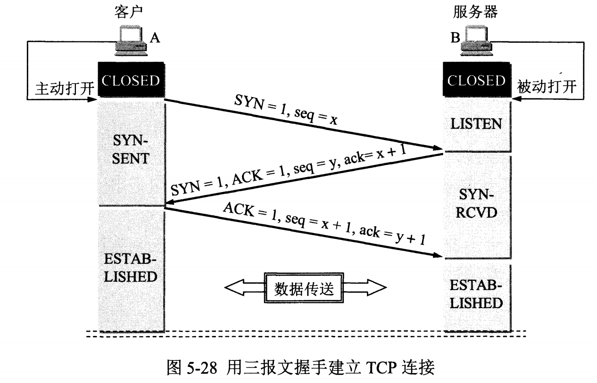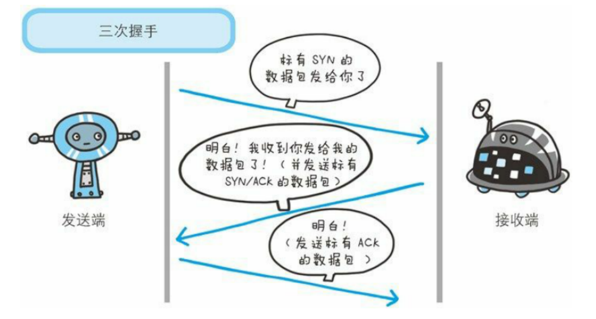

流程：

1. 客户端一发送带有SYN标志的数据包一一次握手一服务端
2. 服务端一发送带有SYN/ACK标志的数据包一二次握手一客户端
3. 客户端一发送带有带有ACK标志的数据包一三次握手一服务端

相关问题：

1.为什么要三次握手

三次握手的目的是建立可靠的通信信道，说到通讯，简单来说就是数据的发送与接收，而三次握手最主要的目的就是双方确认自己与对方的发送与接收是正常的。  
第一次握手：Client什么都不能确认；Server确认了对方发送正常，自己接收正常

第二次握手：Client确认了：自己发送、接收正常，对方发送、接收正常；Server确认了：对方发送正常，自己接收正常

*第三次握手：Client确认了：自己发送、接收正常，对方发送、接收正常；Server确认了：自己发送、接收正常，对方发送、接收正常  
所以三次握手就能确认双发收发功能都正常，缺一不可。*

2.*为什么要传回 SYN*

***接收端传回发送端所发送的SYN是为了告诉发送端，我接收到的信息确实就是你所发送的信号了。***

SYN是TCP/IP建立连接时使用的握手信号。在客户机和服务器之间建立正常的TCP网络连接时，客户机首先发出一个SYN消息，服务器使用SYN-ACK应答表示接收到了这个消息，最后客户机再以ACK（Acknowledgement[汉译：确认字符，在数据通信传输中，接收站发给发送站的一种传输控制字符。它表示确认发来的数据已经接受无误。]）消息响应。这样在客户机和服务器之间才能建立起可靠的TCP连接，数据才可以在客户机和服务器之间传递。

*3.*传了SYN，为啥还要传ACK

双方通信无误必须是两者互相发送信息都无误。传了SYN，证明发送方到接收方的通道没有问题，但是接收方到发送方的通道还需要ACK信号来进行验证。

四次挥手

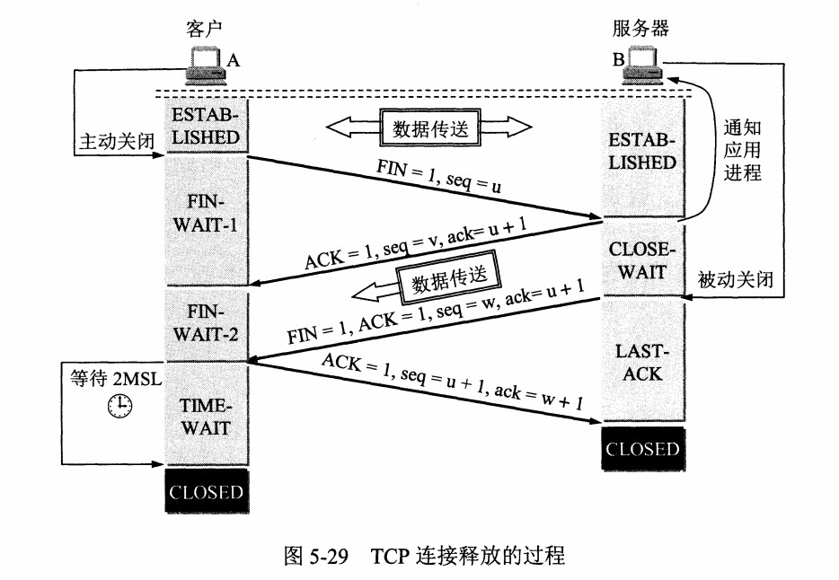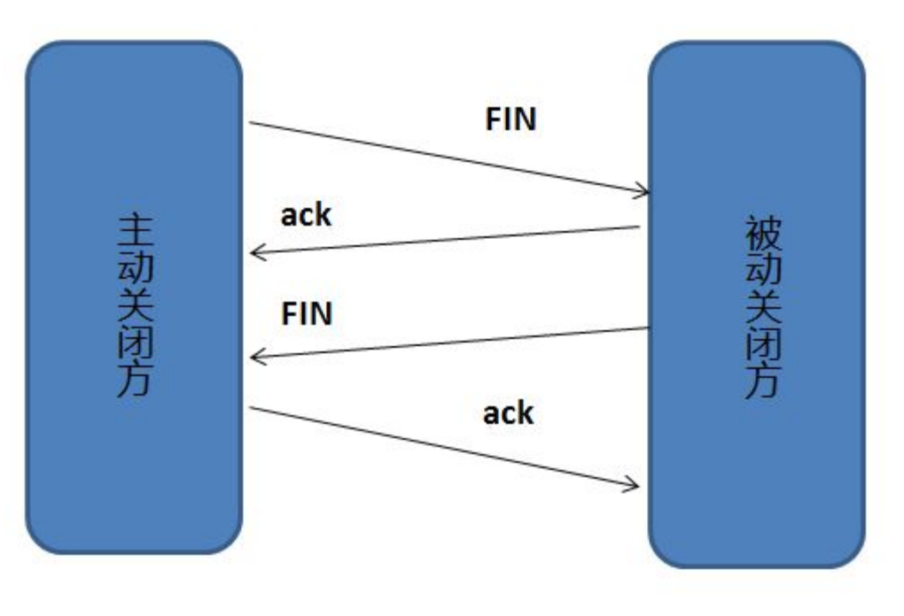

流程：

1. 客户端-发送一个FIN，用来关闭客户端到服务器的数据传送
2. 服务器-收到这个FIN，它发回一个ACK，确认序号为收到的序号加1。和SYN一样，一个FIN将占用一个序号
3. 服务器-关闭与客户端的连接，发送一个FIN给客户端
4. 客户端-发回ACK报文确认，并将确认序号设置为收到序号加1

为什么要四次挥手：  
任何一方都可以在数据传送结束后发出连接释放的通知，待对方确认后进入半关闭状态。当另一方也没有数据再发送的时候，则发出连接释放通知，对方确认后就完全关闭了TCP连接。  
举个例子：A和B打电话，通话即将结束后，A说“我没啥要说的了”，B回答“我知道了”，但是B可能还会有要说的话，A不能要求B跟着自己的节奏结束通话，于是B可能又巴拉巴拉说了一通，最后B说“我说完了”，A回答“知道了”，这样通话才算结束。

理解有困难的话可以看看这几篇文章：

<https://blog.csdn.net/qzcsu/article/details/72861891>

**<https://mp.weixin.qq.com/s?__biz=MzAxOTc0NzExNg==&mid=2665513094&idx=1&sn=a2accfc41107ac08d74ec3317995955e&scene=21#wechat_redirect>**

<https://mp.weixin.qq.com/s?__biz=MzAxOTc0NzExNg==&mid=2665513375&idx=1&sn=e11745d5cb28fa1f89465f8d0e5fae1a&chksm=80d679dcb7a1f0cadec0a1db45b3fa3f6eabde4a9e56a77acf551fbc1511e6b8f055ee2c97e3&scene=21#wechat_redirect>

<https://mp.weixin.qq.com/s?__biz=MzAxOTc0NzExNg==&mid=2665513384&idx=1&sn=82c45e4430618270a744e212d2f57990&chksm=80d679ebb7a1f0fd27fe1814765a0e60b1c293ca4e09403271b4bb3f38f317439956fdca1bc1&scene=21#wechat_redirect>

#### TCP与UDP的区别

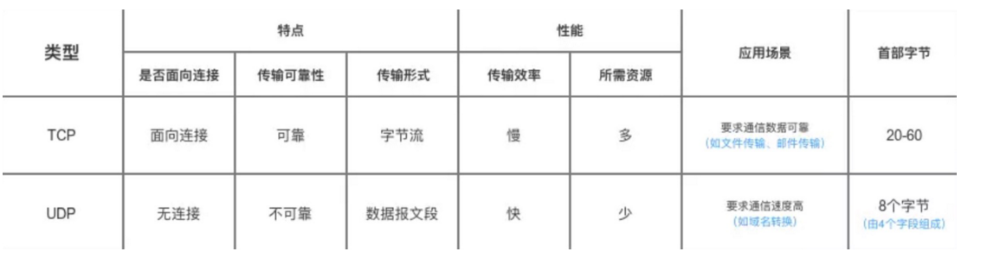

UDP在传送数据之前不需要先建立连接，远地主机在收到UDP报文后，不需要给出任何确认。虽然UDP不提供可靠交付，但在某些情况下UDP确是一种最有效的工作方式（一般用于即时通信），比如：QQ语音、QQ视频、直播等等

TCP提供面向连接的服务。在传送数据之前必须先建立连接，数据传送结束后要释放连接。TCP不提供广播或多播服务。由于TCP要提供可靠的，面向连接的传输服务（TCP的可靠体现在TCP在传递数据之前，会有三次握手来建立连接，而且在数据传递时，有确认、窗口、重传、拥塞控制机制，在数据传完后，还会断开连接用来节约系统资源），这一难以避免增加了许多开销，如确认，流量控制，计时器以及连接管理等。这不仅使协议数据单元的首部增大很多，还要占用许多处理机资源。TCP一般用于文件传输、发送和接收邮件、远程登录等场景。

#### TCP可靠传输

1.应用数据被分割成TCP认为最适合发送的数据块。  
2.TCP给发送的每一个包进行编号，接收方对数据包进行排序，把有序数据传送给应用层。  
3.校验和：TCP将保持它首部和数据的检验和。这是一个端到端的检验和，目的是检测数据在传输过程中的任何变化。如果收到段的检验和有差错，TCP将丢弃这个报文段和不确认收到此报文段。  
4.TCP的接收端会丢弃重复的数据。  
5.流量控制：TCP连接的每一方都有固定大小的缓冲空间，TCP的接收端只允许发送端发送接收端缓冲区能接纳的数据。当接收方来不及处理发送方的数据，能提示发送方降低发送的速率，防止包丢失。TCP使用的流量控制协议是可变大小的滑动窗口协议。（TCP利用滑动窗口实现流量控制）6.拥塞控制：当网络拥塞时，减少数据的发送。  
7.ARQ协议：也是为了实现可靠传输的，它的基本原理就是每发完一个分组就停止发送，等待对方确认。在收到确认后再发下一个分组。  
8.超时重传：当TCP发出一个段后，它启动一个定时器，等待目的端确认收到这个报文段。如果不能及时收到一个确认，将重发这个报文段。

#### 滑动窗口和流量控制

窗口是缓存的一部分，用来暂时存放字节流。发送方和接收方各有一个窗口，接收方通过 TCP 报文段中的窗口字段告诉发送方自己的窗口大小，发送方根据这个值和其它信息设置自己的窗口大小。

发送窗口内的字节都允许被发送，接收窗口内的字节都允许被接收。如果发送窗口左部的字节已经发送并且收到了确认，那么就将发送窗口向右滑动一定距离，直到左部第一个字节不是已发送并且已确认的状态；接收窗口的滑动类似，接收窗口左部字节已经发送确认并交付主机，就向右滑动接收窗口。

接收窗口只会对窗口内最后一个按序到达的字节进行确认，例如接收窗口已经收到的字节为 {31, 34, 35}，其中 {31} 按序到达，而 {34, 35} 就不是，因此只对字节 31 进行确认。发送方得到一个字节的确认之后，就知道这个字节之前的所有字节都已经被接收。

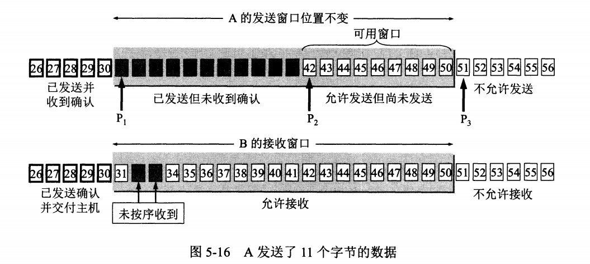

**TCP利用滑动窗口实现流量控制。流量控制是为了控制发送方发送速率，保证接收方来得及接收。**

接收方发送的确认报文中的窗口字段可以用来控制发送方窗口大小，从而影响发送方的发送速率。将窗口字段设置为0，则发送方不能发送数据。

#### 拥塞控制

在某段时间，若对网络中某一资源的需求超过了该资源所能提供的可用部分，网络的性能就要变坏。这种情况就叫拥塞。拥塞控制就是为了防止过多的数据注入到网络中，这样就可以使网络中的路由器或链路不致过载。拥塞控制所要做的都有一个前提，就是网络能够承受现有的网络负荷。拥塞控制是一个全局性的过程，涉及到所有的主机，所有的路由器，以及与降低网络传输性能有关的所有因素。相反，流量控制往往是点对点通信量的控制，是个端到端的问题。流量控制所要做到的就是抑制发送端发送数据的速率，以便使接收端来得及接收。

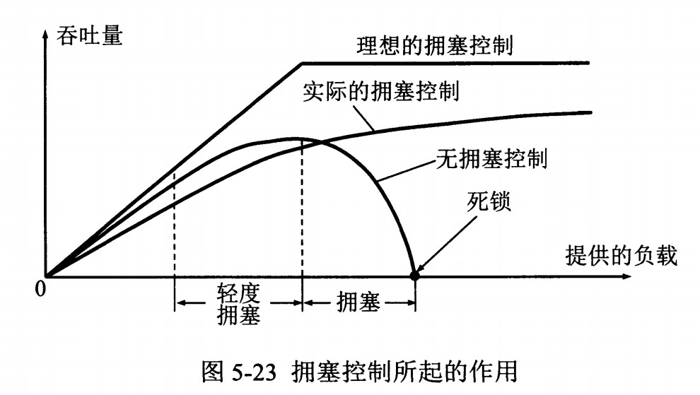

为了进行拥塞控制，TCP发送方要维持一个**拥塞窗口（cwnd）**的状态变量。拥塞控制窗口的大小取决于网络的拥塞程度，并且动态变化。发送方让自己的发送窗口取为拥塞窗口和接收方的接受窗口中较小的一个。（拥塞窗口只是一个状态变量，实际决定发送方能发送多少数据的是发送方窗口。）  
TCP的拥塞控制采用了四种算法，即**慢开始、拥塞避免、快重传**和**快恢复**。在网络层也可以使路由器采用适当的分组丢弃策略（如主动队列管理AQM），以减少网络拥塞的发生。

思路：

**慢开始：**慢开始算法的思路是当主机开始发送数据时，如果立即把大量数据字节注入到网络，那么可能会引起网络阻塞，因为现在还不知道网络的符合情况。经验表明，较好的方法是先探测一下，即由小到大逐渐增大发送窗口，也就是由小到大逐渐增大拥塞窗口数值。cwnd初始值为1，每经过一个传播轮次，cwnd加倍。

**拥塞避免：**拥塞避免算法的思路是让拥塞窗口cwnd缓慢增大，即每经过一个往返时间RTT就把发送放的cwnd加1.

***快重传与快恢复：**在TCP/IP中，快速重传和恢复（fast retransmit and recovery，FRR）是一种拥塞控制算法，它能快速恢复丢失的数据包。没有FRR，如果数据包丢失了，TCP将会使用定时器来要求传输暂停。在暂停的这段时间内，没有新的或复制的数据包被发送。有了FRR，如果接收机接收到一个不按顺序的数据段，它会立即给发送机发送一个重复确认。如果发送机接收到三个重复确认，它会假定确认件指出的数据段丢失了，并立即重传这些丢失的数据段。有了FRR，就不会因为重传时要求的暂停被耽误。当有单独的数据包丢失时，快速重传和恢复（FRR）能最有效地工作。当有多个数据信息包在某一段很短的时间内丢失时，它则不能很有效地工作。*

具体流程：

为了便于讨论，做如下假设：

- 接收方有足够大的接收缓存，因此不会发生流量控制；
- 虽然 TCP 的窗口基于字节，但是这里设窗口的大小单位为报文段。
- 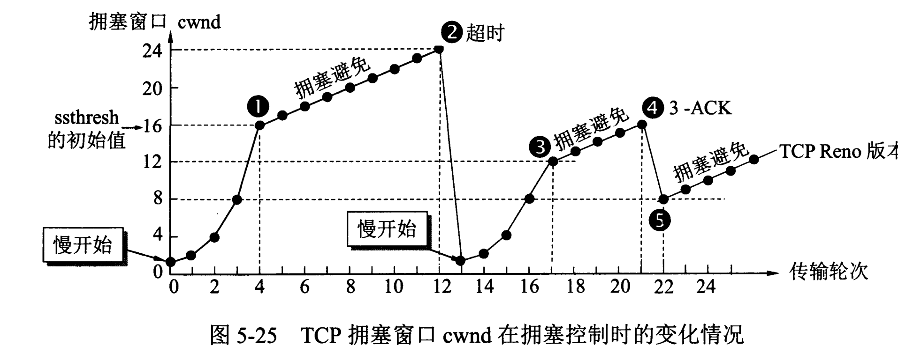

慢开始与拥塞避免

发送的最初执行慢开始，令 cwnd = 1，发送方只能发送 1 个报文段；当收到确认后，将 cwnd 加倍，因此之后发送方能够发送的报文段数量为：2、4、8 ...

注意到慢开始每个轮次都将 cwnd 加倍，这样会让 cwnd 增长速度非常快，从而使得发送方发送的速度增长速度过快，网络拥塞的可能性也就更高。设置一个慢开始门限 ssthresh，当 cwnd >= ssthresh 时，进入拥塞避免，每个轮次只将 cwnd 加 1。

如果出现了超时，则令 ssthresh = cwnd / 2，然后重新执行慢开始。

快重传与快回复

在接收方，要求每次接收到报文段都应该对最后一个已收到的有序报文段进行确认。例如已经接收到 M1 和 M2，此时收到 M4，应当发送对 M2 的确认。

在发送方，如果收到三个重复确认，那么可以知道下一个报文段丢失，此时执行快重传，立即重传下一个报文段。例如收到三个 M2，则 M3 丢失，立即重传 M3。

在这种情况下，只是丢失个别报文段，而不是网络拥塞。因此执行快恢复，令 ssthresh = cwnd / 2 ，cwnd = ssthresh，注意到此时直接进入拥塞避免。

慢开始和快恢复的快慢指的是 cwnd 的设定值，而不是 cwnd 的增长速率。慢开始 cwnd 设定为 1，而快恢复 cwnd 设定为 ssthresh。

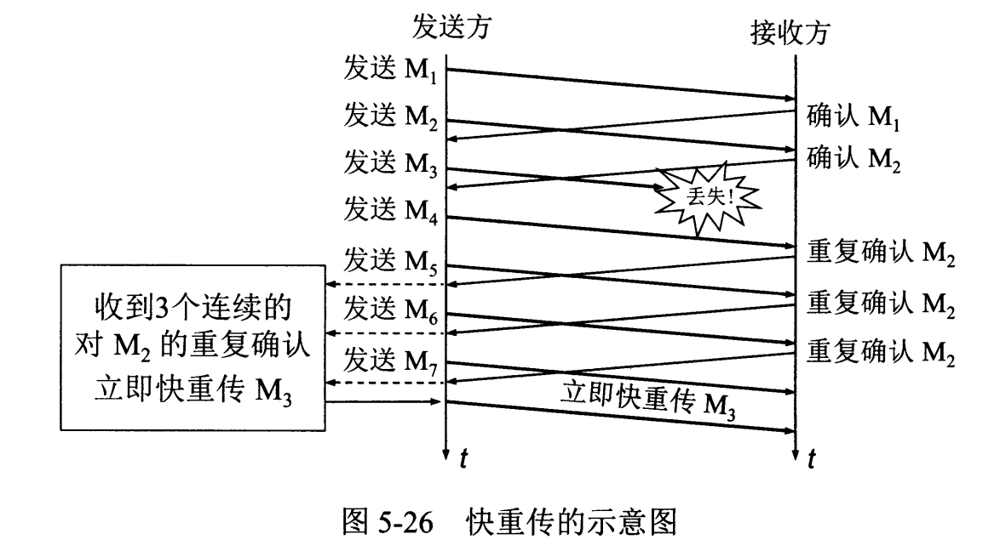

## 状态码

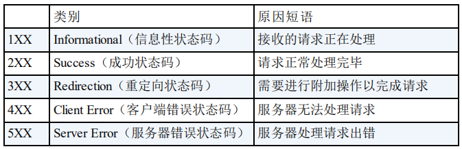

## **2.题目记录**

### 1.当键入网址后，到网页显示，其间发生了什么？

<https://mp.weixin.qq.com/s/hrkGg85mUYEy6PMUQZFn4w>

参考：<https://cyc2018.github.io/CS-Notes/#/notes/%E8%AE%A1%E7%AE%97%E6%9C%BA%E7%BD%91%E7%BB%9C%20-%20%E7%9B%AE%E5%BD%951>

<https://snailclimb.gitee.io/javaguide/#/docs/network/%E5%B9%B2%E8%B4%A7%EF%BC%9A%E8%AE%A1%E7%AE%97%E6%9C%BA%E7%BD%91%E7%BB%9C%E7%9F%A5%E8%AF%86%E6%80%BB%E7%BB%93>

### 2.交换机、路由器、网关的概念及各自的用途

#### **交换机**

在计算机网络系统中，交换机是针对共享工作模式的弱点而推出的。交换机拥有一条高带宽的背部总线和内部交换矩阵。交换机的所有的端口都挂接在这条背 部总线上，当控制电路收到数据包以后，**处理端口会查找内存中的地址对照表以确定目的MAC（网卡的硬件地址）的NIC（网卡）挂接在哪个端口上**，通过内部 交换矩阵迅速将数据包传送到目的端口。目的MAC若不存在，交换机才广播到所有的端口，接收端口回应后交换机会“学习”新的地址，并把它添加入内部地址表 中。

**交换机工作于OSI参考模型的第二层，即数据链路层**。交换机内部的CPU会在每个端口成功连接时，通过ARP协议学习它的MAC地址，保存成一张 ARP表。在今后的通讯中，发往该MAC地址的数据包将仅送往其对应的端口，而不是所有的端口。因此，交换机可用于划分数据链路层广播，即冲突域；但它不 能划分网络层广播，即广播域。

交换机被广泛应用于二层网络交换，俗称“二层交换机”。

交换机的种类有：二层交换机、三层交换机、四层交换机、七层交换机分别工作在OSI七层模型中的第二层、第三层、第四层盒第七层，并因此而得名。

#### **路由器**

**路由器**（**Router**）是一种计算机网络设备，提供了路由与转送两种重要机制，可以决定数据包从来源端到目的端所经过 的路由路径（host到host之间的传输路径），这个过程称为路由；将路由器输入端的数据包移送至适当的路由器输出端(在路由器内部进行)，这称为转 送。路由工作在**OSI模型的第三层——即网络层**，例如网际协议。

**路由器的一个作用是连通不同的网络，另一个作用是选择信息传送的线路。** 路由器与交换器的差别，路由器是属于OSI第三层的产品，交换器是OSI第二层的产品(这里特指二层交换机)。

#### **网关**

**网关**（Gateway），**网关**顾名思义就是连接两个网络的设备，区别于路由器（由于历史的原因，许多有关TCP/IP 的文献曾经把网络层使用的路由器（Router）称为网关，**在今天很多局域网采用都是路由来接入网络，因此现在通常指的网关就是路由器的IP**），经常在家 庭中或者小型企业网络中使用，用于连接局域网和Internet。 网关也经常指把一种协议转成另一种协议的设备，比如语音网关。

## 3.HTTP相关问题

<https://mp.weixin.qq.com/s/FyB3Dlg0_2LpIF1x1ElIPA>
