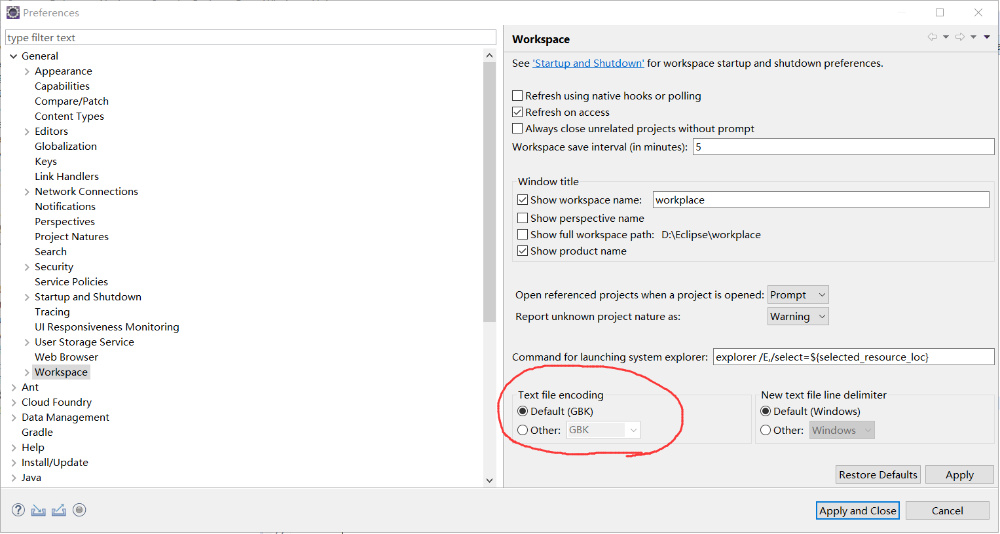
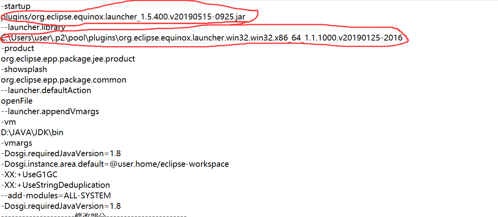
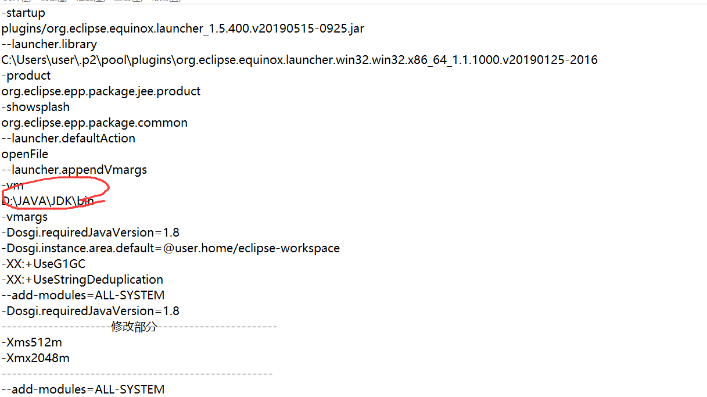

> 迁移来源 [博客园原文](https://www.cnblogs.com/xiuzhublog/p/12736717.html) · 原文发布于 `2020-04-20 11:29:00`（UTC+8）
> 旧文归档，保留当时的记录。

使用eclipse或idea的时候会遇到各式各样的小问题，解决方案其实网上也大都搜得到，但是下次遇到的时候总是想不起来如何解决，还要花费时间再次查资料。所以以后把遇到的问题都记录一下。

## Eclipse

### 1.乱码

【Window】-->【Preferences】-->【General】-->【Workspace】-->【Text file encoding】



## 2.经常卡顿、未响应

eclipse.ini配置文件主要参数介绍

-vmargs：说明后面是VM的参数  
-Xms512m：虚拟机占用系统的最小内存，初始分配  
-Xmx2048m：虚拟机占用系统的最大内存，按需分配  
-XX:PermSize=256M：最小堆大小。一般报内存不足时,都是说这个太小, 堆空间剩余小于5%就会警告,建议把这个稍微设大一点,不过要视自己电脑内存大小来设置，但不能超过MaxPermSize。  
-XX:MaxPermSize=1024M：最大堆大小。这个也适当大些所以若出现问题，首先请调整Xms512m将其设置的小一些，就可以解决问题。

打开eclipse.ini文件 更改一下虚拟机的最小内存和最大内存，我的之前是Xms256m和Xmx1024m 然后更改成了 Xms512m和Xmx2048m，可以正常启动，并且也没有再出现未响应现象。

```
-startup
plugins/org.eclipse.equinox.launcher_1.4.0.v20161219-1356.jar
--launcher.library
C:\Users\lenovo\.p2\pool\plugins\org.eclipse.equinox.launcher.win32.win32.x86_64_1.1.551.v20171108-1834
-product
org.eclipse.epp.package.jee.product
-showsplash
org.eclipse.epp.package.common
--launcher.defaultAction
openFile
--launcher.appendVmargs
-vm
C:/Program Files/Java/jdk1.8.0_60/bin
-vmargs
-Dosgi.requiredJavaVersion=1.8
-Dosgi.instance.area.default=@user.home/eclipse-workspace
-XX:+UseG1GC
-XX:+UseStringDeduplication
--add-modules=ALL-SYSTEM
-Dosgi.requiredJavaVersion=1.8
---------------------修改部分-----------------------
-Xms512m
-Xmx2048m
----------------------------------------------------
--add-modules=ALL-SYSTEM
-Declipse.p2.max.threads=10
-Doomph.update.url=http://download.eclipse.org/oomph/updates/milestone/latest
-Doomph.redirection.index.redirection=index:/->http://git.eclipse.org/c/oomph/org.eclipse.oomph.git/plain/setups/
```

## 3.Eclipse打开报错，The Eclipse executable launcher was unable to locate its companion shared library.

这是由于多次卸载重装Eclipse后的配置错误，也可能是更换eclipse路径，导致配置文件与eclipse更换后的路径不符。

这种错误的解决方法如下：

首先，打开Eclipse安装目录下的配置文件eclipse.ini文件

Eclipse.ini文件内容如下：



 画圈的两个修改为自己的本地地址

## 4.Eclipse启动错误：A Java Runtime Environment(JRE) or Java Development Kit(JDK) must be available……



画圈的地方修改为本地地址

## idea

### 1.全局搜索替换

<https://blog.csdn.net/gnail_oug/article/details/78281354>
