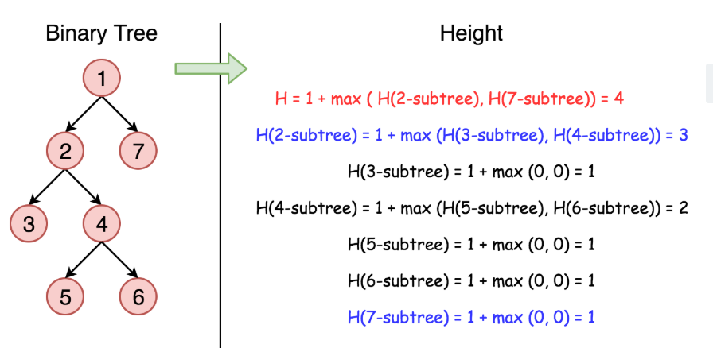
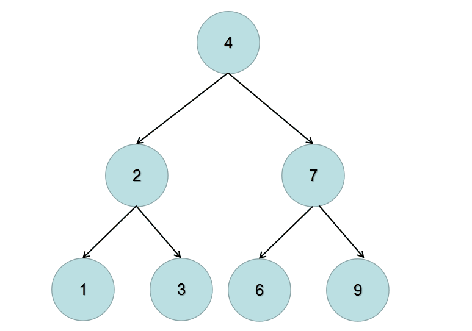
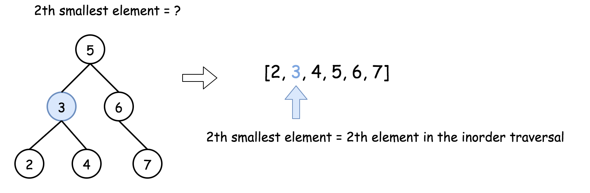

> 迁移来源 [博客园原文](https://www.cnblogs.com/xiuzhublog/p/12741185.html) · 原文发布于 `2020-04-20 22:41:00`（UTC+8）
> 旧文归档，保留当时的记录。

## 递归

### 104.二叉树的最大深度

```
/**
 * Definition for a binary tree node.
 * public class TreeNode {
 *     int val;
 *     TreeNode left;
 *     TreeNode right;
 *     TreeNode(int x) { val = x; }
 * }
 */
class Solution {
    public int maxDepth(TreeNode root) {
        if(root==null) return 0;
        return Math.max(maxDepth(root.left),maxDepth(root.right))+1;
    }
}
```

将问题转化为二叉树的深度等于1+左右子树中数值更大的深度



### 111.二叉树的最小深度

这个题遇上一个差不多，提交的时候1,2这个用例没有通过。题目中最小深度是**从根节点到最近叶子节点的最短路径**上的节点数量。所以这个用例应该输出的长度是2不是1.

```
class Solution {
    public int minDepth(TreeNode root) {
        if (root == null) return 0;
        int left = minDepth(root.left);
        int right = minDepth(root.right);
        if (left == 0 || right == 0) return left + right + 1;
        return Math.min(left, right) + 1;
    }
}
```

### 110.平衡二叉树

```
class Solution {
    private boolean tag = true;
    public boolean isBalanced(TreeNode root) {
        maxDepth(root);
        return tag;
    }
    public int maxDepth(TreeNode root){
        if(root==null)return 0;
        int left=maxDepth(root.left);
        int right=maxDepth(root.right);
        if(Math.abs(left-right)>1){
            tag=false;
        }
        return 1+Math.max(left,right);
    }
}
```

上一个问题的进阶版，只需要在上一题的基础上判定两个子树深度之差的绝对值是否大于一。

### 543.二叉树的直径

与之前的问题一脉相承，根据题目，树的直径其实就是使用深度优先搜索找到最长的两条路径进行拼接。有一个细节问题。求直径（即求路径长度的最大值）等效于求路径经过节点数的最大值减一。所以根节点的问题刚好可以忽略。

```
class Solution {
    private int MAX=0;
    public int diameterOfBinaryTree(TreeNode root) {
        depth(root);
        return MAX;
    }
    public int depth(TreeNode root){
        if(root==null)return 0;
        int left=depth(root.left);
        int right=depth(root.right);
        MAX=Math.max(MAX,left+right);
        return Math.max(left,right)+1; 
    }
}
```

### 226.翻转二叉树

思路是递归交换左右子节点



```
class Solution {
    public TreeNode invertTree(TreeNode root) {
        if(root==null)return null;
        TreeNode left=root.left;
        root.left=invertTree(root.right);
        root.right=invertTree(left);
        return root;

    }
}
```

### 617.合并二叉树

 官方题解：

我们可以对这两棵树同时进行前序遍历，并将对应的节点进行合并。在遍历时，如果两棵树的当前节点均不为空，我们就将它们的值进行相加，并对它们的左孩子和右孩子进行递归合并；如果其中有一棵树为空，那么我们返回另一颗树作为结果；如果两棵树均为空，此时返回任意一棵树均可（因为都是空）。

```
class Solution {
    public TreeNode mergeTrees(TreeNode t1, TreeNode t2) {
        if(t1==null&&t2==null)return null;//这句话加了内存占用少一点，不加用时短一点
        if(t1==null)return t2;
        if(t2==null)return t1;
        TreeNode root=new TreeNode(t1.val+t2.val);
        root.left=mergeTrees(t1.left,t2.left);
        root.right=mergeTrees(t1.right,t2.right);
        return root;
    }
}
```

### 112.路径总和

 依旧是递归

```
class Solution {
    public boolean hasPathSum(TreeNode root, int sum) {
        if (root == null) return false;
        if (root.left == null && root.right == null && root.val == sum) return true;
        return hasPathSum(root.left, sum - root.val) || hasPathSum(root.right, sum - root.val);
    }
}
```

### 437.路径总和III

和上一题差不多，区别只是不一定包含起点和终点

```
class Solution {
    public int pathSum(TreeNode root, int sum) {
        if (root == null) return 0;
    int ret = pathSumStartWithRoot(root, sum) + pathSum(root.left, sum) + pathSum(root.right, sum);
    return ret;
}

private int pathSumStartWithRoot(TreeNode root, int sum) {
    if (root == null) return 0;
    int ret = 0;
    if (root.val == sum) ret++;
    ret += pathSumStartWithRoot(root.left, sum - root.val) + pathSumStartWithRoot(root.right, sum - root.val);
    return ret;
    }
}
```

### 572.另一个树的子树

 关于树的题目是有套路的，这几个题都可以通过递归访问左子节点和右子节点解决。

```
  public boolean isSubtree(TreeNode s, TreeNode t) {
        if (s == null) return false;
    return isSubtreeWithRoot(s, t) || isSubtree(s.left, t) || isSubtree(s.right, t);
}

private boolean isSubtreeWithRoot(TreeNode s, TreeNode t) {
    if (t == null && s == null) return true;
    if (t == null || s == null) return false;
    if (t.val != s.val) return false;
    return isSubtreeWithRoot(s.left, t.left) && isSubtreeWithRoot(s.right, t.right);
    }
```

### 101.对称二叉树

```
 public boolean isSymmetric(TreeNode root) {
          if (root == null) return true;
          return isSymmetric(root.left, root.right);
    }

private boolean isSymmetric(TreeNode t1, TreeNode t2) {
    if (t1 == null && t2 == null) return true;
    if (t1 == null || t2 == null) return false;
    if (t1.val != t2.val) return false;
    return isSymmetric(t1.left, t2.right) && isSymmetric(t1.right, t2.left);
    }
```

### 404.左叶子之和

首先判断根节点的左子节点是不是叶子节点，是的话添加，不是的话向下一层搜索。深度优先搜索的方法。

```
class Solution {
    public int sumOfLeftLeaves(TreeNode root) {
      if (root == null) return 0;
    if (isLeaf(root.left)) return root.left.val + sumOfLeftLeaves(root.right);
    return sumOfLeftLeaves(root.left) + sumOfLeftLeaves(root.right);
    }

private boolean isLeaf(TreeNode node){
    if (node == null) return false;
    return node.left == null && node.right == null;
    }
}
```

### 687.最长同值路径

最长的路径可能有三种情况：  
1.在左子树内部  
2.在右子树内部  
3.在穿过左子树，根节点，右子树的一条路径中

设计一个递归函数，返回以该节点为根节点，向下走的最长同值路径  
知道这个值以后  
以某个节点为根节点的最长同值路径就是，  
如果该节点的值等于其左子树的值，则最长同值路径要加上左子树的最长同值路径，如果不等，左子树的路径为0  
如果该节点的值等于其右子树的值，则最长同值路径要加上右子树的最长同值路径，如果不等，右子树的路径为0

我们用一个全局变量记录这个最大值，不断更新

```
private int path = 0;

public int longestUnivaluePath(TreeNode root) {
    dfs(root);
    return path;
}

private int dfs(TreeNode root){
    if (root == null) return 0;
    int left = dfs(root.left);
    int right = dfs(root.right);
    int leftPath = root.left != null && root.left.val == root.val ? left + 1 : 0;
    int rightPath = root.right != null && root.right.val == root.val ? right + 1 : 0;
    path = Math.max(path, leftPath + rightPath);
    return Math.max(leftPath, rightPath);
}
```

### 337.打家劫舍III

 这个题也有三种情况：

1.从根节点开始

2.从根节点的左子节点开始

3.从根节点的右子节点开始

```
class Solution {
    public int rob(TreeNode root) {
       if(root==null)return 0;
       int val1=root.val;
       if(root.left!=null)val1+=rob(root.left.left)+rob(root.left.right);
       if(root.right!=null)val1+=rob(root.right.left)+rob(root.right.right);
       int val2=rob(root.left)+rob(root.right);
       return Math.max(val1,val2);
    }
}
```

（这种写法耗时过长，有待优化）。

### 671.二叉树中第二小的节点

```Java
class Solution {
    public int findSecondMinimumValue(TreeNode root) {
        if(root == null || (root.left == null && root.right == null)) return -1;//没有最小节点

        //找出候选数，默认就是子节点值，如果子节点值和root值相同，递归，在子树中寻找候选数
        int left = root.left.val;
        int right = root.right.val;
        if(root.left.val == root.val) left = findSecondMinimumValue(root.left);
        if(root.right.val == root.val) right = findSecondMinimumValue(root.right);

        //如果左右候选数都正常，返回较小值就可
        if(left != -1 && right != -1){
            return Math.min(left, right);
        }
        //如果候选数有-1，说明整个子树中没有可供候选的数
        if(left != -1)
        //左子树正常，答案就是左边的候选数
            return left;
            //右子树正常，返回答案
            //或者右子树也没有候选数，返回-1，即right
            return right;
    }
}
```

## 层次遍历

### 637.二叉树层的平均值

使用了官方题解的广度优先搜索思路：[官方题解](https://leetcode-cn.com/problems/average-of-levels-in-binary-tree/solution/er-cha-shu-de-ceng-ping-jun-zhi-by-leetcode/)

```
class Solution {
    public List<Double> averageOfLevels(TreeNode root) {
        List<Double> ret = new ArrayList<>();
        if (root == null) return ret;
        Queue<TreeNode> queue = new LinkedList<>();
        queue.add(root);
    while (!queue.isEmpty()) {
        int cnt = queue.size();
        double sum = 0;
        for (int i = 0; i < cnt; i++) {
            TreeNode node = queue.poll();
            sum += node.val;
            if (node.left != null) queue.add(node.left);
            if (node.right != null) queue.add(node.right);
        }
        ret.add(sum / cnt);
    }
    return ret;
    }
}
```

### 513.找树左下角的值

首先要找的最深的一层，然后找到最深一层最左边的叶子结点，可以采用从右向左层次遍历，把遍历的值放进一个队列。那么最后一个出队的值就是要找的节点。

```
class Solution {
    public int findBottomLeftValue(TreeNode root) {
        Queue<TreeNode> queue = new LinkedList<>();
        queue.add(root);
    while (!queue.isEmpty()) {
        root = queue.poll();
        if (root.right != null) queue.add(root.right);
        if (root.left != null) queue.add(root.left);
    }
        return root.val;
    }
}
```

## 前中后序遍历

遍历顺序复习：

```html
    1
   / \
  2   3
 / \   \
4   5   6
```

层次遍历顺序：[1 2 3 4 5 6]

前序遍历顺序：[1 2 4 5 3 6]

中序遍历顺序：[4 2 5 1 3 6]

后序遍历顺序：[4 5 2 6 3 1]

层次遍历使用 BFS 实现，利用的就是 BFS 一层一层遍历的特性；而前序、中序、后序遍历利用了 DFS 实现。

前序、中序、后序遍只是在对节点访问的顺序有一点不同，其它都相同。

① 前序

```
void dfs(TreeNode root) {
    visit(root);
    dfs(root.left);
    dfs(root.right);
}
```

② 中序

```
void dfs(TreeNode root) {
    dfs(root.left);
    visit(root);
    dfs(root.right);
}
```

③ 后序

```
void dfs(TreeNode root) {
    dfs(root.left);
    dfs(root.right);
    visit(root);
}
```

### 144.二叉树的前序遍历

递归方法：

```
class Solution {
    public List<Integer> preorderTraversal(TreeNode root) {
        List<Integer> res = new ArrayList<>();
        helper(root, res);
        return res;
    }

    private void helper(TreeNode root, List<Integer> res) {
        if (root == null) return;
        res.add(root.val);
        helper(root.left, res);
        helper(root.right, res);
    }
}
```

使用非递归方法：

```
class Solution {
    public List<Integer> preorderTraversal(TreeNode root) {
        List<Integer> res=new ArrayList<>();
        Stack<TreeNode> stack=new Stack<>();
        stack.push(root); 
        while(!stack.isEmpty()){
            TreeNode node = stack.pop();
            if(node==null)continue;
            res.add(node.val);
            stack.push(node.right);
            stack.push(node.left);//先有后左，保证左子节点后进先出
        }
        return res;
    }
}
```

### 94.中序遍历

```
class Solution {
    public List<Integer> inorderTraversal(TreeNode root) {
         List<Integer> ret = new ArrayList<>();
         if (root == null) return ret;
         Stack<TreeNode> stack = new Stack<>();
         TreeNode cur = root;
        while (cur != null || !stack.isEmpty()) {
            while (cur != null) {
            stack.push(cur);
            cur = cur.left;
        }
        TreeNode node = stack.pop();
        ret.add(node.val);
        cur = node.right;
    }
        return ret;
    }
}
```

### 145.二叉树的后序遍历（非递归）

跟前序遍历区别不大

```
  public List<Integer> postorderTraversal(TreeNode root) {
         List<Integer> ret = new ArrayList<>();
    Stack<TreeNode> stack = new Stack<>();
    stack.push(root);
    while (!stack.isEmpty()) {
        TreeNode node = stack.pop();
        if (node == null) continue;
        ret.add(node.val);
        stack.push(node.left);
        stack.push(node.right);
    }
    Collections.reverse(ret);
    return ret;
    }
```

## [BST](/posts/java-binary-search-tree/)

### 669.修剪二叉搜索树

根据二叉搜索树的特性，

当node.val > R，那么修剪后的二叉树必定出现在节点的左边。

当node.val < L，那么修剪后的二叉树出现在节点的右边。

否则，我们将会修剪树的两边。

```
class Solution {
    public TreeNode trimBST(TreeNode root, int L, int R) {
        if (root == null) return root;
        if (root.val > R) return trimBST(root.left, L, R);
        if (root.val < L) return trimBST(root.right, L, R);

        root.left = trimBST(root.left, L, R);
        root.right = trimBST(root.right, L, R);
        return root;
    }
}
```

### 230.二叉搜索树中第K小的元素

通过构建 BST 的中序遍历序列，则第 `k-1` 个元素就是第 `k` 小的元素。

```
class Solution {
        private int cnt = 0;
        private int val;

        public int kthSmallest(TreeNode root, int k) {
            inOrder(root, k);
            return val;
        }

        private void inOrder(TreeNode node, int k) {
            if (node == null) return;
            inOrder(node.left, k);
            cnt++;
            if (cnt == k) {
             val = node.val;
             return;
        }
        inOrder(node.right, k);
    }
}
```

递归解法

```
class Solution {
    public int kthSmallest(TreeNode root, int k) {
        int leftCnt = count(root.left);
        if (leftCnt == k - 1) return root.val;
        if (leftCnt > k - 1) return kthSmallest(root.left, k);
        return kthSmallest(root.right, k - leftCnt - 1);
    }
    private int count(TreeNode node) {
        if (node == null) return 0;
        return 1 + count(node.left) + count(node.right);
    }
}
```

### 238.把二叉搜索树转换为累加树

在递归方法中，我们维护一些递归调用过程中可以访问和修改的全局变量。首先我们判断当前访问的节点是否存在，如果存在就递归右子树，递归回来的时候更新总和和当前点的值，然后递归左子树。如果我们分别正确地递归 root.right 和 root.left ，那么我们就能正确地用大于某个节点的值去更新此节点，然后才遍历比它小的值。

```
class Solution {
    private int sum = 0;

    public TreeNode convertBST(TreeNode root) {
        traver(root);
        return root;
    }

    private void traver(TreeNode node) {
        if (node == null) return;
         traver(node.right);
        sum += node.val;
        node.val = sum;
        traver(node.left);
    }
}
```

### 235.二叉搜索树中的最近公共祖先

根据二叉搜索树的性质，如果两个节点都比根节点小，那就向下搜索根节点的左节点。向右同理。

class Solution {

public TreeNode lowestCommonAncestor(TreeNode root, TreeNode p, TreeNode q) {

if (root.val > p.val && root.val > q.val) return lowestCommonAncestor(root.left, p, q);

if (root.val < p.val && root.val < q.val) return lowestCommonAncestor(root.right, p, q);

return root;

}

}

### 236.二叉树的最近公共祖先

```
class Solution {
    public TreeNode lowestCommonAncestor(TreeNode root, TreeNode p, TreeNode q) {
        
        if (root == null || root == p || root == q) return root;
        TreeNode left = lowestCommonAncestor(root.left, p, q);
        TreeNode right = lowestCommonAncestor(root.right, p, q);
        return left == null ? right : right == null ? left : root;
    
    }
}
```

### 108.从有序数组中构建二叉查找树

```
class Solution {
    public TreeNode sortedArrayToBST(int[] nums) {
    return toBST(nums, 0, nums.length - 1);
}

private TreeNode toBST(int[] nums, int sIdx, int eIdx){
    if (sIdx > eIdx) return null;
    int mIdx = (sIdx + eIdx) / 2;
    TreeNode root = new TreeNode(nums[mIdx]);
    root.left =  toBST(nums, sIdx, mIdx - 1);
    root.right = toBST(nums, mIdx + 1, eIdx);
    return root;
     }
}
```

### 109.有序链表转换二叉搜索树中

```
class Solution {
   public TreeNode sortedListToBST(ListNode head) {
    if (head == null) return null;
    if (head.next == null) return new TreeNode(head.val);
    ListNode preMid = preMid(head);
    ListNode mid = preMid.next;
    preMid.next = null;  // 断开链表
    TreeNode t = new TreeNode(mid.val);
    t.left = sortedListToBST(head);
    t.right = sortedListToBST(mid.next);
    return t;
}

private ListNode preMid(ListNode head) {
    ListNode slow = head, fast = head.next;
    ListNode pre = head;
    while (fast != null && fast.next != null) {
        pre = slow;
        slow = slow.next;
        fast = fast.next.next;
    }
    return pre;
   }
}
```

### 653.两数之和4

使用中序遍历得到有序数组之后，再利用双指针对数组进行查找。

应该注意到，这一题不能用分别在左右子树两部分来处理这种思想，因为两个待求的节点可能分别在左右子树中。

```
class Solution {
    public boolean findTarget(TreeNode root, int k) {
    List<Integer> nums = new ArrayList<>();
    inOrder(root, nums);
    int i = 0, j = nums.size() - 1;
    while (i < j) {
        int sum = nums.get(i) + nums.get(j);
        if (sum == k) return true;
        if (sum < k) i++;
        else j--;
    }
    return false;
}

private void inOrder(TreeNode root, List<Integer> nums) {
    if (root == null) return;
    inOrder(root.left, nums);
    nums.add(root.val);
    inOrder(root.right, nums);
}
}
```

### 530.二叉搜索树的最小绝对差

利用二叉查找树的中序遍历为有序的性质，计算中序遍历中临近的两个节点之差的绝对值，取最小值。

```
class Solution {
    private int minDiff = Integer.MAX_VALUE;
    private TreeNode preNode = null;

    public int getMinimumDifference(TreeNode root) {
        inOrder(root);
        return minDiff;
    }

    private void inOrder(TreeNode node) {
        if (node == null) return;
        inOrder(node.left);
        if (preNode != null) minDiff = Math.min(minDiff, node.val - preNode.val);
        preNode = node;
        inOrder(node.right);
    }
}
```

### 501.二叉搜索树中的众数

```
class Solution {
    private int curCnt = 1;
    private int maxCnt = 1;
    private TreeNode preNode = null;

    public int[] findMode(TreeNode root) {
        List<Integer> maxCntNums = new ArrayList<>();
        inOrder(root, maxCntNums);
        int[] ret = new int[maxCntNums.size()];
        int idx = 0;
        for (int num : maxCntNums) {
            ret[idx++] = num;
        }
        return ret;
    }

private void inOrder(TreeNode node, List<Integer> nums) {
    if (node == null) return;
    inOrder(node.left, nums);
    if (preNode != null) {
        if (preNode.val == node.val) curCnt++;
        else curCnt = 1;
    }
    if (curCnt > maxCnt) {
        maxCnt = curCnt;
        nums.clear();
        nums.add(node.val);
    } else if (curCnt == maxCnt) {
        nums.add(node.val);
    }
    preNode = node;
    inOrder(node.right, nums);
    }
}
```

## Trie

[介绍](https://www.cnblogs.com/xiuzhublog/p/12814155.html)

### 208.实现Trie

```
class Trie {

    private class Node {
        Node[] childs = new Node[26];
        boolean isLeaf;
    }

    private Node root = new Node();

    public Trie() {
    }

    public void insert(String word) {
        insert(word, root);
    }

    private void insert(String word, Node node) {
        if (node == null) return;
        if (word.length() == 0) {
            node.isLeaf = true;
            return;
        }
        int index = indexForChar(word.charAt(0));
        if (node.childs[index] == null) {
            node.childs[index] = new Node();
        }
        insert(word.substring(1), node.childs[index]);
    }

    public boolean search(String word) {
        return search(word, root);
    }

    private boolean search(String word, Node node) {
        if (node == null) return false;
        if (word.length() == 0) return node.isLeaf;
        int index = indexForChar(word.charAt(0));
        return search(word.substring(1), node.childs[index]);
    }

    public boolean startsWith(String prefix) {
        return startWith(prefix, root);
    }

    private boolean startWith(String prefix, Node node) {
        if (node == null) return false;
        if (prefix.length() == 0) return true;
        int index = indexForChar(prefix.charAt(0));
        return startWith(prefix.substring(1), node.childs[index]);
    }

    private int indexForChar(char c) {
        return c - 'a';
    }
}
```

### 677.键值映射

实现一个Trie，用来求前缀和

class MapSum {

  

private class Node {

Node[] child = new Node[26];

int value;

}

  

private Node root = new Node();

  

public MapSum() {

  

}

  

public void insert(String key, int val) {

insert(key, root, val);

}

  

private void insert(String key, Node node, int val) {

if (node == null) return;

if (key.length() == 0) {

node.value = val;

return;

}

int index = indexForChar(key.charAt(0));

if (node.child[index] == null) {

node.child[index] = new Node();

}

insert(key.substring(1), node.child[index], val);

}

  

public int sum(String prefix) {

return sum(prefix, root);

}

  

private int sum(String prefix, Node node) {

if (node == null) return 0;

if (prefix.length() != 0) {

int index = indexForChar(prefix.charAt(0));

return sum(prefix.substring(1), node.child[index]);

}

int sum = node.value;

for (Node child : node.child) {

sum += sum(prefix, child);

}

return sum;

}

  

private int indexForChar(char c) {

return c - 'a';

}

}

## 总结

### 二叉搜索树解题框架

二叉树算法的设计的总路线：明确一个节点要做的事情，然后剩下的事抛给框架。

```
void traverse(TreeNode root) {
    // root 需要做什么？在这做。
    // 其他的不用 root 操心，抛给框架
    traverse(root.left);
    traverse(root.right);
}
```

举两个简单的例子体会一下这个思路。

**1. 如何把二叉树所有的节点中的值加一？**

```
void plusOne(TreeNode root) {
if (root == null) return;
root.val += 1;
 
plusOne(root.left);
plusOne(root.right);
}
```

**2. 如何判断两棵二叉树是否完全相同？**

```
boolean isSameTree(TreeNode root1, TreeNode root2) {
// 都为空的话，显然相同
if (root1 == null && root2 == null) return true;
// 一个为空，一个非空，显然不同
if (root1 == null || root2 == null) return false;
// 两个都非空，但 val 不一样也不行
if (root1.val != root2.val) return false;
 
// root1 和 root2 该比的都比完了
return isSameTree(root1.left, root2.left)
&& isSameTree(root1.right, root2.right);
}
```

借助框架，上面这两个例子不难理解吧？如果可以理解，那么所有二叉树算法你都能解决。

二叉搜索树（Binary Search Tree，简称 BST）是一种很常用的的二叉树。它的定义是：一个二叉树中，任意节点的值要大于等于左子树所有节点的值，且要小于等于右边子树的所有节点的值。

如下就是一个符合定义的 BST：

[此处原图未能恢复，可查看源文章](https://www.cnblogs.com/xiuzhublog/p/12741185.html)

BST

下面实现 BST 的基础操作：判断 BST 的合法性、增、删、查。其中“删”和“判断合法性”略微复杂。

**零、判断 BST 的合法性**

这里是有坑的哦，我们按照刚才的思路，每个节点自己要做的事不就是比较自己和左右孩子吗？看起来应该这样写代码：

```
boolean isValidBST(TreeNode root) {
if (root == null) return true;
if (root.left != null && root.val <= root.left.val) return false;
if (root.right != null && root.val >= root.right.val) return false;
 
return isValidBST(root.left)
&& isValidBST(root.right);
}
```

但是这个算法出现了错误，BST 的每个节点应该要小于右边子树的所有节点，下面这个二叉树显然不是 BST，但是我们的算法会把它判定为 BST。

[此处原图未能恢复，可查看源文章](https://www.cnblogs.com/xiuzhublog/p/12741185.html)

notBST

出现错误，不要慌张，框架没有错，一定是某个细节问题没注意到。我们重新看一下 BST 的定义，root 需要做的不只是和左右子节点比较，而是要整个左子树和右子树所有节点比较。怎么办，鞭长莫及啊！

这种情况，我们可以使用辅助函数，增加函数参数列表，在参数中携带额外信息，请看正确的代码：

```
boolean isValidBST(TreeNode root) {
return isValidBST(root, null, null);
}
 
boolean isValidBST(TreeNode root, TreeNode min, TreeNode max) {
if (root == null) return true;
if (min != null && root.val <= min.val) return false;
if (max != null && root.val >= max.val) return false;
return isValidBST(root.left, min, root)
&& isValidBST(root.right, root, max);
}
```

**一、在 BST 中查找一个数是否存在**

根据我们的指导思想，可以这样写代码：

```
boolean isInBST(TreeNode root, int target) {
if (root == null) return false;
if (root.val == target) return true;
 
return isInBST(root.left, target)
|| isInBST(root.right, target);
}
```

这样写完全正确，充分证明了你的框架性思维已经养成。现在你可以考虑一点细节问题了：如何充分利用信息，把 BST 这个“左小右大”的特性用上？

很简单，其实不需要递归地搜索两边，类似二分查找思想，根据 target 和 root.val 的大小比较，就能排除一边。我们把上面的思路稍稍改动：

```
boolean isInBST(TreeNode root, int target) {
if (root == null) return false;
if (root.val == target)
return true;
if (root.val < target)
return isInBST(root.right, target);
if (root.val > target)
return isInBST(root.left, target);
// root 该做的事做完了，顺带把框架也完成了，妙
}
```

于是，我们对原始框架进行改造，抽象出一套**针对 BST 的遍历框架**：

```
void BST(TreeNode root, int target) {
if (root.val == target)
// 找到目标，做点什么
if (root.val < target)
BST(root.right, target);
if (root.val > target)
BST(root.left, target);
}
```

**二、在 BST 中插入一个数**

对数据结构的操作无非遍历 + 访问，遍历就是“找”，访问就是“改”。具体到这个问题，插入一个数，就是先找到插入位置，然后进行插入操作。

上一个问题，我们总结了 BST 中的遍历框架，就是“找”的问题。直接套框架，加上“改”的操作即可。一旦涉及“改”，函数就要返回 TreeNode 类型，并且对递归调用的返回值进行接收。

```
TreeNode insertIntoBST(TreeNode root, int val) {
// 找到空位置插入新节点
if (root == null) return new TreeNode(val);
// if (root.val == val)
// BST 中一般不会插入已存在元素
if (root.val < val)
root.right = insertIntoBST(root.right, val);
if (root.val > val)
root.left = insertIntoBST(root.left, val);
return root;
}
```

**三、在 BST 中删除一个数**

这个问题稍微复杂，不过你有框架指导，难不住你。跟插入操作类似，先“找”再“改”，先把框架写出来再说：

```
TreeNode deleteNode(TreeNode root, int key) {
if (root.val == key) {
// 找到啦，进行删除
} else if (root.val > key) {
root.left = deleteNode(root.left, key);
} else if (root.val < key) {
root.right = deleteNode(root.right, key);
}
return root;
}
```

找到目标节点了，比方说是节点 A，如何删除这个节点，这是难点。因为删除节点的同时不能破坏 BST 的性质。有三种情况，用图片来说明。

情况 1：A 恰好是末端节点，两个子节点都为空，那么它可以当场去世了。

```
if (root.left == null && root.right == null)
return null;
```

情况 2：A 只有一个非空子节点，那么它要让这个孩子接替自己的位置。

```
// 排除了情况 1 之后
if (root.left == null) return root.right;
if (root.right == null) return root.left;
```

情况 3：A 有两个子节点，麻烦了，为了不破坏 BST 的性质，A 必须找到左子树中最大的那个节点，或者右子树中最小的那个节点来接替自己。我们以第二种方式讲解。

```
if (root.left != null && root.right != null) {
// 找到右子树的最小节点
TreeNode minNode = getMin(root.right);
// 把 root 改成 minNode
root.val = minNode.val;
// 转而去删除 minNode
root.right = deleteNode(root.right, minNode.val);
}
```

三种情况分析完毕，填入框架，简化一下代码：

```
TreeNode deleteNode(TreeNode root, int key) {
if (root == null) return null;
if (root.val == key) {
// 这两个 if 把情况 1 和 2 都正确处理了
if (root.left == null) return root.right;
if (root.right == null) return root.left;
// 处理情况 3
TreeNode minNode = getMin(root.right);
root.val = minNode.val;
root.right = deleteNode(root.right, minNode.val);
} else if (root.val > key) {
root.left = deleteNode(root.left, key);
} else if (root.val < key) {
root.right = deleteNode(root.right, key);
}
return root;
}
 
TreeNode getMin(TreeNode node) {
// BST 最左边的就是最小的
while (node.left != null) node = node.left;
return node;
}
```

删除操作就完成了。注意一下，这个删除操作并不完美，因为我们一般不会通过 root.val = minNode.val 修改节点内部的值来交换节点，而是通过一系列略微复杂的链表操作交换 root 和 minNode 两个节点。因为具体应用中，val 域可能会很大，修改起来很耗时，而链表操作无非改一改指针，而不会去碰内部数据。

但这里忽略这个细节，旨在突出 BST 基本操作的共性，以及借助框架逐层细化问题的思维方式。

**四、最后总结**

通过这篇文章，你学会了如下几个技巧：

1. 二叉树算法设计的总路线：把当前节点要做的事做好，其他的交给递归框架，不用当前节点操心。
2. 如果当前节点会对下面的子节点有整体影响，可以通过辅助函数增长参数列表，借助参数传递信息。
3. 在二叉树框架之上，扩展出一套 BST 遍历框架：

   ```
   void BST(TreeNode root, int target) {
   if (root.val == target)
   // 找到目标，做点什么
   if (root.val < target)
   BST(root.right, target);
   if (root.val > target)
   BST(root.left, target);
   }
   ```

4.掌握了 BST 的基本操作。

### 如何计算完全二叉树的节点数

如果让你数一下一棵普通二叉树有多少个节点，这很简单，只要在二叉树的遍历框架上加一点代码就行了。

但是，如果给你一棵完全二叉树，让你计算它的节点个数，你会不会？算法的时间复杂度是多少？这个算法的时间复杂度应该是 O(logN\*logN)，如果你心中的算法没有达到高效，那么本文就是给你写的。

首先要明确一下两个关于二叉树的名词「完全二叉树」和「满二叉树」。

我们说的**完全二叉树**如下图，每一层都是紧凑靠左排列的：

[此处原图未能恢复，可查看源文章](https://www.cnblogs.com/xiuzhublog/p/12741185.html)

我们说的**满二叉树**如下图，是一种特殊的完全二叉树，每层都是是满的，像一个稳定的三角形：

[此处原图未能恢复，可查看源文章](https://www.cnblogs.com/xiuzhublog/p/12741185.html)

说句题外话，关于这两个定义，中文语境和英文语境似乎有点区别，我们说的完全二叉树对应英文 Complete Binary Tree，没有问题。但是我们说的满二叉树对应英文 Perfect Binary Tree，而英文中的 Full Binary Tree 是指一棵二叉树的所有节点要么没有孩子节点，要么有两个孩子节点。如下：

[此处原图未能恢复，可查看源文章](https://www.cnblogs.com/xiuzhublog/p/12741185.html)

以上定义出自 wikipedia，这里就是顺便一提，其实名词叫什么都无所谓，重要的是算法操作。**本文就按我们中文的语境，记住「满二叉树」和「完全二叉树」的区别，等会会用到**。

一、思路分析

现在回归正题，如何求一棵完全二叉树的节点个数呢？

// 输入一棵完全二叉树，返回节点总数

int countNodes(TreeNode root);

如果是一个**普通**二叉树，显然只要向下面这样遍历一边即可，时间复杂度 O(N)：

```
public int countNodes(TreeNode root) {
if (root == null) return 0;
return 1 + countNodes(root.left) + countNodes(root.right);
}
```

那如果是一棵**满**二叉树，节点总数就和树的高度呈指数关系：

```
public int countNodes(TreeNode root) {
int h = 0;
// 计算树的高度
while (root != null) {
root = root.left;
h++;
}
// 节点总数就是 2^h - 1
return (int)Math.pow(2, h) - 1;
}
```

**完全**二叉树比普通二叉树特殊，但又没有满二叉树那么特殊，计算它的节点总数，可以说是普通二叉树和完全二叉树的结合版，先看代码：

```
public int countNodes(TreeNode root) {
TreeNode l = root, r = root;
// 记录左、右子树的高度
int hl = 0, hr = 0;
while (l != null) {
l = l.left;
hl++;
}
while (r != null) {
r = r.right;
hr++;
}
// 如果左右子树的高度相同，则是一棵满二叉树
if (hl == hr) {
return (int)Math.pow(2, hl) - 1;
}
// 如果左右高度不同，则按照普通二叉树的逻辑计算
return 1 + countNodes(root.left) + countNodes(root.right);
}
```

结合刚才针对满二叉树和普通二叉树的算法，上面这段代码应该不难理解，就是一个结合版，但是**其中降低时间复杂度的技巧是非常微妙的**。

二、复杂度分析

开头说了，这个算法的时间复杂度是 O(logN\*logN)，这是怎么算出来的呢？

直觉感觉好像最坏情况下是 O(N\*logN) 吧，因为之前的 while 需要 logN 的时间，最后要 O(N) 的时间向左右子树递归：

```
return 1 + countNodes(root.left) + countNodes(root.right);
```

**关键点在于，这两个递归只有一个会真的递归下去，另一个一定会触发** **`hl == hr`** **而立即返回，不会递归下去**。

为什么呢？原因如下：

**一棵完全二叉树的两棵子树，至少有一棵是满二叉树**：

[此处原图未能恢复，可查看源文章](https://www.cnblogs.com/xiuzhublog/p/12741185.html)

看图就明显了吧，由于完全二叉树的性质，其子树一定有一棵是满的，所以一定会触发 `hl == hr`，只消耗 O(logN) 的复杂度而不会继续递归。

综上，算法的递归深度就是树的高度 O(logN)，每次递归所花费的时间就是 while 循环，需要 O(logN)，所以总体的时间复杂度是 O(logN\*logN)。

所以说，「完全二叉树」这个概念还是有它存在的原因的，不仅适用于数组实现二叉堆，而且连计算节点总数这种看起来简单的操作都有高效的算法实现。

参考：<https://labuladong.gitbook.io/algo/>

<https://cyc2018.github.io/CS-Notes/#/notes/Leetcode%20%E9%A2%98%E8%A7%A3%20-%20%E6%A0%91>
