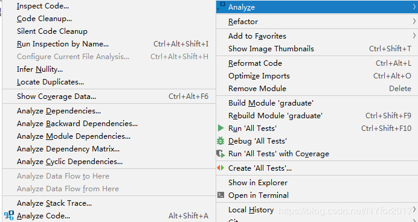
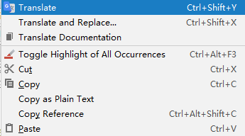
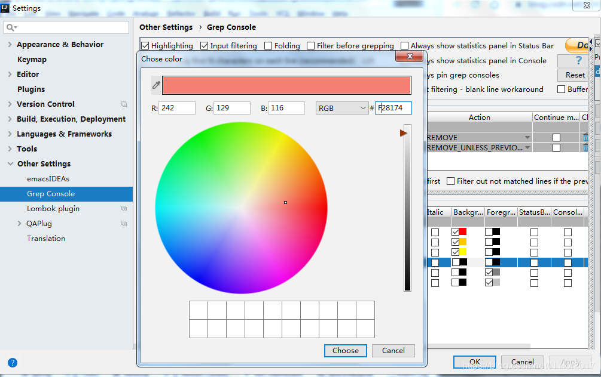
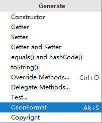
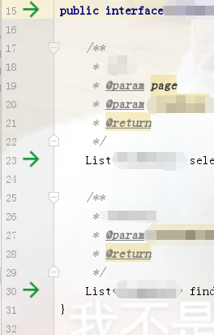
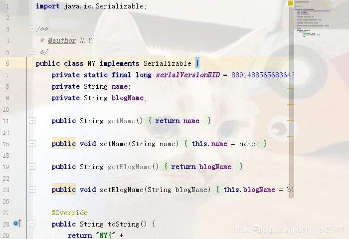
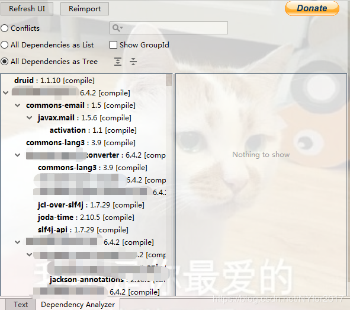
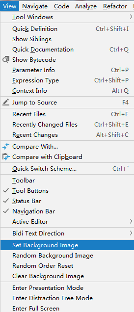
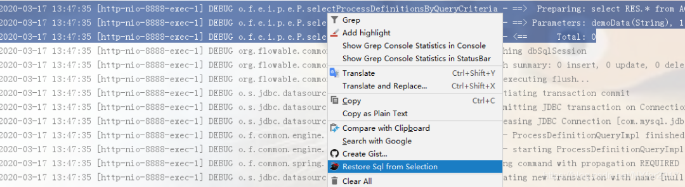
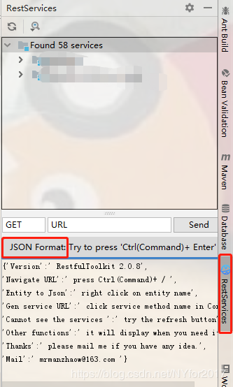

> 迁移来源 [博客园原文](https://www.cnblogs.com/xiuzhublog/p/12810057.html) · 原文发布于 `2020-04-30 17:25:00`（UTC+8）
> 旧文归档，保留当时的记录。

这篇文章用于记录idea插件。多分类记录确实可以提升效率。

#### 1. FindBugs

虽说Idea本身提供的代码检查工具已经很强大了，但Idea提供的更多是规范性的检查，如果需要深入地检查异常，可以使用此插件。

使用方式：右键点击项目、包或者文件，出现如下界面：



#### 2. Translation

对于平常不怎么使用英语的同学，在给类、方法、变量起名的时候总需要打开网页查询单词，这也太麻烦了。这个插件可以让你直接在编辑器查询到想翻译的单词。

使用方式：选出要翻译的单词，右键点击便可出现以下页面：



#### 3. Grep Console

Idea的控制台console输出日志时，往往是一大堆信息一起出现，想要快速找到自己想要的日志类型，使用这个插件便可以快速定位到自己关注的日志类型，还可以配置自己喜欢的颜色。

使用方式：点击菜单栏的File之后点击下拉表中的Settings，进入Other Settings中后点击Grep Console设置：



#### 4. GsonFormat

当我们在对接接口的时候接受对方返回的JSON对象，而自己想要用一个对象去接受时，可以用此插件进行转换。当然，除了使用插件，还可以使用一些在线json转换网站，如bejson等。



#### 5. Free MyBatis Plugin

这个插件之前的名称是free-idea-mybatis。平时开发的时候在mybatis xml和对应的mapper之间反复横跳，然而不同的人开发，放置的位置又不同，这个插件既可以帮助我们快速在mybatis xml和对应的mapper之间跳转，还可以帮助生成mapper xml文件等。

使用方式：安装好插件重启之后，mybatis xml和对应的mapper的左侧就会有可以实现快速跳转的箭头：



#### 6. CodeGlance

这个插件可以向查看缩略图一样，帮助我们快速切换到所要的代码区域，而不用疯狂地拖拽一遍去找。

使用方式：安装插件之后直接重启就可以看到：



#### 7. Maven Helper

当你的程序莫名其妙跑不动的时候，或许你可以从解决依赖冲突开始。在没有这个插件之前，需要通过输入命令行：

```
mvn denpendency:tree
```

才可以查看依赖，如果想要查看是否有依赖包冲突，也需要通过输入命令行等操作才行。安装此插件就可以通过界面操作，无需输入命令方可查看依赖。

使用方式：安装好插件之后，打开pom.xml之后，其下方有Dependency Analyzer选项，点击之后即可看到此页面：



#### 8. Background Image Plus +

这个插件虽然不能直接提高开发效率和代码质量，但是可以让你的背景设置成你喜欢的图片，让你面对的IDE不再单调，间接提高代码效率~

使用方式：在菜单栏找到View后，选择下拉表中的Set Background Image：



#### 9. Mybatis Log Plugin

开发过程中总少不了日志系统，而在我们书写mysql语句过程中往往会忽略参数的对应关系，而且输出在控制台上的sql语句都还要手动转化。这个插件可以将mybatis执行的sql脚本显示出来，无需处理，直接使用。

使用方式：选中控制台中的输出的sql语句，右键选择Restore sql from selection即可：



#### 10. RestfulToolkit

我们平时经常需要使用postman或者postwoman来进行RESTful服务开发调试，而idea插件RestfulToolkit提供了一套的RESTful服务开发辅助工具集，使我们日常调试更加方便。

使用方式：安装插件后，其右侧会有RestServices侧边栏，点击打开即可：



当然还有一些值得推荐的插件，像是：

- Stackoverflow：用于搜索问题，但是用的是google搜索引擎，对于不购买vpn的同学来说，用处不大…
- NyanProgressBar：精致的同学们可以用起来，这是一个形象利器。
- VisualVM Launcher：Java虚拟机调试利器。
- Jrebel：热部署插件，但是要收费的（网上有很多破解咳咳）
- JUnitGenerator V2.0：单元测试利器。
- Alibaba Java Coding Guidelines：阿里巴巴试行的开发设计规范
