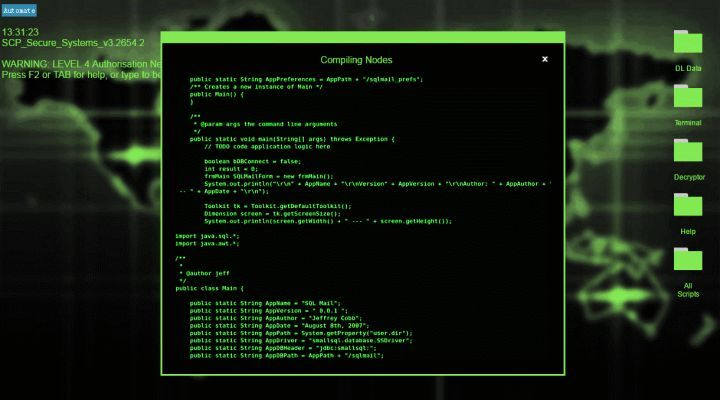

> 迁移来源 [博客园原文](https://www.cnblogs.com/xiuzhublog/p/12810088.html) · 原文发布于 `2020-04-30 17:28:00`（UTC+8）
> 旧文归档，保留当时的记录。

在csdn上看到了一篇文章<https://blog.csdn.net/qq_43901693/article/details/100606828>，这篇转载了博主介绍的网站，又添加了一些平时自己平时遇到的有价值的网站。以后遇到的网站也会在这里记录。用网页的方式保存确实比书签方便，想用什么的时候搜一下就行了。不像书签，多级分类搞了一大堆。

#### 搞学习

- 知乎：www.zhihu.com
- TED（最优质的演讲）：https://www.ted.com/
- 谷粉学术： https://gfsoso.99lb.net/scholar.html
- 大学资源网：http://www.dxzy163.com/
- 简答题：http://www.jiandati.com/
- 网易公开课：https://open.163.com/ted/
- 网易云课堂：https://study.163.com/
- 中国大学MOOC：www.icourse163.org
- 网易云课堂：study.163.com
- 哔哩哔哩弹幕网：www.bilibili.com
- 我要自学网：www.（这个打不出来）51zxw.net
- 大学生资源网：http://www.dxzy163.com/
- 学堂在线：www.xuetangx.com
- 爱课程：www.icourses.cn
- 猫咪论文：https://lunwen.im/
- iData（论文搜索）：www.cn-ki.net
- 文泉考试：https://www.wqkaoshi.com
- 码农之家（计算机电子书下载）：www.xz577.com
- 鸠摩搜书：www.jiumodiary.com
- 云海电子图书馆：www.pdfbook.cn
- 周读（书籍搜索）：ireadweek.com
- 知轩藏书：http://www.zxcs.me/
- 脚本之家电子书下载：https://www.jb51.net/books/
- 搜书VIP-电子书搜索：http://www.soshuvip.com/all.html
- 书格（在线古籍图书馆）：https://new.shuge.org/
- 术语在线：http://www.termonline.cn/
- 必看网（人生必看的书籍）：https://www.biikan.com/

#### 冷知识 / 黑科技

- 上班摸鱼必备（假装电脑系统升级）：http://fakeupdate.net/
- 创意光线绘画：http://weavesilk.com/
- 星系观察：https://stellarium-web.org/
- 煎蛋：http://jandan.net/
- 渣男-说话的艺术：https://lovelive.tools/
- 全历史：https://www.allhistory.com/
- iData：https://www.cn-ki.net/
- caj云阅读：http://cajviewer.cnki.net/cajcloud/
- geektyper（黑客帝国风格）：http://geektyper.com/
- 

#### 资源搜索

- 1.鸠摩搜书
- 首先给大家推荐的网站是：鸠摩搜书
- 地址：https://www.jiumodiary.com/
- 这个网上非常棒，上面有很多优质电子书，有技术的，非技术的，基本上能满足各位老铁的需求，该网站很轻，没有广告，也提供各种格式的下载。比如我搜《java编程思想》：
- 2. 威锋网电子书论坛
- 这个网站里面不仅可以搜到电子书，还有很多资讯内容，没事儿可以逛逛，https://www.feng.com/
- 比如我搜：《Java编程思想》：
- 3.Kindle 论坛
- 这里面都是实用kindle书籍，是个论坛，里面可以搜索很多自己需要的书籍资料：http://www.dabianbang.com/
- 比如我搜索：《Java编程思想》：
- 4.ePUBee
- 一个号称最大的电子书网站：http://cn.epubee.com/books/。你可以在这里找到一些新出版的图书，搜索到的书籍格式也非常全面。最主要的是，所有的书都是免费的。这个网站，很少人知道。虽然它的界面不好看，但搜索功能非常强大。你可以通过作者、书名、ASIN进行搜索。
- 5.ePUBw
- 这是一个免费的电子书资源网站，几乎你想要的电子书都可以在这找到：https://epubw.com/
- 6.万千合集站
- 这个网站基本上很多技术电子书也是能搜到的，挺不错的网站，看名字就知道了：http://www.hejizhan.com/bbs/
- 友情提示：下文我就不贴图了，大家需要的话，自己去搜索一下，体验一下就知道我的用心了。
- 如果你是学Java的，可以关注我的原创公众号：【武哥聊编程】
- 公众号后台回复：“CSDN”，即可获得两份Java面试题大全。
- 其他电子书网站，我把地址总结给大家，大家自己去搜索一下即可，不仅限于技术电子书，其他类的也都能搜到，程序员平时不能只钻研技术，其他书籍也是可以读一读的。我给大家整理的，都是比较优质的网站，我自己都用过的，大家可以放心搜索。加上上面6个，总共有50+个电子书网站，足够你用几辈子了~
- 读书皮：http://slfswh.xiangzhan.com/
- 书格：https://new.shuge.org/
- 田间小站：https://www.tianfateng.cn/
- 喵咪论文：https://lunwen.im/
- 爱如生论坛：http://forum.er07.com/
- 超星读书：http://book.chaoxing.com/
- 台大图书馆：http://ebooks.lib.ntu.edu.tw/Home/ListBooks
- PDFDrive：https://www.pdfdrive.com/
- Sodu：http://www.sodu.cn
- 图灵社区：https://www.ituring.com.cn/
- BookSC：https://booksc.org/
- Manybooks：https://manybooks.net/
- 子午书简：https://5kindle.com/
- 书伴: https://bookfere.com/eboo
- Kindle 论坛：http://www.dabianbang.com/
- 智奇搜书：https://www.zqbook.top/
- 如风搜：http://www.rufengso.net/
- 小白盘：https://www.xiaobaipan.com/
- Lorefree：https://ebook.lorefree.com/
- 我与书：http://www.woyushu.com/forum/
- 三秋书屋：https://www.d4j.cn/
- 书语者：https://book.shuyuzhe.com/
- E书联盟：http://www.book118.com/
- 蚂蚁搜书：http://book.mybanshu.win/
- 云海电子图书馆：http://www.pdfbook.cn/
- 爱问共享资料：https://ishare.iask.sina.com.cn/
- IRead：http://www.iread.cf/
- iamtxt：http://www.iamtxt.com/
- 好读：http://haodoo.net/
- 计算机书控：http://bestcbooks.com/
- 国学数典：http://bbs.gxsd.com.cn/forum.php
- 影印古籍：https://sou-yun.cn/eBookIndex.aspx
- 国学网：http://www.guoxue.com/
- 周读：http://www.ireadweek.com/
- ZLibrary：https://b-ok.cc/
- Gutenberg：https://www.gutenberg.org/
- Libgen：http://gen.lib.rus.ec/
- Magzinelib：https://magazinelib.com/
- 苦瓜书盘：https://www.kgbook.com/
- 必看网：https://www.biikan.com/
- 书单网：http://www.shudan.vip/
- 采书：http://www.ebook.name/
- 台湾华文电子书库：http://taiwanebook.ncl.edu.tw/zh-tw
- 走读派：http://www.zoudupai.com/
- 蓝菊花：http://www.lanjuhua.com/
- 快吧：http://www.fast8.com
- 书舟网：http://kindle.archiew.top/
- 云海电子图书馆：http://www.pdfbook.cn/
- DogeDoge搜索引擎：www.dogedoge.com
- 秘迹搜索：https://mijisou.com/
- 小白盘：https://www.xiaobaipan.com/
- 云盘精灵（资源搜索）：www.yunpanjingling.com
- 虫部落（资源搜索）：www.chongbuluo.com
- 如风搜（资源搜索）：http://www.rufengso.net/
- 爱扒：https://www.zyboe.com/
- 免费下载电子书：http://freecomputerbooks.com
- 谷歌插件网：http://chromecj.com/
- MSDN我告诉你：https://msdn.itellyou.cn/

#### 小工具

- 云端超级应用空间（PS，PPT，Excel，Ai）：https://uzer.me/
- 在线接口测试（Getman）：https://getman.cn/
- 香当网（年终总结，个人简历，事迹材料，租赁合同，演讲稿）：https://www.xiangdang.net/
- 二维码生成：https://cli.im/
- 搜狗翻译：fanyi.sogou.com
- 熵数（图表制作，数据可视化）：https://dydata.io/appv2/#/pages/index/home
- 拷贝兔：https://cp.anyknew.com/
- 图片无限变放大：http://bigjpg.com/zh
- 幕布（在线大纲笔记工具）：mubu.com
- 奶牛快传（在线传输文件利器）：cowtransfer.com
- 在线转换器（在线转换器转换任何测量单位）：https://zh.justcnw.com/
- 调查问卷制作：https://www.wenjuan.com/
- 果核剥壳（软件下载）：https://www.ghpym.com/
- 软件下载：https://www.unyoo.com/
- MSDN我告诉你（windows10系统镜像下载）：https://msdn.itellyou.c格式转换大全（office文档格式、视频格式、音频格式、图片格式、电子书格式......**.**）：https://cn.office-converter.com
- 在线办公：https://uzer.me/

#### 导航页（工具集）

- NiceTool.net 好工具网：http://www.nicetool.net/
- 现实君工具箱（综合型在线工具集成网站）：http://tool.uixsj.cn/
- 蓝调网站：http://lcoc.top/
- 偷渡鱼：https://touduyu.com/
- 牛导航：http://www.ziliao6.com/
- 小呆导航：https://www.webjike.com/index.html
- 简法主页：http://www.jianfast.com/
- KIM主页：https://kim.plopco.com/
- 聚BT：https://jubt.net/cn/index.html
- 精准云工具合集：https://jingzhunyun.com/
- 兔2工具合集：https://www.tool2.cn/
- 爱资料工具（在线实用工具集合）：www.toolnb.com
- 工具导航：https://hao.logosc.cn/
- PPT资源网站导航：http://www.hippter.com/
- 常用网站书签www.bewindoweb.com/dwg.php

#### 看视频

- 电影推荐（分类别致）：http://www.mvcat.com
- 去看TV：https://www.qukantv.net/
- 动漫视频网：http://www.zzzfun.com/
- 94神马电影网：http://www.9rmb.com/
- NO视频官网：http://www.novipnoad.com/
- 蓝光画质电影：http://www.languang.co/
- 在线看剧：http://dy.27234.cn/
- 大数据导航：http://hao.199it.com/
- 多功能图片网站：https://www.logosc.cn/so/
- 牛牛TV：http://www.ziliao6.com/tv/
- VideoFk解析视频：http://www.videofk.com/
- 蓝调网站：http://lcoc.top/vip2.3/
- 全球电视直播：http://bddn.cn/zb.htm

#### 学设计

- 免费音频素材：https://icons8.cn/music
- 新CG儿（视频素材模板，无水印+免费下载）：https://www.newcger.com/
- 小图标下载：https://www.easyicon.net/
- 第一字体转换器：http://www.diyiziti.com/
- doyoudosh（平面设计）：www.doyoudo.com
- 企业宣传视频在线制作：https://duomu.tv/
- MAKE海报设计官网：http://maka.im/
- 一键海报神器：https://www.logosc.cn/photo/?utm\_source=hao.logosc.cn&utm\_medium=referral
- 字由（字体设计）：http://www.hellofont.cn/
- 查字体网站：https://fonts.safe.360.cn/
- 爱给网（免费素材下载的网站，包括音效、配乐，3D、视频、游戏，平面、教程）：http://www.aigei.com/
- 在线视频剪辑：https://bilibili.clipchamp.com/editor

#### 搞文档

- 即书（在线制作PPT）：https://www.keysuper.com/
- PDF处理：https://smallpdf.com/cn
- PDF处理：https://www.ilovepdf.com/zh-cn
- PDF处理：https://www.pdfpai.com/
- PDF处理：https://www.hipdf.cn/
- 腾讯文档（在线协作编辑和管理文档）：docs.qq.com
- ProcessOn（在线协作制作结构图）：www.processon.com
- iLovePDF（在线转换PDF利器）：www.ilovepdf.com
- PPT在线制作：https://www.woodo.cn/
- PDF24工具（pdf处理工具）：https://tools.pdf24.org/en
- IMGBOT（在线图片处理）：www.imgbot.ai
- 福昕云编辑（在线编辑PDF）：edit.foxitcloud.cn
- TinyPNG（在线压缩图片）：tinypng.com
- UZER.ME（在线使用各种大应用，在线使用CAD，MATLAB，Office三件套  
  ）：uzer.me
- 优品PPT（模板下载）：http://www.ypppt.com/
- 第一PPT（模板下载）：http://www.1ppt.com/xiazai/
- 三顿PPT导航：sandunppt.com

#### 找图片

- 电脑壁纸：http://lcoc.top/bizhi/
- https://unsplash.com/
- https://pixabay.com/
- https://www.pexels.com/
- https://visualhunt.com/
- https://www.ssyer.com/
- 彼岸图网：http://pic.netbian.com/
- 极像素（超高清大图）：https://www.sigoo.com/
- 免费版权图片搜索：https://www.logosc.cn/so/
