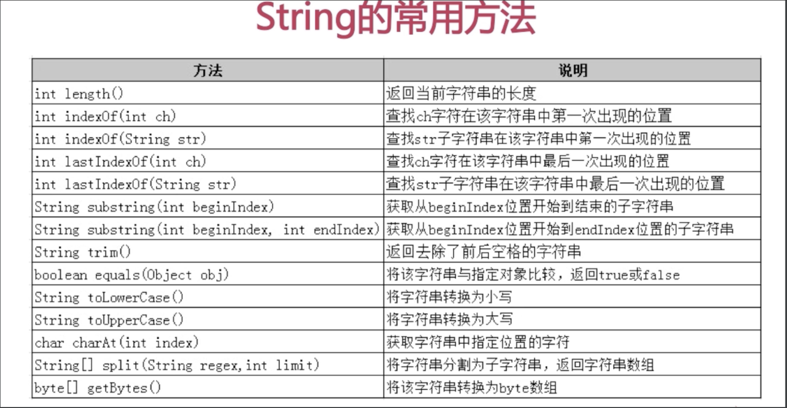
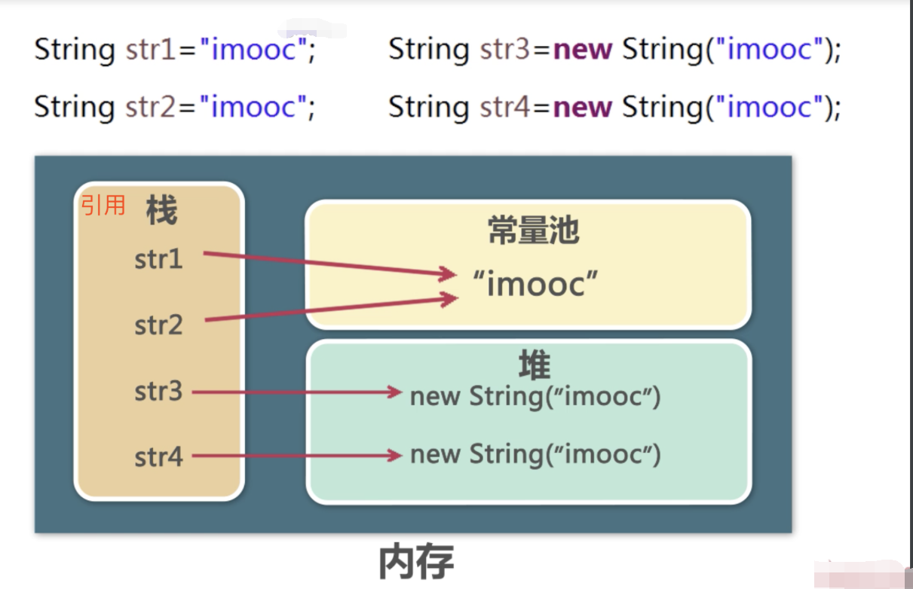
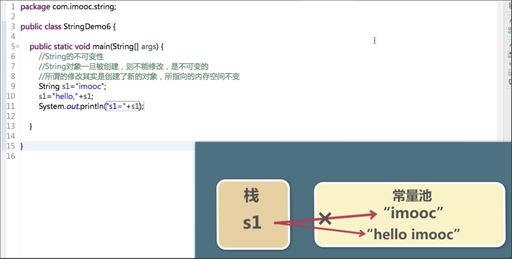
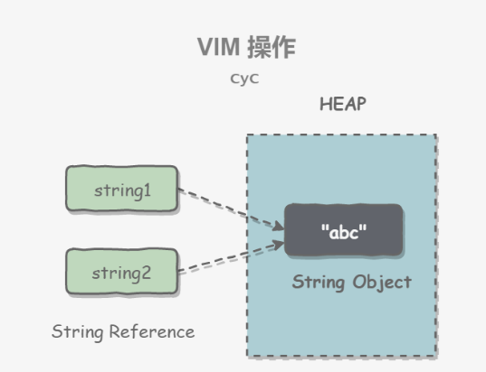

> 迁移来源 [博客园原文](https://www.cnblogs.com/xiuzhublog/p/12823838.html) · 原文发布于 `2020-05-03 22:07:00`（UTC+8）
> 旧文归档，保留当时的记录。

## String基础

### Java String 类

字符串广泛应用 在 Java 编程中，在 Java 中字符串属于对象，Java 提供了 String 类来创建和操作字符串。

### 创建字符串

创建字符串最简单的方式如下:

String greeting = “helloworld”;

在代码中遇到字符串常量时，这里的值是 “helloworld ”，编译器会使用该值创建一个 String 对象。

和其它对象一样，可以使用关键字和构造方法来创建 String 对象。

String 类有 11 种构造方法，这些方法提供不同的参数来初始化字符串，比如提供一个字符数组参数:

### StringDemo.java 文件代码：

```
public class StringDemo{   
      public static void main(String args[]){ 
                char[] helloArray = { 'r', 'u', 'n', 'o', 'o', 'b'}; 
                String helloString = new String(helloArray);
                System.out.println( helloString );   
              } 
}
```

以上实例编译运行结果如下：

```
runoob
```

**注意:**String 类是不可改变的，所以你一旦创建了 String 对象，那它的值就无法改变了，如果需要对字符串做很多修改，那么应该选择使用 [StringBuffer & StringBuilder 类](https://www.runoob.com/java/java-stringbuffer.html)。

## String基本用法

### 创建String对象的常用方法

（1） String s1 = “mpptest”

(2) String s2 = new String();

(3) String s3 = new String(“mpptest”)

### String的常用方法



#### 三个方法的使用： lenth() substring() charAt()

```
package com.mpp.string; public class StringDemo1 { public static void main(String[] args) { //定义一个字符串"晚来天欲雪 能饮一杯无"
        String str = "晚来天欲雪 能饮一杯无";
        System.out.println("字符串的长度是："+str.length()); //字符串的雪字打印输出  charAt(int index)
        System.out.println(str.charAt(4)); //取出子串  天欲
        System.out.println(str.substring(2));   //取出从index2开始直到最后的子串，包含2
        System.out.println(str.substring(2,4));  //取出index从2到4的子串，包含2不包含4  顾头不顾尾
 }
}
```

#### 两个方法的使用,求字符或子串第一次/最后一次在字符串中出现的位置： indexOf() lastIndexOf()package com.mpp.string;

```
public class StringDemo2 { public static void main(String[] args) {
        String str = new String("赵客缦胡缨 吴钩胡缨霜雪明"); //查找胡在字符串中第一次出现的位置
        System.out.println("\"胡\"在字符串中第一次出现的位置："+str.indexOf("胡")); //查找子串"胡缨"在字符串中第一次出现的位置
        System.out.println("\"胡缨\"在字符串中第一次出现的位置"+str.indexOf("胡缨")); //查找胡在字符串中最后一次次出现的位置
        System.out.println(str.lastIndexOf("胡")); //查找子串"胡缨"在字符串中最后一次出现的位置
        System.out.println(str.lastIndexOf("胡缨")); //从indexof为5的位置，找第一次出现的"吴"
        System.out.println(str.indexOf("吴",5));
    }
}
```

### 字符串与byte数组间的相互转换

```
public class StringDemo3 {  
 public static void main(String[] args) throws UnsupportedEncodingException { //字符串和byte数组之间的相互转换
 String str = new String("hhhabc银鞍照白马 飒沓如流星"); //将字符串转换为byte数组，并打印输出
        byte[] arrs = str.getBytes("GBK"); for(int i=0;i){
            System.out.print(arrs[i]);
        } //将byte数组转换成字符串
 System.out.println();
        String str1 = new String(arrs,"GBK");  //保持字符集的一致，否则会出现乱码
 System.out.println(str1);
    }
}
```

### ==运算符和equals之间的区别：

引用指向的内容和引用指向的地址



```
public class StringDemo5 { public static void main(String[] args) {
        String str1 = "mpp";
        String str2 = "mpp";
        String str3 = new String("mpp");

        System.out.println(str1.equals(str2)); //true  内容相同
        System.out.println(str1.equals(str3));   //true  内容相同
        System.out.println(str1==str2);   //true   地址相同
        System.out.println(str1==str3);   //false  地址不同
 }
}
```

### String的连接

```
@Test
public void contact () {
    //1连接方式
    String s1 = "a";
    String s2 = "a";
    String s3 = "a" + s2;
    String s4 = "a" + "a";
    String s5 = s1 + s2;
    //表达式只有常量时，编译期完成计算
    //表达式有变量时，运行期才计算，所以地址不一样
    System.out.println(s3 == s4); //f
    System.out.println(s3 == s5); //f
    System.out.println(s4 == "aa"); //t

}
```

### String、String builder和String buffer的区别

String是Java中基础且重要的类，并且String也是Immutable类的典型实现，被声明为final class，除了hash这个属性其它属性都声明为final,因为它的不可变性，所以例如拼接字符串时候会产生很多无用的中间对象，如果频繁的进行这样的操作对性能有所影响。

StringBuffer就是为了解决大量拼接字符串时产生很多中间对象问题而提供的一个类，提供append和add方法，可以将字符串添加到已有序列的末尾或指定位置，它的本质是一个线程安全的可修改的字符序列，把所有修改数据的方法都加上了synchronized。但是保证了线程安全是需要性能的代价的。

在很多情况下我们的字符串拼接操作不需要线程安全，这时候StringBuilder登场了，StringBuilder是JDK1.5发布的，它和StringBuffer本质上没什么区别，就是去掉了保证线程安全的那部分，减少了开销。

StringBuffer 和 StringBuilder 二者都继承了 AbstractStringBuilder ，底层都是利用可修改的char数组(JDK 9 以后是 byte数组)。

所以如果我们有大量的字符串拼接，如果能预知大小的话最好在new StringBuffer 或者StringBuilder 的时候设置好capacity，避免多次扩容的开销。扩容要抛弃原有数组，还要进行数组拷贝创建新的数组。

我们平日开发通常情况下少量的字符串拼接其实没太必要担心，例如

String str = “aa”+”bb”+”cc”;

像这种没有变量的字符串，编译阶段就直接合成”aabbcc”了，然后看字符串常量池（下面会说到常量池）里有没有，有也直接引用，没有就在常量池中生成，返回引用。

如果是带变量的，其实影响也不大，JVM会帮我们优化了。

> 1、在字符串不经常发生变化的业务场景优先使用String(代码更清晰简洁)。如常量的声明，少量的字符串操作(拼接，删除等)。
>
> 2、在单线程情况下，如有大量的字符串操作情况，应该使用StringBuilder来操作字符串。不能使用String”+”来拼接而是使用，避免产生大量无用的中间对象，耗费空间且执行效率低下（新建对象、回收对象花费大量时间）。如JSON的封装等。
>
> 3、在多线程情况下，如有大量的字符串操作情况，应该使用StringBuffer。如HTTP参数解析和封装等。

## String类的源码分析

### String类型的intern

```
public void intern () {
    //2：string的intern使用
    //s1是基本类型，比较值。s2是string实例，比较实例地址
    //字符串类型用equals方法比较时只会比较值
    String s1 = "a";
    String s2 = new String("a");
    //调用intern时,如果s2中的字符不在常量池，则加入常量池并返回常量的引用
    String s3 = s2.intern();
    System.out.println(s1 == s2);
    System.out.println(s1 == s3);
}
```

### String类型的equals

```
//字符串的equals方法
//    public boolean equals(Object anObject) {
//            if (this == anObject) {
//                return true;
//            }
//            if (anObject instanceof String) {
//                String anotherString = (String)anObject;
//                int n = value.length;
//                if (n == anotherString.value.length) {
//                    char v1[] = value;
//                    char v2[] = anotherString.value;
//                    int i = 0;
//                    while (n-- != 0) {
//                        if (v1[i] != v2[i])
//                            return false;
//                        i++;
//                    }
//                    return true;
//                }
//            }
//            return false;
//        }
```

### StringBuffer和Stringbuilder

底层是继承父类的可变字符数组value

```
/**

- The value is used for character storage.
  */
  char[] value;
  初始化容量为16

/**

- Constructs a string builder with no characters in it and an
- initial capacity of 16 characters.
  */
  public StringBuilder() {
  super(16);
  }
  这两个类的append方法都是来自父类AbstractStringBuilder的方法

public AbstractStringBuilder append(String str) {
    if (str == null)
        return appendNull();
    int len = str.length();
    ensureCapacityInternal(count + len);
    str.getChars(0, len, value, count);
    count += len;
    return this;
}
@Override
public StringBuilder append(String str) {
    super.append(str);
    return this;
}

@Override
public synchronized StringBuffer append(String str) {
    toStringCache = null;
    super.append(str);
    return this;
}
```

### append方法

```
Stringbuffer在大部分涉及字符串修改的操作上加了synchronized关键字来保证线程安全，效率较低。

String类型在使用 + 运算符例如

String a = “a”

a = a + a;时，实际上先把a封装成stringbuilder，调用append方法后再用tostring返回，所以当大量使用字符串加法时，  
会大量地生成stringbuilder实例，这是十分浪费的，这种时候应该用stringbuilder来代替string。
```

### 扩容

#注意在append方法中调用到了一个函数

ensureCapacityInternal(count + len);  
该方法是计算append之后的空间是否足够，不足的话需要进行扩容

```
public void ensureCapacity(int minimumCapacity) {
    if (minimumCapacity > 0)
        ensureCapacityInternal(minimumCapacity);
}
private void ensureCapacityInternal(int minimumCapacity) {
    // overflow-conscious code
    if (minimumCapacity - value.length > 0) {
        value = Arrays.copyOf(value,
                newCapacity(minimumCapacity));
    }
}
```

如果新字符串长度大于value数组长度则进行扩容

扩容后的长度一般为原来的两倍 + 2；

假如扩容后的长度超过了jvm支持的最大数组长度MAX\_ARRAY\_SIZE。

考虑两种情况

如果新的字符串长度超过int最大值，则抛出异常，否则直接使用数组最大长度作为新数组的长度。

```
private int hugeCapacity(int minCapacity) {
    if (Integer.MAX_VALUE - minCapacity < 0) { // overflow
        throw new OutOfMemoryError();
    }
    return (minCapacity > MAX_ARRAY_SIZE)
        ? minCapacity : MAX_ARRAY_SIZE;
}
```

### 删除

这两个类型的删除操作：

都是调用父类的delete方法进行删除

```
public AbstractStringBuilder delete(int start, int end) {
    if (start < 0)
        throw new StringIndexOutOfBoundsException(start);
    if (end > count)
        end = count;
    if (start > end)
        throw new StringIndexOutOfBoundsException();
    int len = end - start;
    if (len > 0) {
        System.arraycopy(value, start+len, value, start, count-end);
        count -= len;
    }
    return this;
}
```

事实上是将剩余的字符重新拷贝到字符数组value。

这里用到了system.arraycopy来拷贝数组，速度是比较快的

### system.arraycopy方法

转自知乎：

> 在主流高性能的JVM上（HotSpot VM系、IBM J9 VM系、JRockit系等等），可以认为System.arraycopy()在拷贝数组时是可靠高效的——如果发现不够高效的情况，请报告performance bug，肯定很快就会得到改进。
>
> java.lang.System.arraycopy()方法在Java代码里声明为一个native方法。所以最naïve的实现方式就是通过JNI调用JVM里的native代码来实现。
>
> String的不可变性  
> 关于String的不可变性，这里转一个不错的回答
>
> 什么是不可变？  
> String不可变很简单，如下图，给一个已有字符串”abcd”第二次赋值成”abcedl”，不是在原内存地址上修改数据，而是重新指向一个新对象，新地址。

## String和JVM的关系

下面我们了解下Java栈、Java堆、方法区和常量池：

### Java栈（线程私有数据区）：

每个Java虚拟机线程都有自己的Java虚拟机栈，Java虚拟机栈用来存放栈帧，每个方法被执行的时候都会同时创建一个栈帧（Stack Frame）用于存储局部变量表、操作栈、动态链接、方法出口等信息。每一个方法被调用直至执行完成的过程，就对应着一个栈帧在虚拟机栈中从入栈到出栈的过程。

### Java堆（线程共享数据区）：

```
在虚拟机启动时创建，此内存区域的唯一目的就是存放对象实例，几乎所有的对象实例都在这里分配。
```

### 方法区（线程共享数据区）：

方法区在虚拟机启动的时候被创建，它存储了每一个类的结构信息，例如运行时常量池、字段和方法数据、构造函数和普通方法的字节码内容、还包括在类、实例、接口初始化时用到的特殊方法。在JDK8之前永久代是方法区的一种实现，而JDK8元空间替代了永久代，永久代被移除，也可以理解为元空间是方法区的一种实现。

### 常量池（线程共享数据区）：

```
常量池常被分为两大类：静态常量池和运行时常量池。  
  
静态常量池也就是Class文件中的常量池，存在于Class文件中。  
  
运行时常量池（Runtime Constant Pool）是方法区的一部分，存放一些运行时常量数据。
```

### 下面重点了解的是字符串常量池：

字符串常量池存在运行时常量池之中（在JDK7之前存在运行时常量池之中，在JDK7已经将其转移到堆中）。  
  
字符串常量池的存在使JVM提高了性能和减少了内存开销。  
  
使用字符串常量池，每当我们使用字面量（String s=”1”;）创建字符串常量时，JVM会首先检查字符串常量池，如果该字符串已经存在常量池中，那么就将此字符串对象的地址赋值给引用s（引用s在Java栈中）。如果字符串不存在常量池中，就会实例化该字符串并且将其放到常量池中，并将此字符串对象的地址赋值给引用s（引用s在Java栈中）。

使用字符串常量池，每当我们使用关键字new（String s=new String(”1”);）创建字符串常量时，JVM会首先检查字符串常量池，如果该字符串已经存在常量池中，那么不再在字符串常量池创建该字符串对象，而直接堆中复制该对象的副本，然后将堆中对象的地址赋值给引用s，如果字符串不存在常量池中，就会实例化该字符串并且将其放到常量池中，然后在堆中复制该对象的副本，然后将堆中对象的地址赋值给引用s。

## String的不可变性

### 源码分析

String 被声明为 final，因此它不可被继承。(Integer 等包装类也不能被继承）

在 Java 8 中，String 内部使用 char 数组存储数据。

```
public final class String
    implements java.io.Serializable, Comparable<String>, CharSequence {
    /** The value is used for character storage. */
    private final char value[];
}
```

在 Java 9 之后，String 类的实现改用 byte 数组存储字符串，同时使用 `coder` 来标识使用了哪种编码。

```
public final class String
    implements java.io.Serializable, Comparable<String>, CharSequence {
    /** The value is used for character storage. */
    private final byte[] value;

    /** The identifier of the encoding used to encode the bytes in {@code value}. */
    private final byte coder;
}
```

value 数组被声明为 final，这意味着 value 数组初始化之后就不能再引用其它数组。并且 String 内部没有改变 value 数组的方法，因此可以保证 String 不可变。

### 实例

String的对象一旦被创建，则不能修改，是不可变的

所谓的修改其实是创建了新的对象，所指向的内存空间不变



 上图中，s1不再指向imooc所在的内存空间，而是指向了hello,imooc

### 不可变的好处

#### 1. 可以缓存 hash 值

因为 String 的 hash 值经常被使用，例如 String 用做 HashMap 的 key。不可变的特性可以使得 hash 值也不可变，因此只需要进行一次计算。

#### 2. String Pool 的需要

如果一个 String 对象已经被创建过了，那么就会从 String Pool 中取得引用。只有 String 是不可变的，才可能使用 String Pool。



#### 3. 安全性

String 经常作为参数，String 不可变性可以保证参数不可变。例如在作为网络连接参数的情况下如果 String 是可变的，那么在网络连接过程中，String 被改变，改变 String 的那一方以为现在连接的是其它主机，而实际情况却不一定是。

#### 4. 线程安全

String 不可变性天生具备线程安全，可以在多个线程中安全地使用。

## String常用工具类

问题描述：  
很多时候我们需要对字符串进行很多固定的操作,而这些操作在JDK/JRE中又没有预置,于是我们想到了apache-commons组件,但是它也不能完全覆盖我们的业务需求,所以很多时候还是要自己写点代码的,下面就是基于apache-commons组件写的部分常用方法:

```
MAVEN依赖
<dependency>
    <groupId>org.apache.commons</groupId>
    <artifactId>commons-lang3</artifactId>
    <version>${commons-lang3.version}</version>
 </dependency>
```

代码

```
public class StringUtils extends org.apache.commons.lang3.StringUtils {

/** 值为"NULL"的字符串 */
private static final String NULL_STRING = "NULL";

private static final char SEPARATOR = '_';


/**
 * 满足一下情况返回true<br/>
 * ①.入参为空
 * ②.入参为空字符串
 * ③.入参为"null"字符串
 *
 * @param string 需要判断的字符型
 * @return boolean
 */
public static boolean isNullOrEmptyOrNULLString(String string) {
    return isBlank(string) || NULL_STRING.equalsIgnoreCase(string);
}

/**
 * 把字符串转为二进制码<br/>
 * 本方法不会返回null
 *
 * @param str 需要转换的字符串
 * @return 二进制字节码数组
 */
public static byte[] toBytes(String str) {
    return isBlank(str) ? new byte[]{} : str.getBytes();
}

/**
 * 把字符串转为二进制码<br/>
 * 本方法不会返回null
 *
 * @param str     需要转换的字符串
 * @param charset 编码类型
 * @return 二进制字节码数组
 * @throws UnsupportedEncodingException 字符串转换的时候编码不支持时出现
 */
public static byte[] toBytes(String str, Charset charset) throws UnsupportedEncodingException {
    return isBlank(str) ? new byte[]{} : str.getBytes(charset.displayName());
}

/**
 * 把字符串转为二进制码<br/>
 * 本方法不会返回null
 *
 * @param str     需要转换的字符串
 * @param charset 编码类型
 * @param locale  编码类型对应的地区
 * @return 二进制字节码数组
 * @throws UnsupportedEncodingException 字符串转换的时候编码不支持时出现
 */
public static byte[] toBytes(String str, Charset charset, Locale locale) throws UnsupportedEncodingException {
    return isBlank(str) ? new byte[]{} : str.getBytes(charset.displayName(locale));
}

/**
 * 二进制码转字符串<br/>
 * 本方法不会返回null
 *
 * @param bytes 二进制码
 * @return 字符串
 */
public static String bytesToString(byte[] bytes) {
    return bytes == null || bytes.length == 0 ? EMPTY : new String(bytes);
}

/**
 * 二进制码转字符串<br/>
 * 本方法不会返回null
 *
 * @param bytes   二进制码
 * @param charset 编码集
 * @return 字符串
 * @throws UnsupportedEncodingException 当前二进制码可能不支持传入的编码
 */
public static String byteToString(byte[] bytes, Charset charset) throws UnsupportedEncodingException {
    return bytes == null || bytes.length == 0 ? EMPTY : new String(bytes, charset.displayName());
}

/**
 * 二进制码转字符串<br/>
 * 本方法不会返回null
 *
 * @param bytes   二进制码
 * @param charset 编码集
 * @param locale  本地化
 * @return 字符串
 * @throws UnsupportedEncodingException 当前二进制码可能不支持传入的编码
 */
public static String byteToString(byte[] bytes, Charset charset, Locale locale) throws UnsupportedEncodingException {
    return bytes == null || bytes.length == 0 ? EMPTY : new String(bytes, charset.displayName(locale));
}

/**
 * 把对象转为字符串
 *
 * @param object 需要转化的字符串
 * @return 字符串, 可能为空
 */
public static String parseString(Object object) {
    if (object == null) {
        return null;
    }
    if (object instanceof byte[]) {
        return bytesToString((byte[]) object);
    }
    return object.toString();
}

/**
 * 把字符串转为int类型
 *
 * @param str 需要转化的字符串
 * @return int
 * @throws NumberFormatException 字符串格式不正确时抛出
 */
public static int parseInt(String str) throws NumberFormatException {
    return isBlank(str) ? 0 : Integer.parseInt(str);
}

/**
 * 把字符串转为double类型
 *
 * @param str 需要转化的字符串
 * @return double
 * @throws NumberFormatException 字符串格式不正确时抛出
 */
public static double parseDouble(String str) throws NumberFormatException {
    return isBlank(str) ? 0D : Double.parseDouble(str);
}

/**
 * 把字符串转为long类型
 *
 * @param str 需要转化的字符串
 * @return long
 * @throws NumberFormatException 字符串格式不正确时抛出
 */
public static long parseLong(String str) throws NumberFormatException {
    return isBlank(str) ? 0L : Long.parseLong(str);
}

/**
 * 把字符串转为float类型
 *
 * @param str 需要转化的字符串
 * @return float
 * @throws NumberFormatException 字符串格式不正确时抛出
 */
public static float parseFloat(String str) throws NumberFormatException {
    return isBlank(str) ? 0L : Float.parseFloat(str);
}

/**
 * 获取i18n字符串
 *
 * @param code
 * @param args
 * @return
 */
public static String getI18NMessage(String code, Object[] args) {
    //LocaleResolver localLocaleResolver = (LocaleResolver) SpringContextHolder.getBean(LocaleResolver.class);
    //HttpServletRequest request = ((ServletRequestAttributes)RequestContextHolder.getRequestAttributes()).getRequest();
    //Locale locale = localLocaleResolver.resolveLocale(request);
    //return SpringContextHolder.getApplicationContext().getMessage(code, args, locale);
    return "";
}

/**
 * 获得用户远程地址
 *
 * @param request 请求头
 * @return 用户ip
 */
public static String getRemoteAddr(HttpServletRequest request) {
    String remoteAddr = request.getHeader("X-Real-IP");
    if (isNotBlank(remoteAddr)) {
        remoteAddr = request.getHeader("X-Forwarded-For");
    } else if (isNotBlank(remoteAddr)) {
        remoteAddr = request.getHeader("Proxy-Client-IP");
    } else if (isNotBlank(remoteAddr)) {
        remoteAddr = request.getHeader("WL-Proxy-Client-IP");
    }
    return remoteAddr != null ? remoteAddr : request.getRemoteAddr();
}

/**
 * 驼峰命名法工具
 *
 * @return toCamelCase(" hello_world ") == "helloWorld"
 * toCapitalizeCamelCase("hello_world") == "HelloWorld"
 * toUnderScoreCase("helloWorld") = "hello_world"
 */
public static String toCamelCase(String s, Locale locale, char split) {
    if (isBlank(s)) {
        return "";
    }

    s = s.toLowerCase(locale);

    StringBuilder sb = new StringBuilder();
    for (char c : s.toCharArray()) {
        sb.append(c == split ? Character.toUpperCase(c) : c);
    }

    return sb.toString();
}

public static String toCamelCase(String s) {
    return toCamelCase(s, Locale.getDefault(), SEPARATOR);
}

public static String toCamelCase(String s, Locale locale) {
    return toCamelCase(s, locale, SEPARATOR);
}

public static String toCamelCase(String s, char split) {
    return toCamelCase(s, Locale.getDefault(), split);
}

public static String toUnderScoreCase(String s, char split) {
    if (isBlank(s)) {
        return "";
    }

    StringBuilder sb = new StringBuilder();
    for (int i = 0; i < s.length(); i++) {
        char c = s.charAt(i);
        boolean nextUpperCase = (i < (s.length() - 1)) && Character.isUpperCase(s.charAt(i + 1));
        boolean upperCase = (i > 0) && Character.isUpperCase(c);
        sb.append((!upperCase || !nextUpperCase) ? split : "").append(Character.toLowerCase(c));
    }

    return sb.toString();
}

public static String toUnderScoreCase(String s) {
    return toUnderScoreCase(s, SEPARATOR);
}

/**
 * 把字符串转换为JS获取对象值的三目运算表达式
 *
 * @param objectString 对象串
 *                     例如：入参:row.user.id/返回：!row?'':!row.user?'':!row.user.id?'':row.user.id
 */
public static String toJsGetValueExpression(String objectString) {
    StringBuilder result = new StringBuilder();
    StringBuilder val = new StringBuilder();
    String[] fileds = split(objectString, ".");
    for (int i = 0; i < fileds.length; i++) {
        val.append("." + fileds[i]);
        result.append("!" + (val.substring(1)) + "?'':");
    }
    result.append(val.substring(1));
    return result.toString();
}


}
```

## Stringpool

字符串常量池（String Pool）保存着所有字符串字面量（literal strings），这些字面量在编译时期就确定。不仅如此，还可以使用 String 的 intern() 方法在运行过程将字符串添加到 String Pool 中。

当一个字符串调用 intern() 方法时，如果 String Pool 中已经存在一个字符串和该字符串值相等（使用 equals() 方法进行确定），那么就会返回 String Pool 中字符串的引用；否则，就会在 String Pool 中添加一个新的字符串，并返回这个新字符串的引用。

下面示例中，s1 和 s2 采用 new String() 的方式新建了两个不同字符串，而 s3 和 s4 是通过 s1.intern() 方法取得同一个字符串引用。intern() 首先把 s1 引用的字符串放到 String Pool 中，然后返回这个字符串引用。因此 s3 和 s4 引用的是同一个字符串。

```
String s1 = new String("aaa");
String s2 = new String("aaa");
System.out.println(s1 == s2);           // false
String s3 = s1.intern();
String s4 = s1.intern();
System.out.println(s3 == s4);           // true
```

如果是采用 "bbb" 这种字面量的形式创建字符串，会自动地将字符串放入 String Pool 中。

```
String s5 = "bbb";
String s6 = "bbb";
System.out.println(s5 == s6);  // true
```

在 Java 7 之前，String Pool 被放在运行时常量池中，它属于永久代。而在 Java 7，String Pool 被移到堆中。这是因为永久代的空间有限，在大量使用字符串的场景下会导致 OutOfMemoryError 错误。

参考：<https://how2playlife.com/2019/09/03/3string%E5%92%8C%E5%8C%85%E8%A3%85%E7%B1%BB/>

<https://cyc2018.github.io/CS-Notes/#/notes/Java%20%E5%9F%BA%E7%A1%80?id=string-pool>

<https://hollischuang.github.io/toBeTopJavaer/#/basics/java-basic/class-contant-pool?id=%e7%ac%a6%e5%8f%b7%e5%bc%95%e7%94%a8>
