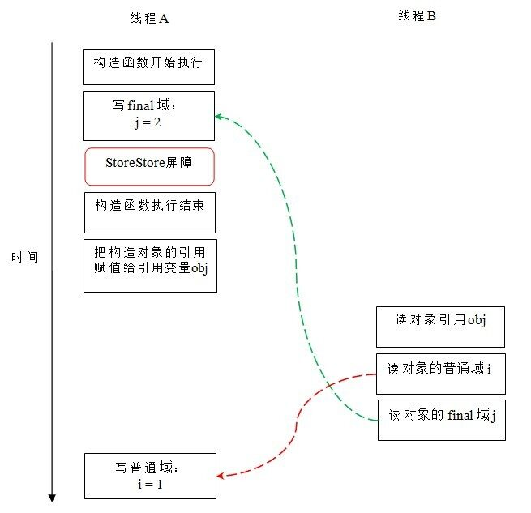
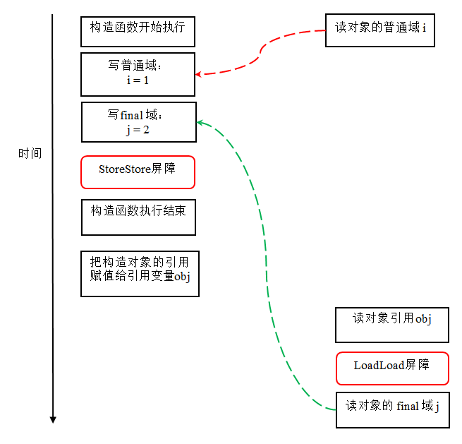
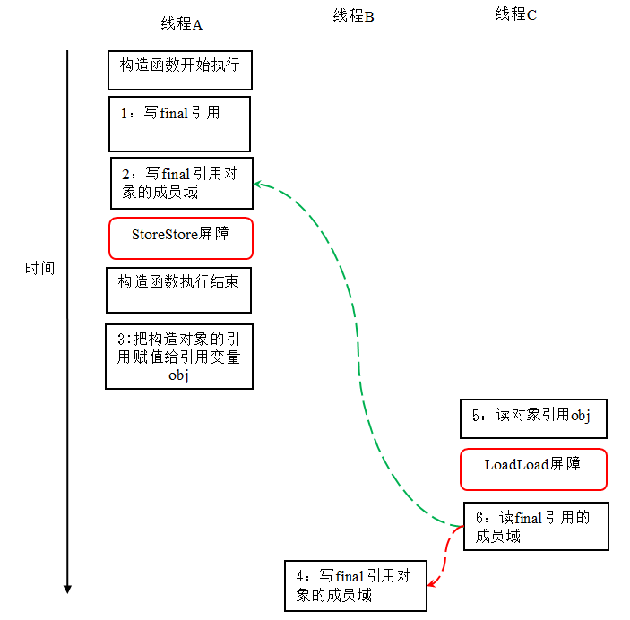
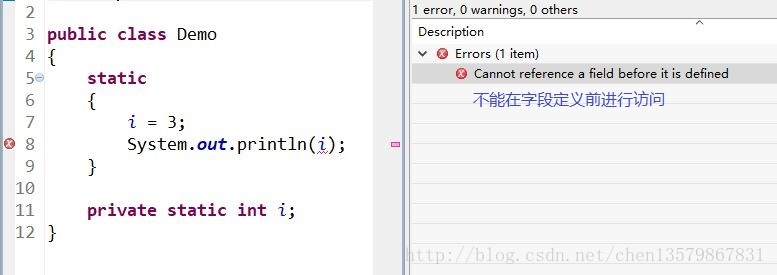

> 迁移来源 [博客园原文](https://www.cnblogs.com/xiuzhublog/p/12827298.html) · 原文发布于 `2020-05-04 17:21:00`（UTC+8）
> 旧文归档，保留当时的记录。

## final的使用

### final变量

final变量有成员变量或者是本地变量(方法内的局部变量)，在类成员中final经常和static一起使用，作为类常量使用。**其中类常量必须在声明时初始化，final成员常量可以在构造函数初始化。**

```
public class Main {
    public static final int i; //报错，必须初始化 因为常量在常量池中就存在了，调用时不需要类的初始化，所以必须在声明时初始化
    public static final int j;
    Main() {
        i = 2;
        j = 3;
    }
}
```

就如上所说的，对于类常量，JVM会缓存在常量池中，在读取该变量时不会加载这个类。

```
public class Main {
    public static final int i = 2;
    Main() {
        System.out.println("调用构造函数"); // 该方法不会调用
    }
    public static void main(String[] args) {
        System.out.println(Main.i);
    }
}
```

### final修饰基本数据类型变量和引用

```
public void final修饰基本类型变量和引用() {
    final int a = 1;
    final int[] b = {1};
    final int[] c = {1};
//  b = c;报错
    b[0] = 1;
    final String aa = "a";
    final Fi f = new Fi();
    //aa = "b";报错
    // f = null;//报错
    f.a = 1;
}
```

final方法表示该方法不能被子类的方法重写，将方法声明为final，在编译的时候就已经静态绑定了，不需要在运行时动态绑定。final方法调用时使用的是invokespecial指令。

```
class PersonalLoan{
    public final String getName(){
        return"personal loan”;
    }
}

class CheapPersonalLoan extends PersonalLoan{
    @Override
    public final String getName(){
        return"cheap personal loan";//编译错误，无法被重载
    }

    public String test() {
        return getName(); //可以调用，因为是public方法
    }
}
```

### final类

final类不能被继承，final类中的方法默认也会是final类型的，java中的String类和Integer类都是final类型的。

```
class Si{
    //一般情况下final修饰的变量一定要被初始化。
    //只有下面这种情况例外，要求该变量必须在构造方法中被初始化。
    //并且不能有空参数的构造方法。
    //这样就可以让每个实例都有一个不同的变量，并且这个变量在每个实例中只会被初始化一次
    //于是这个变量在单个实例里就是常量了。
    final int s ;
    Si(int s) {
        this.s = s;
    }
}
class Bi {
    final int a = 1;
    final void go() {
        //final修饰方法无法被继承
    }
}
class Ci extends Bi {
    final int a = 1;
//        void go() {
//            //final修饰方法无法被继承
//        }
}
final char[]a = {'a'};
final int[]b = {1};
```

```
final class PersonalLoan{}

class CheapPersonalLoan extends PersonalLoan {  //编译错误，无法被继承 
}
```

```
public void final修饰类() {
    //引用没有被final修饰，所以是可变的。
    //final只修饰了Fi类型，即Fi实例化的对象在堆中内存地址是不可变的。
    //虽然内存地址不可变，但是可以对内部的数据做改变。
    Fi f = new Fi();
    f.a = 1;
    System.out.println(f);
    f.a = 2;
    System.out.println(f);
    //改变实例中的值并不改变内存地址。

    Fi ff = f;
    //让引用指向新的Fi对象，原来的f对象由新的引用ff持有。
    //引用的指向改变也不会改变原来对象的地址
    f = new Fi();
    System.out.println(f);
    System.out.println(ff);
}
```

```
 
```

#### final关键字的知识点

1. final成员变量必须在声明的时候初始化或者在构造器中初始化，否则就会报编译错误。final变量一旦被初始化后不能再次赋值。
2. 本地变量必须在声明时赋值。 因为没有初始化的过程
3. 在匿名类中所有变量都必须是final变量。
4. final方法不能被重写, final类不能被继承
5. 接口中声明的所有变量本身是final的。类似于匿名类
6. final和abstract这两个关键字是反相关的，final类就不可能是abstract的。
7. final方法在编译阶段绑定，称为静态绑定(static binding)。
8. 将类、方法、变量声明为final能够提高性能，这样JVM就有机会进行估计，然后优化。

### final方法的好处:

1. 提高了性能，JVM在常量池中会缓存final变量
2. final变量在多线程中并发安全，无需额外的同步开销
3. final方法是静态编译的，提高了调用速度
4. final类创建的对象是只可读的，在多线程可以安全共享

### 总结

final关键字主要用在三个地方：变量、方法、类。

1. 1. 对于一个final变量，如果是基本数据类型的变量，则其数值一旦在初始化之后便不能更改；如果是引用类型的变量，则在对其初始化之后便不能再让其指向另一个对象。
   2. 当用final修饰一个类时，表明这个类不能被继承。final类中的所有成员方法都会被隐式地指定为final方法。
   3. 使用final方法的原因有两个。第一个原因是把方法锁定，以防任何继承类修改它的含义；第二个原因是效率。在早期的Java实现版本中，会将final方法转为内嵌调用。但是如果方法过于庞大，可能看不到内嵌调用带来的任何性能提升（现在的Java版本已经不需要使用final方法进行这些优化了）。类中所有的private方法都隐式地指定为final。

## final的实践

### final的用法

1、final 对于常量来说，意味着值不能改变，例如 final int i=100。这个i的值永远都是100。  
但是对于变量来说又不一样，只是标识这个引用不可被改变，例如 final File f=new File("c:\test.txt");

那么这个f一定是不能被改变的，如果f本身有方法修改其中的成员变量，例如是否可读，是允许修改的。有个形象的比喻：一个女子定义了一个final的老公，这个老公的职业和收入都是允许改变的，只是这个女人不会换老公而已。

### 关于空白final

final修饰的变量有三种：静态变量、实例变量和局部变量，分别表示三种类型的常量。  
另外，final变量定义的时候，可以先声明，而不给初值，这中变量也称为final空白，无论什么情况，编译器都确保空白final在使用之前必须被初始化。  
　  
但是，final空白在final关键字final的使用上提供了更大的灵活性，为此，一个类中的final数据成员就可以实现依对象而有所不同，却有保持其恒定不变的特征。

```
public class FinalTest { 
final int p; 
final int q=3; 
FinalTest(){ 
p=1; 
} 
FinalTest(int i){ 
p=i;//可以赋值，相当于直接定义p 
q=i;//不能为一个final变量赋值 
} 
}
```

### final内存分配

刚提到了内嵌机制，现在详细展开。  
要知道调用一个函数除了函数本身的执行时间之外，还需要额外的时间去寻找这个函数（类内部有一个函数签名和函数地址的映射表）。所以减少函数调用次数就等于降低了性能消耗。

final修饰的函数会被编译器优化，优化的结果是减少了函数调用的次数。如何实现的，举个例子给你看：

```
public class Test{ 
final void func(){System.out.println("g");}; 
public void main(String[] args){ 
for(int j=0;j<1000;j++)   
func(); 
}} 
经过编译器优化之后，这个类变成了相当于这样写： 
public class Test{ 
final void func(){System.out.println("g");}; 
public void main(String[] args){ 
for(int j=0;j<1000;j++)  
{System.out.println("g");} 
}}
```

看出来区别了吧？编译器直接将func的函数体内嵌到了调用函数的地方，这样的结果是节省了1000次函数调用，当然编译器处理成字节码，只是我们可以想象成这样，看个明白。

不过，当函数体太长的话，用final可能适得其反，因为经过编译器内嵌之后代码长度大大增加，于是就增加了jvm解释字节码的时间。

在使用final修饰方法的时候，编译器会将被final修饰过的方法插入到调用者代码处，提高运行速度和效率，但被final修饰的方法体不能过大，编译器可能会放弃内联，但究竟多大的方法会放弃，我还没有做测试来计算过。

**下面这些内容是通过两个疑问来继续阐述的**

### 使用final修饰方法会提高速度和效率吗

见下面的测试代码，我会执行五次：

```
public class Test   
{   
    public static void getJava()   
    {   
        String str1 = "Java ";   
        String str2 = "final ";   
        for (int i = 0; i < 10000; i++)   
        {   
            str1 += str2;   
        }   
    }   
    public static final void getJava_Final()   
    {   
        String str1 = "Java ";   
        String str2 = "final ";   
        for (int i = 0; i < 10000; i++)   
        {   
            str1 += str2;   
        }   
    }   
    public static void main(String[] args)   
    {   
        long start = System.currentTimeMillis();   
        getJava();   
        System.out.println("调用不带final修饰的方法执行时间为:" + (System.currentTimeMillis() - start) + "毫秒时间");   
        start = System.currentTimeMillis();   
        String str1 = "Java ";   
        String str2 = "final ";   
        for (int i = 0; i < 10000; i++)   
        {   
            str1 += str2;   
        }   
        System.out.println("正常的执行时间为:" + (System.currentTimeMillis() - start) + "毫秒时间");   
        start = System.currentTimeMillis();   
        getJava_Final();   
        System.out.println("调用final修饰的方法执行时间为:" + (System.currentTimeMillis() - start) + "毫秒时间");   
    }   
}
```

```
结果为：
```

```
第一次： 
调用不带final修饰的方法执行时间为:1732毫秒时间 
正常的执行时间为:1498毫秒时间 
调用final修饰的方法执行时间为:1593毫秒时间 
第二次： 
调用不带final修饰的方法执行时间为:1217毫秒时间 
正常的执行时间为:1031毫秒时间 
调用final修饰的方法执行时间为:1124毫秒时间 
第三次： 
调用不带final修饰的方法执行时间为:1154毫秒时间 
正常的执行时间为:1140毫秒时间 
调用final修饰的方法执行时间为:1202毫秒时间 
第四次： 
调用不带final修饰的方法执行时间为:1139毫秒时间 
正常的执行时间为:999毫秒时间 
调用final修饰的方法执行时间为:1092毫秒时间 
第五次： 
调用不带final修饰的方法执行时间为:1186毫秒时间 
正常的执行时间为:1030毫秒时间 
调用final修饰的方法执行时间为:1109毫秒时间
```

```
由以上运行结果不难看出，执行最快的是“正常的执行”即代码直接编写，而使用final修饰的方法，不像有些书上或者文章上所说的那样，速度与效率与“正常的执行”无异，而是位于第二位，最差的是调用不加final修饰的方法。
```

观点：加了比不加好一点。

### 使用final修饰变量会让变量的值不能被改变吗；

见代码：

```
public class Final   
{   
    public static void main(String[] args)   
    {   
        Color.color[3] = "white";   
        for (String color : Color.color)   
            System.out.print(color+" ");   
    }   
}   

class Color   
{   
    public static final String[] color = { "red", "blue", "yellow", "black" };   
}  


执行结果： 
red blue yellow white 
看！，黑色变成了白色。
```

​  
​ 在使用findbugs插件时，就会提示public static String[] color = { “red”, “blue”, “yellow”, “black” };这行代码不安全，但加上final修饰，这行代码仍然是不安全的，因为final没有做到保证变量的值不会被修改！  
​  
原因是：final关键字只能保证变量本身不能被赋与新值，而不能保证变量的内部结构不被修改。例如在main方法有如下代码Color.color = new String[]{“”};就会报错了。

### 如何保证数组内部不被修改

`那可能有的同学就会问了，加上final关键字不能保证数组不会被外部修改，那有什么方法能够保证呢？答案就是降低访问级别，把数组设为private。这样的话，就解决了数组在外部被修改的不安全性，但也产生了另一个问题，那就是这个数组要被外部使用的。`

解决这个问题见代码：

```
import java.util.AbstractList;   
import java.util.List;   

public class Final   
{   
    public static void main(String[] args)   
    {   
        for (String color : Color.color)   
            System.out.print(color + " ");   
        Color.color.set(3, "white");   
    }   
}   

class Color   
{   
    private static String[] _color = { "red", "blue", "yellow", "black" };   
    public static List<String> color = new AbstractList<String>()   
    {   
        @Override  
        public String get(int index)   
        {   
            return _color[index];   
        }   
        @Override  
        public String set(int index, String value)   
        {   
            throw new RuntimeException("为了代码安全,不能修改数组");   
        }   
        @Override  
        public int size()   
        {   
            return _color.length;   
        }   
    };  


}
```

这样就OK了，既保证了代码安全，又能让数组中的元素被访问了。

### final方法的三条规则

规则1：final修饰的方法不可以被重写。

规则2：final修饰的方法仅仅是不能重写，但它完全可以被重载。

规则3：父类中private final方法，子类可以重新定义，这种情况不是重写。

代码示例

```
规则1代码

public class FinalMethodTest
{
    public final void test(){}
}
class Sub extends FinalMethodTest
{
    // 下面方法定义将出现编译错误，不能重写final方法
    public void test(){}
}

规则2代码

public class Finaloverload {
    //final 修饰的方法只是不能重写，完全可以重载
    public final void test(){}
    public final void test(String arg){}
}

规则3代码

public class PrivateFinalMethodTest
{
    private final void test(){}
}
class Sub extends PrivateFinalMethodTest
{
    // 下面方法定义将不会出现问题
    public void test(){}
}
```

## final和jvm的关系

与前面介绍的锁和 volatile 相比较，对 final 域的读和写更像是普通的变量访问。对于 final 域，编译器和处理器要遵守两个重排序规则：

1. 在构造函数内对一个 final 域的写入，与随后把这个被构造对象的引用赋值给一个引用变量，这两个操作之间不能重排序。
2. 初次读一个包含 final 域的对象的引用，与随后初次读这个 final 域，这两个操作之间不能重排序。

下面，我们通过一些示例性的代码来分别说明这两个规则：

```
public class FinalExample {
    int i;                            // 普通变量 
    final int j;                      //final 变量 
    static FinalExample obj;

    public void FinalExample () {     // 构造函数 
        i = 1;                        // 写普通域 
        j = 2;                        // 写 final 域 
    }

    public static void writer () {    // 写线程 A 执行 
        obj = new FinalExample ();
    }

    public static void reader () {       // 读线程 B 执行 
        FinalExample object = obj;       // 读对象引用 
        int a = object.i;                // 读普通域 
        int b = object.j;                // 读 final 域 
    }
}
```

这里假设一个线程 A 执行 writer () 方法，随后另一个线程 B 执行 reader () 方法。下面我们通过这两个线程的交互来说明这两个规则。

### 写 final 域的重排序规则

写 final 域的重排序规则禁止把 final 域的写重排序到构造函数之外。这个规则的实现包含下面 2 个方面：

- JMM 禁止编译器把 final 域的写重排序到构造函数之外。
- 编译器会在 final 域的写之后，构造函数 return 之前，插入一个 StoreStore 屏障。这个屏障禁止处理器把 final 域的写重排序到构造函数之外。

现在让我们分析 writer () 方法。writer () 方法只包含一行代码：finalExample = new FinalExample ()。这行代码包含两个步骤：

1. 构造一个 FinalExample 类型的对象；
2. 把这个对象的引用赋值给引用变量 obj。

假设线程 B 读对象引用与读对象的成员域之间没有重排序（马上会说明为什么需要这个假设），下图是一种可能的执行时序：

[](https://static001.infoq.cn/resource/image/66/3a/6628576a54f0ba625c8c3af4586cef3a.jpg)

在上图中，写普通域的操作被编译器重排序到了构造函数之外，读线程 B 错误的读取了普通变量 i 初始化之前的值。而写 final 域的操作，被写 final 域的重排序规则“限定”在了构造函数之内，读线程 B 正确的读取了 final 变量初始化之后的值。

写 final 域的重排序规则可以确保：在对象引用为任意线程可见之前，对象的 final 域已经被正确初始化过了，而普通域不具有这个保障。以上图为例，在读线程 B“看到”对象引用 obj 时，很可能 obj 对象还没有构造完成（对普通域 i 的写操作被重排序到构造函数外，此时初始值 2 还没有写入普通域 i）。

### 读 final 域的重排序规则

读 final 域的重排序规则如下：

- 在一个线程中，初次读对象引用与初次读该对象包含的 final 域，JMM 禁止处理器重排序这两个操作（注意，这个规则仅仅针对处理器）。编译器会在读 final 域操作的前面插入一个 LoadLoad 屏障。

初次读对象引用与初次读该对象包含的 final 域，这两个操作之间存在间接依赖关系。由于编译器遵守间接依赖关系，因此编译器不会重排序这两个操作。大多数处理器也会遵守间接依赖，大多数处理器也不会重排序这两个操作。但有少数处理器允许对存在间接依赖关系的操作做重排序（比如 alpha 处理器），这个规则就是专门用来针对这种处理器。

reader() 方法包含三个操作：

1. 初次读引用变量 obj;
2. 初次读引用变量 obj 指向对象的普通域 j。
3. 初次读引用变量 obj 指向对象的 final 域 i。

现在我们假设写线程 A 没有发生任何重排序，同时程序在不遵守间接依赖的处理器上执行，下面是一种可能的执行时序：

[](https://static001.infoq.cn/resource/image/a0/36/a0a9b023bc56ab97bbda8812cdca7236.png)

在上图中，读对象的普通域的操作被处理器重排序到读对象引用之前。读普通域时，该域还没有被写线程 A 写入，这是一个错误的读取操作。而读 final 域的重排序规则会把读对象 final 域的操作“限定”在读对象引用之后，此时该 final 域已经被 A 线程初始化过了，这是一个正确的读取操作。

读 final 域的重排序规则可以确保：在读一个对象的 final 域之前，一定会先读包含这个 final 域的对象的引用。在这个示例程序中，如果该引用不为 null，那么引用对象的 final 域一定已经被 A 线程初始化过了。

### 如果 final 域是引用类型

上面我们看到的 final 域是基础数据类型，下面让我们看看如果 final 域是引用类型，将会有什么效果？

请看下列示例代码：

```
public class FinalReferenceExample {
final int[] intArray;                     //final 是引用类型 
static FinalReferenceExample obj;

public FinalReferenceExample () {        // 构造函数 
    intArray = new int[1];              //1
    intArray[0] = 1;                   //2
}

public static void writerOne () {          // 写线程 A 执行 
    obj = new FinalReferenceExample ();  //3
}

public static void writerTwo () {          // 写线程 B 执行 
    obj.intArray[0] = 2;                 //4
}

public static void reader () {              // 读线程 C 执行 
    if (obj != null) {                    //5
        int temp1 = obj.intArray[0];       //6
    }
}
}
```

这里 final 域为一个引用类型，它引用一个 int 型的数组对象。对于引用类型，写 final 域的重排序规则对编译器和处理器增加了如下约束：

1. 在构造函数内对一个 final 引用的对象的成员域的写入，与随后在构造函数外把这个被构造对象的引用赋值给一个引用变量，这两个操作之间不能重排序。

对上面的示例程序，我们假设首先线程 A 执行 writerOne() 方法，执行完后线程 B 执行 writerTwo() 方法，执行完后线程 C 执行 reader () 方法。下面是一种可能的线程执行时序：

[](https://static001.infoq.cn/resource/image/29/db/29b097c36fd531028991826bb7c835db.png)

在上图中，1 是对 final 域的写入，2 是对这个 final 域引用的对象的成员域的写入，3 是把被构造的对象的引用赋值给某个引用变量。这里除了前面提到的 1 不能和 3 重排序外，2 和 3 也不能重排序。

JMM 可以确保读线程 C 至少能看到写线程 A 在构造函数中对 final 引用对象的成员域的写入。即 C 至少能看到数组下标 0 的值为 1。而写线程 B 对数组元素的写入，读线程 C 可能看的到，也可能看不到。JMM 不保证线程 B 的写入对读线程 C 可见，因为写线程 B 和读线程 C 之间存在数据竞争，此时的执行结果不可预知。

如果想要确保读线程 C 看到写线程 B 对数组元素的写入，写线程 B 和读线程 C 之间需要使用同步原语（lock 或 volatile）来确保内存可见性。

## static

#### 使用

         static 关键字主要有以下四种使用场景：

#### 修饰成员变量和成员方法（常用）:

被 static 修饰的成员属于类，不属于单个这个类的某个对象，被类中所有对象共享，可以并且建议通过类名调用。被static 声明的成员变量属于静态成员变量，静态变量 存放在 Java 内存区域的方法区。调用格式：`类名.静态变量名` `类名.静态方法名()`

##### 详解：

被 static 修饰的成员属于类，不属于单个这个类的某个对象，被类中所有对象共享，可以并且建议通过类名调用。被static 声明的成员变量属于静态成员变量，静态变量 存放在 Java 内存区域的方法区。

方法区与 Java 堆一样，是各个线程共享的内存区域，它用于存储已被虚拟机加载的类信息、常量、静态变量、即时编译器编译后的代码等数据。虽然Java虚拟机规范把方法区描述为堆的一个逻辑部分，但是它却有一个别名叫做 Non-Heap（非堆），目的应该是与 Java 堆区分开来。

HotSpot 虚拟机中方法区也常被称为 “永久代”，本质上两者并不等价。仅仅是因为 HotSpot 虚拟机设计团队用永久代来实现方法区而已，这样 HotSpot 虚拟机的垃圾收集器就可以像管理 Java 堆一样管理这部分内存了。但是这并不是一个好主意，因为这样更容易遇到内存溢出问题。

调用格式：

- `类名.静态变量名`
- `类名.静态方法名()`

如果变量或者方法被 private 则代表该属性或者该方法只能在类的内部被访问而不能在类的外部被访问。

测试方法：

```
public class StaticBean {

    String name;
    //静态变量
    static int age;

    public StaticBean(String name) {
        this.name = name;
    }
    //静态方法
    static void SayHello() {
        System.out.println("Hello i am java");
    }
    @Override
    public String toString() {
        return StaticBean{ +
                name=' + name + ''' + age + age +
                '}';
    }
}
```

```
public class StaticDemo {

    public static void main(String[] args) {
        StaticBean staticBean = new StaticBean(1);
        StaticBean staticBean2 = new StaticBean(2);
        StaticBean staticBean3 = new StaticBean(3);
        StaticBean staticBean4 = new StaticBean(4);
        StaticBean.age = 33;
        StaticBean{name='1'age33} StaticBean{name='2'age33} StaticBean{name='3'age33} StaticBean{name='4'age33}
        System.out.println(staticBean+ +staticBean2+ +staticBean3+ +staticBean4);
        StaticBean.SayHello();Hello i am java
    }

}
```

### 静态代码块:

静态代码块定义在类中方法外, 静态代码块就在非静态代码块之前执行(静态代码块—>非静态代码块—>构造方法)。 该类不管创建多少对象，静态代码块只执行一次.

静态代码块的格式是：

```
static {    
语句体;   
}
```

一个类中的静态代码块可以有多个，位置可以随便放，它不在任何的方法体内，JVM加载类时会执行这些静态的代码块，如果静态代码块有多个，JVM将按照它们在类中出现的先后顺序依次执行它们，每个代码块只会被执行一次。



 静态代码块对于定义在它之后的静态变量，可以赋值，但是不能访问.

### 静态内部类（static修饰类的话只能修饰内部类）：

 静态内部类与非静态内部类之间存在一个最大的区别: 非静态内部类在编译完成之后会隐含地保存着一个引用，该引用是指向创建它的外围类，但是静态内部类却没有。没有这个引用就意味着：1. 它的创建是不需要依赖外围类的创建。2. 它不能使用任何外围类的非static成员变量和方法。

静态内部类与非静态内部类之间存在一个最大的区别，我们知道非静态内部类在编译完成之后会隐含地保存着一个引用，该引用是指向创建它的外围类，但是静态内部类却没有。没有这个引用就意味着：

1. 它的创建是不需要依赖外围类的创建。
2. 它不能使用任何外围类的非static成员变量和方法。

Example（静态内部类实现单例模式）

```
public class Singleton {

    //声明为 private 避免调用默认构造方法创建对象
    private Singleton() {
    }

   // 声明为 private 表明静态内部该类只能在该 Singleton 类中被访问
    private static class SingletonHolder {
        private static final Singleton INSTANCE = new Singleton();
    }

    public static Singleton getUniqueInstance() {
        return SingletonHolder.INSTANCE;
    }
}
```

当 Singleton 类加载时，静态内部类 SingletonHolder 没有被加载进内存。只有当调用 `getUniqueInstance()`方法从而触发 `SingletonHolder.INSTANCE` 时 SingletonHolder 才会被加载，此时初始化 INSTANCE 实例，并且 JVM 能确保 INSTANCE 只被实例化一次。

这种方式不仅具有延迟初始化的好处，而且由 JVM 提供了对线程安全的支持。

### 静态导包(用来导入类中的静态资源，1.5之后的新特性):

 格式为：`import static` 这两个关键字连用可以指定导入某个类中的指定静态资源，并且不需要使用类名调用类中静态成员，可以直接使用类中静态成员变量和成员方法。

```
 //将Math中的所有静态资源导入，这时候可以直接使用里面的静态方法，而不用通过类名进行调用
 //如果只想导入单一某个静态方法，只需要将换成对应的方法名即可

import static java.lang.Math.;//换成import static java.lang.Math.max;具有一样的效果

public class Demo {
  public static void main(String[] args) {

    int max = max(1,2);
    System.out.println(max);
  }
}
```

### 补充

#### 静态方法与非静态方法

静态方法属于类本身，非静态方法属于从该类生成的每个对象。 如果您的方法执行的操作不依赖于其类的各个变量和方法，请将其设置为静态（这将使程序的占用空间更小）。 否则，它应该是非静态的。

举例说明：

```
class Foo {
    int i;
    public Foo(int i) { 
       this.i = i;
    }

    public static String method1() {
       return An example string that doesn't depend on i (an instance variable);

    }

    public int method2() {
       return this.i + 1;  Depends on i
    }

}
```

你可以像这样调用静态方法：`Foo.method1（）`。 如果您尝试使用这种方法调用 method2 将失败。 但这样可行：`Foo bar = new Foo（1）;bar.method2（）;`

#### static{}静态代码块与{}非静态代码块

相同点： 都是在JVM加载类时且在构造方法执行之前执行，在类中都可以定义多个，定义多个时按定义的顺序执行，一般在代码块中对一些static变量进行赋值。

不同点： 静态代码块在非静态代码块之前执行(静态代码块—非静态代码块—构造方法)。静态代码块可能在第一次new的时候执行，但不一定只在第一次new的时候执行。比如通过 `Class.forName("ClassDemo")`创建 Class 对象的时候也会执行。而非静态代码块在每new一次就执行一次。 非静态代码块可在普通方法中定义(不过作用不大)；而静态代码块不行。

一般情况下,如果有些代码比如一些项目最常用的变量或对象必须在项目启动的时候就执行的时候,需要使用静态代码块,这种代码是主动执行的。如果我们想要设计不需要创建对象就可以调用类中的方法，例如：Arrays类，Character类，String类等，就需要使用静态方法, 两者的区别是 静态代码块是自动执行的而静态方法是被调用的时候才执行的.

举例：

```
public class Test {
    public Test() {
        System.out.print("默认构造方法！--");
    }

    //非静态代码块
    {
        System.out.print("非静态代码块！--");
    }

    //静态代码块
    static {
        System.out.print("静态代码块！--");
    }

    private static void test() {
        System.out.print("静态方法中的内容! --");
        {
            System.out.print("静态方法中的代码块！--");
        }

    }

    public static void main(String[] args) {
        Test test = new Test();
        Test.test();//静态代码块！--静态方法中的内容! --静态方法中的代码块！--
    }
}
```

上述代码输出：

```
静态代码块！--非静态代码块！--默认构造方法！--静态方法中的内容! --静态方法中的代码块！--
```

当只执行 `Test.test();` 时输出：

```
静态代码块！--非静态代码块！--默认构造方法！--
```

当只执行 `Test test = new Test();` 时输出：

```
静态代码块！--非静态代码块！--默认构造方法！--
```

非静态代码块与构造函数的区别是： 非静态代码块是给所有对象进行统一初始化，而构造函数是给对应的对象初始化，因为构造函数是可以多个的，运行哪个构造函数就会建立什么样的对象，但无论建立哪个对象，都会先执行相同的构造代码块。也就是说，构造代码块中定义的是不同对象共性的初始化内容。

## this

this关键字用于引用类的当前实例。 例如：

```
class Manager {
    Employees[] employees;

    void manageEmployees() {
        int totalEmp = this.employees.length;
        System.out.println("Total employees: " + totalEmp);
        this.report();
    }

    void report() { }
}
```

在上面的示例中，this关键字用于两个地方：

- this.employees.length：访问类Manager的当前实例的变量。
- this.report（）：调用类Manager的当前实例的方法。

此关键字是可选的，这意味着如果上面的示例在不使用此关键字的情况下表现相同。 但是，使用此关键字可能会使代码更易读或易懂。

总结：

- 在外部调用静态方法时，可以使用”类名.方法名”的方式，也可以使用”对象名.方法名”的方式。而实例方法只有后面这种方式。也就是说，调用静态方法可以无需创建对象。
- 静态方法在访问本类的成员时，只允许访问静态成员（即静态成员变量和静态方法），而不允许访问实例成员变量和实例方法；实例方法则无此限制

## super

super关键字用于从子类访问父类的变量和方法。 例如：

```
public class Super {
    protected int number;

    protected showNumber() {
        System.out.println("number = " + number);
    }
}

public class Sub extends Super {
    void bar() {
        super.number = 10;
        super.showNumber();
    }
}
```

在上面的例子中，Sub 类访问父类成员变量 number 并调用其其父类 Super 的 `showNumber（）` 方法。

### 使用 this 和 super 要注意的问题：

- 在构造器中使用 `super（）` 调用父类中的其他构造方法时，该语句必须处于构造器的首行，否则编译器会报错。另外，this 调用本类中的其他构造方法时，也要放在首行。
- this、super不能用在static方法中。

简单解释一下：

被 static 修饰的成员属于类，不属于单个这个类的某个对象，被类中所有对象共享。而 this 代表对本类对象的引用，指向本类对象；而 super 代表对父类对象的引用，指向父类对象；所以， this和super是属于对象范畴的东西，而静态方法是属于类范畴的东西。

reference：<https://how2playlife.com/2019/09/04/4final%E5%85%B3%E9%94%AE%E5%AD%97%E7%89%B9%E6%80%A7/>

<https://snailclimb.gitee.io/javaguide/#/docs/java/basic/final,static,this,super?id=finalstaticthissuper-%e5%85%b3%e9%94%ae%e5%ad%97%e6%80%bb%e7%bb%93>
