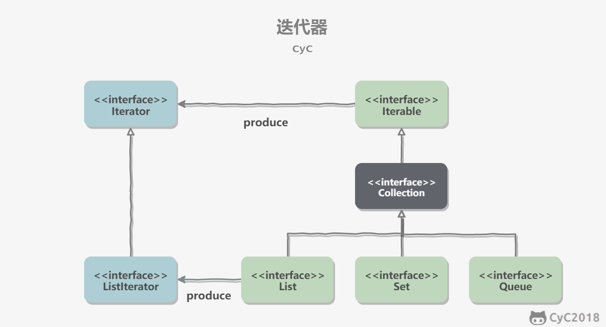
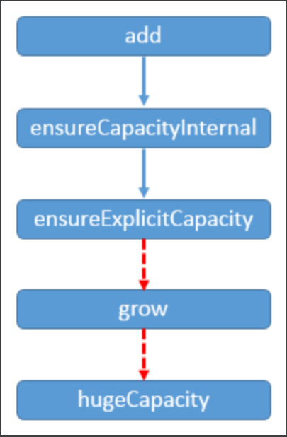
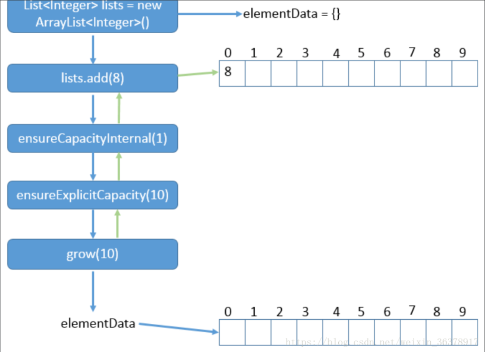
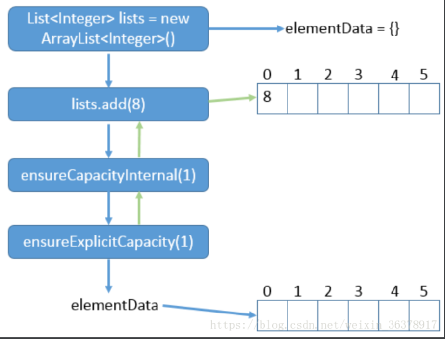
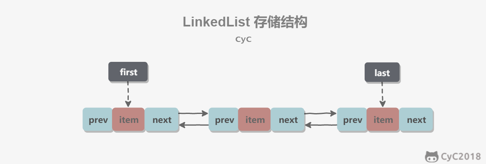
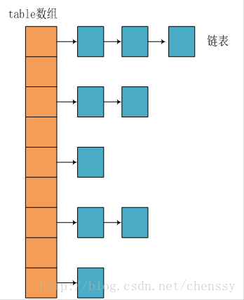
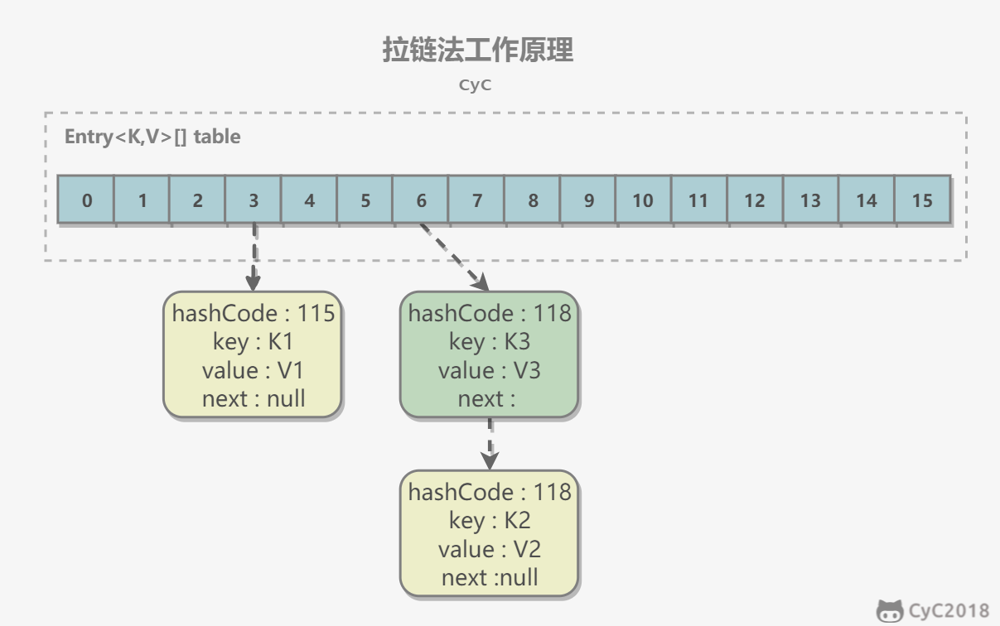
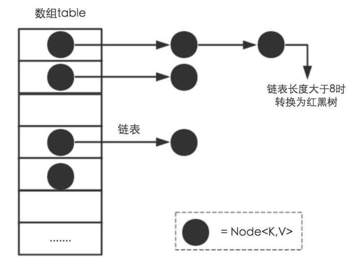

> 迁移来源 [博客园原文](https://www.cnblogs.com/xiuzhublog/p/12837168.html) · 原文发布于 `2020-05-07 21:19:00`（UTC+8）
> 旧文归档，保留当时的记录。

## 概览

容器主要包括 Collection 和 Map 两种，Collection 存储着对象的集合，而 Map 存储着键值对（两个对象）的映射表。

### [L](https://snailclimb.gitee.io/javaguide/#/docs/java/collection/Java%E9%9B%86%E5%90%88%E6%A1%86%E6%9E%B6%E5%B8%B8%E8%A7%81%E9%9D%A2%E8%AF%95%E9%A2%98?id=_1-list)ist

- Arraylist： Object数组，基于动态数组实现，支持随机访问。
- Vector： Object数组，和 ArrayList 类似，但它是线程安全的。
- LinkedList： 双向链表(JDK1.6之前为循环链表，JDK1.7取消了循环)，只能顺序访问，但是可以快速地在链表中间插入和删除元素。不仅如此，LinkedList 还可以用作栈、队列和双向队列。

### [S](https://snailclimb.gitee.io/javaguide/#/docs/java/collection/Java%E9%9B%86%E5%90%88%E6%A1%86%E6%9E%B6%E5%B8%B8%E8%A7%81%E9%9D%A2%E8%AF%95%E9%A2%98?id=_2-set)et

- HashSet（无序，唯一）: 基于 HashMap 实现的，底层采用 HashMap 来保存元素。支持快速查找，但不支持有序性操作。并且失去了元素的插入顺序信息，也就是说使用 Iterator 遍历 HashSet 得到的结果是不确定的。
- LinkedHashSet： LinkedHashSet 继承于 HashSet，并且其内部是通过 LinkedHashMap 来实现的。有点类似于我们之前说的LinkedHashMap 其内部是基于 HashMap 实现一样，不过还是有一点点区别的。具有 HashSet 的查找效率，并且内部使用双向链表维护元素的插入顺序。
- TreeSet（有序，唯一）： 红黑树(自平衡的排序二叉树)，基于红黑树实现，支持有序性操作，例如根据一个范围查找元素的操作。但是查找效率不如 HashSet，HashSet 查找的时间复杂度为 O(1)，TreeSet 则为 O(logN)。（红黑树介绍：<https://www.cxyxiaowu.com/7374.html>）

### Queue

- LinkedList：可以用它来实现双向队列。
- PriorityQueue：基于堆结构实现，可以用它来实现优先队列。

## 容器中的设计模式

### 迭代器模式



Collection 继承了 Iterable 接口，其中的 iterator() 方法能够产生一个 Iterator 对象，通过这个对象就可以迭代遍历 Collection 中的元素。

从 JDK 1.5 之后可以使用 foreach 方法来遍历实现了 Iterable 接口的聚合对象。

```
List<String> list = new ArrayList<>();
list.add("a");
list.add("b");
for (String item : list) {
    System.out.println(item);
}
```

### 适配器模式

java.util.Arrays#asList() 可以把数组类型转换为 List 类型。

```
@SafeVarargs
public static <T> List<T> asList(T... a)
```

应该注意的是 asList() 的参数为泛型的变长参数，不能使用基本类型数组作为参数，只能使用相应的包装类型数组。

```
Integer[] arr = {1, 2, 3};
List list = Arrays.asList(arr);
```

也可以使用以下方式调用 asList()：

```
List list = Arrays.asList(1, 2, 3);
```

## Arraylist

### 简介

ArrayList 的底层是数组队列，相当于动态数组。与 Java 中的数组相比，它的容量能动态增长。在添加大量元素前，应用程序可以使用`ensureCapacity`操作来增加 ArrayList 实例的容量。这可以减少递增式再分配的数量。

它继承于 AbstractList，实现了 List, RandomAccess, Cloneable, java.io.Serializable 这些接口。

在我们学数据结构的时候就知道了线性表的顺序存储，插入删除元素的时间复杂度为O（n）,求表长以及增加元素，取第 i 元素的时间复杂度为O（1）

　 ArrayList 继承了AbstractList，实现了List。它是一个数组队列，提供了相关的添加、删除、修改、遍历等功能。

　　ArrayList 实现了RandomAccess 接口， RandomAccess 是一个标志接口，表明实现这个这个接口的 List 集合是支持快速随机访问的。在 ArrayList 中，我们即可以通过元素的序号快速获取元素对象，这就是快速随机访问。

　　ArrayList 实现了Cloneable 接口，即覆盖了函数 clone()，能被克隆。

　　ArrayList 实现java.io.Serializable 接口，这意味着ArrayList支持序列化，能通过序列化去传输。

　　和 Vector 不同，ArrayList 中的操作不是线程安全的！所以，建议在单线程中才使用 ArrayList，而在多线程中可以选择 Vector 或者 CopyOnWriteArrayList。

### ArrayList核心源码及部分源码解释

```
package java.util;

import java.util.function.Consumer;
import java.util.function.Predicate;
import java.util.function.UnaryOperator;


public class ArrayList<E> extends AbstractList<E>
        implements List<E>, RandomAccess, Cloneable, java.io.Serializable  
//因为 ArrayList 是基于数组实现的，所以支持快速随机访问。RandomAccess 接口标识着该类支持快速随机访问。  
//List接口（规定了List的操作规范）、Cloneable（可拷贝）、Serializable（可序列化）。
{
    private static final long serialVersionUID = 8683452581122892189L;

    /**
     * 默认初始容量大小
     */
    private static final int DEFAULT_CAPACITY = 10;

    /**
     * 空数组（用于空实例）。
     */
    private static final Object[] EMPTY_ELEMENTDATA = {};

     //用于默认大小空实例的共享空数组实例。
      //我们把它从EMPTY_ELEMENTDATA数组中区分出来，以知道在添加第一个元素时容量需要增加多少。
    private static final Object[] DEFAULTCAPACITY_EMPTY_ELEMENTDATA = {};

    /**
     * 保存ArrayList数据的数组  
       ArrayList的底层是一个object数组，并且由trasient修饰。
     */
    transient Object[] elementData; // non-private to simplify nested class access

    /**
     * ArrayList 所包含的元素个数
     */
    private int size;

    /**
     * 带初始容量参数的构造函数。（用户自己指定容量）
     */
    public ArrayList(int initialCapacity) {
        if (initialCapacity > 0) {
            //创建initialCapacity大小的数组
            this.elementData = new Object[initialCapacity];
        } else if (initialCapacity == 0) {
            //创建空数组
            this.elementData = EMPTY_ELEMENTDATA;
        } else {
            throw new IllegalArgumentException("Illegal Capacity: "+
                                               initialCapacity);
        }
    }

    /**
     *默认构造函数，DEFAULTCAPACITY_EMPTY_ELEMENTDATA 为0.初始化为10，也就是说初始其实是空数组 当添加第一个元素的时候数组容量才变成10
     */
    public ArrayList() {
        this.elementData = DEFAULTCAPACITY_EMPTY_ELEMENTDATA;
    }

    /**
     * 构造一个包含指定集合的元素的列表，按照它们由集合的迭代器返回的顺序。
     */
    public ArrayList(Collection<? extends E> c) {
        //
        elementData = c.toArray();
        //如果指定集合元素个数不为0
        if ((size = elementData.length) != 0) {
            // c.toArray 可能返回的不是Object类型的数组所以加上下面的语句用于判断，
            //这里用到了反射里面的getClass()方法
            if (elementData.getClass() != Object[].class)
                elementData = Arrays.copyOf(elementData, size, Object[].class);
        } else {
            // 用空数组代替
            this.elementData = EMPTY_ELEMENTDATA;
        }
    }

    /**
     * 修改这个ArrayList实例的容量是列表的当前大小。 应用程序可以使用此操作来最小化ArrayList实例的存储。 
     */
    public void trimToSize() {
        modCount++;
        if (size < elementData.length) {
            elementData = (size == 0)
              ? EMPTY_ELEMENTDATA
              : Arrays.copyOf(elementData, size);
        }
    }
//下面是ArrayList的扩容机制
//ArrayList的扩容机制提高了性能，如果每次只扩充一个，
//那么频繁的插入会导致频繁的拷贝，降低性能，而ArrayList的扩容机制避免了这种情况。
    /**
     * 如有必要，增加此ArrayList实例的容量，以确保它至少能容纳元素的数量
     * @param   minCapacity   所需的最小容量
     */
    public void ensureCapacity(int minCapacity) {
        int minExpand = (elementData != DEFAULTCAPACITY_EMPTY_ELEMENTDATA)
            // any size if not default element table
            ? 0
            // larger than default for default empty table. It's already
            // supposed to be at default size.
            : DEFAULT_CAPACITY;

        if (minCapacity > minExpand) {
            ensureExplicitCapacity(minCapacity);
        }
    }
   //得到最小扩容量
    private void ensureCapacityInternal(int minCapacity) {
        if (elementData == DEFAULTCAPACITY_EMPTY_ELEMENTDATA) {
              // 获取默认的容量和传入参数的较大值
            minCapacity = Math.max(DEFAULT_CAPACITY, minCapacity);
        }

        ensureExplicitCapacity(minCapacity);
    }
  //判断是否需要扩容
    private void ensureExplicitCapacity(int minCapacity) {
        modCount++;

        // overflow-conscious code
        if (minCapacity - elementData.length > 0)
            //调用grow方法进行扩容，调用此方法代表已经开始扩容了
            grow(minCapacity);
    }

    /**
     * 要分配的最大数组大小
     */
    private static final int MAX_ARRAY_SIZE = Integer.MAX_VALUE - 8;

    /**
     * ArrayList扩容的核心方法。
     */
    private void grow(int minCapacity) {  
         //elementData为保存ArrayList数据的数组   
         ///elementData.length求数组长度elementData.size是求数组中的元素个数
        // oldCapacity为旧容量，newCapacity为新容量
        int oldCapacity = elementData.length;
        //将oldCapacity 右移一位，其效果相当于oldCapacity /2，
        //我们知道位运算的速度远远快于整除运算，整句运算式的结果就是将新容量更新为旧容量的1.5倍，
        int newCapacity = oldCapacity + (oldCapacity >> 1);
        //然后检查新容量是否大于最小需要容量，若还是小于最小需要容量，那么就把最小需要容量当作数组的新容量，
        if (newCapacity - minCapacity < 0)
            newCapacity = minCapacity;
        //再检查新容量是否超出了ArrayList所定义的最大容量，
        //若超出了，则调用hugeCapacity()来比较minCapacity和 MAX_ARRAY_SIZE，
        //如果minCapacity大于MAX_ARRAY_SIZE，则新容量则为Interger.MAX_VALUE，否则，新容量大小则为 MAX_ARRAY_SIZE。
        if (newCapacity - MAX_ARRAY_SIZE > 0)
            newCapacity = hugeCapacity(minCapacity);
        // minCapacity is usually close to size, so this is a win:
        elementData = Arrays.copyOf(elementData, newCapacity);
    }
    //比较minCapacity和 MAX_ARRAY_SIZE
    private static int hugeCapacity(int minCapacity) {
        if (minCapacity < 0) // overflow
            throw new OutOfMemoryError();
        return (minCapacity > MAX_ARRAY_SIZE) ?
            Integer.MAX_VALUE :
            MAX_ARRAY_SIZE;
    }

    /**
     *返回此列表中的元素数。 
     */
    public int size() {
        return size;
    }

    /**
     * 如果此列表不包含元素，则返回 true 。
     */
    public boolean isEmpty() {
        //注意=和==的区别
        return size == 0;
    }

    /**
     * 如果此列表包含指定的元素，则返回true 。
     */
    public boolean contains(Object o) {
        //indexOf()方法：返回此列表中指定元素的首次出现的索引，如果此列表不包含此元素，则为-1 
        return indexOf(o) >= 0;
    }

    /**
     *返回此列表中指定元素的首次出现的索引，如果此列表不包含此元素，则为-1 
     */
    public int indexOf(Object o) {
        if (o == null) {
            for (int i = 0; i < size; i++)
                if (elementData[i]==null)
                    return i;
        } else {
            for (int i = 0; i < size; i++)
                //equals()方法比较
                if (o.equals(elementData[i]))
                    return i;
        }
        return -1;
    }

    /**
     * 返回此列表中指定元素的最后一次出现的索引，如果此列表不包含元素，则返回-1。.
     */
    public int lastIndexOf(Object o) {
        if (o == null) {
            for (int i = size-1; i >= 0; i--)
                if (elementData[i]==null)
                    return i;
        } else {
            for (int i = size-1; i >= 0; i--)
                if (o.equals(elementData[i]))
                    return i;
        }
        return -1;
    }

    /**
     * 返回此ArrayList实例的浅拷贝。 （元素本身不被复制。） 
     */
    public Object clone() {
        try {
            ArrayList<?> v = (ArrayList<?>) super.clone();
            //Arrays.copyOf功能是实现数组的复制，返回复制后的数组。参数是被复制的数组和复制的长度
            v.elementData = Arrays.copyOf(elementData, size);
            v.modCount = 0;
            return v;
        } catch (CloneNotSupportedException e) {
            // 这不应该发生，因为我们是可以克隆的
            throw new InternalError(e);
        }
    }

    /**
     *以正确的顺序（从第一个到最后一个元素）返回一个包含此列表中所有元素的数组。 
     *返回的数组将是“安全的”，因为该列表不保留对它的引用。 （换句话说，这个方法必须分配一个新的数组）。
     *因此，调用者可以自由地修改返回的数组。 此方法充当基于阵列和基于集合的API之间的桥梁。
     */
    public Object[] toArray() {
        return Arrays.copyOf(elementData, size);
    }

    /**
     * 以正确的顺序返回一个包含此列表中所有元素的数组（从第一个到最后一个元素）; 
     *返回的数组的运行时类型是指定数组的运行时类型。 如果列表适合指定的数组，则返回其中。 
     *否则，将为指定数组的运行时类型和此列表的大小分配一个新数组。 
     *如果列表适用于指定的数组，其余空间（即数组的列表数量多于此元素），则紧跟在集合结束后的数组中的元素设置为null 。
     *（这仅在调用者知道列表不包含任何空元素的情况下才能确定列表的长度。） 
     */
    @SuppressWarnings("unchecked")
    public <T> T[] toArray(T[] a) {
        if (a.length < size)
            // 新建一个运行时类型的数组，但是ArrayList数组的内容
            return (T[]) Arrays.copyOf(elementData, size, a.getClass());
            //调用System提供的arraycopy()方法实现数组之间的复制
        System.arraycopy(elementData, 0, a, 0, size);
        if (a.length > size)
            a[size] = null;
        return a;
    }

    // Positional Access Operations

    @SuppressWarnings("unchecked")
    E elementData(int index) {
        return (E) elementData[index];
    }

    /**
     * 返回此列表中指定位置的元素。
     */
    public E get(int index) {
        rangeCheck(index);

        return elementData(index);
    }

    /**
     * 用指定的元素替换此列表中指定位置的元素。 
     */
    public E set(int index, E element) {
        //对index进行界限检查
        rangeCheck(index);

        E oldValue = elementData(index);
        elementData[index] = element;
        //返回原来在这个位置的元素
        return oldValue;
    }

    /**
     * 将指定的元素追加到此列表的末尾。 
     */
    public boolean add(E e) {
        ensureCapacityInternal(size + 1);  // Increments modCount!!
        //这里看到ArrayList添加元素的实质就相当于为数组赋值
        elementData[size++] = e;
        return true;
    }

    /**
     * 在此列表中的指定位置插入指定的元素。 
     *先调用 rangeCheckForAdd 对index进行界限检查；然后调用 ensureCapacityInternal 方法保证capacity足够大；
     *再将从index开始之后的所有成员后移一个位置；将element插入index位置；最后size加1。
     */
    public void add(int index, E element) {
        rangeCheckForAdd(index);

        ensureCapacityInternal(size + 1);  // Increments modCount!!
        //arraycopy()这个实现数组之间复制的方法一定要看一下，下面就用到了arraycopy()方法实现数组自己复制自己
        System.arraycopy(elementData, index, elementData, index + 1,
                         size - index);
        elementData[index] = element;
        size++;
    }

    /**
     * 删除该列表中指定位置的元素。 将任何后续元素移动到左侧（从其索引中减去一个元素）。 
     */
    public E remove(int index) {
        rangeCheck(index);

        modCount++;
        E oldValue = elementData(index);

        int numMoved = size - index - 1;
        if (numMoved > 0)
            System.arraycopy(elementData, index+1, elementData, index,
                             numMoved);
        elementData[--size] = null; // clear to let GC do its work
      //从列表中删除的元素 
        return oldValue;
    }

    /**
     * 从列表中删除指定元素的第一个出现（如果存在）。 如果列表不包含该元素，则它不会更改。
     *返回true，如果此列表包含指定的元素
     */
    public boolean remove(Object o) {
        if (o == null) {
            for (int index = 0; index < size; index++)
                if (elementData[index] == null) {
                    fastRemove(index);
                    return true;
                }
        } else {
            for (int index = 0; index < size; index++)
                if (o.equals(elementData[index])) {
                    fastRemove(index);
                    return true;
                }
        }
        return false;
    }

    /*
     * Private remove method that skips bounds checking and does not
     * return the value removed.
     */
    private void fastRemove(int index) {
        modCount++;
        int numMoved = size - index - 1;
        if (numMoved > 0)
            System.arraycopy(elementData, index+1, elementData, index,
                             numMoved);
        elementData[--size] = null; // clear to let GC do its work
    }

    /**
     * 从列表中删除所有元素。 
     */
    public void clear() {
        modCount++;

        // 把数组中所有的元素的值设为null
        for (int i = 0; i < size; i++)
            elementData[i] = null;

        size = 0;
    }

    /**
     * 按指定集合的Iterator返回的顺序将指定集合中的所有元素追加到此列表的末尾。
     */
    public boolean addAll(Collection<? extends E> c) {
        Object[] a = c.toArray();
        int numNew = a.length;
        ensureCapacityInternal(size + numNew);  // Increments modCount
        System.arraycopy(a, 0, elementData, size, numNew);
        size += numNew;
        return numNew != 0;
    }

    /**
     * 将指定集合中的所有元素插入到此列表中，从指定的位置开始。
     */
    public boolean addAll(int index, Collection<? extends E> c) {
        rangeCheckForAdd(index);

        Object[] a = c.toArray();
        int numNew = a.length;
        ensureCapacityInternal(size + numNew);  // Increments modCount

        int numMoved = size - index;
        if (numMoved > 0)
            System.arraycopy(elementData, index, elementData, index + numNew,
                             numMoved);

        System.arraycopy(a, 0, elementData, index, numNew);
        size += numNew;
        return numNew != 0;
    }

    /**
     * 从此列表中删除所有索引为fromIndex （含）和toIndex之间的元素。
     *将任何后续元素移动到左侧（减少其索引）。
     */
    protected void removeRange(int fromIndex, int toIndex) {
        modCount++;
        int numMoved = size - toIndex;
        System.arraycopy(elementData, toIndex, elementData, fromIndex,
                         numMoved);

        // clear to let GC do its work
        int newSize = size - (toIndex-fromIndex);
        for (int i = newSize; i < size; i++) {
            elementData[i] = null;
        }
        size = newSize;
    }

    /**
     * 检查给定的索引是否在范围内。
     */
    private void rangeCheck(int index) {
        if (index >= size)
            throw new IndexOutOfBoundsException(outOfBoundsMsg(index));
    }

    /**
     * add和addAll使用的rangeCheck的一个版本
     */
    private void rangeCheckForAdd(int index) {
        if (index > size || index < 0)
            throw new IndexOutOfBoundsException(outOfBoundsMsg(index));
    }

    /**
     * 返回IndexOutOfBoundsException细节信息
     */
    private String outOfBoundsMsg(int index) {
        return "Index: "+index+", Size: "+size;
    }

    /**
     * 从此列表中删除指定集合中包含的所有元素。 
     */
    public boolean removeAll(Collection<?> c) {
        Objects.requireNonNull(c);
        //如果此列表被修改则返回true
        return batchRemove(c, false);
    }

    /**
     * 仅保留此列表中包含在指定集合中的元素。
     *换句话说，从此列表中删除其中不包含在指定集合中的所有元素。 
     */
    public boolean retainAll(Collection<?> c) {
        Objects.requireNonNull(c);
        return batchRemove(c, true);
    }


    /**
     * 从列表中的指定位置开始，返回列表中的元素（按正确顺序）的列表迭代器。
     *指定的索引表示初始调用将返回的第一个元素为next 。 初始调用previous将返回指定索引减1的元素。 
     *返回的列表迭代器是fail-fast 。 
     */
    public ListIterator<E> listIterator(int index) {
        if (index < 0 || index > size)
            throw new IndexOutOfBoundsException("Index: "+index);
        return new ListItr(index);
    }

    /**
     *返回列表中的列表迭代器（按适当的顺序）。 
     *返回的列表迭代器是fail-fast 。
     */
    public ListIterator<E> listIterator() {
        return new ListItr(0);
    }

    /**
     *以正确的顺序返回该列表中的元素的迭代器。 
     *返回的迭代器是fail-fast 。 
     */
    public Iterator<E> iterator() {
        return new Itr();
    }
```

### 底层数据结构

ArrayList的底层是一个object数组，并且由trasient修饰。

```
//transient Object[] elementData; //
```

non-private to simplify nested class access  
//ArrayList底层数组不会参与序列化，而是使用另外的序列化方式。

//使用writeobject方法进行序列化。

//总结一下就是只复制数组中有值的位置，其他未赋值的位置不进行序列化，可以节省空间。

```
//        private void writeObject(java.io.ObjectOutputStream s)
//        throws java.io.IOException{
//            // Write out element count, and any hidden stuff
//            int expectedModCount = modCount;
//            s.defaultWriteObject();
//
//            // Write out size as capacity for behavioural compatibility with clone()
//            s.writeInt(size);
//
//            // Write out all elements in the proper order.
//            for (int i=0; i<size; i++) {
//                s.writeObject(elementData[i]);
//            }
//
//            if (modCount != expectedModCount) {
//                throw new ConcurrentModificationException();
//            }
//        }
```

### 扩容

添加元素时使用 ensureCapacityInternal() 方法来保证容量足够，如果不够时，需要使用 grow() 方法进行扩容，新容量的大小为 `oldCapacity + (oldCapacity >> 1)`，也就是旧容量的 1.5 倍。

当新容量大于最大数组容量时，执行大数扩容

```
//        private void grow(int minCapacity) {
//            // overflow-conscious code
//            int oldCapacity = elementData.length;
//            int newCapacity = oldCapacity + (oldCapacity >> 1);
//            if (newCapacity - minCapacity < 0)
//                newCapacity = minCapacity;
//            if (newCapacity - MAX_ARRAY_SIZE > 0)
//                newCapacity = hugeCapacity(minCapacity);
//            // minCapacity is usually close to size, so this is a win:
//            elementData = Arrays.copyOf(elementData, newCapacity);
//        }
```

当新容量大于最大数组长度，有两种情况，一种是溢出，抛异常，一种是没溢出，返回整数的最大值。

```
private static int hugeCapacity(int minCapacity) {
    if (minCapacity < 0) // overflow
        throw new OutOfMemoryError();
    return (minCapacity > MAX_ARRAY_SIZE) ?
        Integer.MAX_VALUE :
        MAX_ARRAY_SIZE;
}
```

在这里有一个疑问，为什么每次扩容处理会是1.5倍，而不是2.5、3、4倍呢？通过google查找，发现1.5倍的扩容是最好的倍数。因为扩容操作需要调用 `Arrays.copyOf()` 把原数组整个复制到新数组中，这个操作代价很高，因此最好在创建 ArrayList 对象时就指定大概的容量大小，减少扩容操作的次数。一次性扩容太大(例如2.5倍)可能会浪费更多的内存(1.5倍最多浪费33%，而2.5被最多会浪费60%，3.5倍则会浪费71%……)。但是一次性扩容太小，需要多次对数组重新分配内存，对性能消耗比较严重。所以1.5倍刚刚好，既能满足性能需求，也不会造成很大的内存消耗。

除了这个ensureCapacity()这个扩容数组外，ArrayList还给我们提供了将底层数组的容量调整为当前列表保存的实际元素的大小的功能。它可以通过trimToSize()方法来实现。该方法可以最小化ArrayList实例的存储量。

```
public void trimToSize() {
    modCount++;
    int oldCapacity = elementData.length;
    if (size < oldCapacity) {
        elementData = Arrays.copyOf(elementData, size);
    }
}
```

另外需要注意的是：

1. java 中的length 属性是针对数组说的,比如说你声明了一个数组,想知道这个数组的长度则用到了 length 这个属性.
2. java 中的length()方法是针对字 符串String说的,如果想看这个字符串的长度则用到 length()这个方法.
3. .java 中的size()方法是针对泛型集合说的,如果想看这个泛型有多少个元素,就调用此方法来查看!

### 增删改查

添加元素时，首先判断索引是否合法，然后检测是否需要扩容，最后使用System.arraycopy方法 将 index+1 后面的元素都复制到 index 位置上，该操作的时间复杂度为 O(N)，可以看到 ArrayList 删除元素的代价是非常高的。

#### System.arraycopy方法Aarrays.copyOf方法

通过上面源码我们发现这两个实现数组复制的方法被广泛使用而且很多地方都特别巧妙。比如下面add(int index, E element)方法就很巧妙的用到了arraycopy()方法让数组自己复制自己实现让index开始之后的所有成员后移一个位置:

```
    /**
     * 在此列表中的指定位置插入指定的元素。 
     *先调用 rangeCheckForAdd 对index进行界限检查；然后调用 ensureCapacityInternal 方法保证capacity足够大；
     *再将从index开始之后的所有成员后移一个位置；将element插入index位置；最后size加1。
     */
    public void add(int index, E element) {
        rangeCheckForAdd(index);

        ensureCapacityInternal(size + 1);  // Increments modCount!!
        //arraycopy()方法实现数组自己复制自己
        //elementData:源数组;index:源数组中的起始位置;elementData：目标数组；index + 1：目标数组中的起始位置； size - index：要复制的数组元素的数量；
        System.arraycopy(elementData, index, elementData, index + 1, size - index);
        elementData[index] = element;
        size++;
    }
```

该方法的原型为：

```
public static void arraycopy(Object src, int srcPos, Object dest, int destPos, int length)。
```

它的根本目的就是进行数组元素的复制。即从指定源数组中复制一个数组，复制从指定的位置开始，到目标数组的指定位置结束。

又如toArray()方法中用到了copyOf()方法

```
    /**
     *以正确的顺序（从第一个到最后一个元素）返回一个包含此列表中所有元素的数组。 
     *返回的数组将是“安全的”，因为该列表不保留对它的引用。 （换句话说，这个方法必须分配一个新的数组）。
     *因此，调用者可以自由地修改返回的数组。 此方法充当基于阵列和基于集合的API之间的桥梁。
     */
    public Object[] toArray() {
    //elementData：要复制的数组；size：要复制的长度
        return Arrays.copyOf(elementData, size);
    }
```

##### 两者的区别与联系

联系： 看两者源代码可以发现`copyOf()`内部调用了`System.arraycopy()`方法

 区别：

1. arraycopy()需要目标数组，将原数组拷贝到你自己定义的数组里，而且可以选择拷贝的起点和长度以及放入新数组中的位置
2. copyOf()是系统自动在内部新建一个数组，并返回该数组。

删除元素时，同样判断索引是否合法，删除的方式是把被删除元素右边的元素左移，方法同样是使用System.arraycopy进行拷贝。

```
//        public E remove(int index) {
//            rangeCheck(index);
//
//            modCount++;
//            E oldValue = elementData(index);
//
//            int numMoved = size - index - 1;
//            if (numMoved > 0)
//                System.arraycopy(elementData, index+1, elementData, index,
//                        numMoved);
//            elementData[--size] = null; // clear to let GC do its work
//
//            return oldValue;
//        }
```

ArrayList提供一个清空数组的办法，方法是将所有元素置为null，这样就可以让GC自动回收掉没有被引用的元素了。

```
//
//        /**
//         * Removes all of the elements from this list.  The list will
//         * be empty after this call returns.
//         */
//        public void clear() {
//            modCount++;
//
//            // clear to let GC do its work
//            for (int i = 0; i < size; i++)
//                elementData[i] = null;
//
//            size = 0;
//        }
```

修改元素时，只需要检查下标即可进行修改操作。

```
//        public E set(int index, E element) {
//            rangeCheck(index);
//
//            E oldValue = elementData(index);
//            elementData[index] = element;
//            return oldValue;
//        }
//
//        public E get(int index) {
//            rangeCheck(index);
//
//            return elementData(index);
//        }
//
```

上述方法都使用了rangeCheck方法，其实就是简单地检查下标而已。

```
//        private void rangeCheck(int index) {
//            if (index >= size)
//                throw new IndexOutOfBoundsException(outOfBoundsMsg(index));
//        }
```

### modCount

```
 protected transient int modCount = 0;
```

由以上代码可以看出，在一个迭代器初始的时候会赋予它调用这个迭代器的对象的mCount，如何在迭代器遍历的过程中，一旦发现这个对象的mcount和迭代器中存储的mcount不一样那就抛异常

好的，下面是这个的完整解释：

**Fail-Fast 机制：**  
我们知道 java.util.ArrayList 不是线程安全的，ArrayList，那么将抛出ConcurrentModificationException，这就是所谓fail-fast策略。

这一策略在源码中的实现是通过 modCount 域，modCount 顾名思义就是修改次数，对ArrayList 内容的修改都将增加这个值，那么在迭代器初始化过程中会将这个值赋给迭代器的 expectedModCount。

在迭代过程中，判断 modCount 跟 expectedModCount 是否相等，如果不相等就表示已经有其他线程修改了 ArrayList。

所以在这里和大家建议，当大家遍历那些非线程安全的数据结构时，尽量使用迭代器。

### 线程安全

ArrayList是线程不安全的。在其迭代器iteator中，如果有多线程操作导致modcount改变，会执行fastfail。抛出异常。

```
final void checkForComodification() {
    if (modCount != expectedModCount)
        throw new ConcurrentModificationException();
}
```

### 内部类

ArrayList有四个内部类，其中的Itr是实现了Iterator接口，同时重写了里面的hasNext()， next()， remove() 等方法；其中的ListItr 继承 Itr，实现了ListIterator接口，同时重写了hasPrevious()， nextIndex()， previousIndex()， previous()， set(E e)， add(E e) 等方法，所以这也可以看出了 Iterator和ListIterator的区别: ListIterator在Iterator的基础上增加了添加对象，修改对象，逆向遍历等方法，这些是Iterator不能实现的。

```
    (1)private class Itr implements Iterator<E>  
    (2)private class ListItr extends Itr implements ListIterator<E>  
    (3)private class SubList extends AbstractList<E> implements RandomAccess  
    (4)static final class ArrayListSpliterator<E> implements Spliterator<E>
```

Arraylist经典Demo

```
package list;
import java.util.ArrayList;
import java.util.Iterator;

public class ArrayListDemo {

    public static void main(String[] srgs){
         ArrayList<Integer> arrayList = new ArrayList<Integer>();

         System.out.printf("Before add:arrayList.size() = %d\n",arrayList.size());

         arrayList.add(1);
         arrayList.add(3);
         arrayList.add(5);
         arrayList.add(7);
         arrayList.add(9);
         System.out.printf("After add:arrayList.size() = %d\n",arrayList.size());

         System.out.println("Printing elements of arrayList");
         // 三种遍历方式打印元素
         // 第一种：通过迭代器遍历
         System.out.print("通过迭代器遍历:");
         Iterator<Integer> it = arrayList.iterator();
         while(it.hasNext()){
             System.out.print(it.next() + " ");
         }
         System.out.println();

         // 第二种：通过索引值遍历
         System.out.print("通过索引值遍历:");
         for(int i = 0; i < arrayList.size(); i++){
             System.out.print(arrayList.get(i) + " ");
         }
         System.out.println();

         // 第三种：for循环遍历
         System.out.print("for循环遍历:");
         for(Integer number : arrayList){
             System.out.print(number + " ");
         }

         // toArray用法
         // 第一种方式(最常用)
         Integer[] integer = arrayList.toArray(new Integer[0]);

         // 第二种方式(容易理解)
         Integer[] integer1 = new Integer[arrayList.size()];
         arrayList.toArray(integer1);

         // 抛出异常，java不支持向下转型
         //Integer[] integer2 = new Integer[arrayList.size()];
         //integer2 = arrayList.toArray();
         System.out.println();

         // 在指定位置添加元素
         arrayList.add(2,2);
         // 删除指定位置上的元素
         arrayList.remove(2);    
         // 删除指定元素
         arrayList.remove((Object)3);
         // 判断arrayList是否包含5
         System.out.println("ArrayList contains 5 is: " + arrayList.contains(5));

         // 清空ArrayList
         arrayList.clear();
         // 判断ArrayList是否为空
         System.out.println("ArrayList is empty: " + arrayList.isEmpty());
    }
}
```

## Vector

### 简介

Vector可以实现可增长的对象数组。与数组一样，它包含可以使用整数索引进行访问的组件。不过，Vector的大小是可以增加或者减小的，以便适应创建Vector后进行添加或者删除操作。

Vector实现List接口，继承AbstractList类，所以我们可以将其看做队列，支持相关的添加、删除、修改、遍历等功能。

Vector实现RandmoAccess接口，即提供了随机访问功能，提供提供快速访问功能。在Vector我们可以直接访问元素。

Vector 实现了Cloneable接口，支持clone()方法，可以被克隆。

vector底层数组不加transient，序列化时会全部复制

```
 protected Object[] elementData;


//        private void writeObject(java.io.ObjectOutputStream s)
//            throws java.io.IOException {
//            final java.io.ObjectOutputStream.PutField fields = s.putFields();
//            final Object[] data;
//            synchronized (this) {
//                fields.put("capacityIncrement", capacityIncrement);
//                fields.put("elementCount", elementCount);
//                data = elementData.clone();
//            }
//            fields.put("elementData", data);
//            s.writeFields();
//        }
```

Vector除了iterator外还提供Enumeration枚举方法，不过现在比较过时。

```
//        public Enumeration<E> elements() {
//            return new Enumeration<E>() {
//                int count = 0;
//
//                public boolean hasMoreElements() {
//                    return count < elementCount;
//                }
//
//                public E nextElement() {
//                    synchronized (Vector.this) {
//                        if (count < elementCount) {
//                            return elementData(count++);
//                        }
//                    }
//                    throw new NoSuchElementException("Vector Enumeration");
//                }
//            };
```

### 增删改查

vector的增删改查既提供了自己的实现，也继承了abstractList抽象类的部分方法。  
下面的方法是vector自己实现的。

```
//
//    public synchronized E elementAt(int index) {
//        if (index >= elementCount) {
//            throw new ArrayIndexOutOfBoundsException(index + " >= " + elementCount);
//        }
//
//        return elementData(index);
//    }
//
//

//    public synchronized void setElementAt(E obj, int index) {
//        if (index >= elementCount) {
//            throw new ArrayIndexOutOfBoundsException(index + " >= " +
//                    elementCount);
//        }
//        elementData[index] = obj;
//    }
//


//    public synchronized void removeElementAt(int index) {
//        modCount++;
//        if (index >= elementCount) {
//            throw new ArrayIndexOutOfBoundsException(index + " >= " +
//                    elementCount);
//        }
//        else if (index < 0) {
//            throw new ArrayIndexOutOfBoundsException(index);
//        }
//        int j = elementCount - index - 1;
//        if (j > 0) {
//            System.arraycopy(elementData, index + 1, elementData, index, j);
//        }
//        elementCount--;
//        elementData[elementCount] = null; /* to let gc do its work */
//    }


//    public synchronized void insertElementAt(E obj, int index) {
//        modCount++;
//        if (index > elementCount) {
//            throw new ArrayIndexOutOfBoundsException(index
//                    + " > " + elementCount);
//        }
//        ensureCapacityHelper(elementCount + 1);
//        System.arraycopy(elementData, index, elementData, index + 1, elementCount - index);
//        elementData[index] = obj;
//        elementCount++;
//    }
//

//    public synchronized void addElement(E obj) {
//        modCount++;
//        ensureCapacityHelper(elementCount + 1);
//        elementData[elementCount++] = obj;
//    }
```

### 扩容

```
//    protected int elementCount;

//    protected int capacityIncrement;
//
//
//    }
//    public Vector() {
//        this(10);
//    }
```

capacityIncrement：向量的大小大于其容量时，容量自动增加的量。如果在创建Vector时，指定了capacityIncrement的大小；则，每次当Vector中动态数组容量增加时>，增加的大小都是capacityIncrement。如果容量的增量小于等于零，则每次需要增大容量时，向量的容量将增大一倍。

```
//        public synchronized void ensureCapacity(int minCapacity) {
//            if (minCapacity > 0) {
//                modCount++;
//                ensureCapacityHelper(minCapacity);
//            }
//        }
//        private void ensureCapacityHelper(int minCapacity) {
//            // overflow-conscious code
//            if (minCapacity - elementData.length > 0)
//                grow(minCapacity);
//        }
//
//        private void grow(int minCapacity) {
//            // overflow-conscious code
//            int oldCapacity = elementData.length;
//            int newCapacity = oldCapacity + ((capacityIncrement > 0) ?
//                    capacityIncrement : oldCapacity);
//            if (newCapacity - minCapacity < 0)
//                newCapacity = minCapacity;
//            if (newCapacity - MAX_ARRAY_SIZE > 0)
//                newCapacity = hugeCapacity(minCapacity);
//            elementData = Arrays.copyOf(elementData, newCapacity);
//        }
```

下面是扩容过程示意图







### 线程安全

 vector大部分方法都使用了synchronized修饰符，所以他是线程安全的集合类。

### 与Arraylist的比较

- Vector 是同步的，因此开销就比 ArrayList 要大，访问速度更慢。最好使用 ArrayList 而不是 Vector，因为同步操作完全可以由程序员自己来控制；
- Vector 每次扩容请求其大小的 2 倍（也可以通过构造函数设置增长的容量），而 ArrayList 是 1.5 倍。

### 替代方案

可以使用 `Collections.synchronizedList();` 得到一个线程安全的 ArrayList。

```
List<String> list = new ArrayList<>();
List<String> synList = Collections.synchronizedList(list);
```

也可以使用 concurrent 并发包下的 CopyOnWriteArrayList 类。

```
List<String> list = new CopyOnWriteArrayList<>();
```

## Linkedlist

### 简介

LinkedList是一个实现了List接口和Deque接口的双端链表。 LinkedList底层的链表结构使它支持高效的插入和删除操作，另外它实现了Deque接口，使得LinkedList类也具有队列的特性; LinkedList不是线程安全的，如果想使LinkedList变成线程安全的，可以调用静态类Collections类中的synchronizedList方法：

```
List list=Collections.synchronizedList(new LinkedList(...));
```

### 定义

```
public class LinkedList<E>
    extends AbstractSequentialList<E>
    implements List<E>, Deque<E>, Cloneable, java.io.Serializable
从这段代码中我们可以清晰地看出LinkedList继承AbstractSequentialList，  
实现List、Deque、Cloneable、Serializable。其中AbstractSequentialList提供了 List 接口的骨干实现，  
从而最大限度地减少了实现受“连续访问”数据存储（如链接列表）支持的此接口所需的工作,从而以减少实现List接口的复杂度。  
Deque一个线性 collection，支持在两端插入和移除元素，定义了双端队列的操作。
```

### 属性

在LinkedList中提供了两个基本属性size、header。

private transient Entry header = new Entry(null, null, null);  
private transient int size = 0;  
其中size表示的LinkedList的大小，header表示链表的表头，Entry为节点对象。

```
private static class Entry<E> {
    E element;        //元素节点
    Entry<E> next;    //下一个元素
    Entry<E> previous;  //上一个元素

    Entry(E element, Entry<E> next, Entry<E> previous) {
        this.element = element;
        this.next = next;
        this.previous = previous;
    }
}
  上面为Entry对象的源代码，Entry为LinkedList的内部类，它定义了存储的元素。该元素的前一个元素、后一个元素，这是典型的双向链表定义方式。
```

```
private static class Node<E> {
        E item;//节点值
        Node<E> next;//后继节点
        Node<E> prev;//前驱节点

        Node(Node<E> prev, E element, Node<E> next) {
            this.item = element;
            this.next = next;
            this.prev = prev;
        }
    }  
这个类就代表双端链表的节点Node。这个类有三个属性，分别是前驱节点，本节点的值，后继结点。
```

每个链表存储了 first 和 last 指针：

```
transient Node<E> first;
transient Node<E> last;
```



### 构造方法

LinkedList提供了两个构造方法：LinkedList()和LinkedList(Collection<? extends E> c)。

```
/**
     *  构造一个空列表。
     */
    public LinkedList() {
        header.next = header.previous = header;
    }

    /**
     *  构造一个包含指定 collection 中的元素的列表，这些元素按其 collection 的迭代器返回的顺序排列。
     */
    public LinkedList(Collection<? extends E> c) {
        this();
        addAll(c);
    }
```

LinkedList()构造一个空列表。里面没有任何元素，仅仅只是将header节点的前一个元素、后一个元素都指向自身。

LinkedList(Collection<? extends E> c)： 构造一个包含指定 collection 中的元素的列表，这些元素按其 collection 的迭代器返回的顺序排列。该构造函数首先会调用LinkedList()，构造一个空列表，然后调用了addAll()方法将Collection中的所有元素添加到列表中。以下是addAll()的源代码：

```
/**
     *  添加指定 collection 中的所有元素到此列表的结尾，顺序是指定 collection 的迭代器返回这些元素的顺序。
     */
    public boolean addAll(Collection<? extends E> c) {
        return addAll(size, c);
    }

/**
 * 将指定 collection 中的所有元素从指定位置开始插入此列表。其中index表示在其中插入指定collection中第一个元素的索引
 */
public boolean addAll(int index, Collection<? extends E> c) {
    //若插入的位置小于0或者大于链表长度，则抛出IndexOutOfBoundsException异常
    if (index < 0 || index > size)
        throw new IndexOutOfBoundsException("Index: " + index + ", Size: " + size);
    Object[] a = c.toArray();
    int numNew = a.length;    //插入元素的个数
    //若插入的元素为空，则返回false
    if (numNew == 0)
        return false;
    //modCount:在AbstractList中定义的，表示从结构上修改列表的次数
    modCount++;
    //获取插入位置的节点，若插入的位置在size处，则是头节点，否则获取index位置处的节点
    Entry<E> successor = (index == size ? header : entry(index));
    //插入位置的前一个节点，在插入过程中需要修改该节点的next引用：指向插入的节点元素
    Entry<E> predecessor = successor.previous;
    //执行插入动作
    for (int i = 0; i < numNew; i++) {
        //构造一个节点e，这里已经执行了插入节点动作同时修改了相邻节点的指向引用
        //
        Entry<E> e = new Entry<E>((E) a[i], successor, predecessor);
        //将插入位置前一个节点的下一个元素引用指向当前元素
        predecessor.next = e;
        //修改插入位置的前一个节点，这样做的目的是将插入位置右移一位，保证后续的元素是插在该元素的后面，确保这些元素的顺序
        predecessor = e;
    }
    successor.previous = predecessor;
    //修改容量大小
    size += numNew;
    return true;
}
  在addAll()方法中，涉及到了两个方法，一个是entry(int index)，该方法为LinkedList的私有方法，主要是用来查找index位置的节点元素。

/**
     * 返回指定位置(若存在)的节点元素
     */
    private Entry<E> entry(int index) {
        if (index < 0 || index >= size)
            throw new IndexOutOfBoundsException("Index: " + index + ", Size: "
                    + size);
        //头部节点
        Entry<E> e = header;
        //判断遍历的方向
        if (index < (size >> 1)) {
            for (int i = 0; i <= index; i++)
                e = e.next;
        } else {
            for (int i = size; i > index; i--)
                e = e.previous;
        }
        return e;
    }
```

从该方法有两个遍历方向中我们也可以看出LinkedList是双向链表，这也是在构造方法中为什么需要将header的前、后节点均指向自己。

如果对数据结构有点了解，对上面所涉及的内容应该问题，我们只需要清楚一点：LinkedList是双向链表，其余都迎刃而解。

### add方法

#### add(E e) 方法：将元素添加到链表尾部

```
public boolean add(E e) {
        linkLast(e);//这里就只调用了这一个方法
        return true;
    }
```

```java
   /**
     * 链接使e作为最后一个元素。
     */
    void linkLast(E e) {
        final Node<E> l = last;
        final Node<E> newNode = new Node<>(l, e, null);
        last = newNode;//新建节点
        if (l == null)
            first = newNode;
        else
            l.next = newNode;//指向后继元素也就是指向下一个元素
        size++;
        modCount++;
    }
```

#### add(int index,E e)：在指定位置添加元素

```
public void add(int index, E element) {
        checkPositionIndex(index); //检查索引是否处于[0-size]之间

        if (index == size)//添加在链表尾部
            linkLast(element);
        else//添加在链表中间
            linkBefore(element, node(index));
    }
```

linkBefore方法需要给定两个参数，一个插入节点的值，一个指定的node，所以我们又调用了Node(index)去找到index对应的node

#### addAll(Collection c )：将集合插入到链表尾部

```
public boolean addAll(Collection<? extends E> c) {
        return addAll(size, c);
    }
```

#### addAll(int index, Collection c)： 将集合从指定位置开始插入

```
public boolean addAll(int index, Collection<? extends E> c) {
        //1:检查index范围是否在size之内
        checkPositionIndex(index);

        //2:toArray()方法把集合的数据存到对象数组中
        Object[] a = c.toArray();
        int numNew = a.length;
        if (numNew == 0)
            return false;

        //3：得到插入位置的前驱节点和后继节点
        Node<E> pred, succ;
        //如果插入位置为尾部，前驱节点为last，后继节点为null
        if (index == size) {
            succ = null;
            pred = last;
        }
        //否则，调用node()方法得到后继节点，再得到前驱节点
        else {
            succ = node(index);
            pred = succ.prev;
        }

        // 4：遍历数据将数据插入
        for (Object o : a) {
            @SuppressWarnings("unchecked") E e = (E) o;
            //创建新节点
            Node<E> newNode = new Node<>(pred, e, null);
            //如果插入位置在链表头部
            if (pred == null)
                first = newNode;
            else
                pred.next = newNode;
            pred = newNode;
        }

        //如果插入位置在尾部，重置last节点
        if (succ == null) {
            last = pred;
        }
        //否则，将插入的链表与先前链表连接起来
        else {
            pred.next = succ;
            succ.prev = pred;
        }

        size += numNew;
        modCount++;
        return true;
    }
```

上面可以看出addAll方法通常包括下面四个步骤：

1. 检查index范围是否在size之内
2. toArray()方法把集合的数据存到对象数组中
3. 得到插入位置的前驱和后继节点
4. 遍历数据，将数据插入到指定位置

#### addFirst(E e)： 将元素添加到链表头部

```
 public void addFirst(E e) {
        linkFirst(e);
    }
private void linkFirst(E e) {
        final Node<E> f = first;
        final Node<E> newNode = new Node<>(null, e, f);//新建节点，以头节点为后继节点
        first = newNode;
        //如果链表为空，last节点也指向该节点
        if (f == null)
            last = newNode;
        //否则，将头节点的前驱指针指向新节点，也就是指向前一个元素
        else
            f.prev = newNode;
        size++;
        modCount++;
    }
```

#### addLast(E e)： 将元素添加到链表尾部，与 add(E e) 方法一样

```
public void addLast(E e) {
        linkLast(e);
    }
```

### 删除方法

#### remove() ,removeFirst(),pop(): 删除头节点

```
public E pop() {
        return removeFirst();
    }
public E remove() {
        return removeFirst();
    }
public E removeFirst() {
        final Node<E> f = first;
        if (f == null)
            throw new NoSuchElementException();
        return unlinkFirst(f);
    }
```

#### removeLast(),pollLast(): 删除尾节点

```
public E removeLast() {
        final Node<E> l = last;
        if (l == null)
            throw new NoSuchElementException();
        return unlinkLast(l);
    }
public E pollLast() {
        final Node<E> l = last;
        return (l == null) ? null : unlinkLast(l);
    }
```

区别： removeLast()在链表为空时将抛出NoSuchElementException，而pollLast()方法返回null。

#### remove(Object o): 删除指定元素

```
public boolean remove(Object o) {
        //如果删除对象为null
        if (o == null) {
            //从头开始遍历
            for (Node<E> x = first; x != null; x = x.next) {
                //找到元素
                if (x.item == null) {
                   //从链表中移除找到的元素
                    unlink(x);
                    return true;
                }
            }
        } else {
            //从头开始遍历
            for (Node<E> x = first; x != null; x = x.next) {
                //找到元素
                if (o.equals(x.item)) {
                    //从链表中移除找到的元素
                    unlink(x);
                    return true;
                }
            }
        }
        return false;
    }
```

当删除指定对象时，只需调用remove(Object o)即可，不过该方法一次只会删除一个匹配的对象，如果删除了匹配对象，返回true，否则false。

#### unlink(Node x) 方法：

```
E unlink(Node<E> x) {
        // assert x != null;
        final E element = x.item;
        final Node<E> next = x.next;//得到后继节点
        final Node<E> prev = x.prev;//得到前驱节点

        //删除前驱指针
        if (prev == null) {
            first = next;//如果删除的节点是头节点,令头节点指向该节点的后继节点
        } else {
            prev.next = next;//将前驱节点的后继节点指向后继节点
            x.prev = null;
        }

        //删除后继指针
        if (next == null) {
            last = prev;//如果删除的节点是尾节点,令尾节点指向该节点的前驱节点
        } else {
            next.prev = prev;
            x.next = null;
        }

        x.item = null;
        size--;
        modCount++;
        return element;
    }
```

#### remove(int index)：删除指定位置的元素

```
public E remove(int index) {
        //检查index范围
        checkElementIndex(index);
        //将节点删除
        return unlink(node(index));
    }
```

### 查找方法

```
get(int index)：返回此列表中指定位置处的元素。

getFirst()：返回此列表的第一个元素。

getLast()：返回此列表的最后一个元素。

indexOf(Object o)：返回此列表中首次出现的指定元素的索引，如果此列表中不包含该元素，则返回 -1。

lastIndexOf(Object o)：返回此列表中最后出现的指定元素的索引，如果此列表中不包含该元素，则返回 -1。
```

#### 根据位置获取数据的方法

##### get(int index)： 根据指定索引返回数据

```
public E get(int index) {
        //检查index范围是否在size之内
        checkElementIndex(index);
        //调用Node(index)去找到index对应的node然后返回它的值
        return node(index).item;
    }
```

##### 获取头节点（index=0）数据方法:

```
public E getFirst() {
        final Node<E> f = first;
        if (f == null)
            throw new NoSuchElementException();
        return f.item;
    }
public E element() {
        return getFirst();
    }
public E peek() {
        final Node<E> f = first;
        return (f == null) ? null : f.item;
    }

public E peekFirst() {
        final Node<E> f = first;
        return (f == null) ? null : f.item;
     }
```

##### 区别：

getFirst(),element(),peek(),peekFirst() 这四个获取头结点方法的区别在于对链表为空时的处理，是抛出异常还是返回null，其中getFirst() 和element() 方法将会在链表为空时，抛出异常

element()方法的内部就是使用getFirst()实现的。它们会在链表为空时，抛出NoSuchElementException

##### 获取尾节点（index=-1）数据方法

```
 public E getLast() {
        final Node<E> l = last;
        if (l == null)
            throw new NoSuchElementException();
        return l.item;
    }
 public E peekLast() {
        final Node<E> l = last;
        return (l == null) ? null : l.item;
    }
```

两者区别： getLast() 方法在链表为空时，会抛出NoSuchElementException，而peekLast() 则不会，只是会返回 null。

#### 根据对象得到索引的方法

##### int indexOf(Object o)： 从头遍历找

```
public int indexOf(Object o) {
        int index = 0;
        if (o == null) {
            //从头遍历
            for (Node<E> x = first; x != null; x = x.next) {
                if (x.item == null)
                    return index;
                index++;
            }
        } else {
            //从头遍历
            for (Node<E> x = first; x != null; x = x.next) {
                if (o.equals(x.item))
                    return index;
                index++;
            }
        }
        return -1;
    }
```

##### int lastIndexOf(Object o)： 从尾遍历找

```
public int lastIndexOf(Object o) {
        int index = size;
        if (o == null) {
            //从尾遍历
            for (Node<E> x = last; x != null; x = x.prev) {
                index--;
                if (x.item == null)
                    return index;
            }
        } else {
            //从尾遍历
            for (Node<E> x = last; x != null; x = x.prev) {
                index--;
                if (o.equals(x.item))
                    return index;
            }
        }
        return -1;
    }
```

#### 检查链表是否包含某对象的方法

##### contains(Object o)： 检查对象o是否存在于链表中

```
 public boolean contains(Object o) {
        return indexOf(o) != -1;
    }
```

### LinkedList类常用方法测试

```
package list;

import java.util.Iterator;
import java.util.LinkedList;

public class LinkedListDemo {
    public static void main(String[] srgs) {
        //创建存放int类型的linkedList
        LinkedList<Integer> linkedList = new LinkedList<>();
        /************************** linkedList的基本操作 ************************/
        linkedList.addFirst(0); // 添加元素到列表开头
        linkedList.add(1); // 在列表结尾添加元素
        linkedList.add(2, 2); // 在指定位置添加元素
        linkedList.addLast(3); // 添加元素到列表结尾

        System.out.println("LinkedList（直接输出的）: " + linkedList);

        System.out.println("getFirst()获得第一个元素: " + linkedList.getFirst()); // 返回此列表的第一个元素
        System.out.println("getLast()获得第最后一个元素: " + linkedList.getLast()); // 返回此列表的最后一个元素
        System.out.println("removeFirst()删除第一个元素并返回: " + linkedList.removeFirst()); // 移除并返回此列表的第一个元素
        System.out.println("removeLast()删除最后一个元素并返回: " + linkedList.removeLast()); // 移除并返回此列表的最后一个元素
        System.out.println("After remove:" + linkedList);
        System.out.println("contains()方法判断列表是否包含1这个元素:" + linkedList.contains(1)); // 判断此列表包含指定元素，如果是，则返回true
        System.out.println("该linkedList的大小 : " + linkedList.size()); // 返回此列表的元素个数

        /************************** 位置访问操作 ************************/
        System.out.println("-----------------------------------------");
        linkedList.set(1, 3); // 将此列表中指定位置的元素替换为指定的元素
        System.out.println("After set(1, 3):" + linkedList);
        System.out.println("get(1)获得指定位置（这里为1）的元素: " + linkedList.get(1)); // 返回此列表中指定位置处的元素

        /************************** Search操作 ************************/
        System.out.println("-----------------------------------------");
        linkedList.add(3);
        System.out.println("indexOf(3): " + linkedList.indexOf(3)); // 返回此列表中首次出现的指定元素的索引
        System.out.println("lastIndexOf(3): " + linkedList.lastIndexOf(3));// 返回此列表中最后出现的指定元素的索引

        /************************** Queue操作 ************************/
        System.out.println("-----------------------------------------");
        System.out.println("peek(): " + linkedList.peek()); // 获取但不移除此列表的头
        System.out.println("element(): " + linkedList.element()); // 获取但不移除此列表的头
        linkedList.poll(); // 获取并移除此列表的头
        System.out.println("After poll():" + linkedList);
        linkedList.remove();
        System.out.println("After remove():" + linkedList); // 获取并移除此列表的头
        linkedList.offer(4);
        System.out.println("After offer(4):" + linkedList); // 将指定元素添加到此列表的末尾

        /************************** Deque操作 ************************/
        System.out.println("-----------------------------------------");
        linkedList.offerFirst(2); // 在此列表的开头插入指定的元素
        System.out.println("After offerFirst(2):" + linkedList);
        linkedList.offerLast(5); // 在此列表末尾插入指定的元素
        System.out.println("After offerLast(5):" + linkedList);
        System.out.println("peekFirst(): " + linkedList.peekFirst()); // 获取但不移除此列表的第一个元素
        System.out.println("peekLast(): " + linkedList.peekLast()); // 获取但不移除此列表的第一个元素
        linkedList.pollFirst(); // 获取并移除此列表的第一个元素
        System.out.println("After pollFirst():" + linkedList);
        linkedList.pollLast(); // 获取并移除此列表的最后一个元素
        System.out.println("After pollLast():" + linkedList);
        linkedList.push(2); // 将元素推入此列表所表示的堆栈（插入到列表的头）
        System.out.println("After push(2):" + linkedList);
        linkedList.pop(); // 从此列表所表示的堆栈处弹出一个元素（获取并移除列表第一个元素）
        System.out.println("After pop():" + linkedList);
        linkedList.add(3);
        linkedList.removeFirstOccurrence(3); // 从此列表中移除第一次出现的指定元素（从头部到尾部遍历列表）
        System.out.println("After removeFirstOccurrence(3):" + linkedList);
        linkedList.removeLastOccurrence(3); // 从此列表中移除最后一次出现的指定元素（从尾部到头部遍历列表）
        System.out.println("After removeFirstOccurrence(3):" + linkedList);

        /************************** 遍历操作 ************************/
        System.out.println("-----------------------------------------");
        linkedList.clear();
        for (int i = 0; i < 100000; i++) {
            linkedList.add(i);
        }
        // 迭代器遍历
        long start = System.currentTimeMillis();
        Iterator<Integer> iterator = linkedList.iterator();
        while (iterator.hasNext()) {
            iterator.next();
        }
        long end = System.currentTimeMillis();
        System.out.println("Iterator：" + (end - start) + " ms");

        // 顺序遍历(随机遍历)
        start = System.currentTimeMillis();
        for (int i = 0; i < linkedList.size(); i++) {
            linkedList.get(i);
        }
        end = System.currentTimeMillis();
        System.out.println("for：" + (end - start) + " ms");

        // 另一种for循环遍历
        start = System.currentTimeMillis();
        for (Integer i : linkedList)
            ;
        end = System.currentTimeMillis();
        System.out.println("for2：" + (end - start) + " ms");

        // 通过pollFirst()或pollLast()来遍历LinkedList
        LinkedList<Integer> temp1 = new LinkedList<>();
        temp1.addAll(linkedList);
        start = System.currentTimeMillis();
        while (temp1.size() != 0) {
            temp1.pollFirst();
        }
        end = System.currentTimeMillis();
        System.out.println("pollFirst()或pollLast()：" + (end - start) + " ms");

        // 通过removeFirst()或removeLast()来遍历LinkedList
        LinkedList<Integer> temp2 = new LinkedList<>();
        temp2.addAll(linkedList);
        start = System.currentTimeMillis();
        while (temp2.size() != 0) {
            temp2.removeFirst();
        }
        end = System.currentTimeMillis();
        System.out.println("removeFirst()或removeLast()：" + (end - start) + " ms");
    }
}
```

## HashMap

### 简介

```
HashMap 主要用来存放键值对，它基于哈希表的Map接口实现，是常用的Java集合之一。

JDK1.8 之前 HashMap 由 数组+链表 组成的，数组是 HashMap 的主体，链表则是主要为了解决哈希冲突而存在的（“拉链法”解决冲突）.JDK1.8 以后在解决哈希冲突时有了较大的变化，  
当链表长度大于阈值（默认为 8）时，将链表转化为红黑树（将链表转换成红黑树前会判断，如果当前数组的长度小于 64，那么会选择先进行数组扩容，而不是转换为红黑树），以减少搜索时间，  
具体可以参考 treeifyBin方法。
```

### 底层数据结构

#### JDK1.8之前

JDK1.8

JDK1.8 之前 HashMap 底层是 数组和链表 结合在一起使用也就是 链表散列。HashMap 通过 key 的 hashCode 经过扰动函数处理过后得到 hash 值，然后通过 `(n - 1) & hash` 判断当前元素存放的位置

（这里的 n 指的是数组的长度），如果当前位置存在元素的话，就判断该元素与要存入的元素的 hash 值以及 key 是否相同，如果相同的话，直接覆盖，不相同就通过拉链法解决冲突。

所谓扰动函数指的就是 HashMap 的 hash 方法。使用 hash 方法也就是扰动函数是为了防止一些实现比较差的 hashCode() 方法 换句话说使用扰动函数之后可以减少碰撞。

#### JDK 1.8 HashMap 的 hash 方法源码:

JDK 1.8 的 hash方法 相比于 JDK 1.7 hash 方法更加简化，但是原理不变。

```
      static final int hash(Object key) {
        int h;
        // key.hashCode()：返回散列值也就是hashcode
        // ^ ：按位异或
        // >>>:无符号右移，忽略符号位，空位都以0补齐
        return (key == null) ? 0 : (h = key.hashCode()) ^ (h >>> 16);
    }
```

对比一下 JDK1.7的 HashMap 的 hash 方法源码.

```
static int hash(int h) {
    // This function ensures that hashCodes that differ only by
    // constant multiples at each bit position have a bounded
    // number of collisions (approximately 8 at default load factor).

    h ^= (h >>> 20) ^ (h >>> 12);
    return h ^ (h >>> 7) ^ (h >>> 4);
}
```

所谓 “**拉链法**” 就是：将链表和数组相结合。也就是说创建一个链表数组，数组中每一格就是一个链表。若遇到哈希冲突，则将冲突的值加到链表中即可。



拉链法的工作原理：

```
HashMap<String, String> map = new HashMap<>();
map.put("K1", "V1");
map.put("K2", "V2");
map.put("K3", "V3");
```

- 新建一个 HashMap，默认大小为 16；
- 插入 <K1,V1> 键值对，先计算 K1 的 hashCode 为 115，使用除留余数法得到所在的桶下标 115%16=3。
- 插入 <K2,V2> 键值对，先计算 K2 的 hashCode 为 118，使用除留余数法得到所在的桶下标 118%16=6。
- 插入 <K3,V3> 键值对，先计算 K3 的 hashCode 为 118，使用除留余数法得到所在的桶下标 118%16=6，插在 <K2,V2> 前面。

应该注意到链表的插入是以头插法方式进行的，例如上面的 <K3,V3> 不是插在 <K2,V2> 后面，而是插入在链表头部。

查找需要分成两步进行：

- 计算键值对所在的桶；
- 在链表上顺序查找，时间复杂度显然和链表的长度成正比。
- 

#### JDK1.8之后

相比于之前的版本，jdk1.8在解决哈希冲突时有了较大的变化，当链表长度大于阈值（默认为8）时，将链表转化为红黑树，以减少搜索时间。



##### 类的属性：

```
public class HashMap<K,V> extends AbstractMap<K,V> implements Map<K,V>, Cloneable, Serializable {
    // 序列号
    private static final long serialVersionUID = 362498820763181265L;    
    // 默认的初始容量是16
    static final int DEFAULT_INITIAL_CAPACITY = 1 << 4;   
    // 最大容量
    static final int MAXIMUM_CAPACITY = 1 << 30; 
    // 默认的填充因子
    static final float DEFAULT_LOAD_FACTOR = 0.75f;
    // 当桶(bucket)上的结点数大于这个值时会转成红黑树
    static final int TREEIFY_THRESHOLD = 8; 
    // 当桶(bucket)上的结点数小于这个值时树转链表
    static final int UNTREEIFY_THRESHOLD = 6;
    // 桶中结构转化为红黑树对应的table的最小大小
    static final int MIN_TREEIFY_CAPACITY = 64;
    // 存储元素的数组，总是2的幂次倍
    transient Node<k,v>[] table; 
    // 存放具体元素的集
    transient Set<map.entry<k,v>> entrySet;
    // 存放元素的个数，注意这个不等于数组的长度。
    transient int size;
    // 每次扩容和更改map结构的计数器
    transient int modCount;   
    // 临界值 当实际大小(容量*填充因子)超过临界值时，会进行扩容
    int threshold;
    // 加载因子
    final float loadFactor;
}
```

- 初始容量

          容量表示哈希表中桶的数量，初始容量是创建哈希表时的容量，加载因子是哈希表在其容量自动增加之前可以达到多满的一种尺度，它衡量的是一个散列表的空间的使用程度，负载因子越大表示散列表的            装填程度越高，反之愈小。

- loadFactor加载因子

  loadFactor加载因子是控制数组存放数据的疏密程度，loadFactor越趋近于1，那么 数组中存放的数据(entry)也就越多，也就越密，也就是会让链表的长度增加，loadFactor越小，也就是趋近于0，数组中存放的数据(entry)也就越少，也就越稀疏。

  loadFactor太大导致查找元素效率低，太小导致数组的利用率低，存放的数据会很分散。loadFactor的默认值为0.75f是官方给出的一个比较好的临界值。

  给定的默认容量为 16，负载因子为 0.75。Map 在使用过程中不断的往里面存放数据，当数量达到了 16 \* 0.75 = 12 就需要将当前 16 的容量进行扩容，而扩容这个过程涉及到 rehash、复制数据等操作，所以非常消耗性能。
- threshold

  threshold = capacity \* loadFactor，当Size>=threshold的时候，那么就要考虑对数组的扩增了，也就是说，这个的意思就是 衡量数组是否需要扩增的一个标准。

##### Node节点类源码:

```
// 继承自 Map.Entry<K,V>
static class Node<K,V> implements Map.Entry<K,V> {
       final int hash;// 哈希值，存放元素到hashmap中时用来与其他元素hash值比较
       final K key;//键
       V value;//值
       // 指向下一个节点
       Node<K,V> next;
       Node(int hash, K key, V value, Node<K,V> next) {
            this.hash = hash;
            this.key = key;
            this.value = value;
            this.next = next;
        }
        public final K getKey()        { return key; }
        public final V getValue()      { return value; }
        public final String toString() { return key + "=" + value; }
        // 重写hashCode()方法
        public final int hashCode() {
            return Objects.hashCode(key) ^ Objects.hashCode(value);
        }

        public final V setValue(V newValue) {
            V oldValue = value;
            value = newValue;
            return oldValue;
        }
        // 重写 equals() 方法
        public final boolean equals(Object o) {
            if (o == this)
                return true;
            if (o instanceof Map.Entry) {
                Map.Entry<?,?> e = (Map.Entry<?,?>)o;
                if (Objects.equals(key, e.getKey()) &&
                    Objects.equals(value, e.getValue()))
                    return true;
            }
            return false;
        }
}
```

##### 树节点类源码

```
static final class TreeNode<K,V> extends LinkedHashMap.Entry<K,V> {
        TreeNode<K,V> parent;  // 父
        TreeNode<K,V> left;    // 左
        TreeNode<K,V> right;   // 右
        TreeNode<K,V> prev;    // needed to unlink next upon deletion
        boolean red;           // 判断颜色
        TreeNode(int hash, K key, V val, Node<K,V> next) {
            super(hash, key, val, next);
        }
        // 返回根节点
        final TreeNode<K,V> root() {
            for (TreeNode<K,V> r = this, p;;) {
                if ((p = r.parent) == null)
                    return r;
                r = p;
       }
```

### 构造方法

HashMap 中有四个构造方法，它们分别如下：

```
    // 默认构造函数。
    public HashMap() {
        this.loadFactor = DEFAULT_LOAD_FACTOR; // all   other fields defaulted
     }

     // 包含另一个“Map”的构造函数
     public HashMap(Map<? extends K, ? extends V> m) {
         this.loadFactor = DEFAULT_LOAD_FACTOR;
         putMapEntries(m, false);//下面会分析到这个方法
     }

     // 指定“容量大小”的构造函数
     public HashMap(int initialCapacity) {
         this(initialCapacity, DEFAULT_LOAD_FACTOR);
     }

     // 指定“容量大小”和“加载因子”的构造函数
     public HashMap(int initialCapacity, float loadFactor) {
         if (initialCapacity < 0)
             throw new IllegalArgumentException("Illegal initial capacity: " + initialCapacity);
         if (initialCapacity > MAXIMUM_CAPACITY)
             initialCapacity = MAXIMUM_CAPACITY;
         if (loadFactor <= 0 || Float.isNaN(loadFactor))
             throw new IllegalArgumentException("Illegal load factor: " + loadFactor);
         this.loadFactor = loadFactor;
         this.threshold = tableSizeFor(initialCapacity);
     }
```

#### putMapEntries方法：

```
final void putMapEntries(Map<? extends K, ? extends V> m, boolean evict) {
    int s = m.size();
    if (s > 0) {
        // 判断table是否已经初始化
        if (table == null) { // pre-size
            // 未初始化，s为m的实际元素个数
            float ft = ((float)s / loadFactor) + 1.0F;
            int t = ((ft < (float)MAXIMUM_CAPACITY) ?
                    (int)ft : MAXIMUM_CAPACITY);
            // 计算得到的t大于阈值，则初始化阈值
            if (t > threshold)
                threshold = tableSizeFor(t);
        }
        // 已初始化，并且m元素个数大于阈值，进行扩容处理
        else if (s > threshold)
            resize();
        // 将m中的所有元素添加至HashMap中
        for (Map.Entry<? extends K, ? extends V> e : m.entrySet()) {
            K key = e.getKey();
            V value = e.getValue();
            putVal(hash(key), key, value, false, evict);
        }
    }
}
```

### 存储实现：put（）方法

 HashMap只提供了put用于添加元素，putVal方法只是给put方法调用的一个方法，并没有提供给用户使用。

对putVal方法添加元素的分析如下：

- ①如果定位到的数组位置没有元素 就直接插入。
- ②如果定位到的数组位置有元素就和要插入的key比较，如果key相同就直接覆盖，如果key不相同，就判断p是否是一个树节点，如果是就调用`e = ((TreeNode<K,V>)p).putTreeVal(this, tab, hash, key, value)`将元素添加进入。如果不是就遍历链表插入(插入的是链表尾部)。

```
public V put(K key, V value) {
    return putVal(hash(key), key, value, false, true);
}

final V putVal(int hash, K key, V value, boolean onlyIfAbsent,
                   boolean evict) {
    Node<K,V>[] tab; Node<K,V> p; int n, i;
    // table未初始化或者长度为0，进行扩容
    if ((tab = table) == null || (n = tab.length) == 0)
        n = (tab = resize()).length;
    // (n - 1) & hash 确定元素存放在哪个桶中，桶为空，新生成结点放入桶中(此时，这个结点是放在数组中)
    if ((p = tab[i = (n - 1) & hash]) == null)
        tab[i] = newNode(hash, key, value, null);
    // 桶中已经存在元素
    else {
        Node<K,V> e; K k;
        // 比较桶中第一个元素(数组中的结点)的hash值相等，key相等
        if (p.hash == hash &&
            ((k = p.key) == key || (key != null && key.equals(k))))
                // 将第一个元素赋值给e，用e来记录
                e = p;
        // hash值不相等，即key不相等；为红黑树结点
        else if (p instanceof TreeNode)
            // 放入树中
            e = ((TreeNode<K,V>)p).putTreeVal(this, tab, hash, key, value);
        // 为链表结点
        else {
            // 在链表最末插入结点
            for (int binCount = 0; ; ++binCount) {
                // 到达链表的尾部
                if ((e = p.next) == null) {
                    // 在尾部插入新结点
                    p.next = newNode(hash, key, value, null);
                    // 结点数量达到阈值，转化为红黑树
                    if (binCount >= TREEIFY_THRESHOLD - 1) // -1 for 1st
                        treeifyBin(tab, hash);
                    // 跳出循环
                    break;
                }
                // 判断链表中结点的key值与插入的元素的key值是否相等
                if (e.hash == hash &&
                    ((k = e.key) == key || (key != null && key.equals(k))))
                    // 相等，跳出循环
                    break;
                // 用于遍历桶中的链表，与前面的e = p.next组合，可以遍历链表
                p = e;
            }
        }
        // 表示在桶中找到key值、hash值与插入元素相等的结点
        if (e != null) { 
            // 记录e的value
            V oldValue = e.value;
            // onlyIfAbsent为false或者旧值为null
            if (!onlyIfAbsent || oldValue == null)
                //用新值替换旧值
                e.value = value;
            // 访问后回调
            afterNodeAccess(e);
            // 返回旧值
            return oldValue;
        }
    }
    // 结构性修改
    ++modCount;
    // 实际大小大于阈值则扩容
    if (++size > threshold)
        resize();
    // 插入后回调
    afterNodeInsertion(evict);
    return null;
}
```

JDK1.8在链表长度超过8时会转换为红黑树。  
转换方法如下：

```
final void treeifyBin(Node<K,V>[] tab, int hash) {
        int n, index; Node<K,V> e;
        if (tab == null || (n = tab.length) < MIN_TREEIFY_CAPACITY)
        //如果节点数变小小于红黑树的节点数阈值时，调整空间
            resize();
        else if ((e = tab[index = (n - 1) & hash]) != null) {
            TreeNode<K,V> hd = null, tl = null;
            do {
            //该方法直接返回一个红黑树结点。
                TreeNode<K,V> p = replacementTreeNode(e, null);
                if (tl == null)
                    hd = p;
                else {
                //从链表头开始依次插入红黑树
                    p.prev = tl;
                    tl.next = p;
                }
                tl = p;
            } while ((e = e.next) != null);
            if ((tab[index] = hd) != null)
                hd.treeify(tab);
        }
    }

        // For treeifyBin
TreeNode<K,V> replacementTreeNode(Node<K,V> p, Node<K,V> next) {
    return new TreeNode<>(p.hash, p.key, p.value, next);
}
```

我们再来对比一下 JDK1.7 put方法的代码

对于put方法的分析如下：

- ①如果定位到的数组位置没有元素 就直接插入。
- ②如果定位到的数组位置有元素，遍历以这个元素为头结点的链表，依次和插入的key比较，如果key相同就直接覆盖，不同就采用头插法插入元素。

```
public V put(K key, V value)
    if (table == EMPTY_TABLE) { 
    inflateTable(threshold); 
}  
    if (key == null)
        return putForNullKey(value);
    int hash = hash(key);
    int i = indexFor(hash, table.length);
    for (Entry<K,V> e = table[i]; e != null; e = e.next) { // 先遍历
        Object k;
        if (e.hash == hash && ((k = e.key) == key || key.equals(k))) {
            V oldValue = e.value;
            e.value = value;
            e.recordAccess(this);
            return oldValue; 
        }
    }

    modCount++;
    addEntry(hash, key, value, i);  // 再插入
    return null;
}
```

### 扩容

```
final Node<K,V>[] resize() {
        Node<K,V>[] oldTab = table;
        int oldCap = (oldTab == null) ? 0 : oldTab.length;
        int oldThr = threshold;
        int newCap, newThr = 0;
        if (oldCap > 0) {
            //如果原容量大于最大空间，则让阈值为最大值。因为不能再扩容了，最大容量就是整数最大值。
            if (oldCap >= MAXIMUM_CAPACITY) {
                threshold = Integer.MAX_VALUE;
                return oldTab;
            }
            //两倍扩容，阈值也跟着变为两倍
            else if ((newCap = oldCap << 1) < MAXIMUM_CAPACITY &&
                     oldCap >= DEFAULT_INITIAL_CAPACITY)
                newThr = oldThr << 1; // double threshold
        }
        else if (oldThr > 0) // initial capacity was placed in threshold
            newCap = oldThr;
        else {               // zero initial threshold signifies using defaults
            newCap = DEFAULT_INITIAL_CAPACITY;
            newThr = (int)(DEFAULT_LOAD_FACTOR * DEFAULT_INITIAL_CAPACITY);
        }
        if (newThr == 0) {
            float ft = (float)newCap * loadFactor;
            newThr = (newCap < MAXIMUM_CAPACITY && ft < (float)MAXIMUM_CAPACITY ?
                      (int)ft : Integer.MAX_VALUE);
        }
        threshold = newThr;
        @SuppressWarnings({"rawtypes","unchecked"})
            Node<K,V>[] newTab = (Node<K,V>[])new Node[newCap];
        table = newTab;
        if (oldTab != null) {
            for (int j = 0; j < oldCap; ++j) {
                Node<K,V> e;
                if ((e = oldTab[j]) != null) {
                    oldTab[j] = null;
                    if (e.next == null)
                        //当后面没有节点时，直接插入即可 //每个元素重新计算索引位置，此处的hash值并没有变，只是改变索引值
                        newTab[e.hash & (newCap - 1)] = e;
                    else if (e instanceof TreeNode)
                        ((TreeNode<K,V>)e).split(this, newTab, j, oldCap);
                    else { // preserve order
                    //否则，就从头到尾依次将节点进行索引然后插入新数组，这样插入后的链表顺序会和原来的顺序相反。
                        Node<K,V> loHead = null, loTail = null;
                        Node<K,V> hiHead = null, hiTail = null;
                        Node<K,V> next;
                        do {
                            next = e.next;
                            if ((e.hash & oldCap) == 0) {
                                if (loTail == null)
                                    loHead = e;
                                else
                                    loTail.next = e;
                                loTail = e;
                            }
                            else {
                                if (hiTail == null)
                                    hiHead = e;
                                else
                                    hiTail.next = e;
                                hiTail = e;
                            }
                        } while ((e = next) != null);
                        if (loTail != null) {
                            loTail.next = null;
                            newTab[j] = loHead;
                        }
                        if (hiTail != null) {
                            hiTail.next = null;
                            newTab[j + oldCap] = hiHead;
                        }
                    }
                }
            }
        }
        return newTab;
    }
```

### get方法

```
public V get(Object key) {
    Node<K,V> e;
    return (e = getNode(hash(key), key)) == null ? null : e.value;
}

final Node<K,V> getNode(int hash, Object key) {
    Node<K,V>[] tab; Node<K,V> first, e; int n; K k;
    if ((tab = table) != null && (n = tab.length) > 0 &&
        (first = tab[(n - 1) & hash]) != null) {
        // 数组元素相等
        if (first.hash == hash && // always check first node
            ((k = first.key) == key || (key != null && key.equals(k))))
            return first;
        // 桶中不止一个节点
        if ((e = first.next) != null) {
            // 在树中get
            if (first instanceof TreeNode)
                return ((TreeNode<K,V>)first).getTreeNode(hash, key);
            // 在链表中get
            do {
                if (e.hash == hash &&
                    ((k = e.key) == key || (key != null && key.equals(k))))
                    return e;
            } while ((e = e.next) != null);
        }
    }
    return null;
}
```

### resize方法

进行扩容，会伴随着一次重新hash分配，并且会遍历hash表中所有的元素，是非常耗时的。在编写程序中，要尽量避免resize。

```
final Node<K,V>[] resize() {
    Node<K,V>[] oldTab = table;
    int oldCap = (oldTab == null) ? 0 : oldTab.length;
    int oldThr = threshold;
    int newCap, newThr = 0;
    if (oldCap > 0) {
        // 超过最大值就不再扩充了，就只好随你碰撞去吧
        if (oldCap >= MAXIMUM_CAPACITY) {
            threshold = Integer.MAX_VALUE;
            return oldTab;
        }
        // 没超过最大值，就扩充为原来的2倍
        else if ((newCap = oldCap << 1) < MAXIMUM_CAPACITY && oldCap >= DEFAULT_INITIAL_CAPACITY)
            newThr = oldThr << 1; // double threshold
    }
    else if (oldThr > 0) // initial capacity was placed in threshold
        newCap = oldThr;
    else { 
        // signifies using defaults
        newCap = DEFAULT_INITIAL_CAPACITY;
        newThr = (int)(DEFAULT_LOAD_FACTOR * DEFAULT_INITIAL_CAPACITY);
    }
    // 计算新的resize上限
    if (newThr == 0) {
        float ft = (float)newCap * loadFactor;
        newThr = (newCap < MAXIMUM_CAPACITY && ft < (float)MAXIMUM_CAPACITY ? (int)ft : Integer.MAX_VALUE);
    }
    threshold = newThr;
    @SuppressWarnings({"rawtypes","unchecked"})
        Node<K,V>[] newTab = (Node<K,V>[])new Node[newCap];
    table = newTab;
    if (oldTab != null) {
        // 把每个bucket都移动到新的buckets中
        for (int j = 0; j < oldCap; ++j) {
            Node<K,V> e;
            if ((e = oldTab[j]) != null) {
                oldTab[j] = null;
                if (e.next == null)
                    newTab[e.hash & (newCap - 1)] = e;
                else if (e instanceof TreeNode)
                    ((TreeNode<K,V>)e).split(this, newTab, j, oldCap);
                else { 
                    Node<K,V> loHead = null, loTail = null;
                    Node<K,V> hiHead = null, hiTail = null;
                    Node<K,V> next;
                    do {
                        next = e.next;
                        // 原索引
                        if ((e.hash & oldCap) == 0) {
                            if (loTail == null)
                                loHead = e;
                            else
                                loTail.next = e;
                            loTail = e;
                        }
                        // 原索引+oldCap
                        else {
                            if (hiTail == null)
                                hiHead = e;
                            else
                                hiTail.next = e;
                            hiTail = e;
                        }
                    } while ((e = next) != null);
                    // 原索引放到bucket里
                    if (loTail != null) {
                        loTail.next = null;
                        newTab[j] = loHead;
                    }
                    // 原索引+oldCap放到bucket里
                    if (hiTail != null) {
                        hiTail.next = null;
                        newTab[j + oldCap] = hiHead;
                    }
                }
            }
        }
    }
    return newTab;
}
```

### HashMap常用方法测试

```
package map;

import java.util.Collection;
import java.util.HashMap;
import java.util.Set;

public class HashMapDemo {

    public static void main(String[] args) {
        HashMap<String, String> map = new HashMap<String, String>();
        // 键不能重复，值可以重复
        map.put("san", "张三");
        map.put("si", "李四");
        map.put("wu", "王五");
        map.put("wang", "老王");
        map.put("wang", "老王2");// 老王被覆盖
        map.put("lao", "老王");
        System.out.println("-------直接输出hashmap:-------");
        System.out.println(map);
        /**
         * 遍历HashMap
         */
        // 1.获取Map中的所有键
        System.out.println("-------foreach获取Map中所有的键:------");
        Set<String> keys = map.keySet();
        for (String key : keys) {
            System.out.print(key+"  ");
        }
        System.out.println();//换行
        // 2.获取Map中所有值
        System.out.println("-------foreach获取Map中所有的值:------");
        Collection<String> values = map.values();
        for (String value : values) {
            System.out.print(value+"  ");
        }
        System.out.println();//换行
        // 3.得到key的值的同时得到key所对应的值
        System.out.println("-------得到key的值的同时得到key所对应的值:-------");
        Set<String> keys2 = map.keySet();
        for (String key : keys2) {
            System.out.print(key + "：" + map.get(key)+"   ");

        }
        /**
         * 如果既要遍历key又要value，那么建议这种方式，应为如果先获取keySet然后再执行map.get(key)，map内部会执行两次遍历。
         * 一次是在获取keySet的时候，一次是在遍历所有key的时候。
         */
        // 当我调用put(key,value)方法的时候，首先会把key和value封装到
        // Entry这个静态内部类对象中，把Entry对象再添加到数组中，所以我们想获取
        // map中的所有键值对，我们只要获取数组中的所有Entry对象，接下来
        // 调用Entry对象中的getKey()和getValue()方法就能获取键值对了
        Set<java.util.Map.Entry<String, String>> entrys = map.entrySet();
        for (java.util.Map.Entry<String, String> entry : entrys) {
            System.out.println(entry.getKey() + "--" + entry.getValue());
        }

        /**
         * HashMap其他常用方法
         */
        System.out.println("after map.size()："+map.size());
        System.out.println("after map.isEmpty()："+map.isEmpty());
        System.out.println(map.remove("san"));
        System.out.println("after map.remove()："+map);
        System.out.println("after map.get(si)："+map.get("si"));
        System.out.println("after map.containsKey(si)："+map.containsKey("si"));
        System.out.println("after containsValue(李四)："+map.containsValue("李四"));
        System.out.println(map.replace("si", "李四2"));
        System.out.println("after map.replace(si, 李四2):"+map);
    }

}
```

## HashTable

对于HashTable而言，它在很大程度上和HashMap的实现差不多，如果我们对HashMap比较了解的话，对HashTable的认知会提高很大的帮助。他们两者之间只存在几点的不同，这个后面会阐述。

### 定义

```
 HashTable在Java中的定义如下：

public class Hashtable<K,V>
    extends Dictionary<K,V>
    implements Map<K,V>, Cloneable, java.io.Serializable
      从中可以看出HashTable继承Dictionary类，实现Map接口。其中Dictionary类是任何可将键映射到相应值的类  
（如 Hashtable）的抽象父类。每个键和每个值都是一个对象。在任何一个 Dictionary 对象中，每个键至多与一个值相关联。Map是"key-value键值对"接口。


  HashTable采用"拉链法"实现哈希表，它定义了几个重要的参数：table、count、threshold、loadFactor、modCount。


  table：为一个Entry[]数组类型，Entry代表了“拉链”的节点，每一个Entry代表了一个键值对，哈希表的"key-value键值对"都是存储在Entry数组中的。


  count：HashTable的大小，注意这个大小并不是HashTable的容器大小，而是他所包含Entry键值对的数量。


  threshold：Hashtable的阈值，用于判断是否需要调整Hashtable的容量。threshold的值="容量*加载因子"。


  loadFactor：加载因子。


  modCount：用来实现“fail-fast”机制的（也就是快速失败）。所谓快速失败就是在并发集合中，其进行迭代操作时，若有其他线程对其进行结构性的修改，  
这时迭代器会立马感知到，并且立即抛出ConcurrentModificationException异常，而不是等到迭代完成之后才告诉你（你已经出错了）。
```

#### 构造方法

```
  在HashTabel中存在5个构造函数。通过这5个构造函数我们构建出一个我想要的HashTable。
```

```
public Hashtable() {
        this(11, 0.75f);
    }
      默认构造函数，容量为11，加载因子为0.75。

public Hashtable(int initialCapacity) {
        this(initialCapacity, 0.75f);
    }
      用指定初始容量和默认的加载因子 (0.75) 构造一个新的空哈希表。

public Hashtable(int initialCapacity, float loadFactor) {
        //验证初始容量
        if (initialCapacity < 0)
            throw new IllegalArgumentException("Illegal Capacity: "+
                                               initialCapacity);
        //验证加载因子
        if (loadFactor <= 0 || Float.isNaN(loadFactor))
            throw new IllegalArgumentException("Illegal Load: "+loadFactor);

        if (initialCapacity==0)
            initialCapacity = 1;

        this.loadFactor = loadFactor;

        //初始化table，获得大小为initialCapacity的table数组
        table = new Entry[initialCapacity];
        //计算阀值
        threshold = (int)Math.min(initialCapacity * loadFactor, MAX_ARRAY_SIZE + 1);
        //初始化HashSeed值
        initHashSeedAsNeeded(initialCapacity);
    }
```

> 用指定初始容量和指定加载因子构造一个新的空哈希表。其中initHashSeedAsNeeded方法用于初始化hashSeed参数，其中hashSeed用于计算key的hash值，它与key的hashCode进行按位异或运算。这个hashSeed是一个与实例相关的随机值，主要用于解决hash冲突。

```
private int hash(Object k) {
        return hashSeed ^ k.hashCode();
    }
```

构造一个与给定的 Map 具有相同映射关系的新哈希表。

```
public Hashtable(Map<? extends K, ? extends V> t) {
        //设置table容器大小，其值==t.size * 2 + 1
        this(Math.max(2*t.size(), 11), 0.75f);
        putAll(t);
    }
```

### 主要方法

HashTable的API对外提供了许多方法，这些方法能够很好帮助我们操作HashTable，但是这里我只介绍两个最根本的方法：put、get。

```
  首先我们先看put方法：将指定 key 映射到此哈希表中的指定 value。注意这里键key和值value都不可为空。

public synchronized V put(K key, V value) {
        // 确保value不为null
        if (value == null) {
            throw new NullPointerException();
        }

        /*
         * 确保key在table[]是不重复的
         * 处理过程：
         * 1、计算key的hash值，确认在table[]中的索引位置
         * 2、迭代index索引位置，如果该位置处的链表中存在一个一样的key，则替换其value，返回旧值
         */
        Entry tab[] = table;
        int hash = hash(key);    //计算key的hash值
        int index = (hash & 0x7FFFFFFF) % tab.length;     //确认该key的索引位置
        //迭代，寻找该key，替换
        for (Entry<K,V> e = tab[index] ; e != null ; e = e.next) {
            if ((e.hash == hash) && e.key.equals(key)) {
                V old = e.value;
                e.value = value;
                return old;
            }
        }

        modCount++;
        if (count >= threshold) {  //如果容器中的元素数量已经达到阀值，则进行扩容操作
            rehash();
            tab = table;
            hash = hash(key);
            index = (hash & 0x7FFFFFFF) % tab.length;
        }

        // 在索引位置处插入一个新的节点
        Entry<K,V> e = tab[index];
        tab[index] = new Entry<>(hash, key, value, e);
        //容器中元素+1
        count++;
        return null;
    }
```

> put方法的整个处理流程是：计算key的hash值，根据hash值获得key在table数组中的索引位置，然后迭代该key处的Entry链表（我们暂且理解为链表），若该链表中存在一个这个的key对象，那么就直接替换其value值即可，否则在将改key-value节点插入该index索引位置处

在HashTabled的put方法中有两个地方需要注意：

1、HashTable的扩容操作，在put方法中，如果需要向table[]中添加Entry元素，会首先进行容量校验，如果容量已经达到了阀值，HashTable就会进行扩容处理rehash()，如下:

```
protected void rehash() {
        int oldCapacity = table.length;
        //元素
        Entry<K,V>[] oldMap = table;

        //新容量=旧容量 * 2 + 1
        int newCapacity = (oldCapacity << 1) + 1;
        if (newCapacity - MAX_ARRAY_SIZE > 0) {
            if (oldCapacity == MAX_ARRAY_SIZE)
                return;
            newCapacity = MAX_ARRAY_SIZE;
        }

        //新建一个size = newCapacity 的HashTable
        Entry<K,V>[] newMap = new Entry[];

        modCount++;
        //重新计算阀值
        threshold = (int)Math.min(newCapacity * loadFactor, MAX_ARRAY_SIZE + 1);
        //重新计算hashSeed
        boolean rehash = initHashSeedAsNeeded(newCapacity);

        table = newMap;
        //将原来的元素拷贝到新的HashTable中
        for (int i = oldCapacity ; i-- > 0 ;) {
            for (Entry<K,V> old = oldMap[i] ; old != null ; ) {
                Entry<K,V> e = old;
                old = old.next;

                if (rehash) {
                    e.hash = hash(e.key);
                }
                int index = (e.hash & 0x7FFFFFFF) % newCapacity;
                e.next = newMap[index];
                newMap[index] = e;
            }
        }
    }
```

在这个rehash()方法中我们可以看到容量扩大两倍+1，同时需要将原来HashTable中的元素一一复制到新的HashTable中，这个过程是比较消耗时间的，同时还需要重新计算hashSeed的，毕竟容量已经变了。

这里对阀值啰嗦一下：比如初始值11、加载因子默认0.75，那么这个时候阀值threshold=8，当容器中的元素达到8时，HashTable进行一次扩容操作，容量 = 8 \* 2 + 1 =17，而阀值threshold=17\*0.75 = 13，当容器元素再一次达到阀值时，HashTable还会进行扩容操作，依次类推。

下面是计算key的hash值，这里hashSeed发挥了作用。

```
private int hash(Object k) {
        return hashSeed ^ k.hashCode();
    }
```

相对于put方法，get方法就会比较简单，处理过程就是计算key的hash值，判断在table数组中的索引位置，然后迭代链表，匹配直到找到相对应key的value,若没有找到返回null。

```
public synchronized V get(Object key) {
        Entry tab[] = table;
        int hash = hash(key);
        int index = (hash & 0x7FFFFFFF) % tab.length;
        for (Entry<K,V> e = tab[index] ; e != null ; e = e.next) {
            if ((e.hash == hash) && e.key.equals(key)) {
                return e.value;
            }
        }
        return null;
    }
```

### HashTable与HashMap的异同点

HashTable和HashMap存在很多的相同点，但是他们还是有几个比较重要的不同点。

> 第一：我们从他们的定义就可以看出他们的不同，HashTable基于Dictionary类，而HashMap是基于AbstractMap。Dictionary是什么？它是任何可将键映射到相应值的类的抽象父类，而AbstractMap是基于Map接口的骨干实现，它以最大限度地减少实现此接口所需的工作。
>
> 第二：HashMap可以允许存在一个为null的key和任意个为null的value，但是HashTable中的key和value都不允许为null。如下：
>
> 当HashMap遇到为null的key时，它会调用putForNullKey方法来进行处理。对于value没有进行任何处理，只要是对象都可以。
>
> ```
> if (key == null)
>             return putForNullKey(value);
>       而当HashTable遇到null时，他会直接抛出NullPointerException异常信息。
> ```

```
if (value == null) {
    throw new NullPointerException();
}
```

> 第三：Hashtable的方法是同步的，而HashMap的方法不是。所以有人一般都建议如果是涉及到多线程同步时采用HashTable，没有涉及就采用HashMap，但是在Collections类中存在一个静态方法：synchronizedMap()，该方法创建了一个线程安全的Map对象，并把它作为一个封装的对象来返回，所以通过Collections类的synchronizedMap方法是可以我们你同步访问潜在的HashMap。这样君该如何选择呢？？？

## 面试题

### 说说List，Set，Map三者的区别？

- List(对付顺序的好帮手)： List接口存储一组不唯一（可以有多个元素引用相同的对象），有序的对象
- Set(注重独一无二的性质): 不允许重复的集合。不会有多个元素引用相同的对象。
- Map(用Key来搜索的专家): 使用键值对存储。Map会维护与Key有关联的值。两个Key可以引用相同的对象，但Key不能重复，典型的Key是String类型，但也可以是任何对象。

### Arraylist与Linklist区别？

- 1. 是否保证线程安全： `ArrayList` 和 `LinkedList` 都是不同步的，也就是不保证线程安全；
- 2. 底层数据结构： `Arraylist` 底层使用的是 `Object` 数组；`LinkedList` 底层使用的是 双向链表 数据结构（JDK1.6之前为循环链表，JDK1.7取消了循环。注意双向链表和双向循环链表的区别，下面有介绍到！）
- 3. 插入和删除是否受元素位置的影响： ① `ArrayList` 采用数组存储，所以插入和删除元素的时间复杂度受元素位置的影响。 比如：执行`add(E e)`方法的时候， `ArrayList` 会默认在将指定的元素追加到此列表的末尾，这种情况时间复杂度就是O(1)。但是如果要在指定位置 i 插入和删除元素的话（`add(int index, E element)`）时间复杂度就为 O(n-i)。因为在进行上述操作的时候集合中第 i 和第 i 个元素之后的(n-i)个元素都要执行向后位/向前移一位的操作。 ② `LinkedList` 采用链表存储，所以对于`add(E e)`方法的插入，删除元素时间复杂度不受元素位置的影响，近似 O(1)，如果是要在指定位置`i`插入和删除元素的话（`(add(int index, E element)`） 时间复杂度近似为`o(n))`因为需要先移动到指定位置再插入。
- 4. 是否支持快速随机访问： `LinkedList` 不支持高效的随机元素访问，而 `ArrayList` 支持。快速随机访问就是通过元素的序号快速获取元素对象(对应于`get(int index)`方法)。
- 5. 内存空间占用： ArrayList的空 间浪费主要体现在在list列表的结尾会预留一定的容量空间，而LinkedList的空间花费则体现在它的每一个元素都需要消耗比ArrayList更多的空间（因为要存放直接后继和直接前驱以及数据）。

补充：

#### RandomAccess接口

```
public interface RandomAccess {
}
```

查看源码我们发现实际上 `RandomAccess` 接口中什么都没有定义。所以，在我看来 `RandomAccess` 接口不过是一个标识罢了。标识什么？ 标识实现这个接口的类具有随机访问功能。

在 `binarySearch（)` 方法中，它要判断传入的list 是否 `RamdomAccess` 的实例，如果是，调用`indexedBinarySearch()`方法，如果不是，那么调用`iteratorBinarySearch()`方法。

```
    public static <T>
    int binarySearch(List<? extends Comparable<? super T>> list, T key) {
        if (list instanceof RandomAccess || list.size()<BINARYSEARCH_THRESHOLD)
            return Collections.indexedBinarySearch(list, key);
        else
            return Collections.iteratorBinarySearch(list, key);
    }
```

`ArrayList` 实现了 `RandomAccess` 接口， 而 `LinkedList` 没有实现。为什么呢？我觉得还是和底层数据结构有关！`ArrayList` 底层是数组，而 `LinkedList` 底层是链表。数组天然支持随机访问，时间复杂度为 O(1)，所以称为快速随机访问。链表需要遍历到特定位置才能访问特定位置的元素，时间复杂度为 O(n)，所以不支持快速随机访问。，`ArrayList` 实现了 `RandomAccess` 接口，就表明了他具有快速随机访问功能。 `RandomAccess` 接口只是标识，并不是说 `ArrayList` 实现 `RandomAccess` 接口才具有快速随机访问功能的！

下面再总结一下 list 的遍历方式选择：

- 实现了 `RandomAccess` 接口的list，优先选择普通 for 循环 ，其次 foreach,
- 未实现 `RandomAccess`接口的list，优先选择iterator遍历（foreach遍历底层也是通过iterator实现的），大size的数据，千万不要使用普通for循环！

### ArrayList 与 Vector 区别呢?为什么要用Arraylist取代Vector呢？

`Vector`类的所有方法都是同步的。可以由两个线程安全地访问一个Vector对象、但是一个线程访问Vector的话代码要在同步操作上耗费大量的时间。

`Arraylist`不是同步的，所以在不需要保证线程安全时建议使用Arraylist。

### 说一说 ArrayList 的扩容机制吧

[通过源码一步一步分析ArrayList 扩容机制](https://github.com/Snailclimb/JavaGuide/blob/master/docs/java/collection/ArrayList-Grow.md)

### HashMap 和 Hashtable 的区别

1. 线程是否安全： HashMap 是非线程安全的，HashTable 是线程安全的；HashTable 内部的方法基本都经过`synchronized` 修饰。（如果你要保证线程安全的话就使用 ConcurrentHashMap 吧！）；
2. 效率： 因为线程安全的问题，HashMap 要比 HashTable 效率高一点。另外，HashTable 基本被淘汰，不要在代码中使用它；
3. 对Null key 和Null value的支持： HashMap 中，null 可以作为键，这样的键只有一个，可以有一个或多个键所对应的值为 null。。但是在 HashTable 中 put 进的键值只要有一个 null，直接抛出 NullPointerException。
4. 初始容量大小和每次扩充容量大小的不同 ： ①创建时如果不指定容量初始值，Hashtable 默认的初始大小为11，之后每次扩充，容量变为原来的2n+1。HashMap 默认的初始化大小为16。之后每次扩充，容量变为原来的2倍。②创建时如果给定了容量初始值，那么 Hashtable 会直接使用你给定的大小，而 HashMap 会将其扩充为2的幂次方大小（HashMap 中的`tableSizeFor()`方法保证，下面给出了源代码）。也就是说 HashMap 总是使用2的幂作为哈希表的大小,后面会介绍到为什么是2的幂次方。
5. 底层数据结构： JDK1.8 以后的 HashMap 在解决哈希冲突时有了较大的变化，当链表长度大于阈值（默认为8）（将链表转换成红黑树前会判断，如果当前数组的长度小于 64，那么会选择先进行数组扩容，而不是转换为红黑树）时，将链表转化为红黑树，以减少搜索时间。Hashtable 没有这样的机制。

HashMap 中带有初始容量的构造函数：

```
public HashMap(int initialCapacity, float loadFactor) {
        if (initialCapacity < 0)
            throw new IllegalArgumentException("Illegal initial capacity: " +
                                               initialCapacity);
        if (initialCapacity > MAXIMUM_CAPACITY)
            initialCapacity = MAXIMUM_CAPACITY;
        if (loadFactor <= 0 || Float.isNaN(loadFactor))
            throw new IllegalArgumentException("Illegal load factor: " +
                                               loadFactor);
        this.loadFactor = loadFactor;
        this.threshold = tableSizeFor(initialCapacity);
    }
     public HashMap(int initialCapacity) {
        this(initialCapacity, DEFAULT_LOAD_FACTOR);
    }
```

下面这个方法保证了 HashMap 总是使用2的幂作为哈希表的大小。

```
  /**
     * Returns a power of two size for the given target capacity.
     */
    static final int tableSizeFor(int cap) {
        int n = cap - 1;
        n |= n >>> 1;
        n |= n >>> 2;
        n |= n >>> 4;
        n |= n >>> 8;
        n |= n >>> 16;
        return (n < 0) ? 1 : (n >= MAXIMUM_CAPACITY) ? MAXIMUM_CAPACITY : n + 1;
    }
```

### HashMap 和 HashSet区别

如果你看过 `HashSet` 源码的话就应该知道：HashSet 底层就是基于 HashMap 实现的。（HashSet 的源码非常非常少，因为除了 `clone()`、`writeObject()`、`readObject()`是 HashSet 自己不得不实现之外，其他方法都是直接调用 HashMap 中的方法。

| HashMap | HashSet |
| --- | --- |
| 实现了Map接口 | 实现Set接口 |
| 存储键值对 | 仅存储对象 |
| 调用 `put()`向map中添加元素 | 调用 `add()`方法向Set中添加元素 |
| HashMap使用键（Key）计算Hashcode | HashSet使用成员对象来计算hashcode值，对于两个对象来说hashcode可能相同，所以equals()方法用来判断对象的相等性， |

### HashSet如何检查重复

当你把对象加入`HashSet`时，HashSet会先计算对象的`hashcode`值来判断对象加入的位置，同时也会与其他加入的对象的hashcode值作比较，如果没有相符的hashcode，HashSet会假设对象没有重复出现。但是如果发现有相同hashcode值的对象，这时会调用`equals()`方法来检查hashcode相等的对象是否真的相同。如果两者相同，HashSet就不会让加入操作成功。（摘自我的Java启蒙书《Head fist java》第二版）

#### hashCode()与equals()的相关规定：

1. 如果两个对象相等，则hashcode一定也是相同的
2. 两个对象相等,对两个equals方法返回true
3. 两个对象有相同的hashcode值，它们也不一定是相等的
4. 综上，equals方法被覆盖过，则hashCode方法也必须被覆盖
5. hashCode()的默认行为是对堆上的对象产生独特值。如果没有重写hashCode()，则该class的两个对象无论如何都不会相等（即使这两个对象指向相同的数据）。

#### ==与equals的区别

1. ==是判断两个变量或实例是不是指向同一个内存空间 equals是判断两个变量或实例所指向的内存空间的值是不是相同
2. ==是指对内存地址进行比较 equals()是对字符串的内容进行比较
3. ==指引用是否相同 equals()指的是值是否相同

### HashMap 的长度为什么是2的幂次方

为了能让 HashMap 存取高效，尽量较少碰撞，也就是要尽量把数据分配均匀。我们上面也讲到了过了，Hash 值的范围值-2147483648到2147483647，前后加起来大概40亿的映射空间，只要哈希函数映射得比较均匀松散，一般应用是很难出现碰撞的。但问题是一个40亿长度的数组，内存是放不下的。所以这个散列值是不能直接拿来用的。用之前还要先做对数组的长度取模运算，得到的余数才能用来要存放的位置也就是对应的数组下标。这个数组下标的计算方法是“ `(n - 1) & hash`”。（n代表数组长度）。这也就解释了 HashMap 的长度为什么是2的幂次方。

这个算法应该如何设计呢？

我们首先可能会想到采用%取余的操作来实现。但是，重点来了：“取余(%)操作中如果除数是2的幂次则等价于与其除数减一的与(&)操作（也就是说 hash%length==hash&(length-1)的前提是 length 是2的 n 次方；）。” 并且 采用二进制位操作 &，相对于%能够提高运算效率，这就解释了 HashMap 的长度为什么是2的幂次方。

### HashMap 多线程操作导致死循环问题

主要原因在于并发下的Rehash 会造成元素之间会形成一个循环链表。不过，jdk 1.8 后解决了这个问题，但是还是不建议在多线程下使用 HashMap,因为多线程下使用 HashMap 还是会存在其他问题比如数据丢失。并发环境下推荐使用 ConcurrentHashMap 。

详情请查看：<https://coolshell.cn/articles/9606.html>

### ConcurrentHashMap 和 Hashtable 的区别

ConcurrentHashMap 和 Hashtable 的区别主要体现在实现线程安全的方式上不同。

- 底层数据结构： JDK1.7的 ConcurrentHashMap 底层采用 分段的数组+链表 实现，JDK1.8 采用的数据结构跟HashMap1.8的结构一样，数组+链表/红黑二叉树。Hashtable 和 JDK1.8 之前的 HashMap 的底层数据结构类似都是采用 数组+链表 的形式，数组是 HashMap 的主体，链表则是主要为了解决哈希冲突而存在的；
- 实现线程安全的方式（重要）： ① 在JDK1.7的时候，ConcurrentHashMap（分段锁） 对整个桶数组进行了分割分段(Segment)，每一把锁只锁容器其中一部分数据，多线程访问容器里不同数据段的数据，就不会存在锁竞争，提高并发访问率。 到了 JDK1.8 的时候已经摒弃了Segment的概念，而是直接用 Node 数组+链表+红黑树的数据结构来实现，并发控制使用 synchronized 和 CAS 来操作。（JDK1.6以后 对 synchronized锁做了很多优化） 整个看起来就像是优化过且线程安全的 HashMap，虽然在JDK1.8中还能看到 Segment 的数据结构，但是已经简化了属性，只是为了兼容旧版本；② Hashtable(同一把锁) :使用 synchronized 来保证线程安全，效率非常低下。当一个线程访问同步方法时，其他线程也访问同步方法，可能会进入阻塞或轮询状态，如使用 put 添加元素，另一个线程不能使用 put 添加元素，也不能使用 get，竞争会越来越激烈效率越低。

两者的对比图：

图片来源：<http://www.cnblogs.com/chengxiao/p/6842045.html>

HashTable:

[此处原图未能恢复，可查看源文章](https://www.cnblogs.com/xiuzhublog/p/12837168.html)

JDK1.7的ConcurrentHashMap：

[此处原图未能恢复，可查看源文章](https://www.cnblogs.com/xiuzhublog/p/12837168.html)

JDK1.8的ConcurrentHashMap（TreeBin: 红黑二叉树节点 Node: 链表节点）：

[此处原图未能恢复，可查看源文章](https://www.cnblogs.com/xiuzhublog/p/12837168.html)

### ConcurrentHashMap线程安全的具体实现方式/底层具体实现

#### JDK1.7（上面有示意图）

首先将数据分为一段一段的存储，然后给每一段数据配一把锁，当一个线程占用锁访问其中一个段数据时，其他段的数据也能被其他线程访问。

ConcurrentHashMap 是由 Segment 数组结构和 HashEntry 数组结构组成。

Segment 实现了 ReentrantLock,所以 Segment 是一种可重入锁，扮演锁的角色。HashEntry 用于存储键值对数据。

```
static class Segment<K,V> extends ReentrantLock implements Serializable {
}
```

一个 ConcurrentHashMap 里包含一个 Segment 数组。Segment 的结构和HashMap类似，是一种数组和链表结构，一个 Segment 包含一个 HashEntry 数组，每个 HashEntry 是一个链表结构的元素，每个 Segment 守护着一个HashEntry数组里的元素，当对 HashEntry 数组的数据进行修改时，必须首先获得对应的 Segment的锁。

#### JDK1.8 （上面有示意图）

ConcurrentHashMap取消了Segment分段锁，采用CAS和synchronized来保证并发安全。数据结构跟HashMap1.8的结构类似，数组+链表/红黑二叉树。Java 8在链表长度超过一定阈值（8）时将链表（寻址时间复杂度为O(N)）转换为红黑树（寻址时间复杂度为O(log(N))）

synchronized只锁定当前链表或红黑二叉树的首节点，这样只要hash不冲突，就不会产生并发，效率又提升N倍。

### comparable 和 Comparator的区别

- comparable接口实际上是出自java.lang包 它有一个 `compareTo(Object obj)`方法用来排序
- comparator接口实际上是出自 java.util 包它有一个`compare(Object obj1, Object obj2)`方法用来排序

一般我们需要对一个集合使用自定义排序时，我们就要重写`compareTo()`方法或`compare()`方法，当我们需要对某一个集合实现两种排序方式，比如一个song对象中的歌名和歌手名分别采用一种排序方法的话，我们可以重写`compareTo()`方法和使用自制的Comparator方法或者以两个Comparator来实现歌名排序和歌星名排序，第二种代表我们只能使用两个参数版的 `Collections.sort()`.

#### Comparator定制排序

```
ArrayList<Integer> arrayList = new ArrayList<Integer>();
        arrayList.add(-1);
        arrayList.add(3);
        arrayList.add(3);
        arrayList.add(-5);
        arrayList.add(7);
        arrayList.add(4);
        arrayList.add(-9);
        arrayList.add(-7);
        System.out.println("原始数组:");
        System.out.println(arrayList);
        // void reverse(List list)：反转
        Collections.reverse(arrayList);
        System.out.println("Collections.reverse(arrayList):");
        System.out.println(arrayList);

        // void sort(List list),按自然排序的升序排序
        Collections.sort(arrayList);
        System.out.println("Collections.sort(arrayList):");
        System.out.println(arrayList);
        // 定制排序的用法
        Collections.sort(arrayList, new Comparator<Integer>() {

            @Override
            public int compare(Integer o1, Integer o2) {
                return o2.compareTo(o1);
            }
        });
        System.out.println("定制排序后：");
        System.out.println(arrayList);
```

```java
 
```

Output:

```
原始数组:
[-1, 3, 3, -5, 7, 4, -9, -7]
Collections.reverse(arrayList):
[-7, -9, 4, 7, -5, 3, 3, -1]
Collections.sort(arrayList):
[-9, -7, -5, -1, 3, 3, 4, 7]
定制排序后：
[7, 4, 3, 3, -1, -5, -7, -9]
```

#### 重写compareTo方法实现按年龄来排序

```
// person对象没有实现Comparable接口，所以必须实现，这样才不会出错，才可以使treemap中的数据按顺序排列
// 前面一个例子的String类已经默认实现了Comparable接口，详细可以查看String类的API文档，另外其他
// 像Integer类等都已经实现了Comparable接口，所以不需要另外实现了

public  class Person implements Comparable<Person> {
    private String name;
    private int age;

    public Person(String name, int age) {
        super();
        this.name = name;
        this.age = age;
    }

    public String getName() {
        return name;
    }

    public void setName(String name) {
        this.name = name;
    }

    public int getAge() {
        return age;
    }

    public void setAge(int age) {
        this.age = age;
    }

    /**
     * TODO重写compareTo方法实现按年龄来排序
     */
    @Override
    public int compareTo(Person o) {
        // TODO Auto-generated method stub
        if (this.age > o.getAge()) {
            return 1;
        } else if (this.age < o.getAge()) {
            return -1;
        }
        return age;
    }
}
```

```
 public static void main(String[] args) {
        TreeMap<Person, String> pdata = new TreeMap<Person, String>();
        pdata.put(new Person("张三", 30), "zhangsan");
        pdata.put(new Person("李四", 20), "lisi");
        pdata.put(new Person("王五", 10), "wangwu");
        pdata.put(new Person("小红", 5), "xiaohong");
        // 得到key的值的同时得到key所对应的值
        Set<Person> keys = pdata.keySet();
        for (Person key : keys) {
            System.out.println(key.getAge() + "-" + key.getName());

        }
    }
```

```java
 
```

Output：

```
5-小红
10-王五
20-李四
30-张三
```

[参考：](https://cyc2018.github.io/CS-Notes/#/notes/Java%20%E5%AE%B9%E5%99%A8?id=collection)[https://cyc2018.github.io/CS-Notes/#/n](https://cyc2018.github.io/CS-Notes/#/notes/Java%20%E5%AE%B9%E5%99%A8?id=collection)[otes/Java%20%E5%AE%B9%E5%99%A8?id=collection](https://cyc2018.github.io/CS-Notes/#/notes/Java%20%E5%AE%B9%E5%99%A8?id=collection)

<https://how2playlife.com/2019/09/29/Java%E9%9B%86%E5%90%88%E7%B1%BB/Java%E9%9B%86%E5%90%88%E8%AF%A6%E8%A7%A38%EF%BC%9AJava%E9%9B%86%E5%90%88%E7%B1%BB%E7%BB%86%E8%8A%82%E7%B2%BE%E8%AE%B2/>

<https://snailclimb.gitee.io/javaguide/#/docs/java/collection/Java%E9%9B%86%E5%90%88%E6%A1%86%E6%9E%B6%E5%B8%B8%E8%A7%81%E9%9D%A2%E8%AF%95%E9%A2%98?id=collection>

<https://hollischuang.github.io/toBeTopJavaer/#/basics/java-basic/set-vs-list>

<https://how2playlife.com/2019/09/25/Java%E9%9B%86%E5%90%88%E7%B1%BB/Java%E9%9B%86%E5%90%88%E8%AF%A6%E8%A7%A32%EF%BC%9AQueue%E5%92%8CLinkedList/>

<https://snailclimb.gitee.io/javaguide/#/docs/java/collection/LinkedList?id=font-face%e6%a5%b7%e4%bd%93-id31%e6%9e%84%e9%80%a0%e6%96%b9%e6%b3%95>

<https://hollischuang.github.io/toBeTopJavaer/#/basics/java-basic/arraylist-vs-linkedlist-vs-vector>

<https://snailclimb.gitee.io/javaguide/#/docs/java/collection/Java%E9%9B%86%E5%90%88%E6%A1%86%E6%9E%B6%E5%B8%B8%E8%A7%81%E9%9D%A2%E8%AF%95%E9%A2%98?id=%e5%89%96%e6%9e%90%e9%9d%a2%e8%af%95%e6%9c%80%e5%b8%b8%e8%a7%81%e9%97%ae%e9%a2%98%e4%b9%8bjava%e9%9b%86%e5%90%88%e6%a1%86%e6%9e%b6>
