> 迁移来源 [博客园原文](https://www.cnblogs.com/xiuzhublog/p/12905298.html) · 原文发布于 `2020-05-17 22:31:00`（UTC+8）
> 旧文归档，保留当时的记录。

<https://blog.csdn.net/qq_36667170/article/details/105789610>这一篇已经写得很详细了，下面的内容是我操作的时候遇到的问题及解决方法。

## 1.下载Node.js

官网：https://nodejs.org/zh-cn/

下载慢的可以试试这个<http://nodejs.cn/download/>

作用：创建运行环境，让JavaScript运行在服务端的开发平台  
打开cmd命令行:node -v  
测试是否成功

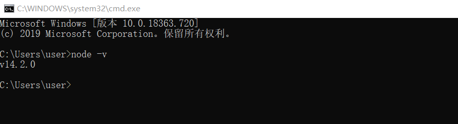

## 2.注册github

1.新建Repositories，Repositories就相当于一个库，存放我们的项目文件。创建仓库名称时有要求，必须是(用户名)xxxx+.github.io

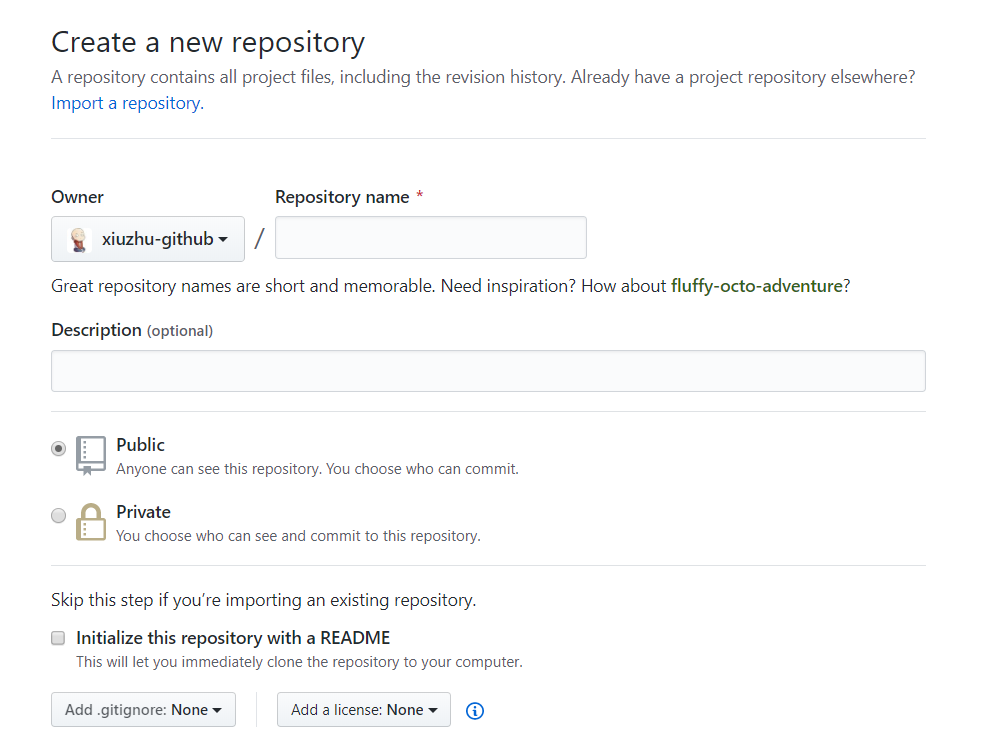

 2.点击Settings，往下拉，设置相关内容

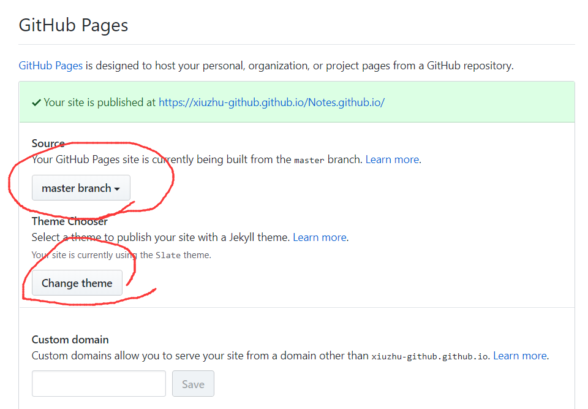

输入用户名)xxxx+.github.io测试是否可以打开

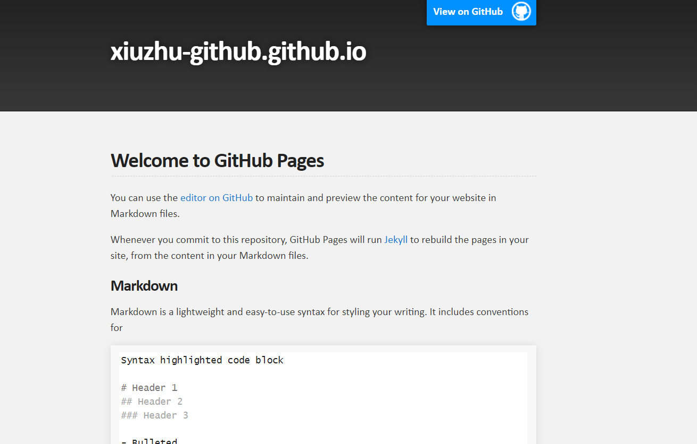

## 3.下载git

官网：https://git-scm.com/

内网下载：<https://npm.taobao.org/mirrors/git-for-windows/>

命令行输入git

出来一堆参数说明安装成功

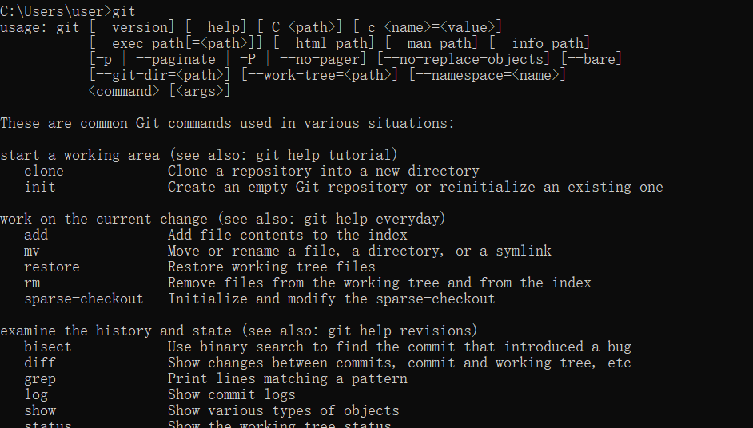

## 4.配置github

打开git-bash 输入：  
ssh-keygen -t rsa -C “邮箱名”  
三段回车  
打开GitHub–头像–设置—ssh----将公钥粘贴

github添加SSH;<https://www.jianshu.com/p/cb85ab83ade1>

## 5.hexo

https://hexo.io/

hexo：静态博客框架；WordPress是动态的博客框架；  
在自己的电脑磁盘上选择一个目录，新建文件夹  
cmd命令行：进入新建的文件夹  
比如：E盘 blog文件夹  
C:\Users\my>cd E:  
E:  
E:>cd F:\blog  
安装hexo  
npm install hexo-cli -g

报错问题：

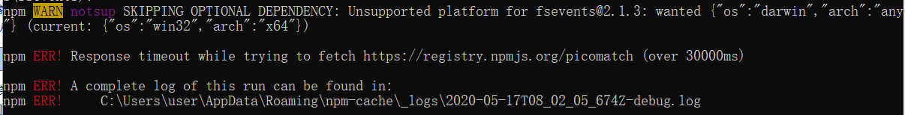

 解决方法

添加

```
 npm config set registry https://registry.npm.taobao.org
```

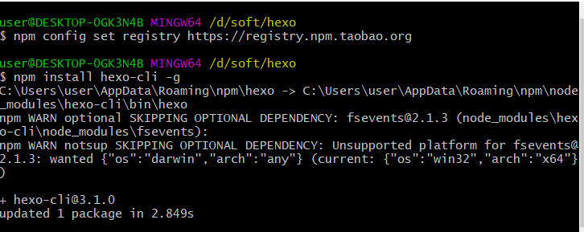

初始化:  
hexo init 博客名  
进入初始化的博客名（其实是一个文件）  
安装依赖  
npm install

报错：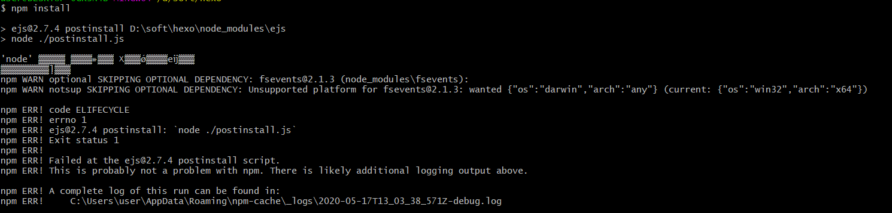

 解决

先安装npm install --ignore-scripts 再使用npm install

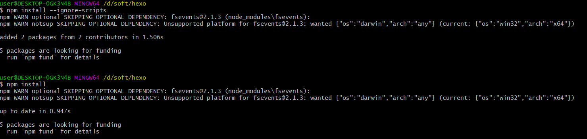

 修改\_config.yml出错

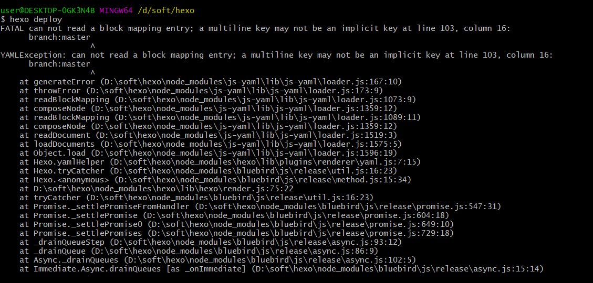

 解决方法

所有在两个配置文件中的设置，形如`xxx: xxx`的必须在冒号后打一个空格

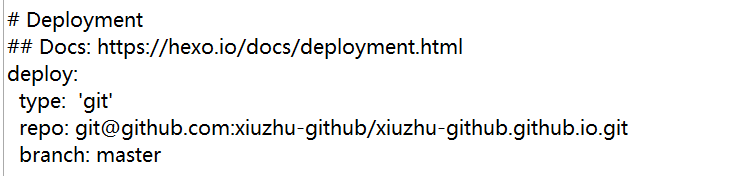

 部署的时候出现了这个错误：

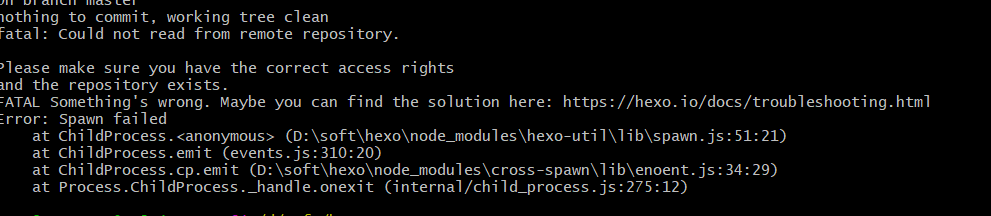

 使用hexo clean就恢复正常了

不清楚为什么第一次用这个命令之后报错，第二次及恢复正常了

## 主题配置

使用了这个主题（github下载很慢，可以用码云先把项目克隆一份在下载，一秒就下完了）

如何配置作者也有介绍：<http://blinkfox.com/2018/09/28/qian-duan/hexo-bo-ke-zhu-ti-zhi-hexo-theme-matery-de-jie-shao/>

## 写作

<https://ouuan.github.io/post/hexo%E5%8D%9A%E5%AE%A2%E6%90%AD%E5%BB%BA%E6%8C%87%E5%8C%97/#%E5%8D%9A%E5%AE%A2%E7%9A%84%E5%86%99%E4%BD%9C>

## 效果

点击菜单栏的githubpages可以看到

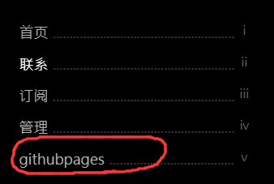
