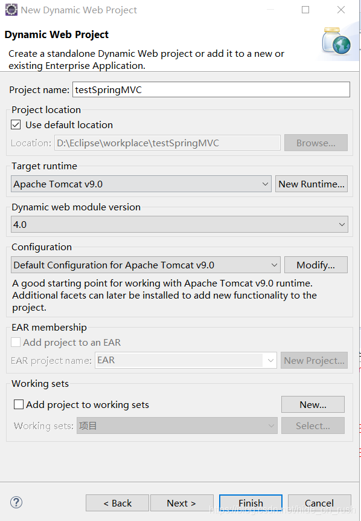
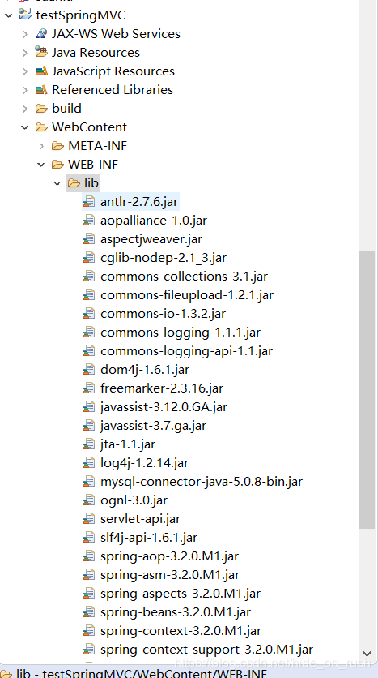
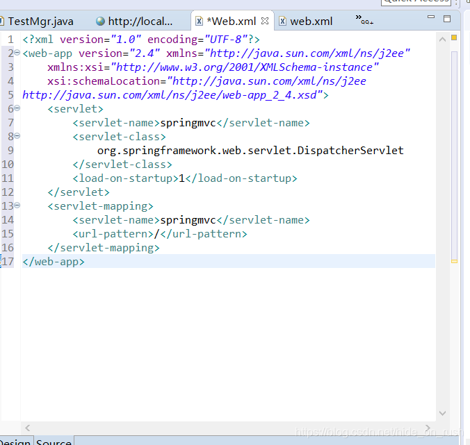
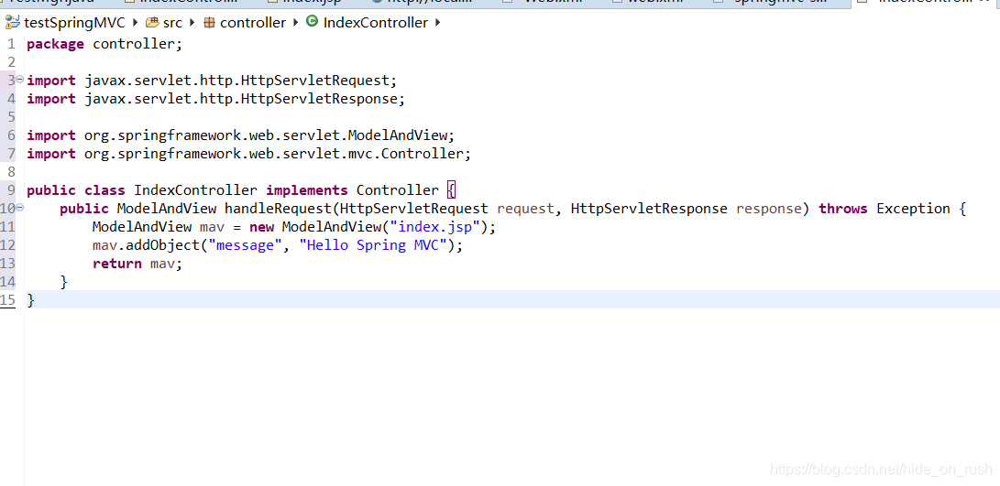
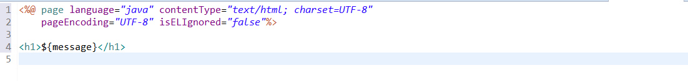
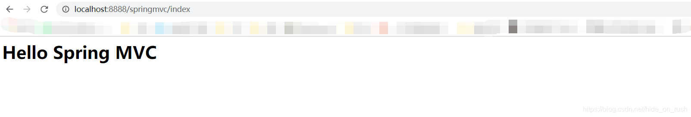
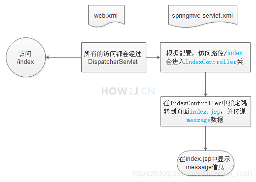

> 迁移来源 [博客园原文](https://www.cnblogs.com/xiuzhublog/p/12909376.html) · 原文发布于 `2020-05-18 16:02:00`（UTC+8）
> 旧文归档，保留当时的记录。

学习SpringMVC框架第一步，先创建一个简单项目，了解流程。使用的是Eclipse+Tomcat9.0

## 创建项目springmvc

新建Dynamic Web Project  
File->New->Other->Web->Dynamic Web Project  


## 导入jar包

下载lib.rar, 解压后复制到 e:/project/springmvc/WebContent/WEB-INF/lib目录下  


## web.xml

在WEB-INF目录下创建 web.xml

配置Spring MVC的入口 **DispatcherServlet**，把所有的请求都提交到该Servlet

注意：

```java
<servlet-name>springmvc</servlet-name>
```

springmvc这个名字在下一步会用到

## 创建springmvc-servlet.xml

在WEB-INF目录下创建 springmvc-servlet.xml  
springmvc-servlet.xml 与上一步中的

```java
<servlet-name>springmvc</servlet-name>
```

springmvc对应

这是Spring MVC的 映射配置文件  
表示访问路径/index会交给id=indexController的bean处理  
id=indexController的bean配置为类：IndexController

## 控制类 IndexController

控制类 IndexController实现接口Controller ，提供方法handleRequest处理请求

SpringMVC通过 ModelAndView 对象把模型和视图结合在一起

```java
ModelAndView mav = new ModelAndView("index.jsp");
mav.addObject("message", "Hello Spring MVC");
```

表示视图是index.jsp  
模型数据是 message，内容是 “Hello Spring MVC”  


## 准备index.jsp

在WebContent目录下创建index.jsp

index.jsp很简单，通过EL表达式显示message的内容  


## 部署在tomcat中，重启测试

部署在Tomcat中，重启tomcat，然后访问地址，观察效果  
默认位置

```java
http://127.0.0.1:8080/springmvc/index
```

我的Tomcat之前改过端口，所以是8888  


## 原理图

1. 用户访问 /index
2. 根据web.xml中的配置 所有的访问都会经过DispatcherServlet
3. 根据 根据配置文件springmvc-servlet.xml ，访问路径/index  
   会进入IndexController类
4. 在IndexController中指定跳转到页面index.jsp，并传递message数据
5. 在index.jsp中显示message信息


