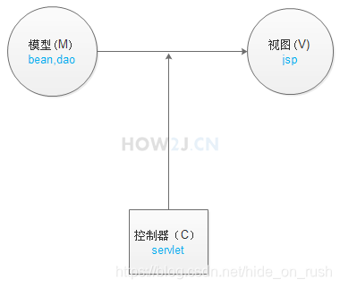

> 迁移来源 [博客园原文](https://www.cnblogs.com/xiuzhublog/p/12910855.html) · 原文发布于 `2020-05-18 15:30:00`（UTC+8）
> 旧文归档，保留当时的记录。

## 认识MVC

### 仅使用Servlet的短处

示例代码：  
根据浏览器提交的id，通过HeroDAO找到对应的Hero,然后在Servlet中组织html显示出来。  
可以看到这个Servlet不仅要准备数据，还要准备html。 尤其是准备html，可读性非常差，维护起来也很麻烦

```java
package servlet;
 
import java.io.IOException;
 
import javax.servlet.ServletException;
import javax.servlet.http.HttpServlet;
import javax.servlet.http.HttpServletRequest;
import javax.servlet.http.HttpServletResponse;
 
import bean.Hero;
import dao.HeroDAO;
 
public class HeroEditServlet extends HttpServlet {
 
    protected void service(HttpServletRequest request, HttpServletResponse response)
            throws ServletException, IOException {
 
        int id = Integer.parseInt(request.getParameter("id"));
 
        Hero hero = new HeroDAO().get(id);
 
        StringBuffer format = new StringBuffer();
        response.setContentType("text/html; charset=UTF-8");
 
        format.append("<!DOCTYPE html>");
 
        format.append("<form action='updateHero' method='post'>");
        format.append("名字 ： <input type='text' name='name' value='%s' > <br>");
        format.append("血量 ： <input type='text' name='hp'  value='%f' > <br>");
        format.append("伤害： <input type='text' name='damage'  value='%d' > <br>");
        format.append("<input type='hidden' name='id' value='%d'>");
        format.append("<input type='submit' value='更新'>");
        format.append("</form>");
 
        String html = String.format(format.toString(), hero.getName(), hero.getHp(), hero.getDamage(), hero.getId());
 
        response.getWriter().write(html);
 
    }
}
```

### 仅使用JSP的短处

因为在Servlet中编写html有这样的短板，所以索性直接在JSP中开发编辑Hero这个功能。这时会发现，虽然编写html方便了，但是写java代码不如在Servlet中那么方便

```java
<%@ page language="java" contentType="text/html; charset=UTF-8"
	pageEncoding="UTF-8" import="java.util.*,bean.*,java.sql.*"%>

<%
	int id = Integer.parseInt(request.getParameter("id"));
	Hero hero = null;
	try {
		Class.forName("com.mysql.jdbc.Driver");
	
		Connection c = DriverManager.getConnection("jdbc:mysql://127.0.0.1:3306/how2java?characterEncoding=UTF-8",
				"root", "admin");
	
		Statement s = c.createStatement();
	
		String sql = "select * from hero where id = " + id;
	
		ResultSet rs = s.executeQuery(sql);
	
		if (rs.next()) {
			hero = new Hero();
			String name = rs.getString(2);
			float hp = rs.getFloat("hp");
			int damage = rs.getInt(4);
			hero.name = name;
			hero.hp = hp;
			hero.damage = damage;
			hero.id = id;
		}
	
		s.close();
	
		c.close();
	
	} catch (ClassNotFoundException e) {
		// TODO Auto-generated catch block
		e.printStackTrace();
	} catch (SQLException e) {
		// TODO Auto-generated catch block
		e.printStackTrace();
	}
	
%>

<form action='updateHero' method='post'>
	名字 ： <input type='text' name='name' value='<%=hero.getName()%>'> <br>
	血量 ：<input type='text' name='hp' value='<%=hero.getHp()%>'> <br>
	伤害： <input type='text' name='damage' value='<%=hero.getDamage()%>'> <br>
	<input type='hidden' name='id' value='<%=hero.getId()%>'>
	<input type='submit' value='更新'>
</form>
```

### 结合Servlet和JSP

既然Servlet和JSP都有各自的优势和短板，那么为什么不结合起来扬长避短呢？HeroEditServlet：只用来从数据库中查询Hero对象，然后跳转到JSP页面

```java
request.setAttribute("hero", hero);
```

在request中设置hero

```java
request.getRequestDispatcher("editHero.jsp").forward(request, response);
```

服务端跳转到editHero.jsp，因为是服务端跳转，都属于同一次请求，所以可以在editHero.jsp通过request取出来

editHero.jsp: 不做查询数据库的事情，直接获取从HeroEditServlet传过来的Hero对象，通过EL表达式把request中的hero显示出来

```java
package servlet;
 
import java.io.IOException;
 
import javax.servlet.ServletException;
import javax.servlet.http.HttpServlet;
import javax.servlet.http.HttpServletRequest;
import javax.servlet.http.HttpServletResponse;
 
import bean.Hero;
import dao.HeroDAO;
 
public class HeroEditServlet extends HttpServlet {
 
    protected void service(HttpServletRequest request, HttpServletResponse response)
            throws ServletException, IOException {
        int id = Integer.parseInt(request.getParameter("id"));
        Hero hero = new HeroDAO().get(id);
        request.setAttribute("hero", hero);
        request.getRequestDispatcher("editHero.jsp").forward(request, response);
    }
}
```

```java
<%@ page language="java" contentType="text/html; charset=UTF-8"
    pageEncoding="UTF-8" import="java.util.*,bean.*,java.sql.*"%>
 
<form action='updateHero' method='post'>
    名字 ： <input type='text' name='name' value='${hero.name}'> <br>
    血量 ：<input type='text' name='hp' value='${hero.hp}'> <br>
    伤害： <input type='text' name='damage' value='${hero.damage}'> <br>
    <input type='hidden' name='id' value='${hero.id}'>
    <input type='submit' value='更新'>
</form>
```

### MVC设计模式

上述例子中结合Serlvet和JSP进行数据的显示，就是一种MVC的思想。

M 代表 模型（Model）  
V 代表 视图（View）  
C 代表 控制器（controller)

模型是什么呢？ 模型就是数据，就是dao,bean

视图是什么呢？ 就是网页, JSP，用来展示模型中的数据

控制器是什么？ 控制器用来把不同的数据，显示在不同的视图上。 在这个例子的，Servlet就是充当控制器的角色，把Hero对象，显示在JSP上。

控制器的作用就是把不同的数据(Model)，显示在不同的视图(View)上。  


## MVC开发

### Servlet和JSP的MVC模式弊端

通过结合Servlet和JSP的MVC模式，可以发挥二者各自的优点，

- Servlet实现业务逻辑；
- JSP实现展示逻辑。

但是，直接把MVC搭在Servlet和JSP之上还是有一些弊端：

- Servlet提供的接口仍然偏底层，需要实现Servlet调用相关接口；
- JSP对页面开发不友好，更好的替代品是模板引擎；
- 业务逻辑最好由纯粹的Java类实现，而不是强迫继承自Servlet。

那么能不能通过普通的Java类实现MVC的Controller？类似下面的代码：

```java
public class UserController {
    @GetMapping("/signin")
    public ModelAndView signin() {
        ...
    }

    @PostMapping("/signin")
    public ModelAndView doSignin(SignInBean bean) {
        ...
    }

    @GetMapping("/signout")
    public ModelAndView signout(HttpSession session) {
        ...
    }
}
```

上面的这个Java类每个方法都对应一个GET或POST请求，方法返回值是ModelAndView，它包含一个View的路径以及一个Model，这样，再由MVC框架处理后返回给浏览器。

如果是GET请求，我们希望MVC框架能直接把URL参数按方法参数对应起来然后传入：

```java
@GetMapping("/hello")
public ModelAndView hello(String name) {
    ...
}
```

如果是POST请求，我们希望MVC框架能直接把Post参数变成一个JavaBean后通过方法参数传入：

```java
@PostMapping("/signin")
public ModelAndView doSignin(SignInBean bean) {
    ...
}
```

为了增加灵活性，如果Controller的方法在处理请求时需要访问HttpServletRequest、HttpServletResponse、HttpSession这些实例时，只要方法参数有定义，就可以自动传入：

```java
@GetMapping("/signout")
public ModelAndView signout(HttpSession session) {
    ...
}
```

以上就是我们在设计MVC框架时，上层代码所需要的一切信息。

### 设计MVC框架

前面已经定义了上层代码编写Controller的一切接口信息，并且并不要求实现特定接口，只需返回ModelAndView对象，该对象包含一个View和一个Model。实际上View就是模板的路径，而Model可以用一个Map<String, Object>表示，因此，ModelAndView定义非常简单：

```java
public class ModelAndView {
    Map<String, Object> model;
    String view;
}
```

比较复杂的是我们需要在MVC框架中创建一个接收所有请求的Servlet，通常我们把它命名为DispatcherServlet，它总是映射到/，然后，根据不同的Controller的方法定义的@Get或@Post的Path决定调用哪个方法，最后，获得方法返回的ModelAndView后，渲染模板，写入HttpServletResponse，即完成了整个MVC的处理。
