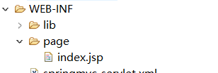
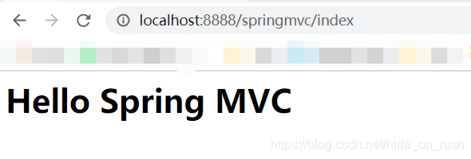
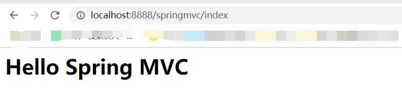

> 迁移来源 [博客园原文](https://www.cnblogs.com/xiuzhublog/p/12912396.html) · 原文发布于 `2020-05-18 18:52:00`（UTC+8）
> 旧文归档，保留当时的记录。

## 什么是视图定位

如果代码写成这样，就表示跳转到页面 index.jsp

```java
new ModelAndView("index.jsp");
```

所谓的视图定位，指的是代码还是写成这样，但是会跳转到 /WEB-INF/page/index.jsp

```java
new ModelAndView("index");
```

## 修改springmvc-servlet.xml

在之前的基础上进行修改，修改springmvc-servlet.xml，增加

```java
<bean id="viewResolver" class="org.springframework.web.servlet.view.InternalResourceViewResolver">
   <property name="prefix" value="/WEB-INF/page/" />
   <property name="suffix" value=".jsp" />
</bean>
```

## 修改IndexController

把IndexController类的这一行代码

```java
ModelAndView mav = new ModelAndView("index.jsp");
```

修改为

```java
ModelAndView mav = new ModelAndView("index");
```

## 移动index.jsp

在WEB-INF下新建目录page  
把index.jsp移动到 WEB-INF/page 目录下  


## 测试

这是修改前的效果  
  
这是修改后的效果  

