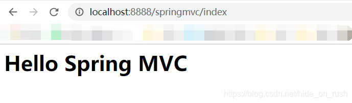

> 迁移来源 [博客园原文](https://www.cnblogs.com/xiuzhublog/p/12912904.html) · 原文发布于 `2020-05-18 20:51:00`（UTC+8）
> 旧文归档，保留当时的记录。

## 修改IndexController

在类前面加上@Controller 表示该类是一个控制器  
在方法handleRequest 前面加上 @RequestMapping("/index") 表示路径/index会映射到该方法上  
注意：不再让IndexController实现Controller接口

## 修改springmvc-servlet.xml

去掉映射相关的配置，因为已经使用注解方式了

增加

```java
<context:component-scan base-package="controller" />
```

表示从包controller下扫描有@Controller注解的类

```java
<?xml version="1.0" encoding="UTF-8"?>
<beans xmlns="http://www.springframework.org/schema/beans"
    xmlns:xsi="http://www.w3.org/2001/XMLSchema-instance"
    xmlns:context="http://www.springframework.org/schema/context"
    xsi:schemaLocation="http://www.springframework.org/schema/beans
    http://www.springframework.org/schema/beans/spring-beans-3.0.xsd
    http://www.springframework.org/schema/context        
    http://www.springframework.org/schema/context/spring-context-3.0.xsd">
     
    <context:component-scan base-package="controller" />
    <bean id="irViewResolver"
        class="org.springframework.web.servlet.view.InternalResourceViewResolver">
        <property name="prefix" value="/WEB-INF/page/" />
        <property name="suffix" value=".jsp" />
    </bean>
<!--     <bean id="simpleUrlHandlerMapping" -->
<!--         class="org.springframework.web.servlet.handler.SimpleUrlHandlerMapping"> -->
<!--         <property name="mappings"> -->
<!--             <props> -->
<!--                 <prop key="/index">indexController</prop> -->
<!--             </props> -->
<!--         </property> -->
<!--     </bean> -->
<!--     <bean id="indexController" class="controller.IndexController"></bean> -->
</beans>
```

## 效果

虽然效果和Hello Spring MVC中的一样，但是开发过程已经换成了注解方式  

