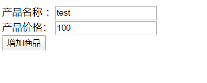
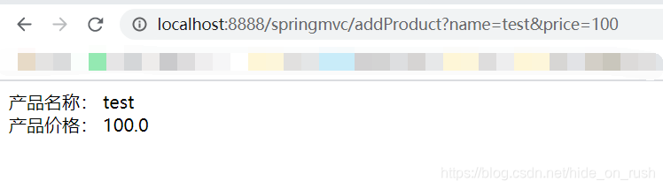

> 迁移来源 [博客园原文](https://www.cnblogs.com/xiuzhublog/p/12914734.html) · 原文发布于 `2020-05-19 08:10:00`（UTC+8）
> 旧文归档，保留当时的记录。

## pojo

新建实体类Product

```java
package pojo;
 
public class Product {
 
    private int id;
    private String name;
    private float price;
    public int getId() {
        return id;
    }
    public void setId(int id) {
        this.id = id;
    }
    public String getName() {
        return name;
    }
    public void setName(String name) {
        this.name = name;
    }
    public float getPrice() {
        return price;
    }
    public void setPrice(float price) {
        this.price = price;
    }
     
}
```

## addProduct.jsp

在web目录下 （不是在WEB-INF下）增加商品的页面addProduct.jsp  
注意：产品名称input的name要使用name，而不是 product.name

```java
<%@ page language="java" contentType="text/html; charset=UTF-8"
    pageEncoding="UTF-8" import="java.util.*" isELIgnored="false"%>
 
<form action="addProduct">
 
    产品名称 ：<input type="text" name="name" value=""><br />
    产品价格： <input type="text" name="price" value=""><br />
 
    <input type="submit" value="增加商品">
</form>
```

## ProductController

控制器ProductController，准备一个add方法映射/addProduct路径

为add方法准备一个Product 参数，用于接收注入

最后跳转到showProduct页面显示用户提交的数据

注： addProduct.jsp 提交的name和price会自动注入到参数 product里  
注： 参数product会默认被当做值加入到ModelAndView 中，相当于：

```java
mav.addObject("product",product);
```

```java
package controller;
 
import org.springframework.stereotype.Controller;
import org.springframework.web.bind.annotation.ModelAttribute;
import org.springframework.web.bind.annotation.RequestMapping;
import org.springframework.web.bind.annotation.RequestParam;
import org.springframework.web.servlet.ModelAndView;
 
import pojo.Product;
 
@Controller
public class ProductController {
 
    @RequestMapping("/addProduct")
    public ModelAndView add(Product product) throws Exception {
        ModelAndView mav = new ModelAndView("showProduct");
        return mav;
    }
}
```

## showProduct.jsp

在WEB-INF/page 目录下创建 showProduct.jsp  
用 EL 表达式显示用户提交的名称和价格

## 测试结果

  

