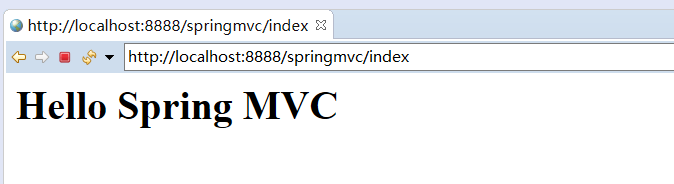

> 迁移来源 [博客园原文](https://www.cnblogs.com/xiuzhublog/p/12915097.html) · 原文发布于 `2020-05-19 09:40:00`（UTC+8）
> 旧文归档，保留当时的记录。

之前无论是/index跳转到index.jsp 还是/addProduct 跳转到showProduct.jsp，都是服务端跳转。  
这一篇练习如何进行客户端跳转

## 修改IndexController

首先映射/jump到jump()方法  
在jump()中编写如下代码

```java
ModelAndView mav = new ModelAndView("redirect:/index");
```

redirect:/index  
即表示客户端跳转的意思

```java
package controller;
 
import javax.servlet.http.HttpServletRequest;
import javax.servlet.http.HttpServletResponse;
 
import org.springframework.stereotype.Controller;
import org.springframework.web.bind.annotation.RequestMapping;
import org.springframework.web.servlet.ModelAndView;
 
@Controller
public class IndexController {
    @RequestMapping("/index")
    public ModelAndView handleRequest(HttpServletRequest request, HttpServletResponse response) throws Exception {
        ModelAndView mav = new ModelAndView("index");
        mav.addObject("message", "Hello Spring MVC");
        return mav;
    }
     
    @RequestMapping("/jump")
    public ModelAndView jump() {
        ModelAndView mav = new ModelAndView("redirect:/index");
        return mav;
    }  
     
}
```

## 效果

访问页面  
<http://localhost:8888/springmvc/jump>  
结果跳转到了  


## 客户端转发和服务端转发

| redirect:xxx | forward:xxx |
| --- | --- |
| 客户端跳转 | 服务端转发 |
|  |  |
| url会跟随着变，变为xxx ，这时已是全新的独立的请求，不能够再使用前面获得的数据 | url保持不变，且原获取到的值，在xxx 控制器下依旧能够用 |
| xxx 是Controller 的映射值 |  |

```java
    @RequestMapping("/Annotation")
    public ModelAndView annotation() {
        ModelAndView modelAndView = new ModelAndView("annotation");
        modelAndView.addObject("message", "注解形式的Controller");
        return modelAndView;
    }
 
    @RequestMapping("/addPojo")
    public ModelAndView addPojo(Pojo pojo) {
        ModelAndView modelAndView = new ModelAndView("redirect:/Annotation");  // 前者客户端跳转    ， 这个 forward:/Annotation 服务端转发
        return modelAndView;
    }
 
// annotation.jsp
<body>
    <h1>${message }</h1>
    <h2>${pojo.id }</h2>           // redirect 即客户端跳转  ，这里将获取不到值(不会报错) ；  forward 即服务端转发，能够将addPojo方法获得的pojo 信息在这里信息
    <h2>${pojo.name }</h2>     // redirect 即客户端跳转  ，这里将获取不到值(不会报错) ；  forward 即服务端转发，能够将addPojo方法获得的pojo 信息在这里信息
</body>
```

## ModelAndView

```java
modelandview 对象 添加的键值传给jsp前端

   ModelAndView m=new ModelAndVies();//对象
  m.addObject("keyname",values);  //jsp通过键名获取值,值可以使基本类型 pojo类 object
 m.setViewName("jsp路径");//前端页面
return m;
```

## 为什么redirect 跳转到的是index而不是index.jsp？

```java
前面的springmvc-servlet中已经定义了
class="org.springframework.web.servlet.view.InternalResourceViewResolver">
        <!-- 作用是把视图约定在/WEB-INF/page/*.jsp这个位置-->
        <property name="prefix" value="/WEB-INF/page/" />
        <!--拦截jsp文件 -->
        <property name="suffix" value=".jsp" />
```
