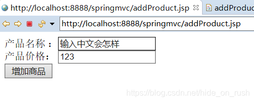
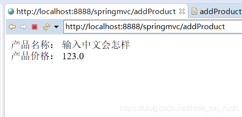

> 迁移来源 [博客园原文](https://www.cnblogs.com/xiuzhublog/p/12918971.html) · 原文发布于 `2020-05-19 19:30:00`（UTC+8）
> 旧文归档，保留当时的记录。

之前练习过提交表单数据，但是提交的数据包含中文，这一篇练习如何处理中文。在Spring MVC中处理中文问题和Filter处理中文问题是一样的手段

## Filter

修改web.xml

```java
<?xml version="1.0" encoding="UTF-8"?>
<web-app version="2.4" xmlns="http://java.sun.com/xml/ns/j2ee"
    xmlns:xsi="http://www.w3.org/2001/XMLSchema-instance"
    xsi:schemaLocation="http://java.sun.com/xml/ns/j2ee
http://java.sun.com/xml/ns/j2ee/web-app_2_4.xsd">
    <servlet>
        <servlet-name>springmvc</servlet-name>
        <servlet-class>
            org.springframework.web.servlet.DispatcherServlet
        </servlet-class>
        <load-on-startup>1</load-on-startup>
    </servlet>
    <servlet-mapping>
        <servlet-name>springmvc</servlet-name>
        <url-pattern>/</url-pattern>
    </servlet-mapping>
    <filter> 
        <filter-name>CharacterEncodingFilter</filter-name> 
        <filter-class>org.springframework.web.filter.CharacterEncodingFilter</filter-class> 
        <init-param> 
            <param-name>encoding</param-name> 
            <param-value>utf-8</param-value> 
        </init-param> 
    </filter> 
    <filter-mapping> 
        <filter-name>CharacterEncodingFilter</filter-name> 
        <url-pattern>/*</url-pattern> 
    </filter-mapping>    
</web-app>
```

## addProduct.jsp

为form 设置method="post"

```java
<%@ page language="java" contentType="text/html; charset=UTF-8"
    pageEncoding="UTF-8" import="java.util.*" isELIgnored="false"%>
 
<form action="addProduct" method="post">
 
    产品名称 ：<input type="text" name="name" value=""><br />
    产品价格： <input type="text" name="price" value=""><br />
 
    <input type="submit" value="增加商品">
</form>
```

## 结果

  

