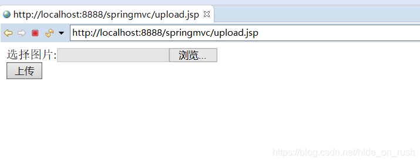

> 迁移来源 [博客园原文](https://www.cnblogs.com/xiuzhublog/p/12919159.html) · 原文发布于 `2020-05-19 20:12:00`（UTC+8）
> 旧文归档，保留当时的记录。

## 配置web.xml允许访问\*.jpg

在web.xml中新增加一段

```java
<servlet-mapping>
	    <servlet-name>default</servlet-name>
	    <url-pattern>*.jpg</url-pattern>
	</servlet-mapping>
```

表示允许访问\*.jpg。

为什么要加这一段呢？ 因为配置springmvc的servlet的时候，使用的路径是"/"，导致静态资源在默认情况下不能访问，所以要加上这一段，允许访问jpg。 并且必须加在springmvc的servlet之前

如果你配置spring-mvc使用的路径是/\*.do，就不会有这个问题了。

注： 这里仅仅是允许访问jpg,如果你要显示png,gif那么需要额外进行配置  
完整的代码：

```java
<?xml version="1.0" encoding="UTF-8"?>
<web-app version="2.4" xmlns="http://java.sun.com/xml/ns/j2ee"
    xmlns:xsi="http://www.w3.org/2001/XMLSchema-instance"
    xsi:schemaLocation="http://java.sun.com/xml/ns/j2ee
http://java.sun.com/xml/ns/j2ee/web-app_2_4.xsd">
 
    <servlet-mapping>
        <servlet-name>default</servlet-name>
        <url-pattern>*.jpg</url-pattern>
    </servlet-mapping>
     
    <servlet>
        <servlet-name>springmvc</servlet-name>
        <servlet-class>
            org.springframework.web.servlet.DispatcherServlet
        </servlet-class>
        <load-on-startup>1</load-on-startup>
    </servlet>
    <servlet-mapping>
        <servlet-name>springmvc</servlet-name>
        <url-pattern>/</url-pattern>
    </servlet-mapping>
    <filter> 
        <filter-name>CharacterEncodingFilter</filter-name> 
        <filter-class>org.springframework.web.filter.CharacterEncodingFilter</filter-class> 
        <init-param> 
            <param-name>encoding</param-name> 
            <param-value>utf-8</param-value> 
        </init-param> 
    </filter> 
    <filter-mapping> 
        <filter-name>CharacterEncodingFilter</filter-name> 
        <url-pattern>/*</url-pattern> 
    </filter-mapping>    
</web-app>
```

## 配置springmvc-servlet.xml

新增加一段配置

```java
<bean id="multipartResolver" class="org.springframework.web.multipart.commons.CommonsMultipartResolver"/>
```

用来开放对上传功能的支持  
完整代码：

```java
<?xml version="1.0" encoding="UTF-8"?>
<beans xmlns="http://www.springframework.org/schema/beans"
    xmlns:xsi="http://www.w3.org/2001/XMLSchema-instance"
    xmlns:context="http://www.springframework.org/schema/context"
    xsi:schemaLocation="http://www.springframework.org/schema/beans
    http://www.springframework.org/schema/beans/spring-beans-3.0.xsd
    http://www.springframework.org/schema/context        
    http://www.springframework.org/schema/context/spring-context-3.0.xsd">
     
    <context:component-scan base-package="controller" />
    <bean id="irViewResolver"
        class="org.springframework.web.servlet.view.InternalResourceViewResolver">
        <property name="prefix" value="/WEB-INF/page/" />
        <property name="suffix" value=".jsp" />
    </bean>
    <bean id="multipartResolver" class="org.springframework.web.multipart.commons.CommonsMultipartResolver"/>
</beans>
```

## upload.jsp 上传页面

上传页面，需要注意的是form 的两个属性必须提供  
method="post" 和 enctype="multipart/form-data" 缺一不可  
上传组件 增加一个属性 accept="image/\*" 表示只能选择图片进行上传  
留意  这个image，后面会用到这个image

```java
<%@ page language="java" contentType="text/html; charset=UTF-8"
    pageEncoding="UTF-8" import="java.util.*" isELIgnored="false"%>
  
<form action="uploadImage" method="post" enctype="multipart/form-data">
  选择图片:<input type="file" name="image" accept="image/*" /> <br>
  <input type="submit" value="上传">
</form>
```

## 创建UploadedImageFile

在UploadedImageFile中封装MultipartFile类型的字段 image ，用于接受页面的注入

这里的字段 image必须和上传页面upload.jsp中的image

```java
<input type="file" name="image" accept="image/*" />
```

保持一致

```java
package pojo;
 
import org.springframework.web.multipart.MultipartFile;
 
public class UploadedImageFile {
    MultipartFile image;
 
    public MultipartFile getImage() {
        return image;
    }
 
    public void setImage(MultipartFile image) {
        this.image = image;
    }
 
}
```

## UploadController 上传控制器

新建类UploadController 作为上传控制器  
准备方法upload 映射上传路径/uploadImage

1. 方法的第二个参数UploadedImageFile 中已经注入好了 image
2. 通过 RandomStringUtils.randomAlphanumeric(10);获取一个随机文件名。 因为用户可能上传相同文件名的文件，为了不覆盖原来的文件，通过随机文件名的办法来规避
3. 根据request.getServletContext().getRealPath 获取到web目录下的image目录，用于存放上传后的文件。
4. 调用file.getImage().transferTo(newFile); 复制文件
5. 把生成的随机文件名提交给视图，用于后续的显示

```java
package controller;
 
import java.io.File;
import java.io.IOException;
 
import javax.servlet.http.HttpServletRequest;
 
import org.apache.commons.lang.xwork.RandomStringUtils;
import org.springframework.stereotype.Controller;
import org.springframework.web.bind.annotation.RequestMapping;
import org.springframework.web.servlet.ModelAndView;
 
import pojo.UploadedImageFile;
 
@Controller
public class UploadController {
 
    @RequestMapping("/uploadImage")
    public ModelAndView upload(HttpServletRequest request, UploadedImageFile file)
            throws IllegalStateException, IOException {
        String name = RandomStringUtils.randomAlphanumeric(10);
        String newFileName = name + ".jpg";
        File newFile = new File(request.getServletContext().getRealPath("/image"), newFileName);
        newFile.getParentFile().mkdirs();
        file.getImage().transferTo(newFile);
 
        ModelAndView mav = new ModelAndView("showUploadedFile");
        mav.addObject("imageName", newFileName);
        return mav;
    }
}
```

## showUploadedFile.jsp 显示图片的页面

在WEB-INF/page 下新建文件showUploadedFile 显示上传的图片

```java
<%@ page language="java" contentType="text/html; charset=UTF-8"
    pageEncoding="UTF-8" isELIgnored="false"%>
 

```

## 效果

  

