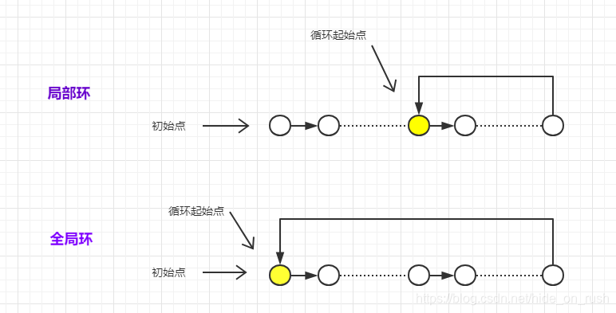

> 迁移来源 [博客园原文](https://www.cnblogs.com/xiuzhublog/p/12919903.html) · 原文发布于 `2020-05-19 22:05:00`（UTC+8）
> 旧文归档，保留当时的记录。

## 283. 移动零

开始的想法是把零都挪到后面，看到了一种效率更高的写法，思路是先遍历一遍数组，把遇到的非零数按顺序重新复制，后面的全修改成零

```java
public void moveZeroes(int[] nums) {
    int idx = 0;
    for (int num : nums) {
        if (num != 0) {
            nums[idx++] = num;
        }
    }
    while (idx < nums.length) {
        nums[idx++] = 0;
    }
}
```

## 566. 重塑矩阵

遍历

```java
class Solution {
    public int[][] matrixReshape(int[][] nums, int r, int c) {
    int m = nums.length, n = nums[0].length;
    if (m * n != r * c) {
        return nums;
    }
    int[][] reshapedNums = new int[r][c];
    int index = 0;
    for (int i = 0; i < r; i++) {
        for (int j = 0; j < c; j++) {
            reshapedNums[i][j] = nums[index / n][index % n];
            index++;
        }
    }
    return reshapedNums;
    }
}
```

## 485. 最大连续1的个数

双指针法

```java
class Solution {
    public int findMaxConsecutiveOnes(int[] nums) {
        int front = 0;
        int last = 0;
        int res = 0;
        while (last < nums.length) {
        	if (nums[last] == 1) {
        		last ++;
        	}
            /** 若出现0 保存当前最大连续值 重置指针*/
        	else {
        		res = Math.max(res, last - front);
        		front = last + 1;
        		last = front;
        	}
        }
        /** 判断最后的连续值是否是最大值 */
        res = Math.max(res, last - front);
        
        return res;
    }
}
```

## 240. 搜索二维矩阵 II

因为每一行递增，每一列递增。

所以本题的思路是从右上角往左下角找或者从左下角往右上角找。每次比较可以排除一行或者一列，时间复杂度为O(m+n)  
和之前剑指offer上的一个题差不多  
<https://blog.csdn.net/hide_on_rush/article/details/105165885>

```java
class Solution {
    public boolean searchMatrix(int[][] matrix, int target) {
    if (matrix == null || matrix.length == 0 || matrix[0].length == 0) return false;
    int m = matrix.length, n = matrix[0].length;
    int row = 0, col = n - 1;
    while (row < m && col >= 0) {
        if (target == matrix[row][col]) return true;
        else if (target < matrix[row][col]) col--;
        else row++;
    }
    return false;
    }
}
```

## 378. 有序矩阵中第K小的元素

二分查找法

```java
public int kthSmallest(int[][] matrix, int k) {
    int m = matrix.length, n = matrix[0].length;
    int lo = matrix[0][0], hi = matrix[m - 1][n - 1];
    while (lo <= hi) {
        int mid = lo + (hi - lo) / 2;
        int cnt = 0;
        for (int i = 0; i < m; i++) {
            for (int j = 0; j < n && matrix[i][j] <= mid; j++) {
                cnt++;
            }
        }
        if (cnt < k) lo = mid + 1;
        else hi = mid - 1;
    }
    return lo;
}
```

## 645. 错误的集合

开始的想法是先排序，这种方法时间复杂度为 O(NlogN)。但是可以通过交换数组元素，使得数组上的元素在正确的位置上。这样的话时间复杂度为O(N)，  
空间复杂度为O(1)。

```java
class Solution {
   public int[] findErrorNums(int[] nums) {
    for (int i = 0; i < nums.length; i++) {
        while (nums[i] != i + 1 && nums[nums[i] - 1] != nums[i]) {
            swap(nums, i, nums[i] - 1);
        }
    }
    for (int i = 0; i < nums.length; i++) {
        if (nums[i] != i + 1) {
            return new int[]{nums[i], i + 1};
        }
    }
    return null;
}

private void swap(int[] nums, int i, int j) {
    int tmp = nums[i];
    nums[i] = nums[j];
    nums[j] = tmp;
    }
}
```

## 287. 寻找重复数

双指针解法要比二分法效率高  
题解里找到的思路：  
这里一共有n+1个元素，且元素的值为 [ 1 , n ]，因此这里把下标i当做结点的标志，nums[ i ]当做是结点i的下一个结点的标志。这样从结点1到结点n中的任一个结点开始跳，必然会出现两种情况：

1.形成局部环（循环起始点不是初始点）  
2.形成全局环（循环起始点是初始点）  
  
情况1：如果是局部环，那么循环起始点的标志就是重复数字。  
情况2：如果是全局环，则稍微复杂一点，因为它只能说明环内的结点所对应的值不重复，但整个全局环不一定包含所有结点。为了判断是否含有重复，还需要从剩下的点继续跳。

解决办法：由于情况2比较难处理（因为要判断剩余的结点是哪些），因此这里有一个小小的tips，我们不再是从结点1到结点n中任意位置起跳，而是从结点nums[ 0 ]起跳，这样即使形成的是全局环，循环的起点依然是重复数字（因为全局环意味着环内的末节点指向初始结点，而结点0又指向初始结点，因此，初始结点即循环起始点就是重复数字）。这样，无论情况1还是情况2，我们只需要找到循环起始点就可以了。

作者：shi-wen  
链接：<https://leetcode-cn.com/problems/find-the-duplicate-number/solution/kuai-man-zhi-zhen-de-yuan-li-0ms-100-by-shi-wen/>

```java
public int findDuplicate(int[] nums) {
    int slow = nums[0], fast = nums[nums[0]];
    while (slow != fast) {
        slow = nums[slow];
        fast = nums[nums[fast]];
    }
    fast = 0;
    while (slow != fast) {
        slow = nums[slow];
        fast = nums[fast];
    }
    return slow;
}
```

## 667. 优美的排列 II

```java
class Solution {
    public int[] constructArray(int n, int k) {
    int[] ret = new int[n];
    ret[0] = 1;
    for (int i = 1, interval = k; i <= k; i++, interval--) {
        ret[i] = i % 2 == 1 ? ret[i - 1] + interval : ret[i - 1] - interval;
    }
    for (int i = k + 1; i < n; i++) {
        ret[i] = i + 1;
    }
    return ret;
    }
}
```

## 697. 数组的度

使用HashMap

```java
class Solution {
    public int findShortestSubArray(int[] nums) {
    Map<Integer, Integer> numsCnt = new HashMap<>();
    Map<Integer, Integer> numsLastIndex = new HashMap<>();
    Map<Integer, Integer> numsFirstIndex = new HashMap<>();
    for (int i = 0; i < nums.length; i++) {
        int num = nums[i];
        numsCnt.put(num, numsCnt.getOrDefault(num, 0) + 1);
        numsLastIndex.put(num, i);
        if (!numsFirstIndex.containsKey(num)) {
            numsFirstIndex.put(num, i);
        }
    }
    int maxCnt = 0;
    for (int num : nums) {
        maxCnt = Math.max(maxCnt, numsCnt.get(num));
    }
    int ret = nums.length;
    for (int i = 0; i < nums.length; i++) {
        int num = nums[i];
        int cnt = numsCnt.get(num);
        if (cnt != maxCnt) continue;
        ret = Math.min(ret, numsLastIndex.get(num) - numsFirstIndex.get(num) + 1);
    }
    return ret;
    }
}
```

## 766. 托普利茨矩阵

每个元素都跟左上角元素比较，因为第0行和第0列都没有左上角元素，所以两个索引都从1开始。

```java
class Solution {
    public boolean isToeplitzMatrix(int[][] matrix) {
        for(int i = 1; i < matrix.length; i ++)
            for(int j = 1; j < matrix[0].length; j ++)
                if(matrix[i][j] != matrix[i-1][j-1])
                    return false;
        return true;
    }
}
```

## 565. 数组嵌套

将访问过的数标位-1，访问到-1直接跳出。原理是如果访问到之前一个循环中访问过的数，则说明也进入了之前的循环，没有必要再进行下去。

```java
class Solution {
    public int arrayNesting(int[] nums) {
        int res = 0;
        for(int i = 0; i < nums.length; i++){
            int count = 0;
            int k = i;
            while(nums[k]!=-1){
                int temp = k;
                k = nums[k];
                nums[temp] = -1;
                count++;
            }
            res = Math.max(res,count);
        }
        return res;

    }
}
```

## 769. 最多能完成排序的块

```java
class Solution {
    public int maxChunksToSorted(int[] arr) {
    if (arr == null) return 0;
    int ret = 0;
    int right = arr[0];
    for (int i = 0; i < arr.length; i++) {
        right = Math.max(right, arr[i]);
        if (right == i) ret++;
    }
    return ret;
    }
}
```
