> 迁移来源 [博客园原文](https://www.cnblogs.com/xiuzhublog/p/12931615.html) · 原文发布于 `2020-05-21 16:29:00`（UTC+8）
> 旧文归档，保留当时的记录。

github账号注册很久了，使用过idea的版本管理，但是命令行还不会。正好新写了一个小项目，练习一下如何上传到github。

## 新建github仓库

关于注册账号，邮箱认证什么的就不再多说了  
新建一个仓库，添加名称和描述  
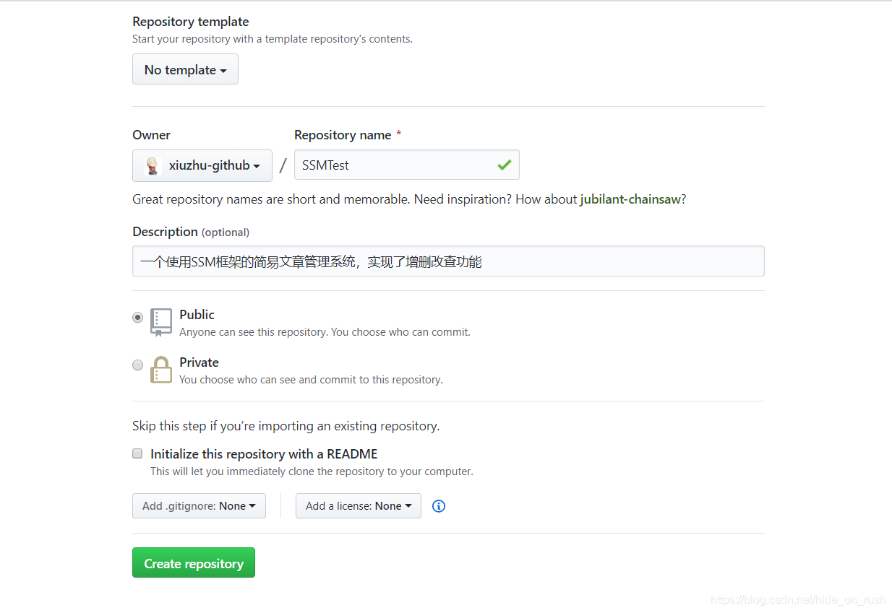  
圈中的地址随后会用到  
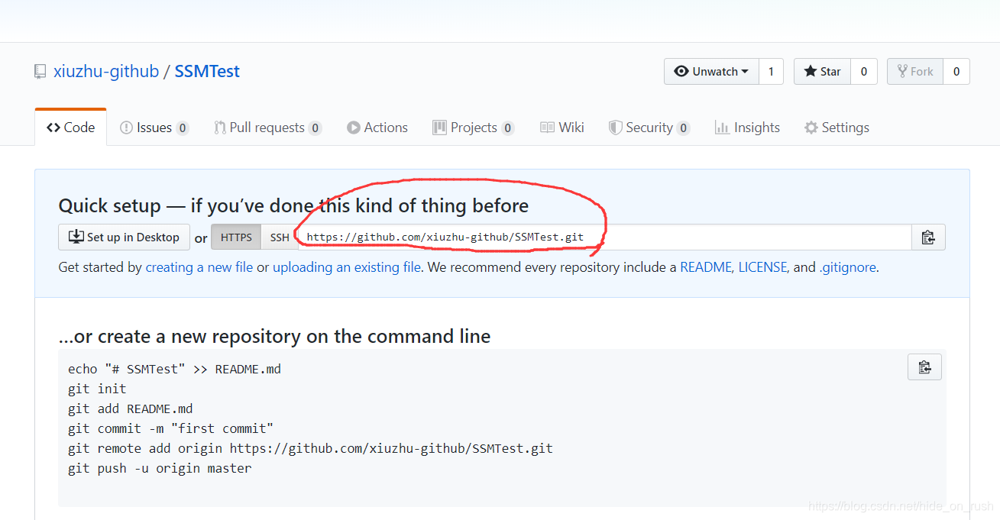

## 安装git

[官网下载地址](https://git-scm.com/downloads)

## 上传项目

### 1.创建本地版本库（文件夹）

你可以直接右击新建文件夹，也可以右击打开Git bash命令行窗口通过命令来创建。

下面通过命令行在桌面新建一个TEST文件夹（你也可以在其他任何地方创建这个文件夹），并且进入这个文件夹  
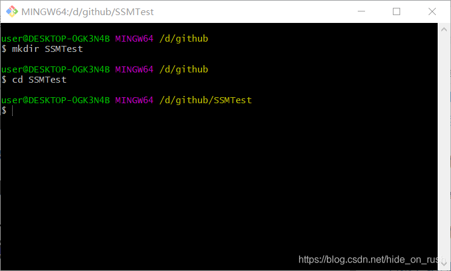

### 2.通过命令git init把这个文件夹变成Git可管理的仓库

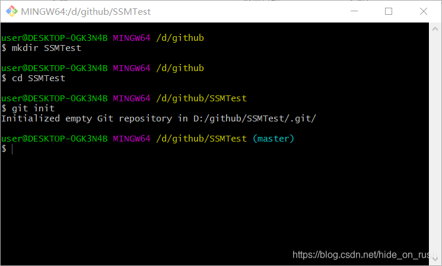  
里面会出现一个.git文件夹，它是Git用来跟踪和管理版本库的。如果你看不到，是因为它默认是隐藏文件，那你就需要设置一下让隐藏文件可见。  
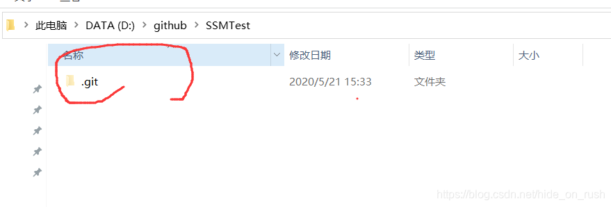

### 3.把项目添加到仓库

这时候你就可以把你的项目粘贴到这个本地Git仓库里面（粘贴后你可以通过git status来查看你当前的状态），然后通过git add把项目添加到仓库（或git add .把该目录下的所有文件添加到仓库，注意点是用空格隔开的）。在这个过程中你其实可以一直使用git status来查看你当前的状态。  
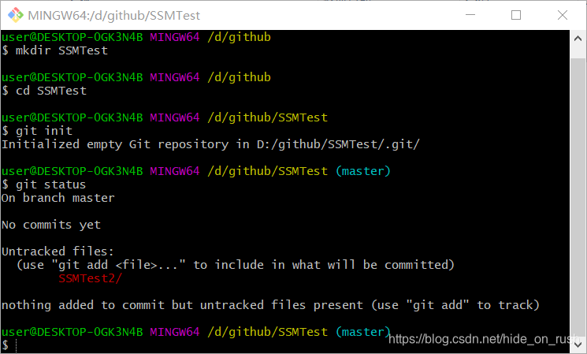  
这里提示你虽然把项目粘贴过来了，但还没有add到Git仓库上，然后我们通过git add .把刚才复制过来的项目全部添加到仓库上。  
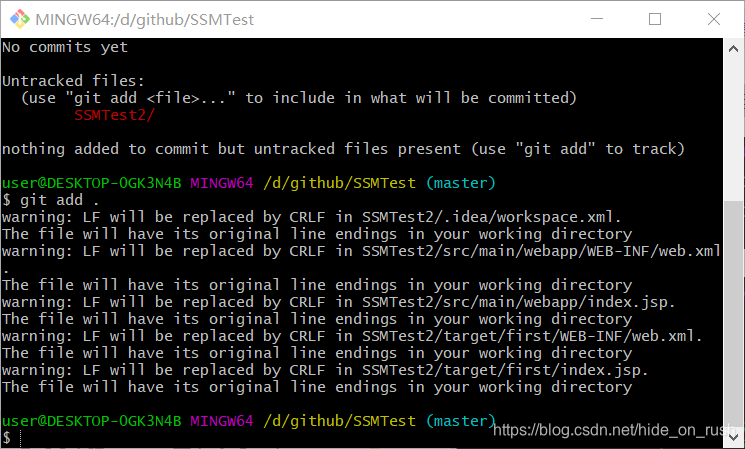

### 4.用git commit把项目提交到仓库

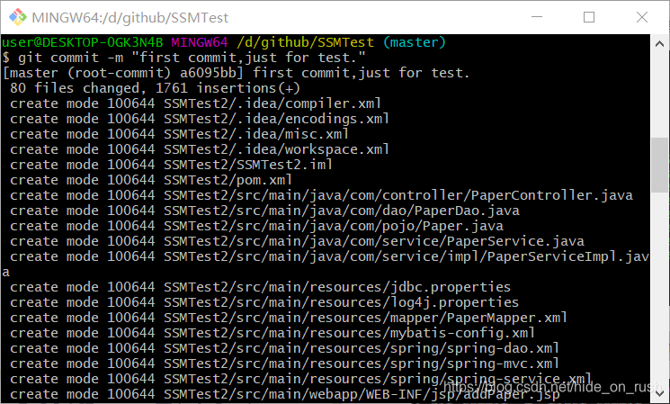

-m后面引号里面是本次提交的注释内容，这个可以不写，但最好写上，不然会报错，详情自行搜索。

### 创建SSH KEY

接下来就到了连接远程仓库。首先需要创建sshkey。之前创建过的话这一步直接跳过。  
不知道自己创建过没有的话可以查看你C盘用户目录下有没有.ssh目录，有的话看下里面有没有id\_rsa和id\_rsa.pub这两个文件  
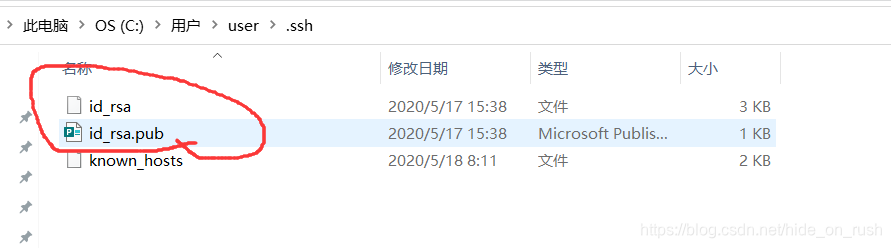  
没有的话可以通过下面的命令创建：

```java
   $ ssh-keygen -t rsa -C "youremail@example.com"
```

### 6.github设置sshkey

登录Github,找到右上角的图标，打开点进里面的Settings，再选中里面的SSH and GPG KEYS，点击右上角的New SSH key，然后Title里面随便填，再把刚才id\_rsa.pub里面的内容复制到Title下面的Key内容框里面，最后点击Add SSH key，这样就完成了SSH Key的加密。

### 7.创建关联

就可以和本地仓库进行关联了，根据创建好的Git仓库页面的提示，可以在本地TEST仓库的命令行输入

```java
$ git remote add origin https://github.com/xiuzhu-github/SSMTest.git
```

origin后面加的是之前Github上创建好的仓库的地址。  
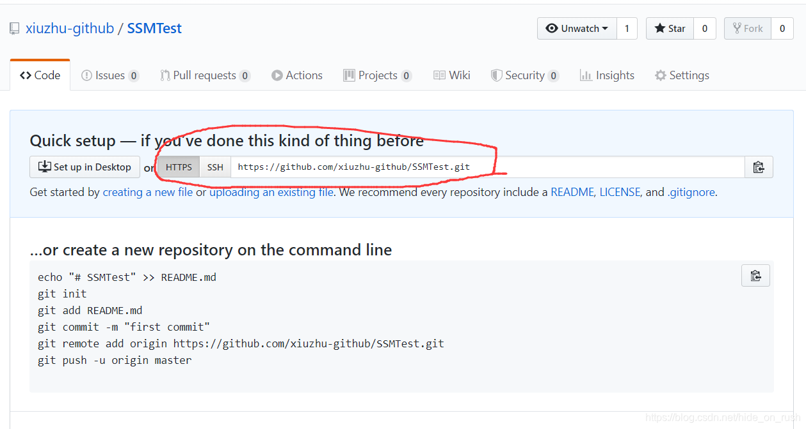

### 8.内容推送到远程仓库

关联好之后我们就可以把本地库的所有内容推送到远程仓库（也就是Github）上了，通过：

```java
$ git push -u origin master
```

由于新建的远程仓库是空的，所以要加上-u这个参数，等远程仓库里面有了内容之后，下次再从本地库上传内容的时候只需下面这样就可以了：

```java
$ git push origin master
```

这一步需要登录  
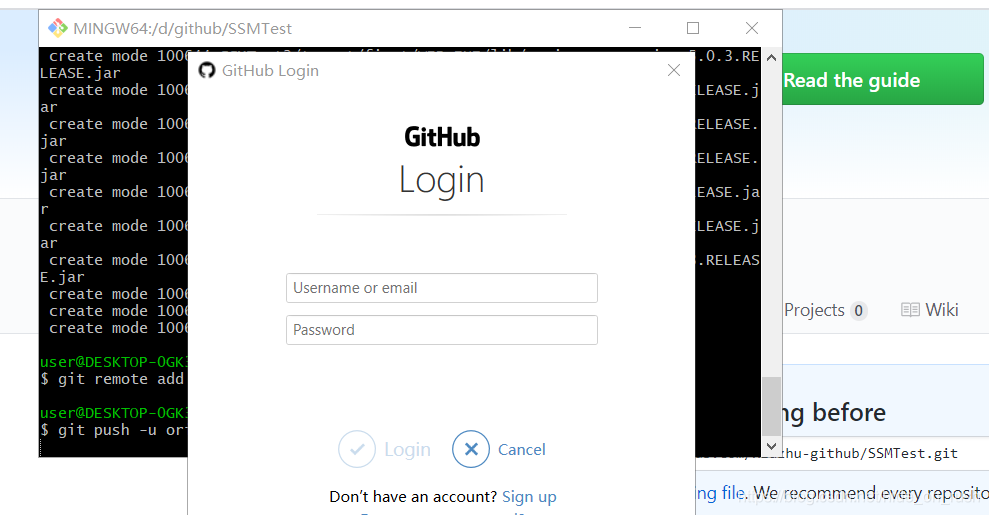  
输入SSHKey  
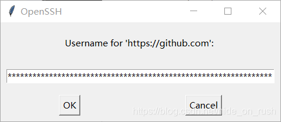  
输入私钥  
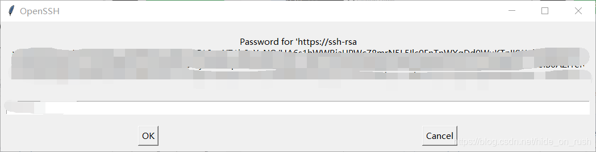  
执行的时间有点长，完成后的界面是这样的：  
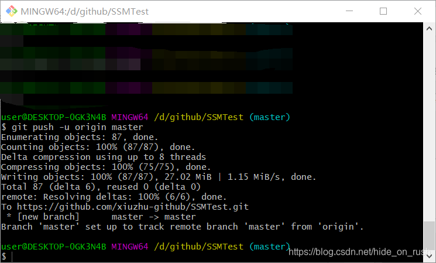  
刷新github，可以看到已经传上了  
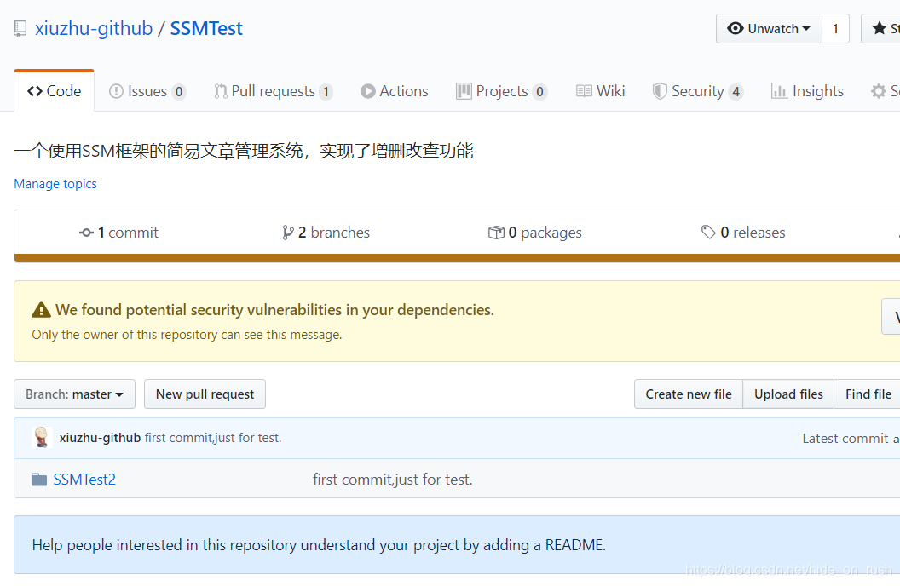  
这里出现了安全提示。  
点开：  
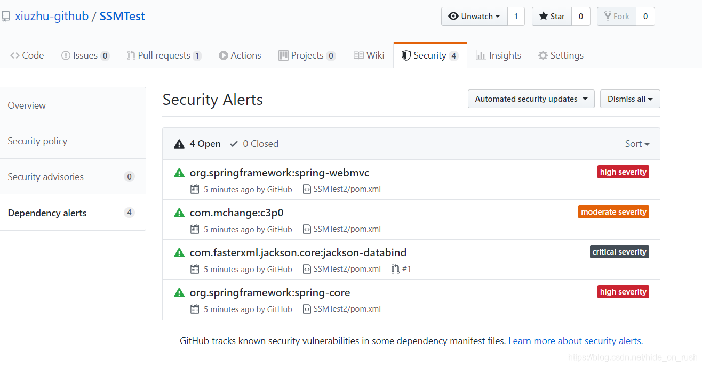  
点开错误信息：  
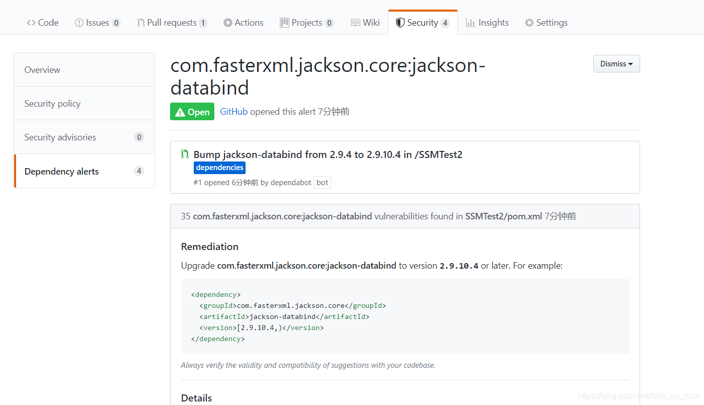  
可以看到是版本问题。四个问题都是有版本漏洞。修改版本就行了。  
至此就完成了将本地项目上传到Github的整个过程。

## 更新项目

当以后需要更新项目的时候有四步需要走  
第一步：执行git pull命令将GitHub上的代码当下来合并代码，防止提交新代码的时候起冲突  
第二步：执行git add命令将代码添加到仓库  
第三步：执行git commit命令将代码提交到仓库  
第四步：执行git push命令将代码提交到GitHub
