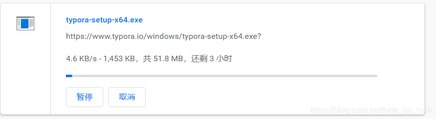
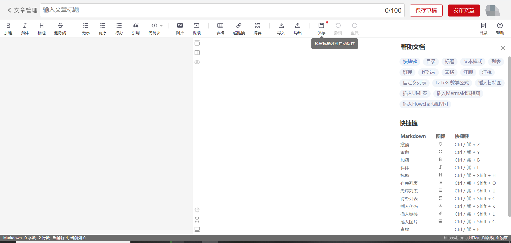

> 迁移来源 [博客园原文](https://www.cnblogs.com/xiuzhublog/p/12938339.html) · 原文发布于 `2021-02-06 22:19:00`（UTC+8）
> 旧文归档，保留当时的记录。

Typora 是一款支持实时预览的 Markdown 文本编辑器。由于在测试阶段，目前是免费的。  
教程非常多：  
<https://sspai.com/post/54912>  
<https://www.cnblogs.com/hider/p/11614688.html>  
<https://blog.csdn.net/yw00yw/article/details/81633266>  
就记录一下遇到的问题：

## 1.下载慢

  
下载速度惨不忍睹。  
找了找没有什么太好的解决办法。意外在腾讯软件中心找到了一个19年的版本。  
  
下载这个版本以后软件内更新要快得多。

## 2.使用体验

软件操作挺简单的。但是目前来说使用体验只能算一般。因为刚用markdown没几天，感觉Typora对我这样的新手不太友好。这两天写markdown用的是csdn的Markdown在线编辑器。  
  
刚学好多命令记不住，这个的体验效果要好一点。等以后用熟练了不再需要命令提示的时候，typora应该更好。毕竟typora的功能要全面得多。
