> 迁移来源 [博客园原文](https://www.cnblogs.com/xiuzhublog/p/12940014.html) · 原文发布于 `2020-05-22 21:58:00`（UTC+8）
> 旧文归档，保留当时的记录。

## 1.基础

### 进程的基本概念

进程就是应用程序在内存中分配的空间，也就是正在运行的程序，各个进程之间互不干扰。同时进程保存着程序每一个时刻运行的状态。

程序：用某种编程语言(java、python等)编写，能够完成一定任务或者功能的代码集合,是指令和数据的有序集合，是一段静态代码。

此时，CPU采用时间片轮转的方式运行进程：CPU为每个进程分配一个时间段，称作它的时间片。如果在时间片结束时进程还在运行，则暂停这个进程的运行，并且CPU分配给另一个进程（这个过程叫做上下文切换）。如果进程在时间片结束前阻塞或结束，则CPU立即进行切换，不用等待时间片用完。

当进程暂停时，它会保存当前进程的状态（进程标识，进程使用的资源等），在下一次切换回来时根据之前保存的状态进行恢复，接着继续执行。

使用进程+CPU时间片轮转方式的操作系统，在宏观上看起来同一时间段执行多个任务，换句话说，进程让操作系统的并发成为了可能。虽然并发从宏观上看有多个任务在执行，但在事实上，对于单核CPU来说，任意具体时刻都只有一个任务在占用CPU资源。

### 线程的基本概念

让一个线程执行一个子任务，这样一个进程就包含了多个线程，每个线程负责一个单独的子任务。

使用线程之后，事情就变得简单多了。当用户使用扫描病毒功能时，就让扫描病毒这个线程去执行。同时，如果用户又使用清理垃圾功能，那么可以先暂停扫描病毒线程，先响应用户的清理垃圾的操作，让清理垃圾这个线程去执行。响应完后再切换回来，接着执行扫描病毒线程。

总之，进程和线程的提出极大的提高了操作系统的性能。进程让操作系统的并发性成为了可能，而线程让进程的内部并发成为了可能。

### 进程和线程的关系

下图是 Java 内存区域，通过下图我们从 JVM 的角度来说一下线程和进程之间的关系。如果你对 Java 内存区域 (运行时数据区) 这部分知识不太了解的话可以阅读一下这篇文章：《可能是把 Java 内存区域讲的最清楚的一篇文章》

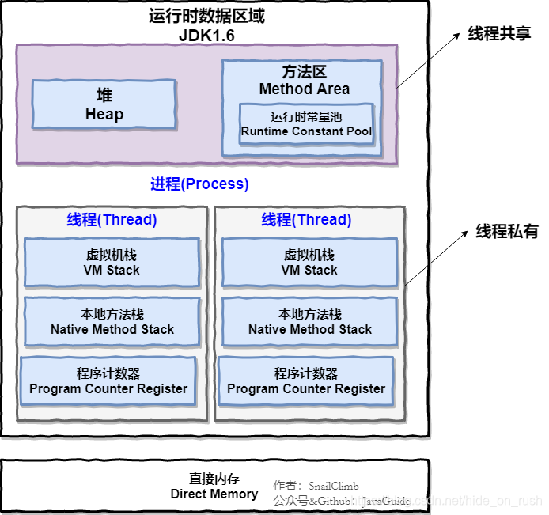

从上图可以看出：一个进程中可以有多个线程，多个线程共享进程的堆和方法区 (JDK1.8 之后的元空间)资源，但是每个线程有自己的程序计数器、虚拟机栈 和 本地方法栈。

### 进程和线程的区别

进程是一个独立的运行环境，而线程是在进程中执行的一个任务。他们两个本质的区别是是否单独占有内存地址空间及其它系统资源（比如I/O）：

进程单独占有一定的内存地址空间，所以进程间存在内存隔离，数据是分开的，数据共享复杂但是同步简单，各个进程之间互不干扰；而线程共享所属进程占有的内存地址空间和资源，数据共享简单，但是同步复杂。

进程单独占有一定的内存地址空间，一个进程出现问题不会影响其他进程，不影响主程序的稳定性，可靠性高；一个线程崩溃可能影响整个程序的稳定性，可靠性较低。

进程单独占有一定的内存地址空间，进程的创建和销毁不仅需要保存寄存器和栈信息，还需要资源的分配回收以及页调度，开销较大；线程只需要保存寄存器和栈信息，开销较小。  
另外一个重要区别是，进程是操作系统进行资源分配的基本单位，而线程是操作系统进行调度的基本单位，即CPU分配时间的单位 。

总结： 线程 是 进程 划分成的更小的运行单位。线程和进程最大的不同在于基本上各进程是独立的，而各线程则不一定，因为同一进程中的线程极有可能会相互影响。线程执行开销小，但不利于资源的管理和保护；而进程正相反

### 线程的使用

#### 继承Thread类

如何使用Thread

```java
public class Demo {
    public static class MyThread extends Thread {
        @Override
        public void run() {
            System.out.println("MyThread");
        }
    }

    public static void main(String[] args) {
        Thread myThread = new MyThread();
        myThread.start();
    }
}
```

注意要调用start()方法后，该线程才算启动！

我们在程序里面调用了start()方法后，虚拟机会先为我们创建一个线程，然后等到这个线程第一次得到时间片时再调用run()方法。

**注意不可多次调用start()方法。在第一次调用start()方法后，再次调用start()方法会抛出异常。**

**Thread类构造方法**  
Thread类是一个Runnable接口的实现类，我们来看看Thread类的源码。

查看Thread类的构造方法，发现其实是简单调用一个私有的init方法来实现初始化。init的方法签名：

Thread类源码

```java
// 片段1 - init方法
private void init(ThreadGroup g, Runnable target, String name,
                      long stackSize, AccessControlContext acc,
                      boolean inheritThreadLocals)
```

```java
// 片段2 - 构造函数调用init方法
public Thread(Runnable target) {
    init(null, target, "Thread-" + nextThreadNum(), 0);
}

// 片段3 - 使用在init方法里初始化AccessControlContext类型的私有属性
this.inheritedAccessControlContext = 
    acc != null ? acc : AccessController.getContext();

// 片段4 - 两个对用于支持ThreadLocal的私有属性
ThreadLocal.ThreadLocalMap threadLocals = null;
ThreadLocal.ThreadLocalMap inheritableThreadLocals = null;
```

我们挨个来解释一下init方法的这些参数：

- g：线程组，指定这个线程是在哪个线程组下；
- target：指定要执行的任务；
- name：线程的名字，多个线程的名字是可以重复的。如果不指定名字，见片段2；
- acc：见片段3，用于初始化私有变量inheritedAccessControlContext。

这个变量有点神奇。它是一个私有变量，但是在Thread类里只有init方法对它进行初始化，在exit方法把它设为null。其它没有任何地方使用它。一般我们是不会使用它的，那什么时候会使用到这个变量呢？可以参考这个stackoverflow的问题：Restrict permissions to threads which execute third party software；

inheritThreadLocals：可继承的ThreadLocal，见片段4，Thread类里面有两个私有属性来支持ThreadLocal，我们会在后面的章节介绍ThreadLocal的概念。

实际情况下，我们大多是直接调用下面两个构造方法：

```java
Thread(Runnable target)
Thread(Runnable target, String name)
Thread类的常用方法
```

这里介绍一下Thread类的几个常用的方法：

- currentThread()：静态方法，返回对当前正在执行的线程对象的引用；
- start()：开始执行线程的方法，java虚拟机会调用线程内的run()方法；
- yield()：yield在英语里有放弃的意思，同样，这里的yield()指的是当前线程- 愿意让出对当前处理器的占用。这里需要注意的是，就算当前线程调用了yield()方法，程序在调度的时候，也还有可能继续运行这个线程的；
- sleep()：静态方法，使当前线程睡眠一段时间；
- join()：使当前线程等待另一个线程执行完毕之后再继续执行，内部调用的是Object类的wait方法实现的；

### 实现Runnable接口

接着我们来看一下Runnable接口(JDK 1.8 +)：

```java
@FunctionalInterface
public interface Runnable {
    public abstract void run();
}
```

可以看到Runnable是一个函数式接口，这意味着我们可以使用Java 8的函数式编程来简化代码。

示例代码：

```java
public class Demo {
    public static class MyThread implements Runnable {
        @Override
        public void run() {
            System.out.println("MyThread");
        }
    }

    public static void main(String[] args) {
        new MyThread().run();

        // Java 8 函数式编程，可以省略MyThread类
        new Thread(() -> {
            System.out.println("Java 8 匿名内部类");
        }).start();
    }
}
```

#### Thread类与Runnable比较

实现一个自定义的线程类，可以有继承Thread类或者实现Runnable接口这两种方式，它们之间有什么优劣呢？

由于Java“单继承，多实现”的特性，Runnable接口使用起来比Thread更灵活。  
Runnable接口出现更符合面向对象，将线程单独进行对象的封装。  
Runnable接口出现，降低了线程对象和线程任务的耦合性。  
如果使用线程时不需要使用Thread类的诸多方法，显然使用Runnable接口更为轻量。  
所以，我们通常优先使用“实现Runnable接口”这种方式来自定义线程类。

### 实现Callable接口

通常来说，我们使用Runnable和Thread来创建一个新的线程。但是它们有一个弊端，就是run方法是没有返回值的。而有时候我们希望开启一个线程去执行一个任务，并且这个任务执行完成后有一个返回值。

JDK提供了Callable接口与Future类为我们解决这个问题，这也是所谓的“异步”模型。

Callable与Runnable类似，同样是只有一个抽象方法的函数式接口。不同的是，Callable提供的方法是有返回值的，而且支持泛型。

```java
@FunctionalInterface
public interface Callable<V> {
    V call() throws Exception;
}
```

那一般是怎么使用Callable的呢？Callable一般是配合线程池工具ExecutorService来使用的。我们会在后续解释线程池的使用。这里只介绍ExecutorService可以使用submit方法来让一个Callable接口执行。它会返回一个Future，我们后续的程序可以通过这个Future的get方法得到结果。

这里可以看一个简单的使用demo：

```java
// 自定义Callable
class Task implements Callable<Integer>{
    @Override
    public Integer call() throws Exception {
        // 模拟计算需要一秒
        Thread.sleep(1000);
        return 2;
    }
    public static void main(String args[]){
        // 使用
        ExecutorService executor = Executors.newCachedThreadPool();
        Task task = new Task();
        Future<Integer> result = executor.submit(task);
        // 注意调用get方法会阻塞当前线程，直到得到结果。
        // 所以实际编码中建议使用可以设置超时时间的重载get方法。
        System.out.println(result.get()); 
    }
}
//输出结果：2
```

#### Future接口

Future接口只有几个比较简单的方法：

```java
	public abstract interface Future<V> {
    public abstract boolean cancel(boolean paramBoolean);
    public abstract boolean isCancelled();
    public abstract boolean isDone();
    public abstract V get() throws InterruptedException, ExecutionException;
    public abstract V get(long paramLong, TimeUnit paramTimeUnit)
            throws InterruptedException, ExecutionException, TimeoutException;
}
```

cancel方法是试图取消一个线程的执行。

**注意是试图取消，并不一定能取消成功。**因为任务可能已完成、已取消、或者一些其它因素不能取消，存在取消失败的可能。boolean类型的返回值是“是否取消成功”的意思。参数paramBoolean表示是否采用中断的方式取消线程执行。

所以有时候，为了让任务有能够取消的功能，就使用Callable来代替Runnable。如果为了可取消性而使用 Future但又不提供可用的结果，则可以声明 Future<?>形式类型、并返回 null作为底层任务的结果。

#### FutureTask类

上面介绍了Future接口。这个接口有一个实现类叫FutureTask。FutureTask是实现的RunnableFuture接口的，而RunnableFuture接口同时继承了Runnable接口和Future接口：

```java
public interface RunnableFuture<V> extends Runnable, Future<V> {
    /**
     * Sets this Future to the result of its computation
     * unless it has been cancelled.
     */
    void run();
}
```

那FutureTask类有什么用？为什么要有一个FutureTask类？前面说到了Future只是一个接口，而它里面的cancel，get，isDone等方法要自己实现起来都是非常复杂的。所以JDK提供了一个FutureTask类来供我们使用。

示例代码：

```java
// 自定义Callable，与上面一样
class Task implements Callable<Integer>{
    @Override
    public Integer call() throws Exception {
        // 模拟计算需要一秒
        Thread.sleep(1000);
        return 2;
    }
    public static void main(String args[]){
        // 使用
        ExecutorService executor = Executors.newCachedThreadPool();
        FutureTask<Integer> futureTask = new FutureTask<>(new Task());
        executor.submit(futureTask);
        System.out.println(futureTask.get());
    }
}
```

使用上与第一个Demo有一点小的区别。首先，调用submit方法是没有返回值的。这里实际上是调用的submit(Runnable task)方法，而上面的Demo，调用的是submit(Callable task)方法。

然后，这里是使用FutureTask直接取get取值，而上面的Demo是通过submit方法返回的Future去取值。

在很多高并发的环境下，有可能Callable和FutureTask会创建多次。FutureTask能够在高并发环境下确保任务只执行一次。

```java
FutureTask的几个状态
/**
  *
  * state可能的状态转变路径如下：
  * NEW -> COMPLETING -> NORMAL
  * NEW -> COMPLETING -> EXCEPTIONAL
  * NEW -> CANCELLED
  * NEW -> INTERRUPTING -> INTERRUPTED
  */
private volatile int state;
private static final int NEW          = 0;
private static final int COMPLETING   = 1;
private static final int NORMAL       = 2;
private static final int EXCEPTIONAL  = 3;
private static final int CANCELLED    = 4;
private static final int INTERRUPTING = 5;
private static final int INTERRUPTED  = 6;
state表示任务的运行状态，初始状态为NEW。运行状态只会在set、setException、cancel方法中终止。COMPLETING、INTERRUPTING是任务完成后的瞬时状态。
```

### 线程组

Java中用ThreadGroup来表示线程组，我们可以使用线程组对线程进行批量控制。

ThreadGroup和Thread的关系就如同他们的字面意思一样简单粗暴，每个Thread必然存在于一个ThreadGroup中，Thread不能独立于ThreadGroup存在。执行main()方法线程的名字是main，如果在new Thread时没有显式指定，那么默认将父线程（当前执行new Thread的线程）线程组设置为自己的线程组。

示例代码：

```java
public class Demo {
    public static void main(String[] args) {
        Thread testThread = new Thread(() -> {
            System.out.println("testThread当前线程组名字：" +
                    Thread.currentThread().getThreadGroup().getName());
            System.out.println("testThread线程名字：" +
                    Thread.currentThread().getName());
        });

        testThread.start();
        System.out.println("执行main方法线程名字：" + Thread.currentThread().getName());
    }
}
输出结果：

执行main方法线程名字：main
testThread当前线程组名字：main
testThread线程名字：Thread-0
```

ThreadGroup管理着它下面的Thread，**ThreadGroup是一个标准的向下引用的树状结构**，这样设计的原因是防止"上级"线程被"下级"线程引用而无法有效地被GC回收。

在之前，我们有谈到一个线程必然存在于一个线程组中，那么当线程和线程组的优先级不一致的时候将会怎样呢？我们用下面的案例来验证一下：

```java
public static void main(String[] args) {
    ThreadGroup threadGroup = new ThreadGroup("t1");
    threadGroup.setMaxPriority(6);
    Thread thread = new Thread(threadGroup,"thread");
    thread.setPriority(9);
    System.out.println("我是线程组的优先级"+threadGroup.getMaxPriority());
    System.out.println("我是线程的优先级"+thread.getPriority());
}
输出：

我是线程组的优先级6
我是线程的优先级6
```

所以，如果某个线程优先级大于线程所在线程组的最大优先级，那么该线程的优先级将会失效，取而代之的是线程组的最大优先级。

#### 线程组的常用方法

- 获取当前的线程组名字

```java
Thread.currentThread().getThreadGroup().getName()
```

- 复制线程组  
  // 复制一个线程数组到一个线程组

```java
Thread[] threads = new Thread[threadGroup.activeCount()];
TheadGroup threadGroup = new ThreadGroup();
threadGroup.enumerate(threads);
```

- 线程组统一异常处理

```java
package com.func.axc.threadgroup;

public class ThreadGroupDemo {
    public static void main(String[] args) {
        ThreadGroup threadGroup1 = new ThreadGroup("group1") {
            // 继承ThreadGroup并重新定义以下方法
            // 在线程成员抛出unchecked exception
            // 会执行此方法
            public void uncaughtException(Thread t, Throwable e) {
                System.out.println(t.getName() + ": " + e.getMessage());
            }
        };

        // 这个线程是threadGroup1的一员
        Thread thread1 = new Thread(threadGroup1, new Runnable() {
            public void run() {
                // 抛出unchecked异常
                throw new RuntimeException("测试异常");
            }
        });

        thread1.start();
    }
}
```

#### 线程组的数据结构

线程组还可以包含其他的线程组，不仅仅是线程。

首先看看 ThreadGroup源码中的成员变量

```java
public class ThreadGroup implements Thread.UncaughtExceptionHandler {
    private final ThreadGroup parent; // 父亲ThreadGroup
    String name; // ThreadGroupr 的名称
    int maxPriority; // 线程最大优先级
    boolean destroyed; // 是否被销毁
    boolean daemon; // 是否守护线程
    boolean vmAllowSuspension; // 是否可以中断

    int nUnstartedThreads = 0; // 还未启动的线程
    int nthreads; // ThreadGroup中线程数目
    Thread threads[]; // ThreadGroup中的线程

    int ngroups; // 线程组数目
    ThreadGroup groups[]; // 线程组数组
}
然后看看构造函数：

// 私有构造函数
private ThreadGroup() { 
    this.name = "system";
    this.maxPriority = Thread.MAX_PRIORITY;
    this.parent = null;
}

// 默认是以当前ThreadGroup传入作为parent  ThreadGroup，新线程组的父线程组是目前正在运行线程的线程组。
public ThreadGroup(String name) {
    this(Thread.currentThread().getThreadGroup(), name);
}

// 构造函数
public ThreadGroup(ThreadGroup parent, String name) {
    this(checkParentAccess(parent), parent, name);
}

// 私有构造函数，主要的构造函数
private ThreadGroup(Void unused, ThreadGroup parent, String name) {
    this.name = name;
    this.maxPriority = parent.maxPriority;
    this.daemon = parent.daemon;
    this.vmAllowSuspension = parent.vmAllowSuspension;
    this.parent = parent;
    parent.add(this);
}
```

第三个构造函数里调用了checkParentAccess方法，这里看看这个方法的源码：

```java
// 检查parent ThreadGroup
private static Void checkParentAccess(ThreadGroup parent) {
    parent.checkAccess();
    return null;
}

// 判断当前运行的线程是否具有修改线程组的权限
public final void checkAccess() {
    SecurityManager security = System.getSecurityManager();
    if (security != null) {
        security.checkAccess(this);
    }
}
```

这里涉及到SecurityManager这个类，它是Java的安全管理器，它允许应用程序在执行一个可能不安全或敏感的操作前确定该操作是什么，以及是否是在允许执行该操作的安全上下文中执行它。应用程序可以允许或不允许该操作。

比如引入了第三方类库，但是并不能保证它的安全性。

其实Thread类也有一个checkAccess()方法，不过是用来当前运行的线程是否有权限修改被调用的这个线程实例。（Determines if the currently running thread has permission to modify this thread.）

总结来说，线程组是一个树状的结构，每个线程组下面可以有多个线程或者线程组。线程组可以起到统一控制线程的优先级和检查线程的权限的作用。

### 线程优先级

Java中线程优先级可以指定，范围是1~10。但是并不是所有的操作系统都支持10级优先级的划分（比如有些操作系统只支持3级划分：低，中，高），Java只是给操作系统一个优先级的参考值，线程最终在操作系统的优先级是多少还是由操作系统决定。

Java默认的线程优先级为5，线程的执行顺序由调度程序来决定，线程的优先级会在线程被调用之前设定。

通常情况下，高优先级的线程将会比低优先级的线程有更高的几率得到执行。我们使用方法Thread类的setPriority()实例方法来设定线程的优先级。

```java
public class Demo {
    public static void main(String[] args) {
        Thread a = new Thread();
        System.out.println("我是默认线程优先级："+a.getPriority());
        Thread b = new Thread();
        b.setPriority(10);
        System.out.println("我是设置过的线程优先级："+b.getPriority());
    }
}
输出结果：

我是默认线程优先级：5
我是设置过的线程优先级：10
```

Java中的优先级不是特别的可靠，Java程序中对线程所设置的优先级只是给操作系统一个建议，操作系统不一定会采纳。而真正的调用顺序，是由操作系统的线程调度算法决定的。

我们通过代码来验证一下：

```java
public class Demo {
    public static class T1 extends Thread {
        @Override
        public void run() {
            super.run();
            System.out.println(String.format("当前执行的线程是：%s，优先级：%d",
                    Thread.currentThread().getName(),
                    Thread.currentThread().getPriority()));
        }
    }

    public static void main(String[] args) {
        IntStream.range(1, 10).forEach(i -> {
            Thread thread = new Thread(new T1());
            thread.setPriority(i);
            thread.start();
        });
    }
}
某次输出：

当前执行的线程是：Thread-17，优先级：9
当前执行的线程是：Thread-1，优先级：1
当前执行的线程是：Thread-13，优先级：7
当前执行的线程是：Thread-11，优先级：6
当前执行的线程是：Thread-15，优先级：8
当前执行的线程是：Thread-7，优先级：4
当前执行的线程是：Thread-9，优先级：5
当前执行的线程是：Thread-3，优先级：2
当前执行的线程是：Thread-5，优先级：3
```

Java提供一个线程调度器来监视和控制处于RUNNABLE状态的线程。线程的调度策略采用抢占式，优先级高的线程比优先级低的线程会有更大的几率优先执行。在优先级相同的情况下，按照“先到先得”的原则。每个Java程序都有一个默认的主线程，就是通过JVM启动的第一个线程main线程。

### 操作系统中的线程状态转换

在现在的操作系统中，线程是被视为轻量级进程的，所以操作系统线程的状态其实和操作系统进程的状态是一致的。  
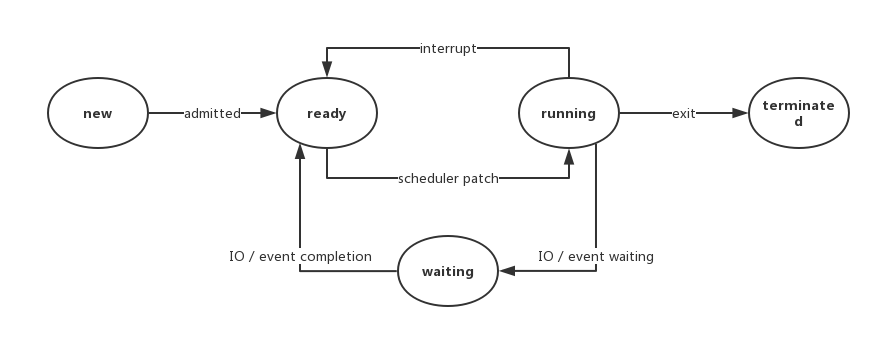

### java线程的六个状态

```java
// Thread.State 源码
public enum State {
    NEW,//（新建）
    RUNNABLE,//（可运行）
    BLOCKED,//（阻塞）
    WAITING,//（等待）
    TIMED_WAITING,//（定时等待）
    TERMINATED;//（终止）
}
```

#### NEW

处于NEW状态的线程此时尚未启动。这里的尚未启动指的是还没调用Thread实例的start()方法。

private void testStateNew() {  
Thread thread = new Thread(() -> {});  
System.out.println(thread.getState()); // 输出 NEW  
}  
从上面可以看出，只是创建了线程而并没有调用start()方法，此时线程处于NEW状态。

关于start()的两个引申问题

反复调用同一个线程的start()方法是否可行？  
假如一个线程执行完毕（此时处于TERMINATED状态），再次调用这个线程的start()方法是否可行？  
要分析这两个问题，我们先来看看start()的源码：

```java
public synchronized void start() {
    if (threadStatus != 0)
        throw new IllegalThreadStateException();

    group.add(this);

    boolean started = false;
    try {
        start0();
        started = true;
    } finally {
        try {
            if (!started) {
                group.threadStartFailed(this);
            }
        } catch (Throwable ignore) {

        }
    }
}
```

我们可以看到，在start()内部，这里有一个threadStatus的变量。如果它不等于0，调用start()是会直接抛出异常的。

我们接着往下看，有一个native的start0()方法。这个方法里并没有对threadStatus的处理。到了这里我们仿佛就拿这个threadStatus没辙了，我们通过debug的方式再看一下:

```java
@Test
public void testStartMethod() {
    Thread thread = new Thread(() -> {});
    thread.start(); // 第一次调用
    thread.start(); // 第二次调用
}
```

我是在start()方法内部的最开始打的断点，叙述下在我这里打断点看到的结果：

```java
第一次调用时threadStatus的值是0。
第二次调用时threadStatus的值不为0。
查看当前线程状态的源码：
```

```java
// Thread.getState方法源码：
public State getState() {
    // get current thread state
    return sun.misc.VM.toThreadState(threadStatus);
}
```

```java
// sun.misc.VM 源码：
public static State toThreadState(int var0) {
    if ((var0 & 4) != 0) {
        return State.RUNNABLE;
    } else if ((var0 & 1024) != 0) {
        return State.BLOCKED;
    } else if ((var0 & 16) != 0) {
        return State.WAITING;
    } else if ((var0 & 32) != 0) {
        return State.TIMED_WAITING;
    } else if ((var0 & 2) != 0) {
        return State.TERMINATED;
    } else {
        return (var0 & 1) == 0 ? State.NEW : State.RUNNABLE;
    }
}
```

所以，我们结合上面的源码可以得到引申的两个问题的结果：

两个问题的答案都是不可行，在调用一次start()之后，threadStatus的值会改变（threadStatus !=0），此时再次调用start()方法会抛出IllegalThreadStateException异常。

比如，threadStatus为2代表当前线程状态为TERMINATED。

#### RUNNABLE

表示当前线程正在运行中。处于RUNNABLE状态的线程在Java虚拟机中运行，也有可能在等待其他系统资源（比如I/O）。

Java中线程的RUNNABLE状态

看了操作系统线程的几个状态之后我们来看看Thread源码里对RUNNABLE状态的定义：

```java
/**
 * Thread state for a runnable thread.  A thread in the runnable
 * state is executing in the Java virtual machine but it may
 * be waiting for other resources from the operating system
 * such as processor.
 */
```

Java线程的RUNNABLE状态其实是包括了传统操作系统线程的ready和running两个状态的。

#### BLOCKED

阻塞状态。处于BLOCKED状态的线程正等待锁的释放以进入同步区。

我们用BLOCKED状态举个生活中的例子：

假如今天你下班后准备去食堂吃饭。你来到食堂仅有的一个窗口，发现前面已经有个人在窗口前了，此时你必须得等前面的人从窗口离开才行。  
假设你是线程t2，你前面的那个人是线程t1。此时t1占有了锁（食堂唯一的窗口），t2正在等待锁的释放，所以此时t2就处于BLOCKED状态。

#### WAITING

等待状态。处于等待状态的线程变成RUNNABLE状态需要其他线程唤醒。

调用如下3个方法会使线程进入等待状态：

Object.wait()：使当前线程处于等待状态直到另一个线程唤醒它；  
Thread.join()：等待线程执行完毕，底层调用的是Object实例的wait方法；  
LockSupport.park()：除非获得调用许可，否则禁用当前线程进行线程调度。  
我们延续上面的例子继续解释一下WAITING状态：

你等了好几分钟现在终于轮到你了，突然你们有一个“不懂事”的经理突然来了。你看到他你就有一种不祥的预感，果然，他是来找你的。

他把你拉到一旁叫你待会儿再吃饭，说他下午要去作报告，赶紧来找你了解一下项目的情况。你心里虽然有一万个不愿意但是你还是从食堂窗口走开了。

此时，假设你还是线程t2，你的经理是线程t1。虽然你此时都占有锁（窗口）了，“不速之客”来了你还是得释放掉锁。此时你t2的状态就是WAITING。然后经理t1获得锁，进入RUNNABLE状态。

要是经理t1不主动唤醒你t2（notify、notifyAll..），可以说你t2只能一直等待了。

#### TIMED\_WAITING

超时等待状态。线程等待一个具体的时间，时间到后会被自动唤醒。

调用如下方法会使线程进入超时等待状态：

Thread.sleep(long millis)：使当前线程睡眠指定时间；  
Object.wait(long timeout)：线程休眠指定时间，等待期间可以通过notify()/notifyAll()唤醒；  
Thread.join(long millis)：等待当前线程最多执行millis毫秒，如果millis为0，则会一直执行；  
LockSupport.parkNanos(long nanos)： 除非获得调用许可，否则禁用当前线程进行线程调度指定时间；  
LockSupport.parkUntil(long deadline)：同上，也是禁止线程进行调度指定时间；  
我们继续延续上面的例子来解释一下TIMED\_WAITING状态：

到了第二天中午，又到了饭点，你还是到了窗口前。

突然间想起你的同事叫你等他一起，他说让你等他十分钟他改个bug。

好吧，你说那你就等等吧，你就离开了窗口。很快十分钟过去了，你见他还没来，你想都等了这么久了还不来，那你还是先去吃饭好了。

这时你还是线程t1，你改bug的同事是线程t2。t2让t1等待了指定时间，此时t1等待期间就属于TIMED\_WATING状态。

t1等待10分钟后，就自动唤醒，拥有了去争夺锁的资格。

#### TERMINATED

终止状态。此时线程已执行完毕。

### 线程状态间的转换

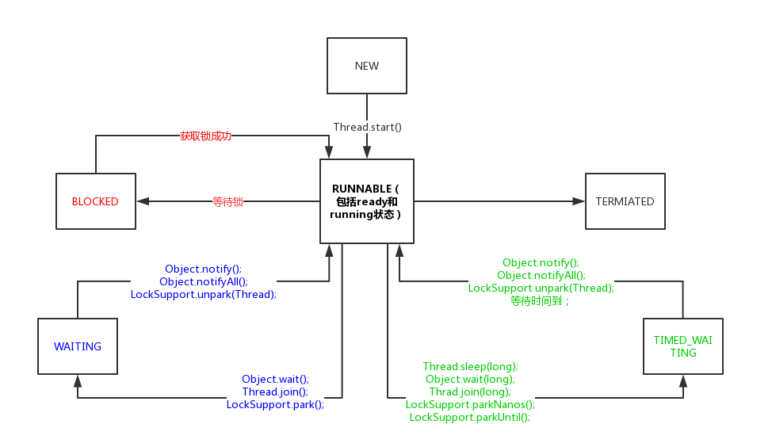  
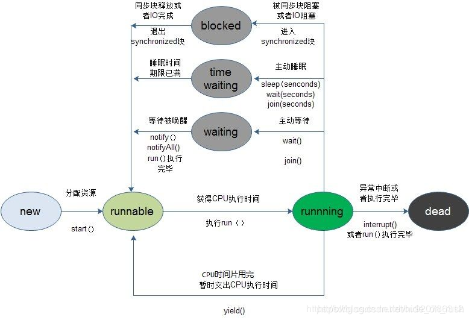

#### BLOCKED与RUNNABLE状态的转换

我们在上面说到：处于BLOCKED状态的线程是因为在等待锁的释放。假如这里有两个线程a和b，a线程提前获得了锁并且暂未释放锁，此时b就处于BLOCKED状态。我们先来看一个例子：

```java
@Test
public void blockedTest() {

    Thread a = new Thread(new Runnable() {
        @Override
        public void run() {
            testMethod();
        }
    }, "a");
    Thread b = new Thread(new Runnable() {
        @Override
        public void run() {
            testMethod();
        }
    }, "b");

    a.start();
    b.start();
    System.out.println(a.getName() + ":" + a.getState()); // 输出？
    System.out.println(b.getName() + ":" + b.getState()); // 输出？
}

// 同步方法争夺锁
private synchronized void testMethod() {
    try {
        Thread.sleep(2000L);
    } catch (InterruptedException e) {
        e.printStackTrace();
    }
}
```

初看之下，大家可能会觉得线程a会先调用同步方法，同步方法内又调用了Thread.sleep()方法，必然会输出TIMED\_WAITING，而线程b因为等待线程a释放锁所以必然会输出BLOCKED。

其实不然，有两点需要值得大家注意，一是在测试方法blockedTest()内还有一个main线程，二是启动线程后执行run方法还是需要消耗一定时间的。不打断点的情况下，上面代码中都应该输出RUNNABLE。

测试方法的main线程只保证了a，b两个线程调用start()方法（转化为RUNNABLE状态），还没等两个线程真正开始争夺锁，就已经打印此时两个线程的状态（RUNNABLE）了。

这时你可能又会问了，要是我想要打印出BLOCKED状态我该怎么处理呢？其实就处理下测试方法里的main线程就可以了，你让它“休息一会儿”，打断点或者调用Thread.sleep方法就行。

这里需要注意的是main线程休息的时间，要保证在线程争夺锁的时间内，不要等到前一个线程锁都释放了你再去争夺锁，此时还是得不到BLOCKED状态的。

我们把上面的测试方法blockedTest()改动一下：

```java
public void blockedTest() throws InterruptedException {
    ······
    a.start();
    Thread.sleep(1000L); // 需要注意这里main线程休眠了1000毫秒，而testMethod()里休眠了2000毫秒
    b.start();
    System.out.println(a.getName() + ":" + a.getState()); // 输出？
    System.out.println(b.getName() + ":" + b.getState()); // 输出？
}
```

在这个例子中，由于main线程休眠，所以线程a的run()方法跟着执行，线程b再接着执行。

在线程a执行run()调用testMethod()之后，线程a休眠了2000ms（注意这里是没有释放锁的），main线程休眠完毕，接着b线程执行的时候是争夺不到锁的，所以这里输出：

```java
a:TIMED_WAITING
b:BLOCKED
```

#### WAITING与RUNNABLE的转换

根据转换图我们知道有3个方法可以使线程从RUNNABLE状态转为WAITING状态。我们主要介绍下Object.wait()和Thread.join()。

- Object.wait()

调用wait()方法前线程必须持有对象的锁。

线程调用wait()方法时，会释放当前的锁，直到有其他线程调用notify()/notifyAll()方法唤醒等待锁的线程。

需要注意的是，其他线程调用notify()方法只会唤醒单个等待锁的线程，如有有多个线程都在等待这个锁的话不一定会唤醒到之前调用wait()方法的线程。

同样，调用notifyAll()方法唤醒所有等待锁的线程之后，也不一定会马上把时间片分给刚才放弃锁的那个线程，具体要看系统的调度。

- Thread.join()

调用join()方法不会释放锁，会一直等待当前线程执行完毕（转换为TERMINATED状态）。

我们再把上面的例子线程启动那里改变一下：

```java
public void blockedTest() {
    ······
    a.start();
    a.join();
    b.start();
    System.out.println(a.getName() + ":" + a.getState()); // 输出 TERMINATED
    System.out.println(b.getName() + ":" + b.getState());
}
```

要是没有调用join方法，main线程不管a线程是否执行完毕都会继续往下走。

a线程启动之后马上调用了join方法，这里main线程就会等到a线程执行完毕，所以这里a线程打印的状态固定是TERMIATED。

至于b线程的状态，有可能打印RUNNABLE（尚未进入同步方法），也有可能打印TIMED\_WAITING（进入了同步方法）。

#### TIMED\_WAITING与WAITING转换

TIMED\_WAITING与WAITING状态类似，只是TIMED\_WAITING状态等待的时间是指定的。

##### Thread.sleep(long)

使当前线程睡眠指定时间。需要注意这里的“睡眠”只是暂时使线程停止执行，并不会释放锁。时间到后，线程会重新进入RUNNABLE状态。

##### Object.wait(long)

wait(long)方法使线程进入TIMED\_WAITING状态。这里的wait(long)方法与无参方法wait()相同的地方是，都可以通过其他线程调用notify()或notifyAll()方法来唤醒。

不同的地方是，有参方法wait(long)就算其他线程不来唤醒它，经过指定时间long之后它会自动唤醒，拥有去争夺锁的资格。

##### Thread.join(long)

join(long)使当前线程执行指定时间，并且使线程进入TIMED\_WAITING状态。

我们再来改一改刚才的示例:

```java
public void blockedTest() {
    ······
    a.start();
    a.join(1000L);
    b.start();
    System.out.println(a.getName() + ":" + a.getState()); // 输出 TIEMD_WAITING
    System.out.println(b.getName() + ":" + b.getState());
}
```

这里调用a.join(1000L)，因为是指定了具体a线程执行的时间的，并且执行时间是小于a线程sleep的时间，所以a线程状态输出TIMED\_WAITING。

b线程状态仍然不固定（RUNNABLE或BLOCKED）。

#### 线程中断

在某些情况下，我们在线程启动后发现并不需要它继续执行下去时，需要中断线程。目前在Java里还没有安全直接的方法来停止线程，但是Java提供了线程中断机制来处理需要中断线程的情况。

线程中断机制是一种协作机制。需要注意，通过中断操作并不能直接终止一个线程，而是通知需要被中断的线程自行处理。

简单介绍下Thread类里提供的关于线程中断的几个方法：

Thread.interrupt()：中断线程。这里的中断线程并不会立即停止线程，而是设置线程的中断状态为true（默认是flase）；  
Thread.interrupted()：测试当前线程是否被中断。线程的中断状态受这个方法的影响，意思是调用一次使线程中断状态设置为true，连续调用两次会使得这个线程的中断状态重新转为false；  
Thread.isInterrupted()：测试当前线程是否被中断。与上面方法不同的是调用这个方法并不会影响线程的中断状态。  
在线程中断机制里，当其他线程通知需要被中断的线程后，线程中断的状态被设置为true，但是具体被要求中断的线程要怎么处理，完全由被中断线程自己而定，可以在合适的实际处理中断请求，也可以完全不处理继续执行下去。

### 线程间的通信

<http://concurrent.redspider.group/article/01/5.html>

## 基础线程机制

### Executor

Executor 管理多个异步任务的执行，而无需程序员显式地管理线程的生命周期。这里的异步是指多个任务的执行互不干扰，不需要进行同步操作。

主要有三种 Executor：

- CachedThreadPool：一个任务创建一个线程；
- FixedThreadPool：所有任务只能使用固定大小的线程；
- SingleThreadExecutor：相当于大小为 1 的 FixedThreadPool。  
  线程池的原理：<http://concurrent.redspider.group/article/03/12.html>

### Daemon

还有一种线程称为守护线程（Daemon），守护线程默认的优先级比较低。

守护线程是程序运行时在后台提供服务的线程，不属于程序中不可或缺的部分。

如果某线程是守护线程，那如果所有的非守护线程结束，这个守护线程也会自动结束。

应用场景是：当所有非守护线程结束时，结束其余的子线程（守护线程）自动关闭，就免去了还要继续关闭子线程的麻烦。

一个线程默认是非守护线程，可以通过Thread类的setDaemon(boolean on)来设置。

main() 属于非守护线程。

在线程启动之前使用 setDaemon() 方法可以将一个线程设置为守护线程。

```java
public static void main(String[] args) {
    Thread thread = new Thread(new MyRunnable());
    thread.setDaemon(true);
}
```

这里介绍一下“临界区”的概念。所谓“临界区”，指的是某一块代码区域，它同一时刻只能由一个线程执行。在上面的例子中，如果synchronized关键字在方法上，那临界区就是整个方法内部。而如果是使用synchronized代码块，那临界区就指的是代码块内部的区域。

通过上面的例子我们可以看到，下面这两个写法其实是等价的作用：

### sleep（）

sleep方法是Thread类的一个静态方法。它的作用是让当前线程睡眠一段时间。它有这样两个方法：

Thread.sleep(long)  
Thread.sleep(long, int)  
同样，查看源码(JDK 1.8)发现，第二个方法貌似只对第二个参数做了简单的处理，没有精确到纳秒。实际上还是调用的第一个方法。

这里需要强调一下：sleep方法是不会释放当前的锁的，而wait方法会。这也是最常见的一个多线程面试题。

它们还有这些区别：

wait可以指定时间，也可以不指定；而sleep必须指定时间。  
wait释放cpu资源，同时释放锁；sleep释放cpu资源，但是不释放锁，所以易死锁。  
wait必须放在同步块或同步方法中，而sleep可以再任意位置  
Thread.sleep(millisec) 方法会休眠当前正在执行的线程，millisec 单位为毫秒。

sleep() 可能会抛出 InterruptedException，因为异常不能跨线程传播回 main() 中，因此必须在本地进行处理。线程中抛出的其它异常也同样需要在本地进行处理。

```java
public void run() {
    try {
        Thread.sleep(3000);
    } catch (InterruptedException e) {
        e.printStackTrace();
    }
}
```

### yield（）

对静态方法 Thread.yield() 的调用声明了当前线程已经完成了生命周期中最重要的部分，可以切换给其它线程来执行。该方法只是对线程调度器的一个建议，而且也只是建议具有相同优先级的其它线程可以运行。

public void run() {  
Thread.yield();  
}

## 2.中断

### InterruptedException

通过调用一个线程的 interrupt() 来中断该线程，如果该线程处于阻塞、限期等待或者无限期等待状态，那么就会抛出 InterruptedException，从而提前结束该线程。但是不能中断 I/O 阻塞和 synchronized 锁阻塞。

对于以下代码，在 main() 中启动一个线程之后再中断它，由于线程中调用了 Thread.sleep() 方法，因此会抛出一个 InterruptedException，从而提前结束线程，不执行之后的语句。

```java
public class InterruptExample {

    private static class MyThread1 extends Thread {
        @Override
        public void run() {
            try {
                Thread.sleep(2000);
                System.out.println("Thread run");
            } catch (InterruptedException e) {
                e.printStackTrace();
            }
        }
    }
}
public static void main(String[] args) throws InterruptedException {
    Thread thread1 = new MyThread1();
    thread1.start();
    thread1.interrupt();
    System.out.println("Main run");
}
Main run
java.lang.InterruptedException: sleep interrupted
    at java.lang.Thread.sleep(Native Method)
    at InterruptExample.lambda$main$0(InterruptExample.java:5)
    at InterruptExample$$Lambda$1/713338599.run(Unknown Source)
    at java.lang.Thread.run(Thread.java:745)
```

### interrupted()

如果一个线程的 run() 方法执行一个无限循环，并且没有执行 sleep() 等会抛出 InterruptedException 的操作，那么调用线程的 interrupt() 方法就无法使线程提前结束。

但是调用 interrupt() 方法会设置线程的中断标记，此时调用 interrupted() 方法会返回 true。因此可以在循环体中使用 interrupted() 方法来判断线程是否处于中断状态，从而提前结束线程。

```java
public class InterruptExample {

    private static class MyThread2 extends Thread {
        @Override
        public void run() {
            while (!interrupted()) {
                // ..
            }
            System.out.println("Thread end");
        }
    }
}
public static void main(String[] args) throws InterruptedException {
    Thread thread2 = new MyThread2();
    thread2.start();
    thread2.interrupt();
}
Thread end
```

### Executor 的中断操作

调用 Executor 的 shutdown() 方法会等待线程都执行完毕之后再关闭，但是如果调用的是 shutdownNow() 方法，则相当于调用每个线程的 interrupt() 方法。

以下使用 Lambda 创建线程，相当于创建了一个匿名内部线程。

```java
Main run
java.lang.InterruptedException: sleep interrupted
    at java.lang.Thread.sleep(Native Method)
    at ExecutorInterruptExample.lambda$main$0(ExecutorInterruptExample.java:9)
    at ExecutorInterruptExample$$Lambda$1/1160460865.run(Unknown Source)
    at java.util.concurrent.ThreadPoolExecutor.runWorker(ThreadPoolExecutor.java:1142)
    at java.util.concurrent.ThreadPoolExecutor$Worker.run(ThreadPoolExecutor.java:617)
    at java.lang.Thread.run(Thread.java:745)
```

如果只想中断 Executor 中的一个线程，可以通过使用 submit() 方法来提交一个线程，它会返回一个 Future<?> 对象，通过调用该对象的 cancel(true) 方法就可以中断线程。

```java
Future<?> future = executorService.submit(() -> {
    // ..
});
future.cancel(true);
```

## 3.互斥同步

首先需要明确的一点是：Java多线程的锁都是基于对象的，Java中的每一个对象都可以作为一个锁。

还有一点需要注意的是，我们常听到的类锁其实也是对象锁。

Java类只有一个Class对象（可以有多个实例对象，多个实例共享这个Class对象），而Class对象也是特殊的Java对象。所以我们常说的类锁，其实就是Class对象的锁。

### java中锁的分类

锁可以根据以下几种方式来进行分类，下面逐一介绍。

#### 可重入锁和非可重入锁

所谓重入锁，顾名思义。就是支持重新进入的锁，也就是说这个锁支持一个线程对资源重复加锁。

synchronized关键字就是使用的重入锁。比如说，你在一个synchronized实例方法里面调用另一个本实例的synchronized实例方法，它可以重新进入这个锁，不会出现任何异常。

如果我们自己在继承AQS实现同步器的时候，没有考虑到占有锁的线程再次获取锁的场景，可能就会导致线程阻塞，那这个就是一个“非可重入锁”。  
ReentrantLock的中文意思就是可重入锁。

#### 公平锁与非公平锁

这里的“公平”，其实通俗意义来说就是“先来后到”，也就是FIFO。如果对一个锁来说，先对锁获取请求的线程一定会先被满足，后对锁获取请求的线程后被满足，那这个锁就是公平的。反之，那就是不公平的。

一般情况下，非公平锁能提升一定的效率。但是非公平锁可能会发生线程饥饿（有一些线程长时间得不到锁）的情况。所以要根据实际的需求来选择非公平锁和公平锁。

ReentrantLock支持非公平锁和公平锁两种。  
可见，只是synchronized是远远不能满足多样化的业务对锁的要求的。下面会介绍一下JDK中有关锁的一些接口和类。

#### 读写锁和排他锁

synchronized用的锁和ReentrantLock，其实都是“排它锁”。也就是说，这些锁在同一时刻只允许一个线程进行访问。

而读写锁可以再同一时刻允许多个读线程访问。Java提供了ReentrantReadWriteLock类作为读写锁的默认实现，内部维护了两个锁：一个读锁，一个写锁。通过分离读锁和写锁，使得在“读多写少”的环境下，大大地提高了性能。

```java
注意，即使用读写锁，在写线程访问时，所有的读线程和其它写线程均被阻塞。
```

### synchronized

说到锁，我们通常会谈到synchronized这个关键字。它翻译成中文就是“同步”的意思。

我们通常使用synchronized关键字来给一段代码或一个方法上锁。它通常有以下几种种形式：

#### 1.同步一个代码块

```java
// 关键字在代码块上，锁为括号里面的对象
public void blockLock() {
    Object o = new Object();
    synchronized (o) {
        // code
    }
}
```

它只作用于同一个对象，如果调用两个对象上的同步代码块，就不会进行同步。  
例如：

```java
public class SynchronizedExample {

    public void func1() {
        synchronized (this) {
            for (int i = 0; i < 10; i++) {
                System.out.print(i + " ");
            }
        }
    }
}
```

```java
public static void main(String[] args) {
    SynchronizedExample e1 = new SynchronizedExample();
    ExecutorService executorService = Executors.newCachedThreadPool();
    executorService.execute(() -> e1.func1());
    executorService.execute(() -> e1.func1());
}
```

```java
运行结果：
0 1 2 3 4 5 6 7 8 9 0 1 2 3 4 5 6 7 8 9
```

#### 2. 同步一个方法

```java
// 关键字在实例方法上，锁为当前实例
public synchronized void instanceLock() {
    // code
}
```

#### 3. 同步一个静态方法

```java
// 关键字在静态方法上，锁为当前Class对象
public static synchronized void classLock() {
    // code
}
```

#### 4. 同步一个类

```java
public void func() {
    synchronized (SynchronizedExample.class) {
        // ...
    }
}
```

作用于整个类，也就是说两个线程调用同一个类的不同对象上的这种同步语句，也会进行同步。

```java
public class SynchronizedExample {

    public void func2() {
        synchronized (SynchronizedExample.class) {
            for (int i = 0; i < 10; i++) {
                System.out.print(i + " ");
            }
        }
    }
}
```

```java
public static void main(String[] args) {
    SynchronizedExample e1 = new SynchronizedExample();
    SynchronizedExample e2 = new SynchronizedExample();
    ExecutorService executorService = Executors.newCachedThreadPool();
    executorService.execute(() -> e1.func2());
    executorService.execute(() -> e2.func2());
}
```

运行结果：

```java
0 1 2 3 4 5 6 7 8 9 0 1 2 3 4 5 6 7 8 9
```

```java
// 关键字在实例方法上，锁为当前实例
public synchronized void instanceLock() {
    // code
}

// 关键字在代码块上，锁为括号里面的对象
public void blockLock() {
    synchronized (this) {
        // code
    }
}
```

所谓“临界区”，指的是某一块代码区域，它同一时刻只能由一个线程执行。在上面的例子中，如果synchronized关键字在方法上，那临界区就是整个方法内部。而如果是使用synchronized代码块，那临界区就指的是代码块内部的区域。

通过上面的例子我们可以看到，下面这两个写法其实是等价的作用：

```java
// 关键字在实例方法上，锁为当前实例
public synchronized void instanceLock() {
    // code
}

// 关键字在代码块上，锁为括号里面的对象
public void blockLock() {
    synchronized (this) {
        // code
    }
}
```

同理，下面这两个方法也应该是等价的：

```java
// 关键字在静态方法上，锁为当前Class对象
public static synchronized void classLock() {
    // code
}

// 关键字在代码块上，锁为括号里面的对象
public void blockLock() {
    synchronized (this.getClass()) {
        // code
    }
}
```

[实现原理](https://blog.csdn.net/chenssy/article/details/54883355)

### ReentrantLock

[源码分析](https://www.cnblogs.com/takumicx/p/9402021.html)  
ReentrantLock 是 java.util.concurrent（J.U.C）包中的锁。  
使用示例

```java
public class LockExample {

    private Lock lock = new ReentrantLock();

    public void func() {
        lock.lock();
        try {
            for (int i = 0; i < 10; i++) {
                System.out.print(i + " ");
            }
        } finally {
            lock.unlock(); // 确保释放锁，从而避免发生死锁。
        }
    }
}
```

```java
public static void main(String[] args) {
    LockExample lockExample = new LockExample();
    ExecutorService executorService = Executors.newCachedThreadPool();
    executorService.execute(() -> lockExample.func());
    executorService.execute(() -> lockExample.func());
}
```

运行结果：

```java
0 1 2 3 4 5 6 7 8 9 0 1 2 3 4 5 6 7 8 9
```

[轻松学习java可重入锁(ReentrantLock)的实现原理](https://blog.csdn.net/yanyan19880509/article/details/52345422?utm_medium=distribute.pc_relevant.none-task-blog-BlogCommendFromMachineLearnPai2-5.nonecase&depth_1-utm_source=distribute.pc_relevant.none-task-blog-BlogCommendFromMachineLearnPai2-5.nonecase)

### ReentrantLock与synchronized的比较

#### 1. 锁的实现

synchronized 是 JVM 实现的，而 ReentrantLock 是 JDK 实现的。

#### 2. 性能

新版本 Java 对 synchronized 进行了很多优化，例如自旋锁等，synchronized 与 ReentrantLock 大致相同。

#### 3. 等待可中断

当持有锁的线程长期不释放锁的时候，正在等待的线程可以选择放弃等待，改为处理其他事情。

ReentrantLock 可中断，而 synchronized 不行。  
synchronized 是 JVM 实现的，而 ReentrantLock 是 JDK 实现的。

#### 4. 公平锁

公平锁是指多个线程在等待同一个锁时，必须按照申请锁的时间顺序来依次获得锁。

synchronized 中的锁是非公平的，ReentrantLock 默认情况下也是非公平的，但是也可以是公平的。

#### 5. 锁绑定多个条件

一个 ReentrantLock 可以同时绑定多个 Condition 对象。

#### 如何选择

除非需要使用 ReentrantLock 的高级功能，否则优先使用 synchronized。这是因为 synchronized 是 JVM 实现的一种锁机制，JVM 原生地支持它，而 ReentrantLock 不是所有的 JDK 版本都支持。并且使用 synchronized 不用担心没有释放锁而导致死锁问题，因为 JVM 会确保锁的释放。

[ReenTrantLock可重入锁（和synchronized的区别）总结](https://blog.csdn.net/qq838642798/article/details/65441415?utm_medium=distribute.pc_relevant.none-task-blog-BlogCommendFromMachineLearnPai2-1.nonecase&depth_1-utm_source=distribute.pc_relevant.none-task-blog-BlogCommendFromMachineLearnPai2-1.nonecase)

## 原理

### java内存模型

Java 内存模型试图屏蔽各种硬件和操作系统的内存访问差异，以实现让 Java 程序在各种平台下都能达到一致的内存访问效果。

#### 并发编程模型

在并发编程中，我们需要处理两个关键问题：

- 线程间如何通信？即：线程之间以何种机制来交换信息
- 线程间如何同步？即：线程以何种机制来控制不同线程间操作发生的相对顺序  
  在命令式编程中，有两种并发模型可以解决这两个问题：
  - 消息传递并发模型
  - 共享内存并发模型  
    这两种模型之间的区别如下表所示：  
    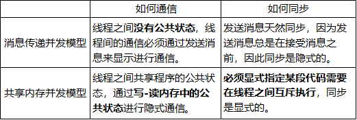  
    **在Java中，使用的是共享内存并发模型。**

  #### 运行时的内存划分

  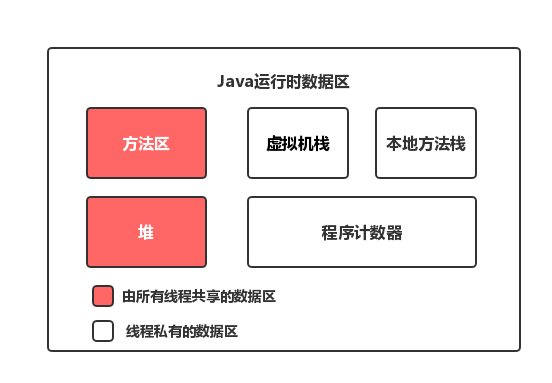  
  对于每一个线程来说，栈都是私有的，而堆是共有的。  
  所有实例域、静态域和数组元素存储在堆内存中，堆内存在线程之间共享（本文使用“共享变量”这个术语代指实例域，静态域和数组元素）。局部变量（Local variables），方法定义参数（java语言规范称之为formal method parameters）和异常处理器参数（exception handler parameters）不会在线程之间共享，它们不会有内存可见性问题，也不受内存模型的影响。  
  所以，内存可见性是针对的共享变量。

#### 堆中内存不可见问题

现代计算机为了高效，往往会在高速缓存区中缓存共享变量，因为cpu访问缓存区比访问内存要快得多。  
线程之间的共享变量存在主内存中，每个线程都有一个私有的本地内存，存储了该线程以读、写共享变量的副本。本地内存是Java内存模型的一个抽象概念，并不真实存在。它涵盖了缓存、写缓冲区、寄存器等。  
Java线程之间的通信由Java内存模型（简称JMM）控制，从抽象的角度来说，JMM定义了线程和主内存之间的抽象关系。JMM的抽象示意图如图所示：  
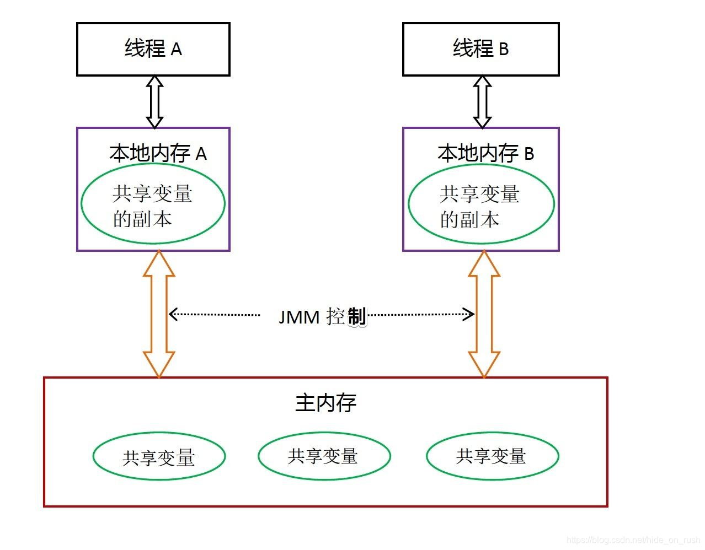  
从图中可以看出：

1. 所有的共享变量都存在主内存中。
2. 每个线程都保存了一份该线程使用到的共享变量的副本。
3. 如果线程A与线程B之间要通信的话，必须经历下面2个步骤：

- 线程A将本地内存A中更新过的共享变量刷新到主内存中去。
- 线程B到主内存中去读取线程A之前已经更新过的共享变量。  
  示例图如下：

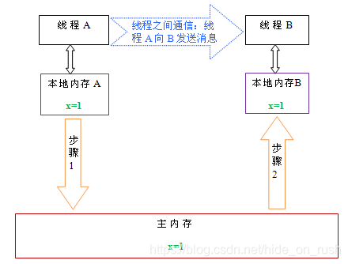  
所以，**线程A无法直接访问线程B的工作内存，线程间通信必须经过主内存。**

注意，根据JMM的规定，线程对共享变量的所有操作都必须在自己的本地内存中进行，不能直接从主内存中读取。

所以线程B并不是直接去主内存中读取共享变量的值，而是先在本地内存B中找到这个共享变量，发现这个共享变量已经被更新了，然后本地内存B去主内存中读取这个共享变量的新值，并拷贝到本地内存B中，最后线程B再读取本地内存B中的新值。

那么怎么知道这个共享变量的被其他线程更新了呢？这就是JMM的功劳了，也是JMM存在的必要性之一。**JMM通过控制主内存与每个线程的本地内存之间的交互，来提供内存可见性保证。**

Java中的volatile关键字可以保证多线程操作共享变量的可见性以及禁止指令重排序，synchronized关键字不仅保证可见性，同时也保证了原子性（互斥性）。在更底层，JMM通过内存屏障来实现内存的可见性以及禁止重排序。为了程序员的方便理解，提出了happens-before，它更加的简单易懂，从而避免了程序员为了理解内存可见性而去学习复杂的重排序规则以及这些规则的具体实现方法

#### 内存间交互操作

Java 内存模型定义了 8 个操作来完成主内存和工作内存的交互操作。  
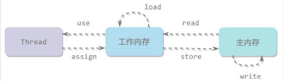

- read：把一个变量的值从主内存传输到工作内存中
- load：在 read 之后执行，把 read 得到的值放入工作内存的变量副本中
- use：把工作内存中一个变量的值传递给执行引擎
- assign：把一个从执行引擎接收到的值赋给工作内存的变量
- store：把工作内存的一个变量的值传送到主内存中
- write：在 store 之后执行，把 store 得到的值放入主内存的变量中
- lock：作用于主内存的变量
- unlock

### 几种锁

Java 6 为了减少获得锁和释放锁带来的性能消耗，引入了“偏向锁”和“轻量级锁“。在Java 6 以前，所有的锁都是”重量级“锁。所以在Java 6 及其以后，一个对象其实有四种锁状态，它们级别由低到高依次是：

- 无锁状态
- 偏向锁状态
- 轻量级锁状态
- 重量级锁状态
- 无锁就是没有对资源进行锁定，任何线程都可以尝试去修改它，无锁在这里不再细讲。

几种锁会随着竞争情况逐渐升级，锁的升级很容易发生，但是锁降级发生的条件会比较苛刻，锁降级发生在Stop The World期间，当JVM进入安全点的时候，会检查是否有闲置的锁，然后进行降级。  
\*\*关于锁降级有两点说明：

1.不同于大部分文章说锁不能降级，实际上HotSpot JVM 是支持锁降级的，[Java锁优化--JVM锁降级](https://www.jianshu.com/p/9932047a89be)。

2.上面提到的Stop The World期间，以及安全点，这些知识是属于JVM的知识范畴\*\*

#### 对象头

前面我们提到，Java的锁都是基于对象的。首先我们来看看一个对象的“锁”的信息是存放在什么地方的。

每个Java对象都有对象头。如果是非数组类型，则用2个字宽来存储对象头，如果是数组，则会用3个字宽来存储对象头。在32位处理器中，一个字宽是32位；在64位虚拟机中，一个字宽是64位。对象头的内容如下表：  
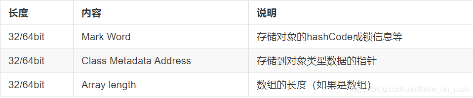  
主要来看看Mark Word的格式：  
  
可以看到，当对象状态为偏向锁时，Mark Word存储的是偏向的线程ID；当状态为轻量级锁时，Mark Word存储的是指向线程栈中Lock Record的指针；当状态为重量级锁时，Mark Word为指向堆中的monitor对象的指针。

#### 偏向锁

Hotspot的作者经过以往的研究发现**大多数情况下锁不仅不存在多线程竞争，而且总是由同一线程多次获得**，于是引入了偏向锁。

偏向锁会偏向于第一个访问锁的线程，如果在接下来的运行过程中，该锁没有被其他的线程访问，则持有偏向锁的线程将永远不需要触发同步。也就是说，**偏向锁在资源无竞争情况下消除了同步语句，连CAS操作都不做了，提高了程序的运行性能。**

```java
大白话就是对锁置个变量，如果发现为true，代表资源无竞争，则无需再走各种加锁/解锁流程。如果为false，代表存在其他线程竞争资源，那么就会走后面的流程。
```

##### 实现原理

一个线程在第一次进入同步块时，会在对象头和栈帧中的锁记录里存储锁的偏向的线程ID。当下次该线程进入这个同步块时，会去检查锁的Mark Word里面是不是放的自己的线程ID。

如果是，表明该线程已经获得了锁，以后该线程在进入和退出同步块时不需要花费CAS操作来加锁和解锁 ；如果不是，就代表有另一个线程来竞争这个偏向锁。这个时候会尝试使用CAS来替换Mark Word里面的线程ID为新线程的ID，这个时候要分两种情况：

- 成功，表示之前的线程不存在了， Mark Word里面的线程ID为新线程的ID，锁不会升级，仍然为偏向锁；
- 失败，表示之前的线程仍然存在，那么暂停之前的线程，设置偏向锁标识为0，并设置锁标志位为00，升级为轻量级锁，会按照轻量级锁的方式进行竞争锁。
- `CAS: Compare and Swap

比较并设置。用于在硬件层面上提供原子性操作。在 Intel 处理器中，比较并交换通过指令cmpxchg实现。 比较是否和给定的数值一致，如果一致则修改，不一致则不修改。`  
线程竞争偏向锁的过程如下：  
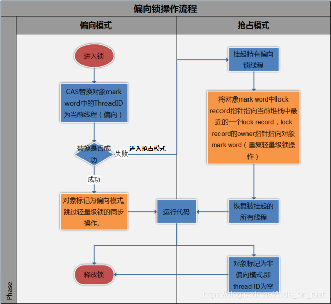  
图中涉及到了lock record指针指向当前堆栈中的最近一个lock record，是轻量级锁按照先来先服务的模式进行了轻量级锁的加锁。

##### 撤销偏向锁

偏向锁使用了一种等到竞争出现才释放锁的机制，所以当其他线程尝试竞争偏向锁时， 持有偏向锁的线程才会释放锁。

偏向锁升级成轻量级锁时，会暂停拥有偏向锁的线程，重置偏向锁标识，这个过程看起来容易，实则开销还是很大的，大概的过程如下：

1. 在一个安全点（在这个时间点上没有字节码正在执行）停止拥有锁的线程。
2. 遍历线程栈，如果存在锁记录的话，需要修复锁记录和Mark Word，使其变成无锁状态。
3. 唤醒被停止的线程，将当前锁升级成轻量级锁。  
   所以，如果应用程序里所有的锁通常处于竞争状态，那么偏向锁就会是一种累赘，对于这种情况，我们可以一开始就把偏向锁这个默认功能给关闭：

```java
-XX:UseBiasedLocking=false。
```

下面这个经典的图总结了偏向锁的获得和撤销：  
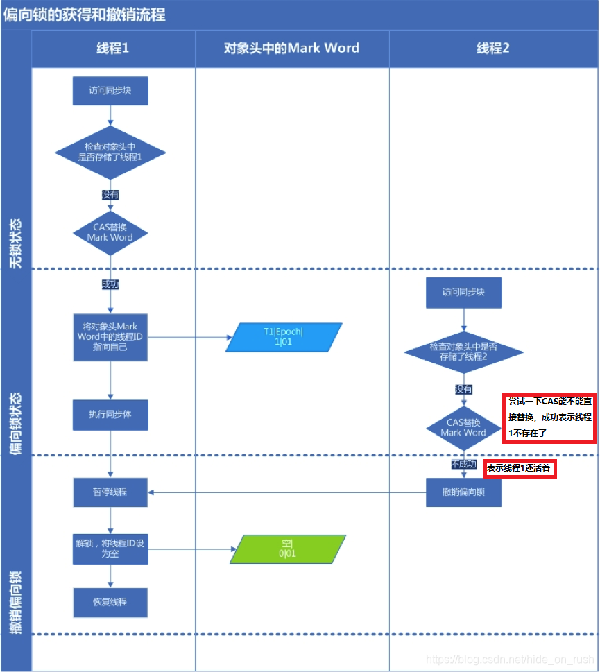

#### 轻量级锁

多个线程在不同时段获取同一把锁，即不存在锁竞争的情况，也就没有线程阻塞。针对这种情况，JVM采用轻量级锁来避免线程的阻塞与唤醒。

##### 轻量级锁的加锁

JVM会为每个线程在当前线程的栈帧中创建用于存储锁记录的空间，我们称为Displaced Mark Word。如果一个线程获得锁的时候发现是轻量级锁，会把锁的Mark Word复制到自己的Displaced Mark Word里面。

然后线程尝试用CAS将锁的Mark Word替换为指向锁记录的指针。如果成功，当前线程获得锁，如果失败，表示Mark Word已经被替换成了其他线程的锁记录，说明在与其它线程竞争锁，当前线程就尝试使用自旋来获取锁。  
**自旋：不断尝试去获取锁，一般用循环来实现。**  
自旋是需要消耗CPU的，如果一直获取不到锁的话，那该线程就一直处在自旋状态，白白浪费CPU资源。解决这个问题最简单的办法就是指定自旋的次数，例如让其循环10次，如果还没获取到锁就进入阻塞状态。

但是JDK采用了更聪明的方式——适应性自旋，简单来说就是线程如果自旋成功了，则下次自旋的次数会更多，如果自旋失败了，则自旋的次数就会减少。

自旋也不是一直进行下去的，如果自旋到一定程度（和JVM、操作系统相关），依然没有获取到锁，称为自旋失败，那么这个线程会阻塞。同时这个锁就会**升级成重量级锁**。

##### 轻量级锁的释放

在释放锁时，当前线程会使用CAS操作将Displaced Mark Word的内容复制回锁的Mark Word里面。如果没有发生竞争，那么这个复制的操作会成功。如果有其他线程因为自旋多次导致轻量级锁升级成了重量级锁，那么CAS操作会失败，此时会释放锁并唤醒被阻塞的线程。

一张图说明加锁和释放锁的过程：  
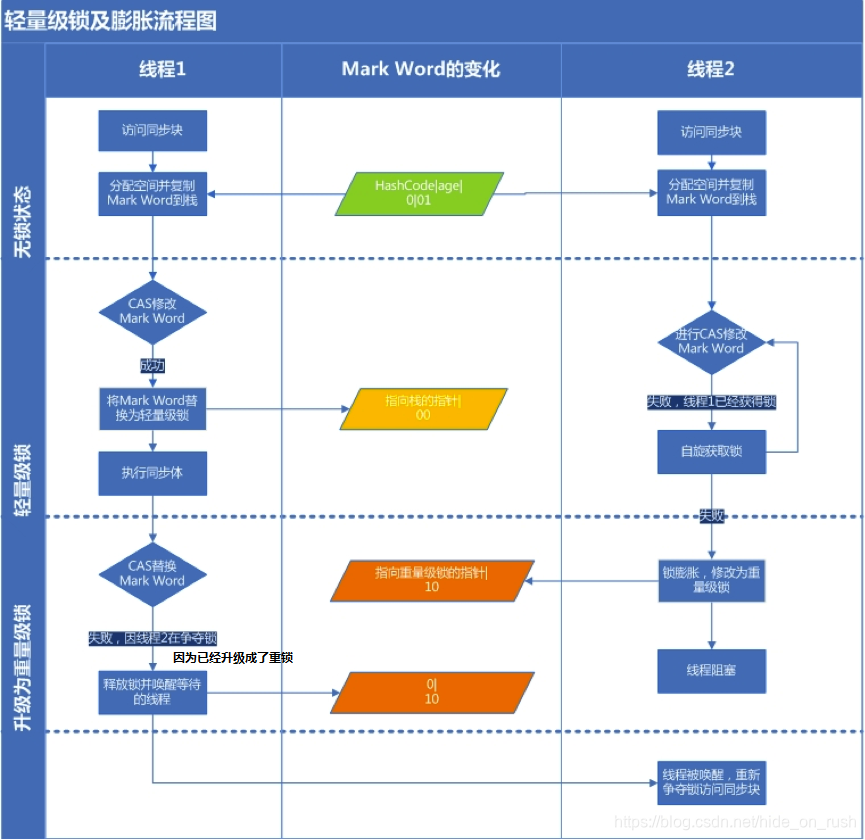

#### 重量级锁

重量级锁依赖于操作系统的互斥量（mutex） 实现的，而操作系统中线程间状态的转换需要相对比较长的时间，所以重量级锁效率很低，但被阻塞的线程不会消耗CPU。

前面说到，每一个对象都可以当做一个锁，当多个线程同时请求某个对象锁时，对象锁会设置几种状态用来区分请求的线程：

```java
Contention List：所有请求锁的线程将被首先放置到该竞争队列
Entry List：Contention List中那些有资格成为候选人的线程被移到Entry List
Wait Set：那些调用wait方法被阻塞的线程被放置到Wait Set
OnDeck：任何时刻最多只能有一个线程正在竞争锁，该线程称为OnDeck
Owner：获得锁的线程称为Owner
!Owner：释放锁的线程
```

当一个线程尝试获得锁时，如果该锁已经被占用，则会将该线程封装成一个ObjectWaiter对象插入到Contention List的队列的队首，然后调用park函数挂起当前线程。

当线程释放锁时，会从Contention List或EntryList中挑选一个线程唤醒，被选中的线程叫做Heir presumptive即假定继承人，假定继承人被唤醒后会尝试获得锁，但synchronized是非公平的，所以假定继承人不一定能获得锁。这是因为对于重量级锁，线程先自旋尝试获得锁，这样做的目的是为了减少执行操作系统同步操作带来的开销。如果自旋不成功再进入等待队列。这对那些已经在等待队列中的线程来说，稍微显得不公平，还有一个不公平的地方是自旋线程可能会抢占了Ready线程的锁。

如果线程获得锁后调用Object.wait方法，则会将线程加入到WaitSet中，当被Object.notify唤醒后，会将线程从WaitSet移动到Contention List或EntryList中去。需要注意的是，当调用一个锁对象的wait或notify方法时，**如当前锁的状态是偏向锁或轻量级锁则会先膨胀成重量级锁。**

#### 锁的升级流程

每一个线程在准备获取共享资源时： 第一步，检查MarkWord里面是不是放的自己的ThreadId ,如果是，表示当前线程是处于 “偏向锁” 。

第二步，如果MarkWord不是自己的ThreadId，锁升级，这时候，用CAS来执行切换，新的线程根据MarkWord里面现有的ThreadId，通知之前线程暂停，之前线程将Markword的内容置为空。

第三步，两个线程都把锁对象的HashCode复制到自己新建的用于存储锁的记录空间，接着开始通过CAS操作， 把锁对象的MarKword的内容修改为自己新建的记录空间的地址的方式竞争MarkWord。

第四步，第三步中成功执行CAS的获得资源，失败的则进入自旋 。

第五步，自旋的线程在自旋过程中，成功获得资源(即之前获的资源的线程执行完成并释放了共享资源)，则整个状态依然处于 轻量级锁的状态，如果自旋失败 。

第六步，进入重量级锁的状态，这个时候，自旋的线程进行阻塞，等待之前线程执行完成并唤醒自己。

#### 各种锁的优缺点对比

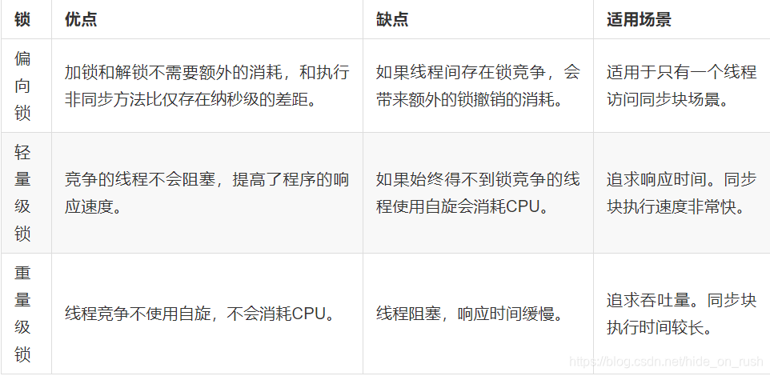

### 重排序与happens-before

#### 什么是重排序

计算机在执行程序时，为了提高性能，编译器和处理器常常会对指令做重排。

#### 为什么指令重排序可以提高性能

简单地说，每一个指令都会包含多个步骤，每个步骤可能使用不同的硬件。因此，流水线技术产生了，它的原理是指令1还没有执行完，就可以开始执行指令2，而不用等到指令1执行结束之后再执行指令2，这样就大大提高了效率。

但是，流水线技术最害怕中断，恢复中断的代价是比较大的，所以我们要想尽办法不让流水线中断。指令重排就是减少中断的一种技术。  
我们分析一下下面这个代码的执行情况：

```java
a = b + c;
d = e - f ;
```

先加载b、c（注意，即有可能先加载b，也有可能先加载c），但是在执行add(b,c)的时候，需要等待b、c装载结束才能继续执行，也就是增加了停顿，那么后面的指令也会依次有停顿,这降低了计算机的执行效率。

为了减少这个停顿，我们可以先加载e和f,然后再去加载add(b,c),这样做对程序（串行）是没有影响的,但却减少了停顿。既然add(b,c)需要停顿，那还不如去做一些有意义的事情。

综上所述，指令重排对于提高CPU处理性能十分必要。虽然由此带来了乱序的问题，但是这点牺牲是值得的。  
指令重排一般分为以下三种：

1.编译器优化重排

编译器在不改变单线程程序语义的前提下，可以重新安排语句的执行顺序。

2.指令并行重排

现代处理器采用了指令级并行技术来将多条指令重叠执行。如果不存在数据依赖性(即后一个执行的语句无需依赖前面执行的语句的结果)，处理器可以改变语句对应的机器指令的执行顺序。

3.内存系统重排

由于处理器使用缓存和读写缓存冲区，这使得加载(load)和存储(store)操作看上去可能是在乱序执行，因为三级缓存的存在，导致内存与缓存的数据同步存在时间差。

指令重排可以保证串行语义一致，但是没有义务保证多线程间的语义也一致。所以在多线程下，指令重排序可能会导致一些问题。

#### 顺序一致性模型与JMM的保证

顺序一致性模型是一个理论参考模型，内存模型在设计的时候都会以顺序一致性内存模型作为参考。

##### 数据竞争与顺序一致性

当程序未正确同步的时候，就可能存在数据竞争。java内存模型规范对数据竞争的定义如下：

```java
数据竞争：在一个线程中写一个变量，在另一个线程读同一个变量，并且写和读没有通过同步来排序。
```

如果程序中包含了数据竞争，那么运行的结果往往充满了不确定性，比如读发生在了写之前，可能就会读到错误的值；如果一个线程程序能够正确同步，那么就不存在数据竞争。  
Java内存模型（JMM）对于正确同步多线程程序的内存一致性做了以下保证：

```java
如果程序是正确同步的，程序的执行将具有顺序一致性。 即程序的执行结果和该程序在顺序一致性模型中执行的结果相同。
```

这里的同步包括了使用volatile、final、synchronized等关键字来实现多线程下的同步。

如果程序员没有正确使用volatile、final、synchronized，那么即便是使用了同步（单线程下的同步），JMM也不会有内存可见性的保证，可能会导致你的程序出错，并且具有不可重现性，很难排查。

##### 顺序一致性模型

顺序一致性内存模型是一个理想化的理论参考模型，它为程序员提供了极强的内存可见性保证。  
顺序一致性模型有两大特性：

- 一个线程中的所有操作必须按照程序的顺序（即Java代码的顺序）来执行。
- 不管程序是否同步，所有线程都只能看到一个单一的操作执行顺序。即在顺序一致性模型中，每个操作必须是原子性的，且立刻对所有线程可见。

为了理解这两个特性，我们举个例子，假设有两个线程A和B并发执行，线程A有3个操作，他们在程序中的顺序是A1->A2->A3，线程B也有3个操作，B1->B2->B3。

假设正确使用了同步，A线程的3个操作执行后释放锁，B线程获取同一个锁。那么在顺序一致性模型中的执行效果如下所示：  
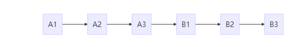  
操作的执行整体上有序，并且两个线程都只能看到这个执行顺序。

假设没有使用同步，那么在顺序一致性模型中的执行效果如下所示：  
  
操作的执行整体上无序，但是两个线程都只能看到这个执行顺序。之所以可以得到这个保证，是因为顺序一致性模型中的每个操作必须立即对任意线程可见。

**但是JMM没有这样的保证。**

比如，在当前线程把写过的数据缓存在本地内存中，在没有刷新到主内存之前，这个写操作仅对当前线程可见；从其他线程的角度来观察，这个写操作根本没有被当前线程所执行。只有当前线程把本地内存中写过的数据刷新到主内存之后，这个写操作才对其他线程可见。在这种情况下，当前线程和其他线程看到的执行顺序是不一样的。

##### JMM中同步程序的顺序一致性效果

在顺序一致性模型中，所有操作完全按照程序的顺序串行执行。但是JMM中，临界区内（同步块或同步方法中）的代码可以发生重排序（但不允许临界区内的代码“逃逸”到临界区之外，因为会破坏锁的内存语义）。

虽然线程A在临界区做了重排序，但是因为锁的特性，线程B无法观察到线程A在临界区的重排序。这种重排序既提高了执行效率，又没有改变程序的执行结果。

同时，JMM会在退出临界区和进入临界区做特殊的处理，使得在临界区内程序获得与顺序一致性模型相同的内存视图。

由此可见，JMM的具体实现方针是：在不改变（正确同步的）程序执行结果的前提下，尽量为编译期和处理器的优化打开方便之门。  
请看下面的示例代码：

```java
class SynchronizedExample {

int a = 0;

boolean flag = false;


public synchronized void writer() {

a = 1;

flag = true;

}


public synchronized void reader() {

if (flag) {

int i = a;

……

}

}

}
```

上面示例代码中，假设A线程执行writer()方法后，B线程执行reader()方法。这是一个正确同步的多线程程序。根据JMM规范，该程序的执行结果将与该程序在顺序一致性模型中的执行结果相同。下面是该程序在两个内存模型中的执行时序对比图：  
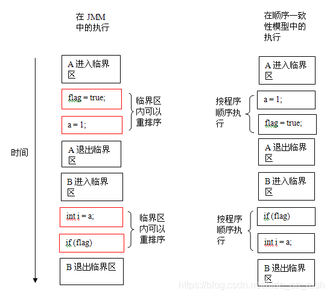  
在顺序一致性模型中，所有操作完全按程序的顺序串行执行。而在JMM中，临界区内的代码可以重排序（但JMM不允许临界区内的代码“逸出”到临界区之外，那样会破坏监视器的语义）。JMM会在退出监视器和进入监视器这两个关键时间点做一些特别处理，使得线程在这两个时间点具有与顺序一致性模型相同的内存视图（具体细节后文会说明）。虽然线程A在临界区内做了重排序，但由于监视器的互斥执行的特性，这里的线程B根本无法“观察”到线程A在临界区内的重排序。这种重排序既提高了执行效率，又没有改变程序的执行结果。

从这里我们可以看到JMM在具体实现上的基本方针：在不改变（正确同步的）程序执行结果的前提下，尽可能的为编译器和处理器的优化打开方便之门。

##### 未同步程序的执行特性

**对于未同步或未正确同步的多线程程序，JMM只提供最小安全性**：线程执行时读取到的值，要么是之前某个线程写入的值，要么是默认值（0，null，false），JMM保证线程读操作读取到的值不会无中生有（out of thin air）的冒出来。为了实现最小安全性，JVM在堆上分配对象时，首先会清零内存空间，然后才会在上面分配对象（JVM内部会同步这两个操作）。因此，在以清零的内存空间（pre-zeroed memory）分配对象时，域的默认初始化已经完成了。

JMM不保证未同步程序的执行结果与该程序在顺序一致性模型中的执行结果一致。因为未同步程序在顺序一致性模型中执行时，整体上是无序的，其执行结果无法预知。保证未同步程序在两个模型中的执行结果一致毫无意义。  
**未同步程序在JMM和顺序一致性内存模型中的执行特性有如下差异：**

1. 顺序一致性保证单线程内的操作会按程序的顺序执行；JMM不保证单线程内的操作会按程序的顺序执行。（因为重排序，但是JMM保证单线程下的重排序不影响执行结果）
2. 顺序一致性模型保证所有线程只能看到一致的操作执行顺序，而JMM不保证所有线程能看到一致的操作执行顺序。（因为JMM不保证所有操作立即可见）
3. JMM不保证对64位的long型和double型变量的写操作具有原子性，而顺序一致性模型保证对所有的内存读写操作都具有原子性。

#### 什么是happens-before

一方面，程序员需要JMM提供一个强的内存模型来编写代码；另一方面，编译器和处理器希望JMM对它们的束缚越少越好，这样它们就可以最可能多的做优化来提高性能，希望的是一个弱的内存模型。

JMM考虑了这两种需求，并且找到了平衡点，对编译器和处理器来说，只要不改变程序的执行结果（单线程程序和正确同步了的多线程程序），编译器和处理器怎么优化都行。

而对于程序员，JMM提供了happens-before规则（JSR-133规范），满足了程序员的需求——简单易懂，并且提供了足够强的内存可见性保证。换言之，程序员只要遵循happens-before规则，那他写的程序就能保证在JMM中具有强的内存可见性。

JMM使用happens-before的概念来定制两个操作之间的执行顺序。这两个操作可以在一个线程以内，也可以是不同的线程之间。因此，JMM可以通过happens-before关系向程序员提供跨线程的内存可见性保证。  
**happens-before关系的定义如下：**

1. 如果一个操作happens-before另一个操作，那么第一个操作的执行结果将对第二个操作可见，而且第一个操作的执行顺序排在第二个操作之前。
2. 两个操作之间存在happens-before关系，并不意味着Java平台的具体实现必须要按照happens-before关系指定的顺序来执行。如果重排序之后的执行结果，与按happens-before关系来执行的结果一致，那么JMM也允许这样的重排序。  
   happens-before关系本质上和as-if-serial语义是一回事。  
   **as-if-serial语义**  
   as-if-serial语义的意思指：不管怎么重排序（编译器和处理器为了提高并行度），（单线程）程序的执行结果不能被改变。编译器，runtime 和处理器都必须遵守as-if-serial语义。

为了遵守as-if-serial语义，编译器和处理器不会对存在数据依赖关系的操作做重排序，因为这种重排序会改变执行结果。但是，如果操作之间不存在数据依赖关系，这些操作可能被编译器和处理器重排序。为了具体说明，请看下面计算圆面积的代码示例：

```java
double pi = 3.14; //A

double r = 1.0; //B

double area = pi * r * r; //C
```

上面三个操作的数据依赖关系如下图所示：  
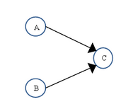  
如上图所示，A和C之间存在数据依赖关系，同时B和C之间也存在数据依赖关系。因此在最终执行的指令序列中，C不能被重排序到A和B的前面（C排到A和B的前面，程序的结果将会被改变）。但A和B之间没有数据依赖关系，编译器和处理器可以重排序A和B之间的执行顺序。下图是该程序的两种执行顺序：

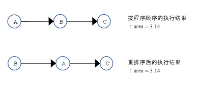  
as-if-serial语义把单线程程序保护了起来，遵守as-if-serial语义的编译器，runtime 和处理器共同为编写单线程程序的程序员创建了一个幻觉：单线程程序是按程序的顺序来执行的。as-if-serial语义使单线程程序员无需担心重排序会干扰他们，也无需担心内存可见性问题。  
总之，**如果操作A happens-before操作B，那么操作A在内存上所做的操作对操作B都是可见的，不管它们在不在一个线程。**

##### 天然的happens-before关系

在Java中，有以下天然的happens-before关系：

- 程序顺序规则：一个线程中的每一个操作，happens-before于该线程中的任意后续操作。
- 监视器锁规则：对一个锁的解锁，happens-before于随后对这个锁的加锁。
- volatile变量规则：对一个volatile域的写，happens-before于任意后续对这个volatile域的读。
- 传递性：如果A happens-before B，且B happens-before C，那么A happens-before C。
- start规则：如果线程A执行操作ThreadB.start()启动线程B，那么A线程的ThreadB.start（）操作happens-before于线程B中的任意操作、
- join规则：如果线程A执行操作ThreadB.join（）并成功返回，那么线程B中的任意操作happens-before于线程A从ThreadB.join()操作成功返回。  
  举例：

```java
int a = 1; // A操作
int b = 2; // B操作
int sum = a + b;// C 操作
System.out.println(sum);
```

根据以上介绍的happens-before规则，假如只有一个线程，那么不难得出：

```java
1> A happens-before B 
2> B happens-before C 
3> A happens-before C
```

注意，真正在执行指令的时候，其实JVM有可能对操作A & B进行重排序，因为无论先执行A还是B，他们都对对方是可见的，并且不影响执行结果。

如果这里发生了重排序，这在视觉上违背了happens-before原则，但是JMM是允许这样的重排序的。

所以，我们只关心happens-before规则，不用关心JVM到底是怎样执行的。只要确定操作A happens-before操作B就行了。

重排序有两类，JMM对这两类重排序有不同的策略：  
= 会改变程序执行结果的重排序，比如 A -> C，JMM要求编译器和处理器都禁止这种重排序。

- 不会改变程序执行结果的重排序，比如 A -> B，JMM对编译器和处理器不做要求，允许这种重排序。

### volatile

#### volatile的内存语义

在Java中，volatile关键字有特殊的内存语义。volatile主要有以下两个功能：

- 保证变量的内存可见性
- 禁止volatile变量与普通变量重排序（JSR133提出，Java 5 开始才有这个“增强的volatile内存语义”）

##### 内存可见性

以一段示例代码开始：

```java
public class VolatileExample {
    int a = 0;
    volatile boolean flag = false;

    public void writer() {
        a = 1; // step 1
        flag = true; // step 2
    }

    public void reader() {
        if (flag) { // step 3
            System.out.println(a); // step 4
        }
    }
}
```

在这段代码里，我们使用volatile关键字修饰了一个boolean类型的变量flag。

所谓内存可见性，指的是当一个线程对volatile修饰的变量进行写操作（比如step 2）时，JMM会立即把该线程对应的本地内存中的共享变量的值刷新到主内存；当一个线程对volatile修饰的变量进行读操作（比如step 3）时，JMM会把立即该线程对应的本地内存置为无效，从主内存中读取共享变量的值。  
假设在时间线上，线程A先自行方法writer方法，线程B后执行reader方法。那必然会有下图：  
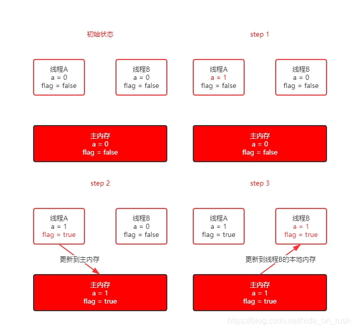  
而如果flag变量没有用volatile修饰，在step 2，线程A的本地内存里面的变量就不会立即更新到主内存，那随后线程B也同样不会去主内存拿最新的值，仍然使用线程B本地内存缓存的变量的值a = 0，flag = false。

```java
在这一点上，volatile与锁具有相同的内存效果，volatile变量的写和锁的释放具有相同的内存语义，volatile变量的读和锁的获取具有相同的内存语义。
```

#### 禁止重排序

在JSR-133之前的旧的Java内存模型中，是允许volatile变量与普通变量重排序的。那上面的案例中，可能就会被重排序成下列时序来执行：

1. 线程A写volatile变量，step 2，设置flag为true；
2. 线程B读同一个volatile，step 3，读取到flag为true；
3. 线程B读普通变量，step 4，读取到 a = 0；
4. 线程A修改普通变量，step 1，设置 a = 1；  
   可见，如果volatile变量与普通变量发生了重排序，虽然volatile变量能保证内存可见性，也可能导致普通变量读取错误。

所以在旧的内存模型中，volatile的写-读就不能与锁的释放-获取具有相同的内存语义了。为了提供一种比锁更轻量级的线程间的通信机制，JSR-133专家组决定增强volatile的内存语义：严格限制编译器和处理器对volatile变量与普通变量的重排序。

编译器还好说，JVM是怎么还能限制处理器的重排序的呢？它是通过内存屏障来实现的。

什么是内存屏障？硬件层面，内存屏障分两种：读屏障（Load Barrier）和写屏障（Store Barrier）。内存屏障有两个作用：

1. 阻止屏障两侧的指令重排序；
2. 强制把写缓冲区/高速缓存中的脏数据等写回主内存，或者让缓存中相应的数据失效。  
   **注意这里的缓存主要指的是CPU缓存，如L1，L2等**  
   编译器在生成字节码时，会在指令序列中插入内存屏障来禁止特定类型的处理器重排序。编译器选择了一个比较保守的JMM内存屏障插入策略，这样可以保证在任何处理器平台，任何程序中都能得到正确的volatile内存语义。这个策略是：

- 在每个volatile写操作前插入一个StoreStore屏障；
- 在每个volatile写操作后插入一个StoreLoad屏障；
- 在每个volatile读操作后插入一个LoadLoad屏障；
- 在每个volatile读操作后再插入一个LoadStore屏障。
- 大概示意图是这个样子：
- 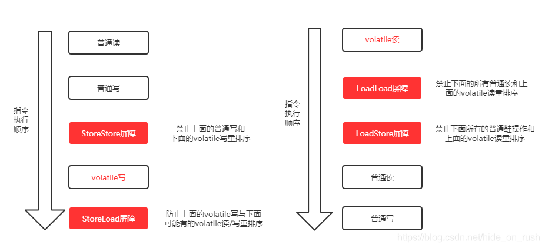  
  再逐个解释一下这几个屏障。注：下述Load代表读操作，Store代表写操作

```java
LoadLoad屏障：对于这样的语句Load1; LoadLoad; Load2，在Load2及后续读取操作要读取的数据被访问前，保证Load1要读取的数据被读取完毕。
StoreStore屏障：对于这样的语句Store1; StoreStore; Store2，在Store2及后续写入操作执行前，保证Store1的写入操作对其它处理器可见。
LoadStore屏障：对于这样的语句Load1; LoadStore; Store2，在Store2及后续写入操作被刷出前，保证Load1要读取的数据被读取完毕。
StoreLoad屏障：对于这样的语句Store1; StoreLoad; Load2，在Load2及后续所有读取操作执行前，保证Store1的写入对所有处理器可见。它的开销是四种屏障中最大的（冲刷写缓冲器，清空无效化队列）。在大多数处理器的实现中，这个屏障是个万能屏障，兼具其它三种内存屏障的功能`
```

对于连续多个volatile变量读或者连续多个volatile变量写，编译器做了一定的优化来提高性能，比如：

```java
第一个volatile读;

LoadLoad屏障；

第二个volatile读；

LoadStore屏障
```

再介绍一下volatile与普通变量的重排序规则:

1. 如果第一个操作是volatile读，那无论第二个操作是什么，都不能重排序；
2. 如果第二个操作是volatile写，那无论第一个操作是什么，都不能重排序；
3. 如果第一个操作是volatile写，第二个操作是volatile读，那不能重排序。

举个例子，我们在案例中step 1，是普通变量的写，step 2是volatile变量的写，那符合第2个规则，这两个steps不能重排序。而step 3是volatile变量读，step 4是普通变量读，符合第1个规则，同样不能重排序。

但如果是下列情况：第一个操作是普通变量读，第二个操作是volatile变量读，那是可以重排序的：

```java
// 声明变量
int a = 0; // 声明普通变量
volatile boolean flag = false; // 声明volatile变量

// 以下两个变量的读操作是可以重排序的
int i = a; // 普通变量读
boolean j = flag; // volatile变量读
```

#### volatile的用途

从volatile的内存语义上来看，volatile可以保证内存可见性且禁止重排序。

在保证内存可见性这一点上，volatile有着与锁相同的内存语义，所以可以作为一个“轻量级”的锁来使用。但由于volatile仅仅保证对单个volatile变量的读/写具有原子性，而锁可以保证整个**临界区代码的**执行具有原子性。所以**在功能上，锁比volatile更强大；在性能上，volatile更有优势。**

在禁止重排序这一点上，volatile也是非常有用的。比如我们熟悉的单例模式，其中有一种实现方式是“双重锁检查”，比如这样的代码：

```java
public class Singleton {

    private static Singleton instance; // 不使用volatile关键字

    // 双重锁检验
    public static Singleton getInstance() {
        if (instance == null) { // 第7行
            synchronized (Singleton.class) {
                if (instance == null) {
                    instance = new Singleton(); // 第10行
                }
            }
        }
        return instance;
    }
}
```

如果这里的变量声明不使用volatile关键字，是可能会发生错误的。它可能会被重排序：

```java
instance = new Singleton(); // 第10行

// 可以分解为以下三个步骤
1 memory=allocate();// 分配内存 相当于c的malloc
2 ctorInstanc(memory) //初始化对象
3 s=memory //设置s指向刚分配的地址

// 上述三个步骤可能会被重排序为 1-3-2，也就是：
1 memory=allocate();// 分配内存 相当于c的malloc
3 s=memory //设置s指向刚分配的地址
2 ctorInstanc(memory) //初始化对象
```

而一旦假设发生了这样的重排序，比如线程A在第10行执行了步骤1和步骤3，但是步骤2还没有执行完。这个时候另一个线程B执行到了第7行，它会判定instance不为空，然后直接返回了一个未初始化完成的instance！

所以JSR-133对volatile做了增强后，volatile的禁止重排序功能还是非常有用的。

### CAS与原子操作

#### 乐观锁与悲观锁

##### 概念

###### 悲观锁：

悲观锁就是我们常说的锁。对于悲观锁来说，它总是认为每次访问共享资源时会发生冲突，所以必须对每次数据操作加上锁，以保证临界区的程序同一时间只能有一个线程在执行。

###### 乐观锁：

乐观锁又称为“无锁”，顾名思义，它是乐观派。乐观锁总是假设对共享资源的访问没有冲突，线程可以不停地执行，无需加锁也无需等待。而一旦多个线程发生冲突，乐观锁通常是使用一种称为CAS的技术来保证线程执行的安全性。

由于无锁操作中没有锁的存在，因此不可能出现死锁的情况，也就是说乐观锁天生免疫死锁。

乐观锁多用于“读多写少“的环境，避免频繁加锁影响性能；而悲观锁多用于”写多读少“的环境，避免频繁失败和重试影响性能。

#### CAS的概念

CAS的全称是：比较并交换（Compare And Swap）。在CAS中，有这样三个值：

- V：要更新的变量(var)
- E：预期值(expected)
- N：新值(new)
- 比较并交换的过程如下：

判断V是否等于E，如果等于，将V的值设置为N；如果不等，说明已经有其它线程更新了V，则当前线程放弃更新，什么都不做。

所以这里的**预期值E本质上指的是“旧值”**。  
我们以一个简单的例子来解释这个过程：

1. 如果有一个多个线程共享的变量i原本等于5，我现在在线程A中，想把它设置为新的值6;
2. 我们使用CAS来做这个事情；
3. 首先我们用i去与5对比，发现它等于5，说明没有被其它线程改过，那我就把它设置为新的值6，此次CAS成功，i的值被设置成了6；
4. 如果不等于5，说明i被其它线程改过了（比如现在i的值为2），那么我就什么也不做，此次CAS失败，i的值仍然为2。  
   在这个例子中，i就是V，5就是E，6就是N。

那有没有可能我在判断了i为5之后，正准备更新它的新值的时候，被其它线程更改了i的值呢？

不会的。因为CAS是一种原子操作，它是一种系统原语，是一条CPU的原子指令，从CPU层面保证它的原子性

**当多个线程同时使用CAS操作一个变量时，只有一个会胜出，并成功更新，其余均会失败，但失败的线程并不会被挂起，仅是被告知失败，并且允许再次尝试，当然也允许失败的线程放弃操作。**

#### Java实现CAS的原理 - Unsafe类

前面提到，CAS是一种原子操作。那么Java是怎样来使用CAS的呢？我们知道，在Java中，如果一个方法是native的，那Java就不负责具体实现它，而是交给底层的JVM使用c或者c++去实现。

在Java中，有一个Unsafe类，它在sun.misc包中。它里面是一些native方法，其中就有几个关于CAS的：

```java
boolean compareAndSwapObject(Object o, long offset,Object expected, Object x);
boolean compareAndSwapInt(Object o, long offset,int expected,int x);
boolean compareAndSwapLong(Object o, long offset,long expected,long x);
```

当然，他们都是public native的。

Unsafe中对CAS的实现是C++写的，它的具体实现和操作系统、CPU都有关系。

Linux的X86下主要是通过cmpxchgl这个指令在CPU级完成CAS操作的，但在多处理器情况下必须使用lock指令加锁来完成。当然不同的操作系统和处理器的实现会有所不同，大家可以自行了解。

当然，Unsafe类里面还有其它方法用于不同的用途。比如支持线程挂起和恢复的park和unpark， LockSupport类底层就是调用了这两个方法。还有支持反射操作的allocateInstance()方法。

#### 原子操作-AtomicInteger类源码简析

上面介绍了Unsafe类的几个支持CAS的方法。那Java具体是如何使用这几个方法来实现原子操作的呢？

JDK提供了一些用于原子操作的类，在java.util.concurrent.atomic包下面。在JDK 11中，有如下17个类：

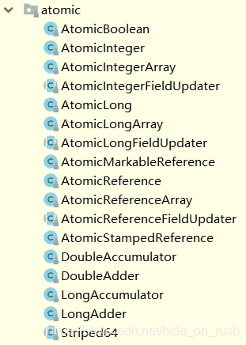  
从名字就可以看得出来这些类大概的用途：

- 原子更新基本类型
- 原子更新数组
- 原子更新引用
- 原子更新字段（属性）  
  这里我们以AtomicInteger类的getAndAdd(int delta)方法为例，来看看Java是如何实现原子操作的。

```java
public final int getAndAdd(int delta) {
    return U.getAndAddInt(this, VALUE, delta);
}
```

这里的U其实就是一个Unsafe对象：

```java
private static final jdk.internal.misc.Unsafe U = jdk.internal.misc.Unsafe.getUnsafe();
```

所以其实AtomicInteger类的getAndAdd(int delta)方法是调用Unsafe类的方法来实现的：

```java
@HotSpotIntrinsicCandidate
public final int getAndAddInt(Object o, long offset, int delta) {
    int v;
    do {
        v = getIntVolatile(o, offset);
    } while (!weakCompareAndSetInt(o, offset, v, v + delta));
    return v;
}
```

```java
注：这个方法是在JDK 1.8才新增的。在JDK1.8之前，AtomicInteger源码实现有所不同，是基于for死循环的，有兴趣的读者可以自行了解一下。
```

我们来一步步解析这段源码。首先，对象o是this，也就是一个AtomicInteger对象。然后offset是一个常量VALUE。这个常量是在AtomicInteger类中声明的：

```java
private static final long VALUE = U.objectFieldOffset(AtomicInteger.class, "value");
```

同样是调用的Unsafe的方法。从方法名字上来看，是得到了一个对象字段偏移量。

用于获取某个字段相对Java对象的“起始地址”的偏移量。

一个java对象可以看成是一段内存，各个字段都得按照一定的顺序放在这段内存里，同时考虑到对齐要求，可能这些字段不是连续放置的，

用这个方法能准确地告诉你某个字段相对于对象的起始内存地址的字节偏移量，因为是相对偏移量，所以它其实跟某个具体对象又没什么太大关系，跟class的定义和虚拟机的内存模型的实现细节更相关。

继续看源码。前面我们讲到，CAS是“无锁”的基础，它允许更新失败。所以经常会与while循环搭配，在失败后不断去重试。

这里声明了一个v，也就是要返回的值。从getAndAddInt来看，它返回的应该是原来的值，而新的值的v + delta。

这里使用的是do-while循环。这种循环不多见，它的目的是保证循环体内的语句至少会被执行一遍。这样才能保证return 的值v是我们期望的值。

循环体的条件是一个CAS方法：

```java
public final boolean weakCompareAndSetInt(Object o, long offset,
                                          int expected,
                                          int x) {
    return compareAndSetInt(o, offset, expected, x);
}

public final native boolean compareAndSetInt(Object o, long offset,
                                             int expected,
                                             int x);
```

可以看到，最终其实是调用的我们之前说到了CAS native方法。那为什么要经过一层weakCompareAndSetInt呢？从JDK源码上看不出来什么。在JDK 8及之前的版本，这两个方法是一样的。

而在JDK 9开始，这两个方法上面增加了@HotSpotIntrinsicCandidate注解。这个注解允许HotSpot VM自己来写汇编或IR编译器来实现该方法以提供性能。也就是说虽然外面看到的在JDK9中weakCompareAndSet和compareAndSet底层依旧是调用了一样的代码，但是不排除HotSpot VM会手动来实现weakCompareAndSet真正含义的功能的可能性。

根据本文第一篇参考文章（文末链接），它跟volitile有关。

简单来说，weakCompareAndSet操作仅保留了volatile自身变量的特性，而出去了happens-before规则带来的内存语义。也就是说，weakCompareAndSet无法保证处理操作目标的volatile变量外的其他变量的执行顺序( 编译器和处理器为了优化程序性能而对指令序列进行重新排序 )，同时也无法保证这些变量的可见性。这在一定程度上可以提高性能。

再回到循环条件上来，可以看到它是在不断尝试去用CAS更新。如果更新失败，就继续重试。那为什么要把获取“旧值”v的操作放到循环体内呢？其实这也很好理解。前面我们说了，CAS如果旧值V不等于预期值E，它就会更新失败。说明旧的值发生了变化。那我们当然需要返回的是被其他线程改变之后的旧值了，因此放在了do循环体内。

#### CAS实现原子操作的三大问题

##### ABA问题

所谓ABA问题，就是一个值原来是A，变成了B，又变回了A。这个时候使用CAS是检查不出变化的，但实际上却被更新了两次。

ABA问题的解决思路是在变量前面追加上版本号或者时间戳。从JDK 1.5开始，JDK的atomic包里提供了一个类AtomicStampedReference类来解决ABA问题。

这个类的compareAndSet方法的作用是首先检查当前引用是否等于预期引用，并且检查当前标志是否等于预期标志，如果二者都相等，才使用CAS设置为新的值和标志。

```java
public boolean compareAndSet(V   expectedReference,
                             V   newReference,
                             int expectedStamp,
                             int newStamp) {
    Pair<V> current = pair;
    return
        expectedReference == current.reference &&
        expectedStamp == current.stamp &&
        ((newReference == current.reference &&
          newStamp == current.stamp) ||
         casPair(current, Pair.of(newReference, newStamp)));
}
```

##### 循环时间长开销大

CAS多与自旋结合。如果自旋CAS长时间不成功，会占用大量的CPU资源。

解决思路是让JVM支持处理器提供的pause指令。

pause指令能让自旋失败时cpu睡眠一小段时间再继续自旋，从而使得读操作的频率低很多,为解决内存顺序冲突而导致的CPU流水线重排的代价也会小很多。

##### 只能保证一个共享变量的原子操作

这个问题你可能已经知道怎么解决了。有两种解决方案：

1. 使用JDK 1.5开始就提供的AtomicReference类保证对象之间的原子性，把多个变量放到一个对象里面进行CAS操作；
2. 使用锁。锁内的临界区代码可以保证只有当前线程能操作。

### AQS

#### 简介

AQS是AbstractQueuedSynchronizer的简称，即抽象队列同步器，从字面意思上理解:

- 抽象：抽象类，只实现一些主要逻辑，有些方法由子类实现；
- 队列：使用先进先出（FIFO）队列存储数据；
- 同步：实现了同步的功能。  
  那AQS有什么用呢？AQS是一个用来构建锁和同步器的框架，使用AQS能简单且高效地构造出应用广泛的同步器，比如我们提到的ReentrantLock，Semaphore，ReentrantReadWriteLock，SynchronousQueue，FutureTask等等皆是基于AQS的。

当然，我们自己也能利用AQS非常轻松容易地构造出符合我们自己需求的同步器，只要之类实现它的几个protected方法就可以了。

#### 数据结构

AQS内部使用了一个volatile的变量state来作为资源的标识。同时定义了几个获取和改版state的protected方法，子类可以覆盖这些方法来实现自己的逻辑：

```java
getState()
setState()
compareAndSetState()
```

这三种叫做均是原子操作，其中compareAndSetState的实现依赖于Unsafe的compareAndSwapInt()方法。

而AQS类本身实现的是一些排队和阻塞的机制，比如具体线程等待队列的维护（如获取资源失败入队/唤醒出队等）。它内部使用了一个先进先出（FIFO）的双端队列，并使用了两个指针head和tail用于标识队列的头部和尾部。其数据结构如图：  
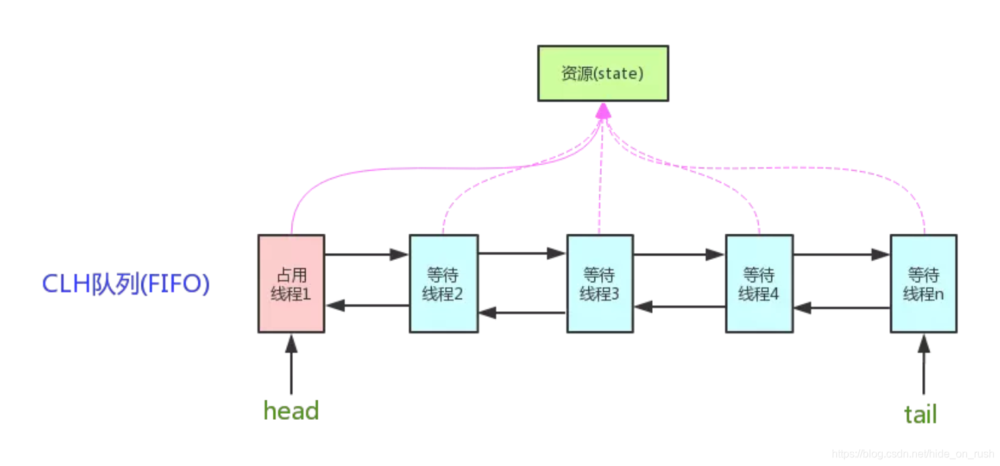  
但它并不是直接储存线程，而是储存拥有线程的Node节点。

#### 资源共享模式

资源有两种共享模式，或者说两种同步方式：

- 独占模式（Exclusive）：资源是独占的，一次只能一个线程获取。如ReentrantLock。
- 共享模式（Share）：同时可以被多个线程获取，具体的资源个数可以通过参数指定。如Semaphore/CountDownLatch。  
  一般情况下，子类只需要根据需求实现其中一种模式，当然也有同时实现两种模式的同步类，如ReadWriteLock。

AQS中关于这两种资源共享模式的定义源码（均在内部类Node中）。我们来看看Node的结构：

```java
static final class Node {
    // 标记一个结点（对应的线程）在共享模式下等待
    static final Node SHARED = new Node();
    // 标记一个结点（对应的线程）在独占模式下等待
    static final Node EXCLUSIVE = null; 

    // waitStatus的值，表示该结点（对应的线程）已被取消
    static final int CANCELLED = 1; 
    // waitStatus的值，表示后继结点（对应的线程）需要被唤醒
    static final int SIGNAL = -1;
    // waitStatus的值，表示该结点（对应的线程）在等待某一条件
    static final int CONDITION = -2;
    /*waitStatus的值，表示有资源可用，新head结点需要继续唤醒后继结点（共享模式下，多线程并发释放资源，而head唤醒其后继结点后，需要把多出来的资源留给后面的结点；设置新的head结点时，会继续唤醒其后继结点）*/
    static final int PROPAGATE = -3;

    // 等待状态，取值范围，-3，-2，-1，0，1
    volatile int waitStatus;
    volatile Node prev; // 前驱结点
    volatile Node next; // 后继结点
    volatile Thread thread; // 结点对应的线程
    Node nextWaiter; // 等待队列里下一个等待条件的结点


    // 判断共享模式的方法
    final boolean isShared() {
        return nextWaiter == SHARED;
    }

    Node(Thread thread, Node mode) {     // Used by addWaiter
        this.nextWaiter = mode;
        this.thread = thread;
    }

    // 其它方法忽略，可以参考具体的源码
}

// AQS里面的addWaiter私有方法
private Node addWaiter(Node mode) {
    // 使用了Node的这个构造函数
    Node node = new Node(Thread.currentThread(), mode);
    // 其它代码省略
}
```

注意：通过Node我们可以实现两个队列，一是通过prev和next实现CLH队列(线程同步队列,双向队列)，二是nextWaiter实现Condition条件上的等待线程队列(单向队列)，这个Condition主要用在ReentrantLock类中。

#### 主要方法源码解析

AQS的设计是基于模板方法模式的，它有一些方法必须要子类去实现的，它们主要有：

- isHeldExclusively()：该线程是否正在独占资源。只有用到condition才需要去实现它。
- tryAcquire(int)：独占方式。尝试获取资源，成功则返回true，失败则返回false。
- tryRelease(int)：独占方式。尝试释放资源，成功则返回true，失败则返回false。
- tryAcquireShared(int)：共享方式。尝试获取资源。负数表示失败；0表示成功，但没有剩余可用资源；正数表示成功，且有剩余资源。
- tryReleaseShared(int)：共享方式。尝试释放资源，如果释放后允许唤醒后续等待结点返回true，否则返回false。

这些方法虽然都是protected方法，但是它们并没有在AQS具体实现，而是直接抛出异常（虽然不知道这里为什么不使用抽象方法的实现方式）：

```java
protected boolean tryAcquire(int arg) {
    throw new UnsupportedOperationException();
}
```

而AQS实现了一系列主要的逻辑。下面我们从源码来分析一下获取和释放资源的主要逻辑：

##### 获取资源

获取资源的入口是acquire(int arg)方法。arg是要获取的资源的个数，在独占模式下始终为1。我们先来看看这个方法的逻辑：

```java
public final void acquire(int arg) {
    if (!tryAcquire(arg) &&
        acquireQueued(addWaiter(Node.EXCLUSIVE), arg))
        selfInterrupt();
}
```

首先调用tryAcquire(arg)尝试去获取资源。前面提到了这个方法是在子类具体实现的。

如果获取资源失败，就通过addWaiter(Node.EXCLUSIVE)方法把这个线程插入到等待队列中。其中传入的参数代表要插入的Node是独占式的。这个方法的具体实现：

```java
private Node addWaiter(Node mode) {
    // 生成该线程对应的Node节点
    Node node = new Node(Thread.currentThread(), mode);
    // 将Node插入队列中
    Node pred = tail;
    if (pred != null) {
        node.prev = pred;
        // 使用CAS尝试，如果成功就返回
        if (compareAndSetTail(pred, node)) {
            pred.next = node;
            return node;
        }
    }
    // 如果等待队列为空或者上述CAS失败，再自旋CAS插入
    enq(node);
    return node;
}

// 自旋CAS插入等待队列
private Node enq(final Node node) {
    for (;;) {
        Node t = tail;
        if (t == null) { // Must initialize
            if (compareAndSetHead(new Node()))
                tail = head;
        } else {
            node.prev = t;
            if (compareAndSetTail(t, node)) {
                t.next = node;
                return t;
            }
        }
    }
}
```

```java
上面的两个函数比较好理解，就是在队列的尾部插入新的Node节点，但是需要注意的是由于AQS中会存在多个线程同时争夺资源的情况，因此肯定会出现多个线程同时插入节点的操作，在这里是通过CAS自旋的方式保证了操作的线程安全性。
```

OK，现在回到最开始的aquire(int arg)方法。现在通过addWaiter方法，已经把一个Node放到等待队列尾部了。而处于等待队列的结点是从头结点一个一个去获取资源的。具体的实现我们来看看acquireQueued方法：

```java
final boolean acquireQueued(final Node node, int arg) {
    boolean failed = true;
    try {
        boolean interrupted = false;
        // 自旋
        for (;;) {
            final Node p = node.predecessor();
            // 如果node的前驱结点p是head，表示node是第二个结点，就可以尝试去获取资源了
            if (p == head && tryAcquire(arg)) {
                // 拿到资源后，将head指向该结点。
                // 所以head所指的结点，就是当前获取到资源的那个结点或null。
                setHead(node); 
                p.next = null; // help GC
                failed = false;
                return interrupted;
            }
            // 如果自己可以休息了，就进入waiting状态，直到被unpark()
            if (shouldParkAfterFailedAcquire(p, node) &&
                parkAndCheckInterrupt())
                interrupted = true;
        }
    } finally {
        if (failed)
            cancelAcquire(node);
    }
}
```

这里parkAndCheckInterrupt方法内部使用到了LockSupport.park(this)，顺便简单介绍一下park。

LockSupport类是Java 6 引入的一个类，提供了基本的线程同步原语。LockSupport实际上是调用了Unsafe类里的函数，归结到Unsafe里，只有两个函数：

- park(boolean isAbsolute, long time)：阻塞当前线程
- unpark(Thread jthread)：使给定的线程停止阻塞
- 所以结点进入等待队列后，是调用park使它进入阻塞状态的。只有头结点的线程是处于活跃状态的。

当然，获取资源的方法除了acquire外，还有以下三个：

- acquireInterruptibly：申请可中断的资源（独占模式）
- acquireShared：申请共享模式的资源
- acquireSharedInterruptibly：申请可中断的资源（共享模式）  
  **可中断的意思是，在线程中断时可能会抛出InterruptedException**  
  总结起来的一个流程图：  
  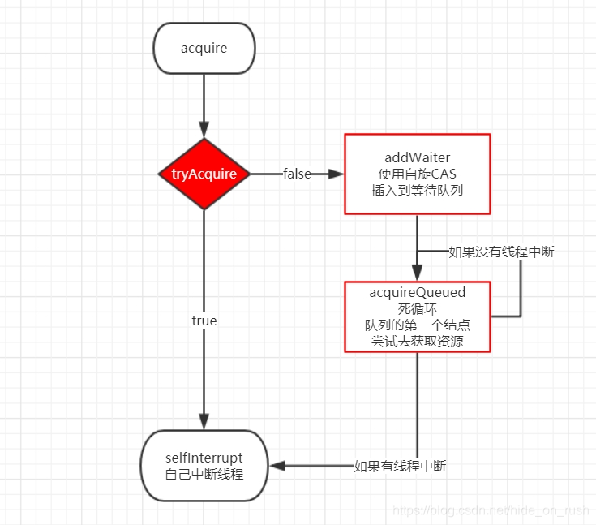

##### 释放资源

释放资源相比于获取资源来说，会简单许多。在AQS中只有一小段实现。源码：

```java
public final boolean release(int arg) {
    if (tryRelease(arg)) {
        Node h = head;
        if (h != null && h.waitStatus != 0)
            unparkSuccessor(h);
        return true;
    }
    return false;
}

private void unparkSuccessor(Node node) {
    // 如果状态是负数，尝试把它设置为0
    int ws = node.waitStatus;
    if (ws < 0)
        compareAndSetWaitStatus(node, ws, 0);
    // 得到头结点的后继结点head.next
    Node s = node.next;
    // 如果这个后继结点为空或者状态大于0
    // 通过前面的定义我们知道，大于0只有一种可能，就是这个结点已被取消
    if (s == null || s.waitStatus > 0) {
        s = null;
        // 等待队列中所有还有用的结点，都向前移动
        for (Node t = tail; t != null && t != node; t = t.prev)
            if (t.waitStatus <= 0)
                s = t;
    }
    // 如果后继结点不为空，
    if (s != null)
        LockSupport.unpark(s.thread);
}
```

## JDK工具

参考：深入浅出多线程

[https://cyc2018.github.io/CS-Notes/#/notes/Java 并发](https://cyc2018.github.io/CS-Notes/#/notes/Java%20%E5%B9%B6%E5%8F%91)

[https://how2playlife.com/2019/10/02/并发编程/Java并发指南1：并发基础与Java多线程/](https://how2playlife.com/2019/10/02/%E5%B9%B6%E5%8F%91%E7%BC%96%E7%A8%8B/Java%E5%B9%B6%E5%8F%91%E6%8C%87%E5%8D%971%EF%BC%9A%E5%B9%B6%E5%8F%91%E5%9F%BA%E7%A1%80%E4%B8%8EJava%E5%A4%9A%E7%BA%BF%E7%A8%8B/)

<https://snailclimb.gitee.io/javaguide/#/docs/java/Multithread/JavaConcurrencyBasicsCommonInterviewQuestionsSummary>

目录  
1.基础  
进程的基本概念  
线程的基本概念  
进程和线程的关系  
进程和线程的区别  
线程的使用  
继承Thread类  
实现Runnable接口  
Thread类与Runnable比较  
实现Callable接口  
Future接口  
FutureTask类  
线程组  
线程组的常用方法  
线程组的数据结构  
线程优先级  
操作系统中的线程状态转换  
java线程的六个状态  
NEW  
RUNNABLE  
BLOCKED  
WAITING  
TIMED\_WAITING  
TERMINATED  
线程状态间的转换  
BLOCKED与RUNNABLE状态的转换  
WAITING与RUNNABLE的转换  
TIMED\_WAITING与WAITING转换  
Thread.sleep(long)  
Object.wait(long)  
Thread.join(long)  
线程中断  
线程间的通信  
基础线程机制  
Executor  
Daemon  
sleep（）  
yield（）  
2.中断  
InterruptedException  
interrupted()  
Executor 的中断操作  
3.互斥同步  
java中锁的分类  
可重入锁和非可重入锁  
公平锁与非公平锁  
读写锁和排他锁  
synchronized  
1.同步一个代码块  
2. 同步一个方法  
3. 同步一个静态方法  
4. 同步一个类  
ReentrantLock  
ReentrantLock与synchronized的比较

1. 锁的实现
2. 性能
3. 等待可中断
4. 公平锁
5. 锁绑定多个条件  
   如何选择  
   原理  
   java内存模型  
   并发编程模型  
   运行时的内存划分  
   堆中内存不可见问题  
   内存间交互操作  
   几种锁  
   对象头  
   偏向锁  
   实现原理  
   撤销偏向锁  
   轻量级锁  
   轻量级锁的加锁  
   轻量级锁的释放  
   重量级锁  
   锁的升级流程  
   各种锁的优缺点对比  
   重排序与happens-before  
   什么是重排序  
   为什么指令重排序可以提高性能  
   顺序一致性模型与JMM的保证  
   数据竞争与顺序一致性  
   顺序一致性模型  
   JMM中同步程序的顺序一致性效果  
   未同步程序的执行特性  
   什么是happens-before  
   天然的happens-before关系  
   volatile  
   volatile的内存语义  
   内存可见性  
   禁止重排序  
   volatile的用途  
   CAS与原子操作  
   乐观锁与悲观锁  
   概念  
   悲观锁：  
   乐观锁：  
   CAS的概念  
   Java实现CAS的原理 - Unsafe类  
   原子操作-AtomicInteger类源码简析  
   CAS实现原子操作的三大问题  
   ABA问题  
   循环时间长开销大  
   只能保证一个共享变量的原子操作  
   AQS  
   简介  
   数据结构  
   资源共享模式  
   主要方法源码解析  
   获取资源  
   释放资源  
   JDK工具  
   1.基础  
   进程的基本概念  
   进程就是应用程序在内存中分配的空间，也就是正在运行的程序，各个进程之间互不干扰。同时进程保存着程序每一个时刻运行的状态。

程序：用某种编程语言(java、python等)编写，能够完成一定任务或者功能的代码集合,是指令和数据的有序集合，是一段静态代码。

此时，CPU采用时间片轮转的方式运行进程：CPU为每个进程分配一个时间段，称作它的时间片。如果在时间片结束时进程还在运行，则暂停这个进程的运行，并且CPU分配给另一个进程（这个过程叫做上下文切换）。如果进程在时间片结束前阻塞或结束，则CPU立即进行切换，不用等待时间片用完。

当进程暂停时，它会保存当前进程的状态（进程标识，进程使用的资源等），在下一次切换回来时根据之前保存的状态进行恢复，接着继续执行。

使用进程+CPU时间片轮转方式的操作系统，在宏观上看起来同一时间段执行多个任务，换句话说，进程让操作系统的并发成为了可能。虽然并发从宏观上看有多个任务在执行，但在事实上，对于单核CPU来说，任意具体时刻都只有一个任务在占用CPU资源。

线程的基本概念  
让一个线程执行一个子任务，这样一个进程就包含了多个线程，每个线程负责一个单独的子任务。

使用线程之后，事情就变得简单多了。当用户使用扫描病毒功能时，就让扫描病毒这个线程去执行。同时，如果用户又使用清理垃圾功能，那么可以先暂停扫描病毒线程，先响应用户的清理垃圾的操作，让清理垃圾这个线程去执行。响应完后再切换回来，接着执行扫描病毒线程。

总之，进程和线程的提出极大的提高了操作系统的性能。进程让操作系统的并发性成为了可能，而线程让进程的内部并发成为了可能。

进程和线程的关系  
下图是 Java 内存区域，通过下图我们从 JVM 的角度来说一下线程和进程之间的关系。如果你对 Java 内存区域 (运行时数据区) 这部分知识不太了解的话可以阅读一下这篇文章：《可能是把 Java 内存区域讲的最清楚的一篇文章》

在这里插入图片描述

从上图可以看出：一个进程中可以有多个线程，多个线程共享进程的堆和方法区 (JDK1.8 之后的元空间)资源，但是每个线程有自己的程序计数器、虚拟机栈 和 本地方法栈。

进程和线程的区别  
进程是一个独立的运行环境，而线程是在进程中执行的一个任务。他们两个本质的区别是是否单独占有内存地址空间及其它系统资源（比如I/O）：

进程单独占有一定的内存地址空间，所以进程间存在内存隔离，数据是分开的，数据共享复杂但是同步简单，各个进程之间互不干扰；而线程共享所属进程占有的内存地址空间和资源，数据共享简单，但是同步复杂。

进程单独占有一定的内存地址空间，一个进程出现问题不会影响其他进程，不影响主程序的稳定性，可靠性高；一个线程崩溃可能影响整个程序的稳定性，可靠性较低。

进程单独占有一定的内存地址空间，进程的创建和销毁不仅需要保存寄存器和栈信息，还需要资源的分配回收以及页调度，开销较大；线程只需要保存寄存器和栈信息，开销较小。  
另外一个重要区别是，进程是操作系统进行资源分配的基本单位，而线程是操作系统进行调度的基本单位，即CPU分配时间的单位 。

总结： 线程 是 进程 划分成的更小的运行单位。线程和进程最大的不同在于基本上各进程是独立的，而各线程则不一定，因为同一进程中的线程极有可能会相互影响。线程执行开销小，但不利于资源的管理和保护；而进程正相反

线程的使用  
继承Thread类  
如何使用Thread

public class Demo {  
public static class MyThread extends Thread {  
@Override  
public void run() {  
System.out.println("MyThread");  
}  
}

public static void main(String[] args) {  
Thread myThread = new MyThread();  
myThread.start();  
}  
}  
注意要调用start()方法后，该线程才算启动！

我们在程序里面调用了start()方法后，虚拟机会先为我们创建一个线程，然后等到这个线程第一次得到时间片时再调用run()方法。

注意不可多次调用start()方法。在第一次调用start()方法后，再次调用start()方法会抛出异常。

Thread类构造方法  
Thread类是一个Runnable接口的实现类，我们来看看Thread类的源码。

查看Thread类的构造方法，发现其实是简单调用一个私有的init方法来实现初始化。init的方法签名：

Thread类源码

// 片段1 - init方法  
private void init(ThreadGroup g, Runnable target, String name,  
long stackSize, AccessControlContext acc,  
boolean inheritThreadLocals)  
// 片段2 - 构造函数调用init方法  
public Thread(Runnable target) {  
init(null, target, "Thread-" + nextThreadNum(), 0);  
}

// 片段3 - 使用在init方法里初始化AccessControlContext类型的私有属性  
this.inheritedAccessControlContext =  
acc != null ? acc : AccessController.getContext();

// 片段4 - 两个对用于支持ThreadLocal的私有属性  
ThreadLocal.ThreadLocalMap threadLocals = null;  
ThreadLocal.ThreadLocalMap inheritableThreadLocals = null;  
我们挨个来解释一下init方法的这些参数：

g：线程组，指定这个线程是在哪个线程组下；

target：指定要执行的任务；

name：线程的名字，多个线程的名字是可以重复的。如果不指定名字，见片段2；

acc：见片段3，用于初始化私有变量inheritedAccessControlContext。

这个变量有点神奇。它是一个私有变量，但是在Thread类里只有init方法对它进行初始化，在exit方法把它设为null。其它没有任何地方使用它。一般我们是不会使用它的，那什么时候会使用到这个变量呢？可以参考这个stackoverflow的问题：Restrict permissions to threads which execute third party software；

inheritThreadLocals：可继承的ThreadLocal，见片段4，Thread类里面有两个私有属性来支持ThreadLocal，我们会在后面的章节介绍ThreadLocal的概念。

实际情况下，我们大多是直接调用下面两个构造方法：

Thread(Runnable target)  
Thread(Runnable target, String name)  
Thread类的常用方法  
这里介绍一下Thread类的几个常用的方法：

currentThread()：静态方法，返回对当前正在执行的线程对象的引用；  
start()：开始执行线程的方法，java虚拟机会调用线程内的run()方法；  
yield()：yield在英语里有放弃的意思，同样，这里的yield()指的是当前线程- 愿意让出对当前处理器的占用。这里需要注意的是，就算当前线程调用了yield()方法，程序在调度的时候，也还有可能继续运行这个线程的；  
sleep()：静态方法，使当前线程睡眠一段时间；  
join()：使当前线程等待另一个线程执行完毕之后再继续执行，内部调用的是Object类的wait方法实现的；  
实现Runnable接口  
接着我们来看一下Runnable接口(JDK 1.8 +)：

@FunctionalInterface  
public interface Runnable {  
public abstract void run();  
}  
可以看到Runnable是一个函数式接口，这意味着我们可以使用Java 8的函数式编程来简化代码。

示例代码：

public class Demo {  
public static class MyThread implements Runnable {  
@Override  
public void run() {  
System.out.println("MyThread");  
}  
}

public static void main(String[] args) {  
new MyThread().run();

// Java 8 函数式编程，可以省略MyThread类  
new Thread(() -> {  
System.out.println("Java 8 匿名内部类");  
}).start();  
}  
}  
Thread类与Runnable比较  
实现一个自定义的线程类，可以有继承Thread类或者实现Runnable接口这两种方式，它们之间有什么优劣呢？

由于Java“单继承，多实现”的特性，Runnable接口使用起来比Thread更灵活。  
Runnable接口出现更符合面向对象，将线程单独进行对象的封装。  
Runnable接口出现，降低了线程对象和线程任务的耦合性。  
如果使用线程时不需要使用Thread类的诸多方法，显然使用Runnable接口更为轻量。  
所以，我们通常优先使用“实现Runnable接口”这种方式来自定义线程类。

实现Callable接口  
通常来说，我们使用Runnable和Thread来创建一个新的线程。但是它们有一个弊端，就是run方法是没有返回值的。而有时候我们希望开启一个线程去执行一个任务，并且这个任务执行完成后有一个返回值。

JDK提供了Callable接口与Future类为我们解决这个问题，这也是所谓的“异步”模型。

Callable与Runnable类似，同样是只有一个抽象方法的函数式接口。不同的是，Callable提供的方法是有返回值的，而且支持泛型。

@FunctionalInterface  
public interface Callable {  
V call() throws Exception;  
}  
那一般是怎么使用Callable的呢？Callable一般是配合线程池工具ExecutorService来使用的。我们会在后续解释线程池的使用。这里只介绍ExecutorService可以使用submit方法来让一个Callable接口执行。它会返回一个Future，我们后续的程序可以通过这个Future的get方法得到结果。

这里可以看一个简单的使用demo：

// 自定义Callable  
class Task implements Callable{  
@Override  
public Integer call() throws Exception {  
// 模拟计算需要一秒  
Thread.sleep(1000);  
return 2;  
}  
public static void main(String args[]){  
// 使用  
ExecutorService executor = Executors.newCachedThreadPool();  
Task task = new Task();  
Future result = executor.submit(task);  
// 注意调用get方法会阻塞当前线程，直到得到结果。  
// 所以实际编码中建议使用可以设置超时时间的重载get方法。  
System.out.println(result.get());  
}  
}  
//输出结果：2  
Future接口  
Future接口只有几个比较简单的方法：

public abstract interface Future {  
public abstract boolean cancel(boolean paramBoolean);  
public abstract boolean isCancelled();  
public abstract boolean isDone();  
public abstract V get() throws InterruptedException, ExecutionException;  
public abstract V get(long paramLong, TimeUnit paramTimeUnit)  
throws InterruptedException, ExecutionException, TimeoutException;  
}  
cancel方法是试图取消一个线程的执行。

**注意是试图取消，并不一定能取消成功。**因为任务可能已完成、已取消、或者一些其它因素不能取消，存在取消失败的可能。boolean类型的返回值是“是否取消成功”的意思。参数paramBoolean表示是否采用中断的方式取消线程执行。

所以有时候，为了让任务有能够取消的功能，就使用Callable来代替Runnable。如果为了可取消性而使用 Future但又不提供可用的结果，则可以声明 Future<?>形式类型、并返回 null作为底层任务的结果。

FutureTask类  
上面介绍了Future接口。这个接口有一个实现类叫FutureTask。FutureTask是实现的RunnableFuture接口的，而RunnableFuture接口同时继承了Runnable接口和Future接口：

public interface RunnableFuture extends Runnable, Future {  
/\*\*  
\* Sets this Future to the result of its computation  
\* unless it has been cancelled.  
\*/  
void run();  
}  
那FutureTask类有什么用？为什么要有一个FutureTask类？前面说到了Future只是一个接口，而它里面的cancel，get，isDone等方法要自己实现起来都是非常复杂的。所以JDK提供了一个FutureTask类来供我们使用。

示例代码：

// 自定义Callable，与上面一样  
class Task implements Callable{  
@Override  
public Integer call() throws Exception {  
// 模拟计算需要一秒  
Thread.sleep(1000);  
return 2;  
}  
public static void main(String args[]){  
// 使用  
ExecutorService executor = Executors.newCachedThreadPool();  
FutureTask futureTask = new FutureTask<>(new Task());  
executor.submit(futureTask);  
System.out.println(futureTask.get());  
}  
}  
使用上与第一个Demo有一点小的区别。首先，调用submit方法是没有返回值的。这里实际上是调用的submit(Runnable task)方法，而上面的Demo，调用的是submit(Callable task)方法。

然后，这里是使用FutureTask直接取get取值，而上面的Demo是通过submit方法返回的Future去取值。

在很多高并发的环境下，有可能Callable和FutureTask会创建多次。FutureTask能够在高并发环境下确保任务只执行一次。

FutureTask的几个状态  
/\*\*  
\*

- state可能的状态转变路径如下：
- NEW -> COMPLETING -> NORMAL
- NEW -> COMPLETING -> EXCEPTIONAL
- NEW -> CANCELLED
- NEW -> INTERRUPTING -> INTERRUPTED  
  \*/  
  private volatile int state;  
  private static final int NEW = 0;  
  private static final int COMPLETING = 1;  
  private static final int NORMAL = 2;  
  private static final int EXCEPTIONAL = 3;  
  private static final int CANCELLED = 4;  
  private static final int INTERRUPTING = 5;  
  private static final int INTERRUPTED = 6;  
  state表示任务的运行状态，初始状态为NEW。运行状态只会在set、setException、cancel方法中终止。COMPLETING、INTERRUPTING是任务完成后的瞬时状态。

线程组  
Java中用ThreadGroup来表示线程组，我们可以使用线程组对线程进行批量控制。

ThreadGroup和Thread的关系就如同他们的字面意思一样简单粗暴，每个Thread必然存在于一个ThreadGroup中，Thread不能独立于ThreadGroup存在。执行main()方法线程的名字是main，如果在new Thread时没有显式指定，那么默认将父线程（当前执行new Thread的线程）线程组设置为自己的线程组。

示例代码：

public class Demo {  
public static void main(String[] args) {  
Thread testThread = new Thread(() -> {  
System.out.println("testThread当前线程组名字：" +  
Thread.currentThread().getThreadGroup().getName());  
System.out.println("testThread线程名字：" +  
Thread.currentThread().getName());  
});

testThread.start();  
System.out.println("执行main方法线程名字：" + Thread.currentThread().getName());  
}  
}  
输出结果：

执行main方法线程名字：main  
testThread当前线程组名字：main  
testThread线程名字：Thread-0  
ThreadGroup管理着它下面的Thread，ThreadGroup是一个标准的向下引用的树状结构，这样设计的原因是防止"上级"线程被"下级"线程引用而无法有效地被GC回收。

在之前，我们有谈到一个线程必然存在于一个线程组中，那么当线程和线程组的优先级不一致的时候将会怎样呢？我们用下面的案例来验证一下：

public static void main(String[] args) {  
ThreadGroup threadGroup = new ThreadGroup("t1");  
threadGroup.setMaxPriority(6);  
Thread thread = new Thread(threadGroup,"thread");  
thread.setPriority(9);  
System.out.println("我是线程组的优先级"+threadGroup.getMaxPriority());  
System.out.println("我是线程的优先级"+thread.getPriority());  
}  
输出：

我是线程组的优先级6  
我是线程的优先级6  
所以，如果某个线程优先级大于线程所在线程组的最大优先级，那么该线程的优先级将会失效，取而代之的是线程组的最大优先级。

线程组的常用方法  
获取当前的线程组名字  
Thread.currentThread().getThreadGroup().getName()  
复制线程组  
// 复制一个线程数组到一个线程组  
Thread[] threads = new Thread[threadGroup.activeCount()];  
TheadGroup threadGroup = new ThreadGroup();  
threadGroup.enumerate(threads);  
线程组统一异常处理  
package com.func.axc.threadgroup;

public class ThreadGroupDemo {  
public static void main(String[] args) {  
ThreadGroup threadGroup1 = new ThreadGroup("group1") {  
// 继承ThreadGroup并重新定义以下方法  
// 在线程成员抛出unchecked exception  
// 会执行此方法  
public void uncaughtException(Thread t, Throwable e) {  
System.out.println(t.getName() + ": " + e.getMessage());  
}  
};

// 这个线程是threadGroup1的一员  
Thread thread1 = new Thread(threadGroup1, new Runnable() {  
public void run() {  
// 抛出unchecked异常  
throw new RuntimeException("测试异常");  
}  
});

thread1.start();  
}  
}  
线程组的数据结构  
线程组还可以包含其他的线程组，不仅仅是线程。

首先看看 ThreadGroup源码中的成员变量

public class ThreadGroup implements Thread.UncaughtExceptionHandler {  
private final ThreadGroup parent; // 父亲ThreadGroup  
String name; // ThreadGroupr 的名称  
int maxPriority; // 线程最大优先级  
boolean destroyed; // 是否被销毁  
boolean daemon; // 是否守护线程  
boolean vmAllowSuspension; // 是否可以中断

int nUnstartedThreads = 0; // 还未启动的线程  
int nthreads; // ThreadGroup中线程数目  
Thread threads[]; // ThreadGroup中的线程

int ngroups; // 线程组数目  
ThreadGroup groups[]; // 线程组数组  
}  
然后看看构造函数：

// 私有构造函数  
private ThreadGroup() {  
this.name = "system";  
this.maxPriority = Thread.MAX\_PRIORITY;  
this.parent = null;  
}

// 默认是以当前ThreadGroup传入作为parent ThreadGroup，新线程组的父线程组是目前正在运行线程的线程组。  
public ThreadGroup(String name) {  
this(Thread.currentThread().getThreadGroup(), name);  
}

// 构造函数  
public ThreadGroup(ThreadGroup parent, String name) {  
this(checkParentAccess(parent), parent, name);  
}

// 私有构造函数，主要的构造函数  
private ThreadGroup(Void unused, ThreadGroup parent, String name) {  
this.name = name;  
this.maxPriority = parent.maxPriority;  
this.daemon = parent.daemon;  
this.vmAllowSuspension = parent.vmAllowSuspension;  
this.parent = parent;  
parent.add(this);  
}  
第三个构造函数里调用了checkParentAccess方法，这里看看这个方法的源码：

// 检查parent ThreadGroup  
private static Void checkParentAccess(ThreadGroup parent) {  
parent.checkAccess();  
return null;  
}

// 判断当前运行的线程是否具有修改线程组的权限  
public final void checkAccess() {  
SecurityManager security = System.getSecurityManager();  
if (security != null) {  
security.checkAccess(this);  
}  
}  
这里涉及到SecurityManager这个类，它是Java的安全管理器，它允许应用程序在执行一个可能不安全或敏感的操作前确定该操作是什么，以及是否是在允许执行该操作的安全上下文中执行它。应用程序可以允许或不允许该操作。

比如引入了第三方类库，但是并不能保证它的安全性。

其实Thread类也有一个checkAccess()方法，不过是用来当前运行的线程是否有权限修改被调用的这个线程实例。（Determines if the currently running thread has permission to modify this thread.）

总结来说，线程组是一个树状的结构，每个线程组下面可以有多个线程或者线程组。线程组可以起到统一控制线程的优先级和检查线程的权限的作用。

线程优先级  
Java中线程优先级可以指定，范围是1~10。但是并不是所有的操作系统都支持10级优先级的划分（比如有些操作系统只支持3级划分：低，中，高），Java只是给操作系统一个优先级的参考值，线程最终在操作系统的优先级是多少还是由操作系统决定。

Java默认的线程优先级为5，线程的执行顺序由调度程序来决定，线程的优先级会在线程被调用之前设定。

通常情况下，高优先级的线程将会比低优先级的线程有更高的几率得到执行。我们使用方法Thread类的setPriority()实例方法来设定线程的优先级。

public class Demo {  
public static void main(String[] args) {  
Thread a = new Thread();  
System.out.println("我是默认线程优先级："+a.getPriority());  
Thread b = new Thread();  
b.setPriority(10);  
System.out.println("我是设置过的线程优先级："+b.getPriority());  
}  
}  
输出结果：

我是默认线程优先级：5  
我是设置过的线程优先级：10  
Java中的优先级不是特别的可靠，Java程序中对线程所设置的优先级只是给操作系统一个建议，操作系统不一定会采纳。而真正的调用顺序，是由操作系统的线程调度算法决定的。

我们通过代码来验证一下：

public class Demo {  
public static class T1 extends Thread {  
@Override  
public void run() {  
super.run();  
System.out.println(String.format("当前执行的线程是：%s，优先级：%d",  
Thread.currentThread().getName(),  
Thread.currentThread().getPriority()));  
}  
}

public static void main(String[] args) {  
IntStream.range(1, 10).forEach(i -> {  
Thread thread = new Thread(new T1());  
thread.setPriority(i);  
thread.start();  
});  
}  
}  
某次输出：

当前执行的线程是：Thread-17，优先级：9  
当前执行的线程是：Thread-1，优先级：1  
当前执行的线程是：Thread-13，优先级：7  
当前执行的线程是：Thread-11，优先级：6  
当前执行的线程是：Thread-15，优先级：8  
当前执行的线程是：Thread-7，优先级：4  
当前执行的线程是：Thread-9，优先级：5  
当前执行的线程是：Thread-3，优先级：2  
当前执行的线程是：Thread-5，优先级：3  
Java提供一个线程调度器来监视和控制处于RUNNABLE状态的线程。线程的调度策略采用抢占式，优先级高的线程比优先级低的线程会有更大的几率优先执行。在优先级相同的情况下，按照“先到先得”的原则。每个Java程序都有一个默认的主线程，就是通过JVM启动的第一个线程main线程。

操作系统中的线程状态转换  
在现在的操作系统中，线程是被视为轻量级进程的，所以操作系统线程的状态其实和操作系统进程的状态是一致的。  
在这里插入图片描述

java线程的六个状态  
// Thread.State 源码  
public enum State {  
NEW,//（新建）  
RUNNABLE,//（可运行）  
BLOCKED,//（阻塞）  
WAITING,//（等待）  
TIMED\_WAITING,//（定时等待）  
TERMINATED;//（终止）  
}  
NEW  
处于NEW状态的线程此时尚未启动。这里的尚未启动指的是还没调用Thread实例的start()方法。

private void testStateNew() {  
Thread thread = new Thread(() -> {});  
System.out.println(thread.getState()); // 输出 NEW  
}  
从上面可以看出，只是创建了线程而并没有调用start()方法，此时线程处于NEW状态。

关于start()的两个引申问题

反复调用同一个线程的start()方法是否可行？  
假如一个线程执行完毕（此时处于TERMINATED状态），再次调用这个线程的start()方法是否可行？  
要分析这两个问题，我们先来看看start()的源码：

public synchronized void start() {  
if (threadStatus != 0)  
throw new IllegalThreadStateException();

group.add(this);

boolean started = false;  
try {  
start0();  
started = true;  
} finally {  
try {  
if (!started) {  
group.threadStartFailed(this);  
}  
} catch (Throwable ignore) {

}  
}  
}  
我们可以看到，在start()内部，这里有一个threadStatus的变量。如果它不等于0，调用start()是会直接抛出异常的。

我们接着往下看，有一个native的start0()方法。这个方法里并没有对threadStatus的处理。到了这里我们仿佛就拿这个threadStatus没辙了，我们通过debug的方式再看一下:

@Test  
public void testStartMethod() {  
Thread thread = new Thread(() -> {});  
thread.start(); // 第一次调用  
thread.start(); // 第二次调用  
}  
我是在start()方法内部的最开始打的断点，叙述下在我这里打断点看到的结果：

第一次调用时threadStatus的值是0。  
第二次调用时threadStatus的值不为0。  
查看当前线程状态的源码：  
// Thread.getState方法源码：  
public State getState() {  
// get current thread state  
return sun.misc.VM.toThreadState(threadStatus);  
}  
// sun.misc.VM 源码：  
public static State toThreadState(int var0) {  
if ((var0 & 4) != 0) {  
return State.RUNNABLE;  
} else if ((var0 & 1024) != 0) {  
return State.BLOCKED;  
} else if ((var0 & 16) != 0) {  
return State.WAITING;  
} else if ((var0 & 32) != 0) {  
return State.TIMED\_WAITING;  
} else if ((var0 & 2) != 0) {  
return State.TERMINATED;  
} else {  
return (var0 & 1) == 0 ? State.NEW : State.RUNNABLE;  
}  
}  
所以，我们结合上面的源码可以得到引申的两个问题的结果：

两个问题的答案都是不可行，在调用一次start()之后，threadStatus的值会改变（threadStatus !=0），此时再次调用start()方法会抛出IllegalThreadStateException异常。

比如，threadStatus为2代表当前线程状态为TERMINATED。

RUNNABLE  
表示当前线程正在运行中。处于RUNNABLE状态的线程在Java虚拟机中运行，也有可能在等待其他系统资源（比如I/O）。

Java中线程的RUNNABLE状态

看了操作系统线程的几个状态之后我们来看看Thread源码里对RUNNABLE状态的定义：

/\*\*

- Thread state for a runnable thread. A thread in the runnable
- state is executing in the Java virtual machine but it may
- be waiting for other resources from the operating system
- such as processor.  
  \*/  
  Java线程的RUNNABLE状态其实是包括了传统操作系统线程的ready和running两个状态的。

BLOCKED  
阻塞状态。处于BLOCKED状态的线程正等待锁的释放以进入同步区。

我们用BLOCKED状态举个生活中的例子：

假如今天你下班后准备去食堂吃饭。你来到食堂仅有的一个窗口，发现前面已经有个人在窗口前了，此时你必须得等前面的人从窗口离开才行。  
假设你是线程t2，你前面的那个人是线程t1。此时t1占有了锁（食堂唯一的窗口），t2正在等待锁的释放，所以此时t2就处于BLOCKED状态。

WAITING  
等待状态。处于等待状态的线程变成RUNNABLE状态需要其他线程唤醒。

调用如下3个方法会使线程进入等待状态：

Object.wait()：使当前线程处于等待状态直到另一个线程唤醒它；  
Thread.join()：等待线程执行完毕，底层调用的是Object实例的wait方法；  
LockSupport.park()：除非获得调用许可，否则禁用当前线程进行线程调度。  
我们延续上面的例子继续解释一下WAITING状态：

你等了好几分钟现在终于轮到你了，突然你们有一个“不懂事”的经理突然来了。你看到他你就有一种不祥的预感，果然，他是来找你的。

他把你拉到一旁叫你待会儿再吃饭，说他下午要去作报告，赶紧来找你了解一下项目的情况。你心里虽然有一万个不愿意但是你还是从食堂窗口走开了。

此时，假设你还是线程t2，你的经理是线程t1。虽然你此时都占有锁（窗口）了，“不速之客”来了你还是得释放掉锁。此时你t2的状态就是WAITING。然后经理t1获得锁，进入RUNNABLE状态。

要是经理t1不主动唤醒你t2（notify、notifyAll…），可以说你t2只能一直等待了。

TIMED\_WAITING  
超时等待状态。线程等待一个具体的时间，时间到后会被自动唤醒。

调用如下方法会使线程进入超时等待状态：

Thread.sleep(long millis)：使当前线程睡眠指定时间；  
Object.wait(long timeout)：线程休眠指定时间，等待期间可以通过notify()/notifyAll()唤醒；  
Thread.join(long millis)：等待当前线程最多执行millis毫秒，如果millis为0，则会一直执行；  
LockSupport.parkNanos(long nanos)： 除非获得调用许可，否则禁用当前线程进行线程调度指定时间；  
LockSupport.parkUntil(long deadline)：同上，也是禁止线程进行调度指定时间；  
我们继续延续上面的例子来解释一下TIMED\_WAITING状态：

到了第二天中午，又到了饭点，你还是到了窗口前。

突然间想起你的同事叫你等他一起，他说让你等他十分钟他改个bug。

好吧，你说那你就等等吧，你就离开了窗口。很快十分钟过去了，你见他还没来，你想都等了这么久了还不来，那你还是先去吃饭好了。

这时你还是线程t1，你改bug的同事是线程t2。t2让t1等待了指定时间，此时t1等待期间就属于TIMED\_WATING状态。

t1等待10分钟后，就自动唤醒，拥有了去争夺锁的资格。

TERMINATED  
终止状态。此时线程已执行完毕。

线程状态间的转换  
在这里插入图片描述  
在这里插入图片描述

BLOCKED与RUNNABLE状态的转换  
我们在上面说到：处于BLOCKED状态的线程是因为在等待锁的释放。假如这里有两个线程a和b，a线程提前获得了锁并且暂未释放锁，此时b就处于BLOCKED状态。我们先来看一个例子：

@Test  
public void blockedTest() {

Thread a = new Thread(new Runnable() {  
@Override  
public void run() {  
testMethod();  
}  
}, "a");  
Thread b = new Thread(new Runnable() {  
@Override  
public void run() {  
testMethod();  
}  
}, "b");

a.start();  
b.start();  
System.out.println(a.getName() + ":" + a.getState()); // 输出？  
System.out.println(b.getName() + ":" + b.getState()); // 输出？  
}

// 同步方法争夺锁  
private synchronized void testMethod() {  
try {  
Thread.sleep(2000L);  
} catch (InterruptedException e) {  
e.printStackTrace();  
}  
}  
初看之下，大家可能会觉得线程a会先调用同步方法，同步方法内又调用了Thread.sleep()方法，必然会输出TIMED\_WAITING，而线程b因为等待线程a释放锁所以必然会输出BLOCKED。

其实不然，有两点需要值得大家注意，一是在测试方法blockedTest()内还有一个main线程，二是启动线程后执行run方法还是需要消耗一定时间的。不打断点的情况下，上面代码中都应该输出RUNNABLE。

测试方法的main线程只保证了a，b两个线程调用start()方法（转化为RUNNABLE状态），还没等两个线程真正开始争夺锁，就已经打印此时两个线程的状态（RUNNABLE）了。

这时你可能又会问了，要是我想要打印出BLOCKED状态我该怎么处理呢？其实就处理下测试方法里的main线程就可以了，你让它“休息一会儿”，打断点或者调用Thread.sleep方法就行。

这里需要注意的是main线程休息的时间，要保证在线程争夺锁的时间内，不要等到前一个线程锁都释放了你再去争夺锁，此时还是得不到BLOCKED状态的。

我们把上面的测试方法blockedTest()改动一下：

public void blockedTest() throws InterruptedException {  
······  
a.start();  
Thread.sleep(1000L); // 需要注意这里main线程休眠了1000毫秒，而testMethod()里休眠了2000毫秒  
b.start();  
System.out.println(a.getName() + ":" + a.getState()); // 输出？  
System.out.println(b.getName() + ":" + b.getState()); // 输出？  
}  
在这个例子中，由于main线程休眠，所以线程a的run()方法跟着执行，线程b再接着执行。

在线程a执行run()调用testMethod()之后，线程a休眠了2000ms（注意这里是没有释放锁的），main线程休眠完毕，接着b线程执行的时候是争夺不到锁的，所以这里输出：

a:TIMED\_WAITING  
b:BLOCKED  
WAITING与RUNNABLE的转换  
根据转换图我们知道有3个方法可以使线程从RUNNABLE状态转为WAITING状态。我们主要介绍下Object.wait()和Thread.join()。

Object.wait()  
调用wait()方法前线程必须持有对象的锁。

线程调用wait()方法时，会释放当前的锁，直到有其他线程调用notify()/notifyAll()方法唤醒等待锁的线程。

需要注意的是，其他线程调用notify()方法只会唤醒单个等待锁的线程，如有有多个线程都在等待这个锁的话不一定会唤醒到之前调用wait()方法的线程。

同样，调用notifyAll()方法唤醒所有等待锁的线程之后，也不一定会马上把时间片分给刚才放弃锁的那个线程，具体要看系统的调度。

Thread.join()  
调用join()方法不会释放锁，会一直等待当前线程执行完毕（转换为TERMINATED状态）。

我们再把上面的例子线程启动那里改变一下：

public void blockedTest() {  
······  
a.start();  
a.join();  
b.start();  
System.out.println(a.getName() + ":" + a.getState()); // 输出 TERMINATED  
System.out.println(b.getName() + ":" + b.getState());  
}  
要是没有调用join方法，main线程不管a线程是否执行完毕都会继续往下走。

a线程启动之后马上调用了join方法，这里main线程就会等到a线程执行完毕，所以这里a线程打印的状态固定是TERMIATED。

至于b线程的状态，有可能打印RUNNABLE（尚未进入同步方法），也有可能打印TIMED\_WAITING（进入了同步方法）。

TIMED\_WAITING与WAITING转换  
TIMED\_WAITING与WAITING状态类似，只是TIMED\_WAITING状态等待的时间是指定的。

Thread.sleep(long)  
使当前线程睡眠指定时间。需要注意这里的“睡眠”只是暂时使线程停止执行，并不会释放锁。时间到后，线程会重新进入RUNNABLE状态。

Object.wait(long)  
wait(long)方法使线程进入TIMED\_WAITING状态。这里的wait(long)方法与无参方法wait()相同的地方是，都可以通过其他线程调用notify()或notifyAll()方法来唤醒。

不同的地方是，有参方法wait(long)就算其他线程不来唤醒它，经过指定时间long之后它会自动唤醒，拥有去争夺锁的资格。

Thread.join(long)  
join(long)使当前线程执行指定时间，并且使线程进入TIMED\_WAITING状态。

我们再来改一改刚才的示例:

public void blockedTest() {  
······  
a.start();  
a.join(1000L);  
b.start();  
System.out.println(a.getName() + ":" + a.getState()); // 输出 TIEMD\_WAITING  
System.out.println(b.getName() + ":" + b.getState());  
}  
这里调用a.join(1000L)，因为是指定了具体a线程执行的时间的，并且执行时间是小于a线程sleep的时间，所以a线程状态输出TIMED\_WAITING。

b线程状态仍然不固定（RUNNABLE或BLOCKED）。

线程中断  
在某些情况下，我们在线程启动后发现并不需要它继续执行下去时，需要中断线程。目前在Java里还没有安全直接的方法来停止线程，但是Java提供了线程中断机制来处理需要中断线程的情况。

线程中断机制是一种协作机制。需要注意，通过中断操作并不能直接终止一个线程，而是通知需要被中断的线程自行处理。

简单介绍下Thread类里提供的关于线程中断的几个方法：

Thread.interrupt()：中断线程。这里的中断线程并不会立即停止线程，而是设置线程的中断状态为true（默认是flase）；  
Thread.interrupted()：测试当前线程是否被中断。线程的中断状态受这个方法的影响，意思是调用一次使线程中断状态设置为true，连续调用两次会使得这个线程的中断状态重新转为false；  
Thread.isInterrupted()：测试当前线程是否被中断。与上面方法不同的是调用这个方法并不会影响线程的中断状态。  
在线程中断机制里，当其他线程通知需要被中断的线程后，线程中断的状态被设置为true，但是具体被要求中断的线程要怎么处理，完全由被中断线程自己而定，可以在合适的实际处理中断请求，也可以完全不处理继续执行下去。

线程间的通信  
<http://concurrent.redspider.group/article/01/5.html>

基础线程机制  
Executor  
Executor 管理多个异步任务的执行，而无需程序员显式地管理线程的生命周期。这里的异步是指多个任务的执行互不干扰，不需要进行同步操作。

主要有三种 Executor：

CachedThreadPool：一个任务创建一个线程；  
FixedThreadPool：所有任务只能使用固定大小的线程；  
SingleThreadExecutor：相当于大小为 1 的 FixedThreadPool。  
线程池的原理：<http://concurrent.redspider.group/article/03/12.html>  
Daemon  
还有一种线程称为守护线程（Daemon），守护线程默认的优先级比较低。

守护线程是程序运行时在后台提供服务的线程，不属于程序中不可或缺的部分。

如果某线程是守护线程，那如果所有的非守护线程结束，这个守护线程也会自动结束。

应用场景是：当所有非守护线程结束时，结束其余的子线程（守护线程）自动关闭，就免去了还要继续关闭子线程的麻烦。

一个线程默认是非守护线程，可以通过Thread类的setDaemon(boolean on)来设置。

main() 属于非守护线程。

在线程启动之前使用 setDaemon() 方法可以将一个线程设置为守护线程。

public static void main(String[] args) {  
Thread thread = new Thread(new MyRunnable());  
thread.setDaemon(true);  
}  
这里介绍一下“临界区”的概念。所谓“临界区”，指的是某一块代码区域，它同一时刻只能由一个线程执行。在上面的例子中，如果synchronized关键字在方法上，那临界区就是整个方法内部。而如果是使用synchronized代码块，那临界区就指的是代码块内部的区域。

通过上面的例子我们可以看到，下面这两个写法其实是等价的作用：

sleep（）  
sleep方法是Thread类的一个静态方法。它的作用是让当前线程睡眠一段时间。它有这样两个方法：

Thread.sleep(long)  
Thread.sleep(long, int)  
同样，查看源码(JDK 1.8)发现，第二个方法貌似只对第二个参数做了简单的处理，没有精确到纳秒。实际上还是调用的第一个方法。

这里需要强调一下：sleep方法是不会释放当前的锁的，而wait方法会。这也是最常见的一个多线程面试题。

它们还有这些区别：

wait可以指定时间，也可以不指定；而sleep必须指定时间。  
wait释放cpu资源，同时释放锁；sleep释放cpu资源，但是不释放锁，所以易死锁。  
wait必须放在同步块或同步方法中，而sleep可以再任意位置  
Thread.sleep(millisec) 方法会休眠当前正在执行的线程，millisec 单位为毫秒。

sleep() 可能会抛出 InterruptedException，因为异常不能跨线程传播回 main() 中，因此必须在本地进行处理。线程中抛出的其它异常也同样需要在本地进行处理。

public void run() {  
try {  
Thread.sleep(3000);  
} catch (InterruptedException e) {  
e.printStackTrace();  
}  
}  
yield（）  
对静态方法 Thread.yield() 的调用声明了当前线程已经完成了生命周期中最重要的部分，可以切换给其它线程来执行。该方法只是对线程调度器的一个建议，而且也只是建议具有相同优先级的其它线程可以运行。

public void run() {  
Thread.yield();  
}

2.中断  
InterruptedException  
通过调用一个线程的 interrupt() 来中断该线程，如果该线程处于阻塞、限期等待或者无限期等待状态，那么就会抛出 InterruptedException，从而提前结束该线程。但是不能中断 I/O 阻塞和 synchronized 锁阻塞。

对于以下代码，在 main() 中启动一个线程之后再中断它，由于线程中调用了 Thread.sleep() 方法，因此会抛出一个 InterruptedException，从而提前结束线程，不执行之后的语句。

public class InterruptExample {

private static class MyThread1 extends Thread {  
@Override  
public void run() {  
try {  
Thread.sleep(2000);  
System.out.println("Thread run");  
} catch (InterruptedException e) {  
e.printStackTrace();  
}  
}  
}  
}  
public static void main(String[] args) throws InterruptedException {  
Thread thread1 = new MyThread1();  
thread1.start();  
thread1.interrupt();  
System.out.println("Main run");  
}  
Main run  
java.lang.InterruptedException: sleep interrupted  
at java.lang.Thread.sleep(Native Method)  
at InterruptExample.lambda\$main\$0(InterruptExample.java:5)  
at InterruptExample\$\$Lambda\$1/713338599.run(Unknown Source)  
at java.lang.Thread.run(Thread.java:745)  
interrupted()  
如果一个线程的 run() 方法执行一个无限循环，并且没有执行 sleep() 等会抛出 InterruptedException 的操作，那么调用线程的 interrupt() 方法就无法使线程提前结束。

但是调用 interrupt() 方法会设置线程的中断标记，此时调用 interrupted() 方法会返回 true。因此可以在循环体中使用 interrupted() 方法来判断线程是否处于中断状态，从而提前结束线程。

public class InterruptExample {

private static class MyThread2 extends Thread {  
@Override  
public void run() {  
while (!interrupted()) {  
// ..  
}  
System.out.println("Thread end");  
}  
}  
}  
public static void main(String[] args) throws InterruptedException {  
Thread thread2 = new MyThread2();  
thread2.start();  
thread2.interrupt();  
}  
Thread end  
Executor 的中断操作  
调用 Executor 的 shutdown() 方法会等待线程都执行完毕之后再关闭，但是如果调用的是 shutdownNow() 方法，则相当于调用每个线程的 interrupt() 方法。

以下使用 Lambda 创建线程，相当于创建了一个匿名内部线程。

Main run  
java.lang.InterruptedException: sleep interrupted  
at java.lang.Thread.sleep(Native Method)  
at ExecutorInterruptExample.lambda\$main\$0(ExecutorInterruptExample.java:9)  
at ExecutorInterruptExample\$\$Lambda\$1/1160460865.run(Unknown Source)  
at java.util.concurrent.ThreadPoolExecutor.runWorker(ThreadPoolExecutor.java:1142)  
at java.util.concurrent.ThreadPoolExecutor\$Worker.run(ThreadPoolExecutor.java:617)  
at java.lang.Thread.run(Thread.java:745)  
如果只想中断 Executor 中的一个线程，可以通过使用 submit() 方法来提交一个线程，它会返回一个 Future<?> 对象，通过调用该对象的 cancel(true) 方法就可以中断线程。

Future<?> future = executorService.submit(() -> {  
// ..  
});  
future.cancel(true);  
3.互斥同步  
首先需要明确的一点是：Java多线程的锁都是基于对象的，Java中的每一个对象都可以作为一个锁。

还有一点需要注意的是，我们常听到的类锁其实也是对象锁。

Java类只有一个Class对象（可以有多个实例对象，多个实例共享这个Class对象），而Class对象也是特殊的Java对象。所以我们常说的类锁，其实就是Class对象的锁。

java中锁的分类  
锁可以根据以下几种方式来进行分类，下面逐一介绍。

可重入锁和非可重入锁  
所谓重入锁，顾名思义。就是支持重新进入的锁，也就是说这个锁支持一个线程对资源重复加锁。

synchronized关键字就是使用的重入锁。比如说，你在一个synchronized实例方法里面调用另一个本实例的synchronized实例方法，它可以重新进入这个锁，不会出现任何异常。

如果我们自己在继承AQS实现同步器的时候，没有考虑到占有锁的线程再次获取锁的场景，可能就会导致线程阻塞，那这个就是一个“非可重入锁”。  
ReentrantLock的中文意思就是可重入锁。

公平锁与非公平锁  
这里的“公平”，其实通俗意义来说就是“先来后到”，也就是FIFO。如果对一个锁来说，先对锁获取请求的线程一定会先被满足，后对锁获取请求的线程后被满足，那这个锁就是公平的。反之，那就是不公平的。

一般情况下，非公平锁能提升一定的效率。但是非公平锁可能会发生线程饥饿（有一些线程长时间得不到锁）的情况。所以要根据实际的需求来选择非公平锁和公平锁。

ReentrantLock支持非公平锁和公平锁两种。  
可见，只是synchronized是远远不能满足多样化的业务对锁的要求的。下面会介绍一下JDK中有关锁的一些接口和类。

读写锁和排他锁  
synchronized用的锁和ReentrantLock，其实都是“排它锁”。也就是说，这些锁在同一时刻只允许一个线程进行访问。

而读写锁可以再同一时刻允许多个读线程访问。Java提供了ReentrantReadWriteLock类作为读写锁的默认实现，内部维护了两个锁：一个读锁，一个写锁。通过分离读锁和写锁，使得在“读多写少”的环境下，大大地提高了性能。

注意，即使用读写锁，在写线程访问时，所有的读线程和其它写线程均被阻塞。  
synchronized  
说到锁，我们通常会谈到synchronized这个关键字。它翻译成中文就是“同步”的意思。

我们通常使用synchronized关键字来给一段代码或一个方法上锁。它通常有以下几种种形式：

1.同步一个代码块  
// 关键字在代码块上，锁为括号里面的对象  
public void blockLock() {  
Object o = new Object();  
synchronized (o) {  
// code  
}  
}  
它只作用于同一个对象，如果调用两个对象上的同步代码块，就不会进行同步。  
例如：

public class SynchronizedExample {

public void func1() {  
synchronized (this) {  
for (int i = 0; i < 10; i++) {  
System.out.print(i + " ");  
}  
}  
}  
}

public static void main(String[] args) {  
SynchronizedExample e1 = new SynchronizedExample();  
ExecutorService executorService = Executors.newCachedThreadPool();  
executorService.execute(() -> e1.func1());  
executorService.execute(() -> e1.func1());  
}

运行结果：  
0 1 2 3 4 5 6 7 8 9 0 1 2 3 4 5 6 7 8 9

2. 同步一个方法  
   // 关键字在实例方法上，锁为当前实例  
   public synchronized void instanceLock() {  
   // code  
   }
3. 同步一个静态方法  
   // 关键字在静态方法上，锁为当前Class对象  
   public static synchronized void classLock() {  
   // code  
   }
4. 同步一个类  
   public void func() {  
   synchronized (SynchronizedExample.class) {  
   // ...  
   }  
   }

作用于整个类，也就是说两个线程调用同一个类的不同对象上的这种同步语句，也会进行同步。

public class SynchronizedExample {

public void func2() {  
synchronized (SynchronizedExample.class) {  
for (int i = 0; i < 10; i++) {  
System.out.print(i + " ");  
}  
}  
}  
}

public static void main(String[] args) {  
SynchronizedExample e1 = new SynchronizedExample();  
SynchronizedExample e2 = new SynchronizedExample();  
ExecutorService executorService = Executors.newCachedThreadPool();  
executorService.execute(() -> e1.func2());  
executorService.execute(() -> e2.func2());  
}

运行结果：

0 1 2 3 4 5 6 7 8 9 0 1 2 3 4 5 6 7 8 9

// 关键字在实例方法上，锁为当前实例  
public synchronized void instanceLock() {  
// code  
}

// 关键字在代码块上，锁为括号里面的对象  
public void blockLock() {  
synchronized (this) {  
// code  
}  
}  
所谓“临界区”，指的是某一块代码区域，它同一时刻只能由一个线程执行。在上面的例子中，如果synchronized关键字在方法上，那临界区就是整个方法内部。而如果是使用synchronized代码块，那临界区就指的是代码块内部的区域。

通过上面的例子我们可以看到，下面这两个写法其实是等价的作用：

// 关键字在实例方法上，锁为当前实例  
public synchronized void instanceLock() {  
// code  
}

// 关键字在代码块上，锁为括号里面的对象  
public void blockLock() {  
synchronized (this) {  
// code  
}  
}  
同理，下面这两个方法也应该是等价的：

// 关键字在静态方法上，锁为当前Class对象  
public static synchronized void classLock() {  
// code  
}

// 关键字在代码块上，锁为括号里面的对象  
public void blockLock() {  
synchronized (this.getClass()) {  
// code  
}  
}  
实现原理

ReentrantLock  
源码分析  
ReentrantLock 是 java.util.concurrent（J.U.C）包中的锁。  
使用示例

public class LockExample {

private Lock lock = new ReentrantLock();

public void func() {  
lock.lock();  
try {  
for (int i = 0; i < 10; i++) {  
System.out.print(i + " ");  
}  
} finally {  
lock.unlock(); // 确保释放锁，从而避免发生死锁。  
}  
}  
}

public static void main(String[] args) {  
LockExample lockExample = new LockExample();  
ExecutorService executorService = Executors.newCachedThreadPool();  
executorService.execute(() -> lockExample.func());  
executorService.execute(() -> lockExample.func());  
}

运行结果：

0 1 2 3 4 5 6 7 8 9 0 1 2 3 4 5 6 7 8 9

轻松学习java可重入锁(ReentrantLock)的实现原理

ReentrantLock与synchronized的比较

1. 锁的实现  
   synchronized 是 JVM 实现的，而 ReentrantLock 是 JDK 实现的。
2. 性能  
   新版本 Java 对 synchronized 进行了很多优化，例如自旋锁等，synchronized 与 ReentrantLock 大致相同。
3. 等待可中断  
   当持有锁的线程长期不释放锁的时候，正在等待的线程可以选择放弃等待，改为处理其他事情。

ReentrantLock 可中断，而 synchronized 不行。  
synchronized 是 JVM 实现的，而 ReentrantLock 是 JDK 实现的。

4. 公平锁  
   公平锁是指多个线程在等待同一个锁时，必须按照申请锁的时间顺序来依次获得锁。

synchronized 中的锁是非公平的，ReentrantLock 默认情况下也是非公平的，但是也可以是公平的。

5. 锁绑定多个条件  
   一个 ReentrantLock 可以同时绑定多个 Condition 对象。

如何选择  
除非需要使用 ReentrantLock 的高级功能，否则优先使用 synchronized。这是因为 synchronized 是 JVM 实现的一种锁机制，JVM 原生地支持它，而 ReentrantLock 不是所有的 JDK 版本都支持。并且使用 synchronized 不用担心没有释放锁而导致死锁问题，因为 JVM 会确保锁的释放。

ReenTrantLock可重入锁（和synchronized的区别）总结

原理  
java内存模型  
Java 内存模型试图屏蔽各种硬件和操作系统的内存访问差异，以实现让 Java 程序在各种平台下都能达到一致的内存访问效果。

并发编程模型  
在并发编程中，我们需要处理两个关键问题：

线程间如何通信？即：线程之间以何种机制来交换信息  
线程间如何同步？即：线程以何种机制来控制不同线程间操作发生的相对顺序  
在命令式编程中，有两种并发模型可以解决这两个问题：  
消息传递并发模型  
共享内存并发模型  
这两种模型之间的区别如下表所示：  
在这里插入图片描述  
在Java中，使用的是共享内存并发模型。  
运行时的内存划分  
在这里插入图片描述  
对于每一个线程来说，栈都是私有的，而堆是共有的。  
所有实例域、静态域和数组元素存储在堆内存中，堆内存在线程之间共享（本文使用“共享变量”这个术语代指实例域，静态域和数组元素）。局部变量（Local variables），方法定义参数（java语言规范称之为formal method parameters）和异常处理器参数（exception handler parameters）不会在线程之间共享，它们不会有内存可见性问题，也不受内存模型的影响。  
所以，内存可见性是针对的共享变量。  
堆中内存不可见问题  
现代计算机为了高效，往往会在高速缓存区中缓存共享变量，因为cpu访问缓存区比访问内存要快得多。  
线程之间的共享变量存在主内存中，每个线程都有一个私有的本地内存，存储了该线程以读、写共享变量的副本。本地内存是Java内存模型的一个抽象概念，并不真实存在。它涵盖了缓存、写缓冲区、寄存器等。  
Java线程之间的通信由Java内存模型（简称JMM）控制，从抽象的角度来说，JMM定义了线程和主内存之间的抽象关系。JMM的抽象示意图如图所示：  
在这里插入图片描述  
从图中可以看出：

所有的共享变量都存在主内存中。  
每个线程都保存了一份该线程使用到的共享变量的副本。  
如果线程A与线程B之间要通信的话，必须经历下面2个步骤：  
线程A将本地内存A中更新过的共享变量刷新到主内存中去。  
线程B到主内存中去读取线程A之前已经更新过的共享变量。  
示例图如下：  
在这里插入图片描述  
所以，线程A无法直接访问线程B的工作内存，线程间通信必须经过主内存。

注意，根据JMM的规定，线程对共享变量的所有操作都必须在自己的本地内存中进行，不能直接从主内存中读取。

所以线程B并不是直接去主内存中读取共享变量的值，而是先在本地内存B中找到这个共享变量，发现这个共享变量已经被更新了，然后本地内存B去主内存中读取这个共享变量的新值，并拷贝到本地内存B中，最后线程B再读取本地内存B中的新值。

那么怎么知道这个共享变量的被其他线程更新了呢？这就是JMM的功劳了，也是JMM存在的必要性之一。JMM通过控制主内存与每个线程的本地内存之间的交互，来提供内存可见性保证。

Java中的volatile关键字可以保证多线程操作共享变量的可见性以及禁止指令重排序，synchronized关键字不仅保证可见性，同时也保证了原子性（互斥性）。在更底层，JMM通过内存屏障来实现内存的可见性以及禁止重排序。为了程序员的方便理解，提出了happens-before，它更加的简单易懂，从而避免了程序员为了理解内存可见性而去学习复杂的重排序规则以及这些规则的具体实现方法

内存间交互操作  
Java 内存模型定义了 8 个操作来完成主内存和工作内存的交互操作。  
在这里插入图片描述

read：把一个变量的值从主内存传输到工作内存中  
load：在 read 之后执行，把 read 得到的值放入工作内存的变量副本中  
use：把工作内存中一个变量的值传递给执行引擎  
assign：把一个从执行引擎接收到的值赋给工作内存的变量  
store：把工作内存的一个变量的值传送到主内存中  
write：在 store 之后执行，把 store 得到的值放入主内存的变量中  
lock：作用于主内存的变量  
unlock  
几种锁  
Java 6 为了减少获得锁和释放锁带来的性能消耗，引入了“偏向锁”和“轻量级锁“。在Java 6 以前，所有的锁都是”重量级“锁。所以在Java 6 及其以后，一个对象其实有四种锁状态，它们级别由低到高依次是：

无锁状态  
偏向锁状态  
轻量级锁状态  
重量级锁状态  
无锁就是没有对资源进行锁定，任何线程都可以尝试去修改它，无锁在这里不再细讲。  
几种锁会随着竞争情况逐渐升级，锁的升级很容易发生，但是锁降级发生的条件会比较苛刻，锁降级发生在Stop The World期间，当JVM进入安全点的时候，会检查是否有闲置的锁，然后进行降级。  
\*\*关于锁降级有两点说明：

1.不同于大部分文章说锁不能降级，实际上HotSpot JVM 是支持锁降级的，Java锁优化–JVM锁降级。

2.上面提到的Stop The World期间，以及安全点，这些知识是属于JVM的知识范畴\*\*

对象头  
前面我们提到，Java的锁都是基于对象的。首先我们来看看一个对象的“锁”的信息是存放在什么地方的。

每个Java对象都有对象头。如果是非数组类型，则用2个字宽来存储对象头，如果是数组，则会用3个字宽来存储对象头。在32位处理器中，一个字宽是32位；在64位虚拟机中，一个字宽是64位。对象头的内容如下表：  
在这里插入图片描述  
主要来看看Mark Word的格式：  
在这里插入图片描述  
可以看到，当对象状态为偏向锁时，Mark Word存储的是偏向的线程ID；当状态为轻量级锁时，Mark Word存储的是指向线程栈中Lock Record的指针；当状态为重量级锁时，Mark Word为指向堆中的monitor对象的指针。

偏向锁  
Hotspot的作者经过以往的研究发现大多数情况下锁不仅不存在多线程竞争，而且总是由同一线程多次获得，于是引入了偏向锁。

偏向锁会偏向于第一个访问锁的线程，如果在接下来的运行过程中，该锁没有被其他的线程访问，则持有偏向锁的线程将永远不需要触发同步。也就是说，偏向锁在资源无竞争情况下消除了同步语句，连CAS操作都不做了，提高了程序的运行性能。

大白话就是对锁置个变量，如果发现为true，代表资源无竞争，则无需再走各种加锁/解锁流程。如果为false，代表存在其他线程竞争资源，那么就会走后面的流程。  
实现原理  
一个线程在第一次进入同步块时，会在对象头和栈帧中的锁记录里存储锁的偏向的线程ID。当下次该线程进入这个同步块时，会去检查锁的Mark Word里面是不是放的自己的线程ID。

如果是，表明该线程已经获得了锁，以后该线程在进入和退出同步块时不需要花费CAS操作来加锁和解锁 ；如果不是，就代表有另一个线程来竞争这个偏向锁。这个时候会尝试使用CAS来替换Mark Word里面的线程ID为新线程的ID，这个时候要分两种情况：

成功，表示之前的线程不存在了， Mark Word里面的线程ID为新线程的ID，锁不会升级，仍然为偏向锁；  
失败，表示之前的线程仍然存在，那么暂停之前的线程，设置偏向锁标识为0，并设置锁标志位为00，升级为轻量级锁，会按照轻量级锁的方式进行竞争锁。  
`CAS: Compare and Swap 比较并设置。用于在硬件层面上提供原子性操作。在 Intel 处理器中，比较并交换通过指令cmpxchg实现。 比较是否和给定的数值一致，如果一致则修改，不一致则不修改。`  
线程竞争偏向锁的过程如下：  
在这里插入图片描述  
图中涉及到了lock record指针指向当前堆栈中的最近一个lock record，是轻量级锁按照先来先服务的模式进行了轻量级锁的加锁。

撤销偏向锁  
偏向锁使用了一种等到竞争出现才释放锁的机制，所以当其他线程尝试竞争偏向锁时， 持有偏向锁的线程才会释放锁。

偏向锁升级成轻量级锁时，会暂停拥有偏向锁的线程，重置偏向锁标识，这个过程看起来容易，实则开销还是很大的，大概的过程如下：

在一个安全点（在这个时间点上没有字节码正在执行）停止拥有锁的线程。  
遍历线程栈，如果存在锁记录的话，需要修复锁记录和Mark Word，使其变成无锁状态。  
唤醒被停止的线程，将当前锁升级成轻量级锁。  
所以，如果应用程序里所有的锁通常处于竞争状态，那么偏向锁就会是一种累赘，对于这种情况，我们可以一开始就把偏向锁这个默认功能给关闭：  
-XX:UseBiasedLocking=false。  
下面这个经典的图总结了偏向锁的获得和撤销：  
在这里插入图片描述

轻量级锁  
多个线程在不同时段获取同一把锁，即不存在锁竞争的情况，也就没有线程阻塞。针对这种情况，JVM采用轻量级锁来避免线程的阻塞与唤醒。

轻量级锁的加锁  
JVM会为每个线程在当前线程的栈帧中创建用于存储锁记录的空间，我们称为Displaced Mark Word。如果一个线程获得锁的时候发现是轻量级锁，会把锁的Mark Word复制到自己的Displaced Mark Word里面。

然后线程尝试用CAS将锁的Mark Word替换为指向锁记录的指针。如果成功，当前线程获得锁，如果失败，表示Mark Word已经被替换成了其他线程的锁记录，说明在与其它线程竞争锁，当前线程就尝试使用自旋来获取锁。  
自旋：不断尝试去获取锁，一般用循环来实现。  
自旋是需要消耗CPU的，如果一直获取不到锁的话，那该线程就一直处在自旋状态，白白浪费CPU资源。解决这个问题最简单的办法就是指定自旋的次数，例如让其循环10次，如果还没获取到锁就进入阻塞状态。

但是JDK采用了更聪明的方式——适应性自旋，简单来说就是线程如果自旋成功了，则下次自旋的次数会更多，如果自旋失败了，则自旋的次数就会减少。

自旋也不是一直进行下去的，如果自旋到一定程度（和JVM、操作系统相关），依然没有获取到锁，称为自旋失败，那么这个线程会阻塞。同时这个锁就会升级成重量级锁。

轻量级锁的释放  
在释放锁时，当前线程会使用CAS操作将Displaced Mark Word的内容复制回锁的Mark Word里面。如果没有发生竞争，那么这个复制的操作会成功。如果有其他线程因为自旋多次导致轻量级锁升级成了重量级锁，那么CAS操作会失败，此时会释放锁并唤醒被阻塞的线程。

一张图说明加锁和释放锁的过程：  
在这里插入图片描述

重量级锁  
重量级锁依赖于操作系统的互斥量（mutex） 实现的，而操作系统中线程间状态的转换需要相对比较长的时间，所以重量级锁效率很低，但被阻塞的线程不会消耗CPU。

前面说到，每一个对象都可以当做一个锁，当多个线程同时请求某个对象锁时，对象锁会设置几种状态用来区分请求的线程：

Contention List：所有请求锁的线程将被首先放置到该竞争队列  
Entry List：Contention List中那些有资格成为候选人的线程被移到Entry List  
Wait Set：那些调用wait方法被阻塞的线程被放置到Wait Set  
OnDeck：任何时刻最多只能有一个线程正在竞争锁，该线程称为OnDeck  
Owner：获得锁的线程称为Owner  
!Owner：释放锁的线程  
当一个线程尝试获得锁时，如果该锁已经被占用，则会将该线程封装成一个ObjectWaiter对象插入到Contention List的队列的队首，然后调用park函数挂起当前线程。

当线程释放锁时，会从Contention List或EntryList中挑选一个线程唤醒，被选中的线程叫做Heir presumptive即假定继承人，假定继承人被唤醒后会尝试获得锁，但synchronized是非公平的，所以假定继承人不一定能获得锁。这是因为对于重量级锁，线程先自旋尝试获得锁，这样做的目的是为了减少执行操作系统同步操作带来的开销。如果自旋不成功再进入等待队列。这对那些已经在等待队列中的线程来说，稍微显得不公平，还有一个不公平的地方是自旋线程可能会抢占了Ready线程的锁。

如果线程获得锁后调用Object.wait方法，则会将线程加入到WaitSet中，当被Object.notify唤醒后，会将线程从WaitSet移动到Contention List或EntryList中去。需要注意的是，当调用一个锁对象的wait或notify方法时，如当前锁的状态是偏向锁或轻量级锁则会先膨胀成重量级锁。

锁的升级流程  
每一个线程在准备获取共享资源时： 第一步，检查MarkWord里面是不是放的自己的ThreadId ,如果是，表示当前线程是处于 “偏向锁” 。

第二步，如果MarkWord不是自己的ThreadId，锁升级，这时候，用CAS来执行切换，新的线程根据MarkWord里面现有的ThreadId，通知之前线程暂停，之前线程将Markword的内容置为空。

第三步，两个线程都把锁对象的HashCode复制到自己新建的用于存储锁的记录空间，接着开始通过CAS操作， 把锁对象的MarKword的内容修改为自己新建的记录空间的地址的方式竞争MarkWord。

第四步，第三步中成功执行CAS的获得资源，失败的则进入自旋 。

第五步，自旋的线程在自旋过程中，成功获得资源(即之前获的资源的线程执行完成并释放了共享资源)，则整个状态依然处于 轻量级锁的状态，如果自旋失败 。

第六步，进入重量级锁的状态，这个时候，自旋的线程进行阻塞，等待之前线程执行完成并唤醒自己。

各种锁的优缺点对比  
在这里插入图片描述

重排序与happens-before  
什么是重排序  
计算机在执行程序时，为了提高性能，编译器和处理器常常会对指令做重排。

为什么指令重排序可以提高性能  
简单地说，每一个指令都会包含多个步骤，每个步骤可能使用不同的硬件。因此，流水线技术产生了，它的原理是指令1还没有执行完，就可以开始执行指令2，而不用等到指令1执行结束之后再执行指令2，这样就大大提高了效率。

但是，流水线技术最害怕中断，恢复中断的代价是比较大的，所以我们要想尽办法不让流水线中断。指令重排就是减少中断的一种技术。  
我们分析一下下面这个代码的执行情况：

a = b + c;  
d = e - f ;  
先加载b、c（注意，即有可能先加载b，也有可能先加载c），但是在执行add(b,c)的时候，需要等待b、c装载结束才能继续执行，也就是增加了停顿，那么后面的指令也会依次有停顿,这降低了计算机的执行效率。

为了减少这个停顿，我们可以先加载e和f,然后再去加载add(b,c),这样做对程序（串行）是没有影响的,但却减少了停顿。既然add(b,c)需要停顿，那还不如去做一些有意义的事情。

综上所述，指令重排对于提高CPU处理性能十分必要。虽然由此带来了乱序的问题，但是这点牺牲是值得的。  
指令重排一般分为以下三种：

1.编译器优化重排

编译器在不改变单线程程序语义的前提下，可以重新安排语句的执行顺序。

2.指令并行重排

现代处理器采用了指令级并行技术来将多条指令重叠执行。如果不存在数据依赖性(即后一个执行的语句无需依赖前面执行的语句的结果)，处理器可以改变语句对应的机器指令的执行顺序。

3.内存系统重排

由于处理器使用缓存和读写缓存冲区，这使得加载(load)和存储(store)操作看上去可能是在乱序执行，因为三级缓存的存在，导致内存与缓存的数据同步存在时间差。

指令重排可以保证串行语义一致，但是没有义务保证多线程间的语义也一致。所以在多线程下，指令重排序可能会导致一些问题。

顺序一致性模型与JMM的保证  
顺序一致性模型是一个理论参考模型，内存模型在设计的时候都会以顺序一致性内存模型作为参考。

数据竞争与顺序一致性  
当程序未正确同步的时候，就可能存在数据竞争。java内存模型规范对数据竞争的定义如下：

数据竞争：在一个线程中写一个变量，在另一个线程读同一个变量，并且写和读没有通过同步来排序。  
如果程序中包含了数据竞争，那么运行的结果往往充满了不确定性，比如读发生在了写之前，可能就会读到错误的值；如果一个线程程序能够正确同步，那么就不存在数据竞争。  
Java内存模型（JMM）对于正确同步多线程程序的内存一致性做了以下保证：

如果程序是正确同步的，程序的执行将具有顺序一致性。 即程序的执行结果和该程序在顺序一致性模型中执行的结果相同。  
这里的同步包括了使用volatile、final、synchronized等关键字来实现多线程下的同步。

如果程序员没有正确使用volatile、final、synchronized，那么即便是使用了同步（单线程下的同步），JMM也不会有内存可见性的保证，可能会导致你的程序出错，并且具有不可重现性，很难排查。

顺序一致性模型  
顺序一致性内存模型是一个理想化的理论参考模型，它为程序员提供了极强的内存可见性保证。  
顺序一致性模型有两大特性：

一个线程中的所有操作必须按照程序的顺序（即Java代码的顺序）来执行。

不管程序是否同步，所有线程都只能看到一个单一的操作执行顺序。即在顺序一致性模型中，每个操作必须是原子性的，且立刻对所有线程可见。

为了理解这两个特性，我们举个例子，假设有两个线程A和B并发执行，线程A有3个操作，他们在程序中的顺序是A1->A2->A3，线程B也有3个操作，B1->B2->B3。

假设正确使用了同步，A线程的3个操作执行后释放锁，B线程获取同一个锁。那么在顺序一致性模型中的执行效果如下所示：  
在这里插入图片描述  
操作的执行整体上有序，并且两个线程都只能看到这个执行顺序。

假设没有使用同步，那么在顺序一致性模型中的执行效果如下所示：  
在这里插入图片描述  
操作的执行整体上无序，但是两个线程都只能看到这个执行顺序。之所以可以得到这个保证，是因为顺序一致性模型中的每个操作必须立即对任意线程可见。

但是JMM没有这样的保证。

比如，在当前线程把写过的数据缓存在本地内存中，在没有刷新到主内存之前，这个写操作仅对当前线程可见；从其他线程的角度来观察，这个写操作根本没有被当前线程所执行。只有当前线程把本地内存中写过的数据刷新到主内存之后，这个写操作才对其他线程可见。在这种情况下，当前线程和其他线程看到的执行顺序是不一样的。

JMM中同步程序的顺序一致性效果  
在顺序一致性模型中，所有操作完全按照程序的顺序串行执行。但是JMM中，临界区内（同步块或同步方法中）的代码可以发生重排序（但不允许临界区内的代码“逃逸”到临界区之外，因为会破坏锁的内存语义）。

虽然线程A在临界区做了重排序，但是因为锁的特性，线程B无法观察到线程A在临界区的重排序。这种重排序既提高了执行效率，又没有改变程序的执行结果。

同时，JMM会在退出临界区和进入临界区做特殊的处理，使得在临界区内程序获得与顺序一致性模型相同的内存视图。

由此可见，JMM的具体实现方针是：在不改变（正确同步的）程序执行结果的前提下，尽量为编译期和处理器的优化打开方便之门。  
请看下面的示例代码：

class SynchronizedExample {

int a = 0;

boolean flag = false;

public synchronized void writer() {

a = 1;

flag = true;

}

public synchronized void reader() {

if (flag) {

int i = a;

……

}

}

}  
上面示例代码中，假设A线程执行writer()方法后，B线程执行reader()方法。这是一个正确同步的多线程程序。根据JMM规范，该程序的执行结果将与该程序在顺序一致性模型中的执行结果相同。下面是该程序在两个内存模型中的执行时序对比图：  
在这里插入图片描述  
在顺序一致性模型中，所有操作完全按程序的顺序串行执行。而在JMM中，临界区内的代码可以重排序（但JMM不允许临界区内的代码“逸出”到临界区之外，那样会破坏监视器的语义）。JMM会在退出监视器和进入监视器这两个关键时间点做一些特别处理，使得线程在这两个时间点具有与顺序一致性模型相同的内存视图（具体细节后文会说明）。虽然线程A在临界区内做了重排序，但由于监视器的互斥执行的特性，这里的线程B根本无法“观察”到线程A在临界区内的重排序。这种重排序既提高了执行效率，又没有改变程序的执行结果。

从这里我们可以看到JMM在具体实现上的基本方针：在不改变（正确同步的）程序执行结果的前提下，尽可能的为编译器和处理器的优化打开方便之门。

未同步程序的执行特性  
对于未同步或未正确同步的多线程程序，JMM只提供最小安全性：线程执行时读取到的值，要么是之前某个线程写入的值，要么是默认值（0，null，false），JMM保证线程读操作读取到的值不会无中生有（out of thin air）的冒出来。为了实现最小安全性，JVM在堆上分配对象时，首先会清零内存空间，然后才会在上面分配对象（JVM内部会同步这两个操作）。因此，在以清零的内存空间（pre-zeroed memory）分配对象时，域的默认初始化已经完成了。

JMM不保证未同步程序的执行结果与该程序在顺序一致性模型中的执行结果一致。因为未同步程序在顺序一致性模型中执行时，整体上是无序的，其执行结果无法预知。保证未同步程序在两个模型中的执行结果一致毫无意义。  
未同步程序在JMM和顺序一致性内存模型中的执行特性有如下差异：

顺序一致性保证单线程内的操作会按程序的顺序执行；JMM不保证单线程内的操作会按程序的顺序执行。（因为重排序，但是JMM保证单线程下的重排序不影响执行结果）  
顺序一致性模型保证所有线程只能看到一致的操作执行顺序，而JMM不保证所有线程能看到一致的操作执行顺序。（因为JMM不保证所有操作立即可见）  
JMM不保证对64位的long型和double型变量的写操作具有原子性，而顺序一致性模型保证对所有的内存读写操作都具有原子性。  
什么是happens-before  
一方面，程序员需要JMM提供一个强的内存模型来编写代码；另一方面，编译器和处理器希望JMM对它们的束缚越少越好，这样它们就可以最可能多的做优化来提高性能，希望的是一个弱的内存模型。

JMM考虑了这两种需求，并且找到了平衡点，对编译器和处理器来说，只要不改变程序的执行结果（单线程程序和正确同步了的多线程程序），编译器和处理器怎么优化都行。

而对于程序员，JMM提供了happens-before规则（JSR-133规范），满足了程序员的需求——简单易懂，并且提供了足够强的内存可见性保证。换言之，程序员只要遵循happens-before规则，那他写的程序就能保证在JMM中具有强的内存可见性。

JMM使用happens-before的概念来定制两个操作之间的执行顺序。这两个操作可以在一个线程以内，也可以是不同的线程之间。因此，JMM可以通过happens-before关系向程序员提供跨线程的内存可见性保证。  
happens-before关系的定义如下：

如果一个操作happens-before另一个操作，那么第一个操作的执行结果将对第二个操作可见，而且第一个操作的执行顺序排在第二个操作之前。  
两个操作之间存在happens-before关系，并不意味着Java平台的具体实现必须要按照happens-before关系指定的顺序来执行。如果重排序之后的执行结果，与按happens-before关系来执行的结果一致，那么JMM也允许这样的重排序。  
happens-before关系本质上和as-if-serial语义是一回事。  
as-if-serial语义  
as-if-serial语义的意思指：不管怎么重排序（编译器和处理器为了提高并行度），（单线程）程序的执行结果不能被改变。编译器，runtime 和处理器都必须遵守as-if-serial语义。  
为了遵守as-if-serial语义，编译器和处理器不会对存在数据依赖关系的操作做重排序，因为这种重排序会改变执行结果。但是，如果操作之间不存在数据依赖关系，这些操作可能被编译器和处理器重排序。为了具体说明，请看下面计算圆面积的代码示例：

double pi = 3.14; //A

double r = 1.0; //B

double area = pi \* r \* r; //C  
上面三个操作的数据依赖关系如下图所示：  
在这里插入图片描述  
如上图所示，A和C之间存在数据依赖关系，同时B和C之间也存在数据依赖关系。因此在最终执行的指令序列中，C不能被重排序到A和B的前面（C排到A和B的前面，程序的结果将会被改变）。但A和B之间没有数据依赖关系，编译器和处理器可以重排序A和B之间的执行顺序。下图是该程序的两种执行顺序：

在这里插入图片描述  
as-if-serial语义把单线程程序保护了起来，遵守as-if-serial语义的编译器，runtime 和处理器共同为编写单线程程序的程序员创建了一个幻觉：单线程程序是按程序的顺序来执行的。as-if-serial语义使单线程程序员无需担心重排序会干扰他们，也无需担心内存可见性问题。  
总之，如果操作A happens-before操作B，那么操作A在内存上所做的操作对操作B都是可见的，不管它们在不在一个线程。

天然的happens-before关系  
在Java中，有以下天然的happens-before关系：

程序顺序规则：一个线程中的每一个操作，happens-before于该线程中的任意后续操作。  
监视器锁规则：对一个锁的解锁，happens-before于随后对这个锁的加锁。  
volatile变量规则：对一个volatile域的写，happens-before于任意后续对这个volatile域的读。  
传递性：如果A happens-before B，且B happens-before C，那么A happens-before C。  
start规则：如果线程A执行操作ThreadB.start()启动线程B，那么A线程的ThreadB.start（）操作happens-before于线程B中的任意操作、  
join规则：如果线程A执行操作ThreadB.join（）并成功返回，那么线程B中的任意操作happens-before于线程A从ThreadB.join()操作成功返回。  
举例：  
int a = 1; // A操作  
int b = 2; // B操作  
int sum = a + b;// C 操作  
System.out.println(sum);  
根据以上介绍的happens-before规则，假如只有一个线程，那么不难得出：

1> A happens-before B  
2> B happens-before C  
3> A happens-before C  
注意，真正在执行指令的时候，其实JVM有可能对操作A & B进行重排序，因为无论先执行A还是B，他们都对对方是可见的，并且不影响执行结果。

如果这里发生了重排序，这在视觉上违背了happens-before原则，但是JMM是允许这样的重排序的。

所以，我们只关心happens-before规则，不用关心JVM到底是怎样执行的。只要确定操作A happens-before操作B就行了。

重排序有两类，JMM对这两类重排序有不同的策略：  
= 会改变程序执行结果的重排序，比如 A -> C，JMM要求编译器和处理器都禁止这种重排序。

不会改变程序执行结果的重排序，比如 A -> B，JMM对编译器和处理器不做要求，允许这种重排序。  
volatile  
volatile的内存语义  
在Java中，volatile关键字有特殊的内存语义。volatile主要有以下两个功能：

保证变量的内存可见性  
禁止volatile变量与普通变量重排序（JSR133提出，Java 5 开始才有这个“增强的volatile内存语义”）  
内存可见性  
以一段示例代码开始：

public class VolatileExample {  
int a = 0;  
volatile boolean flag = false;

public void writer() {  
a = 1; // step 1  
flag = true; // step 2  
}

public void reader() {  
if (flag) { // step 3  
System.out.println(a); // step 4  
}  
}  
}  
在这段代码里，我们使用volatile关键字修饰了一个boolean类型的变量flag。

所谓内存可见性，指的是当一个线程对volatile修饰的变量进行写操作（比如step 2）时，JMM会立即把该线程对应的本地内存中的共享变量的值刷新到主内存；当一个线程对volatile修饰的变量进行读操作（比如step 3）时，JMM会把立即该线程对应的本地内存置为无效，从主内存中读取共享变量的值。  
假设在时间线上，线程A先自行方法writer方法，线程B后执行reader方法。那必然会有下图：  
在这里插入图片描述  
而如果flag变量没有用volatile修饰，在step 2，线程A的本地内存里面的变量就不会立即更新到主内存，那随后线程B也同样不会去主内存拿最新的值，仍然使用线程B本地内存缓存的变量的值a = 0，flag = false。

在这一点上，volatile与锁具有相同的内存效果，volatile变量的写和锁的释放具有相同的内存语义，volatile变量的读和锁的获取具有相同的内存语义。  
禁止重排序  
在JSR-133之前的旧的Java内存模型中，是允许volatile变量与普通变量重排序的。那上面的案例中，可能就会被重排序成下列时序来执行：

线程A写volatile变量，step 2，设置flag为true；  
线程B读同一个volatile，step 3，读取到flag为true；  
线程B读普通变量，step 4，读取到 a = 0；  
线程A修改普通变量，step 1，设置 a = 1；  
可见，如果volatile变量与普通变量发生了重排序，虽然volatile变量能保证内存可见性，也可能导致普通变量读取错误。  
所以在旧的内存模型中，volatile的写-读就不能与锁的释放-获取具有相同的内存语义了。为了提供一种比锁更轻量级的线程间的通信机制，JSR-133专家组决定增强volatile的内存语义：严格限制编译器和处理器对volatile变量与普通变量的重排序。

编译器还好说，JVM是怎么还能限制处理器的重排序的呢？它是通过内存屏障来实现的。

什么是内存屏障？硬件层面，内存屏障分两种：读屏障（Load Barrier）和写屏障（Store Barrier）。内存屏障有两个作用：

阻止屏障两侧的指令重排序；  
强制把写缓冲区/高速缓存中的脏数据等写回主内存，或者让缓存中相应的数据失效。  
注意这里的缓存主要指的是CPU缓存，如L1，L2等  
编译器在生成字节码时，会在指令序列中插入内存屏障来禁止特定类型的处理器重排序。编译器选择了一个比较保守的JMM内存屏障插入策略，这样可以保证在任何处理器平台，任何程序中都能得到正确的volatile内存语义。这个策略是：  
在每个volatile写操作前插入一个StoreStore屏障；  
在每个volatile写操作后插入一个StoreLoad屏障；  
在每个volatile读操作后插入一个LoadLoad屏障；  
在每个volatile读操作后再插入一个LoadStore屏障。  
大概示意图是这个样子：  
在这里插入图片描述  
再逐个解释一下这几个屏障。注：下述Load代表读操作，Store代表写操作  
LoadLoad屏障：对于这样的语句Load1; LoadLoad; Load2，在Load2及后续读取操作要读取的数据被访问前，保证Load1要读取的数据被读取完毕。  
StoreStore屏障：对于这样的语句Store1; StoreStore; Store2，在Store2及后续写入操作执行前，保证Store1的写入操作对其它处理器可见。  
LoadStore屏障：对于这样的语句Load1; LoadStore; Store2，在Store2及后续写入操作被刷出前，保证Load1要读取的数据被读取完毕。  
StoreLoad屏障：对于这样的语句Store1; StoreLoad; Load2，在Load2及后续所有读取操作执行前，保证Store1的写入对所有处理器可见。它的开销是四种屏障中最大的（冲刷写缓冲器，清空无效化队列）。在大多数处理器的实现中，这个屏障是个万能屏障，兼具其它三种内存屏障的功能`  
对于连续多个volatile变量读或者连续多个volatile变量写，编译器做了一定的优化来提高性能，比如：

第一个volatile读;

LoadLoad屏障；

第二个volatile读；

LoadStore屏障  
再介绍一下volatile与普通变量的重排序规则:

如果第一个操作是volatile读，那无论第二个操作是什么，都不能重排序；

如果第二个操作是volatile写，那无论第一个操作是什么，都不能重排序；

如果第一个操作是volatile写，第二个操作是volatile读，那不能重排序。

举个例子，我们在案例中step 1，是普通变量的写，step 2是volatile变量的写，那符合第2个规则，这两个steps不能重排序。而step 3是volatile变量读，step 4是普通变量读，符合第1个规则，同样不能重排序。

但如果是下列情况：第一个操作是普通变量读，第二个操作是volatile变量读，那是可以重排序的：

// 声明变量  
int a = 0; // 声明普通变量  
volatile boolean flag = false; // 声明volatile变量

// 以下两个变量的读操作是可以重排序的  
int i = a; // 普通变量读  
boolean j = flag; // volatile变量读  
volatile的用途  
从volatile的内存语义上来看，volatile可以保证内存可见性且禁止重排序。

在保证内存可见性这一点上，volatile有着与锁相同的内存语义，所以可以作为一个“轻量级”的锁来使用。但由于volatile仅仅保证对单个volatile变量的读/写具有原子性，而锁可以保证整个临界区代码的执行具有原子性。所以在功能上，锁比volatile更强大；在性能上，volatile更有优势。

在禁止重排序这一点上，volatile也是非常有用的。比如我们熟悉的单例模式，其中有一种实现方式是“双重锁检查”，比如这样的代码：

public class Singleton {

private static Singleton instance; // 不使用volatile关键字

// 双重锁检验  
public static Singleton getInstance() {  
if (instance == null) { // 第7行  
synchronized (Singleton.class) {  
if (instance == null) {  
instance = new Singleton(); // 第10行  
}  
}  
}  
return instance;  
}  
}  
如果这里的变量声明不使用volatile关键字，是可能会发生错误的。它可能会被重排序：

instance = new Singleton(); // 第10行

// 可以分解为以下三个步骤  
1 memory=allocate();// 分配内存 相当于c的malloc  
2 ctorInstanc(memory) //初始化对象  
3 s=memory //设置s指向刚分配的地址

// 上述三个步骤可能会被重排序为 1-3-2，也就是：  
1 memory=allocate();// 分配内存 相当于c的malloc  
3 s=memory //设置s指向刚分配的地址  
2 ctorInstanc(memory) //初始化对象  
而一旦假设发生了这样的重排序，比如线程A在第10行执行了步骤1和步骤3，但是步骤2还没有执行完。这个时候另一个线程B执行到了第7行，它会判定instance不为空，然后直接返回了一个未初始化完成的instance！

所以JSR-133对volatile做了增强后，volatile的禁止重排序功能还是非常有用的。

CAS与原子操作  
乐观锁与悲观锁  
概念  
悲观锁：  
悲观锁就是我们常说的锁。对于悲观锁来说，它总是认为每次访问共享资源时会发生冲突，所以必须对每次数据操作加上锁，以保证临界区的程序同一时间只能有一个线程在执行。

乐观锁：  
乐观锁又称为“无锁”，顾名思义，它是乐观派。乐观锁总是假设对共享资源的访问没有冲突，线程可以不停地执行，无需加锁也无需等待。而一旦多个线程发生冲突，乐观锁通常是使用一种称为CAS的技术来保证线程执行的安全性。

由于无锁操作中没有锁的存在，因此不可能出现死锁的情况，也就是说乐观锁天生免疫死锁。

乐观锁多用于“读多写少“的环境，避免频繁加锁影响性能；而悲观锁多用于”写多读少“的环境，避免频繁失败和重试影响性能。

CAS的概念  
CAS的全称是：比较并交换（Compare And Swap）。在CAS中，有这样三个值：

V：要更新的变量(var)  
E：预期值(expected)  
N：新值(new)  
比较并交换的过程如下：  
判断V是否等于E，如果等于，将V的值设置为N；如果不等，说明已经有其它线程更新了V，则当前线程放弃更新，什么都不做。

所以这里的预期值E本质上指的是“旧值”。  
我们以一个简单的例子来解释这个过程：

如果有一个多个线程共享的变量i原本等于5，我现在在线程A中，想把它设置为新的值6;  
我们使用CAS来做这个事情；  
首先我们用i去与5对比，发现它等于5，说明没有被其它线程改过，那我就把它设置为新的值6，此次CAS成功，i的值被设置成了6；  
如果不等于5，说明i被其它线程改过了（比如现在i的值为2），那么我就什么也不做，此次CAS失败，i的值仍然为2。  
在这个例子中，i就是V，5就是E，6就是N。  
那有没有可能我在判断了i为5之后，正准备更新它的新值的时候，被其它线程更改了i的值呢？

不会的。因为CAS是一种原子操作，它是一种系统原语，是一条CPU的原子指令，从CPU层面保证它的原子性

当多个线程同时使用CAS操作一个变量时，只有一个会胜出，并成功更新，其余均会失败，但失败的线程并不会被挂起，仅是被告知失败，并且允许再次尝试，当然也允许失败的线程放弃操作。

Java实现CAS的原理 - Unsafe类  
前面提到，CAS是一种原子操作。那么Java是怎样来使用CAS的呢？我们知道，在Java中，如果一个方法是native的，那Java就不负责具体实现它，而是交给底层的JVM使用c或者c++去实现。

在Java中，有一个Unsafe类，它在sun.misc包中。它里面是一些native方法，其中就有几个关于CAS的：

boolean compareAndSwapObject(Object o, long offset,Object expected, Object x);  
boolean compareAndSwapInt(Object o, long offset,int expected,int x);  
boolean compareAndSwapLong(Object o, long offset,long expected,long x);  
当然，他们都是public native的。

Unsafe中对CAS的实现是C++写的，它的具体实现和操作系统、CPU都有关系。

Linux的X86下主要是通过cmpxchgl这个指令在CPU级完成CAS操作的，但在多处理器情况下必须使用lock指令加锁来完成。当然不同的操作系统和处理器的实现会有所不同，大家可以自行了解。

当然，Unsafe类里面还有其它方法用于不同的用途。比如支持线程挂起和恢复的park和unpark， LockSupport类底层就是调用了这两个方法。还有支持反射操作的allocateInstance()方法。

原子操作-AtomicInteger类源码简析  
上面介绍了Unsafe类的几个支持CAS的方法。那Java具体是如何使用这几个方法来实现原子操作的呢？

JDK提供了一些用于原子操作的类，在java.util.concurrent.atomic包下面。在JDK 11中，有如下17个类：

在这里插入图片描述  
从名字就可以看得出来这些类大概的用途：

原子更新基本类型  
原子更新数组  
原子更新引用  
原子更新字段（属性）  
这里我们以AtomicInteger类的getAndAdd(int delta)方法为例，来看看Java是如何实现原子操作的。  
public final int getAndAdd(int delta) {  
return U.getAndAddInt(this, VALUE, delta);  
}  
这里的U其实就是一个Unsafe对象：

private static final jdk.internal.misc.Unsafe U = jdk.internal.misc.Unsafe.getUnsafe();  
所以其实AtomicInteger类的getAndAdd(int delta)方法是调用Unsafe类的方法来实现的：

@HotSpotIntrinsicCandidate  
public final int getAndAddInt(Object o, long offset, int delta) {  
int v;  
do {  
v = getIntVolatile(o, offset);  
} while (!weakCompareAndSetInt(o, offset, v, v + delta));  
return v;  
}  
注：这个方法是在JDK 1.8才新增的。在JDK1.8之前，AtomicInteger源码实现有所不同，是基于for死循环的，有兴趣的读者可以自行了解一下。  
我们来一步步解析这段源码。首先，对象o是this，也就是一个AtomicInteger对象。然后offset是一个常量VALUE。这个常量是在AtomicInteger类中声明的：

private static final long VALUE = U.objectFieldOffset(AtomicInteger.class, "value");  
同样是调用的Unsafe的方法。从方法名字上来看，是得到了一个对象字段偏移量。

用于获取某个字段相对Java对象的“起始地址”的偏移量。

一个java对象可以看成是一段内存，各个字段都得按照一定的顺序放在这段内存里，同时考虑到对齐要求，可能这些字段不是连续放置的，

用这个方法能准确地告诉你某个字段相对于对象的起始内存地址的字节偏移量，因为是相对偏移量，所以它其实跟某个具体对象又没什么太大关系，跟class的定义和虚拟机的内存模型的实现细节更相关。

继续看源码。前面我们讲到，CAS是“无锁”的基础，它允许更新失败。所以经常会与while循环搭配，在失败后不断去重试。

这里声明了一个v，也就是要返回的值。从getAndAddInt来看，它返回的应该是原来的值，而新的值的v + delta。

这里使用的是do-while循环。这种循环不多见，它的目的是保证循环体内的语句至少会被执行一遍。这样才能保证return 的值v是我们期望的值。

循环体的条件是一个CAS方法：

public final boolean weakCompareAndSetInt(Object o, long offset,  
int expected,  
int x) {  
return compareAndSetInt(o, offset, expected, x);  
}

public final native boolean compareAndSetInt(Object o, long offset,  
int expected,  
int x);  
可以看到，最终其实是调用的我们之前说到了CAS native方法。那为什么要经过一层weakCompareAndSetInt呢？从JDK源码上看不出来什么。在JDK 8及之前的版本，这两个方法是一样的。

而在JDK 9开始，这两个方法上面增加了@HotSpotIntrinsicCandidate注解。这个注解允许HotSpot VM自己来写汇编或IR编译器来实现该方法以提供性能。也就是说虽然外面看到的在JDK9中weakCompareAndSet和compareAndSet底层依旧是调用了一样的代码，但是不排除HotSpot VM会手动来实现weakCompareAndSet真正含义的功能的可能性。

根据本文第一篇参考文章（文末链接），它跟volitile有关。

简单来说，weakCompareAndSet操作仅保留了volatile自身变量的特性，而出去了happens-before规则带来的内存语义。也就是说，weakCompareAndSet无法保证处理操作目标的volatile变量外的其他变量的执行顺序( 编译器和处理器为了优化程序性能而对指令序列进行重新排序 )，同时也无法保证这些变量的可见性。这在一定程度上可以提高性能。

再回到循环条件上来，可以看到它是在不断尝试去用CAS更新。如果更新失败，就继续重试。那为什么要把获取“旧值”v的操作放到循环体内呢？其实这也很好理解。前面我们说了，CAS如果旧值V不等于预期值E，它就会更新失败。说明旧的值发生了变化。那我们当然需要返回的是被其他线程改变之后的旧值了，因此放在了do循环体内。

CAS实现原子操作的三大问题  
ABA问题  
所谓ABA问题，就是一个值原来是A，变成了B，又变回了A。这个时候使用CAS是检查不出变化的，但实际上却被更新了两次。

ABA问题的解决思路是在变量前面追加上版本号或者时间戳。从JDK 1.5开始，JDK的atomic包里提供了一个类AtomicStampedReference类来解决ABA问题。

这个类的compareAndSet方法的作用是首先检查当前引用是否等于预期引用，并且检查当前标志是否等于预期标志，如果二者都相等，才使用CAS设置为新的值和标志。

public boolean compareAndSet(V expectedReference,  
V newReference,  
int expectedStamp,  
int newStamp) {  
Pair current = pair;  
return  
expectedReference == current.reference &&  
expectedStamp == current.stamp &&  
((newReference == current.reference &&  
newStamp == current.stamp) ||  
casPair(current, Pair.of(newReference, newStamp)));  
}  
循环时间长开销大  
CAS多与自旋结合。如果自旋CAS长时间不成功，会占用大量的CPU资源。

解决思路是让JVM支持处理器提供的pause指令。

pause指令能让自旋失败时cpu睡眠一小段时间再继续自旋，从而使得读操作的频率低很多,为解决内存顺序冲突而导致的CPU流水线重排的代价也会小很多。

只能保证一个共享变量的原子操作  
这个问题你可能已经知道怎么解决了。有两种解决方案：

使用JDK 1.5开始就提供的AtomicReference类保证对象之间的原子性，把多个变量放到一个对象里面进行CAS操作；  
使用锁。锁内的临界区代码可以保证只有当前线程能操作。  
AQS  
简介  
AQS是AbstractQueuedSynchronizer的简称，即抽象队列同步器，从字面意思上理解:

抽象：抽象类，只实现一些主要逻辑，有些方法由子类实现；  
队列：使用先进先出（FIFO）队列存储数据；  
同步：实现了同步的功能。  
那AQS有什么用呢？AQS是一个用来构建锁和同步器的框架，使用AQS能简单且高效地构造出应用广泛的同步器，比如我们提到的ReentrantLock，Semaphore，ReentrantReadWriteLock，SynchronousQueue，FutureTask等等皆是基于AQS的。  
当然，我们自己也能利用AQS非常轻松容易地构造出符合我们自己需求的同步器，只要之类实现它的几个protected方法就可以了。

数据结构  
AQS内部使用了一个volatile的变量state来作为资源的标识。同时定义了几个获取和改版state的protected方法，子类可以覆盖这些方法来实现自己的逻辑：

getState()  
setState()  
compareAndSetState()  
这三种叫做均是原子操作，其中compareAndSetState的实现依赖于Unsafe的compareAndSwapInt()方法。

而AQS类本身实现的是一些排队和阻塞的机制，比如具体线程等待队列的维护（如获取资源失败入队/唤醒出队等）。它内部使用了一个先进先出（FIFO）的双端队列，并使用了两个指针head和tail用于标识队列的头部和尾部。其数据结构如图：  
在这里插入图片描述  
但它并不是直接储存线程，而是储存拥有线程的Node节点。

资源共享模式  
资源有两种共享模式，或者说两种同步方式：

独占模式（Exclusive）：资源是独占的，一次只能一个线程获取。如ReentrantLock。  
共享模式（Share）：同时可以被多个线程获取，具体的资源个数可以通过参数指定。如Semaphore/CountDownLatch。  
一般情况下，子类只需要根据需求实现其中一种模式，当然也有同时实现两种模式的同步类，如ReadWriteLock。  
AQS中关于这两种资源共享模式的定义源码（均在内部类Node中）。我们来看看Node的结构：

static final class Node {  
// 标记一个结点（对应的线程）在共享模式下等待  
static final Node SHARED = new Node();  
// 标记一个结点（对应的线程）在独占模式下等待  
static final Node EXCLUSIVE = null;

// waitStatus的值，表示该结点（对应的线程）已被取消  
static final int CANCELLED = 1;  
// waitStatus的值，表示后继结点（对应的线程）需要被唤醒  
static final int SIGNAL = -1;  
// waitStatus的值，表示该结点（对应的线程）在等待某一条件  
static final int CONDITION = -2;  
/*waitStatus的值，表示有资源可用，新head结点需要继续唤醒后继结点（共享模式下，多线程并发释放资源，而head唤醒其后继结点后，需要把多出来的资源留给后面的结点；设置新的head结点时，会继续唤醒其后继结点）*/  
static final int PROPAGATE = -3;

// 等待状态，取值范围，-3，-2，-1，0，1  
volatile int waitStatus;  
volatile Node prev; // 前驱结点  
volatile Node next; // 后继结点  
volatile Thread thread; // 结点对应的线程  
Node nextWaiter; // 等待队列里下一个等待条件的结点

// 判断共享模式的方法  
final boolean isShared() {  
return nextWaiter == SHARED;  
}

Node(Thread thread, Node mode) { // Used by addWaiter  
this.nextWaiter = mode;  
this.thread = thread;  
}

// 其它方法忽略，可以参考具体的源码  
}

// AQS里面的addWaiter私有方法  
private Node addWaiter(Node mode) {  
// 使用了Node的这个构造函数  
Node node = new Node(Thread.currentThread(), mode);  
// 其它代码省略  
}  
注意：通过Node我们可以实现两个队列，一是通过prev和next实现CLH队列(线程同步队列,双向队列)，二是nextWaiter实现Condition条件上的等待线程队列(单向队列)，这个Condition主要用在ReentrantLock类中。

主要方法源码解析  
AQS的设计是基于模板方法模式的，它有一些方法必须要子类去实现的，它们主要有：

isHeldExclusively()：该线程是否正在独占资源。只有用到condition才需要去实现它。

tryAcquire(int)：独占方式。尝试获取资源，成功则返回true，失败则返回false。

tryRelease(int)：独占方式。尝试释放资源，成功则返回true，失败则返回false。

tryAcquireShared(int)：共享方式。尝试获取资源。负数表示失败；0表示成功，但没有剩余可用资源；正数表示成功，且有剩余资源。

tryReleaseShared(int)：共享方式。尝试释放资源，如果释放后允许唤醒后续等待结点返回true，否则返回false。

这些方法虽然都是protected方法，但是它们并没有在AQS具体实现，而是直接抛出异常（虽然不知道这里为什么不使用抽象方法的实现方式）：

protected boolean tryAcquire(int arg) {  
throw new UnsupportedOperationException();  
}  
而AQS实现了一系列主要的逻辑。下面我们从源码来分析一下获取和释放资源的主要逻辑：

获取资源  
获取资源的入口是acquire(int arg)方法。arg是要获取的资源的个数，在独占模式下始终为1。我们先来看看这个方法的逻辑：

public final void acquire(int arg) {  
if (!tryAcquire(arg) &&  
acquireQueued(addWaiter(Node.EXCLUSIVE), arg))  
selfInterrupt();  
}  
首先调用tryAcquire(arg)尝试去获取资源。前面提到了这个方法是在子类具体实现的。

如果获取资源失败，就通过addWaiter(Node.EXCLUSIVE)方法把这个线程插入到等待队列中。其中传入的参数代表要插入的Node是独占式的。这个方法的具体实现：

private Node addWaiter(Node mode) {  
// 生成该线程对应的Node节点  
Node node = new Node(Thread.currentThread(), mode);  
// 将Node插入队列中  
Node pred = tail;  
if (pred != null) {  
node.prev = pred;  
// 使用CAS尝试，如果成功就返回  
if (compareAndSetTail(pred, node)) {  
pred.next = node;  
return node;  
}  
}  
// 如果等待队列为空或者上述CAS失败，再自旋CAS插入  
enq(node);  
return node;  
}

// 自旋CAS插入等待队列  
private Node enq(final Node node) {  
for (;😉 {  
Node t = tail;  
if (t == null) { // Must initialize  
if (compareAndSetHead(new Node()))  
tail = head;  
} else {  
node.prev = t;  
if (compareAndSetTail(t, node)) {  
t.next = node;  
return t;  
}  
}  
}  
}  
上面的两个函数比较好理解，就是在队列的尾部插入新的Node节点，但是需要注意的是由于AQS中会存在多个线程同时争夺资源的情况，因此肯定会出现多个线程同时插入节点的操作，在这里是通过CAS自旋的方式保证了操作的线程安全性。  
OK，现在回到最开始的aquire(int arg)方法。现在通过addWaiter方法，已经把一个Node放到等待队列尾部了。而处于等待队列的结点是从头结点一个一个去获取资源的。具体的实现我们来看看acquireQueued方法：

final boolean acquireQueued(final Node node, int arg) {  
boolean failed = true;  
try {  
boolean interrupted = false;  
// 自旋  
for (;😉 {  
final Node p = node.predecessor();  
// 如果node的前驱结点p是head，表示node是第二个结点，就可以尝试去获取资源了  
if (p == head && tryAcquire(arg)) {  
// 拿到资源后，将head指向该结点。  
// 所以head所指的结点，就是当前获取到资源的那个结点或null。  
setHead(node);  
p.next = null; // help GC  
failed = false;  
return interrupted;  
}  
// 如果自己可以休息了，就进入waiting状态，直到被unpark()  
if (shouldParkAfterFailedAcquire(p, node) &&  
parkAndCheckInterrupt())  
interrupted = true;  
}  
} finally {  
if (failed)  
cancelAcquire(node);  
}  
}  
这里parkAndCheckInterrupt方法内部使用到了LockSupport.park(this)，顺便简单介绍一下park。

LockSupport类是Java 6 引入的一个类，提供了基本的线程同步原语。LockSupport实际上是调用了Unsafe类里的函数，归结到Unsafe里，只有两个函数：

park(boolean isAbsolute, long time)：阻塞当前线程  
unpark(Thread jthread)：使给定的线程停止阻塞  
所以结点进入等待队列后，是调用park使它进入阻塞状态的。只有头结点的线程是处于活跃状态的。  
当然，获取资源的方法除了acquire外，还有以下三个：

acquireInterruptibly：申请可中断的资源（独占模式）  
acquireShared：申请共享模式的资源  
acquireSharedInterruptibly：申请可中断的资源（共享模式）  
可中断的意思是，在线程中断时可能会抛出InterruptedException  
总结起来的一个流程图：  
在这里插入图片描述  
释放资源  
释放资源相比于获取资源来说，会简单许多。在AQS中只有一小段实现。源码：

public final boolean release(int arg) {  
if (tryRelease(arg)) {  
Node h = head;  
if (h != null && h.waitStatus != 0)  
unparkSuccessor(h);  
return true;  
}  
return false;  
}

private void unparkSuccessor(Node node) {  
// 如果状态是负数，尝试把它设置为0  
int ws = node.waitStatus;  
if (ws < 0)  
compareAndSetWaitStatus(node, ws, 0);  
// 得到头结点的后继结点head.next  
Node s = node.next;  
// 如果这个后继结点为空或者状态大于0  
// 通过前面的定义我们知道，大于0只有一种可能，就是这个结点已被取消  
if (s == null || s.waitStatus > 0) {  
s = null;  
// 等待队列中所有还有用的结点，都向前移动  
for (Node t = tail; t != null && t != node; t = t.prev)  
if (t.waitStatus <= 0)  
s = t;  
}  
// 如果后继结点不为空，  
if (s != null)  
LockSupport.unpark(s.thread);  
}  
JDK工具  
参考：深入浅出多线程

[https://cyc2018.github.io/CS-Notes/#/notes/Java 并发](https://cyc2018.github.io/CS-Notes/#/notes/Java%20%E5%B9%B6%E5%8F%91)

[https://how2playlife.com/2019/10/02/并发编程/Java并发指南1：并发基础与Java多线程/](https://how2playlife.com/2019/10/02/%E5%B9%B6%E5%8F%91%E7%BC%96%E7%A8%8B/Java%E5%B9%B6%E5%8F%91%E6%8C%87%E5%8D%971%EF%BC%9A%E5%B9%B6%E5%8F%91%E5%9F%BA%E7%A1%80%E4%B8%8EJava%E5%A4%9A%E7%BA%BF%E7%A8%8B/)

<https://snailclimb.gitee.io/javaguide/#/docs/java/Multithread/JavaConcurrencyBasicsCommonInterviewQuestionsSummary>

文章目录  
Markdown 已选中 9 字数 1 行数 当前行 1433, 当前列 11 文章已保存22:54:52HTML 50995 字数 1471 段落  
已成功保存至草稿箱
