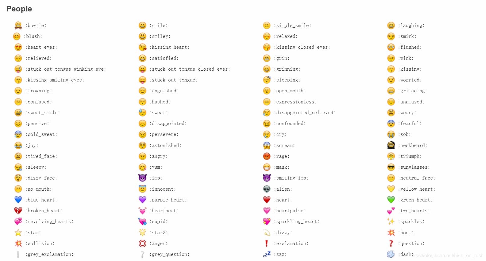

> 迁移来源 [博客园原文](https://www.cnblogs.com/xiuzhublog/p/12960603.html) · 原文发布于 `2020-05-25 20:08:00`（UTC+8）
> 旧文归档，保留当时的记录。

找到了一个网站 <https://www.webfx.com/tools/emoji-cheat-sheet/> ，直接把表情对应的符号复制粘贴就行了。  
比如`:joy:`显示为😂  
部分截图：  
  

