> 迁移来源 [博客园原文](https://www.cnblogs.com/xiuzhublog/p/12961369.html) · 原文发布于 `2020-05-25 22:36:00`（UTC+8）
> 旧文归档，保留当时的记录。

[SQL语句中文教程](https://www.w3school.com.cn/sql/index.asp)

## 知识

### 数据库系统原理

#### 事务

##### 概念

事务指的是满足 ACID 特性的一组操作，可以通过 Commit 提交一个事务，也可以使用 Rollback 进行回滚。  
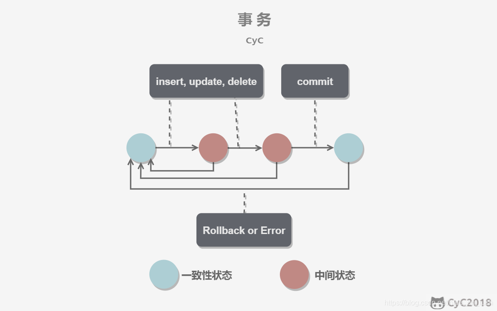

##### ACID

###### 1. 原子性（Atomicity）

事务被视为不可分割的最小单元，事务的所有操作要么全部提交成功，要么全部失败回滚。

回滚可以用回滚日志（Undo Log）来实现，回滚日志记录着事务所执行的修改操作，在回滚时反向执行这些修改操作即可。

###### 2. 一致性（Consistency）

数据库在事务执行前后都保持一致性状态。在一致性状态下，所有事务对同一个数据的读取结果都是相同的。

###### 3. 隔离性（Isolation）

一个事务所做的修改在最终提交以前，对其它事务是不可见的。

###### 4. 持久性（Durability）

一旦事务提交，则其所做的修改将会永远保存到数据库中。即使系统发生崩溃，事务执行的结果也不能丢失。

系统发生奔溃可以用重做日志（Redo Log）进行恢复，从而实现持久性。与回滚日志记录数据的逻辑修改不同，重做日志记录的是数据页的物理修改。

##### ACID关系

事务的 ACID 特性概念简单，但不是很好理解，主要是因为这几个特性不是一种平级关系：

- 只有满足一致性，事务的执行结果才是正确的。
- 在无并发的情况下，事务串行执行，隔离性一定能够满足。此时只要能满足  
  原子性，就一定能满足一致性。
- 在并发的情况下，多个事务并行执行，事务不仅要满足原子性，还需要满足隔离性，才能满足一致性。
- 事务满足持久化是为了能应对系统崩溃的情况。  
  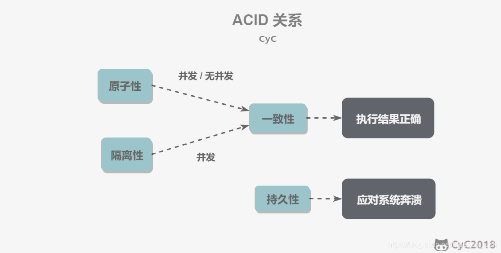

##### AUTOCOMMIT

MySQL 默认采用自动提交模式。也就是说，如果不显式使用START TRANSACTION语句来开始一个事务，那么每个查询操作都会被当做一个事务并自动提交。

#### 并发一致性问题

在并发环境下，事务的隔离性很难保证，因此会出现很多并发一致性问题。

##### 丢失修改

T1 和 T2 两个事务都对一个数据进行修改，T1 先修改，T2 随后修改，T2 的修改覆盖了 T1 的修改。  
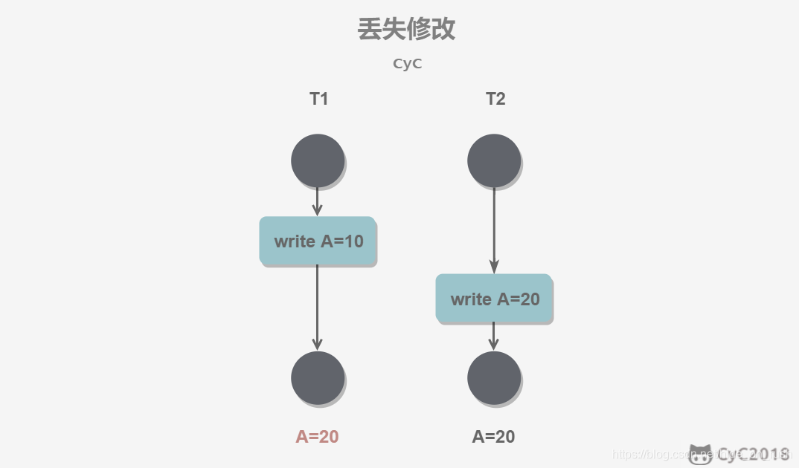

##### 读脏数据

T1 修改一个数据，T2 随后读取这个数据。如果 T1 撤销了这次修改，那么 T2 读取的数据是脏数据。  
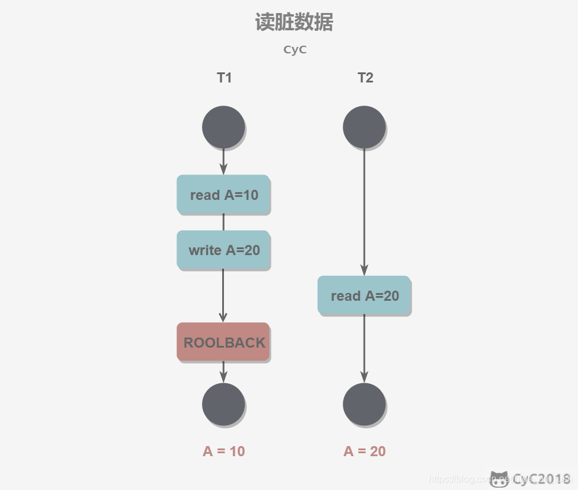

##### 不可重复读

T2 读取一个数据，T1 对该数据做了修改。如果 T2 再次读取这个数据，此时读取的结果和第一次读取的结果不同。  
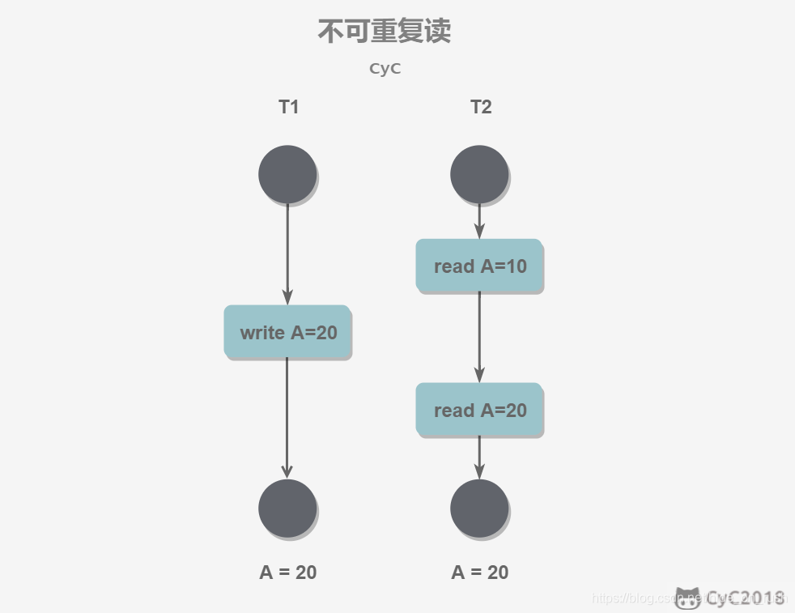

##### 幻影读

T1 读取某个范围的数据，T2 在这个范围内插入新的数据，T1 再次读取这个范围的数据，此时读取的结果和和第一次读取的结果不同。  
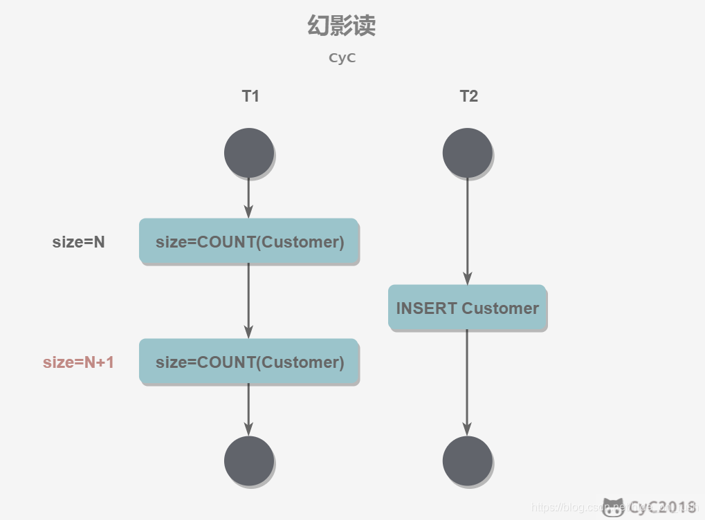  
产生并发不一致性问题的主要原因是破坏了事务的隔离性，解决方法是通过并发控制来保证隔离性。并发控制可以通过封锁来实现，但是封锁操作需要用户自己控制，相当复杂。数据库管理系统提供了事务的隔离级别，让用户以一种更轻松的方式处理并发一致性问题。

#### 封锁

##### 封锁粒度

MySQL 中提供了两种封锁粒度：行级锁以及表级锁。

应该尽量只锁定需要修改的那部分数据，而不是所有的资源。锁定的数据量越少，发生锁争用的可能就越小，系统的并发程度就越高。

但是加锁需要消耗资源，锁的各种操作（包括获取锁、释放锁、以及检查锁状态）都会增加系统开销。因此封锁粒度越小，系统开销就越大。

在选择封锁粒度时，需要在锁开销和并发程度之间做一个权衡。

##### 封锁类型

###### 1.读写锁

- 互斥锁（Exclusive），简写为 X 锁，又称写锁。
- 共享锁（Shared），简写为 S 锁，又称读锁。  
  有以下两个规定：
- 一个事务对数据对象 A 加了 X 锁，就可以对 A 进行读取和更新。加锁期间其它事务不能对 A 加任何锁。
- 一个事务对数据对象 A 加了 S 锁，可以对 A 进行读取操作，但是不能进行更新操作。加锁期间其它事务能对 A 加 S 锁，但是不能加 X 锁。  
  锁的兼容关系如下：  
  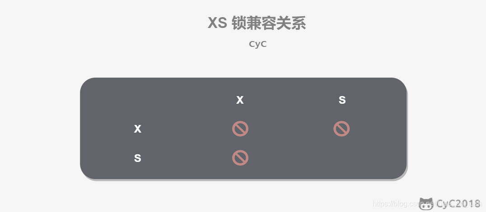

###### 2.意向锁

使用意向锁（Intention Locks）可以更容易地支持多粒度封锁。

在存在行级锁和表级锁的情况下，事务 T 想要对表 A 加 X 锁，就需要先检测是否有其它事务对表 A 或者表 A 中的任意一行加了锁，那么就需要对表 A 的每一行都检测一次，这是非常耗时的。

意向锁在原来的 X/S 锁之上引入了 IX/IS，IX/IS 都是表锁，用来表示一个事务想要在表中的某个数据行上加 X 锁或 S 锁。有以下两个规定：

- 一个事务在获得某个数据行对象的 S 锁之前，必须先获得表的 IS 锁或者更强的锁；
- 一个事务在获得某个数据行对象的 X 锁之前，必须先获得表的 IX 锁。  
  通过引入意向锁，事务 T 想要对表 A 加 X 锁，只需要先检测是否有其它事务对表 A 加了 X/IX/S/IS 锁，如果加了就表示有其它事务正在使用这个表或者表中某一行的锁，因此事务 T 加 X 锁失败。  
  各种锁的兼容关系如下：  
  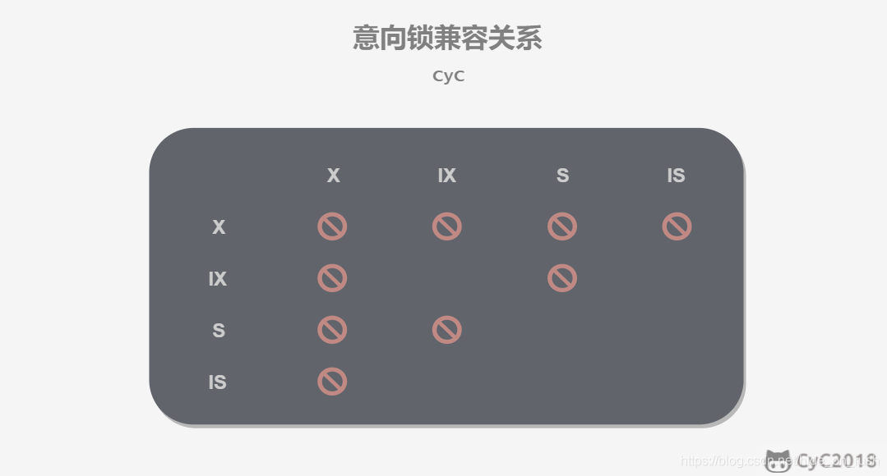  
  解释如下：
- 任意 IS/IX 锁之间都是兼容的，因为它们只表示想要对表加锁，而不是真正加锁；
- 这里兼容关系针对的是表级锁，而表级的 IX 锁和行级的 X 锁兼容，两个事务可以对两个数据行加 X 锁。（事务 T1 想要对数据行 R1 加 X 锁，事务 T2 想要对同一个表的数据行 R2 加 X 锁，两个事务都需要对该表加 IX 锁，但是 IX 锁是兼容的，并且 IX 锁与行级的 X 锁也是兼容的，因此两个事务都能加锁成功，对同一个表中的两个数据行做修改。）

##### 封锁协议

###### 1. 三级封锁协议

###### 一级封锁协议

事务 T 要修改数据 A 时必须加 X 锁，直到 T 结束才释放锁。

可以解决丢失修改问题，因为不能同时有两个事务对同一个数据进行修改，那么事务的修改就不会被覆盖。  
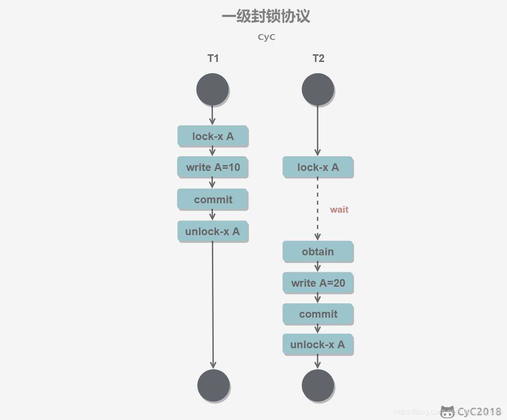

###### 二级封锁协议

在一级的基础上，要求读取数据 A 时必须加 S 锁，读取完马上释放 S 锁。

可以解决读脏数据问题，因为如果一个事务在对数据 A 进行修改，根据 1 级封锁协议，会加 X 锁，那么就不能再加 S 锁了，也就是不会读入数据。  
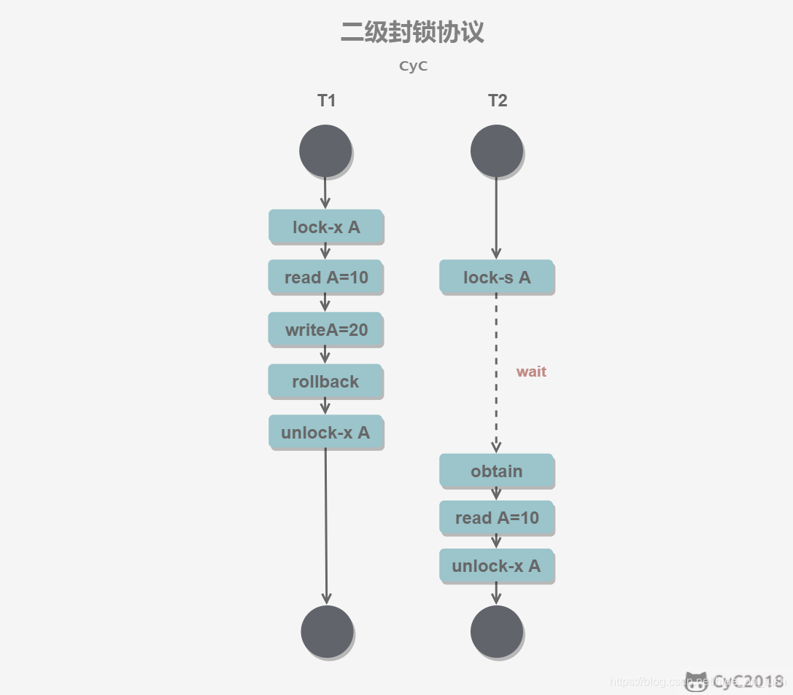

###### 三级封锁协议

在二级的基础上，要求读取数据 A 时必须加 S 锁，直到事务结束了才能释放 S 锁。

可以解决不可重复读的问题，因为读 A 时，其它事务不能对 A 加 X 锁，从而避免了在读的期间数据发生改变。  
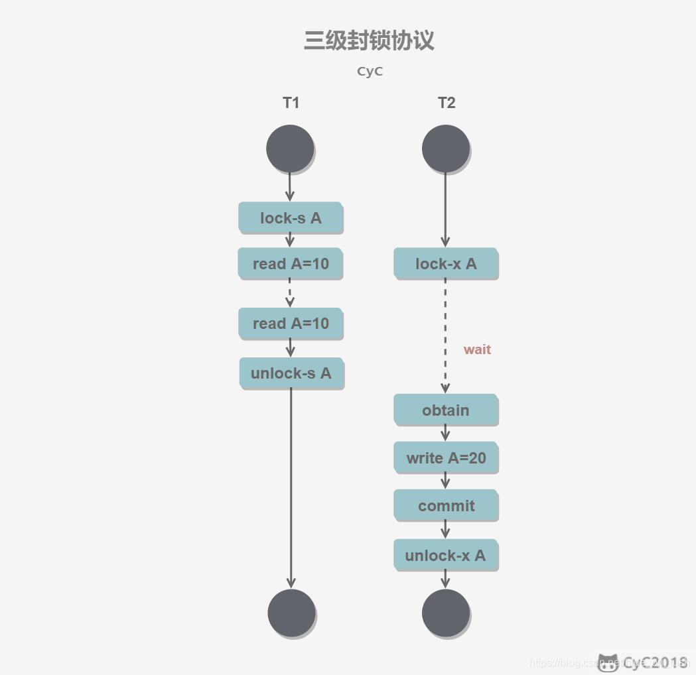

###### 2. 两段锁协议

加锁和解锁分为两个阶段进行。

可串行化调度是指，通过并发控制，使得并发执行的事务结果与某个串行执行的事务结果相同。串行执行的事务互不干扰，不会出现并发一致性问题。

事务遵循两段锁协议是保证可串行化调度的充分条件。例如以下操作满足两段锁协议，它是可串行化调度。

```bash
lock-x(A)...lock-s(B)...lock-s(C)...unlock(A)...unlock(C)...unlock(B)
```

但不是必要条件，例如以下操作不满足两段锁协议，但它还是可串行化调度。

```bash
lock-x(A)...unlock(A)...lock-s(B)...unlock(B)...lock-s(C)...unlock(C)
```

##### MySQL 隐式与显示锁定

MySQL 的 InnoDB 存储引擎采用两段锁协议，会根据隔离级别在需要的时候自动加锁，并且所有的锁都是在同一时刻被释放，这被称为隐式锁定。

InnoDB 也可以使用特定的语句进行显示锁定：

```bash
SELECT ... LOCK In SHARE MODE;
SELECT ... FOR UPDATE;
```

#### 隔离级别

##### 未提交读（READ UNCOMMITTED）

事务中的修改，即使没有提交，对其它事务也是可见的。  
最低的隔离级别，允许读取尚未提交的数据变更，可能会导致脏读、幻读或不可重复读。

##### 提交读（READ COMMITTED）

一个事务只能读取已经提交的事务所做的修改。换句话说，一个事务所做的修改在提交之前对其它事务是不可见的。  
允许读取并发事务已经提交的数据，可以阻止脏读，但是幻读或不可重复读仍有可能发生。

##### 可重复读（REPEATABLE READ）

保证在同一个事务中多次读取同一数据的结果是一样的。  
对同一字段的多次读取结果都是一致的，除非数据是被本身事务自己所修改，可以阻止脏读和不可重复读，但幻读仍有可能发生。

##### 可串行化（SERIALIZABLE）

强制事务串行执行，这样多个事务互不干扰，不会出现并发一致性问题。

该隔离级别需要加锁实现，因为要使用加锁机制保证同一时间只有一个事务执行，也就是保证事务串行执行。  
最高的隔离级别，完全服从ACID的隔离级别。所有的事务依次逐个执行，这样事务之间就完全不可能产生干扰，也就是说，该级别可以防止脏读、不可重复读以及幻读。  
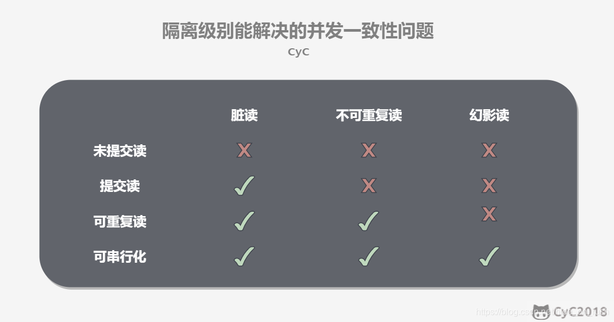

#### 多版本并发控制

多版本并发控制（Multi-Version Concurrency Control, MVCC）是 MySQL 的 InnoDB 存储引擎实现隔离级别的一种具体方式，用于实现提交读和可重复读这两种隔离级别。而未提交读隔离级别总是读取最新的数据行，要求很低，无需使用 MVCC。可串行化隔离级别需要对所有读取的行都加锁，单纯使用 MVCC 无法实现。

##### 基本思想

在封锁一节中提到，加锁能解决多个事务同时执行时出现的并发一致性问题。在实际场景中读操作往往多于写操作，因此又引入了读写锁来避免不必要的加锁操作，例如读和读没有互斥关系。读写锁中读和写操作仍然是互斥的，而 MVCC 利用了多版本的思想，写操作更新最新的版本快照，而读操作去读旧版本快照，没有互斥关系，这一点和 CopyOnWrite 类似。

在 MVCC 中事务的修改操作（DELETE、INSERT、UPDATE）会为数据行新增一个版本快照。

脏读和不可重复读最根本的原因是事务读取到其它事务未提交的修改。在事务进行读取操作时，为了解决脏读和不可重复读问题，MVCC 规定只能读取已经提交的快照。当然一个事务可以读取自身未提交的快照，这不算是脏读。

##### 版本号

- 系统版本号 SYS\_ID：是一个递增的数字，每开始一个新的事务，系统版本号就会自动递增。
- 事务版本号 TRX\_ID ：事务开始时的系统版本号。

##### Undo 日志

MVCC 的多版本指的是多个版本的快照，快照存储在 Undo 日志中，该日志通过回滚指针 ROLL\_PTR 把一个数据行的所有快照连接起来。

例如在 MySQL 创建一个表 t，包含主键 id 和一个字段 x。我们先插入一个数据行，然后对该数据行执行两次更新操作。

```bash
INSERT INTO t(id, x) VALUES(1, "a");
UPDATE t SET x="b" WHERE id=1;
UPDATE t SET x="c" WHERE id=1;
```

因为没有使用 START TRANSACTION 将上面的操作当成一个事务来执行，根据 MySQL 的 AUTOCOMMIT 机制，每个操作都会被当成一个事务来执行，所以上面的操作总共涉及到三个事务。快照中除了记录事务版本号 TRX\_ID 和操作之外，还记录了一个 bit 的 DEL 字段，用于标记是否被删除。  
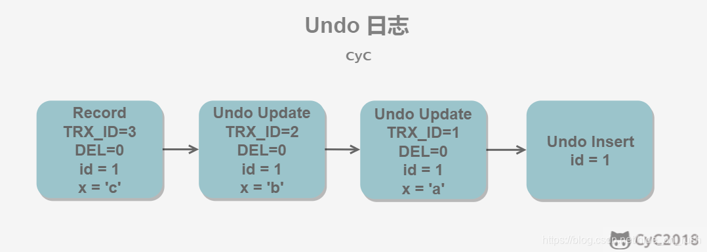  
INSERT、UPDATE、DELETE 操作会创建一个日志，并将事务版本号 TRX\_ID 写入。DELETE 可以看成是一个特殊的 UPDATE，还会额外将 DEL 字段设置为 1。

##### ReadView

MVCC 维护了一个 ReadView 结构，主要包含了当前系统未提交的事务列表 TRX\_IDs {TRX\_ID\_1, TRX\_ID\_2, ...}，还有该列表的最小值 TRX\_ID\_MIN 和 TRX\_ID\_MAX。  
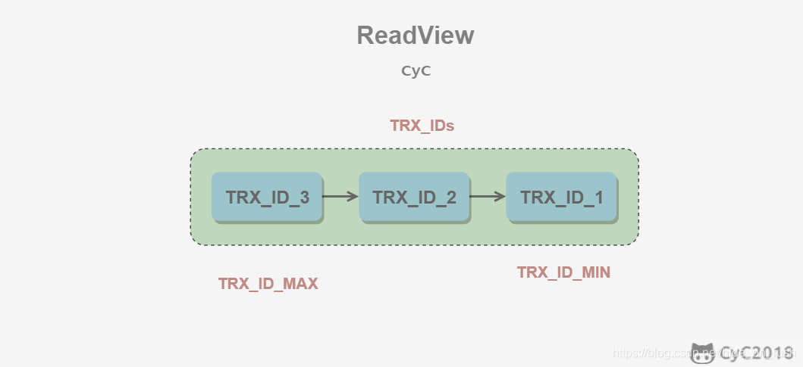  
在进行 SELECT 操作时，根据数据行快照的 TRX\_ID 与 TRX\_ID\_MIN 和 TRX\_ID\_MAX 之间的关系，从而判断数据行快照是否可以使用：

- TRX\_ID < TRX\_ID\_MIN，表示该数据行快照时在当前所有未提交事务之前进行更改的，因此可以使用。
- TRX\_ID > TRX\_ID\_MAX，表示该数据行快照是在事务启动之后被更改的，因此不可使用。
- TRX\_ID\_MIN <= TRX\_ID <= TRX\_ID\_MAX，需要根据隔离级别再进行判断：  
  1.提交读：如果 TRX\_ID 在 TRX\_IDs 列表中，表示该数据行快照对应的事务还未提交，则该快照不可使用。否则表示已经提交，可以使用。  
  2.可重复读：都不可以使用。因为如果可以使用的话，那么其它事务也可以读到这个数据行快照并进行修改，那么当前事务再去读这个数据行得到的值就会发生改变，也就是出现了不可重复读问题。  
  在数据行快照不可使用的情况下，需要沿着 Undo Log 的回滚指针 ROLL\_PTR 找到下一个快照，再进行上面的判断。

##### 快照读与当前读

###### 1. 快照读

MVCC 的 SELECT 操作是快照中的数据，不需要进行加锁操作。

```bash
SELECT * FROM table ...;
```

###### 2. 当前读

MVCC 其它会对数据库进行修改的操作（INSERT、UPDATE、DELETE）需要进行加锁操作，从而读取最新的数据。可以看到 MVCC 并不是完全不用加锁，而只是避免了 SELECT 的加锁操作。

```sql
INSERT;
UPDATE;
DELETE;
```

在进行 SELECT 操作时，可以强制指定进行加锁操作。以下第一个语句需要加 S 锁，第二个需要加 X 锁。

```sql
SELECT * FROM table WHERE ? lock in share mode;
SELECT * FROM table WHERE ? for update;
```

#### Next-Key Locks

Next-Key Locks 是 MySQL 的 InnoDB 存储引擎的一种锁实现。

MVCC 不能解决幻影读问题，Next-Key Locks 就是为了解决这个问题而存在的。在可重复读（REPEATABLE READ）隔离级别下，使用 MVCC + Next-Key Locks 可以解决幻读问题。

##### Record Locks

锁定一个记录上的索引，而不是记录本身。

如果表没有设置索引，InnoDB 会自动在主键上创建隐藏的聚簇索引，因此 Record Locks 依然可以使用。

##### Gap Locks

锁定索引之间的间隙，但是不包含索引本身。例如当一个事务执行以下语句，其它事务就不能在 t.c 中插入 15。

```sql
SELECT c FROM t WHERE c BETWEEN 10 and 20 FOR UPDATE;
```

##### Next-Key Locks

它是 Record Locks 和 Gap Locks 的结合，不仅锁定一个记录上的索引，也锁定索引之间的间隙。它锁定一个前开后闭区间，例如一个索引包含以下值：10, 11, 13, and 20，那么就需要锁定以下区间：

```sql
(-∞, 10]
(10, 11]
(11, 13]
(13, 20]
(20, +∞)
```

#### 关系数据库设计理论

##### 函数依赖

记 A->B 表示 A 函数决定 B，也可以说 B 函数依赖于 A。

如果 {A1，A2，... ，An} 是关系的一个或多个属性的集合，该集合函数决定了关系的其它所有属性并且是最小的，那么该集合就称为键码。

对于 A->B，如果能找到 A 的真子集 A'，使得 A'-> B，那么 A->B 就是部分函数依赖，否则就是完全函数依赖。

对于 A->B，B->C，则 A->C 是一个传递函数依赖。

##### 异常

以下的学生课程关系的函数依赖为 {Sno, Cname} -> {Sname, Sdept, Mname, Grade}，键码为 {Sno, Cname}。也就是说，确定学生和课程之后，就能确定其它信息。

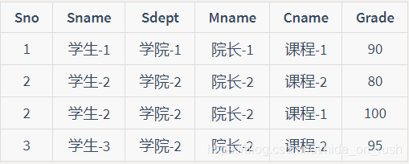  
不符合范式的关系，会产生很多异常，主要有以下四种异常：

- 冗余数据：例如 学生-2 出现了两次。
- 修改异常：修改了一个记录中的信息，但是另一个记录中相同的信息却没有被修改。
- 删除异常：删除一个信息，那么也会丢失其它信息。例如删除了 课程-1 需要删除第一行和第三行，那么 学生-1 的信息就会丢失。
- 插入异常：例如想要插入一个学生的信息，如果这个学生还没选课，那么就无法插入。

##### 范式

范式理论是为了解决以上提到四种异常。

高级别范式的依赖于低级别的范式，1NF 是最低级别的范式。

###### 1. 第一范式 (1NF)

属性不可分。

###### 2. 第二范式 (2NF)

每个非主属性完全函数依赖于键码。

可以通过分解来满足。

###### 分解前

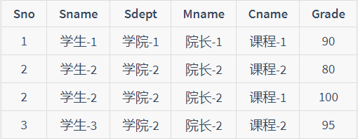  
以上学生课程关系中，{Sno, Cname} 为键码，有如下函数依赖：

- Sno -> Sname, Sdept
- Sdept -> Mname
- Sno, Cname-> Grade  
  Grade 完全函数依赖于键码，它没有任何冗余数据，每个学生的每门课都有特定的成绩。

Sname, Sdept 和 Mname 都部分依赖于键码，当一个学生选修了多门课时，这些数据就会出现多次，造成大量冗余数据。

###### 分解后

关系-1  
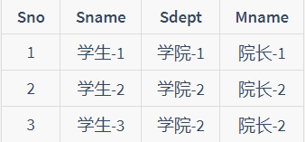  
有以下函数依赖：

- Sno -> Sname, Sdept
- Sdept -> Mname  
  关系-2  
  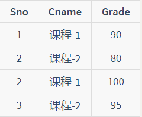  
  有以下函数依赖：
- Sno, Cname -> Grade

###### 3. 第三范式 (3NF)

非主属性不传递函数依赖于键码。

上面的 关系-1 中存在以下传递函数依赖：

- Sno -> Sdept -> Mname  
  可以进行以下分解：

###### 关系-11

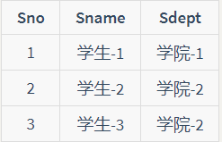

###### 关系-12

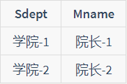

#### ER 图

Entity-Relationship，有三个组成部分：实体、属性、联系。

用来进行关系型数据库系统的概念设计。

##### 实体的三种联系

包含一对一，一对多，多对多三种。

- 如果 A 到 B 是一对多关系，那么画个带箭头的线段指向 B；
- 如果是一对一，画两个带箭头的线段；
- 如果是多对多，画两个不带箭头的线段。  
  下图的 Course 和 Student 是一对多的关系。  
  

##### 表示出现多次的关系

一个实体在联系出现几次，就要用几条线连接。

下图表示一个课程的先修关系，先修关系出现两个 Course 实体，第一个是先修课程，后一个是后修课程，因此需要用两条线来表示这种关系。  
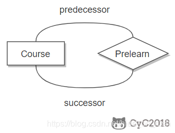

##### 联系的多向性

虽然老师可以开设多门课，并且可以教授多名学生，但是对于特定的学生和课程，只有一个老师教授，这就构成了一个三元联系。  
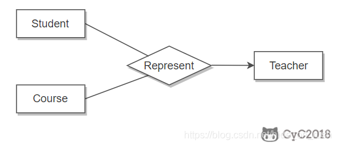

##### 表示子类

用一个三角形和两条线来连接类和子类，与子类有关的属性和联系都连到子类上，而与父类和子类都有关的连到父类上。  
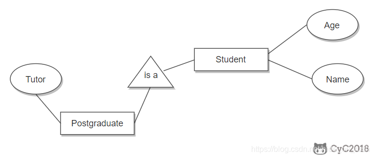

## 命令

### 基本操作

```sql
/* Windows服务 */
-- 启动MySQL
    net start mysql
-- 创建Windows服务
    sc create mysql binPath= mysqld_bin_path(注意：等号与值之间有空格)
/* 连接与断开服务器 */
mysql -h 地址 -P 端口 -u 用户名 -p 密码
SHOW PROCESSLIST -- 显示哪些线程正在运行
SHOW VARIABLES -- 显示系统变量信息
```

### 数据库操作

```sql
/* 数据库操作 */ ------------------
-- 查看当前数据库
    SELECT DATABASE();
-- 显示当前时间、用户名、数据库版本
    SELECT now(), user(), version();
-- 创建库
    CREATE DATABASE[ IF NOT EXISTS] 数据库名 数据库选项
    数据库选项：
        CHARACTER SET charset_name
        COLLATE collation_name
-- 查看已有库
    SHOW DATABASES[ LIKE 'PATTERN']
-- 查看当前库信息
    SHOW CREATE DATABASE 数据库名
-- 修改库的选项信息
    ALTER DATABASE 库名 选项信息
-- 删除库
    DROP DATABASE[ IF EXISTS] 数据库名
        同时删除该数据库相关的目录及其目录内容
```

### 表的操作

```sql
-- 创建表
    CREATE [TEMPORARY] TABLE[ IF NOT EXISTS] [库名.]表名 ( 表的结构定义 )[ 表选项]
        每个字段必须有数据类型
        最后一个字段后不能有逗号
        TEMPORARY 临时表，会话结束时表自动消失
        对于字段的定义：
            字段名 数据类型 [NOT NULL | NULL] [DEFAULT default_value] [AUTO_INCREMENT] [UNIQUE [KEY] | [PRIMARY] KEY] [COMMENT 'string']
-- 表选项
    -- 字符集
        CHARSET = charset_name
        如果表没有设定，则使用数据库字符集
    -- 存储引擎
        ENGINE = engine_name
        表在管理数据时采用的不同的数据结构，结构不同会导致处理方式、提供的特性操作等不同
        常见的引擎：InnoDB MyISAM Memory/Heap BDB Merge Example CSV MaxDB Archive
        不同的引擎在保存表的结构和数据时采用不同的方式
        MyISAM表文件含义：.frm表定义，.MYD表数据，.MYI表索引
        InnoDB表文件含义：.frm表定义，表空间数据和日志文件
        SHOW ENGINES -- 显示存储引擎的状态信息
        SHOW ENGINE 引擎名 {LOGS|STATUS} -- 显示存储引擎的日志或状态信息
    -- 自增起始数
        AUTO_INCREMENT = 行数
    -- 数据文件目录
        DATA DIRECTORY = '目录'
    -- 索引文件目录
        INDEX DIRECTORY = '目录'
    -- 表注释
        COMMENT = 'string'
    -- 分区选项
        PARTITION BY ... (详细见手册)
-- 查看所有表
    SHOW TABLES[ LIKE 'pattern']
    SHOW TABLES FROM  库名
-- 查看表结构
    SHOW CREATE TABLE 表名 （信息更详细）
    DESC 表名 / DESCRIBE 表名 / EXPLAIN 表名 / SHOW COLUMNS FROM 表名 [LIKE 'PATTERN']
    SHOW TABLE STATUS [FROM db_name] [LIKE 'pattern']
-- 修改表
    -- 修改表本身的选项
        ALTER TABLE 表名 表的选项
        eg: ALTER TABLE 表名 ENGINE=MYISAM;
    -- 对表进行重命名
        RENAME TABLE 原表名 TO 新表名
        RENAME TABLE 原表名 TO 库名.表名 （可将表移动到另一个数据库）
        -- RENAME可以交换两个表名
    -- 修改表的字段机构（13.1.2. ALTER TABLE语法）
        ALTER TABLE 表名 操作名
        -- 操作名
            ADD[ COLUMN] 字段定义       -- 增加字段
                AFTER 字段名          -- 表示增加在该字段名后面
                FIRST               -- 表示增加在第一个
            ADD PRIMARY KEY(字段名)   -- 创建主键
            ADD UNIQUE [索引名] (字段名)-- 创建唯一索引
            ADD INDEX [索引名] (字段名) -- 创建普通索引
            DROP[ COLUMN] 字段名      -- 删除字段
            MODIFY[ COLUMN] 字段名 字段属性     -- 支持对字段属性进行修改，不能修改字段名(所有原有属性也需写上)
            CHANGE[ COLUMN] 原字段名 新字段名 字段属性      -- 支持对字段名修改
            DROP PRIMARY KEY    -- 删除主键(删除主键前需删除其AUTO_INCREMENT属性)
            DROP INDEX 索引名 -- 删除索引
            DROP FOREIGN KEY 外键    -- 删除外键
-- 删除表
    DROP TABLE[ IF EXISTS] 表名 ...
-- 清空表数据
    TRUNCATE [TABLE] 表名
-- 复制表结构
    CREATE TABLE 表名 LIKE 要复制的表名
-- 复制表结构和数据
    CREATE TABLE 表名 [AS] SELECT * FROM 要复制的表名
-- 检查表是否有错误
    CHECK TABLE tbl_name [, tbl_name] ... [option] ...
-- 优化表
    OPTIMIZE [LOCAL | NO_WRITE_TO_BINLOG] TABLE tbl_name [, tbl_name] ...
-- 修复表
    REPAIR [LOCAL | NO_WRITE_TO_BINLOG] TABLE tbl_name [, tbl_name] ... [QUICK] [EXTENDED] [USE_FRM]
-- 分析表
    ANALYZE [LOCAL | NO_WRITE_TO_BINLOG] TABLE tbl_name [, tbl_name] ...
```

### 数据操作

```sql
/* 数据操作 */ ------------------
-- 增
    INSERT [INTO] 表名 [(字段列表)] VALUES (值列表)[, (值列表), ...]
        -- 如果要插入的值列表包含所有字段并且顺序一致，则可以省略字段列表。
        -- 可同时插入多条数据记录！
        REPLACE 与 INSERT 完全一样，可互换。
    INSERT [INTO] 表名 SET 字段名=值[, 字段名=值, ...]
-- 查
    SELECT 字段列表 FROM 表名[ 其他子句]
        -- 可来自多个表的多个字段
        -- 其他子句可以不使用
        -- 字段列表可以用*代替，表示所有字段
-- 删
    DELETE FROM 表名[ 删除条件子句]
        没有条件子句，则会删除全部
-- 改
    UPDATE 表名 SET 字段名=新值[, 字段名=新值] [更新条件]
```

### 字符集编码

```sql
/* 字符集编码 */ ------------------
-- MySQL、数据库、表、字段均可设置编码
-- 数据编码与客户端编码不需一致
SHOW VARIABLES LIKE 'character_set_%'   -- 查看所有字符集编码项
    character_set_client        客户端向服务器发送数据时使用的编码
    character_set_results       服务器端将结果返回给客户端所使用的编码
    character_set_connection    连接层编码
SET 变量名 = 变量值
    SET character_set_client = gbk;
    SET character_set_results = gbk;
    SET character_set_connection = gbk;
SET NAMES GBK;  -- 相当于完成以上三个设置
-- 校对集
    校对集用以排序
    SHOW CHARACTER SET [LIKE 'pattern']/SHOW CHARSET [LIKE 'pattern']   查看所有字符集
    SHOW COLLATION [LIKE 'pattern']     查看所有校对集
    CHARSET 字符集编码     设置字符集编码
    COLLATE 校对集编码     设置校对集编码
```

### 数据类型(列类型)

```sql
/* 数据类型（列类型） */ ------------------
1. 数值类型
-- a. 整型 ----------
    类型         字节     范围（有符号位）
    tinyint     1字节    -128 ~ 127      无符号位：0 ~ 255
    smallint    2字节    -32768 ~ 32767
    mediumint   3字节    -8388608 ~ 8388607
    int         4字节
    bigint      8字节
    int(M)  M表示总位数
    - 默认存在符号位，unsigned 属性修改
    - 显示宽度，如果某个数不够定义字段时设置的位数，则前面以0补填，zerofill 属性修改
        例：int(5)   插入一个数'123'，补填后为'00123'
    - 在满足要求的情况下，越小越好。
    - 1表示bool值真，0表示bool值假。MySQL没有布尔类型，通过整型0和1表示。常用tinyint(1)表示布尔型。
-- b. 浮点型 ----------
    类型             字节     范围
    float(单精度)     4字节
    double(双精度)    8字节
    浮点型既支持符号位 unsigned 属性，也支持显示宽度 zerofill 属性。
        不同于整型，前后均会补填0.
    定义浮点型时，需指定总位数和小数位数。
        float(M, D)     double(M, D)
        M表示总位数，D表示小数位数。
        M和D的大小会决定浮点数的范围。不同于整型的固定范围。
        M既表示总位数（不包括小数点和正负号），也表示显示宽度（所有显示符号均包括）。
        支持科学计数法表示。
        浮点数表示近似值。
-- c. 定点数 ----------
    decimal -- 可变长度
    decimal(M, D)   M也表示总位数，D表示小数位数。
    保存一个精确的数值，不会发生数据的改变，不同于浮点数的四舍五入。
    将浮点数转换为字符串来保存，每9位数字保存为4个字节。
2. 字符串类型
-- a. char, varchar ----------
    char    定长字符串，速度快，但浪费空间
    varchar 变长字符串，速度慢，但节省空间
    M表示能存储的最大长度，此长度是字符数，非字节数。
    不同的编码，所占用的空间不同。
    char,最多255个字符，与编码无关。
    varchar,最多65535字符，与编码有关。
    一条有效记录最大不能超过65535个字节。
        utf8 最大为21844个字符，gbk 最大为32766个字符，latin1 最大为65532个字符
    varchar 是变长的，需要利用存储空间保存 varchar 的长度，如果数据小于255个字节，则采用一个字节来保存长度，反之需要两个字节来保存。
    varchar 的最大有效长度由最大行大小和使用的字符集确定。
    最大有效长度是65532字节，因为在varchar存字符串时，第一个字节是空的，不存在任何数据，然后还需两个字节来存放字符串的长度，所以有效长度是65535-1-2=65532字节。
    例：若一个表定义为 CREATE TABLE tb(c1 int, c2 char(30), c3 varchar(N)) charset=utf8; 问N的最大值是多少？ 答：(65535-1-2-4-30*3)/3
-- b. blob, text ----------
    blob 二进制字符串（字节字符串）
        tinyblob, blob, mediumblob, longblob
    text 非二进制字符串（字符字符串）
        tinytext, text, mediumtext, longtext
    text 在定义时，不需要定义长度，也不会计算总长度。
    text 类型在定义时，不可给default值
-- c. binary, varbinary ----------
    类似于char和varchar，用于保存二进制字符串，也就是保存字节字符串而非字符字符串。
    char, varchar, text 对应 binary, varbinary, blob.
3. 日期时间类型
    一般用整型保存时间戳，因为PHP可以很方便的将时间戳进行格式化。
    datetime    8字节    日期及时间     1000-01-01 00:00:00 到 9999-12-31 23:59:59
    date        3字节    日期         1000-01-01 到 9999-12-31
    timestamp   4字节    时间戳        19700101000000 到 2038-01-19 03:14:07
    time        3字节    时间         -838:59:59 到 838:59:59
    year        1字节    年份         1901 - 2155
datetime    YYYY-MM-DD hh:mm:ss
timestamp   YY-MM-DD hh:mm:ss
            YYYYMMDDhhmmss
            YYMMDDhhmmss
            YYYYMMDDhhmmss
            YYMMDDhhmmss
date        YYYY-MM-DD
            YY-MM-DD
            YYYYMMDD
            YYMMDD
            YYYYMMDD
            YYMMDD
time        hh:mm:ss
            hhmmss
            hhmmss
year        YYYY
            YY
            YYYY
            YY
4. 枚举和集合
-- 枚举(enum) ----------
enum(val1, val2, val3...)
    在已知的值中进行单选。最大数量为65535.
    枚举值在保存时，以2个字节的整型(smallint)保存。每个枚举值，按保存的位置顺序，从1开始逐一递增。
    表现为字符串类型，存储却是整型。
    NULL值的索引是NULL。
    空字符串错误值的索引值是0。
-- 集合（set） ----------
set(val1, val2, val3...)
    create table tab ( gender set('男', '女', '无') );
    insert into tab values ('男, 女');
    最多可以有64个不同的成员。以bigint存储，共8个字节。采取位运算的形式。
    当创建表时，SET成员值的尾部空格将自动被删除。
```

### 列属性(列约束)

```sql
/* 列属性（列约束） */ ------------------
1. PRIMARY 主键
    - 能唯一标识记录的字段，可以作为主键。
    - 一个表只能有一个主键。
    - 主键具有唯一性。
    - 声明字段时，用 primary key 标识。
        也可以在字段列表之后声明
            例：create table tab ( id int, stu varchar(10), primary key (id));
    - 主键字段的值不能为null。
    - 主键可以由多个字段共同组成。此时需要在字段列表后声明的方法。
        例：create table tab ( id int, stu varchar(10), age int, primary key (stu, age));
2. UNIQUE 唯一索引（唯一约束）
    使得某字段的值也不能重复。
3. NULL 约束
    null不是数据类型，是列的一个属性。
    表示当前列是否可以为null，表示什么都没有。
    null, 允许为空。默认。
    not null, 不允许为空。
    insert into tab values (null, 'val');
        -- 此时表示将第一个字段的值设为null, 取决于该字段是否允许为null
4. DEFAULT 默认值属性
    当前字段的默认值。
    insert into tab values (default, 'val');    -- 此时表示强制使用默认值。
    create table tab ( add_time timestamp default current_timestamp );
        -- 表示将当前时间的时间戳设为默认值。
        current_date, current_time
5. AUTO_INCREMENT 自动增长约束
    自动增长必须为索引（主键或unique）
    只能存在一个字段为自动增长。
    默认为1开始自动增长。可以通过表属性 auto_increment = x进行设置，或 alter table tbl auto_increment = x;
6. COMMENT 注释
    例：create table tab ( id int ) comment '注释内容';
7. FOREIGN KEY 外键约束
    用于限制主表与从表数据完整性。
    alter table t1 add constraint `t1_t2_fk` foreign key (t1_id) references t2(id);
        -- 将表t1的t1_id外键关联到表t2的id字段。
        -- 每个外键都有一个名字，可以通过 constraint 指定
    存在外键的表，称之为从表（子表），外键指向的表，称之为主表（父表）。
    作用：保持数据一致性，完整性，主要目的是控制存储在外键表（从表）中的数据。
    MySQL中，可以对InnoDB引擎使用外键约束：
    语法：
    foreign key (外键字段） references 主表名 (关联字段) [主表记录删除时的动作] [主表记录更新时的动作]
    此时需要检测一个从表的外键需要约束为主表的已存在的值。外键在没有关联的情况下，可以设置为null.前提是该外键列，没有not null。
    可以不指定主表记录更改或更新时的动作，那么此时主表的操作被拒绝。
    如果指定了 on update 或 on delete：在删除或更新时，有如下几个操作可以选择：
    1. cascade，级联操作。主表数据被更新（主键值更新），从表也被更新（外键值更新）。主表记录被删除，从表相关记录也被删除。
    2. set null，设置为null。主表数据被更新（主键值更新），从表的外键被设置为null。主表记录被删除，从表相关记录外键被设置成null。但注意，要求该外键列，没有not null属性约束。
    3. restrict，拒绝父表删除和更新。
    注意，外键只被InnoDB存储引擎所支持。其他引擎是不支持的。
```

### 建表规范

```sql
/* 建表规范 */ ------------------
    -- Normal Format, NF
        - 每个表保存一个实体信息
        - 每个具有一个ID字段作为主键
        - ID主键 + 原子表
    -- 1NF, 第一范式
        字段不能再分，就满足第一范式。
    -- 2NF, 第二范式
        满足第一范式的前提下，不能出现部分依赖。
        消除复合主键就可以避免部分依赖。增加单列关键字。
    -- 3NF, 第三范式
        满足第二范式的前提下，不能出现传递依赖。
        某个字段依赖于主键，而有其他字段依赖于该字段。这就是传递依赖。
        将一个实体信息的数据放在一个表内实现。
```

### SELECT

```sql
/* SELECT */ ------------------
SELECT [ALL|DISTINCT] select_expr FROM -> WHERE -> GROUP BY [合计函数] -> HAVING -> ORDER BY -> LIMIT
a. select_expr
    -- 可以用 * 表示所有字段。
        select * from tb;
    -- 可以使用表达式（计算公式、函数调用、字段也是个表达式）
        select stu, 29+25, now() from tb;
    -- 可以为每个列使用别名。适用于简化列标识，避免多个列标识符重复。
        - 使用 as 关键字，也可省略 as.
        select stu+10 as add10 from tb;
b. FROM 子句
    用于标识查询来源。
    -- 可以为表起别名。使用as关键字。
        SELECT * FROM tb1 AS tt, tb2 AS bb;
    -- from子句后，可以同时出现多个表。
        -- 多个表会横向叠加到一起，而数据会形成一个笛卡尔积。
        SELECT * FROM tb1, tb2;
    -- 向优化符提示如何选择索引
        USE INDEX、IGNORE INDEX、FORCE INDEX
        SELECT * FROM table1 USE INDEX (key1,key2) WHERE key1=1 AND key2=2 AND key3=3;
        SELECT * FROM table1 IGNORE INDEX (key3) WHERE key1=1 AND key2=2 AND key3=3;
c. WHERE 子句
    -- 从from获得的数据源中进行筛选。
    -- 整型1表示真，0表示假。
    -- 表达式由运算符和运算数组成。
        -- 运算数：变量（字段）、值、函数返回值
        -- 运算符：
            =, <=>, <>, !=, <=, <, >=, >, !, &&, ||,
            in (not) null, (not) like, (not) in, (not) between and, is (not), and, or, not, xor
            is/is not 加上ture/false/unknown，检验某个值的真假
            <=>与<>功能相同，<=>可用于null比较
d. GROUP BY 子句, 分组子句
    GROUP BY 字段/别名 [排序方式]
    分组后会进行排序。升序：ASC，降序：DESC
    以下[合计函数]需配合 GROUP BY 使用：
    count 返回不同的非NULL值数目  count(*)、count(字段)
    sum 求和
    max 求最大值
    min 求最小值
    avg 求平均值
    group_concat 返回带有来自一个组的连接的非NULL值的字符串结果。组内字符串连接。
e. HAVING 子句，条件子句
    与 where 功能、用法相同，执行时机不同。
    where 在开始时执行检测数据，对原数据进行过滤。
    having 对筛选出的结果再次进行过滤。
    having 字段必须是查询出来的，where 字段必须是数据表存在的。
    where 不可以使用字段的别名，having 可以。因为执行WHERE代码时，可能尚未确定列值。
    where 不可以使用合计函数。一般需用合计函数才会用 having
    SQL标准要求HAVING必须引用GROUP BY子句中的列或用于合计函数中的列。
f. ORDER BY 子句，排序子句
    order by 排序字段/别名 排序方式 [,排序字段/别名 排序方式]...
    升序：ASC，降序：DESC
    支持多个字段的排序。
g. LIMIT 子句，限制结果数量子句
    仅对处理好的结果进行数量限制。将处理好的结果的看作是一个集合，按照记录出现的顺序，索引从0开始。
    limit 起始位置, 获取条数
    省略第一个参数，表示从索引0开始。limit 获取条数
h. DISTINCT, ALL 选项
    distinct 去除重复记录
    默认为 all, 全部记录
```

### UNION

```sql
/* UNION */ ------------------
    将多个select查询的结果组合成一个结果集合。
    SELECT ... UNION [ALL|DISTINCT] SELECT ...
    默认 DISTINCT 方式，即所有返回的行都是唯一的
    建议，对每个SELECT查询加上小括号包裹。
    ORDER BY 排序时，需加上 LIMIT 进行结合。
    需要各select查询的字段数量一样。
    每个select查询的字段列表(数量、类型)应一致，因为结果中的字段名以第一条select语句为准。
```

### 子查询

```sql
/* 子查询 */ ------------------
    - 子查询需用括号包裹。
-- from型
    from后要求是一个表，必须给子查询结果取个别名。
    - 简化每个查询内的条件。
    - from型需将结果生成一个临时表格，可用以原表的锁定的释放。
    - 子查询返回一个表，表型子查询。
    select * from (select * from tb where id>0) as subfrom where id>1;
-- where型
    - 子查询返回一个值，标量子查询。
    - 不需要给子查询取别名。
    - where子查询内的表，不能直接用以更新。
    select * from tb where money = (select max(money) from tb);
    -- 列子查询
        如果子查询结果返回的是一列。
        使用 in 或 not in 完成查询
        exists 和 not exists 条件
            如果子查询返回数据，则返回1或0。常用于判断条件。
            select column1 from t1 where exists (select * from t2);
    -- 行子查询
        查询条件是一个行。
        select * from t1 where (id, gender) in (select id, gender from t2);
        行构造符：(col1, col2, ...) 或 ROW(col1, col2, ...)
        行构造符通常用于与对能返回两个或两个以上列的子查询进行比较。
    -- 特殊运算符
    != all()    相当于 not in
    = some()    相当于 in。any 是 some 的别名
    != some()   不等同于 not in，不等于其中某一个。
    all, some 可以配合其他运算符一起使用。
```

### 连接查询(join)

```sql
/* 连接查询(join) */ ------------------
    将多个表的字段进行连接，可以指定连接条件。
-- 内连接(inner join)
    - 默认就是内连接，可省略inner。
    - 只有数据存在时才能发送连接。即连接结果不能出现空行。
    on 表示连接条件。其条件表达式与where类似。也可以省略条件（表示条件永远为真）
    也可用where表示连接条件。
    还有 using, 但需字段名相同。 using(字段名)
    -- 交叉连接 cross join
        即，没有条件的内连接。
        select * from tb1 cross join tb2;
-- 外连接(outer join)
    - 如果数据不存在，也会出现在连接结果中。
    -- 左外连接 left join
        如果数据不存在，左表记录会出现，而右表为null填充
    -- 右外连接 right join
        如果数据不存在，右表记录会出现，而左表为null填充
-- 自然连接(natural join)
    自动判断连接条件完成连接。
    相当于省略了using，会自动查找相同字段名。
    natural join
    natural left join
    natural right join
select info.id, info.name, info.stu_num, extra_info.hobby, extra_info.sex from info, extra_info where info.stu_num = extra_info.stu_id;
```

### TRUNCATE

```sql
/* TRUNCATE */ ------------------
TRUNCATE [TABLE] tbl_name
清空数据
删除重建表
区别：
1，truncate 是删除表再创建，delete 是逐条删除
2，truncate 重置auto_increment的值。而delete不会
3，truncate 不知道删除了几条，而delete知道。
4，当被用于带分区的表时，truncate 会保留分区
```

### 备份与还原

```sql
/* 备份与还原 */ ------------------
备份，将数据的结构与表内数据保存起来。
利用 mysqldump 指令完成。
-- 导出
mysqldump [options] db_name [tables]
mysqldump [options] ---database DB1 [DB2 DB3...]
mysqldump [options] --all--database
1. 导出一张表
　　mysqldump -u用户名 -p密码 库名 表名 > 文件名(D:/a.sql)
2. 导出多张表
　　mysqldump -u用户名 -p密码 库名 表1 表2 表3 > 文件名(D:/a.sql)
3. 导出所有表
　　mysqldump -u用户名 -p密码 库名 > 文件名(D:/a.sql)
4. 导出一个库
　　mysqldump -u用户名 -p密码 --lock-all-tables --database 库名 > 文件名(D:/a.sql)
可以-w携带WHERE条件
-- 导入
1. 在登录mysql的情况下：
　　source  备份文件
2. 在不登录的情况下
　　mysql -u用户名 -p密码 库名 < 备份文件
```

### 视图

```sql
什么是视图：
    视图是一个虚拟表，其内容由查询定义。同真实的表一样，视图包含一系列带有名称的列和行数据。但是，视图并不在数据库中以存储的数据值集形式存在。行和列数据来自由定义视图的查询所引用的表，并且在引用视图时动态生成。
    视图具有表结构文件，但不存在数据文件。
    对其中所引用的基础表来说，视图的作用类似于筛选。定义视图的筛选可以来自当前或其它数据库的一个或多个表，或者其它视图。通过视图进行查询没有任何限制，通过它们进行数据修改时的限制也很少。
    视图是存储在数据库中的查询的sql语句，它主要出于两种原因：安全原因，视图可以隐藏一些数据，如：社会保险基金表，可以用视图只显示姓名，地址，而不显示社会保险号和工资数等，另一原因是可使复杂的查询易于理解和使用。
-- 创建视图
CREATE [OR REPLACE] [ALGORITHM = {UNDEFINED | MERGE | TEMPTABLE}] VIEW view_name [(column_list)] AS select_statement
    - 视图名必须唯一，同时不能与表重名。
    - 视图可以使用select语句查询到的列名，也可以自己指定相应的列名。
    - 可以指定视图执行的算法，通过ALGORITHM指定。
    - column_list如果存在，则数目必须等于SELECT语句检索的列数
-- 查看结构
    SHOW CREATE VIEW view_name
-- 删除视图
    - 删除视图后，数据依然存在。
    - 可同时删除多个视图。
    DROP VIEW [IF EXISTS] view_name ...
-- 修改视图结构
    - 一般不修改视图，因为不是所有的更新视图都会映射到表上。
    ALTER VIEW view_name [(column_list)] AS select_statement
-- 视图作用
    1. 简化业务逻辑
    2. 对客户端隐藏真实的表结构
-- 视图算法(ALGORITHM)
    MERGE       合并
        将视图的查询语句，与外部查询需要先合并再执行！
    TEMPTABLE   临时表
        将视图执行完毕后，形成临时表，再做外层查询！
    UNDEFINED   未定义(默认)，指的是MySQL自主去选择相应的算法。
```

### 事务(transaction)

```sql
事务是指逻辑上的一组操作，组成这组操作的各个单元，要不全成功要不全失败。
    - 支持连续SQL的集体成功或集体撤销。
    - 事务是数据库在数据完整性方面的一个功能。
    - 需要利用 InnoDB 或 BDB 存储引擎，对自动提交的特性支持完成。
    - InnoDB被称为事务安全型引擎。
-- 事务开启
    START TRANSACTION; 或者 BEGIN;
    开启事务后，所有被执行的SQL语句均被认作当前事务内的SQL语句。
-- 事务提交
    COMMIT;
-- 事务回滚
    ROLLBACK;
    如果部分操作发生问题，映射到事务开启前。
-- 事务的特性
    1. 原子性（Atomicity）
        事务是一个不可分割的工作单位，事务中的操作要么都发生，要么都不发生。
    2. 一致性（Consistency）
        事务前后数据的完整性必须保持一致。
        - 事务开始和结束时，外部数据一致
        - 在整个事务过程中，操作是连续的
    3. 隔离性（Isolation）
        多个用户并发访问数据库时，一个用户的事务不能被其它用户的事物所干扰，多个并发事务之间的数据要相互隔离。
    4. 持久性（Durability）
        一个事务一旦被提交，它对数据库中的数据改变就是永久性的。
-- 事务的实现
    1. 要求是事务支持的表类型
    2. 执行一组相关的操作前开启事务
    3. 整组操作完成后，都成功，则提交；如果存在失败，选择回滚，则会回到事务开始的备份点。
-- 事务的原理
    利用InnoDB的自动提交(autocommit)特性完成。
    普通的MySQL执行语句后，当前的数据提交操作均可被其他客户端可见。
    而事务是暂时关闭“自动提交”机制，需要commit提交持久化数据操作。
-- 注意
    1. 数据定义语言（DDL）语句不能被回滚，比如创建或取消数据库的语句，和创建、取消或更改表或存储的子程序的语句。
    2. 事务不能被嵌套
-- 保存点
    SAVEPOINT 保存点名称 -- 设置一个事务保存点
    ROLLBACK TO SAVEPOINT 保存点名称 -- 回滚到保存点
    RELEASE SAVEPOINT 保存点名称 -- 删除保存点
-- InnoDB自动提交特性设置
    SET autocommit = 0|1;   0表示关闭自动提交，1表示开启自动提交。
    - 如果关闭了，那普通操作的结果对其他客户端也不可见，需要commit提交后才能持久化数据操作。
    - 也可以关闭自动提交来开启事务。但与START TRANSACTION不同的是，
        SET autocommit是永久改变服务器的设置，直到下次再次修改该设置。(针对当前连接)
        而START TRANSACTION记录开启前的状态，而一旦事务提交或回滚后就需要再次开启事务。(针对当前事务)
```

### 锁表

```sql
/* 锁表 */
表锁定只用于防止其它客户端进行不正当地读取和写入
MyISAM 支持表锁，InnoDB 支持行锁
-- 锁定
    LOCK TABLES tbl_name [AS alias]
-- 解锁
    UNLOCK TABLES
```

### 触发器

```sql
/* 触发器 */ ------------------
    触发程序是与表有关的命名数据库对象，当该表出现特定事件时，将激活该对象
    监听：记录的增加、修改、删除。
-- 创建触发器
CREATE TRIGGER trigger_name trigger_time trigger_event ON tbl_name FOR EACH ROW trigger_stmt
    参数：
    trigger_time是触发程序的动作时间。它可以是 before 或 after，以指明触发程序是在激活它的语句之前或之后触发。
    trigger_event指明了激活触发程序的语句的类型
        INSERT：将新行插入表时激活触发程序
        UPDATE：更改某一行时激活触发程序
        DELETE：从表中删除某一行时激活触发程序
    tbl_name：监听的表，必须是永久性的表，不能将触发程序与TEMPORARY表或视图关联起来。
    trigger_stmt：当触发程序激活时执行的语句。执行多个语句，可使用BEGIN...END复合语句结构
-- 删除
DROP TRIGGER [schema_name.]trigger_name
可以使用old和new代替旧的和新的数据
    更新操作，更新前是old，更新后是new.
    删除操作，只有old.
    增加操作，只有new.
-- 注意
    1. 对于具有相同触发程序动作时间和事件的给定表，不能有两个触发程序。
-- 字符连接函数
concat(str1,str2,...])
concat_ws(separator,str1,str2,...)
-- 分支语句
if 条件 then
    执行语句
elseif 条件 then
    执行语句
else
    执行语句
end if;
-- 修改最外层语句结束符
delimiter 自定义结束符号
    SQL语句
自定义结束符号
delimiter ;     -- 修改回原来的分号
-- 语句块包裹
begin
    语句块
end
-- 特殊的执行
1. 只要添加记录，就会触发程序。
2. Insert into on duplicate key update 语法会触发：
    如果没有重复记录，会触发 before insert, after insert;
    如果有重复记录并更新，会触发 before insert, before update, after update;
    如果有重复记录但是没有发生更新，则触发 before insert, before update
3. Replace 语法 如果有记录，则执行 before insert, before delete, after delete, after insert
```

### SQL编程

```sql
/* SQL编程 */ ------------------
--// 局部变量 ----------
-- 变量声明
    declare var_name[,...] type [default value]
    这个语句被用来声明局部变量。要给变量提供一个默认值，请包含一个default子句。值可以被指定为一个表达式，不需要为一个常数。如果没有default子句，初始值为null。
-- 赋值
    使用 set 和 select into 语句为变量赋值。
    - 注意：在函数内是可以使用全局变量（用户自定义的变量）
--// 全局变量 ----------
-- 定义、赋值
set 语句可以定义并为变量赋值。
set @var = value;
也可以使用select into语句为变量初始化并赋值。这样要求select语句只能返回一行，但是可以是多个字段，就意味着同时为多个变量进行赋值，变量的数量需要与查询的列数一致。
还可以把赋值语句看作一个表达式，通过select执行完成。此时为了避免=被当作关系运算符看待，使用:=代替。（set语句可以使用= 和 :=）。
select @var:=20;
select @v1:=id, @v2=name from t1 limit 1;
select * from tbl_name where @var:=30;
select into 可以将表中查询获得的数据赋给变量。
    -| select max(height) into @max_height from tb;
-- 自定义变量名
为了避免select语句中，用户自定义的变量与系统标识符（通常是字段名）冲突，用户自定义变量在变量名前使用@作为开始符号。
@var=10;
    - 变量被定义后，在整个会话周期都有效（登录到退出）
--// 控制结构 ----------
-- if语句
if search_condition then
    statement_list   
[elseif search_condition then
    statement_list]
...
[else
    statement_list]
end if;
-- case语句
CASE value WHEN [compare-value] THEN result
[WHEN [compare-value] THEN result ...]
[ELSE result]
END
-- while循环
[begin_label:] while search_condition do
    statement_list
end while [end_label];
- 如果需要在循环内提前终止 while循环，则需要使用标签；标签需要成对出现。
    -- 退出循环
        退出整个循环 leave
        退出当前循环 iterate
        通过退出的标签决定退出哪个循环
--// 内置函数 ----------
-- 数值函数
abs(x)          -- 绝对值 abs(-10.9) = 10
format(x, d)    -- 格式化千分位数值 format(1234567.456, 2) = 1,234,567.46
ceil(x)         -- 向上取整 ceil(10.1) = 11
floor(x)        -- 向下取整 floor (10.1) = 10
round(x)        -- 四舍五入去整
mod(m, n)       -- m%n m mod n 求余 10%3=1
pi()            -- 获得圆周率
pow(m, n)       -- m^n
sqrt(x)         -- 算术平方根
rand()          -- 随机数
truncate(x, d)  -- 截取d位小数
-- 时间日期函数
now(), current_timestamp();     -- 当前日期时间
current_date();                 -- 当前日期
current_time();                 -- 当前时间
date('yyyy-mm-dd hh:ii:ss');    -- 获取日期部分
time('yyyy-mm-dd hh:ii:ss');    -- 获取时间部分
date_format('yyyy-mm-dd hh:ii:ss', '%d %y %a %d %m %b %j'); -- 格式化时间
unix_timestamp();               -- 获得unix时间戳
from_unixtime();                -- 从时间戳获得时间
-- 字符串函数
length(string)          -- string长度，字节
char_length(string)     -- string的字符个数
substring(str, position [,length])      -- 从str的position开始,取length个字符
replace(str ,search_str ,replace_str)   -- 在str中用replace_str替换search_str
instr(string ,substring)    -- 返回substring首次在string中出现的位置
concat(string [,...])   -- 连接字串
charset(str)            -- 返回字串字符集
lcase(string)           -- 转换成小写
left(string, length)    -- 从string2中的左边起取length个字符
load_file(file_name)    -- 从文件读取内容
locate(substring, string [,start_position]) -- 同instr,但可指定开始位置
lpad(string, length, pad)   -- 重复用pad加在string开头,直到字串长度为length
ltrim(string)           -- 去除前端空格
repeat(string, count)   -- 重复count次
rpad(string, length, pad)   --在str后用pad补充,直到长度为length
rtrim(string)           -- 去除后端空格
strcmp(string1 ,string2)    -- 逐字符比较两字串大小
-- 流程函数
case when [condition] then result [when [condition] then result ...] [else result] end   多分支
if(expr1,expr2,expr3)  双分支。
-- 聚合函数
count()
sum();
max();
min();
avg();
group_concat()
-- 其他常用函数
md5();
default();
--// 存储函数，自定义函数 ----------
-- 新建
    CREATE FUNCTION function_name (参数列表) RETURNS 返回值类型
        函数体
    - 函数名，应该合法的标识符，并且不应该与已有的关键字冲突。
    - 一个函数应该属于某个数据库，可以使用db_name.funciton_name的形式执行当前函数所属数据库，否则为当前数据库。
    - 参数部分，由"参数名"和"参数类型"组成。多个参数用逗号隔开。
    - 函数体由多条可用的mysql语句，流程控制，变量声明等语句构成。
    - 多条语句应该使用 begin...end 语句块包含。
    - 一定要有 return 返回值语句。
-- 删除
    DROP FUNCTION [IF EXISTS] function_name;
-- 查看
    SHOW FUNCTION STATUS LIKE 'partten'
    SHOW CREATE FUNCTION function_name;
-- 修改
    ALTER FUNCTION function_name 函数选项
--// 存储过程，自定义功能 ----------
-- 定义
存储存储过程 是一段代码（过程），存储在数据库中的sql组成。
一个存储过程通常用于完成一段业务逻辑，例如报名，交班费，订单入库等。
而一个函数通常专注与某个功能，视为其他程序服务的，需要在其他语句中调用函数才可以，而存储过程不能被其他调用，是自己执行 通过call执行。
-- 创建
CREATE PROCEDURE sp_name (参数列表)
    过程体
参数列表：不同于函数的参数列表，需要指明参数类型
IN，表示输入型
OUT，表示输出型
INOUT，表示混合型
注意，没有返回值。
```

### 存储过程

```sql
/* 存储过程 */ ------------------
存储过程是一段可执行性代码的集合。相比函数，更偏向于业务逻辑。
调用：CALL 过程名
-- 注意
- 没有返回值。
- 只能单独调用，不可夹杂在其他语句中
-- 参数
IN|OUT|INOUT 参数名 数据类型
IN      输入：在调用过程中，将数据输入到过程体内部的参数
OUT     输出：在调用过程中，将过程体处理完的结果返回到客户端
INOUT   输入输出：既可输入，也可输出
-- 语法
CREATE PROCEDURE 过程名 (参数列表)
BEGIN
    过程体
END
```

### 用户和权限管理

```sql
/* 用户和权限管理 */ ------------------
-- root密码重置
1. 停止MySQL服务
2.  [Linux] /usr/local/mysql/bin/safe_mysqld --skip-grant-tables &
    [Windows] mysqld --skip-grant-tables
3. use mysql;
4. UPDATE `user` SET PASSWORD=PASSWORD("密码") WHERE `user` = "root";
5. FLUSH PRIVILEGES;
用户信息表：mysql.user
-- 刷新权限
FLUSH PRIVILEGES;
-- 增加用户
CREATE USER 用户名 IDENTIFIED BY [PASSWORD] 密码(字符串)
    - 必须拥有mysql数据库的全局CREATE USER权限，或拥有INSERT权限。
    - 只能创建用户，不能赋予权限。
    - 用户名，注意引号：如 'user_name'@'192.168.1.1'
    - 密码也需引号，纯数字密码也要加引号
    - 要在纯文本中指定密码，需忽略PASSWORD关键词。要把密码指定为由PASSWORD()函数返回的混编值，需包含关键字PASSWORD
-- 重命名用户
RENAME USER old_user TO new_user
-- 设置密码
SET PASSWORD = PASSWORD('密码')  -- 为当前用户设置密码
SET PASSWORD FOR 用户名 = PASSWORD('密码') -- 为指定用户设置密码
-- 删除用户
DROP USER 用户名
-- 分配权限/添加用户
GRANT 权限列表 ON 表名 TO 用户名 [IDENTIFIED BY [PASSWORD] 'password']
    - all privileges 表示所有权限
    - *.* 表示所有库的所有表
    - 库名.表名 表示某库下面的某表
    GRANT ALL PRIVILEGES ON `pms`.* TO 'pms'@'%' IDENTIFIED BY 'pms0817';
-- 查看权限
SHOW GRANTS FOR 用户名
    -- 查看当前用户权限
    SHOW GRANTS; 或 SHOW GRANTS FOR CURRENT_USER; 或 SHOW GRANTS FOR CURRENT_USER();
-- 撤消权限
REVOKE 权限列表 ON 表名 FROM 用户名
REVOKE ALL PRIVILEGES, GRANT OPTION FROM 用户名   -- 撤销所有权限
-- 权限层级
-- 要使用GRANT或REVOKE，您必须拥有GRANT OPTION权限，并且您必须用于您正在授予或撤销的权限。
全局层级：全局权限适用于一个给定服务器中的所有数据库，mysql.user
    GRANT ALL ON *.*和 REVOKE ALL ON *.*只授予和撤销全局权限。
数据库层级：数据库权限适用于一个给定数据库中的所有目标，mysql.db, mysql.host
    GRANT ALL ON db_name.*和REVOKE ALL ON db_name.*只授予和撤销数据库权限。
表层级：表权限适用于一个给定表中的所有列，mysql.talbes_priv
    GRANT ALL ON db_name.tbl_name和REVOKE ALL ON db_name.tbl_name只授予和撤销表权限。
列层级：列权限适用于一个给定表中的单一列，mysql.columns_priv
    当使用REVOKE时，您必须指定与被授权列相同的列。
-- 权限列表
ALL [PRIVILEGES]    -- 设置除GRANT OPTION之外的所有简单权限
ALTER   -- 允许使用ALTER TABLE
ALTER ROUTINE   -- 更改或取消已存储的子程序
CREATE  -- 允许使用CREATE TABLE
CREATE ROUTINE  -- 创建已存储的子程序
CREATE TEMPORARY TABLES     -- 允许使用CREATE TEMPORARY TABLE
CREATE USER     -- 允许使用CREATE USER, DROP USER, RENAME USER和REVOKE ALL PRIVILEGES。
CREATE VIEW     -- 允许使用CREATE VIEW
DELETE  -- 允许使用DELETE
DROP    -- 允许使用DROP TABLE
EXECUTE     -- 允许用户运行已存储的子程序
FILE    -- 允许使用SELECT...INTO OUTFILE和LOAD DATA INFILE
INDEX   -- 允许使用CREATE INDEX和DROP INDEX
INSERT  -- 允许使用INSERT
LOCK TABLES     -- 允许对您拥有SELECT权限的表使用LOCK TABLES
PROCESS     -- 允许使用SHOW FULL PROCESSLIST
REFERENCES  -- 未被实施
RELOAD  -- 允许使用FLUSH
REPLICATION CLIENT  -- 允许用户询问从属服务器或主服务器的地址
REPLICATION SLAVE   -- 用于复制型从属服务器（从主服务器中读取二进制日志事件）
SELECT  -- 允许使用SELECT
SHOW DATABASES  -- 显示所有数据库
SHOW VIEW   -- 允许使用SHOW CREATE VIEW
SHUTDOWN    -- 允许使用mysqladmin shutdown
SUPER   -- 允许使用CHANGE MASTER, KILL, PURGE MASTER LOGS和SET GLOBAL语句，mysqladmin debug命令；允许您连接（一次），即使已达到max_connections。
UPDATE  -- 允许使用UPDATE
USAGE   -- “无权限”的同义词
GRANT OPTION    -- 允许授予权限
```

### 表维护

```sql
在这里插入代码片
```

### 其他

```sql
/* 杂项 */ ------------------
1. 可用反引号（`）为标识符（库名、表名、字段名、索引、别名）包裹，以避免与关键字重名！中文也可以作为标识符！
2. 每个库目录存在一个保存当前数据库的选项文件db.opt。
3. 注释：
    单行注释 # 注释内容
    多行注释 /* 注释内容 */
    单行注释 -- 注释内容     (标准SQL注释风格，要求双破折号后加一空格符（空格、TAB、换行等）)
4. 模式通配符：
    _   任意单个字符
    %   任意多个字符，甚至包括零字符
    单引号需要进行转义 \'
5. CMD命令行内的语句结束符可以为 ";", "\G", "\g"，仅影响显示结果。其他地方还是用分号结束。delimiter 可修改当前对话的语句结束符。
6. SQL对大小写不敏感
7. 清除已有语句：\c
```

## 常见问题

### 什么是MySQL?

MySQL 是一种关系型数据库，在Java企业级开发中非常常用，因为 MySQL 是开源免费的，并且方便扩展。阿里巴巴数据库系统也大量用到了 MySQL，因此它的稳定性是有保障的。MySQL是开放源代码的，因此任何人都可以在 GPL(General Public License) 的许可下下载并根据个性化的需要对其进行修改。MySQL的默认端口号是3306。

### 存储引擎

#### 一些常用命令

##### 查看MySQL提供的所有存储引擎

```sql
mysql> show engines;
```

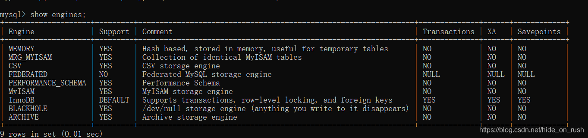  
从上图我们可以查看出 MySQL 当前默认的存储引擎是InnoDB,并且在5.7版本所有的存储引擎中只有 InnoDB 是事务性存储引擎，也就是说只有 InnoDB 支持事务。

##### 查看MySQL当前默认的存储引擎

我们也可以通过下面的命令查看默认的存储引擎。

```sql
mysql> show variables like '%storage_engine%';
```

##### 查看表的存储引擎

```sql
show table status like "table_name" ;
```

#### MyISAM和InnoDB区别

MyISAM是MySQL的默认数据库引擎（5.5版之前）。虽然性能极佳，而且提供了大量的特性，包括全文索引、压缩、空间函数等，但MyISAM不支持事务和行级锁，而且最大的缺陷就是崩溃后无法安全恢复。不过，5.5版本之后，MySQL引入了InnoDB（事务性数据库引擎），MySQL 5.5版本后默认的存储引擎为InnoDB。

大多数时候我们使用的都是 InnoDB 存储引擎，但是在某些情况下使用 MyISAM 也是合适的比如读密集的情况下。（如果你不介意 MyISAM 崩溃恢复问题的话）。

##### 两者的对比：

1. 是否支持行级锁 : MyISAM 只有表级锁(table-level locking)，而InnoDB 支持行级锁(row-level locking)和表级锁,默认为行级锁。
2. 是否支持事务和崩溃后的安全恢复： MyISAM 强调的是性能，每次查询具有原子性,其执行速度比InnoDB类型更快，但是不提供事务支持。但是InnoDB 提供事务支持事务，外部键等高级数据库功能。 具有事务(commit)、回滚(rollback)和崩溃修复能力(crash recovery capabilities)的事务安全(transaction-safe (ACID compliant))型表。
3. 是否支持外键： MyISAM不支持，而InnoDB支持。
4. 是否支持MVCC ：仅 InnoDB 支持。应对高并发事务, MVCC比单纯的加锁更高效;MVCC只在 READ COMMITTED 和 REPEATABLE READ 两个隔离级别下工作;MVCC可以使用 乐观(optimistic)锁 和 悲观(pessimistic)锁来实现;各数据库中MVCC实现并不统一。推荐阅读：MySQL-InnoDB-MVCC多版本并发控制  
   《MySQL高性能》上面有一句话这样写到:  
   **不要轻易相信“MyISAM比InnoDB快”之类的经验之谈，这个结论往往不是绝对的。在很多我们已知场景中，InnoDB的速度都可以让MyISAM望尘莫及，尤其是用到了聚簇索引，或者需要访问的数据都可以放入内存的应用。**  
   一般情况下我们选择 InnoDB 都是没有问题的，但是某些情况下你并不在乎可扩展能力和并发能力，也不需要事务支持，也不在乎崩溃后的安全恢复问题的话，选择MyISAM也是一个不错的选择。但是一般情况下，我们都是需要考虑到这些问题的。

### 字符集及校对规则

字符集指的是一种从二进制编码到某类字符符号的映射。校对规则则是指某种字符集下的排序规则。MySQL中每一种字符集都会对应一系列的校对规则。

MySQL采用的是类似继承的方式指定字符集的默认值，每个数据库以及每张数据表都有自己的默认值，他们逐层继承。比如：某个库中所有表的默认字符集将是该数据库所指定的字符集（这些表在没有指定字符集的情况下，才会采用默认字符集）  
详细内容可参考：[MySQL字符集及校对规则的理解](https://www.cnblogs.com/geaozhang/p/6724393.html#MySQLyuzifuji)

### 索引

MySQL索引使用的数据结构主要有BTree索引 和 哈希索引 。对于哈希索引来说，底层的数据结构就是哈希表，因此在绝大多数需求为单条记录查询的时候，可以选择哈希索引，查询性能最快；其余大部分场景，建议选择BTree索引。

MySQL的BTree索引使用的是B树中的B+Tree，但对于主要的两种存储引擎的实现方式是不同的。

- MyISAM: B+Tree叶节点的data域存放的是数据记录的地址。在索引检索的时候，首先按照B+Tree搜索算法搜索索引，如果指定的Key存在，则取出其 data 域的值，然后以 data 域的值为地址读取相应的数据记录。这被称为“非聚簇索引”。
- InnoDB: 其数据文件本身就是索引文件。相比MyISAM，索引文件和数据文件是分离的，其表数据文件本身就是按B+Tree组织的一个索引结构，树的叶节点data域保存了完整的数据记录。这个索引的key是数据表的主键，因此InnoDB表数据文件本身就是主索引。这被称为“聚簇索引（或聚集索引）”。而其余的索引都作为辅助索引，辅助索引的data域存储相应记录主键的值而不是地址，这也是和MyISAM不同的地方。在根据主索引搜索时，直接找到key所在的节点即可取出数据；在根据辅助索引查找时，则需要先取出主键的值，再走一遍主索引。 因此，在设计表的时候，不建议使用过长的字段作为主键，也不建议使用非单调的字段作为主键，这样会造成主索引频繁分裂。 PS：整理自《Java工程师修炼之道》

### 查询缓存的使用

执行查询语句的时候，会先查询缓存。不过，MySQL 8.0 版本后移除，因为这个功能不太实用

### 事务相关问题

见上文

### 锁机制与InnoDB锁算法

#### MyISAM和InnoDB存储引擎使用的锁：

- MyISAM采用表级锁(table-level locking)。
- InnoDB支持行级锁(row-level locking)和表级锁,默认为行级锁

#### 表级锁和行级锁对比：

- Record lock：单个行记录上的锁
- Gap lock：间隙锁，锁定一个范围，不包括记录本身
- Next-key lock：record+gap 锁定一个范围，包含记录本身  
  [详细内容：Mysql锁机制简单了解一下](https://blog.csdn.net/qq_34337272/article/details/80611486)

#### 相关知识点

1.innodb对于行的查询使用next-key lock  
2.Next-locking keying为了解决Phantom Problem幻读问题  
3.当查询的索引含有唯一属性时，将next-key lock降级为record key  
4.Gap锁设计的目的是为了阻止多个事务将记录插入到同一范围内，而这会导致幻读问题的产生  
5.有两种方式显式关闭gap锁：（除了外键约束和唯一性检查外，其余情况仅使用record lock） A. 将事务隔离级别设置为RC B. 将参数innodb\_locks\_unsafe\_for\_binlog设置为1

### 大表优化

##### 1. 限定数据的范围

务必禁止不带任何限制数据范围条件的查询语句。比如：我们当用户在查询订单历史的时候，我们可以控制在一个月的范围内；

##### 2. 读/写分离

经典的数据库拆分方案，主库负责写，从库负责读；

##### 3. 垂直分区

根据数据库里面数据表的相关性进行拆分。 例如，用户表中既有用户的登录信息又有用户的基本信息，可以将用户表拆分成两个单独的表，甚至放到单独的库做分库。

简单来说垂直拆分是指数据表列的拆分，把一张列比较多的表拆分为多张表。 如下图所示，这样来说大家应该就更容易理解了。  
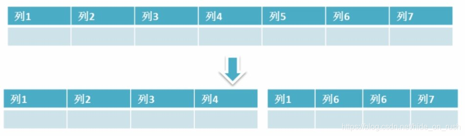

- 垂直拆分的优点： 可以使得列数据变小，在查询时减少读取的Block数，减少I/O次数。此外，垂直分区可以简化表的结构，易于维护。
- 垂直拆分的缺点： 主键会出现冗余，需要管理冗余列，并会引起Join操作，可以通过在应用层进行Join来解决。此外，垂直分区会让事务变得更加复杂；

##### 4. 水平分区

**保持数据表结构不变，通过某种策略存储数据分片。这样每一片数据分散到不同的表或者库中，达到了分布式的目的。 水平拆分可以支撑非常大的数据量。**  
水平拆分是指数据表行的拆分，表的行数超过200万行时，就会变慢，这时可以把一张的表的数据拆成多张表来存放。举个例子：我们可以将用户信息表拆分成多个用户信息表，这样就可以避免单一表数据量过大对性能造成影响。  
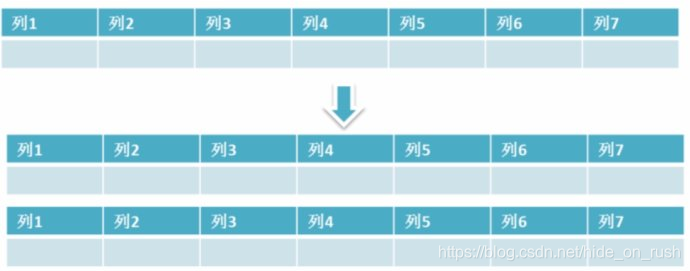  
水平拆分可以支持非常大的数据量。需要注意的一点是：分表仅仅是解决了单一表数据过大的问题，但由于表的数据还是在同一台机器上，其实对于提升MySQL并发能力没有什么意义，所以 水平拆分最好分库 。

水平拆分能够 支持非常大的数据量存储，应用端改造也少，但 分片事务难以解决 ，跨节点Join性能较差，逻辑复杂。《Java工程师修炼之道》的作者推荐 尽量不要对数据进行分片，因为拆分会带来逻辑、部署、运维的各种复杂度 ，一般的数据表在优化得当的情况下支撑千万以下的数据量是没有太大问题的。如果实在要分片，尽量选择客户端分片架构，这样可以减少一次和中间件的网络I/O。  
下面补充一下数据库分片的两种常见方案：

- 客户端代理： 分片逻辑在应用端，封装在jar包中，通过修改或者封装JDBC层来实现。 当当网的 Sharding-JDBC 、阿里的TDDL是两种比较常用的实现。
- 中间件代理： 在应用和数据中间加了一个代理层。分片逻辑统一维护在中间件服务中。 我们现在谈的 Mycat 、360的Atlas、网易的DDB等等都是这种架构的实现。  
  详细内容可以参考： MySQL大表优化方案: <https://segmentfault.com/a/1190000006158186>

### 解释一下什么是池化设计思想。什么是数据库连接池?为什么需要数据库连接池?

池化设计应该不是一个新名词。我们常见的如java线程池、jdbc连接池、redis连接池等就是这类设计的代表实现。这种设计会初始预设资源，解决的问题就是抵消每次获取资源的消耗，如创建线程的开销，获取远程连接的开销等。就好比你去食堂打饭，打饭的大妈会先把饭盛好几份放那里，你来了就直接拿着饭盒加菜即可，不用再临时又盛饭又打菜，效率就高了。除了初始化资源，池化设计还包括如下这些特征：池子的初始值、池子的活跃值、池子的最大值等，这些特征可以直接映射到java线程池和数据库连接池的成员属性中。

数据库连接本质就是一个 socket 的连接。数据库服务端还要维护一些缓存和用户权限信息之类的 所以占用了一些内存。我们可以把数据库连接池是看做是维护的数据库连接的缓存，以便将来需要对数据库的请求时可以重用这些连接。为每个用户打开和维护数据库连接，尤其是对动态数据库驱动的网站应用程序的请求，既昂贵又浪费资源。在连接池中，创建连接后，将其放置在池中，并再次使用它，因此不必建立新的连接。如果使用了所有连接，则会建立一个新连接并将其添加到池中。 连接池还减少了用户必须等待建立与数据库的连接的时间。  
这篇文章对[池化设计思想](https://mp.weixin.qq.com/s?__biz=Mzg2OTA0Njk0OA==&mid=2247485679&idx=1&sn=57dbca8c9ad49e1f3968ecff04a4f735&chksm=cea24724f9d5ce3212292fac291234a760c99c0960b5430d714269efe33554730b5f71208582&token=1141994790&lang=zh_CN#rd)介绍的还不错，直接复制过来了。

### 分库分表之后,id 主键如何处理？

因为要是分成多个表之后，每个表都是从 1 开始累加，这样是不对的，我们需要一个全局唯一的 id 来支持。

生成全局 id 有下面这几种方式：

- UUID：不适合作为主键，因为太长了，并且无序不可读，查询效率低。比较适合用于生成唯一的名字的标示比如文件的名字。
- 数据库自增 id : 两台数据库分别设置不同步长，生成不重复ID的策略来实现高可用。这种方式生成的 id 有序，但是需要独立部署数据库实例，成本高，还会有性能瓶颈。
- 利用 redis 生成 id : 性能比较好，灵活方便，不依赖于数据库。但是，引入了新的组件造成系统更加复杂，可用性降低，编码更加复杂，增加了系统成本。
- Twitter的snowflake算法 ：Github 地址： <https://github.com/twitter-archive/snowflake> 。
- 美团的Leaf分布式ID生成系统 ：Leaf 是美团开源的分布式ID生成器，能保证全局唯一性、趋势递增、单调递增、信息安全，里面也提到了几种分布式方案的对比，但也需要依赖关系数据库、Zookeeper等中间件。感觉还不错。美团技术团队的一篇文章：<https://tech.meituan.com/2017/04/21/mt-leaf.html> 。

### 一条SQL语句在MySQL中如何执行的

[一条SQL语句在MySQL中如何执行的](https://mp.weixin.qq.com/s?__biz=Mzg2OTA0Njk0OA==&mid=2247485097&idx=1&sn=84c89da477b1338bdf3e9fcd65514ac1&chksm=cea24962f9d5c074d8d3ff1ab04ee8f0d6486e3d015cfd783503685986485c11738ccb542ba7&token=79317275&lang=zh_CN#rd)

### 一条SQL语句执行得很慢的原因有哪些？

[链接](https://mp.weixin.qq.com/s?__biz=Mzg2OTA0Njk0OA==&mid=2247485185&idx=1&sn=66ef08b4ab6af5757792223a83fc0d45&chksm=cea248caf9d5c1dc72ec8a281ec16aa3ec3e8066dbb252e27362438a26c33fbe842b0e0adf47&token=79317275&lang=zh_CN#rd)

### MySQL高性能优化规范建议

[MySQL高性能优化规范建议](https://mp.weixin.qq.com/s?__biz=Mzg2OTA0Njk0OA==&mid=2247485117&idx=1&sn=92361755b7c3de488b415ec4c5f46d73&chksm=cea24976f9d5c060babe50c3747616cce63df5d50947903a262704988143c2eeb4069ae45420&token=79317275&lang=zh_CN#rd)

## 练习

### 命令练习

题目来自leetcode，代码使用mysql

#### 595.大的国家

```sql
SELECT
    name, population, area
FROM
    world
WHERE
    area > 3000000 OR population > 25000000
;
```

这个题目还可以使用UNION

```sql
SELECT
    name, population, area
FROM
    world
WHERE
    area > 3000000

UNION

SELECT
    name, population, area
FROM
    world
WHERE
    population > 25000000
;
```

#### 627.交换工资

不允许使用select  
这里用了SQL编程的方法

```sql
update salary
set
     sex = case sex when "m" then "f" else "m" end;
```

还有另一种异或的方法  
两个相等的数异或的结果为 0，而 0 与任何一个数异或的结果为这个数。  
而sex 字段只有两个取值：'f' 和 'm'，并且有以下规律：

```sql
'f' ^ ('m' ^ 'f') = 'm' ^ ('f' ^ 'f') = 'm'
'm' ^ ('m' ^ 'f') = 'f' ^ ('m' ^ 'm') = 'f'
```

因此将 sex 字段和 'm' ^ 'f' 进行异或操作，最后就能反转 sex 字段。

```sql
UPDATE salary
SET sex = CHAR ( ASCII(sex) ^ ASCII( 'm' ) ^ ASCII( 'f' ) );
```

不过这种方法运行速度比上一种慢。

#### 620.有趣的电影

用%比用mod（）快。

```sql
SELECT
    *
FROM
    cinema
WHERE
   # mod(id, 2) = 1
    id % 2 = 1
    AND description != 'boring'
ORDER BY
    rating DESC;
```

#### 596.超过5名学生的课

对 class 列进行分组之后，再使用 count 汇总函数统计每个分组的记录个数，之后使用 HAVING 进行筛选。HAVING 针对分组进行筛选，而 WHERE 针对每个记录（行）进行筛选。

```sql
SELECT
    class
FROM
    courses
GROUP BY
    class
HAVING
    count( DISTINCT student ) >= 5;
```

#### 182.查找重复的电子邮箱

对 Email 进行分组，如果并使用 COUNT 进行计数统计，结果大于 1 的表示 Email 重复。

```sql
select Email
from Person
group by Email
having count(Email) > 1;
```

#### 196.删除重复的电子邮箱

```sql
DELETE p1
FROM
    Person p1,
    Person p2
WHERE
    p1.Email = p2.Email
    AND p1.Id > p2.Id
```

#### 175.组合两个表

涉及到 Person 和 Address 两个表，在对这两个表执行连接操作时，因为要保留 Person 表中的信息，即使在 Address 表中没有关联的信息也要保留。此时可以用左外连接，将 Person 表放在 LEFT JOIN 的左边。

```sql
SELECT
    FirstName,
    LastName,
    City,
    State
FROM
    Person P
    LEFT JOIN Address A
    ON P.PersonId = A.PersonId;
```

#### 181.超过经理收入的员工

```sql
SELECT
    E1.NAME AS Employee
FROM
    Employee E1
    INNER JOIN Employee E2
    ON E1.ManagerId = E2.Id
    AND E1.Salary > E2.Salary;
```

#### 183.从不订购的客户

子查询

```sql
SELECT
    Name AS Customers
FROM
    Customers
WHERE
    Id NOT IN ( 
        SELECT CustomerId 
        FROM Orders 
    );
```

左外链接

```sql
SELECT
    C.Name AS Customers
FROM
    Customers C
    LEFT JOIN Orders O
    ON C.Id = O.CustomerId
WHERE
    O.CustomerId IS NULL;
```

#### 184.部门公司最高的员工

创建一个临时表，包含了部门员工的最大薪资。可以对部门进行分组，然后使用 MAX() 汇总函数取得最大薪资。

之后使用连接找到一个部门中薪资等于临时表中最大薪资的员工。

```sql
SELECT
    D.NAME Department,
    E.NAME Employee,
    E.Salary
FROM
    Employee E,
    Department D,
    ( SELECT DepartmentId, MAX( Salary ) Salary 
     FROM Employee 
     GROUP BY DepartmentId ) M
WHERE
    E.DepartmentId = D.Id
    AND E.DepartmentId = M.DepartmentId
    AND E.Salary = M.Salary;
```

#### 176.第二高的薪水

```sql
SELECT
    ( SELECT DISTINCT Salary 
     FROM Employee 
     ORDER BY Salary DESC 
     LIMIT 1, 1 ) SecondHighestSalary;
```

#### 177. 第N高的薪水

```sql
CREATE FUNCTION getNthHighestSalary ( N INT ) RETURNS INT BEGIN

SET N = N - 1;
RETURN ( 
    SELECT ( 
        SELECT DISTINCT Salary 
        FROM Employee 
        ORDER BY Salary DESC 
        LIMIT N, 1 
    ) 
);

END
```

#### 178.分数排名

```sql
SELECT
    S1.score 'Score',
    COUNT( DISTINCT S2.score ) 'Rank'
FROM
    Scores S1
    INNER JOIN Scores S2
    ON S1.score <= S2.score
GROUP BY
    S1.id, S1.score
ORDER BY
    S1.score DESC;
```

#### 180. 连续出现的数字

```sql
SELECT
    DISTINCT L1.num ConsecutiveNums
FROM
    Logs L1,
    Logs L2,
    Logs L3
WHERE L1.id = l2.id - 1
    AND L2.id = L3.id - 1
    AND L1.num = L2.num
    AND l2.num = l3.num;
```

#### 626. 换座位

```sql
# 处理偶数 id，让 id 减 1
# 例如 2,4,6,... 变成 1,3,5,...
SELECT
    s1.id - 1 AS id,
    s1.student
FROM
    seat s1
WHERE
    s1.id MOD 2 = 0 UNION
# 处理奇数 id，让 id 加 1。但是如果最大的 id 为奇数，则不做处理
# 例如 1,3,5,... 变成 2,4,6,...
SELECT
    s2.id + 1 AS id,
    s2.student
FROM
    seat s2
WHERE
    s2.id MOD 2 = 1
    AND s2.id != ( SELECT max( s3.id ) FROM seat s3 ) UNION
# 如果最大的 id 为奇数，单独取出这个数
SELECT
    s4.id AS id,
    s4.student
FROM
    seat s4
WHERE
    s4.id MOD 2 = 1
    AND s4.id = ( SELECT max( s5.id ) FROM seat s5 )
ORDER BY
    id;
```

## 常见问题

<https://mp.weixin.qq.com/s/iW0FfhP0vsyABoEiZUqsMQ>

reference：[https://cyc2018.github.io/CS-Notes/#/notes/数据库系统原理?id=一、事务](https://cyc2018.github.io/CS-Notes/#/notes/%E6%95%B0%E6%8D%AE%E5%BA%93%E7%B3%BB%E7%BB%9F%E5%8E%9F%E7%90%86?id=%e4%b8%80%e3%80%81%e4%ba%8b%e5%8a%a1)

[https://snailclimb.gitee.io/javaguide/#/docs/database/MySQL?id=书籍推荐](https://snailclimb.gitee.io/javaguide/#/docs/database/MySQL?id=%e4%b9%a6%e7%b1%8d%e6%8e%a8%e8%8d%90)
