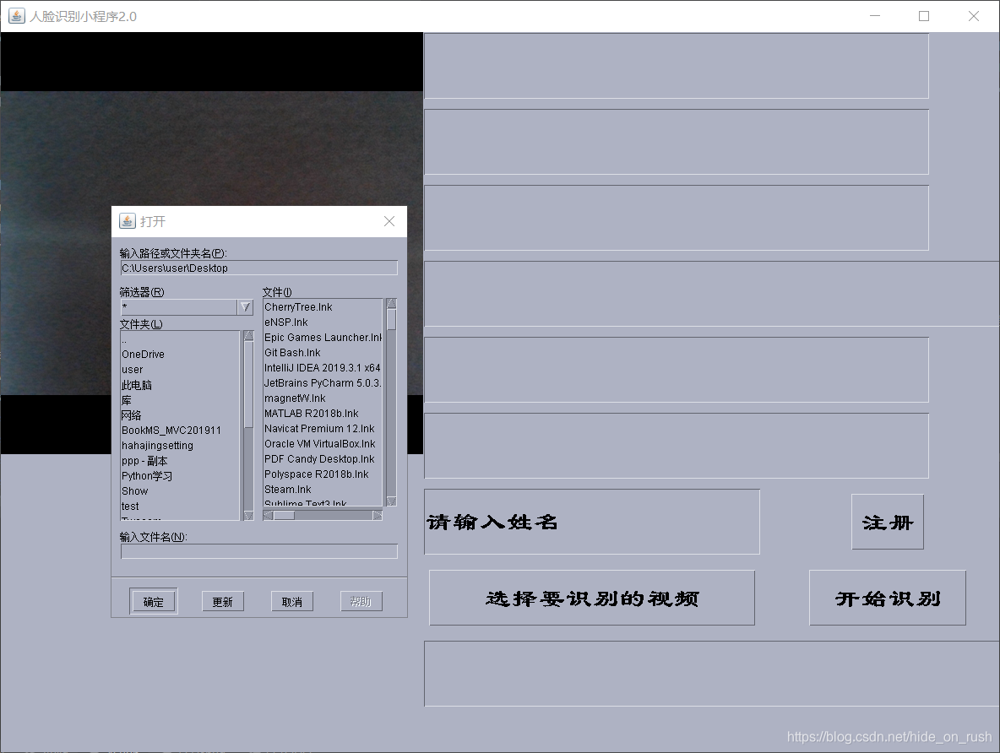
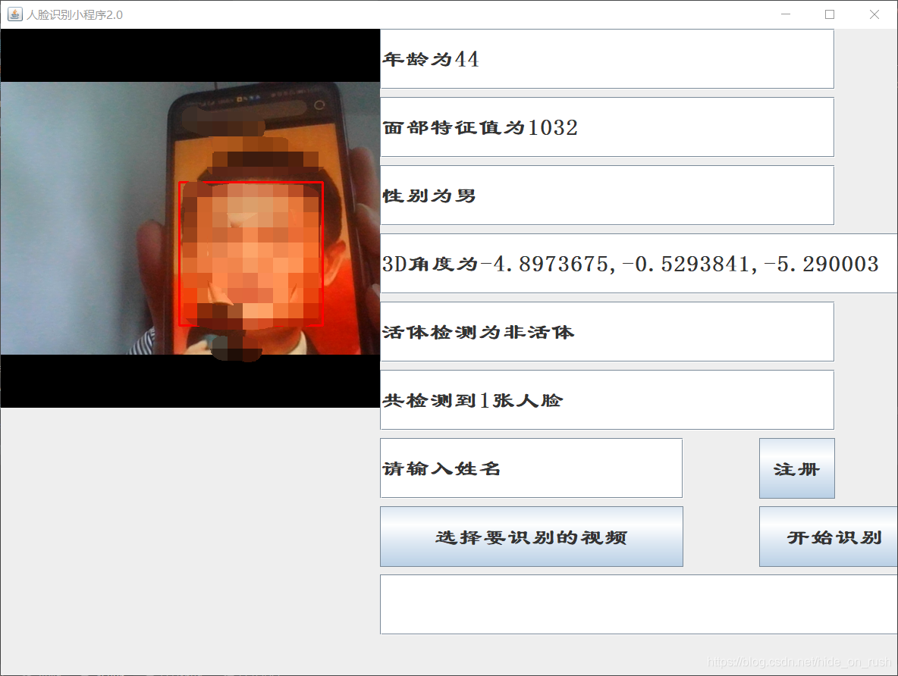
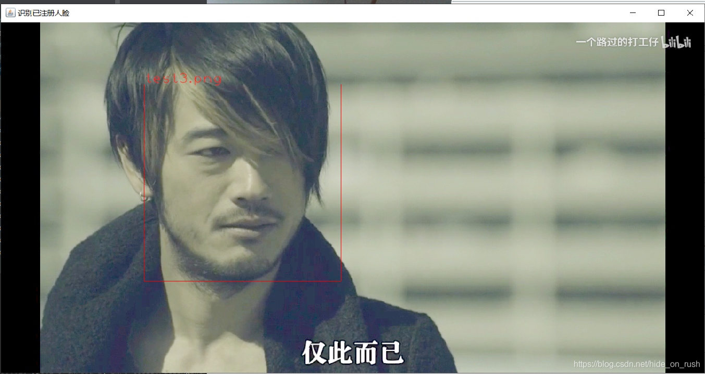
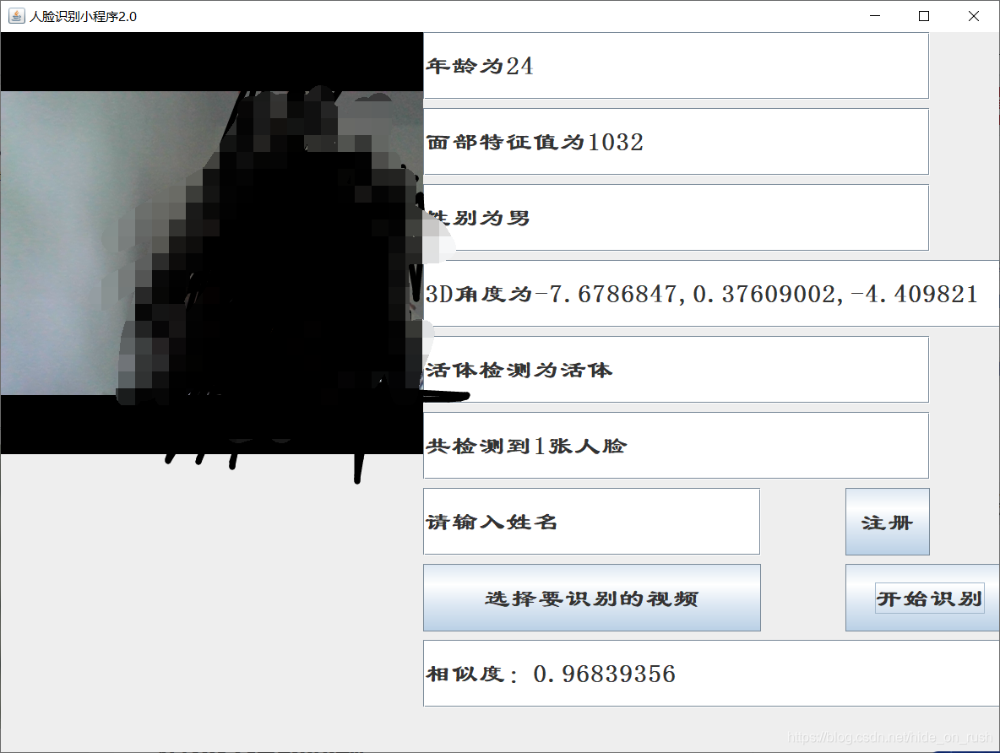

> 迁移来源 [博客园原文](https://www.cnblogs.com/xiuzhublog/p/12966015.html) · 原文发布于 `2020-05-26 15:41:00`（UTC+8）
> 旧文归档，保留当时的记录。

由于第一次写的太粗糙了，所以又修改了一下，详细的更改如下：

## 更改

优化了一下界面风格  

### 窗口问题

原来是在主界面外新开一个窗口显示画面，现在改为在主界面显示。  
思路为用一个Jlabel来显示图片，用一个线程每隔50ms刷新一次，达到显示视频的效果。

### 识别问题

将原来的静态识别照片改为动态识别，同时会在人脸旁边加上一个小红框。  
解决了活体检测不准的情况：  

### 相似度对比

原来只能进行两张图片之间的相似度对比，现在可以拍照注册后保存。然后选择一个视频，看已经注册的人是否在视频里出现。  
比如保存了一张人脸test3.png:  
  
选择一个本地保存的视频：  
  
开始识别：  
  

## 仍然存在的问题

### 人脸信息显示

界面里只有一套信息显示文本框。如果有一个以上的人出现在画面里，只能显示一个人的信息。现在的方法是谁先进入画面显现谁。

### 图片质量

当图片不够清晰的时候年龄会出现误差。
