> 迁移来源 [博客园原文](https://www.cnblogs.com/xiuzhublog/p/12977027.html) · 原文发布于 `2020-05-27 22:15:00`（UTC+8）
> 旧文归档，保留当时的记录。

之前学习数据结构与算法零零散散，不成体系。所以总结一下常用的数据结-  
。..  
构与算法还有有代表性的题目。有一个大致的框架，方便安排进度。  
关于集合类源码的笔记

  
@

## 数据结构

文字、声音、图片。。。。。。这些都是数据。  
而数据结构是计算机存储、组织数据的方式。数据结构是指相互直接存在一种或多种特殊关系的数据元素的集合。通常情况下，精心选择数据结构可以带来更高的运行或者存储效率。

### 数组

#### 源码

Java集合类中提供了Arraylist类。  
ArrayList 是一个数组队列，相当于动态数组。它由数组实现，随机访问效率高，随机插入、随机删除效率低。

#### 使用Java实现动态数组

[动态数组Java实现](/posts/java-dynamic-array-implementation/)

### 链表

#### 链表相对于动态数组的优势

1.最明显的就是链表的随机插入，删除效率要更高。由于数组存在于一段连续的内存空间上，所以插入和删除需要移动多个元素，而连续的内存空间对链表来说不是必要的，插入和删除效率大大提升。  
2.动态数组在存满数据以后如果再添加数据，就需要扩容，重新申请一段更大的连续内存，并将原来的数据拷贝到新申请的内存中。这个操作是比较耗时的，而链表不需要这些操作。

#### 源码

Java集合类中提供了LinkedList类  
LinkedList是一个双向链表。它也可以被当作堆栈、队列或双端队列进行操作。LinkedList随机访问效率低，但随机插入、随机删除效率高。

#### java实现单链表

定义接口：（这一部分只是仿照LinkedList）

```java
public interface List<E> {
	static final int ELEMENT_NOT_FOUND = -1;
	/**
	 * 清除所有元素
	 */
	void clear();

	/**
	 * 元素的数量
	 * @return
	 */
	int size();

	/**
	 * 是否为空
	 * @return
	 */
	boolean isEmpty();

	/**
	 * 是否包含某个元素
	 * @param element
	 * @return
	 */
	boolean contains(E element);

	/**
	 * 添加元素到尾部
	 * @param element
	 */
	void add(E element);

	/**
	 * 获取index位置的元素
	 * @param index
	 * @return
	 */
	E get(int index);

	/**
	 * 设置index位置的元素
	 * @param index
	 * @param element
	 * @return 原来的元素ֵ
	 */
	E set(int index, E element);

	/**
	 * 在index位置插入一个元素
	 * @param index
	 * @param element
	 */
	void add(int index, E element);

	/**
	 * 删除index位置的元素
	 * @param index
	 * @return
	 */
	E remove(int index);

	/**
	 * 查看元素的索引
	 * @param element
	 * @return
	 */
	int indexOf(E element);
}
```

```java
public abstract class AbstractList<E> implements List<E>  {
	/**
	 * 元素的数量
	 */
	protected int size;
	/**
	 * 元素的数量
	 * @return
	 */
	public int size() {
		return size;
	}

	/**
	 * 是否为空
	 * @return
	 */
	public boolean isEmpty() {
		 return size == 0;
	}

	/**
	 * 是否包含某个元素
	 * @param element
	 * @return
	 */
	public boolean contains(E element) {
		return indexOf(element) != ELEMENT_NOT_FOUND;
	}

	/**
	 * 添加元素到尾部
	 * @param element
	 */
	public void add(E element) {
		add(size, element);
	}
	
	protected void outOfBounds(int index) {
		throw new IndexOutOfBoundsException("Index:" + index + ", Size:" + size);
	}
	
	protected void rangeCheck(int index) {
		if (index < 0 || index >= size) {
			outOfBounds(index);
		}
	}
	
	protected void rangeCheckForAdd(int index) {
		if (index < 0 || index > size) {
			outOfBounds(index);
		}
	}
}
```

代码设计：  
首先，要定义一个单链表里应该有什么，对于单链表来说，需要知道链表的长度，指向第一个元素的索引及其指向下一个元素的索引，元素。  
因此定义如下：

```java
private Node<E> first;
	
	public SingleLinkedList() {
		first = new Node<>(null, null);
	}
	
	private static class Node<E> {
		E element;
		Node<E> next;
		public Node(E element, Node<E> next) {
			this.element = element;
			this.next = next;
		}
	}
```

- 这里增加了一个虚拟头结点。这个结点不存储数据，这样做的好处是，可以统一处理所有存储数据的节点，不需要划分为头结点和其他节点两部分，从而使代码更加精简。
- 使用泛型可以使存储数据的种类更加多样化，可以是整数、字符串等等，本质上是存储了了一个对象。所以java的八种基本数据类型需要使用包装类。  
  之后，是实现对数据的增删改查，具体方法如下：

```java
import com.test.AbstractList;

/**
 * 增加一个虚拟头结点
 * @param <E>
 */
public class SingleLinkedList<E> extends AbstractList<E> {
	private Node<E> first;
	
	public SingleLinkedList() {
		first = new Node<>(null, null);
	}
	
	private static class Node<E> {
		E element;
		Node<E> next;
		public Node(E element, Node<E> next) {
			this.element = element;
			this.next = next;
		}
	}

	@Override
	/*这个方法用于清空链表，实现很简单，既然是清空，那么链表的长度将会变为零，同时将指向头结点的链接断掉，连表里原来的元素无法访问了，就相当于清空。*/
	public void clear() {
		size = 0;
		first = null;
	}
/**
	 * 获取index位置对应的节点对象
	 * @param index
	 * @return
	 */
	 /*首先检查输入的地址是否合法，如果合法，从第一个节点开始遍历，到指定位置，返回元素的值。从这里可以看到，虽然链表插入删除的效率高于动态数组，但是查找效率比动态数组低*/
	private Node<E> node(int index) {
		rangeCheck(index);
		
		Node<E> node = first.next;
		for (int i = 0; i < index; i++) {
			node = node.next;
		}
		return node;
	}
	@Override
	//这个就是找到指定位置的结点，输出其元素
	public E get(int index) {
		return node(index).element;
	}

	@Override
	//更改指定位置的元素
	public E set(int index, E element) {
		Node<E> node = node(index);
		E old = node.element;
		node.element = element;
		return old;
	}

	@Override
	/*添加时要先把新增结点的索引指向下一个结点，再把上一个结点的索引指向新增节点，注意新增元素后链表的长度加一*/
	public void add(int index, E element) {
		rangeCheckForAdd(index);
		
		Node<E> prev = index == 0 ? first : node(index - 1);
		prev.next = new Node<>(element, prev.next);

		size++;
	}

	@Override
	/*删除只需要把指定结点前一个结点的索引指向指定结点的下一个结点*/
	public E remove(int index) {
		rangeCheck(index);
		
		Node<E> prev = index == 0 ? first : node(index - 1);
		Node<E> node = prev.next;
		prev.next = node.next;
			
		size--;
		return node.element;
	}

	@Override
	/*输入一个空元素，只需要查找链表里是否有空值元素就行了，不必再对比，提高效率*/
	public int indexOf(E element) {
		if (element == null) {
			Node<E> node = first;
			for (int i = 0; i < size; i++) {
				if (node.element == null) return i;
				
				node = node.next;
			}
		} else {
			Node<E> node = first;
			for (int i = 0; i < size; i++) {
				if (element.equals(node.element)) return i;
				
				node = node.next;
			}
		}
		return ELEMENT_NOT_FOUND;
	}
	@Override
	public String toString() {
		StringBuilder string = new StringBuilder();
		string.append("size=").append(size).append(", [");
		Node<E> node = first.next;
		for (int i = 0; i < size; i++) {
			if (i != 0) {
				string.append(", ");
			}
			
			string.append(node.element);
			
			node = node.next;
		}
		string.append("]");
		
//		Node<E> node1 = first;
//		while (node1 != null) {
//			
//			
//			node1 = node1.next;
//		}
		return string.toString();
	}
}
```

#### 题目

##### [160. 相交链表](https://leetcode-cn.com/problems/intersection-of-two-linked-lists/)

### 队列

### 栈

### 队列

### 哈希表

### 树

#### 二叉树

##### 二叉搜索树

###### 定义

二叉排序树（Binary Sort Tree）或者是一颗空树；或者是具有如下性质的二叉树：

> (1) 若它的左子树不空，则 左子树 上所有结点的值 均小于 它的根结点的值；  
> (2) 若它的右子树不空，则 右子树 上所有结点的值 均大于 它的根结点的值；  
> (3) 它的 左、右子树又分别为二叉排序树 。

可以看出二叉排序树的定义是一个递归形式的定义  
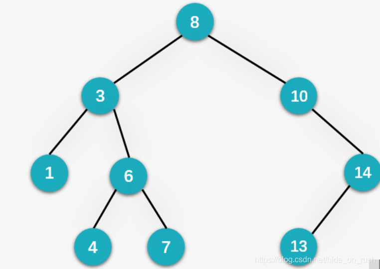

###### 操作

- 查找
- 插入
- 删除

时间复杂度：三种操作的最坏时间复杂度为o(h);(h为二叉排序树的高度)。  
也就是说极端情况下，斜树的高度为n,插入和删除的时间复杂度为O(n).  
<https://www.cxyxiaowu.com/10289.html>

##### 平衡二叉树

二叉搜索树的查找效率取决于树的高度，最差情况下会退化为单链表。

###### 定义

1.可以是空树  
2.假如不是空树，任何一个节点的左子树和右子树都是平衡二叉树，并且高度之差的绝对值不超过1。

##### 平衡因子

###### 定义

某节点的左子树与右子树的高度(深度)差即为该节点的平衡因子（BF,Balance Factor），平衡二叉树中不存在平衡因子大于 1 的节点。在一棵平衡二叉树中，节点的平衡因子只能取 0 、1 或者 -1 ，分别对应着左右子树等高，左子树比较高，右子树比较高。

### 图

### 字符串

### 位运算

## 算法

### 算法的复杂度

### 排序

**排序算法的分类**  
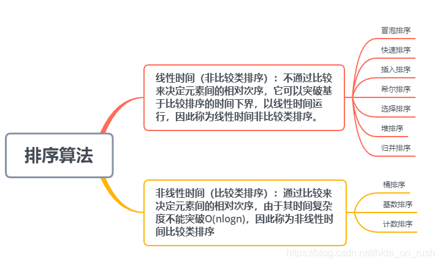  
**时间复杂度**  
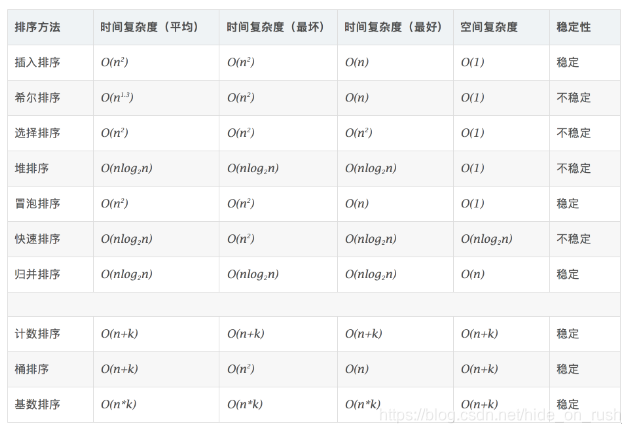  
**快速记忆**

- 平方阶: (O(n2)) 插入、选择、冒泡
- 线性对数阶: (O(nlog2n)) 快速、归并、堆
- 特殊的希尔: O(n^(1.3—2))
- 牛皮的线性: 基数、桶、箱、计数  
  **啥是稳定：**  
  稳定：如果 a 原本在 b 前面，而 a=b，排序之后 a 仍然在 b 的前面。  
  不稳定：如果 a 原本在 b 的前面，而 a=b，排序之后 a 可能会出现在 b 的后面。  
  **哪些稳定**  
  稳定：冒泡、插入、归并和基数。 不稳定：选择、快速、希尔、堆。

#### 冒泡排序

冒泡排序是一种简单直观的排序算法。

##### 1.算法步骤

1. 比较相邻的元素。如果第一个比第二个大，就交换他们两个。
2. 对每一对相邻元素作同样的工作，从开始第一对到结尾的最后一对。这步做完后，最后的元素会是最大的数。
3. 针对所有的元素重复以上的步骤，除了最后一个。
4. 持续每次对越来越少的元素重复上面的步骤，直到没有任何一对数字需要比较。

当然也可以从右往左，比较谁更小。

##### 2.动图演示

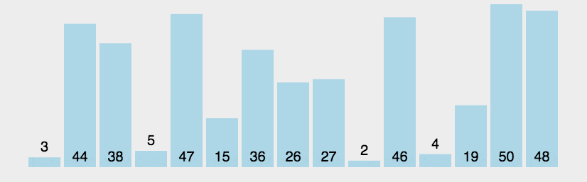

##### 3.效率

对于动图里那种谁大谁放右边的方式，从左往右最快，从右往左最慢  
其他方式同理

##### 4.优化（作用不大）

一个有序的数组，根本不需要排序，它仍然是双层循环一个不少的把数据遍历干净，这其实就是做了没必要做的事情，属于浪费资源。

针对这个问题，我们可以设定一个临时遍历来标记该数组是否已经有序，如果有序了就不用遍历了。

##### 5.Java实现

```java
public class BubbleSort implements IArraySort {

    @Override
    public int[] sort(int[] sourceArray) throws Exception {
        // 对 arr 进行拷贝，不改变参数内容
        int[] arr = Arrays.copyOf(sourceArray, sourceArray.length);

        for (int i = 1; i < arr.length; i++) {
            // 设定一个标记，若为true，则表示此次循环没有进行交换，也就是待排序列已经有序，排序已经完成。
            boolean flag = true;

            for (int j = 0; j < arr.length - i; j++) {
                if (arr[j] > arr[j + 1]) {
                    int tmp = arr[j];
                    arr[j] = arr[j + 1];
                    arr[j + 1] = tmp;

                    flag = false;
                }
            }

            if (flag) {
                break;
            }
        }
        return arr;
    }
}
```

#### 选择排序

选择排序是一种简单直观的排序算法，无论什么数据进去都是 O(n²) 的时间复杂度。所以**用到它的时候，数据规模越小越好**。唯一的好处可能就是不占用额外的内存空间了吧。

##### 算法步骤

1. 首先在未排序序列中找到最小（大）元素，存放到排序序列的起始位置
2. 再从剩余未排序元素中继续寻找最小（大）元素，然后放到已排序序列的末尾。
3. 重复第二步，直到所有元素均排序完毕。

##### 2. 动图演示

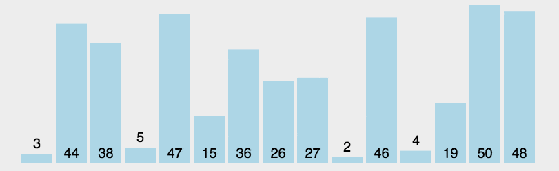

##### 3.Java实现

```java
public class SelectionSort implements IArraySort {

    @Override
    public int[] sort(int[] sourceArray) throws Exception {
        int[] arr = Arrays.copyOf(sourceArray, sourceArray.length);

        // 总共要经过 N-1 轮比较
        for (int i = 0; i < arr.length - 1; i++) {
            int min = i;

            // 每轮需要比较的次数 N-i
            for (int j = i + 1; j < arr.length; j++) {
                if (arr[j] < arr[min]) {
                    // 记录目前能找到的最小值元素的下标
                    min = j;
                }
            }

            // 将找到的最小值和i位置所在的值进行交换
            if (i != min) {
                int tmp = arr[i];
                arr[i] = arr[min];
                arr[min] = tmp;
            }

        }
        return arr;
    }
}
```

#### 插入排序

它的工作原理是通过构建有序序列，对于未排序数据，在已排序序列中从后向前扫描，找到相应位置并插入。（与扑克牌凑顺子类似）

插入排序有一种优化算法，叫做折半插入

##### 1.算法步骤

1. 将第一待排序序列第一个元素看做一个有序序列，把第二个元素到最后一个元素当成是未排序序列。
2. 从头到尾依次扫描未排序序列，将扫描到的每个元素插入有序序列的适当位置。（如果待插入的元素与有序序列中的某个元素相等，则将待插入元素插入到相等元素的后面。）

##### 2.动图演示

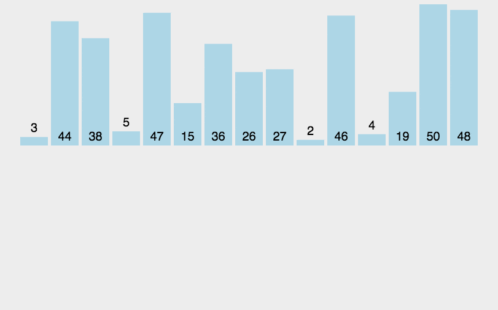#### 3.Java代码实现

```java
public class InsertSort implements IArraySort {

    @Override
    public int[] sort(int[] sourceArray) throws Exception {
        // 对 arr 进行拷贝，不改变参数内容
        int[] arr = Arrays.copyOf(sourceArray, sourceArray.length);

        // 从下标为1的元素开始选择合适的位置插入，因为下标为0的只有一个元素，默认是有序的
        for (int i = 1; i < arr.length; i++) {

            // 记录要插入的数据
            int tmp = arr[i];

            // 从已经排序的序列最右边的开始比较，找到比其小的数
            int j = i;
            while (j > 0 && tmp < arr[j - 1]) {
                arr[j] = arr[j - 1];
                j--;
            }

            // 存在比其小的数，插入
            if (j != i) {
                arr[j] = tmp;
            }

        }
        return arr;
    }
}
```

##### 4.折半插入排序

折半插入排序只能减少关键字间的比较次数，是一种稳定的排序方法，只适合于顺序存储的排序表。

```java
	public static int[] bInsertSort(int[] arr) {
		for (int i = 1; i < arr.length; i++) {
			// arr[i]需要向前移动
			if (arr[i] < arr[i - 1]) {
				// 临时变量，存储当前下标的值
				int temp = arr[i];
				int j = i - 1;
				// 从下标为0开始
				int low = 0;
				// 前一个值结束
				int high = i - 1;
				// 折半查找，有效的减少后续比较次数，循环结束后，high的值 +1 就是temp要插入的位置
				while (low <= high) {
					int mid = (low + high) / 2;
					if (temp < arr[mid]) {
						high = mid - 1;
					} else {
						low = mid + 1;
					}
				}
				// 从j(i-1)开始，往后移动，直到high +１，也就是要插入的位置
				// 比temp(arr[i])大的值向后移动一位
				for (; j >= high + 1; j--) {
					arr[j + 1] = arr[j];
				}
				arr[high + 1] = temp;
			}
		}
		return arr;
	}
```

#### 希尔排序

希尔排序，也称递减增量排序算法，是插入排序的一种更高效的改进版本。但希尔排序是非稳定排序算法。

希尔排序是基于插入排序的以下两点性质而提出改进方法的：

插入排序在对几乎已经排好序的数据操作时，效率高，即可以达到线性排序的效率；  
但插入排序一般来说是低效的，因为插入排序每次只能将数据移动一位；  
希尔排序的基本思想是：先将整个待排序的记录序列分割成为若干子序列分别进行直接插入排序，待整个序列中的记录“基本有序”时，再对全体记录进行依次直接插入排序。

##### 1.算法步骤

1. 选择一个增量序列 t1，t2，……，tk，其中 ti > tj, tk = 1；
2. 按增量序列个数 k，对序列进行 k 趟排序；
3. 每趟排序，根据对应的增量 ti，将待排序列分割成若干长度为 m 的子序列，分别对各子表进行直接插入排序。仅增量因子为 1 时，整个序列作为一个表来处理，表长度即为整个序列的长度。

##### 2.动画演示

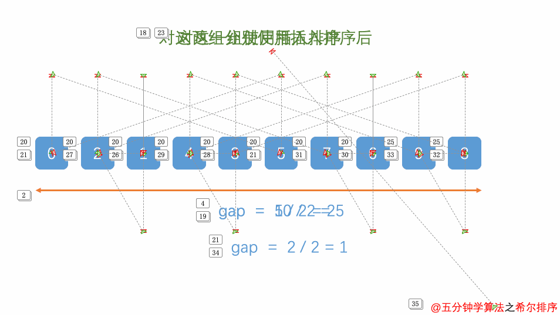

##### 3.Java代码实现

```java
public class ShellSort implements IArraySort {

    @Override
    public int[] sort(int[] sourceArray) throws Exception {
        // 对 arr 进行拷贝，不改变参数内容
        int[] arr = Arrays.copyOf(sourceArray, sourceArray.length);

        int gap = 1;
        while (gap < arr.length/3) {
            gap = gap * 3 + 1;
        }

        while (gap > 0) {
            for (int i = gap; i < arr.length; i++) {
                int tmp = arr[i];
                int j = i - gap;
                while (j >= 0 && arr[j] > tmp) {
                    arr[j + gap] = arr[j];
                    j -= gap;
                }
                arr[j + gap] = tmp;
            }
            gap = (int) Math.floor(gap / 3);
        }

        return arr;
    }
}
```

#### 归并排序

归并排序（Merge sort）是建立在归并操作上的一种有效的排序算法。该算法是采用分治法（Divide and Conquer）的一个非常典型的应用。

作为一种典型的分而治之思想的算法应用，归并排序的实现由两种方法：

自上而下的递归（所有递归的方法都可以用迭代重写，所以就有了第 2 种方法）；  
自下而上的迭代；

和选择排序一样，归并排序的性能不受输入数据的影响，但表现比选择排序好的多，因为始终都是 O(nlogn) 的时间复杂度。代价是需要额外的内存空间。

##### 1.算法步骤

1. 申请空间，使其大小为两个已经排序序列之和，该空间用来存放合并后的序列；
2. 设定两个指针，最初位置分别为两个已经排序序列的起始位置；
3. 比较两个指针所指向的元素，选择相对小的元素放入到合并空间，并移动指针到下一位置；
4. 重复步骤 3 直到某一指针达到序列尾；
5. 将另一序列剩下的所有元素直接复制到合并序列尾。

将另一序列剩下的所有元素直接复制到合并序列尾。

##### 2.动图演示

  
动图有些不太好理解，其实主要应用了分治法的思想  
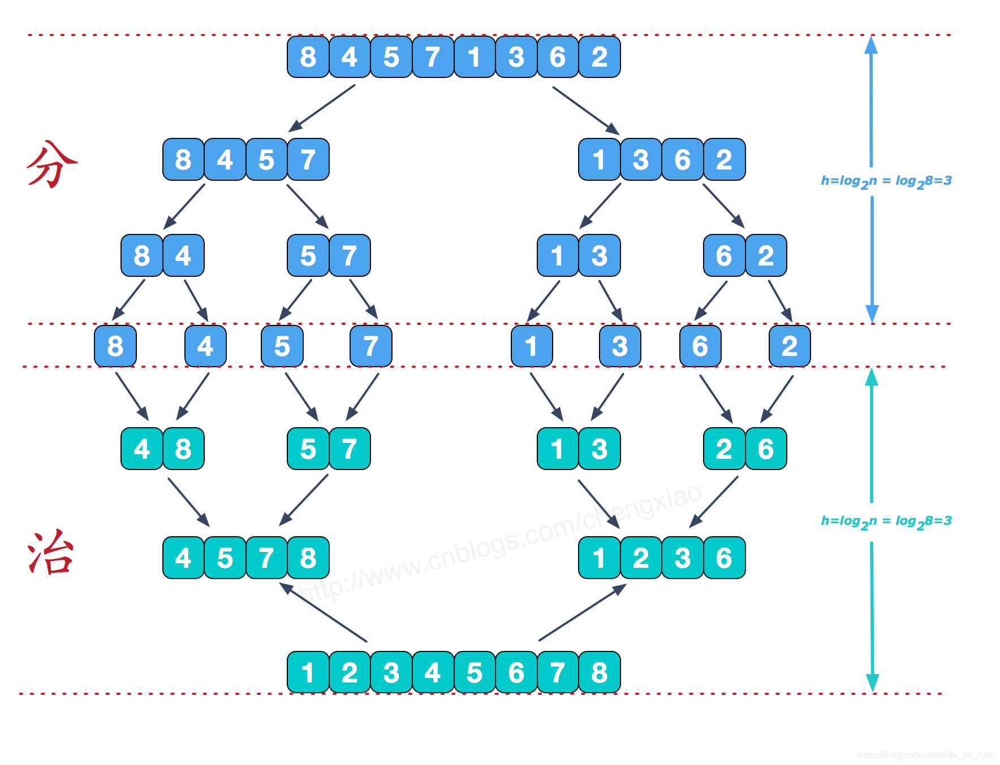  
可以看到这种结构很像一棵完全二叉树，本文的归并排序我们采用递归去实现（也可采用迭代的方式去实现）。**分阶段**可以理解为就是递归拆分子序列的过程，递归深度为log2n。  
**合并相邻有序子序列**  
再来看看**治阶段**，我们需要将两个已经有序的子序列合并成一个有序序列，比如上图中的最后一次合并，要将[4,5,7,8]和[1,2,3,6]两个已经有序的子序列，合并为最终序列[1,2,3,4,5,6,7,8]，来看下实现步骤。  
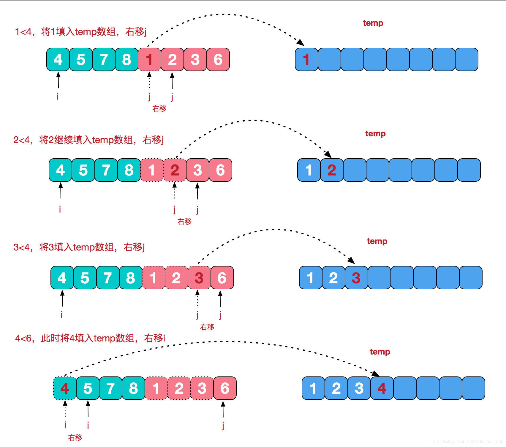

##### 3.代码实现

```java
import java.util.Arrays;
public class MergeSort {
    public static void main(String []args){
        int []arr = {9,8,7,6,5,4,3,2,1};
        sort(arr);
        System.out.println(Arrays.toString(arr));
    }
    public static void sort(int []arr){
        int []temp = new int[arr.length];//在排序前，先建好一个长度等于原数组长度的临时数组，避免递归中频繁开辟空间
        sort(arr,0,arr.length-1,temp);
    }
    private static void sort(int[] arr,int left,int right,int []temp){
        if(left<right){
            int mid = (left+right)/2;
            sort(arr,left,mid,temp);//左边归并排序，使得左子序列有序
            sort(arr,mid+1,right,temp);//右边归并排序，使得右子序列有序
            merge(arr,left,mid,right,temp);//将两个有序子数组合并操作
        }
    }
    private static void merge(int[] arr,int left,int mid,int right,int[] temp){
        int i = left;//左序列指针
        int j = mid+1;//右序列指针
        int t = 0;//临时数组指针
        while (i<=mid && j<=right){
            if(arr[i]<=arr[j]){
                temp[t++] = arr[i++];
            }else {
                temp[t++] = arr[j++];
            }
        }
        while(i<=mid){//将左边剩余元素填充进temp中
            temp[t++] = arr[i++];
        }
        while(j<=right){//将右序列剩余元素填充进temp中
            temp[t++] = arr[j++];
        }
        t = 0;
        //将temp中的元素全部拷贝到原数组中
        while(left <= right){
            arr[left++] = temp[t++];
        }
    }
}
```

#### 快速排序

快速排序是由东尼·霍尔所发展的一种排序算法。在平均状况下，排序 n 个项目要 Ο(nlogn) 次比较。在最坏状况下则需要 Ο(n2) 次比较，但这种状况并不常见。事实上，快速排序通常明显比其他 Ο(nlogn) 算法更快，因为它的内部循环（inner loop）可以在大部分的架构上很有效率地被实现出来。

快速排序使用分治法（Divide and conquer）策略来把一个串行（list）分为两个子串行（sub-lists）。

快速排序又是一种分而治之思想在排序算法上的典型应用。本质上来看，快速排序应该算是在冒泡排序基础上的递归分治法。

快速排序的名字起的是简单粗暴，因为一听到这个名字你就知道它存在的意义，就是快，而且效率高！它是处理大数据最快的排序算法之一了。虽然 Worst Case 的时间复杂度达到了 O(n²)，但是人家就是优秀，在大多数情况下都比平均时间复杂度为 O(n logn) 的排序算法表现要更好，可是这是为什么呢，我也不知道。好在我的强迫症又犯了，查了 N 多资料终于在《算法艺术与信息学竞赛》上找到了满意的答案：

> 快速排序的最坏运行情况是 O(n²)，比如说顺序数列的快排。但它的平摊期望时间是 O(nlogn)，且 O(nlogn) 记号中隐含的常数因子很小，比复杂度稳定等于 O(nlogn) 的归并排序要小很多。所以，对绝大多数顺序性较弱的随机数列而言，快速排序总是优于归并排序。

##### 1.算法步骤

1. 从数列中挑出一个元素，称为 “基准”（pivot）;
2. 重新排序数列，所有元素比基准值小的摆放在基准前面，所有元素比基准值大的摆在基准的后面（相同的数可以到任一边）。在这个分区退出之后，该基准就处于数列的中间位置。这个称为分区（partition）操作；
3. 递归地（recursive）把小于基准值元素的子数列和大于基准值元素的子数列排序；

递归的最底部情形，是数列的大小是零或一，也就是永远都已经被排序好了。虽然一直递归下去，但是这个算法总会退出，因为在每次的迭代（iteration）中，它至少会把一个元素摆到它最后的位置去。

##### 2.动图演示

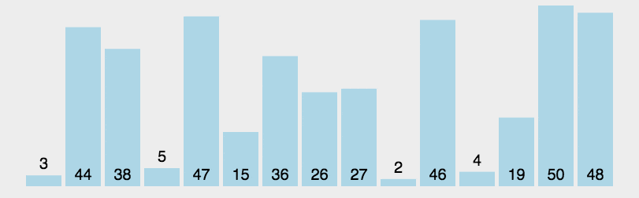

##### 3.代码实现

```java
public class QuickSort implements IArraySort {

    @Override
    public int[] sort(int[] sourceArray) throws Exception {
        // 对 arr 进行拷贝，不改变参数内容
        int[] arr = Arrays.copyOf(sourceArray, sourceArray.length);

        return quickSort(arr, 0, arr.length - 1);
    }

    private int[] quickSort(int[] arr, int left, int right) {
        if (left < right) {
            int  partitionIndex = partition(arr, left, right);
            quickSort(arr, left, partitionIndex - 1);
            quickSort(arr, partitionIndex + 1, right);
        }
        return arr;
    }

    private int partition(int[] arr, int left, int right) {
        // 设定基准值（pivot）
        int pivot = left;
        int index = pivot + 1;
        for (int i = index; i <= right; i++) {
            if (arr[i] < arr[pivot]) {
                swap(arr, i, index);
                index++;
            }
        }
        swap(arr, pivot, index - 1);
        return index - 1;
    }

    private void swap(int[] arr, int i, int j) {
        int temp = arr[i];
        arr[i] = arr[j];
        arr[j] = temp;
    }

}
```

#### 堆排序

堆排序（Heapsort）是指利用堆这种数据结构所设计的一种排序算法。堆积是一个近似完全二叉树的结构，并同时满足堆积的性质：即子结点的键值或索引总是小于（或者大于）它的父节点。堆排序可以说是一种利用堆的概念来排序的选择排序。分为两种方法：

大顶堆：每个节点的值都大于或等于其子节点的值，在堆排序算法中用于升序排列；  
小顶堆：每个节点的值都小于或等于其子节点的值，在堆排序算法中用于降序排列；  
堆排序的平均时间复杂度为 Ο(nlogn)。

##### 1.算法步骤

1. 将待排序序列构建成一个堆 H[0……n-1]，根据（升序降序需求）选择大顶堆或小顶堆；
2. 把堆首（最大值）和堆尾互换；
3. 把堆的尺寸缩小 1，并调用 shift\_down(0)，目的是把新的数组顶端数据调整到相应位置；
4. 重复步骤 2，直到堆的尺寸为 1。

##### 2.动图演示

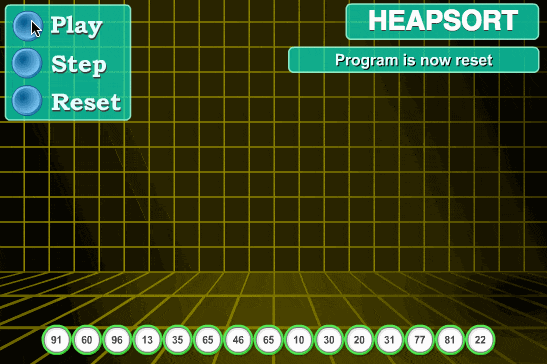

##### 3.代码实现

```java
public class HeapSort implements IArraySort {

    @Override
    public int[] sort(int[] sourceArray) throws Exception {
        // 对 arr 进行拷贝，不改变参数内容
        int[] arr = Arrays.copyOf(sourceArray, sourceArray.length);

        int len = arr.length;

        buildMaxHeap(arr, len);

        for (int i = len - 1; i > 0; i--) {
            swap(arr, 0, i);
            len--;
            heapify(arr, 0, len);
        }
        return arr;
    }

    private void buildMaxHeap(int[] arr, int len) {
        for (int i = (int) Math.floor(len / 2); i >= 0; i--) {
            heapify(arr, i, len);
        }
    }

    private void heapify(int[] arr, int i, int len) {
        int left = 2 * i + 1;
        int right = 2 * i + 2;
        int largest = i;

        if (left < len && arr[left] > arr[largest]) {
            largest = left;
        }

        if (right < len && arr[right] > arr[largest]) {
            largest = right;
        }

        if (largest != i) {
            swap(arr, i, largest);
            heapify(arr, largest, len);
        }
    }

    private void swap(int[] arr, int i, int j) {
        int temp = arr[i];
        arr[i] = arr[j];
        arr[j] = temp;
    }

}
```

#### 计数排序

计数排序的核心在于将输入的数据值转化为键存储在额外开辟的数组空间中。作为一种线性时间复杂度的排序，计数排序要求输入的数据必须是有确定范围的整数。

##### 1.算法步骤

1. 找出原数组中元素值最大的，记为max。
2. 创建一个新数组count，其长度是max加1，其元素默认值都为0。
3. 遍历原数组中的元素，以原数组中的元素作为count数组的索引，以原数组中的元素出现次数作为count数组的元素值。
4. 创建结果数组result，起始索引index。
5. 遍历count数组，找出其中元素值大于0的元素，将其对应的索引作为元素值填充到result数组中去，每处理一次，count中的该元素值减1，直到该元素值不大于0，依次处理count中剩下的元素。
6. 返回结果数组result。

##### 2. 动图演示

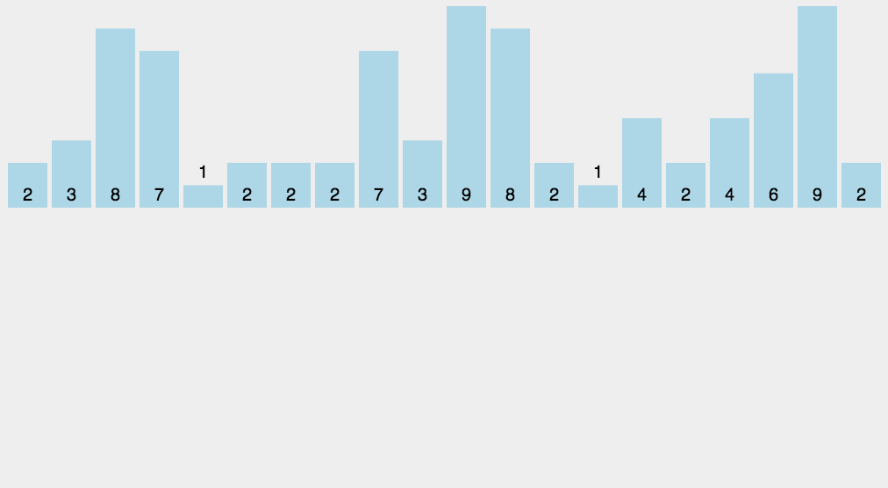

##### 3.代码实现

```java
public class CountingSort implements IArraySort {

    @Override
    public int[] sort(int[] sourceArray) throws Exception {
        // 对 arr 进行拷贝，不改变参数内容
        int[] arr = Arrays.copyOf(sourceArray, sourceArray.length);

        int maxValue = getMaxValue(arr);

        return countingSort(arr, maxValue);
    }

    private int[] countingSort(int[] arr, int maxValue) {
        int bucketLen = maxValue + 1;
        int[] bucket = new int[bucketLen];

        for (int value : arr) {
            bucket[value]++;
        }

        int sortedIndex = 0;
        for (int j = 0; j < bucketLen; j++) {
            while (bucket[j] > 0) {
                arr[sortedIndex++] = j;
                bucket[j]--;
            }
        }
        return arr;
    }

    private int getMaxValue(int[] arr) {
        int maxValue = arr[0];
        for (int value : arr) {
            if (maxValue < value) {
                maxValue = value;
            }
        }
        return maxValue;
    }

}
```

#### 桶排序

桶排序是计数排序的升级版。它利用了函数的映射关系，高效与否的关键就在于这个映射函数的确定。为了使桶排序更加高效，我们需要做到这两点：

在额外空间充足的情况下，尽量增大桶的数量  
使用的映射函数能够将输入的 N 个数据均匀的分配到 K 个桶中  
同时，对于桶中元素的排序，选择何种比较排序算法对于性能的影响至关重要。

**1. 什么时候最快**  
当输入的数据可以均匀的分配到每一个桶中。

**2. 什么时候最慢**  
当输入的数据被分配到了同一个桶中

##### 2.动图演示

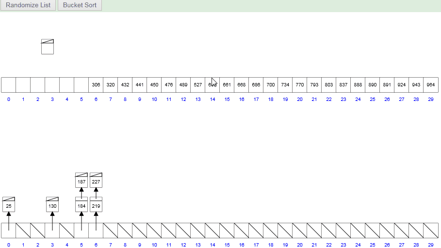

#### 基数排序

基数排序是一种非比较型整数排序算法，其原理是将整数按位数切割成不同的数字，然后按每个位数分别比较。由于整数也可以表达字符串（比如名字或日期）和特定格式的浮点数，所以基数排序也不是只能使用于整数。

##### 1. 基数排序 vs 计数排序 vs 桶排序

基数排序有两种方法：

这三种排序算法都利用了桶的概念，但对桶的使用方法上有明显差异：

- 基数排序：根据键值的每位数字来分配桶；
- 计数排序：每个桶只存储单一键值；
- 桶排序：每个桶存储一定范围的数值；

## 2. LSD 基数排序动图演示

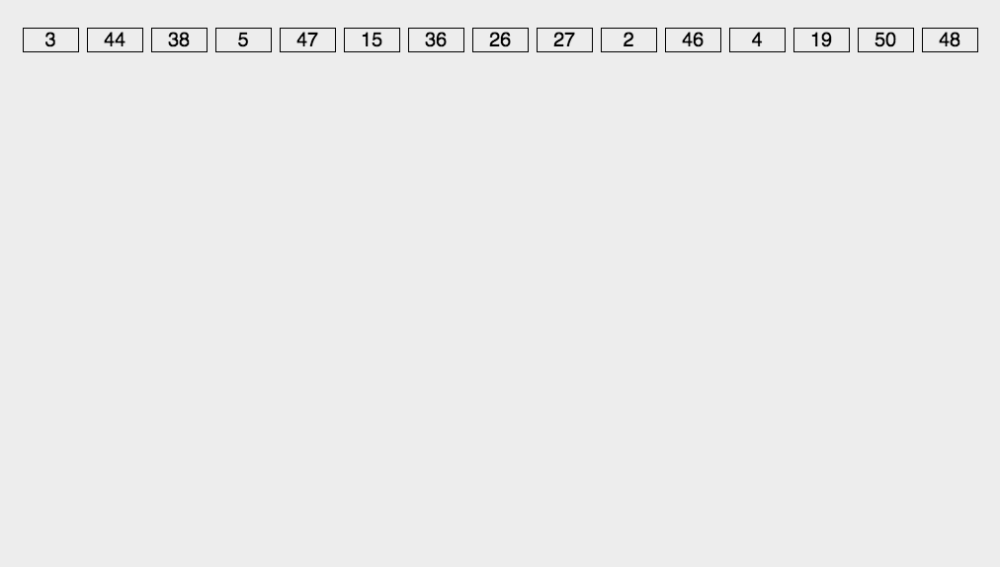

##### 3.代码实现

```java
/**
 * 基数排序
 * 考虑负数的情况还可以参考： https://code.i-harness.com/zh-CN/q/e98fa9
 */
public class RadixSort implements IArraySort {

    @Override
    public int[] sort(int[] sourceArray) throws Exception {
        // 对 arr 进行拷贝，不改变参数内容
        int[] arr = Arrays.copyOf(sourceArray, sourceArray.length);

        int maxDigit = getMaxDigit(arr);
        return radixSort(arr, maxDigit);
    }

    /**
     * 获取最高位数
     */
    private int getMaxDigit(int[] arr) {
        int maxValue = getMaxValue(arr);
        return getNumLenght(maxValue);
    }

    private int getMaxValue(int[] arr) {
        int maxValue = arr[0];
        for (int value : arr) {
            if (maxValue < value) {
                maxValue = value;
            }
        }
        return maxValue;
    }

    protected int getNumLenght(long num) {
        if (num == 0) {
            return 1;
        }
        int lenght = 0;
        for (long temp = num; temp != 0; temp /= 10) {
            lenght++;
        }
        return lenght;
    }

    private int[] radixSort(int[] arr, int maxDigit) {
        int mod = 10;
        int dev = 1;

        for (int i = 0; i < maxDigit; i++, dev *= 10, mod *= 10) {
            // 考虑负数的情况，这里扩展一倍队列数，其中 [0-9]对应负数，[10-19]对应正数 (bucket + 10)
            int[][] counter = new int[mod * 2][0];

            for (int j = 0; j < arr.length; j++) {
                int bucket = ((arr[j] % mod) / dev) + mod;
                counter[bucket] = arrayAppend(counter[bucket], arr[j]);
            }

            int pos = 0;
            for (int[] bucket : counter) {
                for (int value : bucket) {
                    arr[pos++] = value;
                }
            }
        }

        return arr;
    }

    /**
     * 自动扩容，并保存数据
     *
     * @param arr
     * @param value
     */
    private int[] arrayAppend(int[] arr, int value) {
        arr = Arrays.copyOf(arr, arr.length + 1);
        arr[arr.length - 1] = value;
        return arr;
    }
}
```

#### 排序相关的题目

###### [90。按奇偶排序数组](https://leetcode-cn.com/problems/sort-array-by-parity/)

使用双指针的方法，插入排序的应用，一个指针遍历一遍，另一个指针用来区分奇数和偶数  
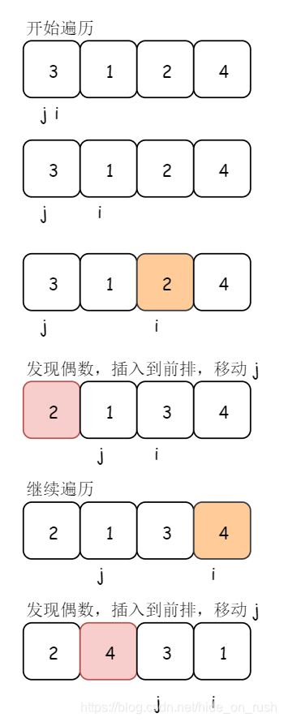  
代码如下：

```java
class Solution {
    public int[] sortArrayByParity(int[] A) {
        int j=0;
        for(int i=0;i<A.length;i++){
        if(A[i]%2==0){
            int temp;
            temp=A[i];
            A[i]=A[j];
            A[j]=temp;
            j++;
        }
        }
        return A;
    }
}
```

###### [215.数组中第k大的元素](https://leetcode-cn.com/problems/kth-largest-element-in-an-array/)

找未排序数组中第k大的元素，可以先排个序，就很好找第k大的元素了。

```java
class Solution {
    public int findKthLargest(int[] nums, int k) {
        Arrays.sort(nums);
        return nums[nums.length-k];
    }
}
```

###### [75.颜色分类](https://leetcode-cn.com/problems/sort-colors/)

题目要求把相同的元素放一块儿，并且按大小排序，可以用桶排序的思想，事先划分好三个区域，用一个指针在1的区域扫描，0放在前面的区域，2放在后面的区域，所以需要三个指针。  
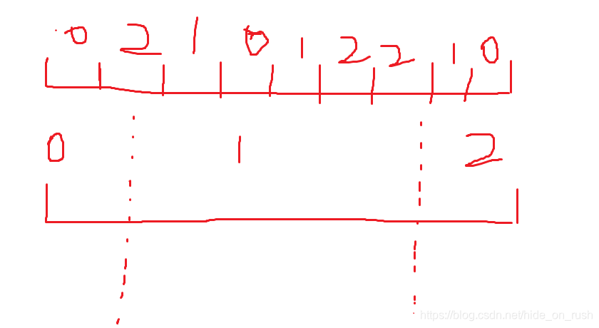  
代码如下：

```java
class Solution {
   public void sortColors(int[] nums) {
    int zero = -1, one = 0, two = nums.length;
    while (one < two) {
        if (nums[one] == 0) {
            swap(nums, ++zero, one++);
        } else if (nums[one] == 2) {
            swap(nums, --two, one);//这里还需要检验交换后的数
        } else {
            ++one;
        }
    }
}

    private void swap(int[] nums, int i, int j) {
    int t = nums[i];
    nums[i] = nums[j];
    nums[j] = t;
    }
}
```

##### 桶排序

###### [！451.根据字符出现频率排序](https://leetcode-cn.com/problems/sort-characters-by-frequency/)

```java
public String frequencySort(String s) {
    Map<Character, Integer> frequencyForNum = new HashMap<>();
    for (char c : s.toCharArray())
        frequencyForNum.put(c, frequencyForNum.getOrDefault(c, 0) + 1);

    List<Character>[] frequencyBucket = new ArrayList[s.length() + 1];
    for (char c : frequencyForNum.keySet()) {
        int f = frequencyForNum.get(c);
        if (frequencyBucket[f] == null) {
            frequencyBucket[f] = new ArrayList<>();
        }
        frequencyBucket[f].add(c);
    }
    StringBuilder str = new StringBuilder();
    for (int i = frequencyBucket.length - 1; i >= 0; i--) {
        if (frequencyBucket[i] == null) {
            continue;
        }
        for (char c : frequencyBucket[i]) {
            for (int j = 0; j < i; j++) {
                str.append(c);
            }
        }
    }
    return str.toString();
}
```

### 双指针

#### 双指针技巧汇总

#### 题目

##### [167. 两数之和 II - 输入有序数组](https://leetcode-cn.com/problems/two-sum-ii-input-array-is-sorted/)

使用双指针，一个在头，一个在尾，target比sum大，头指针后移，target比sum小，尾指针迁移。

```java
class Solution {
    public int[] twoSum(int[] numbers, int target) {
        if(numbers==null)return null;
        int i=0,j=numbers.length-1;
        while(i<j)
        {
            int sum = numbers[i]+numbers[j];
            if(sum==target)
            {
                return new int []{i+1,j+1};
            }else if(sum>target)
            {
                j--;
            }
            else
            {
                i++;
            }
        }
        return null;
    }
}
```

##### [633. 平方数之和](https://leetcode-cn.com/problems/sum-of-square-numbers/)

遇上一题类似，区别在于j近似于target的开方，减少运算量

```java
class Solution {
     public boolean judgeSquareSum(int target) {
     if (target < 0) return false;
     int i = 0, j = (int) Math.sqrt(target);
     while (i <= j) {
         int powSum = i * i + j * j;
         if (powSum == target) {
             return true;
         } else if (powSum > target) {
             j--;
         } else {
             i++;
         }
     }
     return false;
 }

}
```

##### [345. 反转字符串中的元音字母](https://leetcode-cn.com/problems/reverse-vowels-of-a-string/)

```java
class Solution {
   private final static HashSet<Character> vowels = new HashSet<>(
        Arrays.asList('a', 'e', 'i', 'o', 'u', 'A', 'E', 'I', 'O', 'U'));

    public String reverseVowels(String s) {
     if (s == null) return null;
     int i = 0, j = s.length() - 1;
     char[] result = new char[s.length()];
     while (i <= j) {
          char ci = s.charAt(i);
          char cj = s.charAt(j);
           if (!vowels.contains(ci)) {
              result[i++] = ci;
          } else if (!vowels.contains(cj)) {
             result[j--] = cj;
            } else {
               result[i++] = cj;
                result[j--] = ci;
         }
     }
     return new String(result);
}   

}
```

##### [680. 验证回文字符串 Ⅱ](https://leetcode-cn.com/problems/valid-palindrome-ii/)

判断回文数可以使用双指针的方法，一个指针从左到右遍历，一个指针从右到左遍历，两个指针同时移动一个位置，每次都判断两个指针指向的字符是否相同，如果都相同，字符串才是具有左右对称性质的回文字符串。

对于这个题目，在遍历到两个指针指向的字符不相同时，可以将左边或右边的一个字符删掉

```cpp
public boolean validPalindrome(String s) {
    for (int i = 0, j = s.length() - 1; i < j; i++, j--) {
        if (s.charAt(i) != s.charAt(j)) {
            return isPalindrome(s, i, j - 1) || isPalindrome(s, i + 1, j);
        }
    }
    return true;
}

private boolean isPalindrome(String s, int i, int j) {
    while (i < j) {
        if (s.charAt(i++) != s.charAt(j--)) {
            return false;
        }
    }
    return true;
}
```

##### [88. 合并两个有序数组?](https://leetcode-cn.com/problems/merge-sorted-array/)

```java
class Solution {
    public void merge(int[] nums1, int m, int[] nums2, int n) {
        int len1 = m - 1;
        int len2 = n - 1;
        int len = m + n - 1;
        while(len1 >= 0 && len2 >= 0) {
            // 注意--符号在后面，表示先进行计算再减1，这种缩写缩短了代码
            nums1[len--] = nums1[len1] > nums2[len2] ? nums1[len1--] : nums2[len2--];
        }
        // 表示将nums2数组从下标0位置开始，拷贝到nums1数组中，从下标0位置开始，长度为len2+1
        System.arraycopy(nums2, 0, nums1, 0, len2 + 1);
    }
}
```

<https://leetcode-cn.com/problems/merge-sorted-array/solution/hua-jie-suan-fa-88-he-bing-liang-ge-you-xu-shu-zu-/>

##### [141. 环形链表](https://leetcode-cn.com/problems/linked-list-cycle/)

<https://leetcode-cn.com/problems/linked-list-cycle/solution/yi-wen-gao-ding-chang-jian-de-lian-biao-wen-ti-h-2/>  
使用快慢指针，如果链表中有环，那么两个指针一定会相遇。

```java
public class Solution {
    public boolean hasCycle(ListNode head) {
        if(head==null)
        {
            return false;
        }
        ListNode val1 = head,val2=head.next;
        while(val1 != null && val2 != null && val2.next != null)
        {
            if(val1==val2)
            {
                return true;
            }
            val1 = val1.next;
            val2 = val2.next.next;
        }
        return false;
    }
}
```

##### [524. 通过删除字母匹配到字典里最长单词?](https://leetcode-cn.com/problems/longest-word-in-dictionary-through-deleting/)

这题的关键就是怎么在字符串字典中找到那个对应的字符串。其实很简单。  
只要利用两个指针i,j，一个指向s字符串，一个指向sstr字符串，每一次查找过程中,i依次后移，若i,j对应的两个字符相等，则j后移，如果j可以移到sstr.length()，那么说明sstr中对应的字符s中都有，即s中删除一些字符后，可以得到sstr字符串，最后一步就是比较当前的结果字符与找到的sstr字符，按照题目的需求来决定是否改变结果字符

```java
class Solution {
    public String findLongestWord(String s, List<String> d) {
        String str="";
        for(String sstr:d){
            for(int i=0,j=0;i<s.length()&&j<sstr.length();i++){
                if(s.charAt(i)==sstr.charAt(j)) j++;
                if(j==sstr.length()){
                    if(sstr.length()>str.length()||(sstr.length()==str.length()&&str.compareTo(sstr)>0))  str=sstr;
                }
            }
        }
        return str;
        
    }
}
```

### 二分查找

#### 二分查找技巧

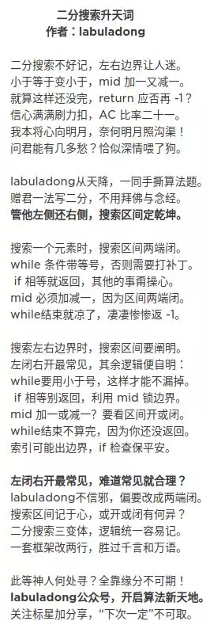

##### 二分查找常用场景

寻找一个数、寻找左侧边界、寻找右侧边界  
细节：不等号是否要带等号、mid是否应该加一

#### 二分查找框架

```cpp
int binarySearch(int[] nums, int target) {
    int left = 0, right = ...;

    while(...) {
        int mid = left + (right - left) / 2;
        if (nums[mid] == target) {
            ...
        } else if (nums[mid] < target) {
            left = ...
        } else if (nums[mid] > target) {
            right = ...
        }
    }
    return ...;
}
```

**分析二分查找的一个技巧是：不要出现else，而是把所有情况用else if 写清楚，这样可以清楚的展现所有细节** 下文都会使用else if，旨在讲清楚。

其中...的部分就是可能出现细节问题的地方。  
另外 ，计算mid时要防止溢出，代码中`left + (right - left) / 2`就和`(left + right) / 2`的结果相同，但是有效防止了left和right太大直接相加导致溢出。

#### 寻找一个数（基本的二分搜索）

即搜索一个数，如果存在，返回其索引。否则返回-1

```cpp
int binarySearch(int[] nums, int target) {
    int left = 0; 
    int right = nums.length - 1; // 注意

    while(left <= right) {
        int mid = left + (right - left) / 2;
        if(nums[mid] == target)
            return mid; 
        else if (nums[mid] < target)
            left = mid + 1; // 注意
        else if (nums[mid] > target)
            right = mid - 1; // 注意
    }
    return -1;
}
```

##### 1.为什么while的循环条件是<=而不是<?

因为初始化`right`的值是`nums.length - 1`。即最后一个数的索引，而不是`nums.length`  
这二者可能出现在不同功能的二分查找中，区别是：前者相当于两端都闭区间`[left, right]`，后者相当于左闭右开区间`[left, right)`，因为索引大小为`nums.length`是越界的。  
我们这个算法中使用的是前者`[left, right]`两端都闭的区间。**这个区间其实就是每次进行搜索的区间。**

什么时候应该停止搜索呢？当然，找到了目标值的时候可以终止：

```cpp
  if(nums[mid] == target)
        return mid;
```

但如果没找到，就需要 while 循环终止，然后返回 -1。那 while 循环什么时候应该终止？**搜索区间为空的时候应该终止**，意味着你没得找了，就等于没找到嘛。

但如果没找到，就需要 while 循环终止，然后返回 -1。那 while 循环什么时候应该终止？搜索区间为空的时候应该终止，意味着你没得找了，就等于没找到嘛。

`while(left <= right)`的终止条件是`left == right + 1`，写成区间的形式就是[`right + 1, right]`，或者带个具体的数字进去`[3, 2]`，可见这时候区间为空，因为没有数字既大于等于 3 又小于等于 2 的吧。所以这时候 while 循环终止是正确的，直接返回 -1 即可。

**while(left < right)**的终止条件是**left == right**，写成区间的形式就是**[left, right]**，或者带个具体的数字进去**[2, 2]**，这时候区间非空，还有一个数 2，但此时 while 循环终止了。也就是说这区间[2, 2]被漏掉了，索引 2 没有被搜索，如果这时候直接返回 -1 就是错误的。

当然，如果你非要用while(left < right)也可以，我们已经知道了出错的原因，就打个补丁好了：

```cpp
 //...
    while(left < right) {
        // ...
    }
    return nums[left] == target ? left : -1;
```

##### 2.为什么`left = mid + 1`，`right = mid - 1`？我看有的代码是`right = mid`或者`left = mid`，没有这些加加减减，到底怎么回事，怎么判断？

刚才明确了「搜索区间」这个概念，而且本算法的搜索区间是两端都闭的，即[left, right]。那么当我们发现索引mid不是要找的target时，下一步应该去搜索哪里呢？

当然是去搜索[left, mid-1]或者[mid+1, right]对不对？因为mid已经搜索过，应该从搜索区间中去除。

##### 3.此算法有什么缺陷？

至此，你应该已经掌握了该算法的所有细节，以及这样处理的原因。但是，这个算法存在局限性。

比如说给你有序数组`nums = [1,2,2,2,3]`，`target`为 2，此算法返回的索引是 2，没错。但是如果我想得到`target`的左侧边界，即索引 1，或者我想得到`target`的右侧边界，即索引 3，这样的话此算法是无法处理的。

这样的需求很常见，**你也许会说，找到一个 target，然后向左或向右线性搜索不行吗？可以，但是不好，因为这样难以保证二分查找对数级的复杂度了。**

我们后续的算法就来讨论这两种二分查找的算法。

#### 二、寻找左侧边界的二分搜索

以下是最常见的代码形式，其中的标记是需要注意的细节：

```cpp
int left_bound(int[] nums, int target) {
    if (nums.length == 0) return -1;
    int left = 0;
    int right = nums.length; // 注意

    while (left < right) { // 注意
        int mid = (left + right) / 2;
        if (nums[mid] == target) {
            right = mid;
        } else if (nums[mid] < target) {
            left = mid + 1;
        } else if (nums[mid] > target) {
            right = mid; // 注意
        }
    }
    return left;
}
```

##### 1.为什么 while 中是<而不是<=?

用相同的方法分析，因为`right = nums.length`而不是`nums.length - 1`。因此每次循环的「搜索区间」是`[left, right)`左闭右开。

`while(left < right)`终止的条件是`left == right`，此时搜索区间`[left, left)`为空，所以可以正确终止。

PS：这里先要说一个搜索左右边界和上面这个算法的一个区别，也是很多读者问的：**刚才的`right`不是`nums.length - 1`吗，为啥这里非要写成`nums.length`使得「搜索区间」变成左闭右开呢**？

##### 2.为什么没有返回 -1 的操作？如果nums中不存在target这个值，怎么办？

因为要一步一步来，先理解一下这个「左侧边界」有什么特殊含义：  
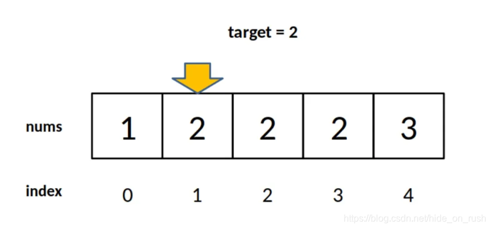  
对于这个数组，算法会返回 1。这个 1 的含义可以这样解读：`nums`中小于 2 的元素有 1 个。

比如对于有序数组`nums = [2,3,5,7],target = 1`，算法会返回 0，含义是：`nums`中小于 1 的元素有 0 个。

再比如说`nums = [2,3,5,7], target = 8`，算法会返回 4，含义是：`nums`中小于 8 的元素有 4 个。

综上可以看出，函数的返回值（即`left`变量的值）取值区间是闭区间`[0, nums.length]`，所以我们简单添加两行代码就能在正确的时候 return -1：

```cpp
while (left < right) {
    //...
}
// target 比所有数都大
if (left == nums.length) return -1;
// 类似之前算法的处理方式
return nums[left] == target ? left : -1;
```

##### 3. 为什么left=mid+1,right=mid?和之前的算法不一样？

这个很好解释，因为我们的「搜索区间」是`[left, right)`左闭右开，所以当`nums[mid]`被检测之后，下一步的搜索区间应该去掉`mid`分割成两个区间，即`[left, mid)`或`[mid + 1, right)`。

##### 4.为什么该算法能搜索左侧边界

关键在于对于nums[mid] == target这种情况的处理：

```cpp
if (nums[mid] == target)
        right = mid;
```

可见，找到 target 时不要立即返回，而是缩小「搜索区间」的上界`right`，在区间`[left, mid)`中继续搜索，即不断向左收缩，达到锁定左侧边界的目的。

##### 5.为什么返回left而不是right？

都是一样的，因为 while 终止的条件是left == right。

##### 6.能不能想办法把`right`变成`nums.length - 1`，也就是继续使用两边都闭的「搜索区间」？这样就可以和第一种二分搜索在某种程度上统一起来了。

当然可以，只要你明白了「搜索区间」这个概念，就能有效避免漏掉元素，随便你怎么改都行。下面我们严格根据逻辑来修改：

因为你非要让搜索区间两端都闭，所以`right`应该初始化为`nums.length - 1`，while 的终止条件应该是`left == right + 1`，也就是其中应该用`<=`：

```cpp
int left_bound(int[] nums, int target) {
    // 搜索区间为 [left, right]
    int left = 0, right = nums.length - 1;
    while (left <= right) {
        int mid = left + (right - left) / 2;
        // if else ...
    }
```

因为搜索区间是两端都闭的，且现在是搜索左侧边界，所以left和right的更新逻辑如下：

```cpp
if (nums[mid] < target) {
    // 搜索区间变为 [mid+1, right]
    left = mid + 1;
} else if (nums[mid] > target) {
    // 搜索区间变为 [left, mid-1]
    right = mid - 1;
} else if (nums[mid] == target) {
    // 收缩右侧边界
    right = mid - 1;
}
```

由于 while 的退出条件是left == right + 1，所以当target比nums中所有元素都大时，会存在以下情况使得索引越界：  
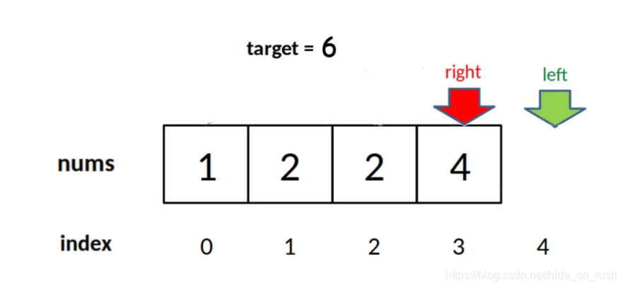  
因此，最后返回结果的代码应该检查越界情况：

```cpp
if (left >= nums.length || nums[left] != target)
    return -1;
return left;
```

至此，整个算法就写完了，完整代码如下：

```cpp
int left_bound(int[] nums, int target) {
    int left = 0, right = nums.length - 1;
    // 搜索区间为 [left, right]
    while (left <= right) {
        int mid = left + (right - left) / 2;
        if (nums[mid] < target) {
            // 搜索区间变为 [mid+1, right]
            left = mid + 1;
        } else if (nums[mid] > target) {
            // 搜索区间变为 [left, mid-1]
            right = mid - 1;
        } else if (nums[mid] == target) {
            // 收缩右侧边界
            right = mid - 1;
        }
    }
    // 检查出界情况
    if (left >= nums.length || nums[left] != target)
        return -1;
    return left;
}
```

这样就和第一种二分搜索算法统一了，都是两端都闭的「搜索区间」，而且最后返回的也是`left`变量的值。只要把住二分搜索的逻辑，两种形式大家看自己喜欢哪种记哪种吧。

#### 寻找右侧边界得二分查找

类似寻找左侧边界的算法，这里也会提供两种写法，还是先写常见的左闭右开的写法，只有两处和搜索左侧边界不同，已标注：

```cpp
int right_bound(int[] nums, int target) {
    if (nums.length == 0) return -1;
    int left = 0, right = nums.length;

    while (left < right) {
        int mid = (left + right) / 2;
        if (nums[mid] == target) {
            left = mid + 1; // 注意
        } else if (nums[mid] < target) {
            left = mid + 1;
        } else if (nums[mid] > target) {
            right = mid;
        }
    }
    return left - 1; // 注意
}
```

##### 1.为什么这个算法能找到右侧边界？

```cpp
if (nums[mid] == target) {
    left = mid + 1;
```

当`nums[mid] == targe`t时，不要立即返回，而是增大「搜索区间」的下界`left`，使得区间不断向右收缩，达到锁定右侧边界的目的。

##### 2.为什么最后返回`left - 1`而不像左侧边界的函数，返回`left`？而且我觉得这里既然是搜索右侧边界，应该返回`right`才对。

首先，while 循环的终止条件是`left == right`，所以`left`和`right`是一样的，你非要体现右侧的特点，返回`right - 1`好了。

至于为什么要减一，这是搜索右侧边界的一个特殊点，关键在这个条件判断：

```cpp
if (nums[mid] == target) {
    left = mid + 1;
    // 这样想: mid = left - 1
```

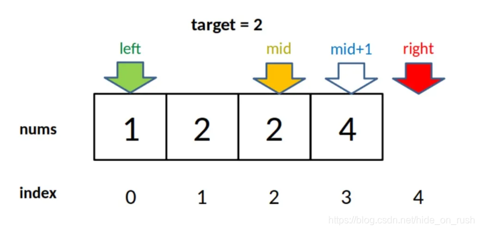  
因为我们对`left`的更新必须是`left = mid + 1`，就是说 while 循环结束时，`nums[left]`一定不等于`target`了，而`nums[left-1]`可能是`target`。

至于为什么`left`的更新必须是`left = mid + 1`，同左侧边界搜索，就不再赘述。

##### 3.为什么没有返回 -1 的操作？如果nums中不存在target这个值，怎么办？

类似之前的左侧边界搜索，因为 while 的终止条件是left == right，就是说left的取值范围是[0, nums.length]，所以可以添加两行代码，正确地返回 -1：

```cpp
while (left < right) {
    // ...
}
if (left == 0) return -1;
return nums[left-1] == target ? (left-1) : -1;
```

##### 4.是否也可以把这个算法的「搜索区间」也统一成两端都闭的形式呢？这样这三个写法就完全统一了，以后就可以闭着眼睛写出来了。

当然可以，类似搜索左侧边界的统一写法，其实只要改两个地方就行了：

```cpp
int right_bound(int[] nums, int target) {
    int left = 0, right = nums.length - 1;
    while (left <= right) {
        int mid = left + (right - left) / 2;
        if (nums[mid] < target) {
            left = mid + 1;
        } else if (nums[mid] > target) {
            right = mid - 1;
        } else if (nums[mid] == target) {
            // 这里改成收缩左侧边界即可
            left = mid + 1;
        }
    }
    // 这里改为检查 right 越界的情况，见下图
    if (right < 0 || nums[right] != target)
        return -1;
    return right;
}
```

当`target`比所有元素都小时，`right`会被减到 -1，所以需要在最后防止越界：  
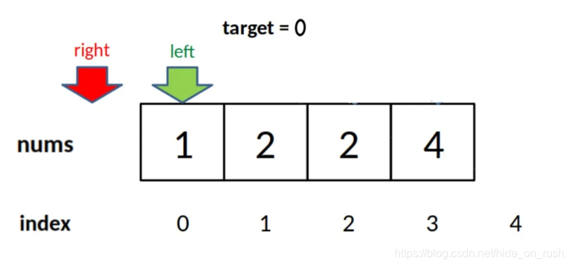  
至此，搜索右侧边界的二分查找的两种写法也完成了，其实将「搜索区间」统一成两端都闭反而更容易记忆，你说是吧？

#### 4.逻辑统一

来梳理一下这些细节差异的因果逻辑：

##### 第一个，最基本的二分查找算法：

```java
因为我们初始化 right = nums.length - 1
所以决定了我们的「搜索区间」是 [left, right]
所以决定了 while (left <= right)
同时也决定了 left = mid+1 和 right = mid-1

因为我们只需找到一个 target 的索引即可
所以当 nums[mid] == target 时可以立即返回
```

##### 第二个，寻找左侧边界的二分查找：

```java
因为我们初始化 right = nums.length
所以决定了我们的「搜索区间」是 [left, right)
所以决定了 while (left < right)
同时也决定了 left = mid + 1 和 right = mid

因为我们需找到 target 的最左侧索引
所以当 nums[mid] == target 时不要立即返回
而要收紧右侧边界以锁定左侧边界
```

##### 第三个，寻找右侧边界的二分查找：

```java
因为我们初始化 right = nums.length
所以决定了我们的「搜索区间」是 [left, right)
所以决定了 while (left < right)
同时也决定了 left = mid + 1 和 right = mid

因为我们需找到 target 的最右侧索引
所以当 nums[mid] == target 时不要立即返回
而要收紧左侧边界以锁定右侧边界

又因为收紧左侧边界时必须 left = mid + 1
所以最后无论返回 left 还是 right，必须减一
```

对于寻找左右边界的二分搜索，常见的手法是使用左闭右开的「搜索区间」，**我们还根据逻辑将「搜索区间」全都统一成了两端都闭，便于记忆，只要修改两处即可变化出三种写法：**

```java
int binary_search(int[] nums, int target) {
    int left = 0, right = nums.length - 1; 
    while(left <= right) {
        int mid = left + (right - left) / 2;
        if (nums[mid] < target) {
            left = mid + 1;
        } else if (nums[mid] > target) {
            right = mid - 1; 
        } else if(nums[mid] == target) {
            // 直接返回
            return mid;
        }
    }
    // 直接返回
    return -1;
}

int left_bound(int[] nums, int target) {
    int left = 0, right = nums.length - 1;
    while (left <= right) {
        int mid = left + (right - left) / 2;
        if (nums[mid] < target) {
            left = mid + 1;
        } else if (nums[mid] > target) {
            right = mid - 1;
        } else if (nums[mid] == target) {
            // 别返回，锁定左侧边界
            right = mid - 1;
        }
    }
    // 最后要检查 left 越界的情况
    if (left >= nums.length || nums[left] != target)
        return -1;
    return left;
}


int right_bound(int[] nums, int target) {
    int left = 0, right = nums.length - 1;
    while (left <= right) {
        int mid = left + (right - left) / 2;
        if (nums[mid] < target) {
            left = mid + 1;
        } else if (nums[mid] > target) {
            right = mid - 1;
        } else if (nums[mid] == target) {
            // 别返回，锁定右侧边界
            left = mid + 1;
        }
    }
    // 最后要检查 right 越界的情况
    if (right < 0 || nums[right] != target)
        return -1;
    return right;
}
```

#### 题目

##### 69.[x的平方根](https://leetcode-cn.com/problems/sqrtx/)

### DFS

### BFS

### 贪心

动态规划的一个特例，需要满足更多的条件，但是效率更高  
流程：

- （1）建立数学模型来描述问题。
- （2）把求解的问题分成若干个子问题。
- （3）对每一子问题求解，得到子问题的局部最优解。
- （4）把子问题的局部最优解合成原来问题的一个解。  
  贪心策略是一种求局部最优解的方法，用贪心策略解题需要证明局部最优解是全局最优解。

#### 题目

##### [455.分发饼干](https://leetcode-cn.com/problems/assign-cookies/)

给一个孩子的饼干应当尽量小并且又能满足该孩子，这样大饼干才能拿来给满足度比较大的孩子。  
因为满足度最小的孩子最容易得到满足，所以先满足满足度最小的孩子。  
在以上的解法中，我们只在每次分配时饼干时选择一种看起来是当前最优的分配方法，但无法保证这种局部最优的分配方法最后能得到全局最优解。我们假设能得到全局最优解，并使用反证法进行证明，即假设存在一种比我们使用的贪心策略更优的最优策略。如果不存在这种最优策略，表示贪心策略就是最优策略，得到的解也就是全局最优解。

证明：假设在某次选择中，贪心策略选择给当前满足度最小的孩子分配第 m 个饼干，第 m 个饼干为可以满足该孩子的最小饼干。假设存在一种最优策略，可以给该孩子分配第 n 个饼干，并且 m < n。我们可以发现，经过这一轮分配，贪心策略分配后剩下的饼干一定有一个比最优策略来得大。因此在后续的分配中，贪心策略一定能满足更多的孩子。也就是说不存在比贪心策略更优的策略，即贪心策略就是最优策略。

```java
class Solution {
    public int findContentChildren(int[] grid, int[] size) {
    if (grid == null || size == null) return 0;
    Arrays.sort(grid);
    Arrays.sort(size);
    int gi = 0, si = 0;
    while (gi < grid.length && si < size.length) {
        if (grid[gi] <= size[si]) {
            gi++;
        }
        si++;
    }
    return gi;
}
}
```

##### [435.无重叠区间?](https://leetcode-cn.com/problems/non-overlapping-intervals/)

<https://labuladong.gitbook.io/algo/dong-tai-gui-hua-xi-lie/tan-xin-suan-fa-zhi-qu-jian-tiao-du-wen-ti#er-tan-xin-jie-fa>

```java
class Solution {
   public int intervalSchedule(int[][] intvs) {
    if (intvs.length == 0) return 0;
    // 按 end 升序排序
    Arrays.sort(intvs, new Comparator<int[]>() {
        public int compare(int[] a, int[] b) {
            return a[1] - b[1];
        }
    });
    // 至少有一个区间不相交
    int count = 1;
    // 排序后，第一个区间就是 x
    int x_end = intvs[0][1];
    for (int[] interval : intvs) {
        int start = interval[0];
        if (start >= x_end) {
            // 找到下一个选择的区间了
            count++;
            x_end = interval[1];
        }
    }
    return count;
}
int eraseOverlapIntervals(int[][] intervals) {
    int n = intervals.length;
    return n - intervalSchedule(intervals);
}
}
```

##### 452.

### 分治

### 倍增

### 搜索

### 动态规划

#### 解题框架

首先，**动态规划问题的一般形式就是求最值**。动态规划其实是运筹学的一种最优化方法，只不过在计算机问题上应用比较多，比如说让你求**最长递增子序列呀，最小编辑距离**呀等等。  
既然是要求最值，核心问题是什么呢？**求解动态规划的核心问题是穷举**。因为要求最值，肯定要把所有可行的答案穷举出来，然后在其中找最值呗。  
动态规划这么简单，就是穷举就完事了？我看到的动态规划问题都很难啊！  
首先，动态规划的穷举有点特别，因为这类问题存在**「重叠子问题」**，如果暴力穷举的话效率会极其低下，所以需要「备忘录」或者「DP table」来优化穷举过程，避免不必要的计算。  
而且，动态规划问题一定会具备**「最优子结构」**，才能通过子问题的最值得到原问题的最值。  
另外，虽然动态规划的核心思想就是穷举求最值，但是问题可以千变万化，穷举所有可行解其实并不是一件容易的事，只有列出正确的「**状态转移方程」**才能正确地穷举。  
以上提到的重叠子问题、最优子结构、状态转移方程就是动态规划三要素。具体什么意思等会会举例详解，但是在实际的算法问题中，**写出状态转移方程是最困难的**，这也就是为什么很多朋友觉得动态规划问题困难的原因，我来提供我研究出来的一个思维框架，辅助你思考状态转移方程：  
**明确 base case -> 明确「状态」-> 明确「选择」 -> 定义 dp 数组/函数的含义。**  
按上面的套路走，最后的结果就可以套这个框架：

```java
# 初始化 base case
dp[0][0][...] = base
# 进行状态转移
for 状态1 in 状态1的所有取值：
    for 状态2 in 状态2的所有取值：
        for ...
            dp[状态1][状态2][...] = 求最值(选择1，选择2...)
```

下面通过斐波那契数列问题和凑零钱问题来详解动态规划的基本原理。前者主要是让你明白什么是重叠子问题（斐波那契数列没有求最值，所以严格来说不是动态规划问题），后者主要举集中于如何列出状态转移方程。

##### 一、斐波那契数列

###### 1.暴力递归

斐波那契数列的数学形式就是递归的，写成代码就是这样：

```java
int fib(int N) {
    if (N == 1 || N == 2) return 1;
    return fib(N - 1) + fib(N - 2);
}
```

这个不用多说了，学校老师讲递归的时候似乎都是拿这个举例。我们也知道这样写代码虽然简洁易懂，但是十分低效，低效在哪里？假设 n = 20，请画出递归树：  
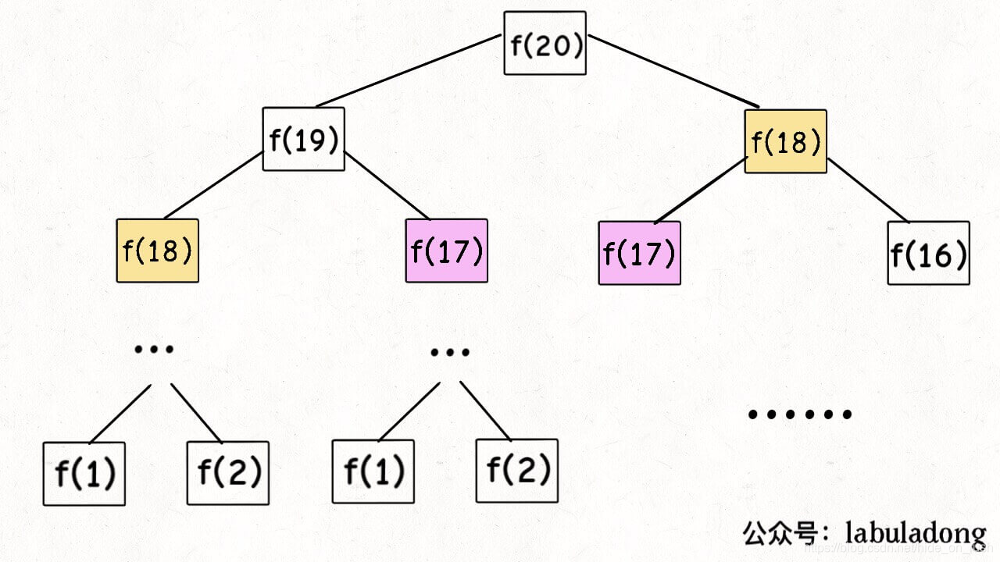

> PS：但凡遇到需要递归的问题，最好都画出递归树，这对你分析算法的复杂度，寻找算法低效的原因都有巨大帮助。

这个递归树怎么理解？就是说想要计算原问题 f(20)，我就得先计算出子问题 f(19) 和 f(18)，然后要计算 f(19)，我就要先算出子问题 f(18) 和 f(17)，以此类推。最后遇到 f(1) 或者 f(2) 的时候，结果已知，就能直接返回结果，递归树不再向下生长了。  
**递归算法的时间复杂度怎么计算？就是用子问题个数乘以解决一个子问题需要的时间。**  
首先计算子问题个数，即递归树中节点的总数。显然二叉树节点总数为指数级别，所以子问题个数为 O(2^n)。  
然后计算解决一个子问题的时间，在本算法中，没有循环，只有 f(n - 1) + f(n - 2) 一个加法操作，时间为 O(1)。  
所以，这个算法的时间复杂度为二者相乘，即 O(2^n)，指数级别，爆炸。  
观察递归树，很明显发现了算法低效的原因：存在大量重复计算，比如 f(18) 被计算了两次，而且你可以看到，以 f(18) 为根的这个递归树体量巨大，多算一遍，会耗费巨大的时间。更何况，还不止 f(18) 这一个节点被重复计算，所以这个算法及其低效。  
这就是动态规划问题的第一个性质：**重叠子问题**。下面，我们想办法解决这个问题。

###### 2.带备忘录的递归解法

明确了问题，其实就已经把问题解决了一半。即然耗时的原因是重复计算，那么我们可以造一个「备忘录」，每次算出某个子问题的答案后别急着返回，先记到「备忘录」里再返回；每次遇到一个子问题先去「备忘录」里查一查，如果发现之前已经解决过这个问题了，直接把答案拿出来用，不要再耗时去计算了。  
一般使用一个数组充当这个「备忘录」，当然你也可以使用哈希表（字典），思想都是一样的。

```java
int fib(int N) {
    if (N < 1) return 0;
    // 备忘录全初始化为 0
    vector<int> memo(N + 1, 0);
    // 进行带备忘录的递归
    return helper(memo, N);
}

int helper(vector<int>& memo, int n) {
    // base case 
    if (n == 1 || n == 2) return 1;
    // 已经计算过
    if (memo[n] != 0) return memo[n];
    memo[n] = helper(memo, n - 1) + helper(memo, n - 2);
    return memo[n];
}
```

现在，画出递归树，你就知道「备忘录」到底做了什么。  
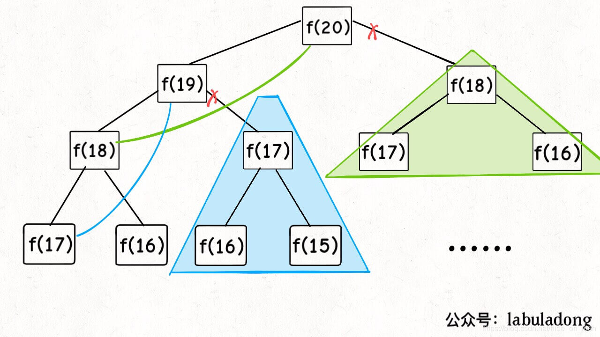  
实际上，带「备忘录」的递归算法，把一棵存在巨量冗余的递归树通过「剪枝」，改造成了一幅不存在冗余的递归图，极大减少了子问题（即递归图中节点）的个数。  
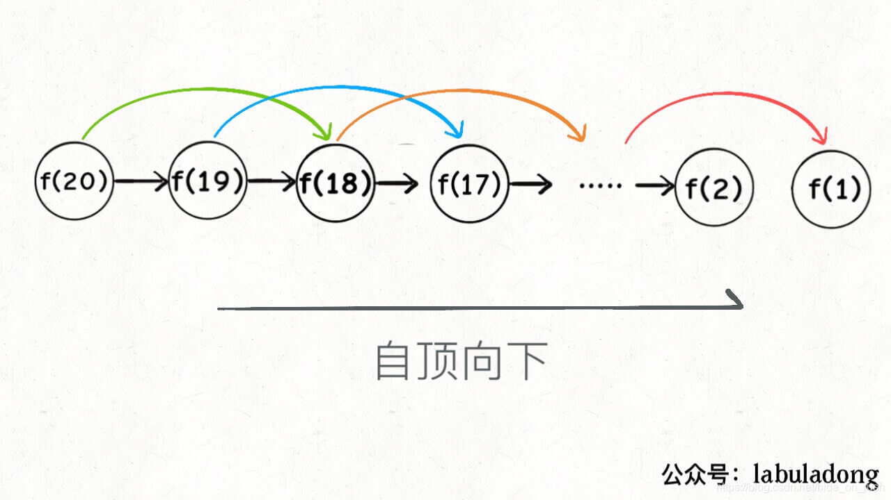  
**递归算法的时间复杂度怎么计算？就是用子问题个数乘以解决一个子问题需要的时间。**

子问题个数，即图中节点的总数，由于本算法不存在冗余计算，子问题就是 f(1), f(2), f(3) ... f(20)，数量和输入规模 n = 20 成正比，所以子问题个数为 O(n)。

解决一个子问题的时间，同上，没有什么循环，时间为 O(1)。

所以，本算法的时间复杂度是 O(n)。比起暴力算法，是降维打击。

至此，带备忘录的递归解法的效率已经和迭代的动态规划解法一样了。实际上，这种解法和迭代的动态规划已经差不多了，只不过这种方法叫做「自顶向下」，动态规划叫做「自底向上」。

啥叫「自顶向下」？注意我们刚才画的递归树（或者说图），是从上向下延伸，都是从一个规模较大的原问题比如说 f(20)，向下逐渐分解规模，直到 f(1) 和 f(2) 这两个 base case，然后逐层返回答案，这就叫「自顶向下」。

啥叫「自底向上」？反过来，我们直接从最底下，最简单，问题规模最小的 f(1) 和 f(2) 开始往上推，直到推到我们想要的答案 f(20)，这就是动态规划的思路，这也是为什么动态规划一般都脱离了递归，而是由循环迭代完成计算。

###### 3、dp 数组的迭代解法

有了上一步「备忘录」的启发，我们可以把这个「备忘录」独立出来成为一张表，就叫做 DP table 吧，在这张表上完成「自底向上」的推算岂不美哉！

```java
int fib(int N) {
    vector<int> dp(N + 1, 0);
    // base case
    dp[1] = dp[2] = 1;
    for (int i = 3; i <= N; i++)
        dp[i] = dp[i - 1] + dp[i - 2];
    return dp[N];
}
```

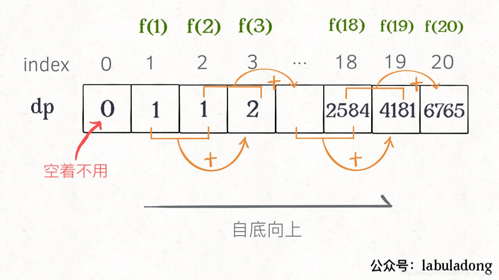  
画个图就很好理解了，而且你发现这个 DP table 特别像之前那个「剪枝」后的结果，只是反过来算而已。实际上，带备忘录的递归解法中的「备忘录」，最终完成后就是这个 DP table，所以说这两种解法其实是差不多的，大部分情况下，效率也基本相同。

这里，**引出「状态转移方程」这个名词，实际上就是描述问题结构的数学形式：**  
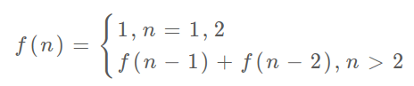  
为啥叫「状态转移方程」？其实就是为了听起来高端。你把 f(n) 想做一个状态 n，这个状态 n 是由状态 n - 1 和状态 n - 2 相加转移而来，这就叫状态转移，仅此而已。

你会发现，上面的几种解法中的所有操作，例如 return f(n - 1) + f(n - 2)，dp[i] = dp[i - 1] + dp[i - 2]，以及对备忘录或 DP table 的初始化操作，都是围绕这个方程式的不同表现形式。可见列出「状态转移方程」的重要性，它是解决问题的核心。而且很容易发现，其实状态转移方程直接代表着暴力解法。

**千万不要看不起暴力解，动态规划问题最困难的就是写出这个暴力解，**即状态转移方程。只要写出暴力解，优化方法无非是用备忘录或者 DP table，再无奥妙可言。

这个例子的最后，讲一个细节优化。细心的读者会发现，根据斐波那契数列的状态转移方程，当前状态只和之前的两个状态有关，其实并不需要那么长的一个 DP table 来存储所有的状态，只要想办法存储之前的两个状态就行了。所以，可以进一步优化，把空间复杂度降为 O(1)：

```java
int fib(int n) {

    if (n == 2 || n == 1) 

        return 1;

    int prev = 1, curr = 1;

    for (int i = 3; i <= n; i++) {

        int sum = prev + curr;

        prev = curr;

        curr = sum;

    }

    return curr;

}
```

这个技巧就是所谓的**「状态压缩」**，如果我们发现每次状态转移只需要 DP table 中的一部分，那么可以尝试用状态压缩来缩小 DP table 的大小，只记录必要的数据，上述例子就相当于把 DP table 的大小从 n 缩小到 2。后续的动态规划章节中我们还会看到这样的例子，一般来说是把一个二维的 DP table 压缩成一维，即把空间复杂度从 O(n^2) 压缩到 O(n)。

有人会问，动态规划的另一个重要特性「最优子结构」，怎么没有涉及？下面会涉及。斐波那契数列的例子严格来说不算动态规划，因为没有涉及求最值，以上旨在说明重叠子问题的消除方法，演示得到最优解法逐步求精的过程。下面，看第二个例子，凑零钱问题。

有人会问，动态规划的另一个重要特性「最优子结构」，怎么没有涉及？下面会涉及。斐波那契数列的例子严格来说不算动态规划，因为没有涉及求最值，以上旨在说明重叠子问题的消除方法，演示得到最优解法逐步求精的过程。下面，看第二个例子，凑零钱问题。

##### 二、凑零钱问题

```java
// coins 中是可选硬币面值，amount 是目标金额
int coinChange(int[] coins, int amount);
```

比如说 k = 3，面值分别为 1，2，5，总金额 amount = 11。那么最少需要 3 枚硬币凑出，即 11 = 5 + 5 + 1。  
你认为计算机应该如何解决这个问题？显然，就是把所有肯能的凑硬币方法都穷举出来，然后找找看最少需要多少枚硬币。

###### 1.暴力递归

首先，这个问题是动态规划问题，因为它具有「最优子结构」的。**要符合「最优子结构」，子问题间必须互相独立**。啥叫相互独立？你肯定不想看数学证明，我用一个直观的例子来讲解。  
比如说，假设你考试，每门科目的成绩都是互相独立的。你的原问题是考出最高的总成绩，那么你的子问题就是要把语文考到最高，数学考到最高…… 为了每门课考到最高，你要把每门课相应的选择题分数拿到最高，填空题分数拿到最高…… 当然，最终就是你每门课都是满分，这就是最高的总成绩。  
得到了正确的结果：最高的总成绩就是总分。因为这个过程符合最优子结构，“每门科目考到最高”这些子问题是互相独立，互不干扰的。  
但是，如果加一个条件：你的语文成绩和数学成绩会互相制约，数学分数高，语文分数就会降低，反之亦然。这样的话，显然你能考到的最高总成绩就达不到总分了，按刚才那个思路就会得到错误的结果。**因为子问题并不独立，语文数学成绩无法同时最优，所以最优子结构被破坏。**  
回到凑零钱问题，为什么说它符合最优子结构呢？比如你想求 amount = 11 时的最少硬币数（原问题），如果你知道凑出 amount = 10 的最少硬币数（子问题），你只需要把子问题的答案加一（再选一枚面值为 1 的硬币）就是原问题的答案。因为硬币的数量是没有限制的，所以子问题之间没有相互制，是互相独立的。  
PS：关于最优子结构的问题，后文动态规划答疑篇 还会再举例探讨。  
那么，既然知道了这是个动态规划问题，就要思考**如何列出正确的状态转移方程？**

1. **确定 base case**，这个很简单，显然目标金额 amount 为 0 时算法返回 0，因为不需要任何硬币就已经凑出目标金额了。
2. **确定「状态」，也就是原问题和子问题中会变化的变量**。由于硬币数量无限，硬币的面额也是题目给定的，只有目标金额会不断地向 base case 靠近，所以唯一的「状态」就是目标金额 amount。
3. **确定「选择」，也就是导致「状态」产生变化 的行为。**目标金额为什么变化呢，因为你在选择硬币，你每选择一枚硬币，就相当于减少了目标金额。所以说所有硬币的面值，就是你的「选择」。
4. **明确 dp 函数/数组的定义**。我们这里讲的是自顶向下的解法，所以会有一个递归的 dp 函数，一般来说函数的参数就是状态转移中会变化的量，也就是上面说到的「状态」；函数的返回值就是题目要求我们计算的量。就本题来说，状态只有一个，即「目标金额」，题目要求我们计算凑出目标金额所需的最少硬币数量。所以我们可以这样定义 dp 函数：  
   dp(n) 的定义：输入一个目标金额 n，返回凑出目标金额 n 的最少硬币数量。  
   搞清楚上面这几个关键点，解法的伪码就可以写出来了：

```java
# 伪码框架
def coinChange(coins: List[int], amount: int):

    # 定义：要凑出金额 n，至少要 dp(n) 个硬币
    def dp(n):
        # 做选择，选择需要硬币最少的那个结果
        for coin in coins:
            res = min(res, 1 + dp(n - coin))
        return res

    # 题目要求的最终结果是 dp(amount)
    return dp(amount)
```

根据伪码，我们加上 base case 即可得到最终的答案。显然目标金额为 0 时，所需硬币数量为 0；当目标金额小于 0 时，无解，返回 -1：

```java
def coinChange(coins: List[int], amount: int):

    def dp(n):
        # base case
        if n == 0: return 0
        if n < 0: return -1
        # 求最小值，所以初始化为正无穷
        res = float('INF')
        for coin in coins:
            subproblem = dp(n - coin)
            # 子问题无解，跳过
            if subproblem == -1: continue
            res = min(res, 1 + subproblem)

        return res if res != float('INF') else -1

    return dp(amount)
```

至此，状态转移方程其实已经完成了，以上算法已经是暴力解法了，以上代码的数学形式就是状态转移方程：  
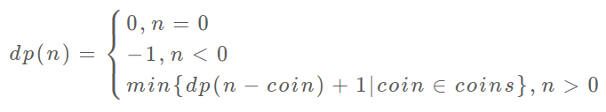  
至此，这个问题其实就解决了，只不过需要消除一下重叠子问题，比如 amount = 11, coins = {1,2,5} 时画出递归树看看：  
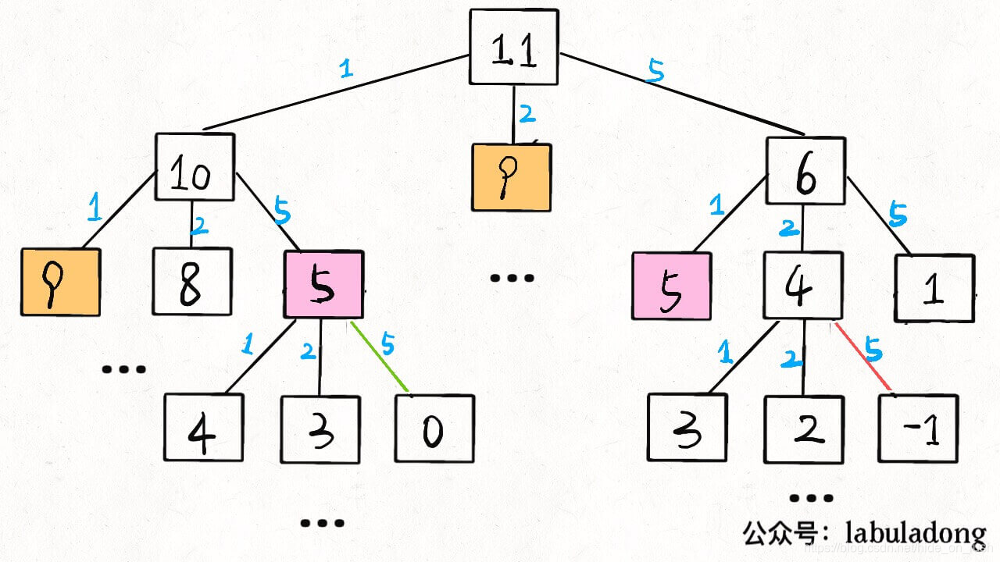  
**递归算法的时间复杂度分析：子问题总数 x 每个子问题的时间。**  
子问题总数为递归树节点个数，这个比较难看出来，是 O(n^k)，总之是指数级别的。每个子问题中含有一个 for 循环，复杂度为 O(k)。所以总时间复杂度为 O(k \* n^k)，指数级别。

###### 2.带备忘录的递归

类似之前斐波那契数列的例子，只需要稍加修改，就可以通过备忘录消除子问题：

```java
def coinChange(coins: List[int], amount: int):
    # 备忘录
    memo = dict()
    def dp(n):
        # 查备忘录，避免重复计算
        if n in memo: return memo[n]
        # base case
        if n == 0: return 0
        if n < 0: return -1
        res = float('INF')
        for coin in coins:
            subproblem = dp(n - coin)
            if subproblem == -1: continue
            res = min(res, 1 + subproblem)

        # 记入备忘录
        memo[n] = res if res != float('INF') else -1
        return memo[n]

    return dp(amount)
```

不画图了，很显然「备忘录」大大减小了子问题数目，完全消除了子问题的冗余，所以子问题总数不会超过金额数 n，即子问题数目为 O(n)。处理一个子问题的时间不变，仍是 O(k)，所以总的时间复杂度是 O(kn)。

###### 3.dp 数组的迭代解法

当然，我们也可以自底向上使用 dp table 来消除重叠子问题，关于「状态」「选择」和 base case 与之前没有区别，dp 数组的定义和刚才 dp 函数类似，也是把「状态」，也就是目标金额作为变量。不过 dp 函数体现在函数参数，而 dp 数组体现在数组索引：  
**dp 数组的定义：当目标金额为 i 时，至少需要 dp[i] 枚硬币凑出。**  
根据我们文章开头给出的动态规划代码框架可以写出如下解法：

```java
int coinChange(vector<int>& coins, int amount) {
    // 数组大小为 amount + 1，初始值也为 amount + 1
    vector<int> dp(amount + 1, amount + 1);
    // base case
    dp[0] = 0;
    // 外层 for 循环在遍历所有状态的所有取值
    for (int i = 0; i < dp.size(); i++) {
        // 内层 for 循环在求所有选择的最小值
        for (int coin : coins) {
            // 子问题无解，跳过
            if (i - coin < 0) continue;
            dp[i] = min(dp[i], 1 + dp[i - coin]);
        }
    }
    return (dp[amount] == amount + 1) ? -1 : dp[amount];
}
```

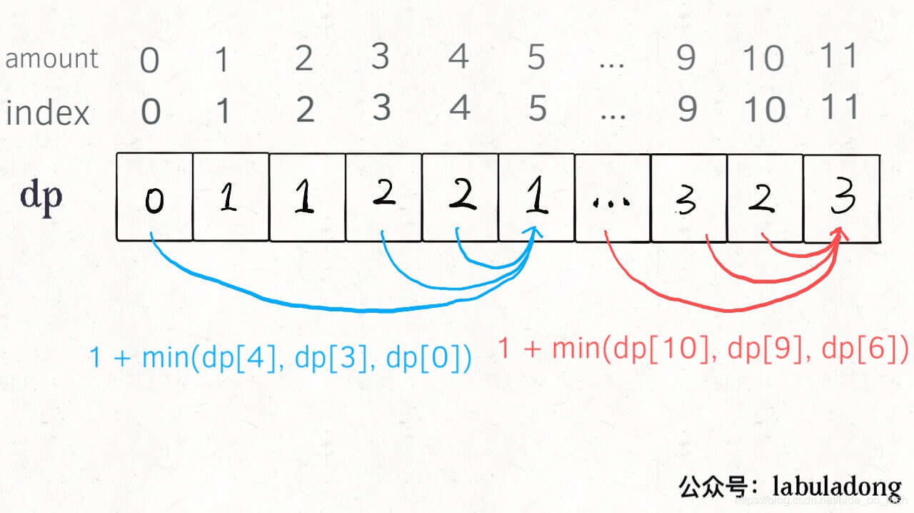  
PS：为啥 dp 数组初始化为 amount + 1 呢，因为凑成 amount 金额的硬币数最多只可能等于 amount（全用 1 元面值的硬币），所以初始化为 amount + 1 就相当于初始化为正无穷，便于后续取最小值。

#### 题目：

##### 斐波那契数列

###### [70.爬楼梯](https://leetcode-cn.com/problems/climbing-stairs/)

题解说的状态缓存、空间压缩什么的越看越迷糊，我的理解是这样的  
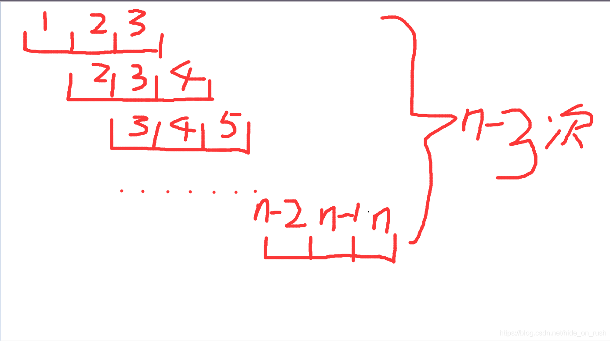

加入上3级台阶，方法数等于上两级台阶的方法数加上上一级台阶的方法数，那么上四级台阶时，我们已经知道了上三级台阶和上两级台阶的方法数，当上n级台阶时，这个交换数值的方法执行了n-3次

```java
class Solution {
    public int climbStairs(int n) {
        if(n<=2)return n;
        int pre1=2, pre2 =1;
        for(int i=2;i<n;i++){
            int cur = pre1 + pre2;
            pre2 = pre1;
            pre1 = cur;
        }
        return pre1;
    }
}
```

###### [198.打家劫舍](https://leetcode-cn.com/problems/house-robber/)

和前一题思路差不多。如果有三家，那么最大数值是第一三家之和及第二家中比较大的那个，如果是有四家。那就是第二家与第四家数值之和与偷到第三家的数值中较大的那个。以此类推。  
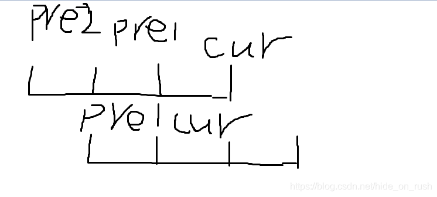

```java
class Solution {
    public int rob(int[] nums) {
        int pre1=0,pre2=0;
        for(int i=0;i<nums.length;i++){
            int cur = Math.max(pre1,pre2+nums[i]);
            pre2=pre1;
            pre1=cur;
        }
        return pre1;
    }
}
```

**注意：数值交换顺序一定不能错**

###### [213.打家劫舍II](https://leetcode-cn.com/problems/house-robber-ii/)

上一体的进阶版  
一个环形数组，由于不能偷相邻的位置，所以可以划分为两个普通数组，比较哪个普通数组更大。到了这步就和上一题相同了  
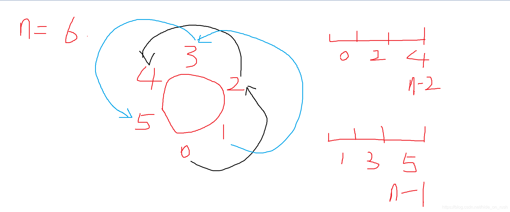

```java
public int rob(int[] nums) {
    if (nums == null || nums.length == 0) {
        return 0;
    }
    int n = nums.length;
    if (n == 1) {
        return nums[0];
    }
    return Math.max(rob(nums, 0, n - 2), rob(nums, 1, n - 1));
}

private int rob(int[] nums, int first, int last) {
    int pre2 = 0, pre1 = 0;
    for (int i = first; i <= last; i++) {
        int cur = Math.max(pre1, pre2 + nums[i]);
        pre2 = pre1;
        pre1 = cur;
    }
    return pre1;
}
```

##### 矩阵路径

###### [1.最小路径和](https://leetcode-cn.com/problems/minimum-path-sum/)

每次只能向下或者向右走一格，所以当前网格的最小数值等于本身的数值加上左边和上边网格中数值较小那个的数值‘  
有4种情况

1. 第一行第一列的数等于自身
2. 第一行的数值只能等于左边一格的数值加上自身
3. 第一列的数值只能等于上面一格的数值加上自身
4. 其他网格的最小值等于上面和左边网格数值更小的那个数值加上自身  
   代码如下：

```java
class Solution {
    public int minPathSum(int[][] grid) {
        for(int i=0;i<grid.length;i++){
            for(int j=0;j<grid[0].length;j++){
                if(i==0&&j==0)continue;
                else if(i==0)grid[i][j]+=grid[i][j-1];
                else if(j==0)grid[i][j]+=grid[i-1][j];
                else grid[i][j]+=Math.min(grid[i-1][j],grid[i][j-1]);
            }
            
        }
        return grid[grid.length-1][grid[0].length-1];
    }
}
```

###### [62.不同路径](https://leetcode-cn.com/problems/unique-paths/)

走到第一行或第一列的方法只有一种，走到其他位置的方法数等于上面的方法数加上左边的方法数如下图所示  
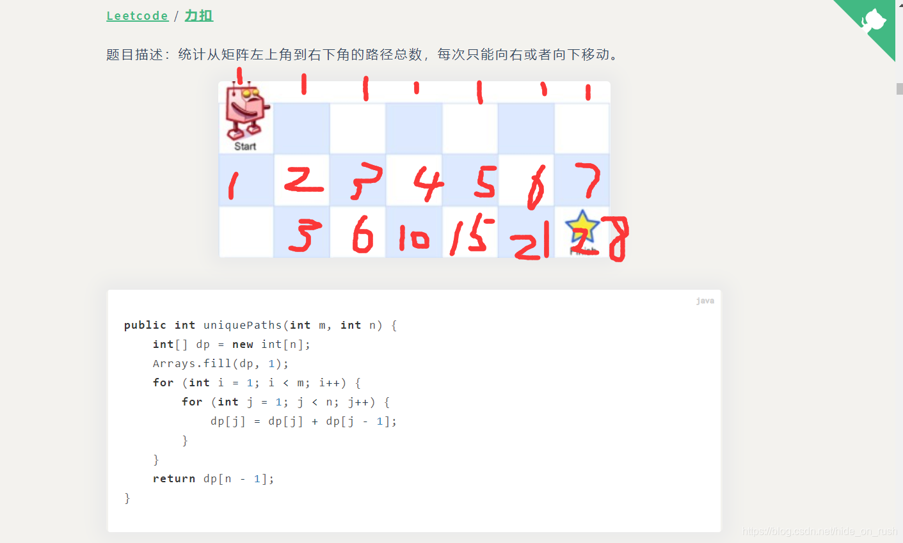  
使用动态数组的方法，可以使用滚动数组进行优化。  
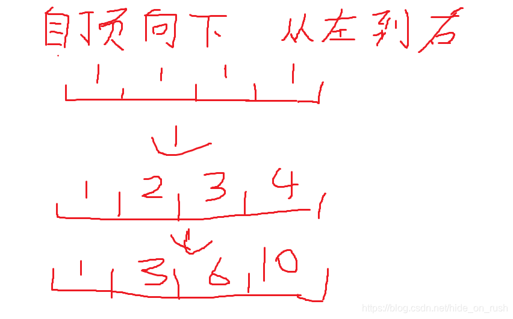  
如图所示，只要在数组里保存上一行的数据，就可以通过重复使用一维数组就够了。  
代码如下：

```java
public int uniquePaths(int m, int n) {
    int[] dp = new int[n];
    Arrays.fill(dp, 1);
    for (int i = 1; i < m; i++) {
        for (int j = 1; j < n; j++) {
            dp[j] = dp[j] + dp[j - 1];
        }
    }
    return dp[n - 1];
}
```

##### 数组区间

###### [303.区域和检索----数组不可变](https://leetcode-cn.com/problems/range-sum-query-immutable/)

使用暴力算法会超时。因为会会多次调用 sumRange 方法。动态规划的核心就是使用缓存来减少计算量。可以先计算出各个位置的累计和，计算的时候直接调用。

###### [413.等差数列划分](https://leetcode-cn.com/problems/arithmetic-slices/)

dp[i] 表示以 A[i] 为结尾的等差递增子区间的个数。

当 A[i] - A[i-1] == A[i-1] - A[i-2]，那么 [A[i-2], A[i-1], A[i]] 构成一个等差递增子区间。而且在以 A[i-1] 为结尾的递增子区间的后面再加上一个 A[i]，一样可以构成新的递增子区间。

```cpp
dp[2] = 1
    [0, 1, 2]
dp[3] = dp[2] + 1 = 2
    [0, 1, 2, 3], // [0, 1, 2] 之后加一个 3
    [1, 2, 3]     // 新的递增子区间
dp[4] = dp[3] + 1 = 3
    [0, 1, 2, 3, 4], // [0, 1, 2, 3] 之后加一个 4
    [1, 2, 3, 4],    // [1, 2, 3] 之后加一个 4
    [2, 3, 4]        // 新的递增子区间
```

综上，在 A[i] - A[i-1] == A[i-1] - A[i-2] 时，dp[i] = dp[i-1] + 1。

因为递增子区间不一定以最后一个元素为结尾，可以是任意一个元素结尾，因此需要返回 dp 数组累加的结果。

```cpp
public int numberOfArithmeticSlices(int[] A) {
    if (A == null || A.length == 0) {
        return 0;
    }
    int n = A.length;
    int[] dp = new int[n];
    for (int i = 2; i < n; i++) {
        if (A[i] - A[i - 1] == A[i - 1] - A[i - 2]) {
            dp[i] = dp[i - 1] + 1;
        }
    }
    int total = 0;
    for (int cnt : dp) {
        total += cnt;
    }
    return total;
}
```

###### 分割整数

[343.整数拆分?](https://leetcode-cn.com/problems/integer-break/)

```cpp
public int integerBreak(int n) {
    int[] dp = new int[n + 1];
    dp[1] = 1;
    for (int i = 2; i <= n; i++) {
        for (int j = 1; j <= i - 1; j++) {
            dp[i] = Math.max(dp[i], Math.max(j * dp[i - j], j * (i - j)));
        }
    }
    return dp[n];
}
```

###### [279.完全平方数](https://leetcode-cn.com/problems/perfect-squares/)

###### [91.解码方法](https://leetcode-cn.com/problems/decode-ways/)

```cpp
class Solution {
   public int numDecodings(String s) {
    if (s == null || s.length() == 0) {
        return 0;
    }
    int n = s.length();
    int[] dp = new int[n + 1];
    dp[0] = 1;
    dp[1] = s.charAt(0) == '0' ? 0 : 1;
    for (int i = 2; i <= n; i++) {
        int one = Integer.valueOf(s.substring(i - 1, i));
        if (one != 0) {
            dp[i] += dp[i - 1];
        }
        if (s.charAt(i - 2) == '0') {
            continue;
        }
        int two = Integer.valueOf(s.substring(i - 2, i));
        if (two <= 26) {
            dp[i] += dp[i - 2];
        }
    }
    return dp[n];
}

}
```

##### 最长递增子序列

###### [最长递增子序列](https://leetcode-cn.com/problems/longest-increasing-subsequence/)

[动态规划设计之最长递增子序列](https://mp.weixin.qq.com/s/02o_OPgePjaz3dXnw9TA1w)  
子序列、求最值理所当然地想到动态规划。  
**定义是这样的：dp[i] 表示以 nums[i] 这个数结尾的最长递增子序列的长度。**  
举个例子：  
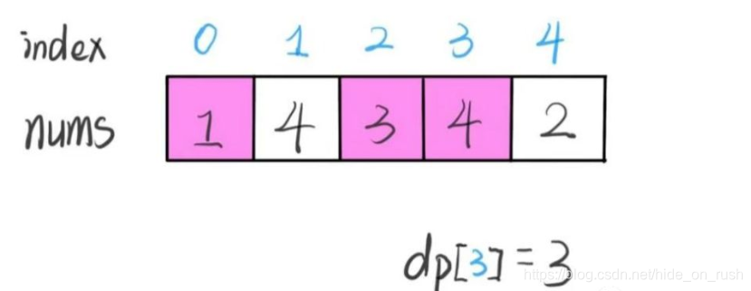  
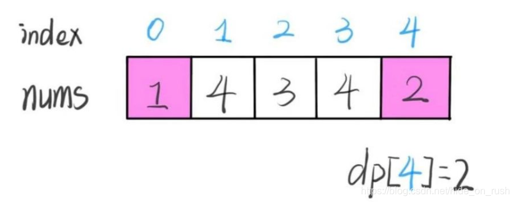

算法演进的过程是这样的：  
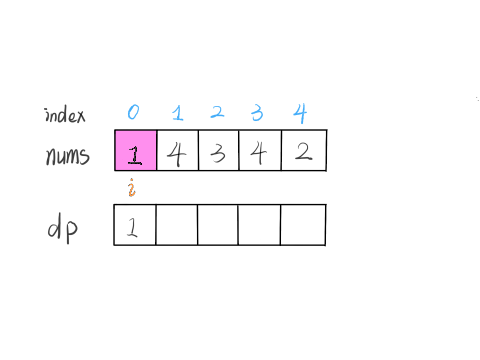  
根据这个定义，我们的最终结果（子序列的最大长度）应该是 dp 数组中的最大值。

```java
int res = 0;
for (int i = 0; i < dp.length; i++) {
    res = Math.max(res, dp[i]);
}
return res;
```

我们应该怎么设计算法逻辑来正确计算每个 dp[i] 呢？

这就是动态规划的重头戏了，要思考如何进行状态转移，这里就可以使用数学归纳的思想：

我们已经知道了 dp[0...4] 的所有结果，我们如何通过这些已知结果推出 dp[5] 呢？  
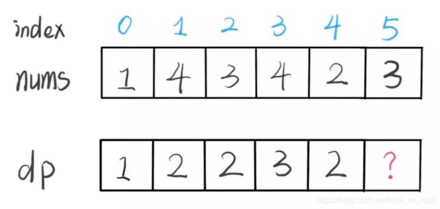  
根据刚才我们对 dp 数组的定义，现在想求 dp[5] 的值，也就是想求以 nums[5] 为结尾的最长递增子序列。

nums[5] = 3，既然是递增子序列，我们只要找到前面那些结尾比 3 小的子序列，然后把 3 接到最后，就可以形成一个新的递增子序列，而且这个新的子序列长度加一。

当然，可能形成很多种新的子序列，但是我们只要最长的，把最长子序列的长度作为 dp[5] 的值即可。  
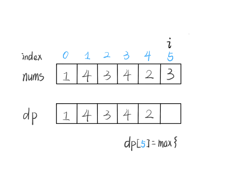

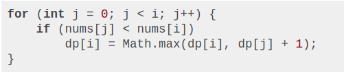  
这段代码的逻辑就可以算出 dp[5]。到这里，这道算法题我们就基本做完了。读者也许会问，我们刚才只是算了 dp[5] 呀，dp[4], dp[3] 这些怎么算呢？

类似数学归纳法，你已经可以通过 dp[0...4] 算出 dp[5] 了，那么任意 dp[i] 你肯定都可以算出来：  
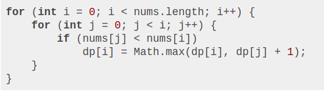  
还有一个细节问题，就是 base case。dp 数组应该全部初始化为 1，因为子序列最少也要包含自己，所以长度最小为 1。下面我们看一下完整代码：

###### ？[646.最长数对链](https://leetcode-cn.com/problems/maximum-length-of-pair-chain/)

<https://blog.csdn.net/qq_34769067/article/details/95169462>

```java
class Solution {
    public int findLongestChain(int[][] pairs) {
        if(pairs.length==0) return 0;
        Arrays.sort(pairs,(int[] a,int[] b)->(a[1]-b[1]));
        int cnt=1;
        int end=pairs[0][1];
        for(int[] pair:pairs){
            int start=pair[0];
            if(end<start){
                end=pair[1];
                cnt++;
            }
        }
        return cnt;
    }
}
```

###### [376. 摆动序列](https://leetcode-cn.com/problems/wiggle-subsequence/)

```java
class Solution {
    public int wiggleMaxLength(int[] nums) {
    if (nums == null || nums.length == 0) {
        return 0;
    }
    int up = 1, down = 1;
    for (int i = 1; i < nums.length; i++) {
        if (nums[i] > nums[i - 1]) {
            up = down + 1;
        } else if (nums[i] < nums[i - 1]) {
            down = up + 1;
        }
    }
    return Math.max(up, down);
}

}
```

##### 最长公共子序列

###### [1143. 最长公共子序列](https://leetcode-cn.com/problems/longest-common-subsequence/)

###### 思路

**第一步，一定要明确 dp 数组的含义**。对于两个字符串的动态规划问题，套路是通用的。  
比如说对于字符串 s1 和 s2，一般来说都要构造一个这样的 DP table：  
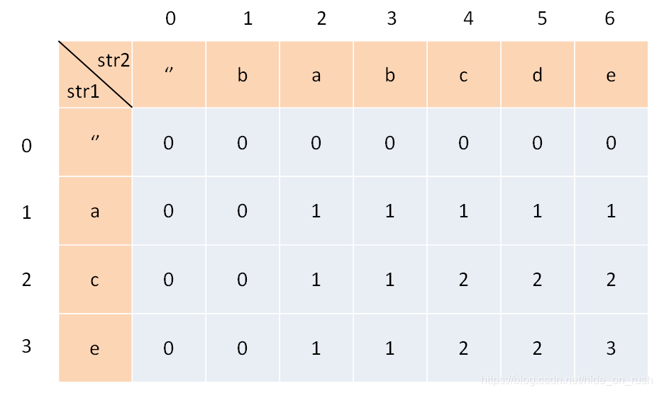  
为了方便理解此表，我们暂时认为索引是从 1 开始的，待会的代码中只要稍作调整即可。其中，`dp[i][j]` 的含义是：对于 `s1[1..i]` 和 `s2[1..j]`，它们的 LCS 长度是 `dp[i][j]`。  
比如上图的例子，`d[2][4]` 的含义就是：对于 `"ac"` 和 `"babc"`，它们的 LCS 长度是 2。我们最终想得到的答案应该是 `dp[3][6]`。  
**第二步，定义 base case。**  
我们专门让索引为 0 的行和列表示空串，`dp[0][..]` 和 `dp[..][0]` 都应该初始化为 0，这就是 base case。  
比如说，按照刚才 dp 数组的定义，`dp[0][3]=0` 的含义是：对于字符串 `""` 和 `"bab"`，其 LCS 的长度为 0。因为有一个字符串是空串，它们的最长公共子序列的长度显然应该是 0。  
**第三步，找状态转移方程。**  
这是动态规划最难的一步，不过好在这种字符串问题的套路都差不多，权且借这道题来聊聊处理这类问题的思路。  
状态转移说简单些就是做选择，比如说这个问题，是求 `s1` 和 `s2` 的最长公共子序列，不妨称这个子序列为 `lcs`。那么对于 `s1` 和 `s2` 中的每个字符，有什么选择？很简单，两种选择，要么在 `lcs` 中，要么不在。  
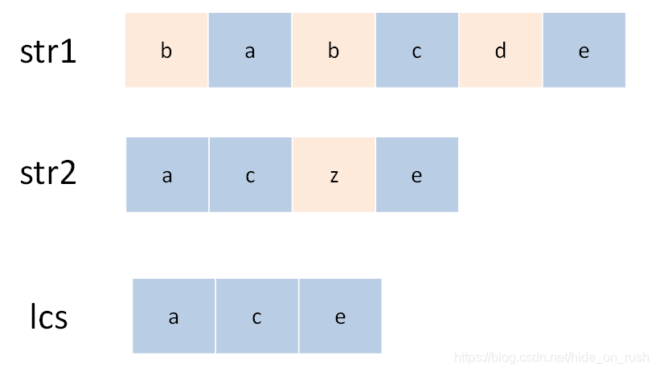  
这个「在」和「不在」就是选择，关键是，应该如何选择呢？这个需要动点脑筋：如果某个字符应该在 `lcs` 中，那么这个字符肯定同时存在于 `s1` 和 `s2` 中，因为 lcs 是最长公共子序列嘛。所以本题的思路是这样：  
用两个指针 `i` 和 `j` 从后往前遍历 `s1` 和 `s2`，如果 `s1[i]==s2[j]`，那么这个字符一定在 `lcs` 中；否则的话，`s1[i]` 和 `s2[j]` 这两个字符至少有一个不在 `lcs` 中，需要丢弃一个。先看一下递归解法，比较容易理解：

```java
def longestCommonSubsequence(str1, str2) -> int:
    def dp(i, j):
        # 空串的 base case
        if i == -1 or j == -1:
            return 0
        if str1[i] == str2[j]:
            # 这边找到一个 lcs 的元素，继续往前找
            return dp(i - 1, j - 1) + 1
        else:
            # 谁能让 lcs 最长，就听谁的
            return max(dp(i-1, j), dp(i, j-1))

    # i 和 j 初始化为最后一个索引
    return dp(len(str1)-1, len(str2)-1)
```

对于第一种情况，找到一个 `lcs` 中的字符，同时将 `i` `j` 向前移动一位，并给 `lcs` 的长度加一；对于后者，则尝试两种情况，取更大的结果。  
其实这段代码就是暴力解法，我们可以通过备忘录或者 DP table 来优化时间复杂度，比如通过前文描述的 DP table 来解决：

```java
def longestCommonSubsequence(str1, str2) -> int:
    m, n = len(str1), len(str2)
    # 构建 DP table 和 base case
    dp = [[0] * (n + 1) for _ in range(m + 1)]
    # 进行状态转移
    for i in range(1, m + 1):
        for j in range(1, n + 1):
            if str1[i - 1] == str2[j - 1]:
                # 找到一个 lcs 中的字符
                dp[i][j] = 1 + dp[i-1][j-1]
            else:
                dp[i][j] = max(dp[i-1][j], dp[i][j-1])

    return dp[-1][-1]
```

###### 疑难解答

对于 `s1[i]` 和 `s2[j]` 不相等的情况，至少有一个字符不在 `lcs` 中，会不会两个字符都不在呢？比如下面这种情况：  
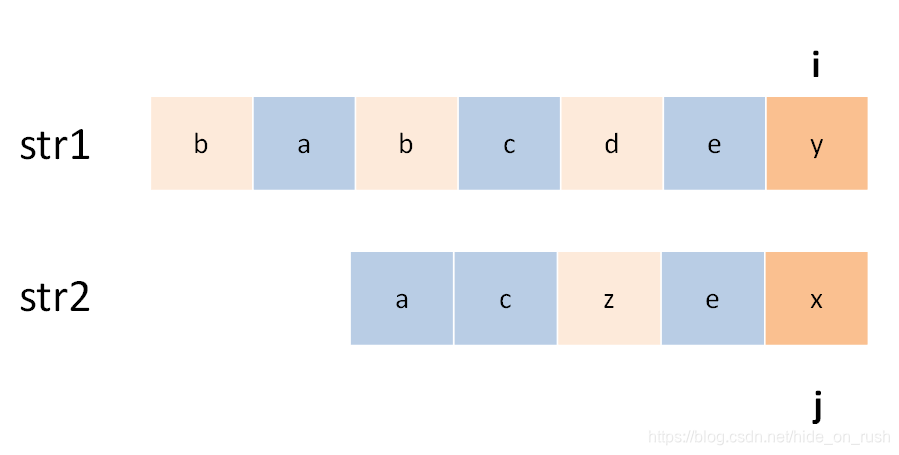  
所以代码是不是应该考虑这种情况，改成这样：

```java
if str1[i - 1] == str2[j - 1]:
    # ...
else:
    dp[i][j] = max(dp[i-1][j], 
                   dp[i][j-1],
                   dp[i-1][j-1])
```

我一开始也有这种怀疑，其实可以这样改，也能得到正确答案，但是多此一举，因为 `dp[i-1][j-1]` 永远是三者中最小的，max 根本不可能取到它。  
原因在于我们对 dp 数组的定义：对于 `s1[1..i] 和 s2[1..j`]，它们的 LCS 长度是 `dp[i][j]`。  
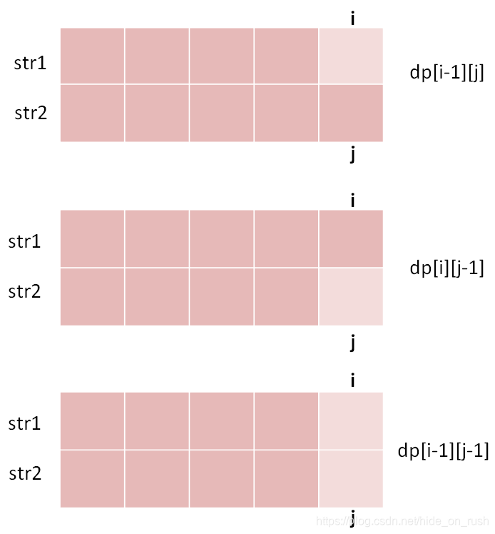  
这样一看，显然 `dp[i-1][j-1]` 对应的 lcs 长度不可能比前两种情况大，所以没有必要参与比较。

###### 总结

对于两个字符串的动态规划问题，一般来说都是像本文一样定义 DP table，因为这样定义有一个好处，就是容易写出状态转移方程，`dp[i][j]` 的状态可以通过之前的状态推导出来：  
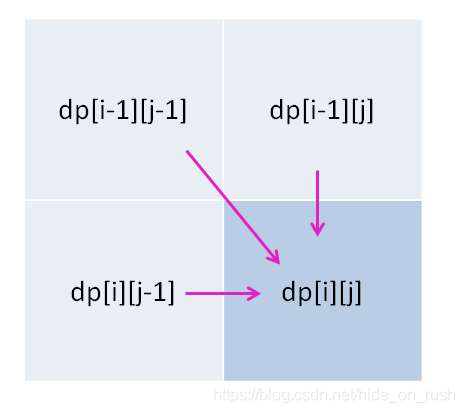  
找状态转移方程的方法是，思考每个状态有哪些「选择」，只要我们能用正确的逻辑做出正确的选择，算法就能够正确运行。

###### 代码实现

```java
class Solution {
        public int longestCommonSubsequence(String text1, String text2) {
        int n1 = text1.length(), n2 = text2.length();
        int[][] dp = new int[n1 + 1][n2 + 1];
        for (int i = 1; i <= n1; i++) {
            for (int j = 1; j <= n2; j++) {
                if (text1.charAt(i - 1) == text2.charAt(j - 1)) {
                    dp[i][j] = dp[i - 1][j - 1] + 1;
                } else {
                    dp[i][j] = Math.max(dp[i - 1][j], dp[i][j - 1]);
                }
            }
        }
        return dp[n1][n2];
    }
}
```

##### 0-1背包问题

###### 0-1背包问题

描述：  
给你一个可装载重量为 `W` 的背包和 `N` 个物品，每个物品有重量和价值两个属性。其中第 `i` 个物品的重量为 `wt[i]`，价值为 `val[i]`，现在让你用这个背包装物品，最多能装的价值是多少？  
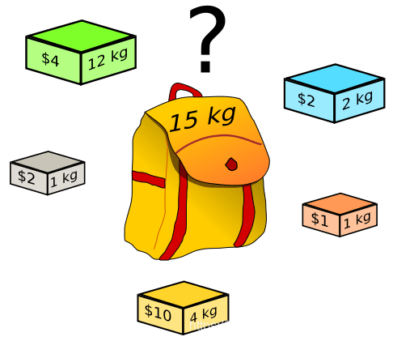  
举个简单的例子，输入如下：

```java
N = 3, W = 4
wt = [2, 1, 3]
val = [4, 2, 3]
```

算法返回 6，选择前两件物品装进背包，总重量 3 小于 `W`，可以获得最大价值 6。  
题目就是这么简单，一个典型的动态规划问题。这个题目中的物品不可以分割，要么装进包里，要么不装，不能说切成两块装一半。这就是 0-1 背包这个名词的来历。  
解决这个问题没有什么排序之类巧妙的方法，只能穷举所有可能，根据我们「动态规划详解」中的套路，直接走流程就行了。

###### 套路

**第一步要明确两点，「状态」和「选择」。**

先说状态，如何才能描述一个问题局面？只要给定几个可选物品和一个背包的容量限制，就形成了一个背包问题，对不对？**所以状态有两个，就是「背包的容量」和「可选择的物品」。**

再说选择，也很容易想到啊，对于每件物品，你能选择什么？选择就是「装进背包」或者「不装进背包」嘛。

明白了状态和选择，动态规划问题基本上就解决了，只要往这个框架套就完事儿了：

```java
for 状态1 in 状态1的所有取值：
    for 状态2 in 状态2的所有取值：
        for ...
            dp[状态1][状态2][...] = 择优(选择1，选择2...)
```

**第二步要明确dp数组的定义。**

`dp`数组是什么？其实就是描述问题局面的一个数组。换句话说，我们刚才明确问题有什么「状态」，现在需要用dp数组把状态表示出来。

首先看看刚才找到的「状态」，有两个，也就是说我们需要一个二维`dp`数组，一维表示可选择的物品，一维表示背包的容量。

**`dp[i][w]`的定义如下：对于前`i`个物品，当前背包的容量为`w`，这种情况下可以装的最大价值是`dp[i][w]`。**

比如说，如果 `dp[3][5] = 6`，其含义为：对于给定的一系列物品中，若只对前 3 个物品进行选择，当背包容量为 5 时，最多可以装下的价值为 6。

PS：为什么要这么定义？便于状态转移，或者说这就是套路，记下来就行了。建议看一下我们的动态规划系列文章，几种动规套路都被扒得清清楚楚了。

**根据这个定义，我们想求的最终答案就是`dp[N][W]`。base case 就是`dp[0][..] = dp[..][0] = 0`，因为没有物品或者背包没有空间的时候，能装的最大价值就是 0。**

细化上面的框架：

```java
int dp[N+1][W+1]
dp[0][..] = 0
dp[..][0] = 0

for i in [1..N]:
    for w in [1..W]:
        dp[i][w] = max(
            把物品 i 装进背包,
            不把物品 i 装进背包
        )
return dp[N][W]
```

**第三步，根据「选择」，思考状态转移的逻辑。**

简单说就是，上面伪码中「把物品i装进背包」和「不把物品i装进背包」怎么用代码体现出来呢？

**这一步要结合对`dp`数组的定义和我们的算法逻辑来分析：**

先重申一下刚才我们的`dp`数组的定义：

`dp[i][w]`表示：对于前`i`个物品，当前背包的容量为w时，这种情况下可以装下的最大价值是`dp[i][w]`。

**如果你没有把这第`i`个物品装入背包**，那么很显然，最大价值`dp[i][w]`应该等于`dp[i-1][w]`。你不装嘛，那就继承之前的结果。

**如果你把这第i个物品装入了背包**，那么`dp[i][w]`应该等于`dp[i-1][w-wt[i-1]] + val[i-1]`。

首先，由于`i`是从 1 开始的，所以对`val`和`wt`的取值是`i-1`。

而`dp[i-1][w-wt[i-1]]`也很好理解：你如果想装第`i`个物品，你怎么计算这时候的最大价值？换句话说，在装第`i`个物品的前提下，背包能装的最大价值是多少？

显然，你应该寻求剩余重量`w-wt[i-1`]限制下能装的最大价值，加上第`i`个物品的价值`val[i-1]`，这就是装第`i`个物品的前提下，背包可以装的最大价值。

综上就是两种选择，我们都已经分析完毕，也就是写出来了状态转移方程，可以进一步细化代码：

```java
for i in [1..N]:
    for w in [1..W]:
        dp[i][w] = max(
            dp[i-1][w],
            dp[i-1][w - wt[i-1]] + val[i-1]
        )
return dp[N][W]
```

**最后一步，把伪码翻译成代码，处理一些边界情况。**

我用 C++ 写的代码，把上面的思路完全翻译了一遍，并且处理了`w - wt[i-1]`可能小于 0 导致数组索引越界的问题：

```java
int knapsack(int W, int N, vector<int>& wt, vector<int>& val) {
    // vector 全填入 0，base case 已初始化
    vector<vector<int>> dp(N + 1, vector<int>(W + 1, 0));
    for (int i = 1; i <= N; i++) {
        for (int w = 1; w <= W; w++) {
            if (w - wt[i-1] < 0) {
                // 当前背包容量装不下，只能选择不装入背包
                dp[i][w] = dp[i - 1][w];
            } else {
                // 装入或者不装入背包，择优
                dp[i][w] = max(dp[i - 1][w - wt[i-1]] + val[i-1], 
                               dp[i - 1][w]);
            }
        }
    }

    return dp[N][W];
}
```

现在你看这个解法代码，是不是感觉非常简单，就是把我们刚才分析的思路原封不动翻译了一下而已。

所以说，明确了动态规划的套路，思路就显得行云流水，非常自然就出答案了。

至此，背包问题就解决了。相比而言，我觉得这是比较简单的动态规划问题，因为状态转移的推导逻辑比较容易想到，基本上你明确了dp数组的定义，就可以理所当然地确定状态转移了。

###### 0-1背包问题的变体

###### 1.问题分析

先看一下题目：  
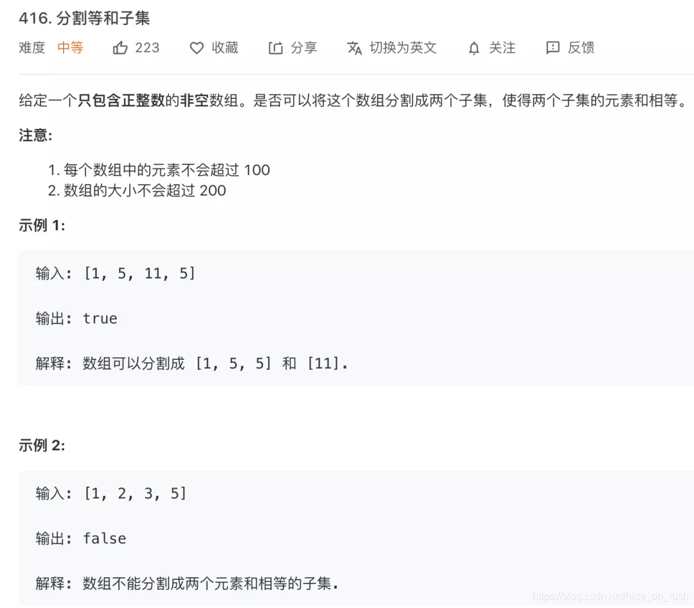  
算法的函数签名如下：

```java
// 输入一个集合，返回是否能够分割成和相等的两个子集
bool canPartition(vector<int>& nums);
```

对于这个问题，看起来和背包没有任何关系，为什么说它是背包问题呢？

首先回忆一下背包问题大致的描述是什么：

给你一个可装载重量为`W`的背包和`N`个物品，每个物品有重量和价值两个属性。其中第`i`个物品的重量为`wt[i]`，价值为`val[i]`，现在让你用这个背包装物品，最多能装的价值是多少？

那么对于这个问题，我们可以先对集合求和，得出`sum`，把问题转化为背包问题：

**给一个可装载重量为`sum/2`的背包和`N`个物品，每个物品的重量为`nums[i]`。现在让你装物品，是否存在一种装法，能够恰好将背包装满？**

你看，这就是背包问题的模型，甚至比我们之前的经典背包问题还要简单一些，**下面我们就直接转换成背包问题**，开始套前文讲过的背包问题框架即可。

###### 2.解法分析

**第一步要明确两点，「状态」和「选择」。**

这个前文 经典动态规划：0-1 背包问题 已经详细解释过了，状态就是「背包的容量」和「可选择的物品」，选择就是「装进背包」或者「不装进背包」。

**第二步要明确`dp`数组的定义。**

按照背包问题的套路，可以给出如下定义：

**dp[i][j] = x**表示，对于前**i**个物品，当前背包的容量为j时，若x为true，则说明可以恰好将背包装满，若`x`为`false`，则说明不能恰好将背包装满。

比如说，如果`dp[4][9] = true`，其含义为：对于容量为 9 的背包，若只是用前 4 个物品，可以有一种方法把背包恰好装满。

或者说对于本题，含义是对于给定的集合中，若只对前 4 个数字进行选择，存在一个子集的和可以恰好凑出 9。

根据这个定义，我们想求的最终答案就是`dp[N][sum/2]`，base case 就是`dp[..][0] = true`和`dp[0][..] = false`，因为背包没有空间的时候，就相当于装满了，而当没有物品可选择的时候，肯定没办法装满背包。

**第三步，根据「选择」，思考状态转移的逻辑。**

回想刚才的`dp`数组含义，可以根据「选择」对`dp[i][j]`得到以下状态转移：

如果不把`nums[i]`算入子集，**或者说你不把这第`i`个物品装入背包**，那么是否能够恰好装满背包，取决于上一个状态`dp[i-1][j]`，继承之前的结果。

如果把`nums[i]`算入子集，或者说你把这第`i`个物品装入了背包，那么是否能够恰好装满背包，取决于状态`dp[i - 1][j-nums[i-1]]`。

首先，由于`i`是从 1 开始的，而数组索引是从 0 开始的，所以第i个物品的重量应该是`nums[i-1]`，这一点不要搞混。

`dp[i - 1][j-nums[i-1]]`也很好理解：你如果装了第i个物品，就要看背包的剩余重量`j - nums[i-1]`限制下是否能够被恰好装满。

换句话说，如果`j - nums[i-1]`的重量可以被恰好装满，那么只要把第`i`个物品装进去，也可恰好装满j的重量；否则的话，重量j肯定是装不满的。

最后一步，把伪码翻译成代码，处理一些边界情况。

以下是我的 C++ 代码，完全翻译了之前的思路，并处理了一些边界情况：

```java
bool canPartition(vector<int>& nums) {
    int sum = 0;
    for (int num : nums) sum += num;
    // 和为奇数时，不可能划分成两个和相等的集合
    if (sum % 2 != 0) return false;
    int n = nums.size();
    sum = sum / 2;
    vector<vector<bool>> 
        dp(n + 1, vector<bool>(sum + 1, false));
    // base case
    for (int i = 0; i <= n; i++)
        dp[i][0] = true;

    for (int i = 1; i <= n; i++) {
        for (int j = 1; j <= sum; j++) {
            if (j - nums[i - 1] < 0) {
               // 背包容量不足，不能装入第 i 个物品
                dp[i][j] = dp[i - 1][j]; 
            } else {
                // 装入或不装入背包
                dp[i][j] = dp[i - 1][j] | dp[i - 1][j-nums[i-1]];
            }
        }
    }
    return dp[n][sum];
}
```

###### 3.进行状态压缩

再进一步，是否可以优化这个代码呢？**注意到`dp[i][j]`都是通过上一行`dp[i-1][..]`转移过来的**，之前的数据都不会再使用了。

所以，我们可以进行状态压缩，将二维`dp`数组压缩为一维，节约空间复杂度：

```java
bool canPartition(vector<int>& nums) {
    int sum = 0, n = nums.size();
    for (int num : nums) sum += num;
    if (sum % 2 != 0) return false;
    sum = sum / 2;
    vector<bool> dp(sum + 1, false);
    // base case
    dp[0] = true;

    for (int i = 0; i < n; i++) 
        for (int j = sum; j >= 0; j--) 
            if (j - nums[i] >= 0) 
                dp[j] = dp[j] || dp[j - nums[i]];

    return dp[sum];
}
```

这就是状态压缩，其实这段代码和之前的解法思路完全相同，只在一行`dp`数组上操作，`i`每进行一轮迭代，`dp[j]`其实就相当于`dp[i-1][j]`，所以只需要一维数组就够用了。

**唯一需要注意的是`j`应该从后往前反向遍历，因为每个物品（或者说数字）只能用一次，以免之前的结果影响其他的结果。**

至此，子集切割的问题就完全解决了，时间复杂度 O(n\*sum)，空间复杂度 O(sum)。

###### 完全背包问题

题目如下：  
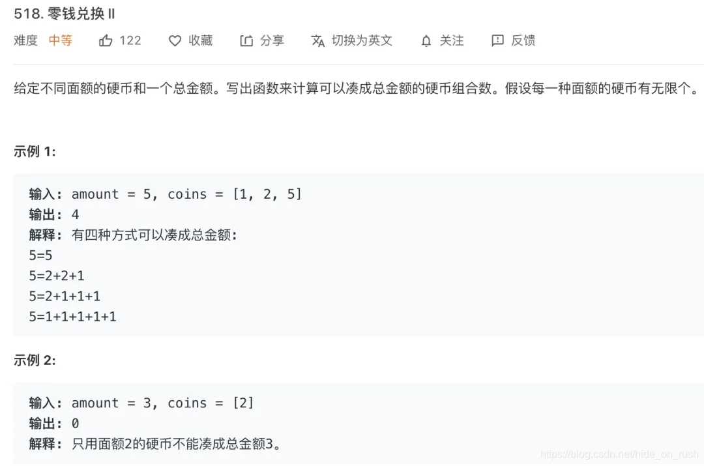

```java
int change(int amount, int[] coins);
```

**我们可以把这个问题转化为背包问题的描述形式：**

有一个背包，最大容量为`amount`，有一系列物品`coins`，每个物品的重量为`coins[i]`，**每个物品的数量无限**。请问有多少种方法，能够把背包恰好装满？

这个问题和我们前面讲过的两个背包问题，有一个最大的区别就是，每个物品的数量是无限的，这也就是传说中的「**完全背包问题**」，没啥高大上的，无非就是状态转移方程有一点变化而已。

下面就以背包问题的描述形式，继续按照流程来分析。

###### 解题思路

**第一步要明确两点，「状态」和「选择」**。

这部分都是背包问题的老套路了，我还是啰嗦一下吧：

状态有两个，就是「背包的容量」和「可选择的物品」，选择就是「装进背包」或者「不装进背包」。

明白了状态和选择，动态规划问题基本上就解决了，只要往这个框架套就完事儿了：

```java
for 状态1 in 状态1的所有取值：
    for 状态2 in 状态2的所有取值：
        for ...
            dp[状态1][状态2][...] = 计算(选择1，选择2...)
```

**第二步要明确`dp`数组的定义**。

首先看看刚才找到的「状态」，有两个，也就是说我们需要一个二维`dp`数组。

`dp[i][j]`的定义如下：

若只使用前`i`个物品，当背包容量为`j`时，有`dp[i][j]`种方法可以装满背包。

换句话说，翻译回我们题目的意思就是：

若只使用`coins`中的前i个硬币的面值，若想凑出金额`j`，有`dp[i][j]`种凑法。

经过以上的定义，可以得到：

base case 为`dp[0][..] = 0， dp[..][0] = 1`。因为如果不使用任何硬币面值，就无法凑出任何金额；如果凑出的目标金额为 0，那么“无为而治”就是唯一的一种凑法。

我们最终想得到的答案就是`dp[N][amount]`，其中`N`为`coins`数组的大小。

大致的伪码思路如下：

```java
int dp[N+1][amount+1]
dp[0][..] = 0
dp[..][0] = 1

for i in [1..N]:
    for j in [1..amount]:
        把物品 i 装进背包,
        不把物品 i 装进背包
return dp[N][amount]
```

**第三步，根据「选择」，思考状态转移的逻辑**。

注意，我们这个问题的特殊点在于物品的数量是无限的，所以这里和之前写的背包问题文章有所不同。

**如果你不把这第`i`个物品装入背包**，也就是说你不使用`coins[i]`这个面值的硬币，那么凑出面额`j`的方法数`dp[i][j]`应该等于`dp[i-1][j]`，继承之前的结果。

**如果你把这第`i`个物品装入了背包**，也就是说你使用`coins[i]`这个面值的硬币，那么`dp[i][j]`应该等于`dp[i][j-coins[i-1]]`。

首先由于`i`是从 1 开始的，所以`coins`的索引是`i-1`时表示第`i`个硬币的面值。

`dp[i][j-coins[i-1]]`也不难理解，如果你决定使用这个面值的硬币，那么就应该关注如何凑出金额`j - coins[i-1]`。

比如说，你想用面值为 2 的硬币凑出金额 5，那么如果你知道了凑出金额 3 的方法，再加上一枚面额为 2 的硬币，不就可以凑出 5 了嘛。

**综上就是两种选择，而我们想求的`dp[i][j]`是「共有多少种凑法」，所以`dp[i][j]`的值应该是以上两种选择的结果之和：**

```java
for (int i = 1; i <= n; i++) {
    for (int j = 1; j <= amount; j++) {
        if (j - coins[i-1] >= 0)
            dp[i][j] = dp[i - 1][j] 
                     + dp[i][j-coins[i-1]];
return dp[N][W]
```

**最后一步，把伪码翻译成代码，处理一些边界情况。**

我用 Java 写的代码，把上面的思路完全翻译了一遍，并且处理了一些边界问题：

```java
int change(int amount, int[] coins) {
    int n = coins.length;
    int[][] dp = amount int[n + 1][amount + 1];
    // base case
    for (int i = 0; i <= n; i++) 
        dp[i][0] = 1;

    for (int i = 1; i <= n; i++) {
        for (int j = 1; j <= amount; j++)
            if (j - coins[i-1] >= 0)
                dp[i][j] = dp[i - 1][j] 
                         + dp[i][j - coins[i-1]];
            else 
                dp[i][j] = dp[i - 1][j];
    }
    return dp[n][amount];
}
```

而且，我们通过观察可以发现，`dp`数组的转移只和`dp[i][..]`和`dp[i-1][..]`有关，所以可以压缩状态，进一步降低算法的空间复杂度：

```java
int change(int amount, int[] coins) {
    int n = coins.length;
    int[] dp = new int[amount + 1];
    dp[0] = 1; // base case
    for (int i = 0; i < n; i++)
        for (int j = 1; j <= amount; j++)
            if (j - coins[i] >= 0)
                dp[j] = dp[j] + dp[j-coins[i]];

    return dp[amount];
}
```

这个解法和之前的思路完全相同，将二维dp数组压缩为一维，时间复杂度 O(N\*amount)，空间复杂度 O(amount)。

至此，这道零钱兑换问题也通过背包问题的框架解决了。

###### 416. 分割等和子集

```java
class Solution {
   public boolean canPartition(int[] nums) {
    int sum = computeArraySum(nums);
    if (sum % 2 != 0) {
        return false;
    }
    int W = sum / 2;
    boolean[] dp = new boolean[W + 1];
    dp[0] = true;
    for (int num : nums) {                 // 0-1 背包一个物品只能用一次
        for (int i = W; i >= num; i--) {   // 从后往前，先计算 dp[i] 再计算 dp[i-num]
            dp[i] = dp[i] || dp[i - num];
        }
    }
    return dp[W];
}

private int computeArraySum(int[] nums) {
    int sum = 0;
    for (int num : nums) {
        sum += num;
    }
    return sum;
}

}
```

###### [494.目标和](https://leetcode-cn.com/problems/target-sum/)

把所有符号为正的数总和设为一个背包的容量，容量为x；把所有符号为负的数总和设为一个背包的容量，容量为y。在给定的数组中，有多少种选择方法让背包装满。令sum为数组的总和，则x+y = sum。而两个背包的差为S,则x-y=S。从而求得x=(S+sum)/2。  
基于上述分析，题目转换为背包问题：给定一个数组和一个容量为x的背包，求有多少种方式让背包装满。  
题解代码如下：

```java
class Solution {
   public int findTargetSumWays(int[] nums, int S) {
    int sum = computeArraySum(nums);
    if (sum < S || (sum + S) % 2 == 1) {
        return 0;
    }
    int W = (sum + S) / 2;
    int[] dp = new int[W + 1];
    dp[0] = 1;
    for (int num : nums) {
        for (int i = W; i >= num; i--) {
            dp[i] = dp[i] + dp[i - num];
        }
    }
    return dp[W];
}

private int computeArraySum(int[] nums) {
    int sum = 0;
    for (int num : nums) {
        sum += num;
    }
    return sum;
}

}
```

###### [474.目标和](https://leetcode-cn.com/problems/target-sum/)

```java
public int findMaxForm(String[] strs, int m, int n) {
    if (strs == null || strs.length == 0) {
        return 0;
    }
    int[][] dp = new int[m + 1][n + 1];
    for (String s : strs) {    // 每个字符串只能用一次
        int ones = 0, zeros = 0;
        for (char c : s.toCharArray()) {
            if (c == '0') {
                zeros++;
            } else {
                ones++;
            }
        }
        for (int i = m; i >= zeros; i--) {
            for (int j = n; j >= ones; j--) {
                dp[i][j] = Math.max(dp[i][j], dp[i - zeros][j - ones] + 1);
            }
        }
    }
    return dp[m][n];
}
```

###### [322.零钱兑换](https://leetcode-cn.com/problems/coin-change/)

### 回溯算法

#### 回溯算法解题套路框架

直接上回溯算法框架。**解决一个回溯问题，实际上就是一个决策树的遍历过程**。你只需要思考 3 个问题：

1. 路径：也就是已经做出的选择。
2. 选择列表：也就是你当前可以做的选择。
3. 结束条件：也就是到达决策树底层，无法再做选择的条件。

如果你不理解这三个词语的解释，没关系，我们后面会用「全排列」和「N 皇后问题」这两个经典的回溯算法问题来帮你理解这些词语是什么意思，现在你先留着印象。  
代码方面，回溯算法的框架：

```java
result = []
def backtrack(路径, 选择列表):
    if 满足结束条件:
        result.add(路径)
        return

    for 选择 in 选择列表:
        做选择
        backtrack(路径, 选择列表)
        撤销选择
```

**其核心就是 for 循环里面的递归，在递归调用之前「做选择」，在递归调用之后「撤销选择」**，特别简单。  
什么叫做选择和撤销选择呢，这个框架的底层原理是什么呢？下面我们就通过「全排列」这个问题来解开之前的疑惑，详细探究一下其中的奥妙！

##### 一、全排列问题

我们在高中的时候就做过排列组合的数学题，我们也知道 n 个不重复的数，全排列共有 n! 个。  
PS：为了简单清晰起见，我们这次讨论的全排列问题不包含重复的数字。  
那么我们当时是怎么穷举全排列的呢？比方说给三个数 [1,2,3]，你肯定不会无规律地乱穷举，一般是这样：  
先固定第一位为 1，然后第二位可以是 2，那么第三位只能是 3；然后可以把第二位变成 3，第三位就只能是 2 了；然后就只能变化第一位，变成 2，然后再穷举后两位……  
其实这就是回溯算法，我们高中无师自通就会用，或者有的同学直接画出如下这棵回溯树：  
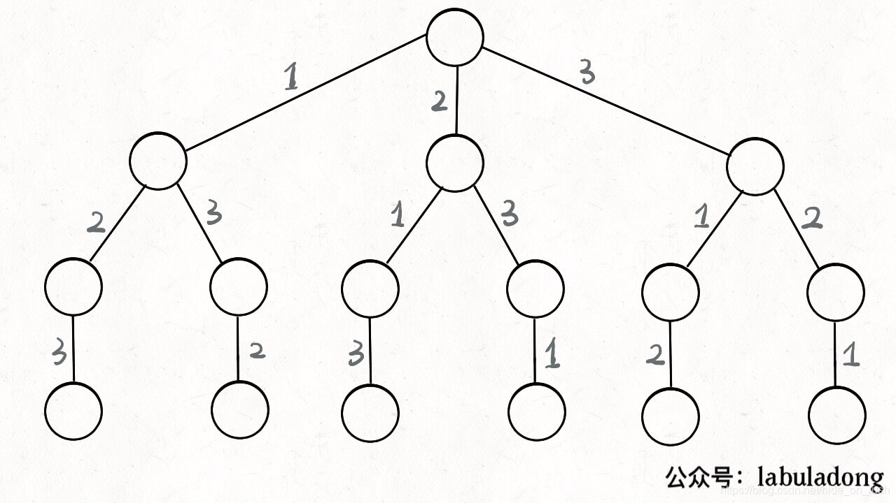  
只要从根遍历这棵树，记录路径上的数字，其实就是所有的全排列。**我们不妨把这棵树称为回溯算法的「决策树」**。  
**为啥说这是决策树呢，因为你在每个节点上其实都在做决策**。比如说你站在下图的红色节点上：  
  
你现在就在做决策，可以选择 1 那条树枝，也可以选择 3 那条树枝。为啥只能在 1 和 3 之中选择呢？因为 2 这个树枝在你身后，这个选择你之前做过了，而全排列是不允许重复使用数字的。  
**现在可以解答开头的几个名词：[2] 就是「路径」，记录你已经做过的选择；[1,3] 就是「选择列表」，表示你当前可以做出的选择；「结束条件」就是遍历到树的底层，在这里就是选择列表为空的时候**。  
如果明白了这几个名词，**可以把「路径」和「选择」列表作为决策树上每个节点的属性**，比如下图列出了几个节点的属性  
  
**我们定义的 backtrack 函数其实就像一个指针，在这棵树上游走，同时要正确维护每个节点的属性，每当走到树的底层，其「路径」就是一个全排列**。

再进一步，如何遍历一棵树？这个应该不难吧。回忆一下之前「学习数据结构的框架思维」写过，各种搜索问题其实都是树的遍历问题，而多叉树的遍历框架就是这样：

```java
void traverse(TreeNode root) {
    for (TreeNode child : root.childern)
        // 前序遍历需要的操作
        traverse(child);
        // 后序遍历需要的操作
}
```

而所谓的前序遍历和后序遍历，他们只是两个很有用的时间点，我给你画张图你就明白了：  
  
**前序遍历的代码在进入某一个节点之前的那个时间点执行，后序遍历代码在离开某个节点之后的那个时间点执行**。  
回想我们刚才说的，「路径」和「选择」是每个节点的属性，函数在树上游走要正确维护节点的属性，那么就要在这两个特殊时间点搞点动作：  
  
现在，你是否理解了回溯算法的这段核心框架？

```java
for 选择 in 选择列表:
    # 做选择
    将该选择从选择列表移除
    路径.add(选择)
    backtrack(路径, 选择列表)
    # 撤销选择
    路径.remove(选择)
    将该选择再加入选择列表
```

**我们只要在递归之前做出选择，在递归之后撤销刚才的选择**，就能正确得到每个节点的选择列表和路径。  
下面，直接看全排列代码：

```java
List<List<Integer>> res = new LinkedList<>();

/* 主函数，输入一组不重复的数字，返回它们的全排列 */
List<List<Integer>> permute(int[] nums) {
    // 记录「路径」
    LinkedList<Integer> track = new LinkedList<>();
    backtrack(nums, track);
    return res;
}

// 路径：记录在 track 中
// 选择列表：nums 中不存在于 track 的那些元素
// 结束条件：nums 中的元素全都在 track 中出现
void backtrack(int[] nums, LinkedList<Integer> track) {
    // 触发结束条件
    if (track.size() == nums.length) {
        res.add(new LinkedList(track));
        return;
    }

    for (int i = 0; i < nums.length; i++) {
        // 排除不合法的选择
        if (track.contains(nums[i]))
            continue;
        // 做选择
        track.add(nums[i]);
        // 进入下一层决策树
        backtrack(nums, track);
        // 取消选择
        track.removeLast();
    }
}
```

我们这里稍微做了些变通，没有显式记录「选择列表」，而是通过 nums 和 track 推导出当前的选择列表：  
  
至此，我们就通过全排列问题详解了回溯算法的底层原理。当然，这个算法解决全排列不是很高效，应为对链表使用 contains 方法需要 O(N) 的时间复杂度。有更好的方法通过交换元素达到目的，但是难理解一些，这里就不写了，有兴趣可以自行搜索一下。  
但是必须说明的是，不管怎么优化，都符合回溯框架，而且时间复杂度都不可能低于 O(N!)，因为穷举整棵决策树是无法避免的。**这也是回溯算法的一个特点，不像动态规划存在重叠子问题可以优化，回溯算法就是纯暴力穷举，复杂度一般都很高。**  
明白了全排列问题，就可以直接套回溯算法框架了，下面简单看看 N 皇后问题。

##### 二、N 皇后问题

这个问题很经典了，简单解释一下：给你一个 N×N 的棋盘，让你放置 N 个皇后，使得它们不能互相攻击。

PS：皇后可以攻击同一行、同一列、左上左下右上右下四个方向的任意单位。

这个问题本质上跟全排列问题差不多，决策树的每一层表示棋盘上的每一行；每个节点可以做出的选择是，在该行的任意一列放置一个皇后。  
直接套用框架:

```java
vector<vector<string>> res;

/* 输入棋盘边长 n，返回所有合法的放置 */
vector<vector<string>> solveNQueens(int n) {
    // '.' 表示空，'Q' 表示皇后，初始化空棋盘。
    vector<string> board(n, string(n, '.'));
    backtrack(board, 0);
    return res;
}

// 路径：board 中小于 row 的那些行都已经成功放置了皇后
// 选择列表：第 row 行的所有列都是放置皇后的选择
// 结束条件：row 超过 board 的最后一行
void backtrack(vector<string>& board, int row) {
    // 触发结束条件
    if (row == board.size()) {
        res.push_back(board);
        return;
    }

    int n = board[row].size();
    for (int col = 0; col < n; col++) {
        // 排除不合法选择
        if (!isValid(board, row, col)) 
            continue;
        // 做选择
        board[row][col] = 'Q';
        // 进入下一行决策
        backtrack(board, row + 1);
        // 撤销选择
        board[row][col] = '.';
    }
}
```

这部分主要代码，其实跟全排列问题差不多，`isValid` 函数的实现也很简单：

```java
/* 是否可以在 board[row][col] 放置皇后？ */
bool isValid(vector<string>& board, int row, int col) {
    int n = board.size();
    // 检查列是否有皇后互相冲突
    for (int i = 0; i < n; i++) {
        if (board[i][col] == 'Q')
            return false;
    }
    // 检查右上方是否有皇后互相冲突
    for (int i = row - 1, j = col + 1; 
            i >= 0 && j < n; i--, j++) {
        if (board[i][j] == 'Q')
            return false;
    }
    // 检查左上方是否有皇后互相冲突
    for (int i = row - 1, j = col - 1;
            i >= 0 && j >= 0; i--, j--) {
        if (board[i][j] == 'Q')
            return false;
    }
    return true;
}
```

函数 `backtrack` 依然像个在决策树上游走的指针，通过 `row` 和 `col` 就可以表示函数遍历到的位置，通过 `isValid` 函数可以将不符合条件的情况剪枝：  
  
如果直接给你这么一大段解法代码，可能是懵逼的。但是现在明白了回溯算法的框架套路，还有啥难理解的呢？无非是改改做选择的方式，排除不合法选择的方式而已，只要框架存于心，你面对的只剩下小问题了。

当 `N = 8` 时，就是八皇后问题，数学大佬高斯穷尽一生都没有数清楚八皇后问题到底有几种可能的放置方法，但是我们的算法只需要一秒就可以算出来所有可能的结果。

不过真的不怪高斯。这个问题的复杂度确实非常高，看看我们的决策树，虽然有 `isValid` 函数剪枝，但是最坏时间复杂度仍然是 O(N^(N+1))，而且无法优化。如果 `N = 10` 的时候，计算就已经很耗时了。

**有的时候，我们并不想得到所有合法的答案，只想要一个答案，怎么办呢**？比如解数独的算法，找所有解法复杂度太高，只要找到一种解法就可以。

其实特别简单，只要稍微修改一下回溯算法的代码即可：

```java
// 函数找到一个答案后就返回 true
bool backtrack(vector<string>& board, int row) {
    // 触发结束条件
    if (row == board.size()) {
        res.push_back(board);
        return true;
    }
    ...
    for (int col = 0; col < n; col++) {
        ...
        board[row][col] = 'Q';

        if (backtrack(board, row + 1))
            return true;

        board[row][col] = '.';
    }

    return false;
}
```

这样修改后，只要找到一个答案，for 循环的后续递归穷举都会被阻断。也许你可以在 N 皇后问题的代码框架上，稍加修改，写一个解数独的算法？

##### 三、最后总结

回溯算法就是个多叉树的遍历问题，关键就是在前序遍历和后序遍历的位置做一些操作，算法框架如下：

```java
def backtrack(...):
    for 选择 in 选择列表:
        做选择
        backtrack(...)
        撤销选择
```

**写 backtrack 函数时，需要维护走过的「路径」和当前可以做的「选择列表」，当触发「结束条件」时，将「路径」记入结果集**。

其实想想看，回溯算法和动态规划是不是有点像呢？我们在动态规划系列文章中多次强调，动态规划的三个需要明确的点就是「状态」「选择」和「base case」，是不是就对应着走过的「路径」，当前的「选择列表」和「结束条件」？

某种程度上说，动态规划的暴力求解阶段就是回溯算法。只是有的问题具有重叠子问题性质，可以用 dp table 或者备忘录优化，将递归树大幅剪枝，这就变成了动态规划。而今天的两个问题，都没有重叠子问题，也就是回溯算法问题了，复杂度非常高是不可避免的。

### 滑动窗口

#### 滑动窗口算法框架

说起滑动窗口算法，很多读者都会头疼。这个算法技巧的思路非常简单，就是维护一个窗口，不断滑动，然后更新答案么。LeetCode 上有起码 10 道运用滑动窗口算法的题目，难度都是中等和困难。该算法的大致逻辑如下：

```java
int left = 0, right = 0;

while (right < s.size()) {`
    // 增大窗口
    window.add(s[right]);
    right++;

    while (window needs shrink) {
        // 缩小窗口
        window.remove(s[left]);
        left++;
    }
}
```

这个算法技巧的时间复杂度是 O(N)，比字符串暴力算法要高效得多。

其实困扰大家的，不是算法的思路，而是各种细节问题。比如说如何向窗口中添加新元素，如何缩小窗口，在窗口滑动的哪个阶段更新结果。即便你明白了这些细节，也容易出 bug，找 bug 还不知道怎么找，真的挺让人心烦的。

**所以今天我就写一套滑动窗口算法的代码框架，我连再哪里做输出 debug 都给你写好了，以后遇到相关的问题，你就默写出来如下框架然后改三个地方就行，还不会出 bug：**

```java
/* 滑动窗口算法框架 */
void slidingWindow(string s, string t) {
    unordered_map<char, int> need, window;
    for (char c : t) need[c]++;

    int left = 0, right = 0;
    int valid = 0; 
    while (right < s.size()) {
        // c 是将移入窗口的字符
        char c = s[right];
        // 右移窗口
        right++;
        // 进行窗口内数据的一系列更新
        ...

        /*** debug 输出的位置 ***/
        printf("window: [%d, %d)\n", left, right);
        /********************/

        // 判断左侧窗口是否要收缩
        while (window needs shrink) {
            // d 是将移出窗口的字符
            char d = s[left];
            // 左移窗口
            left++;
            // 进行窗口内数据的一系列更新
            ...
        }
    }
}
```

其中两处 ... 表示的更新窗口数据的地方，到时候你直接往里面填就行了。  
而且，这两个 ... 处的操作分别是右移和左移窗口更新操作，等会你会发现它们操作是完全对称的。

### 数学

### 高频面试

#### Flood Fill 算法详解

啥是 FloodFill 算法呢，最直接的一个应用就是「颜色填充」，就是 Windows 绘画本中那个小油漆桶的标志，可以把一块被圈起来的区域全部染色。  
  
这种算法思想还在许多其他地方有应用。比如说扫雷游戏，有时候你点一个方格，会一下子展开一片区域，这个展开过程，就是 FloodFill 算法实现的。  
  
类似的，像消消乐这类游戏，相同方块积累到一定数量，就全部消除，也是 FloodFill 算法的功劳。  
  
通过以上的几个例子，你应该对 FloodFill 算法有个概念了，现在我们要抽象问题，提取共同点。

##### 一、构建框架

以上几个例子，都可以抽象成一个二维矩阵（图片其实就是像素点矩阵），然后从某个点开始向四周扩展，直到无法再扩展为止。

矩阵，可以抽象为一幅「图」，这就是一个图的遍历问题，也就类似一个 N 叉树遍历的问题。几行代码就能解决，直接上框架：

```java
// (x, y) 为坐标位置
void fill(int x, int y) {
    fill(x - 1, y); // 上
    fill(x + 1, y); // 下
    fill(x, y - 1); // 左
    fill(x, y + 1); // 右
}
```

**这个框架可以解决几乎所有在二维矩阵中遍历的问题**，说得高端一点，这就叫深度优先搜索（Depth First Search，简称 DFS），说得简单一点，这就叫四叉树遍历框架。坐标 (x, y) 就是 root，四个方向就是 root 的四个子节点。

下面看一道 LeetCode 题目，其实就是让我们来实现「颜色填充」功能。

  
根据上篇文章 二叉搜索树操作集锦，我们讲了「树」算法设计的一个总路线，今天就可以直接套用到 FloodFill 算法中：  
  
只要你能够理解这段代码，一定要给你鼓掌，给你 99 分，因为你对「框架思维」的掌控已经炉火纯青，此算法已经 cover 了 99% 的情况，仅有一个细节问题没有解决，就是当 origColor 和 newColor 相同时，会陷入无限递归。

##### 二、研究细节

为什么会陷入无限递归呢，很好理解，因为每个坐标都要搜索上下左右，那么对于一个坐标，一定也会被上下左右的坐标多次重复搜索。**被重复搜索时，必须保证递归函数能够能正确地退出，否则就会陷入死循环**。

为什么 newColor 和 origColor 不同时算法是正确的呢？把算法流程画个图理解一下：  
  
可以看到，fill(1, 1) 被重复搜索了，我们用 fill(1, 1)\* 表示这次重复搜索。fill(1, 1)\* 执行时，(1, 1) 已经被换成了 newColor，所以 fill(1, 1)\* 会在这个 if 语句被怼回去，正确退出。

```java
// 碰壁：遇到其他颜色
if (image[x][y] != origColor) return;
```

  
但是，如果说 origColor 和 newColor 一样，这个 if 语句就无法让 fill(1, 1)\* 正确退出，而是开启了下面的重复递归，形成了死循环。  


##### 三、处理细节

如何避免上述问题的发生，最容易想到的就是用一个和 image 一样大小的二维 bool 数组记录走过的地方，一旦发现重复探索立即 return。

```java
// 出界：超出数组边界
if (!inArea(image, x, y)) return;
// 碰壁：遇到其他颜色，超出 origColor 区域
if (image[x][y] != origColor) return;
// 已探索过的 origColor 区域
if (visited[x][y]) return;

visited[x][y] = true;
image[x][y] = newColor;
/* 遍历框架，上下左右 */
```

完全 OK，这也是处理「图」的一种常用手段。不过对于此题，不用开数组，我们有一种更好的方法，那就是回溯算法。

前文 回溯算法详解 讲过，这里不再赘述，直接套回溯算法框架：  
  
这种解决方法是最常用的，相当于使用一个特殊值 -1 代替 visited 数组的作用，达到不走回头路的效果。为什么是 -1，因为题目中说了颜色取值在 0 - 65535 之间，所以 -1 足够特殊，能和颜色区分开。

##### 四、拓展延伸：自动魔棒工具和扫雷

大部分图片编辑软件一定有「自动魔棒工具」这个功能：点击一个地方，帮你自动选中相近颜色的部分。如下图，我想选中老鹰，可以先用自动魔棒选中蓝天背景，然后反向选择，就选中了老鹰。我们来分析一下自动魔棒工具的原理。  
  
显然，这个算法肯定是基于 FloodFill 算法的，但有两点不同：首先，背景色是蓝色，但不能保证都是相同的蓝色，毕竟是像素点，可能存在肉眼无法分辨的深浅差异，而我们希望能够忽略细微的颜色差异差异。第二，FloodFill 算法是「区域填充」，这里是想找到 origColor 区域的边界，可以抽象成「边界填充」。

对于第一个问题，很好解决，可以设置一个阈值 threshold，在阈值范围内波动的颜色都视为 origColor：

```java
if (Math.abs(image[x][y] - origColor) > threshold)
    return; // 遇到其他颜色
```

对于第二个问题，我们首先明确问题：不要把 origColor 区域内所有像素点都染色，而是只给区域最外圈像素点染色。然后，我们分析，如何才能仅给外围染色，即如何才能找到最外围坐标，最外围坐标有什么特点？  
  
可以发现，origColor 区域内部的坐标四面一定都是 origColor，而区域边界上的坐标，至少有一个方向不是 origColor，这就是解决问题的关键。保持框架不变，使用 visited 数组记录已搜索坐标，主要代码如下：  
  
这样，区域内部的坐标探索四周后得到的 surround 是 4，而边界的坐标要么遇到其他颜色，要么超出边界索引，surround 会小于 4。如果你对这句话不理解，我们把逻辑框架抽象出来看：  
  
这 4 个 if 判断涵盖了 (x, y) 的所有可能情况，surround 的值由四个递归函数相加得到，而每个递归函数的返回值就这四种情况的一种。借助这个逻辑框架，你一定能理解上面那句话了。

这样就实现了仅对 origColor 区域边界坐标染色的目的，等同于完成了魔棒工具选定区域边界的功能。

这个算法有两个细节问题，一是必须借助 visited 来记录已探索的坐标，而无法使用回溯算法；二是几个 if 顺序不可打乱。读者可以思考一下原因。

同理，思考扫雷游戏，应用 FloodFill 算法展开空白区域的同时，也需要计算并显示边界上雷的个数，如何实现的？其实也是相同的思路，遇到雷就返回 1，这样 surround 变量算出的就是雷的个数。当然，扫雷的 FloodFill 算法除了检查上下左右，还得加上四个斜向。  


##### 五、最后总结

以上详细讲解了 FloodFill 算法的框架设计，并且处理了一个无限递归的细节问题。二维矩阵中的搜索问题，都逃不出这个算法框架，而且细节问题就只有这一个需要注意，其他的真的没啥神秘的了。

另外，除了 FloodFill 算法的原始应用，我们把这个算法稍作修改，就实现了类似自动魔棒工具的功能，也明白了扫雷游戏的实现原理。

LeetCode 第 733 和 1034 题就是相关的题目，读者可以趁热打铁去把它们拿下。

#### 团灭 LeetCode 股票买卖问题

这篇文章用「状态机」的技巧给出最优解，可以全部提交通过。不要觉得这个名词高大上，文学词汇而已，实际上就是 DP table，等会儿一讲就明白了。

先随便抽一道题出来，看看别人发的解法：  
  
能看懂吧？会做了吧？不可能的，你看不懂，这才正常。就算你勉强看懂了，下一个问题你还是做不出来。那为什么别人能写出这么诡异却又高效的解法呢？因为这类问题是有框架的，但是人家不会告诉你的，因为一旦告诉你，你十分钟就学会了，该算法题就不再神秘，变得不堪一击了。

本文就来告诉你处理这类问题的框架，拒绝奇技淫巧，稳扎稳打，以不变应万变。

这 6 道题目是有共性的，本文通过对第四道题的分析，逐步解决所有问题。因为第四题是一个最泛化的形式，其他的问题都是这个形式的简化。看下题目：  
  
第一题是只进行一次交易，相当于 k = 1；第二题是不限交易次数，相当于 k = +infinity（正无穷）；第三题是只进行 2 次交易，相当于 k = 2；剩下两道也是不限交易次数，但是加了交易「冷冻期」和「手续费」的额外条件，其实就是第二题的变种，都很容易处理。

如果你还不熟悉题目，可以去 LeetCode 或者上篇文章 一种通用思路 查看这些题目的内容，本文为了节省篇幅，就不列举这些题目的具体内容了。下面言归正传，开始详解。

##### 一、穷举框架

首先，还是一样的思路：如何穷举？这里的穷举思路和上篇文章递归的思想不太一样。

递归其实是符合我们思考的逻辑的，一步步推进，遇到无法解决的就丢给递归，一不小心就做出来了，可读性还很好。缺点就是一旦出错，你也不容易找到错误出现的原因。比如上篇文章的递归解法，肯定还有计算冗余，但确实不容易找到。

而这里，我们不用递归思想进行穷举，而是利用「状态」进行穷举。

看看总共有几种「状态」，再找出每个「状态」对应的「选择」。我们要穷举所有「状态」，穷举的目的是根据对应的「选择」更新状态。看图，就是这个意思。  
  
具体到当前问题，**每天都有三种「选择」**：买入、卖出、无操作，我们用 buy, sell, rest 表示这三种选择。

但问题是，并不是每天都可以任意选择这三种选择的，因为 sell 必须在 buy 之后，buy 必须在 sell 之后（第一次除外）。那么 rest 操作还应该分两种状态，一种是 buy 之后的 rest（持有了股票），一种是 sell 之后的 rest（没有持有股票）。而且别忘了，我们还有交易次数 k 的限制，就是说你 buy 还只能在 k > 0 的前提下操作。

很复杂对吧，不要怕，我们现在的目的只是穷举，你有再多的状态，老夫要做的就是一把梭全部列举出来。**这个问题的「状态」有三个**，第一个是天数，第二个是当天允许交易的最大次数，第三个是当前的持有状态（即之前说的 rest 的状态，我们不妨用 1 表示持有，0 表示没有持有）。

我们用一个三维数组 dp 就可以装下这几种状态的全部组合，用 for 循环就能完成穷举：  
  
而且我们可以用自然语言描述出每一个状态的含义，比如说 `dp[3][2][1]` 的含义就是：今天是第三天，我现在手上持有着股票，至今最多进行 2 次交易。再比如 `dp[2][3][0]` 的含义：今天是第二天，我现在手上没有持有股票，至今最多进行 3 次交易。很容易理解，对吧？

我们想求的最终答案是 `dp[n - 1][K][0]`，即最后一天，最多允许 K 次交易，所能获取的最大利润。读者可能问为什么不是 dp[n - 1][K][1]？因为 [1] 代表手上还持有股票，[0] 表示手上的股票已经卖出去了，很显然后者得到的利润一定大于前者。

记住如何解释「状态」，一旦你觉得哪里不好理解，把它翻译成自然语言就容易理解了。

##### 二、状态转移框架

现在，我们完成了「状态」的穷举，我们开始思考每种「状态」有哪些「选择」，应该如何更新「状态」。

因为我们的选择是 buy, sell, rest，而这些选择是和「持有状态」相关的，所以只看「持有状态」，可以画个状态转移图。

  
通过这个图可以很清楚地看到，每种状态（0 和 1）是如何转移而来的。根据这个图，我们来写一下状态转移方程：  
  
这个解释应该很清楚了，如果 buy，就要从利润中减去 prices[i]，如果 sell，就要给利润增加 prices[i]。今天的最大利润就是这两种可能选择中较大的那个。而且注意 k 的限制，我们在选择 buy 的时候，把最大交易数 k 减小了 1，很好理解吧，当然你也可以在 sell 的时候减 1，一样的。

现在，我们已经完成了动态规划中最困难的一步：状态转移方程。**如果之前的内容你都可以理解，那么你已经可以秒杀所有问题了，只要套这个框架就行了**。不过还差最后一点点，就是定义 base case，即最简单的情况。  
  
把上面的状态转移方程总结一下：  
  
读者可能会问，这个数组索引是 -1 怎么编程表示出来呢，负无穷怎么表示呢？这都是细节问题，有很多方法实现。现在整体框架已经完成，下面开始具体化。

##### 三、秒杀题目

###### 第一题，k = 1

直接套状态转移方程，根据 base case，可以做一些化简：  
  
直接翻译成代码：  


显然 i = 0 时 dp[i-1] 是不合法的。这是因为我们没有对 i 的 base case 进行处理。那就简单粗暴地处理一下：  
  
第一题就解决了，但是这样处理 base case 很麻烦，而且注意一下状态转移方程，新状态只和相邻的一个状态有关，其实不用整个 dp 数组，只需要两个变量储存所需的状态就足够了，这样可以把空间复杂度降到 O(1):  
  
两种方式都是一样的，不过这种编程方法简洁很多。但是如果没有前面状态转移方程的引导，是肯定看不懂的。后续的题目，我主要写这种空间复杂度 O(1) 的解法。

###### 第二题，k = +infinity

如果 k 为正无穷，那么就可以认为 k 和 k - 1 是一样的。可以这样改写框架：  
  
直接翻译成代码即可：  


###### 第三题，k = +infinity with cooldown

每次 sell 之后要等一天才能继续交易。只要把这个特点融入上一题的状态转移方程即可：  
  
直接翻译成代码即可：  


###### 第四题，k = +infinity with fee

每次交易要支付手续费，只要把手续费从利润中减去即可：

  
直接翻译成代码即可：  


###### 第五题，k = 2

k = 2 和前面题目的情况稍微不同，因为上面的情况都和 k 的关系不太大。要么 k 是正无穷，状态转移和 k 没关系了；要么 k = 1，跟 k = 0 这个 base case 挨得近，最后也被消掉了。

这道题 k = 2 和后面要讲的 k 是任意正整数的情况中，对 k 的处理就凸显出来了。我们直接写代码，边写边分析原因。  
  
按照之前的代码，我们可能想当然这样写代码（错误的）：  
  
为什么错误？我这不是照着状态转移方程写的吗？

还记得前面总结的「穷举框架」吗？就在强调必须穷举所有状态。其实我们之前的解法，都在穷举所有状态，只是之前的题目中 k 都被化简掉了，所以没有对 k 的穷举。比如说第一题，k = 1：  
  
这道题由于没有消掉 k 的影响，所以必须要用 for 循环对 k 进行穷举才是正确的：

  
如果你不理解，可以返回第一点「穷举框架」重新阅读体会一下。

第二种解法：因为这里 k 取值范围比较小，所以也可以不用 for 循环，直接把 k = 1 和 2 的情况手动列举出来也是一样的：  
  
有状态转移方程和含义明确的变量名引导，相信你很容易看懂。如我我们想故弄玄虚，可以把上述四个变量换成 a, b, c, d。这样当别人看到你的解法时就会大惊失色，一头雾水，不得不对你肃然起敬。

###### 第六题，k = any integer

这题和 k = 2 没啥区别，可以直接套上一题的第一个解法。但是提交之后会出现一个超内存的错误，原来是传入的 k 值可以任意大，导致 dp 数组太大了。现在想想，交易次数 k 最多能有多大呢？

一次交易由买入和卖出构成，至少需要两天。所以说有效的限制次数 k 应该不超过 n/2，如果超过，就没有约束作用了，相当于 k = +infinity。这种情况是之前解决过的。

直接把之前的代码重用：  
  
至此，6 道题目通过一个状态转移方程全部解决。

###### 四、最后总结

本文给大家讲了如何通过状态转移的方法解决复杂的问题，用一个状态转移方程秒杀了 6 道股票买卖问题，现在想想，其实也不算难对吧？而这已经属于动态规划问题中较困难的了。

关键就在于找到所有可能的「状态」，然后想想怎么更新这些「状态」。一般用一个多维 dp 数组储存这些状态，从 base case 开始向后推进，推进到最后的状态，就是我们想要的答案。想想这个过程，你是不是有点理解「动态规划」这个名词的意义了呢？

具体到股票买卖问题，我们发现了三个状态，使用了一个三维数组，无非还是穷举 + 更新，不过我们可以说的高大上一点，这叫「三维 DP」，怕不怕？这个大实话一说，立刻显得你高人一等有没有？

#### 二分查找算法详解

先给大家讲个笑话乐呵一下：

有一天阿东到图书馆借了 N 本书，出图书馆的时候，警报响了，于是保安把阿东拦下，要检查一下哪本书没有登记出借。阿东正准备把每一本书在报警器下过一下，以找出引发警报的书，但是保安露出不屑的眼神：你连二分查找都不会吗？于是保安把书分成两堆，让第一堆过一下报警器，报警器响；于是再把这堆书分成两堆…… 最终，检测了 logN 次之后，保安成功的找到了那本引起警报的书，露出了得意和嘲讽的笑容。于是阿东背着剩下的书走了。  
从此，图书馆丢了 N - 1 本书。

二分查找真的很简单吗？并不简单。看看 Knuth 大佬（发明 KMP 算法的那位）怎么说的：

> Although the basic idea of binary search is comparatively straightforward, the details can be surprisingly tricky...

这句话可以这样理解：**思路很简单，细节是魔鬼**。

本文就来探究几个最常用的二分查找场景：寻找一个数、寻找左侧边界、寻找右侧边界。

而且，我们就是要深入细节，比如不等号是否应该带等号，mid 是否应该加一等等。分析这些细节的差异以及出现这些差异的原因，保证你能灵活准确地写出正确的二分查找算法。

##### 零、二分查找框架

```java
int binarySearch(int[] nums, int target) {
    int left = 0, right = ...;

    while(...) {
        int mid = (right + left) / 2;
        if (nums[mid] == target) {
            ...
        } else if (nums[mid] < target) {
            left = ...
        } else if (nums[mid] > target) {
            right = ...
        }
    }
    return ...;
}
```

**分析二分查找的一个技巧是：不要出现 else，而是把所有情况用 else if 写清楚，这样可以清楚地展现所有细节**。本文都会使用 else if，旨在讲清楚，读者理解后可自行简化。

其中...标记的部分，就是可能出现细节问题的地方，当你见到一个二分查找的代码时，首先注意这几个地方。后文用实例分析这些地方能有什么样的变化。

另外声明一下，计算 mid 时需要技巧防止溢出，可以 参见前文，本文暂时忽略这个问题。

##### 一、寻找一个数（基本的二分搜索）

这个场景是最简单的，可能也是大家最熟悉的，即搜索一个数，如果存在，返回其索引，否则返回 -1。

```java
int binarySearch(int[] nums, int target) {
    int left = 0; 
    int right = nums.length - 1; // 注意

    while(left <= right) { // 注意
        int mid = (right + left) / 2;
        if(nums[mid] == target)
            return mid; 
        else if (nums[mid] < target)
            left = mid + 1; // 注意
        else if (nums[mid] > target)
            right = mid - 1; // 注意
        }
    return -1;
}
```

###### 1. 为什么 while 循环的条件中是 <=，而不是 < ？

答：因为初始化 right 的赋值是 nums.length - 1，即最后一个元素的索引，而不是 nums.length。

这二者可能出现在不同功能的二分查找中，区别是：前者相当于两端都闭区间 [left, right]，后者相当于左闭右开区间 [left, right)，因为索引大小为 nums.length 是越界的。

我们这个算法中使用的是 [left, right] 两端都闭的区间。**这个区间就是每次进行搜索的区间，我们不妨称为「搜索区间」。**

什么时候应该停止搜索呢？当然，找到了目标值的时候可以终止：

```java
if(nums[mid] == target)
        return mid;
```

但如果没找到，就需要 while 循环终止，然后返回 -1。那 while 循环什么时候应该终止？**搜索区间为空的时候应该终止**，意味着你没得找了，就等于没找到嘛。

while(left <= right)的终止条件是 left == right + 1，写成区间的形式就是 [right + 1, right]，或者带个具体的数字进去 [3, 2]，可见**这时候搜索区间为空**，因为没有数字既大于等于 3 又小于等于 2 的吧。所以这时候 while 循环终止是正确的，直接返回 -1 即可。

while(left < right)的终止条件是 left == right，写成区间的形式就是 [right, right]，或者带个具体的数字进去 [2, 2]，**这时候搜索区间非空**，还有一个数 2，但此时 while 循环终止了。也就是说这区间 [2, 2] 被漏掉了，索引 2 没有被搜索，如果这时候直接返回 -1 就可能出现错误。

当然，如果你非要用 while(left < right) 也可以，我们已经知道了出错的原因，就打个补丁好了：

```java
//...
while(left < right) {
    // ...
}
return nums[left] == target ? left : -1;
```

##### 2. 为什么 left = mid + 1，right = mid - 1？我看有的代码是 right = mid 或者 left = mid，没有这些加加减减，到底怎么回事，怎么判断？

答：这也是二分查找的一个难点，不过只要你能理解前面的内容，就能够很容易判断。

刚才明确了「搜索区间」这个概念，而且本算法的搜索区间是两端都闭的，即 [left, right]。那么当我们发现索引 mid 不是要找的 target 时，如何确定下一步的搜索区间呢？

当然是去搜索 [left, mid - 1] 或者 [mid + 1, right] 对不对？因为 mid 已经搜索过，应该从搜索区间中去除。

##### 3. 此算法有什么缺陷？

答：至此，你应该已经掌握了该算法的所有细节，以及这样处理的原因。但是，这个算法存在局限性。

比如说给你有序数组 nums = [1,2,2,2,3]，target = 2，此算法返回的索引是 2，没错。但是如果我想得到 target 的左侧边界，即索引 1，或者我想得到 target 的右侧边界，即索引 3，这样的话此算法是无法处理的。

这样的需求很常见。你也许会说，找到一个 target 索引，然后向左或向右线性搜索不行吗？可以，但是不好，因为这样难以保证二分查找对数级的复杂度了。

我们后续的算法就来讨论这两种二分查找的算法。

##### 二、寻找左侧边界的二分搜索

直接看代码，其中的标记是需要注意的细节：

```java
int left_bound(int[] nums, int target) {
    if (nums.length == 0) return -1;
    int left = 0;
    int right = nums.length; // 注意

    while (left < right) { // 注意
        int mid = (left + right) / 2;
        if (nums[mid] == target) {
            right = mid;
        } else if (nums[mid] < target) {
            left = mid + 1;
        } else if (nums[mid] > target) {
            right = mid; // 注意
        }
    }
    return left;
}
```

###### 1. 为什么 while(left < right) 而不是 <= ?

答：用相同的方法分析，因为初始化 right = nums.length 而不是 nums.length - 1 。因此每次循环的「搜索区间」是 [left, right) 左闭右开。

while(left < right) 终止的条件是 left == right，此时搜索区间 [left, left) 恰巧为空，所以可以正确终止。

###### 2. 为什么没有返回 -1 的操作？如果 nums 中不存在 target 这个值，怎么办？

答：因为要一步一步来，先理解一下这个「左侧边界」有什么特殊含义：

  
对于这个数组，算法会返回 1。这个 1 的含义可以这样解读：nums 中小于 2 的元素有 1 个。

比如对于有序数组 nums = [2,3,5,7], target = 1，算法会返回 0，含义是：nums 中小于 1 的元素有 0 个。如果 target = 8，算法会返回 4，含义是：nums 中小于 8 的元素有 4 个。

综上可以看出，函数的返回值（即 left 变量的值）取值区间是闭区间 [0, nums.length]，所以我们简单添加两行代码就能在正确的时候 return -1：

```java
while (left < right) {
    //...
}
// target 比所有数都大
if (left == nums.length) return -1;
// 类似之前算法的处理方式
return nums[left] == target ? left : -1;
```

###### 3. 为什么 left = mid + 1，right = mid ？和之前的算法不一样？

答：这个很好解释，因为我们的「搜索区间」是 [left, right) 左闭右开，所以当 nums[mid] 被检测之后，下一步的搜索区间应该去掉 mid 分割成两个区间，即 [left, mid) 或 [mid + 1, right)。

###### 4. 为什么该算法能够搜索左侧边界？

答：关键在于对于 nums[mid] == target 这种情况的处理：

```java
    if (nums[mid] == target)
        right = mid;
```

可见，找到 target 时不要立即返回，而是缩小「搜索区间」的上界 right，在区间 [left, mid) 中继续搜索，即不断向左收缩，达到锁定左侧边界的目的。

###### 5.为什么返回 left 而不是 right？

答：都是一样的，因为 while 终止的条件是 left == right。

##### 三、寻找右侧边界的二分查找

寻找右侧边界和寻找左侧边界的代码差不多，只有两处不同，已标注：

```java
int right_bound(int[] nums, int target) {
    if (nums.length == 0) return -1;
    int left = 0, right = nums.length;

    while (left < right) {
        int mid = (left + right) / 2;
        if (nums[mid] == target) {
            left = mid + 1; // 注意
        } else if (nums[mid] < target) {
            left = mid + 1;
        } else if (nums[mid] > target) {
            right = mid;
        }
    }
    return left - 1; // 注意
}
```

###### 1. 为什么这个算法能够找到右侧边界？

答：类似地，关键点还是这里：

```java
 if (nums[mid] == target) {
        left = mid + 1;
```

当 nums[mid] == target 时，不要立即返回，而是增大「搜索区间」的下界 left，使得区间不断向右收缩，达到锁定右侧边界的目的。

###### 2. 为什么最后返回 left - 1 而不像左侧边界的函数，返回 left？而且我觉得这里既然是搜索右侧边界，应该返回 right 才对。

答：首先，while 循环的终止条件是 left == right，所以 left 和 right 是一样的，你非要体现右侧的特点，返回 right - 1 好了。

至于为什么要减一，这是搜索右侧边界的一个特殊点，关键在这个条件判断：

```java
  if (nums[mid] == target) {
        left = mid + 1;
        // 这样想: mid = left - 1
```

  
因为我们对 left 的更新必须是 left = mid + 1，就是说 while 循环结束时，nums[left] 一定不等于 target 了，而 nums[left - 1] 可能是 target。

至于为什么 left 的更新必须是 left = mid + 1，同左侧边界搜索，就不再赘述。

###### 3. 为什么没有返回 -1 的操作？如果 nums 中不存在 target 这个值，怎么办？

答：类似之前的左侧边界搜索，因为 while 的终止条件是 left == right，就是说 left 的取值范围是 [0, nums.length]，所以可以添加两行代码，正确地返回 -1：

```java
while (left < right) {
    // ...
}
if (left == 0) return -1;
return nums[left-1] == target ? (left-1) : -1;
```

###### 四、最后总结

先来梳理一下这些细节差异的因果逻辑：

第一个，最基本的二分查找算法：

```java
因为我们初始化 right = nums.length - 1
所以决定了我们的「搜索区间」是 [left, right]
所以决定了 while (left <= right)
同时也决定了 left = mid+1 和 right = mid-1

因为我们只需找到一个 target 的索引即可
所以当 nums[mid] == target 时可以立即返回
```

第二个，寻找左侧边界的二分查找：

```java
因为我们初始化 right = nums.length
所以决定了我们的「搜索区间」是 [left, right)
所以决定了 while (left < right)
同时也决定了 left = mid+1 和 right = mid

因为我们需找到 target 的最左侧索引
所以当 nums[mid] == target 时不要立即返回
而要收紧右侧边界以锁定左侧边界
```

第三个，寻找右侧边界的二分查找：

```java
因为我们初始化 right = nums.length
所以决定了我们的「搜索区间」是 [left, right)
所以决定了 while (left < right)
同时也决定了 left = mid+1 和 right = mid

因为我们需找到 target 的最右侧索引
所以当 nums[mid] == target 时不要立即返回
而要收紧左侧边界以锁定右侧边界

又因为收紧左侧边界时必须 left = mid + 1
所以最后无论返回 left 还是 right，必须减一
```

如果以上内容你都能理解，那么恭喜你，二分查找算法的细节不过如此。

通过本文，你学会了：

1. 分析二分查找代码时，不要出现 else，全部展开成 else if 方便理解。
2. 注意「搜索区间」和 while 的终止条件，如果存在漏掉的元素，记得在最后检查。
3. 如需要搜索左右边界，只要在 nums[mid] == target 时做修改即可。搜索右侧时需要减一。

就算遇到其他的二分查找变形，运用这几点技巧，也能保证你写出正确的代码。LeetCode Explore 中有二分查找的专项练习，其中提供了三种不同的代码模板，现在你再去看看，很容易就知道这几个模板的实现原理了。

#### 滑动窗口算法解决子串问题

现在写滑动窗口算法的时机应该是合适的，因为读者已经通过 双指针技巧汇总 理解了双指针的套路，通过 单调队列解决滑动窗口问题 对滑动窗口这个东西有了个印象，而且通过 一个方法团灭股票问题 看到了成体系方法举一反三的威力。

本文详解「滑动窗口」这种高级双指针技巧的算法框架，带你秒杀几道高难度的子字符串匹配问题。

LeetCode 上至少有 9 道题目可以用此方法高效解决。但是有几道是 VIP 题目，有几道题目虽不难但太复杂，所以本文只选择点赞最高，较为经典的，最能够讲明白的三道题来讲解。第一题为了让读者掌握算法模板，篇幅相对长，后两题就基本秒杀了。文章最后抽象出一个简单的算法框架。

本文代码为 C++ 实现，不会用到什么编程方面的奇技淫巧，但是还是简单介绍一下一些用到的数据结构，以免有的读者因为语言的细节问题阻碍对算法思想的理解：

`unordered_map` 就是哈希表（字典），它的一个方法 count(key) 相当于 containsKey(key) 可以判断键 key 是否存在。

可以使用方括号访问键对应的值 map[key]。需要注意的是，如果该 key 不存在，C++ 会自动创建这个 key，并把 map[key] 赋值为 0。

所以代码中多次出现的 `map[key]++` 相当于 Java 的 `map.put(key, map.getOrDefault(key, 0)+1)`。

##### 一、最小覆盖子串

  
题目不难理解，要求在串 S(source) 中找到包含串 T(target) 中全部字母的一个子串，顺序无所谓，但这个子串得是所有可能子串中最短的。

此题难度 Hard，但是因为很有代表性，所以放到第一道。

如果我们使用暴力解法，代码大概是这样的：

```java
for (int i = 0; i < s.size(); i++)
    for (int j = i + 1; j < s.size(); j++)
        if s[i:j] 包含 t 的所有字母:
            更新答案
```

思路很直接吧，但是显然，这个算法的复杂度肯定大于 O(N^2) 了，不好。

**滑动窗口算法的思路是这样：**

1. 我们在字符串 S 中使用双指针中的左右指针技巧，初始化 left = right = 0，把索引闭区间 [left, right] 称为一个「窗口」。
2. 我们先不断地增加 right 指针扩大窗口 [left, right]，直到窗口中的字符串符合要求（包含了 T 中的所有字符）。
3. 此时，我们停止增加 right，转而不断增加 left 指针缩小窗口 [left, right]，直到窗口中的字符串不再符合要求（不包含 T 中的所有字符了）。同时，每次增加 left，我们都要更新一轮结果。
4. 重复第 2 和第 3 步，直到 right 到达字符串 S 的尽头。

这个思路其实也不难，**第 2 步相当于在寻找一个「可行解」，然后第 3 步在优化这个「可行解」，最终找到最优解**。左右指针轮流前进，窗口大小增增减减，窗口不断向右滑动。

下面画图理解一下，needs 和 window 相当于计数器，分别记录 T 中字符出现次数和窗口中的相应字符的出现次数。

初始状态：  
  
增加 right，直到窗口 [left, right] 包含了 T 中所有字符：  
  
现在开始增加 left，缩小窗口 [left, right]（此时窗口里的字符串是最优解）：  


直到窗口中的字符串不再符合要求，left 不再继续移动：

  
之后重复上述过程，再移动 right 试图使窗口中的字符再次符合要求，之后移动 left 缩小窗口… 直到 right 指针到达字符串 S 的末端，算法结束。

在算法执行过程中，就可以找到长度最短符合条件的子串（窗口）。

如果你能够理解上述过程，恭喜，你已经完全掌握了滑动窗口算法思想。至于如何具体到问题，如何得出此题的答案，都是编程问题，很容易解决。

上述过程可以简单地写出如下伪码框架：

```java
string s, t;
// 在 s 中寻找 t 的「最小覆盖子串」
int left = 0, right = 0;
string res = s;
// 先移动 right 寻找可行解
while(right < s.size()) {
    window.add(s[right]);
    right++;
    // 找到可行解后，开始移动 left 缩小窗口
    while (window 符合要求) {
        // 如果这个窗口的子串更短，则更新结果
        res = minLen(res, window);
        window.remove(s[left]);
        left++;
    }
}
return res;
```

如果上述代码你也能够理解，那么你离解题更近了一步。现在就剩下一个比较棘手的问题：

如何判断 window 即子串 s[left...right] 是否符合要求，即是否包含 t 的所有字符呢？

可以用两个哈希表当作计数器解决。用一个哈希表 needs 记录字符串 t 中包含的字符及出现次数，用另一个哈希表 window 记录当前「窗口」中包含的字符及出现的次数。如果 window 包含所有 needs 中的键，且这些键对应的值都大于等于 needs 中的值，那么就可以知道当前「窗口」符合要求了，可以开始移动 left 指针了。

现在将上面的框架继续细化：  
  
上述代码已经具备完整的逻辑了，只有一处伪码，即更新最短子串结果 res 的地方，不过这个问题太好解决了，直接看完整解法吧！  


如果直接甩给你这么一大段代码，我想你的心态是爆炸的。但是通过之前的步步跟进，你应该能够理解这个算法的内在逻辑，能清晰看出该算法的结构了。

这个算法的时间复杂度是 O(M + N)，M 和 N 分别是字符串 S 和 T 的长度。因为我们先用 for 循环遍历了字符串 T 来初始化 needs，时间 O(N)，之后的两个 while 循环最多执行 2M 次，时间 O(M)。

读者也许认为嵌套的 while 循环复杂度应该是平方级，但是你这样想，while 执行的次数就是双指针 left 和 right 走的总路程，最多是 2M 嘛。

##### 二、找到字符串中所有字母异位词

  
这道题的难度是 Easy，但是评论区点赞最多的一条是这样：

```java
How can this problem be marked as easy?
```

实际上，这个 Easy 是属于了解双指针技巧的人的，只要把上一道题的代码改中更新结果的代码稍加修改就成了这道题的解：  
  
因为这道题和上一道的场景类似，也需要 window 中包含串 t 的所有字符，但上一道题要找长度最短的子串，这道题要找长度相同的子串，也就是「字母异位词」嘛。

##### 三、无重复字符的最长子串

  
此题难度 Medium，遇到子串问题，首先想到的就是滑动窗口技巧。

类似之前的思路，使用 window 作为计数器记录窗口中的字符出现次数，然后先向右移动 right，当 window 中出现重复字符时，开始移动 left 缩小窗口，如此往复：  
  
需要注意的是，因为我们要求的是最长子串，所以需要在每次移动 right 增大窗口时更新 res，而不是像之前的题目在移动 left 缩小窗口时更新。

##### 四、模板总结

通过上面三道题，我们可以总结出滑动窗口算法的抽象思想：

```java
int left = 0, right = 0;

while (right < s.size()) {
    window.add(s[right]);
    right++;

    while (valid) {
        window.remove(s[left]);
        left++;
    }
}
```

其中 window 的数据类型可以视具体情况而定，比如上述题目都使用哈希表充当计数器，当然你也可以用一个数组实现同样效果，因为我们只处理英文字母。

另外，滑动窗口技巧也可以运用在数组中，比如给一个数组，求其中 sum 最大的子数组，或者求平均数最大的子数组，都可以用滑动窗口技巧解决。

稍微麻烦的地方就是这个 valid 条件，为了实现这个条件的实时更新，我们可能会写很多代码。比如前两道题，看起来解法篇幅那么长，实际上思想还是很简单，只是大多数代码都在处理这个问题而已。

#### 洗牌算法详解：你会排序，但你会打乱吗？

我知道大家会各种花式排序，但是如果叫你打乱一个数组，你是否能做到胸有成竹？即便你拍脑袋想出一个算法，怎么证明你的算法就是正确的呢？乱序算法不像排序算法，结果唯一可以很容易检验，因为「乱」可以有很多种，你怎么能证明你的算法是「真的乱」呢？

所以我们面临两个问题：

1. 什么叫做「真的乱」？
2. 设计怎样的算法来打乱数组才能做到「真的乱」？

这种算法称为「随机乱置算法」或者「洗牌算法」。

本文分两部分，第一部分详解最常用的洗牌算法。因为该算法的细节容易出错，且存在好几种变体，虽有细微差异但都是正确的，所以本文要介绍一种简单的通用思想保证你写出正确的洗牌算法。第二部分讲解使用「蒙特卡罗方法」来检验我们的打乱结果是不是真的乱。蒙特卡罗方法的思想不难，但是实现方式也各有特点的。

##### 一、洗牌算法

此类算法都是靠随机选取元素交换来获取随机性，直接看代码（伪码），该算法有 4 种形式，都是正确的：

```java
// 得到一个在闭区间 [min, max] 内的随机整数
int randInt(int min, int max);

// 第一种写法
void shuffle(int[] arr) {
    int n = arr.length();
    /******** 区别只有这两行 ********/
    for (int i = 0 ; i < n; i++) {
        // 从 i 到最后随机选一个元素
        int rand = randInt(i, n - 1);
        /*************************/
        swap(arr[i], arr[rand]);
    }
}

// 第二种写法
    for (int i = 0 ; i < n - 1; i++)
        int rand = randInt(i, n - 1);

// 第三种写法
    for (int i = n - 1 ; i >= 0; i--)
        int rand = randInt(0, i);

// 第四种写法
    for (int i = n - 1 ; i > 0; i--)
        int rand = randInt(0, i);
```

**分析洗牌算法正确性的准则：产生的结果必须有 n! 种可能，否则就是错误的**。这个很好解释，因为一个长度为 n 的数组的全排列就有 n! 种，也就是说打乱结果总共有 n! 种。算法必须能够反映这个事实，才是正确的。

我们先用这个准则分析一下**第一种写法**的正确性：

```java
// 假设传入这样一个 arr
int[] arr = {1,3,5,7,9};

void shuffle(int[] arr) {
    int n = arr.length(); // 5
    for (int i = 0 ; i < n; i++) {
        int rand = randInt(i, n - 1);
        swap(arr[i], arr[rand]);
    }
}
```

for 循环第一轮迭代时，i=0，rand 的取值范围是 [0,4]，有 5 个可能的取值。  
  
for 循环第二轮迭代时，`i=1，rand` 的取值范围是 `[1,4]`，有 4 个可能的取值。  
  
后面以此类推，直到最后一次迭代，i=4，rand 的取值范围是 [4,4]，只有 1 个可能的取值。  
  
可以看到，整个过程产生的所有可能结果有 `5*4*3*2*1=5!=n!` 种，所以这个算法是正确的。

分析**第二种写法**，前面的迭代都是一样的，少了一次迭代而已。所以最后一次迭代时 `i = 3，rand` 的取值范围是 [3,4]，有 2 个可能的取值。

```java
// 第二种写法
// arr = {1,3,5,7,9}, n = 5
    for (int i = 0 ; i < n - 1; i++)
        int rand = randInt(i, n - 1);
```

所以整个过程产生的所有可能结果仍然有 `5*4*3*2=5!=n!` 种，因为乘以 1 可有可无嘛。所以这种写法也是正确的。

如果以上内容你都能理解，那么你就能发现**第三种写法**就是第一种写法，只是将数组从后往前迭代而已；**第四种写**法是第二种写法从后往前来。所以它们都是正确的。

如果读者思考过洗牌算法，可能会想出如下的算法，但是这种**写法是错误的：**

```java
void shuffle(int[] arr) {
    int n = arr.length();
    for (int i = 0 ; i < n; i++) {
        // 每次都从闭区间 [0, n-1]
        // 中随机选取元素进行交换
        int rand = randInt(0, n - 1);
        swap(arr[i], arr[rand]);
    }
}
```

现在你应该明白这种写法为什么会错误了。因为这种写法得到的所有可能结果有 n^n 种，而不是 n! 种，而且 n^n 一般不可能是 n! 的整数倍。

比如说 arr = {1,2,3}，正确的结果应该有 3!=6 种可能，而这种写法总共有 3^3 = 27 种可能结果。因为 27 不能被 6 整除，也就是说总概率不可能被平分，一定有某些情况被「偏袒」了。

后文会讲到，概率均等是算法正确的衡量标准，所以这个算法是错误的。

#### LRU算法
