> 迁移来源 [博客园原文](https://www.cnblogs.com/xiuzhublog/p/12989825.html) · 原文发布于 `2020-05-29 22:05:00`（UTC+8）
> 旧文归档，保留当时的记录。

## 概述

### 什么是计算机网络？

> 计算机网络是指将地理位置不同的具有独立功能的多台计算机及其外部设备，通过通信线路连接起来，在网络操作系统，网络管理软件及网络通信协议的管理和协调下，实现资源共享和信息传递的计算机系统。

### 互联网

#### 概述

计算机网络由若干结点和连接这些结点的链路组成，这些结点可以是计算机、集线器、交换机、路由器等等。  
网络的网络：

> 网络把主机连接起来，而互连网（internet）是把多种不同的网络连接起来，因此互连网是网络的网络。而互联网（Internet）是全球范围的互连网。

#### 组成

互联网分为边缘部分和核心部分

1. 边缘部分：由所有连接在互联网上的主机组成。这部分是**用户直接使用的**，用来进行通信（传送数据、音频或视频）和资源共享。比如计算机、手机等设备。
2. 核心部分：由大量网络和连接这些网络的路由器组成。这部分是为边缘部分提供服务的（提供连通性和交换）。  
   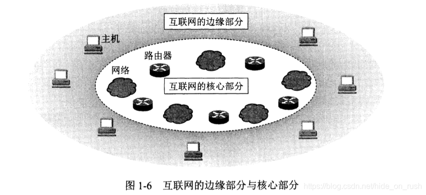

#### 电路交换与分组交换

##### 电路交换

电路交换用于电话通信系统，两个用户要通信之前需要建立一条专用的物理链路，并且在整个通信过程中始终占用该链路。由于通信的过程中不可能一直在使用传输线路，因此电路交换对线路的利用率很低，往往不到 10%。

##### 分组交换

每个分组都有首部和尾部，包含了源地址和目的地址等控制信息，在同一个传输线路上同时传输多个分组互相不会影响，因此在同一条传输线路上允许同时传输多个分组，也就是说分组交换不需要占用传输线路。

在一个邮局通信系统中，邮局收到一份邮件之后，先存储下来，然后把相同目的地的邮件一起转发到下一个目的地，这个过程就是存储转发过程，分组交换也使用了存储转发过程。  
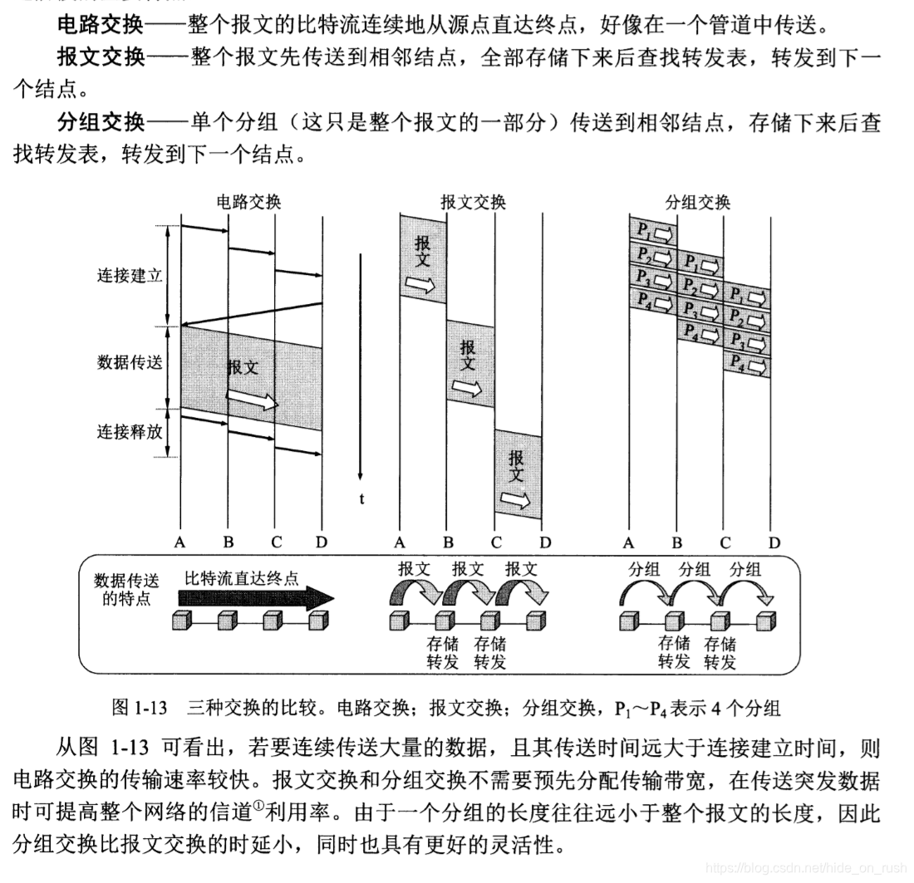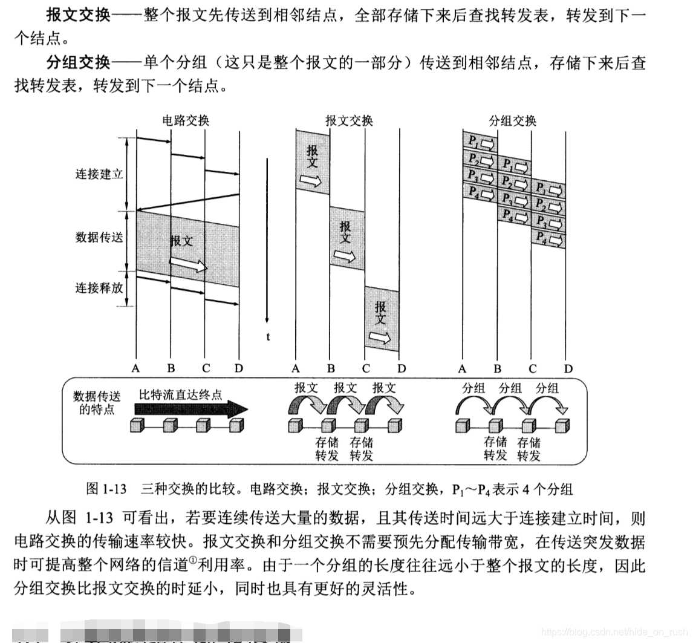

### 计算机网络的时延

总时延 = 排队时延 + 处理时延 + 传输时延 + 传播时延  
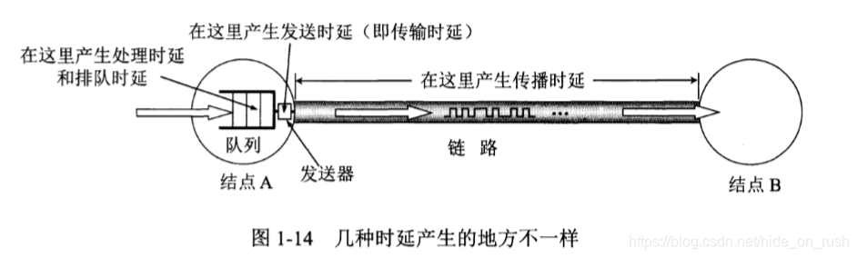

#### 排队时延

分组在路由器的输入队列和输出队列中排队等待的时间，取决于网络当前的通信量。

#### 处理时延

主机或路由器收到分组时进行处理所需要的时间，例如分析首部、从分组中提取数据、进行差错检验或查找适当的路由等。

#### 发送时延（传输时延）

**发送时延（transmission delay）**是主机或路由器发送数据帧所需要的时间，也就是从发送数据帧的第一个比特算起，到该帧的最后一个比特发送完毕所需的时间。因此发送时延也叫做传输时延（我们尽量不采用传输时延这个名词，因为它很容易和下面要讲到的传播时延弄混）。发送时延的计算公式是：  

#### 传播时延

**传播时延（propagation delay）**是电磁波在信道中传播一定的距离需要花费的时间。传播时延的计算公式是：  
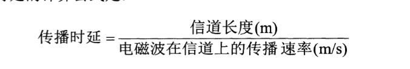

### 计算机网络的体系结构

#### 什么是协议

> 在计算机网络中要做到有条不紊地交换数据，就必须遵守一些事先约定好的规则。这些规则明确规定了所交换的数据的格式以及有关的同步问题。这里所说的同步不是狭义的（即同频或同频同相）而是广义的，即在一定的条件下应当发生什么事件（例如，应当发送一个应答信息），因而同步含有时序的意思。这些为进行网络中的数据交换而建立的规则、标准或约定称为网络协议（network protocol）。网络协议也可简称为协议。

网络协议主要有三个要素：

1. 语法，即数据与控制信息的结构或格式；
2. 语义，即需要发出何种控制信息，完成何种动作以及做出何种响应；
3. 同步，即事件实现顺序的详细说明。

#### 体系结构

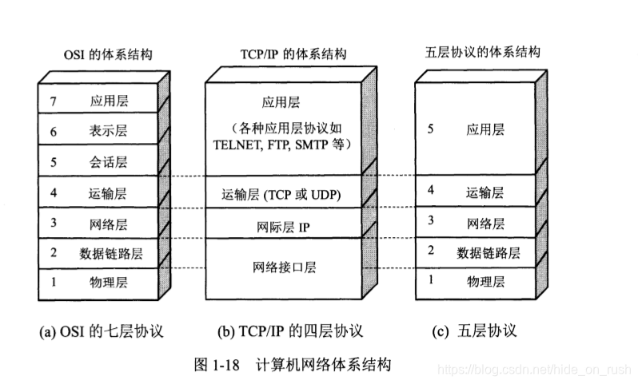  
下面主要按具有五层协议的体系结构，关于七层体系结构可以看看这个[OSI七层模型详解](https://blog.csdn.net/yaopeng_2005/article/details/7064869)

### 其他

#### ISP

互联网服务提供商 ISP 可以从互联网管理机构获得许多 IP 地址，同时拥有通信线路以及路由器等联网设备，个人或机构向 ISP 缴纳一定的费用就可以接入互联网。  
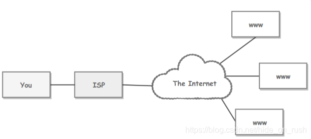  
目前的互联网是一种多层次 ISP 结构，ISP 根据覆盖面积的大小分为第一层 ISP、区域 ISP 和接入 ISP。互联网交换点 IXP 允许两个 ISP 直接相连而不用经过第三个 ISP。  
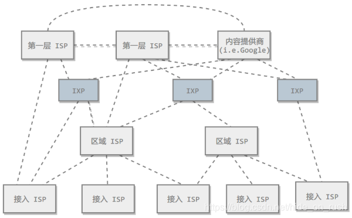

#### 主机通信方式

##### 客户-服务器（C/S）：

客户是服务的请求方，服务器是服务的提供方。  
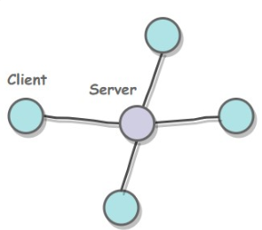

##### 对等（P2P）：

不区分客户和服务器。  
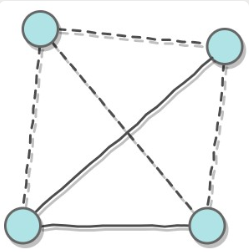

## 物理层

> 物理层考虑的是怎样才能在连接各种计算机的传输媒体上传输数据比特流，而不是指具体的传输媒体。现有的计算机网络中的硬件设备和传输媒体的种类非常繁多，而通信手段也有许多不同方式。物理层的作用正是要尽可能地屏蔽掉这些传输媒体和通信手段的差异，使物理层上面的数据链路层感觉不到这些差异，这样就可使数据链路层只需要考虑如何完成本层的协议和服务，而不必考虑网络具体的传输媒体和通信手段是什么。用于物理层的协议也常称为**物理层规程（procedure）**。其实物理层规程就是物理层协议。只是在“协议”这个名词出现之前人们就先使用了“规程”这一名词。

### 主要任务

透明地传送比特流。也可以将物理层的主要任务描述为确定与传输媒体的接口的一些特性，即：

- 机械特性（接口所用接线器的一些物理属性如形状尺寸）
- 电气特性（接口电缆的各条线上出现的电压的范围）
- 功能特性（某条线上出现的某一电平的电压的意义）
- 过程特性（对于不同功能能的各种可能事件的出现顺序）。

### 其他重要知识

#### 通信系统的模型

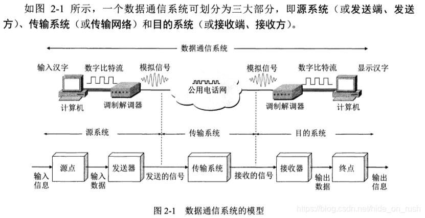

#### 通信方式

通信的目的是传送消息。如话音，文字，图像等都是消息，数据是运送消息的实体。信号则是数据的电器或电磁的表现。

- 单向通信  
  又称为单工通信，即只能有一个方向的通信而没有反方向的交互。无线电广播或有线电广播以及电视广播就属于这种类型。
- 双向交替通信  
  又称为半双工通信，即通信的双方都可以发送信息，但不能双方同时发（当然也就不能同时接收）。这种通信方式是一方发送另一方接收，过一段时间后可以再反过来。
- 双向同时通信  
  又称为全双工通信，即通信的双方可以同时发送和接收信息。单向通信只需要一条信道，而双向交替通信或双向同时通信则都需要两条信道（每个方向各一条）。显然，双向同时通信的传输效率最高。

#### 带通调制

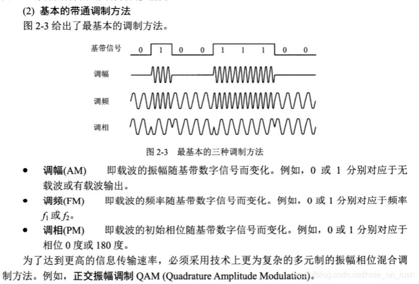

#### 信道复用技术

##### 频分复用

##### 时分复用

##### 统计时分复用

##### 波分复用

##### 码分复用

[信道复用技术](https://blog.csdn.net/qq_28602957/article/details/53467950?utm_medium=distribute.pc_relevant.none-task-blog-BlogCommendFromMachineLearnPai2-1.nonecase&depth_1-utm_source=distribute.pc_relevant.none-task-blog-BlogCommendFromMachineLearnPai2-1.nonecase)

#### 常用宽带接入技术

用户到互联网的宽带接入方法有非对称数字用户线ADSL（用数字技术对现有的模拟电话线进行改造，而不需要重新布线。ASDL的快速版本是甚高速数字用户线VDSL。），光纤同轴混合网HFC（是在目前覆盖范围很广的有线电视网的基础上开发的一种居民宽带接入网）和FTTx（即光纤到······）。

## 数据链路层

### 数据链路和帧

#### 数据链路

> 所谓链路（Link）就是从一个结点到相邻结点的一段物理线路（有线或无线），而中间没有任何其他的交换结点。在进行数据通信时，两台计算机之间的通信路径往往要经过许多段这样的链路。可见链路只是一条路径的组成部分。

> 数据链路（data link）则是另一个概念。这是因为当需要在一条线路上传送数据时，除了必须有一条物理线路外，还必须有一些必要的通信协议来控制这些数据的传输（这将在后面几节讨论）。若把实现这些协议的硬件和软件加到链路上，就构成了数据链路。现在最常用的方法是使用网络适配器（既有硬件，也包括软件）来实现这些协议。

简单来说：**链路是从一个结点到相邻节点的一段物理链路，数据链路则在链路的基础上增加了一些必要的硬件（如网络适配器）和软件（如协议的实现）**

#### 帧

帧是点对点信道的数据链路层的协议数据单元。  
数据链路层把网络层交下来的数据构成帧发送到链路上，以及把接收到的帧中的数据取出并上交给网络层。在互联网中，网络层协议数据单元就是IP数据报（或简称为数据报、分组或包）。  
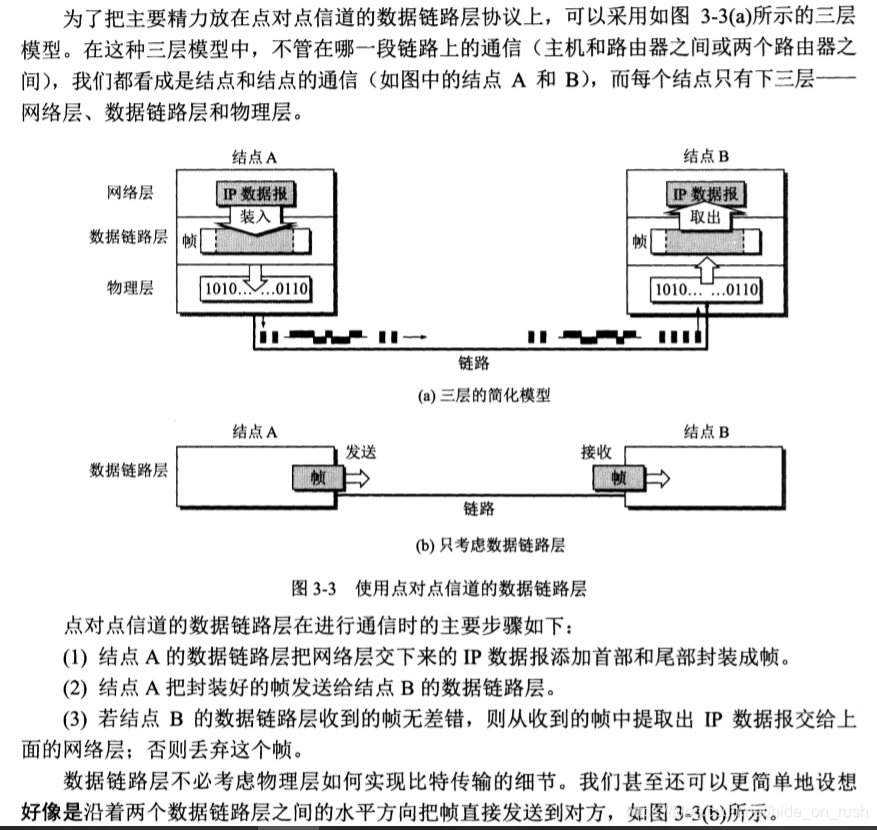

#### 三个基本问题

- 封装成帧
- 透明传输
- 差错检测
  - CRC循环冗余检验

### 使用点对点信道的数据链路层

#### 点对点信道

一对一通信。  
因为不会发生碰撞，因此也比较简单，使用 PPP 协议进行控制。

#### PPP协议(Point-to-Point Protocol)

互联网用户通常需要连接到某个 ISP 之后才能接入到互联网，PPP 协议是用户计算机和 ISP 进行通信时所使用的数据链路层协议。  
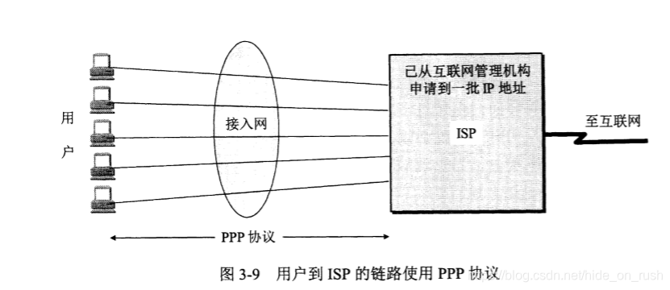

##### 特点

简单，只检测差错而不去纠正差错，不使用序号，也不进行流量控制，可同时支持多种网络层协议

##### 帧格式

- F（标志字段/定界符）

> 标志字段表示一个帧的开始或结束。因此标志字段就是PPP帧的定界符。连续两帧之间只需要用一个标志字段。如果出现连续两个标志字段，就表示这是一个空帧，应当丢弃。

- A 和 C 字段暂时没有意义
- FCS 字段是使用 CRC 的检验序列
- 信息部分的长度不超过 1500  
  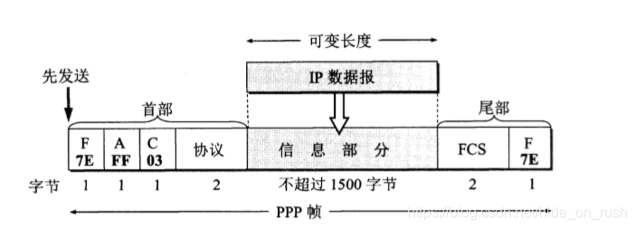

### 使用广播信道的数据链路层

#### 广播信道

一对多通信，一个节点发送的数据能够被广播信道上所有的节点接收到。

所有的节点都在同一个广播信道上发送数据，因此需要有专门的控制方法进行协调，避免发生冲突（冲突也叫碰撞）。

主要有两种控制方法进行协调，一个是使用信道复用技术，一是使用 CSMA/CD 协议。

##### 局域网

局域网是一种典型的广播信道，主要特点是网络为一个单位所拥有，且地理范围和站点数目均有限。  
主要有以太网、令牌环网、FDDI 和 ATM 等局域网技术，目前以太网占领着有线局域网市场。  
可以按照网络拓扑结构对局域网进行分类：  
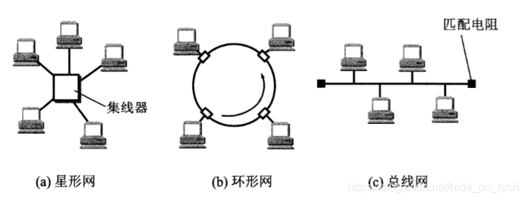

###### 以太网

以太网是一种**星型拓扑结构局域网**。

> 早期使用集线器进行连接，集线器是一种物理层设备， 作用于比特而不是帧，当一个比特到达接口时，集线器重新生成这个比特，并将其能量强度放大，从而扩大网络的传输距离，之后再将这个比特发送到其它所有接口。如果集线器同时收到两个不同接口的帧，那么就发生了碰撞。

目前以太网使用交换机替代了集线器，交换机是一种链路层设备，它不会发生碰撞，能根据 MAC 地址进行存储转发。  
**以太网帧格式：**

- 类型 ：标记上层使用的协议；
- 数据 ：长度在 46-1500 之间，如果太小则需要填充；
- FCS ：帧检验序列，使用的是 CRC 检验方法；  
  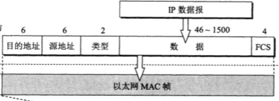

### CSMA/CD 协议

CSMA/CD，意思是载波监听多点接入/碰撞检测（Carrier Sense Multiple Access with Collision Detection）。

#### 原理

我们知道，总线上只要有一台计算机在发送数据，总线的传输资源就被占用。因此，在同一时间只能允许一台计算机发送数据，否则各计算机之间就会互相干扰，使得所发送数据被破坏。  
举个例子，课堂上；老师提问，有两个学生同时站起来发言。如果两个人继续同时发言就乱套了，需要协调，让一个人先发言，而CSMA/CD 协议起的就是协调的作用。

#### 要点

- 多点接入 ：说明这是总线型网络，许多主机以多点的方式连接到总线上。
- 载波监听 ：每个主机都必须不停地监听信道。在发送前，如果监听到信道正在使用，就必须等待。
- 碰撞检测 ：在发送中，如果监听到信道已有其它主机正在发送数据，就表示发生了碰撞。虽然每个主机在发送数据之前都已经监听到信道为空闲，但是由于电磁波的传播时延的存在，还是有可能会发生碰撞。记端到端的传播时延为 τ，最先发送的站点最多经过 2τ 就可以知道是否发生了碰撞，称 2τ 为 争用期 。只有经过争用期之后还没有检测到碰撞，才能肯定这次发送不会发生碰撞。当发生碰撞时，站点要停止发送，等待一段时间再发送。这个时间采用 截断二进制指数退避算法 来确定。从离散的整数集合 {0, 1, .., (2k-1)} 中随机取出一个数，记作 r，然后取 r 倍的争用期作为重传等待时间。
- 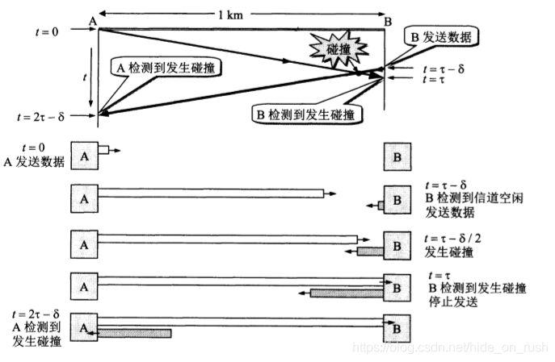

### 交换机

交换机具有自学习能力，学习的是交换表的内容，交换表中存储着 MAC 地址到接口的映射。

正是由于这种自学习能力，因此交换机是一种即插即用设备，不需要网络管理员手动配置交换表内容。

下图中，交换机有 4 个接口，主机 A 向主机 B 发送数据帧时，交换机把主机 A 到接口 1 的映射写入交换表中。为了发送数据帧到 B，先查交换表，此时没有主机 B 的表项，那么主机 A 就发送广播帧，主机 C 和主机 D 会丢弃该帧，主机 B 回应该帧向主机 A 发送数据包时，交换机查找交换表得到主机 A 映射的接口为 1，就发送数据帧到接口 1，同时交换机添加主机 B 到接口 2 的映射。  
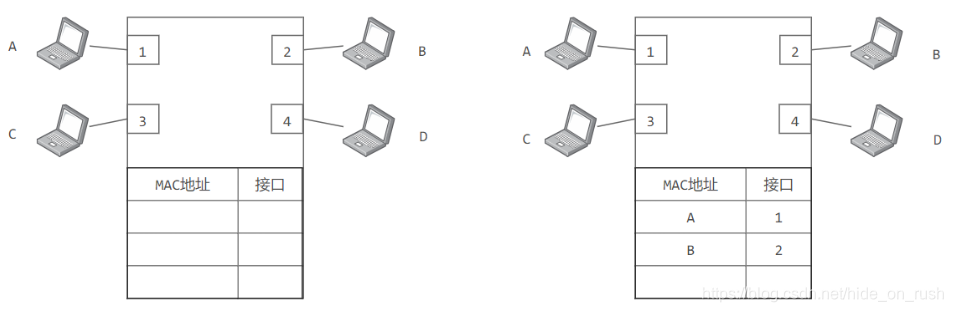

### 虚拟局域网

虚拟局域网可以建立与物理位置无关的逻辑组，只有在同一个虚拟局域网中的成员才会收到链路层广播信息。

例如下图中 (A1, A2, A3, A4) 属于一个虚拟局域网，A1 发送的广播会被 A2、A3、A4 收到，而其它站点收不到。

使用 VLAN 干线连接来建立虚拟局域网，每台交换机上的一个特殊接口被设置为干线接口，以互连 VLAN 交换机。IEEE 定义了一种扩展的以太网帧格式 802.1Q，它在标准以太网帧上加进了 4 字节首部 VLAN 标签，用于表示该帧属于哪一个虚拟局域网。

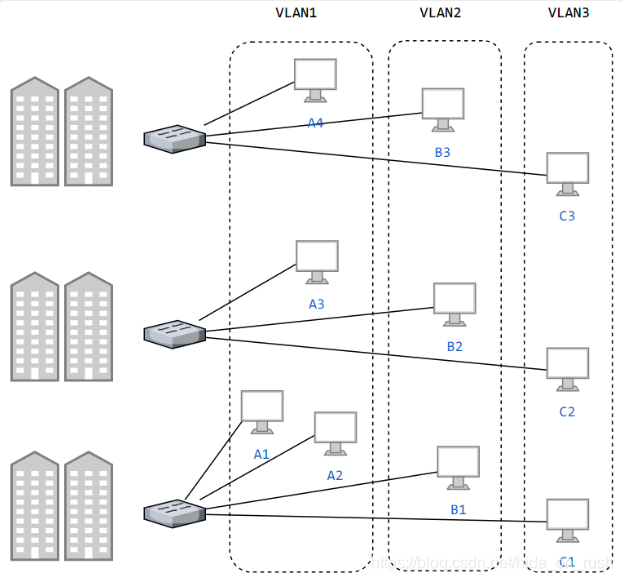

### 其他

- PPPoE是为宽带上网的主机使用的链路层协议
- 局域网的优点是：具有广播功能，从一个站点可方便地访问全网；便于系统的扩展和逐渐演变；提高了系统的可靠性，可用性和生存性。
- 共享媒体通信资源的方法有二：一是静态划分信道(各种复用技术)，而是动态媒体接入控制，又称为多点接入（随即接入或受控接入）
- 计算机与外接局域网通信需要通过通信适配器（或网络适配器），它又称为网络接口卡或网卡。计算器的硬件地址就在适配器的ROM中。
- 以太网采用的无连接的工作方式，对发送的数据帧不进行编号，也不要求对方发回确认。目的站收到有差错帧就把它丢掉，其他什么也不做
- 以太网的适配器具有过滤功能，它只接收单播帧，广播帧和多播帧。
- 使用集线器可以在物理层扩展以太网（扩展后的以太网仍然是一个网络）

## 网络层

网络层的主要作用是：**实现主机与主机之间的通信，也叫点对点（end to end）通信。**  
因为网络层是整个互联网的核心，因此应当让网络层尽可能简单。**网络层向上只提供简单灵活的、无连接的、尽最大努力交互的数据报服务。网络层并不提供服务质量上的保证**

使用 IP 协议，可以把异构的物理网络连接起来，使得在网络层看起来好像是一个统一的网络。  
与 IP 协议配套使用的还有三个协议：

- 地址解析协议 ARP（Address Resolution Protocol）
- 网际控制报文协议 ICMP（Internet Control Message Protocol）
- 网际组管理协议 IGMP（Internet Group Management Protocol）  
  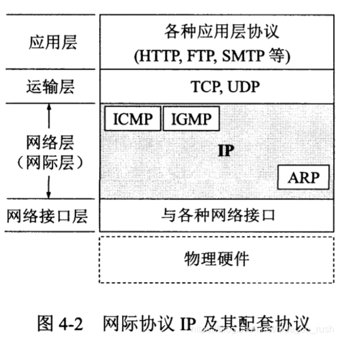

### 虚拟互联网络

**没有一种单一的网络能够适应所有用户的需求**，市场上总是有很多不同性能，不同协议的网络。  
从一般的概念来讲，将网络互相连接起来要使用一些中间设备。根据中间设备所在的层次，可以有以下四种不同的中间设备：  
（1）物理层使用的中间设备叫做转发器（repeater）。  
（2）数据链路层使用的中间设备叫做网桥或桥接器（bridge）。  
（3）网络层使用的中间设备叫做路由器（router）o。  
（4）在网络层以上使用的中间设备叫做网关（gateway）。用网关连接两个不兼容的系统需要在高层进行协议的转换。

> 图4-3（a）表示有许多计算机网络通过一些路由器进行互连。由于参加互连的计算机网络都使用相同的网际协议IP（Internet Protocol），因此可以把互连以后的计算机网络看成如图4-3（b）所示的一个虚拟互连网络（internet）。所谓虚拟互连网络也就是逻辑互连网络，它的意思就是互连起来的各种物理网络的异构性本来是客观存在的，但是我们利用IP协议就可以使这些性能各异的网络在网络层上看起来好像是一个统一的网络。这种使用IP协议的虚拟互连网络可简称为IP网

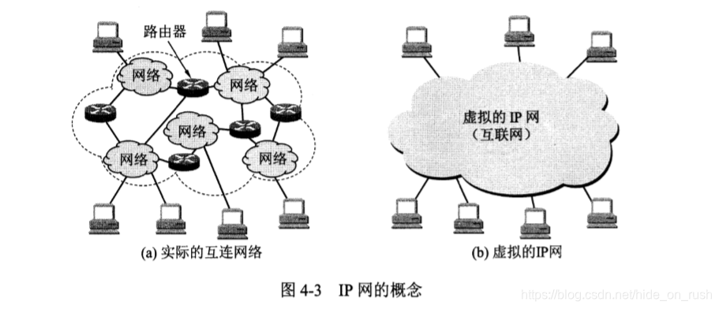

### IP协议

#### IP属于面向无连接类型

> IP面向无连接。即在发包之前，不需要建立与对端目标地址之间的连接。上层如果遇到需要发送给IP的数据，该数据会立即被压缩成IP包发送出去。

那么，为什么IP要采用面向无连接呢？  
主要有两点原因：一是为了简化，二是为了提速。面向连接比起面向无连接处理相对复杂。甚至管理每个连接本身就是一个相当繁琐的事情。此外，每次通信之前都要事先建立连接，又会降低处理速度。需要有连接时，可以委托上一层提供此项服务。因此，IP为了实现简单化与高速化采用面向无连接的方式。  
但是这样就丧失了数据的可靠性，为了弥补这一点，位于上一层的TCP协议采用面向有连接型

#### IP地址

> 整个的互联网就是一个单一的、抽象的网络。IP地址就是给互联网上的每一台主机（或路由器）的每一个接口分配一个在全世界范围内是唯一的32位的标识符。IP地址的结构使我们可以在互联网上很方便地进行寻址。IP地址现在由互联网名字和数字分配机构ICANN（Internet Corporation for Assigned Names and Numbers）进行分配。

##### IP地址的定义

IP地址（IPv4地址）由32位正整数来表示。TCP/IP通信要求将这样的IP地址分配给每一个参与通信的主机。IP地址在计算机内部以二进制”方式被处理。然而，由于人类社会并不习惯于采用二进制方式，需要采用一种特殊的标记方式。那就是将32位的IP地址以每8位为一组，分成4组，每组以“.”隔开，再将每组数转换为十进制数”。下面举例说明这一方法。  
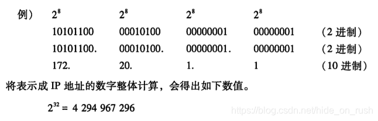

##### IP地址的分类

#### IP与MAC的关系

其实很容易区分，在上面我们知道 IP 的作用是主机之间通信中的，而 **MAC 的作用则是实现「直连」的两个设备之间通信，而 IP 则负责在「没有直连」的两个网络之间进行通信传输。**

举个生活的栗子，小林要去一个很远的地方旅行，制定了一个行程表，其间需先后乘坐飞机、地铁、公交车才能抵达目的地，为此小林需要买飞机票，地铁票等。

飞机票和地铁票都是去往特定的地点的，每张票只能够在某一限定区间内移动，此处的「区间内」就如同通信网络中数据链路。

在区间内移动相当于数据链路层，充当区间内两个节点传输的功能，区间内的出发点好比源 MAC 地址，目标地点好比目的 MAC 地址。

整个旅游行程表就相当于网络层，充当远程定位的功能，行程的开始好比源 IP，行程的终点好比目的 IP 地址。  
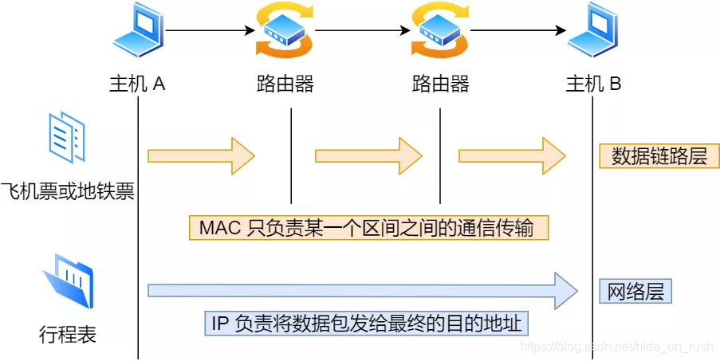  
只有两者兼备，既有某个区间的车票又有整个旅行的行程表，才能保证到达目的地。与此类似，计算机网络中也需要「数据链路层」和「网络层」这个分层才能实现向最终目标地址的通信。

还有重要一点，旅行途中我们虽然不断变化了交通工具，但是旅行行程的起始地址和目的地址始终都没变。其实，在网络中数据包传输中也是如此，源IP地址和目标IP地址在传输过程中是不会变化的，只有源 MAC 地址和目标 MAC 一直在变化。

#### IP数据报格式

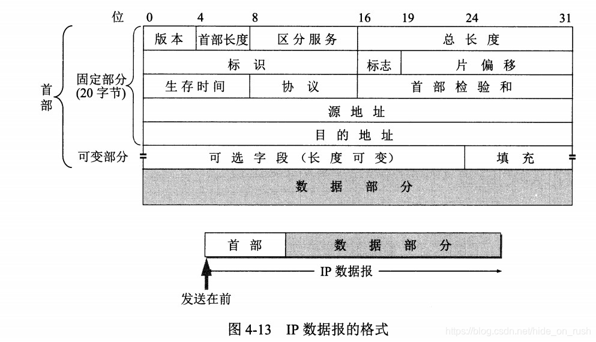

- 版本 : 有 4（IPv4）和 6（IPv6）两个值；
- 首部长度 : 占 4 位，因此最大值为 15。值为 1 表示的是 1 个 32 位字的长度，也就是 4 字节。因为固定部分长度为 20 字节，因此该值最小为 5。如果可选字段的长度不是 4 字节的整数倍，就用尾部的填充部分来填充。
- 区分服务 : 用来获得更好的服务，一般情况下不使用。
- 总长度 : 包括首部长度和数据部分长度。
- 生存时间 ：TTL，它的存在是为了防止无法交付的数据报在互联网中不断兜圈子。以路由器跳数为单位，当 TTL 为 0 时就丢弃数据报。
- 协议 ：指出携带的数据应该上交给哪个协议进行处理，例如 ICMP、TCP、UDP 等。
- 首部检验和 ：因为数据报每经过一个路由器，都要重新计算检验和，因此检验和不包含数据部分可以减少计算的工作量。
- 标识 : 在数据报长度过长从而发生分片的情况下，相同数据报的不同分片具有相同的标识符。
- 片偏移 : 和标识符一起，用于发生分片的情况。片偏移的单位为 8 字节。

#### IP地址的编址三个历史阶段

##### 分类的IP地址

由两部分组成，网络号和主机号，其中不同分类具有不同的网络号长度，并且是固定的。

IP 地址 ::= {< 网络号 >, < 主机号 >}  
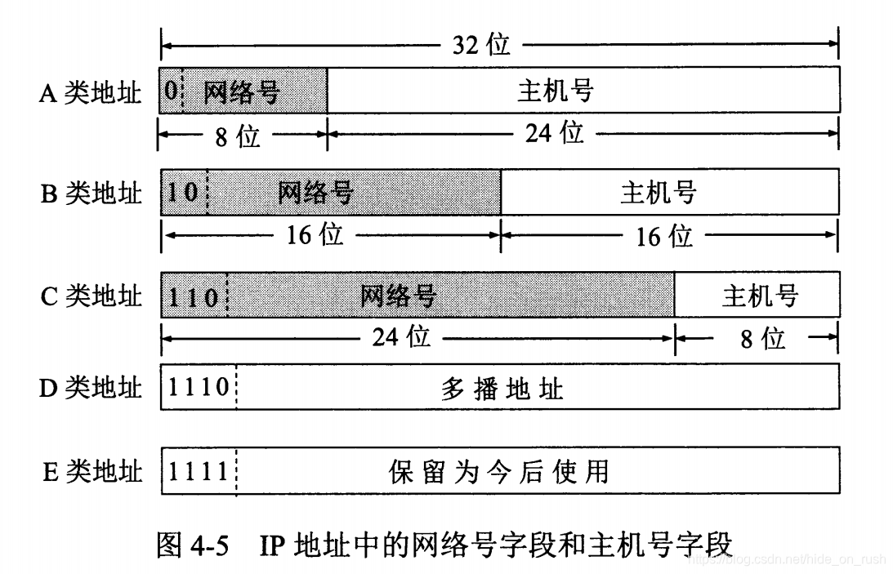  
**A、B、C类为单播地址、D类为多播地址**

##### 划分子网

通过在主机号字段中拿一部分作为子网号，把两级 IP 地址划分为三级 IP 地址。

IP 地址 ::= {< 网络号 >, < 子网号 >, < 主机号 >}

要使用子网，必须配置子网掩码。一个 B 类地址的默认子网掩码为 255.255.0.0，如果 B 类地址的子网占两个比特，那么子网掩码为 11111111 11111111 11000000 00000000，也就是 255.255.192.0。

注意，外部网络看不到子网的存在。

##### 构成超网(无分类编址 CIDR)

无分类编址 CIDR 消除了传统 A 类、B 类和 C 类地址以及划分子网的概念，使用网络前缀和主机号来对 IP 地址进行编码，网络前缀的长度可以根据需要变化。

IP 地址 ::= {< 网络前缀号 >, < 主机号 >}

CIDR 的记法上采用在 IP 地址后面加上网络前缀长度的方法，例如 128.14.35.7/20 表示前 20 位为网络前缀。

CIDR 的地址掩码可以继续称为子网掩码，子网掩码首 1 长度为网络前缀的长度。

一个 CIDR 地址块中有很多地址，一个 CIDR 表示的网络就可以表示原来的很多个网络，并且在路由表中只需要一个路由就可以代替原来的多个路由，减少了路由表项的数量。把这种通过使用网络前缀来减少路由表项的方式称为路由聚合，也称为 构成超网 。

在路由表中的项目由“网络前缀”和“下一跳地址”组成，在查找时可能会得到不止一个匹配结果，应当采用最长前缀匹配来确定应该匹配哪一个。

#### IP地址与硬件地址的区别

从层次的角度看，**物理地址是数据链路层和物理层使用的地址，而IP地址是网络层和以上各层使用的地址，是一种逻辑地址**（称IP地址为逻辑地址是因为IP地址是用软件实现的）。  
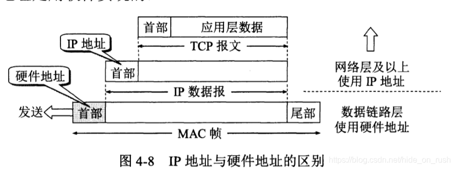

#### IP地址与路由控制

IP地址的网络地址这一部分是用于进行路由控制。

路由控制表中记录着网络地址与下一步应该发送至路由器的地址，在主机和路由器上都会有各自的路由器控制表。

在发送 IP 包时，首先要确定 IP 包首部中的目标地址，再从路由控制表中找到与该地址具有相同网络地址的记录，根据该记录将 IP 包转发给相应的下一个路由器。如果路由控制表中存在多条相同网络地址的记录，就选择相同位数最多的网络地址，也就是最长匹配。  
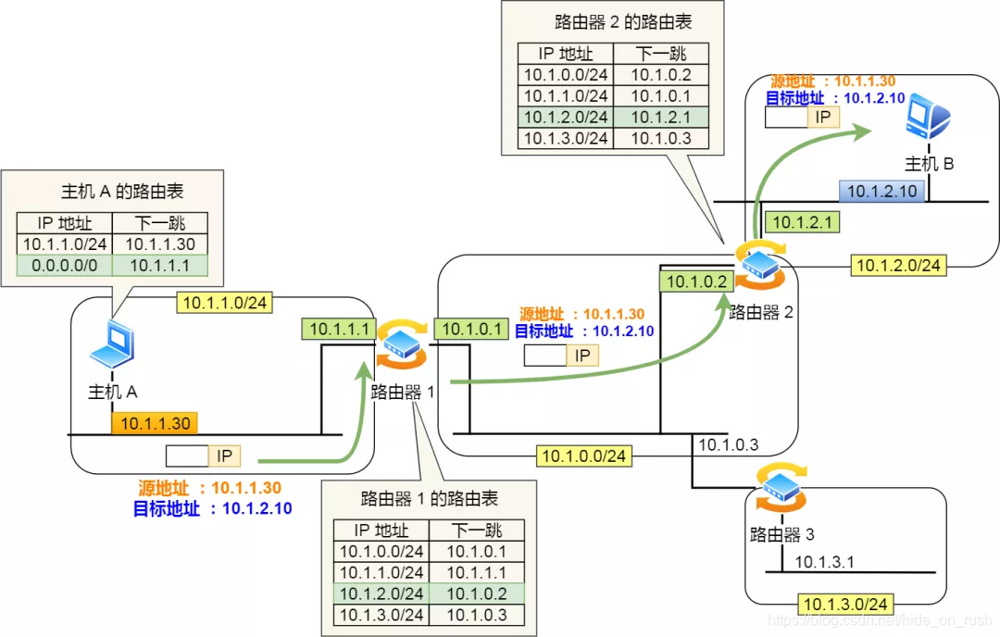

1. 主机 A 要发送一个 IP 包，其源地址是 10.1.1.30 和目标地址是 10.1.2.10，由于没有在主机 A 的路由表找到与目标地址 10.1.2.10 的网络地址，于是把包被转发到默认路由（路由器 1 ）
2. 路由器 1 收到 IP 包后，也在路由器 1 的路由表匹配与目标地址相同的网络地址记录，发现匹配到了，于是就把 IP 数据包转发到了 10.1.0.2 这台路由器 2
3. 路由器 2 收到后，同样对比自身的路由表，发现匹配到了，于是把 IP 包从路由器 2 的 10.1.2.1 这个接口出去，最终经过交换机把 IP 数据包转发到了目标主机

下面以下图的网络链路作为例子说明：

### 地址解析协议ARP

> 网络层实现主机之间的通信，而链路层实现具体每段链路之间的通信。因此在通信过程中，IP 数据报的源地址和目的地址始终不变，而 MAC 地址随着链路的改变而改变。

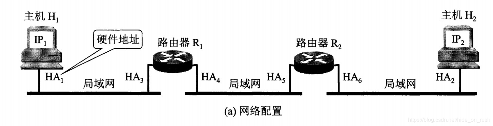  
ARP 实现由 IP 地址得到 MAC 地址。  
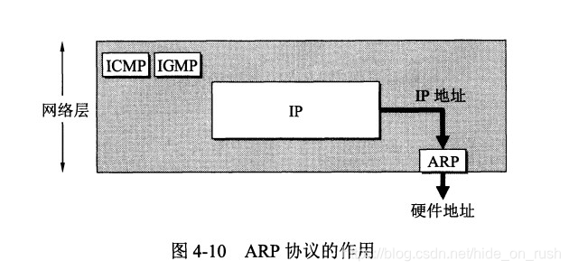  
每个主机都有一个 ARP 高速缓存，里面有本局域网上的各主机和路由器的 IP 地址到 MAC 地址的映射表。

如果主机 A 知道主机 B 的 IP 地址，但是 ARP 高速缓存中没有该 IP 地址到 MAC 地址的映射，此时主机 A 通过广播的方式发送 ARP 请求分组，主机 B 收到该请求后会发送 ARP 响应分组给主机 A 告知其 MAC 地址，随后主机 A 向其高速缓存中写入主机 B 的 IP 地址到 MAC 地址的映射。  
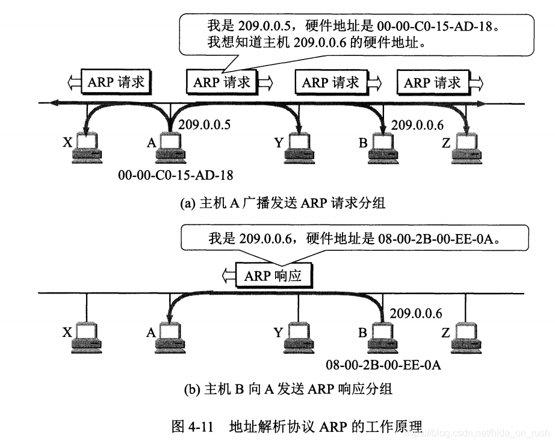

#### 总结：

在传输一个 IP 数据报的时候，确定了源 IP 地址和目标 IP 地址后，就会通过主机「路由表」确定 IP 数据包下一跳。然而，网络层的下一层是数据链路层，所以我们还要知道「下一跳」的 MAC 地址。

由于主机的路由表中可以找到下一条的 IP 地址，所以可以通过 ARP 协议，求得下一跳的 MAC 地址。  
那么 ARP 又是如何知道对方 MAC 地址的呢？简单地说，ARP 是借助 ARP 请求与 ARP 响应两种类型的包确定 MAC 地址的。

简单地说，ARP 是借助 ARP 请求与 ARP 响应两种类型的包确定 MAC 地址的。  
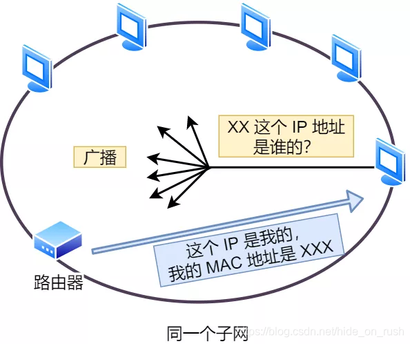

- 主机会通过广播发送 ARP 请求，这个包中包含了想要知道的 MAC 地址的主机 IP 地址。
- 当同个链路中的所有设备收到 ARP 请求时，会去拆开 ARP 请求包里的内容，如果 ARP 请求包中的目标 IP 地址与自己的 IP 地址一致，那么这个设备就将自己的 MAC 地址塞入 ARP 响应包返回给主机。

操作系统通常会把第一次通过 ARP 获取的 MAC 地址缓存起来，以便下次直接从缓存中找到对应 IP 地址的 MAC 地址。

不过，MAC 地址的缓存是有一定期限的，超过这个期限，缓存的内容将被清除。

### 网际控制报文协议 ICMP

ICMP 是为了更有效地转发 IP 数据报和提高交付成功的机会。它封装在 IP 数据报中，但是不属于高层协议。  
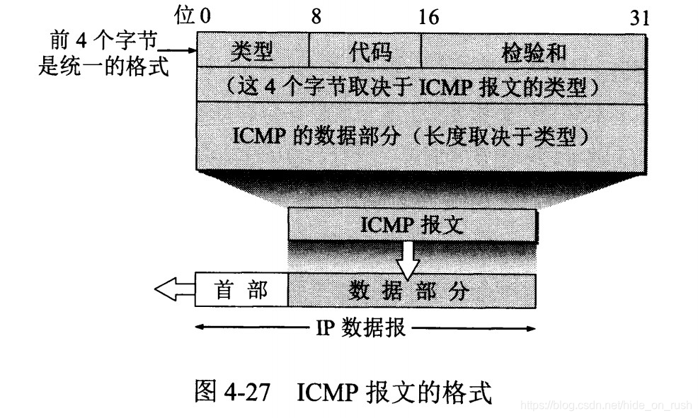

#### ICMP报文的种类

ICMP 报文分为差错报告报文和询问报文。  
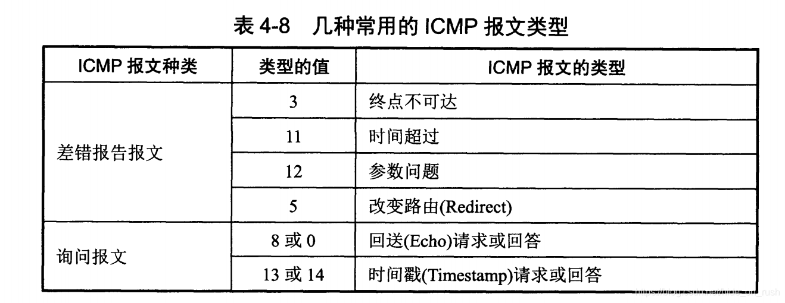

#### 应用举例

##### Ping

Ping 是 ICMP 的一个重要应用，主要用来测试两台主机之间的连通性。

Ping 的原理是通过向目的主机发送 ICMP Echo 请求报文，目的主机收到之后会发送 Echo 回答报文。Ping 会根据时间和成功响应的次数估算出数据包往返时间以及丢包率。

##### Traceroute

Traceroute 是 ICMP 的另一个应用，用来跟踪一个分组从源点到终点的路径。

Traceroute 发送的 IP 数据报封装的是无法交付的 UDP 用户数据报，并由目的主机发送终点不可达差错报告报文。

- 源主机向目的主机发送一连串的 IP 数据报。第一个数据报 P1 的生存时间 TTL 设置为 1，当 P1 到达路径上的第一个路由器 R1 时，R1 收下它并把 TTL 减 1，此时 TTL 等于 0，R1 就把 P1 丢弃，并向源主机发送一个 ICMP 时间超过差错报告报文；
- 源主机接着发送第二个数据报 P2，并把 TTL 设置为 2。P2 先到达 R1，R1 收下后把 TTL 减 1 再转发给 R2，R2 收下后也把 TTL 减 1，由于此时 TTL 等于 0，R2 就丢弃 P2，并向源主机发送一个 ICMP 时间超过差错报文。
- 不断执行这样的步骤，直到最后一个数据报刚刚到达目的主机，主机不转发数据报，也不把 TTL 值减 1。但是因为数据报封装的是无法交付的 UDP，因此目的主机要向源主机发送 ICMP 终点不可达差错报告报文。
- 之后源主机知道了到达目的主机所经过的路由器 IP 地址以及到达每个路由器的往返时间。

### 路由器

#### 路由器的结构

路由器从功能上可以划分为：路由选择和分组转发。

分组转发结构由三个部分组成：交换结构、一组输入端口和一组输出端口。  
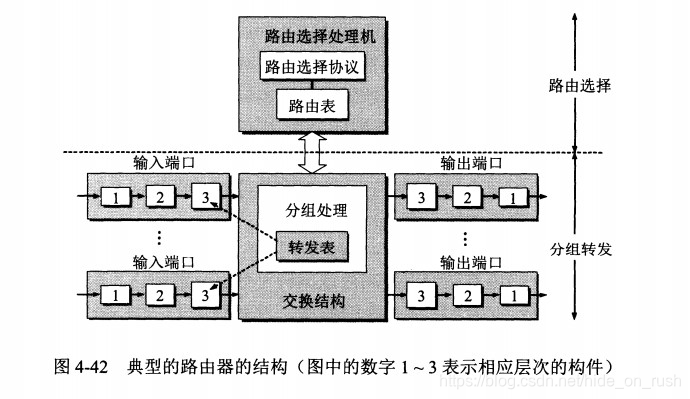

#### 路由器分组转发流程

1. 从数据报的首部提取目的主机的 IP 地址 D，得到目的网络地址 N。
2. 若 N 就是与此路由器直接相连的某个网络地址，则进行直接交付；
3. 若路由表中有目的地址为 D 的特定主机路由，则把数据报传送给表中所指明的下一跳路由器；
4. 若路由表中有到达网络 N 的路由，则把数据报传送给路由表中所指明的下一跳路由器；
5. 若路由表中有一个默认路由，则把数据报传送给路由表中所指明的默认路由器；
6. 报告转发分组出错。  
   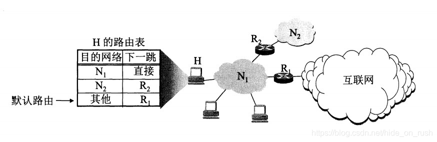

### 路由选择协议

路由选择协议都是自适应的，能随着网络通信量和拓扑结构的变化而自适应地进行调整。

互联网可以划分为许多较小的自治系统 AS，一个 AS 可以使用一种和别的 AS 不同的路由选择协议。

可以把路由选择协议划分为两大类：

- 自治系统内部的路由选择：RIP 和 OSPF
- 自治系统间的路由选择：BGP

#### 内部网关协议 RIP

RIP 是一种基于距离向量的路由选择协议。距离是指跳数，直接相连的路由器跳数为 1。跳数最多为 15，超过 15 表示不可达。

RIP 按固定的时间间隔仅和相邻路由器交换自己的路由表，经过若干次交换之后，所有路由器最终会知道到达本自治系统中任何一个网络的最短距离和下一跳路由器地址。

距离向量算法：

- 对地址为 X 的相邻路由器发来的 RIP 报文，先修改报文中的所有项目，把下一跳字段中的地址改为 X，并把所有的距离字段加 1；
- 对修改后的 RIP 报文中的每一个项目，进行以下步骤：
  - 若原来的路由表中没有目的网络 N，则把该项目添加到路由表中；
  - 否则：若下一跳路由器地址是 X，则把收到的项目替换原来路由表中的项目；否则：若收到的项目中的距离 d 小于路由表中的距离，则进行更新（例如原始路由表项为 Net2, 5, P，新表项为 Net2, 4, X，则更新）；否则什么也不做。
- 若 3 分钟还没有收到相邻路由器的更新路由表，则把该相邻路由器标为不可达，即把距离置为 16。  
  **RIP 协议实现简单，开销小。但是 RIP 能使用的最大距离为 15，限制了网络的规模。并且当网络出现故障时，要经过比较长的时间才能将此消息传送到所有路由器。**

#### 内部网关协议 OSPF

**开放最短路径优先 OSPF**，是为了克服 RIP 的缺点而开发出来的。

开放表示 OSPF 不受某一家厂商控制，而是公开发表的；最短路径优先表示使用了 Dijkstra 提出的最短路径算法 SPF。

OSPF 具有以下特点：

- 向本自治系统中的所有路由器发送信息，这种方法是洪泛法。
- 发送的信息就是与相邻路由器的链路状态，链路状态包括与哪些路由器相连以及链路的度量，度量用费用、距离、时延、带宽等来表示。
- 只有当链路状态发生变化时，路由器才会发送信息。  
  所有路由器都具有全网的拓扑结构图，并且是一致的。相比于 RIP，OSPF 的更新过程收敛的很快。

#### 外部网关协议 BGP

BGP（Border Gateway Protocol，边界网关协议）

AS 之间的路由选择很困难，主要是由于：

- 互联网规模很大；
- 各个 AS 内部使用不同的路由选择协议，无法准确定义路径的度量；
- AS 之间的路由选择必须考虑有关的策略，比如有些 AS 不愿意让其它 AS 经过。  
  BGP 只能寻找一条比较好的路由，而不是最佳路由。

每个 AS 都必须配置 BGP 发言人，通过在两个相邻 BGP 发言人之间建立 TCP 连接来交换路由信息。

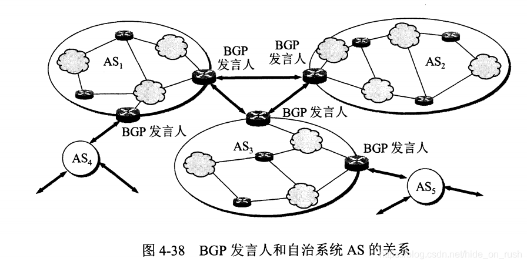

### 虚拟专用网VPN

由于 IP 地址的紧缺，一个机构能申请到的 IP 地址数往往远小于本机构所拥有的主机数。并且一个机构并不需要把所有的主机接入到外部的互联网中，机构内的计算机可以使用仅在本机构有效的 IP 地址（专用地址）。

有三个专用地址块：

- 10.0.0.0 ~ 10.255.255.255
- 172.16.0.0 ~ 172.31.255.255
- 192.168.0.0 ~ 192.168.255.255  
  VPN 使用公用的互联网作为本机构各专用网之间的通信载体。专用指机构内的主机只与本机构内的其它主机通信；虚拟指好像是，而实际上并不是，它有经过公用的互联网。

下图中，场所 A 和 B 的通信经过互联网，如果场所 A 的主机 X 要和另一个场所 B 的主机 Y 通信，IP 数据报的源地址是 10.1.0.1，目的地址是 10.2.0.3。数据报先发送到与互联网相连的路由器 R1，R1 对内部数据进行加密，然后重新加上数据报的首部，源地址是路由器 R1 的全球地址 125.1.2.3，目的地址是路由器 R2 的全球地址 194.4.5.6。路由器 R2 收到数据报后将数据部分进行解密，恢复原来的数据报，此时目的地址为 10.2.0.3，就交付给 Y。  
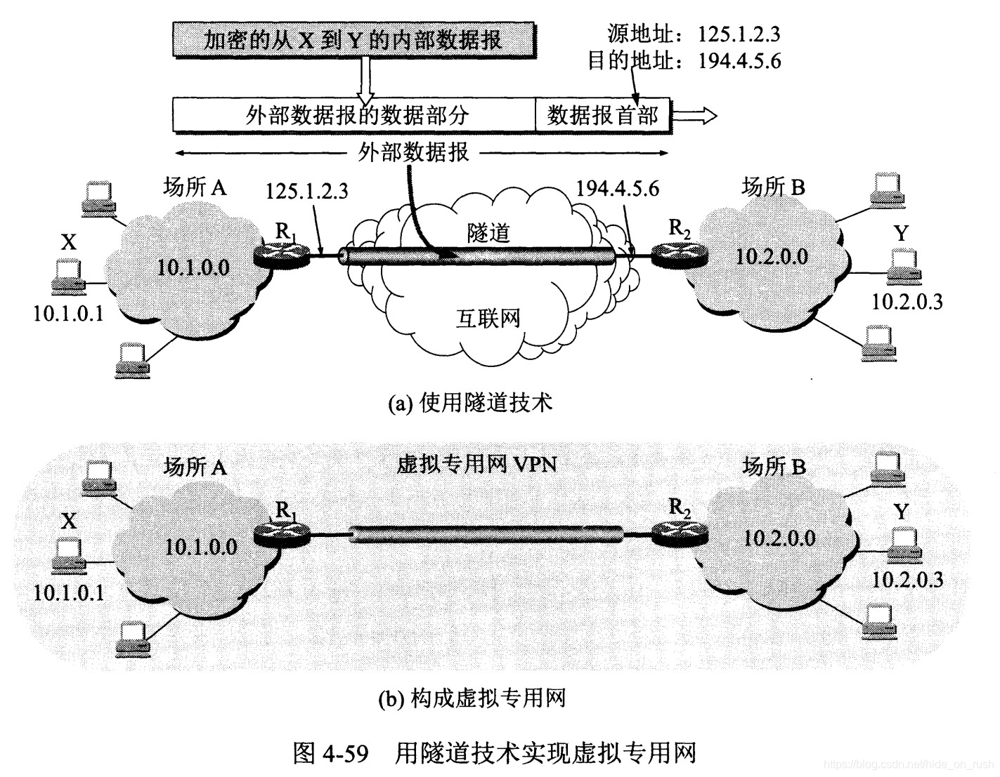

### 网络地址转换NAT

专用网内部的主机使用本地 IP 地址又想和互联网上的主机通信时，可以使用 NAT 来将本地 IP 转换为全球 IP。

在以前，NAT 将本地 IP 和全球 IP 一一对应，这种方式下拥有 n 个全球 IP 地址的专用网内最多只可以同时有 n 台主机接入互联网。为了更有效地利用全球 IP 地址，现在常用的 NAT 转换表把传输层的端口号也用上了，使得多个专用网内部的主机共用一个全球 IP 地址。使用端口号的 NAT 也叫做网络地址与端口转换 NAPT。  
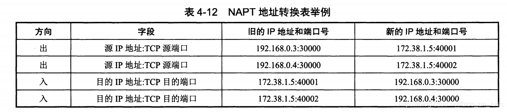

## 运输层

> 运输层提供应用进程之间的逻辑通信，也就是说，运输层之间的通信并不是真正在两个运输层之间直接传输数据。运输层向应用层屏蔽了下面网络的细节（如网络拓补，所采用的路由选择协议等），它使应用进程之间看起来好像两个运输层实体之间有一条端到端的逻辑通信信道。网络层为主机提供逻辑通信，而运输层为应用进程之间提供端到端的逻辑通信。

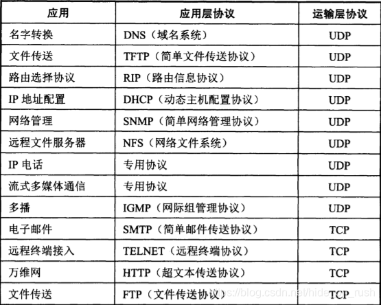

### 用户数据报协议 UDP（User Datagram Protocol）

#### 特点

用户数据报协议 UDP（User Datagram Protocol）是**无连接的，尽最大可能交付，没有拥塞控制，面向报文**（对于应用程序传下来的报文不合并也不拆分，只是添加 UDP 首部），**支持一对一、一对多、多对一和多对多的交互通信。**

#### UDP首部格式

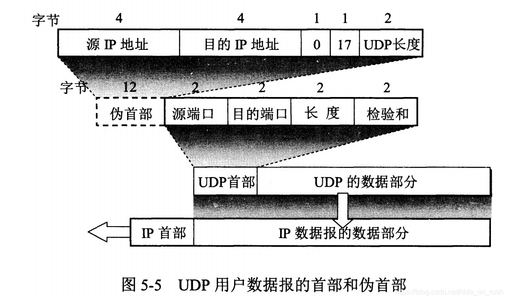  
首部字段只有 8 个字节，包括源端口、目的端口、长度、检验和。12 字节的伪首部是为了计算检验和临时添加的。

### 传输控制协议 TCP（Transmission Control Protocol）

#### 为什么需要TCP协议？

前面提到过，IP 层是「不可靠」的，它不保证网络包的交付、不保证网络包的按序交付、也不保证网络包中的数据的完整性。  
如果需要保障网络数据包的可靠性，那么就需要由上层（运输层）的 TCP 协议来负责。  
因为 TCP 是一个工作在**运输层**的可靠数据传输的服务，它能确保接收端接收的网络包是**无损坏、无间隔、非冗余和按序的。**

#### 特点

传输控制协议 TCP（Transmission Control Protocol）是**面向连接的，提供可靠交付，有流量控制，拥塞控制，提供全双工通信，面向字节流**（把应用层传下来的报文看成字节流，把字节流组织成大小不等的数据块），每一条 TCP 连接只能是**点对点的（一对一）**。

- 面向连接：一定是「一对一」才能连接，不能像 UDP 协议 可以一个主机同时向多个主机发送消息，也就是一对多是无法做到的；
- 可靠的：无论的网络链路中出现了怎样的链路变化，TCP 都可以保证一个报文一定能够到达接收端；
- 字节流：消息是「没有边界」的，所以无论我们消息有多大都可以进行传输。并且消息是「有序的」，当「前一个」消息没有收到的时候，即使它先收到了后面的字节，那么也不能扔给应用层去处理，同时对「重复」的报文会自动丢弃。

#### 首部格式

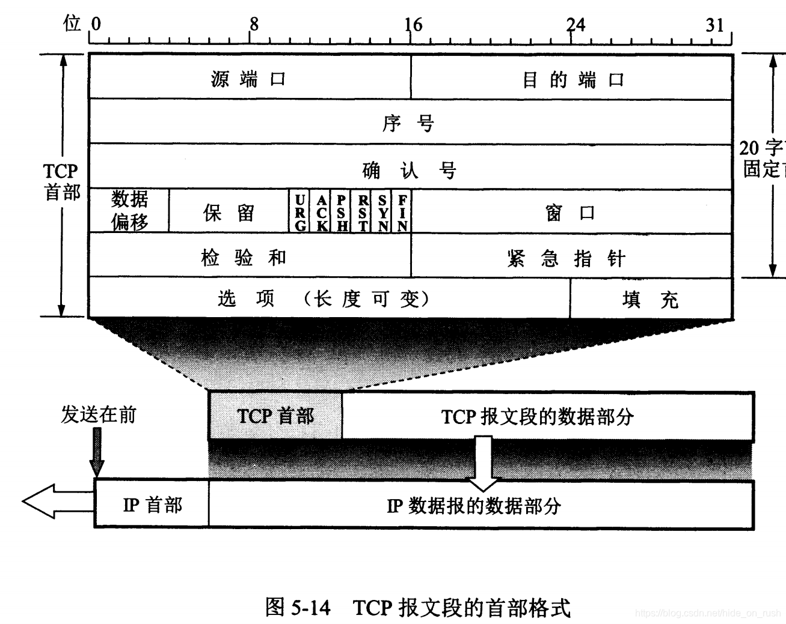

- **序号** ：在建立连接时由计算机生成的随机数作为其初始值，通过 SYN 包传给接收端主机，每发送一次数据，就「累加」一次该「数据字节数」的大小。**用来解决网络包乱序问题**。用于对字节流进行编号，例如序号为 301，表示第一个字节的编号为 301，如果携带的数据长度为 100 字节，那么下一个报文段的序号应为 401。
- **确认号** ：指下一次「期望」收到的数据的序列号，发送端收到这个确认应答以后可以认为在这个序号以前的数据都已经被正常接收。**用来解决不丢包的问题。** 例如 B 正确收到 A 发送来的一个报文段，序号为 501，携带的数据长度为 200 字节，因此 B 期望下一个报文段的序号为 701，B 发送给 A 的确认报文段中确认号就为 701。
- **数据偏移** ：指的是数据部分距离报文段起始处的偏移量，实际上指的是首部的长度。
- **确认 ACK** ：当 ACK=1 时确认号字段有效，否则无效。TCP 规定，在连接建立后所有传送的报文段都必须把 ACK 置 1。
- **同步 SYN** ：在连接建立时用来同步序号。当 SYN=1，ACK=0 时表示这是一个连接请求报文段。SYN=1时，该位为 1 时，表示希望建立连接。若对方同意建立连接，则响应报文中 SYN=1，ACK=1。
- **终止 FIN** ：用来释放一个连接，当 FIN=1 时，表示此报文段的发送方的数据已发送完毕，并要求释放连接。
- **窗口** ：窗口值作为接收方让发送方设置其发送窗口的依据。之所以要有这个限制，是因为接收方的数据缓存空间是有限的。

#### TCP建立连接

##### 详细过程

TCP 是面向连接的协议，所以使用 TCP 前必须先建立连接，而建立连接是通过三次握手而进行的。  
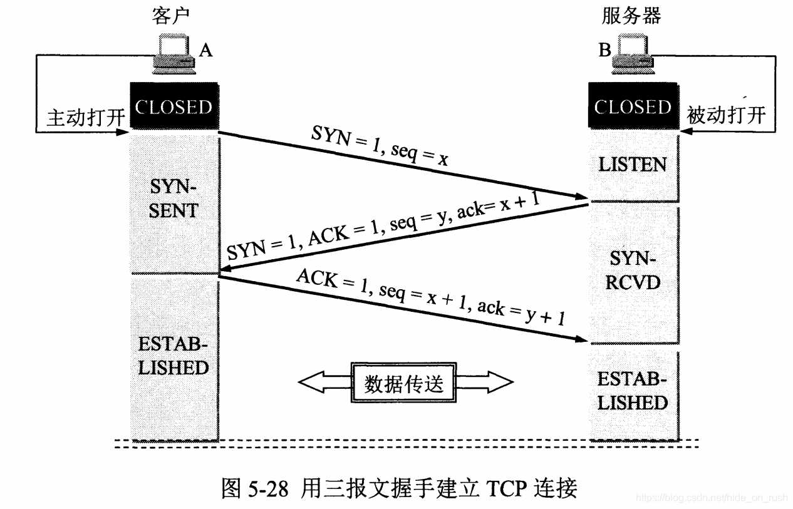

1. 一开始，客户端和服务端都处于 CLOSED 状态。先是服务端主动监听某个端口，处于 LISTEN 状态  
   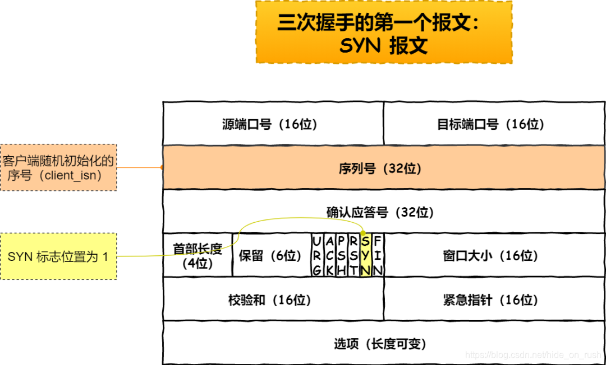
2. 客户端会随机初始化序号（client\_isn），将此序号置于 TCP 首部的「序号」字段中，同时把 SYN 标志位置为 1 ，表示 SYN 报文。接着把第一个 SYN 报文发送给服务端，表示向服务端发起连接，该报文不包含应用层数据，之后客户端处于 SYN-SENT 状态。  
   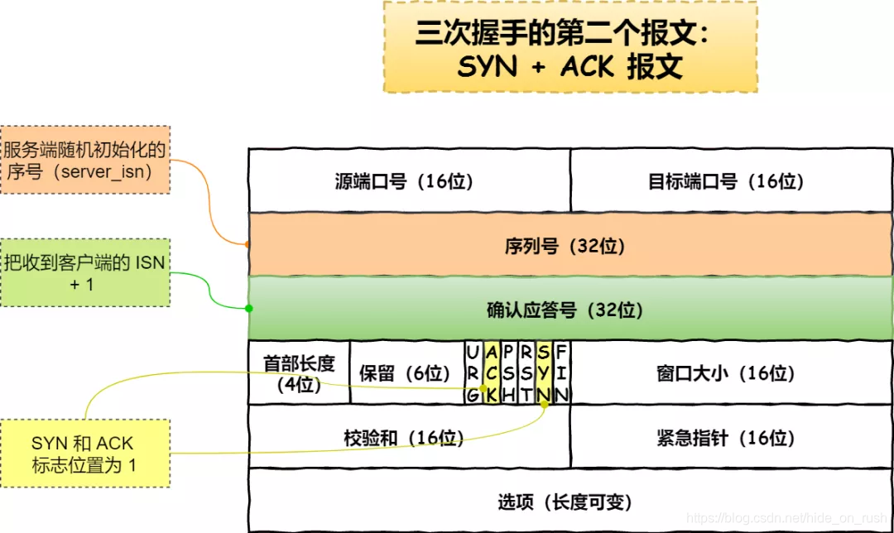
3. 服务端收到客户端的 SYN 报文后，首先服务端也随机初始化自己的序号（server\_isn），将此序号填入 TCP 首部的「序号」字段中，其次把 TCP 首部的「确认应答号」字段填入 client\_isn + 1, 接着把 SYN 和 ACK 标志位置为 1。最后把该报文发给客户端，该报文也不包含应用层数据，之后服务端处于 SYN-RCVD 状态。  
   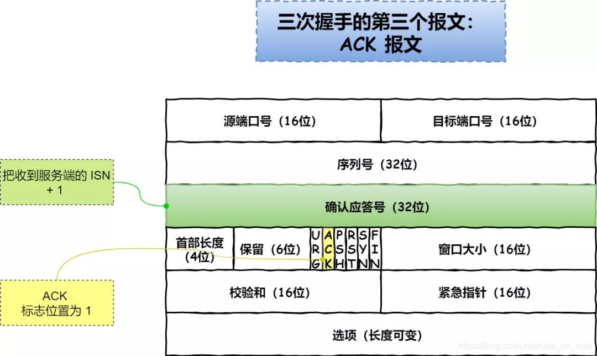
4. 客户端收到服务端报文后，还要向服务端回应最后一个应答报文，首先该应答报文 TCP 首部 ACK 标志位置为 1 ，其次「确认应答号」字段填入 server\_isn + 1 ，最后把报文发送给服务端，这次报文可以携带客户到服务器的数据，之后客户端处于 ESTABLISHED 状态。
5. 服务器收到客户端的应答报文后，也进入 ESTABLISHED 状态。  
   从上面的过程可以发现**第三次握手是可以携带数据的，前两次握手是不可以携带数据的**，这也是面试常问的题。  
   一旦完成三次握手，双方都处于 ESTABLISHED 状态，此致连接就已建立完成，客户端和服务端就可以相互发送数据了。

##### 简单总结

三次握手的目的是建立可靠的通信信道，说到通讯，简单来说就是数据的发送与接收，而三次握手最主要的目的就是双方确认自己与对方的发送与接收是正常的。  
第一次握手：Client什么都不能确认；Server确认了对方发送正常，自己接收正常

第二次握手：Client确认了：自己发送、接收正常，对方发送、接收正常；Server确认了：对方发送正常，自己接收正常

第三次握手：Client确认了：自己发送、接收正常，对方发送、接收正常；Server确认了：自己发送、接收正常，对方发送、接收正常  
所以三次握手就能确认双发收发功能都正常，缺一不可。  
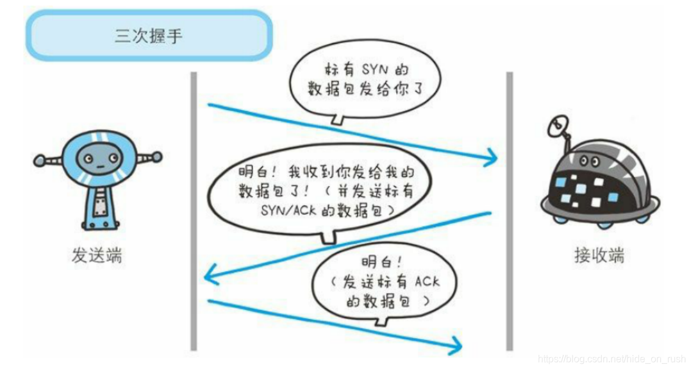

#### TCP断开连接

TCP 断开连接是通过四次挥手方式。

双方都可以主动断开连接，断开连接后主机中的「资源」将被释放。

##### 详细过程

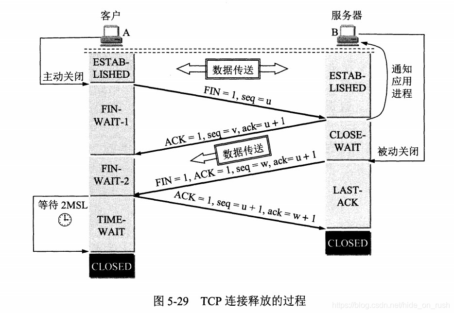

1. 客户端打算关闭连接，此时会发送一个 TCP 首部 FIN 标志位被置为 1 的报文，也即 FIN 报文，之后客户端进入 FIN\_WAIT\_1 状态。
2. 服务端收到该报文后，就向客户端发送 ACK 应答报文，接着服务端进入 CLOSED\_WAIT 状态。
3. 客户端收到服务端的 ACK 应答报文后，之后进入 FIN\_WAIT\_2 状态。
4. 等待服务端处理完数据后，也向客户端发送 FIN 报文，之后服务端进入 LAST\_ACK 状态。
5. 客户端收到服务端的 FIN 报文后，回一个 ACK 应答报文，之后进入 TIME\_WAIT 状态
6. 服务器收到了 ACK 应答报文后，就进入了 CLOSE 状态，至此服务端已经完成连接的关闭。
7. 客户端在经过 2MSL 一段时间后，自动进入 CLOSE 状态，至此客户端也完成连接的关闭。  
   你可以看到，每个方向都需要一个 FIN 和一个 ACK，因此通常被称为四次挥手。

这里一点需要注意是：**主动关闭连接的，才有 TIME\_WAIT 状态。**

##### 简单总结

任何一方都可以在数据传送结束后发出连接释放的通知，待对方确认后进入半关闭状态。当另一方也没有数据再发送的时候，则发出连接释放通知，对方确认后就完全关闭了TCP连接。  
举个例子：A和B打电话，通话即将结束后，A说“我没啥要说的了”，B回答“我知道了”，但是B可能还会有要说的话，A不能要求B跟着自己的节奏结束通话，于是B可能又巴拉巴拉说了一通，最后B说“我说完了”，A回答“知道了”，这样通话才算结束。  
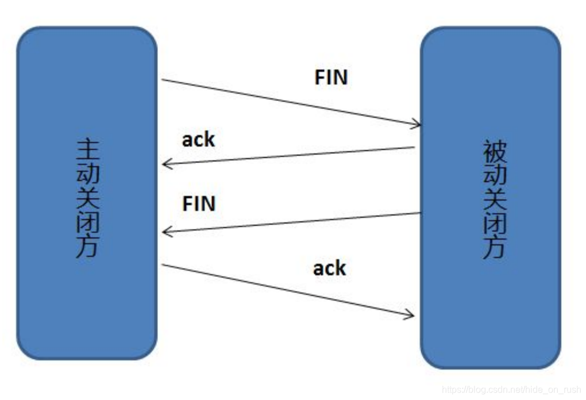  
一些相关的文章  
<https://blog.csdn.net/qzcsu/article/details/72861891>

<https://mp.weixin.qq.com/s?__biz=MzAxOTc0NzExNg==&mid=2665513094&idx=1&sn=a2accfc41107ac08d74ec3317995955e&scene=21#wechat_redirect>

<https://mp.weixin.qq.com/s?__biz=MzAxOTc0NzExNg==&mid=2665513375&idx=1&sn=e11745d5cb28fa1f89465f8d0e5fae1a&chksm=80d679dcb7a1f0cadec0a1db45b3fa3f6eabde4a9e56a77acf551fbc1511e6b8f055ee2c97e3&scene=21#wechat_redirect>

<https://mp.weixin.qq.com/s?__biz=MzAxOTc0NzExNg==&mid=2665513384&idx=1&sn=82c45e4430618270a744e212d2f57990&chksm=80d679ebb7a1f0fd27fe1814765a0e60b1c293ca4e09403271b4bb3f38f317439956fdca1bc1&scene=21#wechat_redirect>

#### TCP可靠传输（重传机制）

TCP 实现可靠传输的方式之一，是通过序列号与确认应答。

在 TCP 中，当发送端的数据到达接收主机时，接收端主机会返回一个确认应答消息，表示已收到消息。  
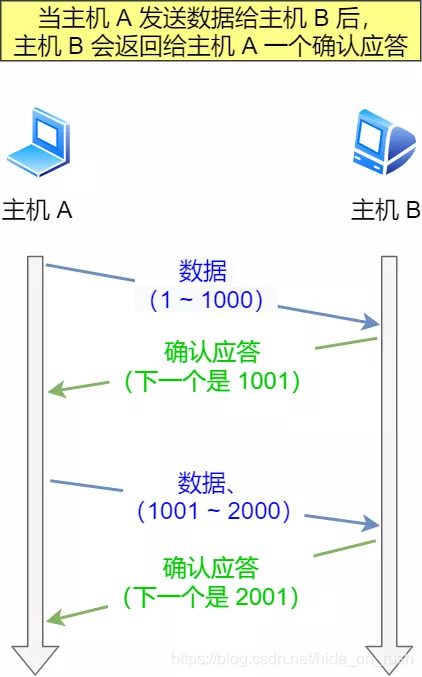  
但在错综复杂的网络，并不一定能如上图那么顺利能正常的数据传输，万一数据在传输过程中丢失了呢？

所以 TCP 针对数据包丢失的情况，会用重传机制解决。

接下来说说常见的重传机制：

- 超时重传
- 快速重传
- SACK
- D-SACK

##### 超时重传

重传机制的其中一个方式，就是在发送数据时，设定一个定时器，当超过指定的时间后，没有收到对方的 ACK 确认应答报文，就会重发该数据，也就是我们常说的**超时重传**。  
TCP 会在以下两种情况发生超时重传：

- 数据包丢失
- 确认应答丢失  
  

###### 超时重传的时间设定

我们先来了解一下什么是 RTT（Round-Trip Time 往返时延），从下图我们就可以知道：  
  
RTT 就是**数据从网络一端传送到另一端所需的时间**，也就是包的往返时间。

超时重传时间是以 RTO （Retransmission Timeout 超时重传时间）表示。

假设在重传的情况下，超时时间 RTO 「较长或较短」时，会发生什么事情呢？  
  
上图中有两种超时时间不同的情况：

- 当超时时间 RTO 较大时，重发就慢，丢了老半天才重发，没有效率，性能差；
- 当超时时间 RTO 较小时，会导致可能并没有丢就重发，于是重发的就快，会增加网络拥塞，导致更多的超时，更多的超时导致更多的重发。

精确的测量超时时间 RTO 的值是非常重要的，这可让我们的重传机制更高效。

根据上述的两种情况，我们可以得知，**超时重传时间 RTO 的值应该略大于报文往返 RTT 的值。**  
  
至此，可能大家觉得超时重传时间 RTO 的值计算，也不是很复杂嘛。

好像就是在发送端发包时记下 t0 ，然后接收端再把这个 ack 回来时再记一个 t1，于是 RTT = t1 – t0。没那么简单，**这只是一个采样，不能代表普遍情况。**

实际上「报文往返 RTT 的值」是经常变化的，因为我们的网络也是时常变化的。也就因为「报文往返 RTT 的值」 是经常波动变化的，**所以「超时重传时间 RTO 的值」应该是一个动态变化的值。**

我们来看看 Linux 是如何计算 RTO 的呢？

估计往返时间，通常需要采样以下两个：

- 需要 TCP 通过采样 RTT 的时间，然后进行加权平均，算出一个平滑 RTT 的值，而且这个值还是要不断变化的，因为网络状况不断地变化。
- 除了采样 RTT，还要采样 RTT 的波动范围，这样就避免如果 RTT 有一个大的波动的话，很难被发现的情况。

RFC6289 建议使用以下的公式计算 RTO：  
  
其中 SRTT 是计算平滑的RTT ，DevRTR 是计算平滑的RTT 与 最新 RTT 的差距。

在 Linux 下，α = 0.125，β = 0.25， μ = 1，∂ = 4。别问怎么来的，问就是大量实验中调出来的。

如果超时重发的数据，再次超时的时候，又需要重传的时候，TCP 的策略是**超时间隔加倍。**

也就是**每当遇到一次超时重传的时候，都会将下一次超时时间间隔设为先前值的两倍。两次超时，就说明网络环境差，不宜频繁反复发送。**

超时触发重传存在的问题是，超时周期可能相对较长。那是不是可以有更快的方式呢？

于是就可以用「快速重传」机制来解决超时重发的时间等待。

##### 快速重传

TCP 还有另外一种快速重传（Fast Retransmit）机制，它不以时间为驱动，而是以数据驱动重传。  

##### SACK方法

还有一种实现重传机制的方式叫：SACK（ Selective Acknowledgment 选择性确认）。

这种方式需要在 TCP 头部「选项」字段里加一个 SACK 的东西，**它可以将缓存的地图发送给发送方**，这样发送方就可以知道哪些数据收到了，哪些数据没收到，知道了这些信息，就可以**只重传丢失的数据**。

如下图，发送方收到了三次同样的 ACK 确认报文，于是就会触发快速重发机制，通过 SACK 信息发现只有 200~299 这段数据丢失，则重发时，就只选择了这个 TCP 段进行重复。  
  
如果要支持 SACK，必须双方都要支持。在 Linux 下，可以通过 net.ipv4.tcp\_sack 参数打开这个功能（Linux 2.4 后默认打开）。

##### Duplicate SACK

Duplicate SACK 又称 D-SACK，其主要使用了 SACK 来告诉「发送方」有哪些数据被重复接收了。

#### TCP滑动窗口

##### 为什么要引入窗口

前面提到TCP 是每发送一个数据，都要进行一次确认应答。当上一个数据包收到了应答了， 再发送下一个。

这个模式就有点像我和你面对面聊天，你一句我一句。但这种方式的缺点是效率比较低的。  
如果你说完一句话，我在处理其他事情，没有及时回复你，那你不是要干等着我做完其他事情后，我回复你，你才能说下一句话，很显然这不现实。  
所以，这样的传输方式有一个缺点：**数据包的往返时间越长，通信的效率就越低。**  
  
为解决这个问题，TCP 引入了**窗口**这个概念。即使在往返时间较长的情况下，它也不会降低网络通信的效率。

那么有了窗口，就可以指定窗口大小，**窗口大小就是指无需等待确认应答，而可以继续发送数据的最大值。**

> 窗口的实现实际上是操作系统开辟的一个缓存空间，发送方主机在等到确认应答返回之前，必须在缓冲区中保留已发送的数据。如果按期收到确认应答，此时数据就可以从缓存区清除。

假设窗口大小为 3 个 TCP 段，那么发送方就可以「连续发送」 3 个 TCP 段，并且中途若有 ACK 丢失，可以通过「下一个确认应答进行确认」。如下图：  

> 图中的 ACK 600 确认应答报文丢失，也没关系，因为可以通话下一个确认应答进行确认，只要发送方收到了 ACK 700 确认应答，就意味着 700 之前的所有数据「接收方」都收到了。这个模式就叫累计确认或者累计应答。

##### 窗口大小由哪一方决定？

TCP 头里有一个字段叫 `Window`，也就是窗口大小。

这个字段是接收端告诉发送端自己还有多少缓冲区可以接收数据。于是发送端就可以根据这个接收端的处理能力来发送数据，而不会导致接收端处理不过来。

所以，**通常窗口的大小是由接收方的决定的**。

发送方发送的数据大小不能超过接收方的窗口大小，否则接收方就无法正常接收到数据。

##### 发送方的滑动窗口

下图就是发送方缓存的数据，根据处理的情况分成四个部分，其中深蓝色方框是发送窗口，紫色方框是可用窗口：  

- `#1` 是已发送并收到 ACK确认的数据：1~31 字节
- `#2` 是已发送但未收到 ACK确认的数据：32~45 字节
- `#3` 是未发送但总大小在接收方处理范围内（接收方还有空间）：46~51字节
- `#4` 是未发送但总大小超过接收方处理范围（接收方没有空间）：52字节以后  
  在下图，当发送方把数据「全部」都一下发送出去后，可用窗口的大小就为 0 了，表明可用窗口耗尽，在没收到 ACK 确认之前是无法继续发送数据了。  
    
  在下图，当收到之前发送的数据 32~36 字节的 ACK 确认应答后，如果发送窗口的大小没有变化，**则滑动窗口往右边移动 5 个字节，因为有 5 个字节的数据被应答确认**，接下来 52~56 字节又变成了可用窗口，那么后续也就可以发送 52~56 这 5 个字节的数据了。  
  

##### 程序如何表示滑动方的四个部分

TCP 滑动窗口方案使用三个指针来跟踪在四个传输类别中的每一个类别中的字节。其中两个指针是绝对指针（指特定的序列号），一个是相对指针（需要做偏移）。  

- SND.WND：表示发送窗口的大小（大小是由接收方指定的）；
- SND.UNA：是一个绝对指针，它指向的是已发送但未收到确认的第一个字节的序列号，也就是 #2 的第一个字节。
- SND.NXT：也是一个绝对指针，它指向未发送但可发送范围的第一个字节的序列号，也就是 #3 的第一个字节。
- 指向 #4 的第一个字节是个相对指针，它需要 SND.UNA 指针加上 SND.WND 大小的偏移量，就可以指向 #4 的第一个字节了。

那么可用窗口大小的计算就可以是：

**可用窗口大 = SND.WND -（SND.NXT - SND.UNA）**

##### 接收方的滑动窗口

接下来我们看看接收方的窗口，接收窗口相对简单一些，根据处理的情况划分成三个部分：

- `#1+#2` 是已成功接收并确认的数据（等待应用进程读取）；
- `#3` 是未收到数据但可以接收的数据；
- `#4` 未收到数据并不可以接收的数据；  
    
  其中三个接收部分，使用两个指针进行划分:
- `RCV.WND`：表示接收窗口的大小，它会通告给发送方。
- `RCV.NXT`：是一个指针，它指向期望从发送方发送来的下一个数据字节的序列号，也就是 #3 的第一个字节。
- 指向 #4 的第一个字节是个相对指针，它需要 `RCV.NXT` 指针加上 `RCV.WND` 大小的偏移量，就可以指向 #4 的第一个字节了。

##### 接收窗口和发送窗口大小关系

**并不是完全相等，接收窗口的大小是约等于发送窗口的大小的。**

因为滑动窗口并不是一成不变的。比如，当接收方的应用进程读取数据的速度非常快的话，这样的话接收窗口可以很快的就空缺出来。那么新的接收窗口大小，是通过 TCP 报文中的 Windows 字段来告诉发送方。那么这个传输过程是存在时延的，所以接收窗口和发送窗口是约等于的关系。

#### 流量控制

发送方不能无脑的发数据给接收方，要考虑接收方处理能力。

如果一直无脑的发数据给对方，但对方处理不过来，那么就会导致触发重发机制，从而导致网络流量的无端的浪费。

为了解决这种现象发生，**TCP 提供一种机制可以让「发送方」根据「接收方」的实际接收能力控制发送的数据量，这就是所谓的流量控制。**  
假设以下场景：

- 客户端是接收方，服务端是发送方
- 假设接收窗口和发送窗口相同，都为 `200`
- 假设两个设备在整个传输过程中都保持相同的窗口大小，不受外界影响  
    
  根据上图的流量控制，说明下每个过程：  
  1.客户端向服务端发送请求数据报文。这里要说明下，本次例子是把服务端作为发送方，所以没有画出服务端的接收窗口。

2. 服务端收到请求报文后，发送确认报文和 80 字节的数据，于是可用窗口 Usable 减少为 120 字节，同时 SND.NXT 指针也向右偏移 80 字节后，指向 321，这意味着下次发送数据的时候，序列号是 321。
3. 客户端收到 80 字节数据后，于是接收窗口往右移动 80 字节，RCV.NXT 也就指向 321，这意味着客户端期望的下一个报文的序列号是 321，接着发送确认报文给服务端。
4. 服务端再次发送了 120 字节数据，于是可用窗口耗尽为 0，服务端无法在继续发送数据。
5. 客户端收到 120 字节的数据后，于是接收窗口往右移动 120 字节，RCV.NXT 也就指向 441，接着发送确认报文给服务端。
6. 服务端收到对 80 字节数据的确认报文后，SND.UNA 指针往右偏移后指向 321，于是可用窗口 Usable 增大到 80。
7. 服务端收到对 120 字节数据的确认报文后，SND.UNA 指针往右偏移后指向 441，于是可用窗口 Usable 增大到 200。
8. 服务端可以继续发送了，于是发送了 160 字节的数据后，SND.NXT 指向 601，于是可用窗口 Usable 减少到 40。
9. 客户端收到 160 字节后，接收窗口往右移动了 160 字节，RCV.NXT 也就是指向了 601，接着发送确认报文给服务端。
10. 服务端收到对 160 字节数据的确认报文后，发送窗口往右移动了 160 字节，于是 SND.UNA 指针偏移了 160 后指向 601，可用窗口 Usable 也就增大至了 200。

#### 拥塞控制

##### 为什么需要流量控制

前面的流量控制是避免「发送方」的数据填满「接收方」的缓存，但是并不知道网络的中发生了什么。

一般来说，计算机网络都处在一个共享的环境。因此也有可能会因为其他主机之间的通信使得网络拥堵。  
**在网络出现拥堵时，如果继续发送大量数据包，可能会导致数据包时延、丢失等，这时 TCP 就会重传数据，但是一重传就会导致网络的负担更重，于是会导致更大的延迟以及更多的丢包，这个情况就会进入恶性循环被不断地放大….**  
在网络出现拥堵时，如果继续发送大量数据包，可能会导致数据包时延、丢失等，这时 TCP 就会重传数据，但是一重传就会导致网络的负担更重，于是会导致更大的延迟以及更多的丢包，这个情况就会进入恶性循环被不断地放大….

所以，TCP 不能忽略网络上发生的事，它被设计成一个无私的协议，当网络发送拥塞时，TCP 会自我牺牲，降低发送的数据量。

于是，就有了**拥塞控制，控制的目的就是避免「发送方」的数据填满整个网络。**

为了在「发送方」调节所要发送数据的量，定义了一个叫做「**拥塞窗口**」的概念。

##### 拥塞控制与发送窗口的关系

**拥塞窗口 cwnd**是发送方维护的一个 的状态变量，它会根据**网络的拥塞程度动态变化的。**

我们在前面提到过发送窗口 `swnd` 和接收窗口 `rwnd` 是约等于的关系，那么由于入了拥塞窗口的概念后，此时发送窗口的值是swnd = min(cwnd, rwnd)，也就是拥塞窗口和接收窗口中的最小值。  
拥塞窗口 cwnd 变化的规则：

只要网络中没有出现拥塞，cwnd 就会增大；

但网络中出现了拥塞，cwnd 就减少；

##### 如何知道网络中出现了拥塞

其实只要「发送方」没有在规定时间内接收到 ACK 应答报文，也就是**发生了超时重传，就会认为网络出现了用拥塞。**

##### 拥塞控制有哪些控制算法？

###### 慢启动

TCP 在刚建立连接完成后，首先是有个慢启动的过程，这个慢启动的意思就是一点一点的提高发送数据包的数量，如果一上来就发大量的数据，这不是给网络添堵吗？

慢启动的算法记住一个规则就行：**当发送方每收到一个 ACK，拥塞窗口 cwnd 的大小就会加 1。**  
这里假定拥塞窗口 cwnd 和发送窗口 swnd 相等，下面举个例子：

1. 连接建立完成后，一开始初始化 cwnd = 1，表示可以传一个 MSS 大小的数据。
2. 当收到一个 ACK 确认应答后，cwnd 增加 1，于是一次能够发送 2 个
3. 当收到 2 个的 ACK 确认应答后， cwnd 增加 2，于是就可以比之前多发2 个，所以这一次能够发送 4 个
4. 当这 4 个的 ACK 确认到来的时候，每个确认 cwnd 增加 1， 4 个确认 cwnd 增加 4，于是就可以比之前多发 4 个，所以这一次能够发送 8 个。

  
可以看出慢启动算法，发包的个数是**指数性的增长。**

###### 拥塞避免

有一个叫**慢启动门限** `ssthresh` （slow start threshold）状态变量。

- 当 `cwnd < ssthresh` 时，使用慢启动算法。
- 当 `cwnd >= ssthresh` 时，就会使用「拥塞避免算法」。

###### 拥塞发生

当网络出现拥塞，也就是会发生数据包重传，重传机制主要有两种：

- 超时重传
- 快速重传

这两种使用的拥塞发送算法是不同的，接下来分别来说说。

###### 发生超时重传的拥塞发生算法

当发生了「超时重传」，则就会使用拥塞发生算法。

这个时候，sshresh 和 cwnd 的值会发生变化：

- ssthresh 设为 cwnd/2，
- cwnd 重置为 1
-   
  接着，就重新开始慢启动，慢启动是会突然减少数据流的。这真是一旦「超时重传」，马上回到解放前。但是这种方式太激进了，反应也很强烈，会造成网络卡顿。

###### 发生快速重传的拥塞发生算法

还有更好的方式，前面我们讲过「快速重传算法」。当接收方发现丢了一个中间包的时候，发送三次前一个包的 ACK，于是发送端就会快速地重传，不必等待超时再重传。

TCP 认为这种情况不严重，因为大部分没丢，只丢了一小部分，则 `ssthresh` 和 `cwnd` 变化如下：

- cwnd = cwnd/2 ，也就是设置为原来的一半;
- ssthresh = cwnd;
- 进入快速恢复算法

###### 快速恢复

快速重传和快速恢复算法一般同时使用，快速恢复算法是认为，你还能收到 3 个重复 ACK 说明网络也不那么糟糕，所以没有必要像 RTO 超时那么强烈。

正如前面所说，进入快速恢复之前，cwnd 和 ssthresh 已被更新了：

- cwnd = cwnd/2 ，也就是设置为原来的一半;
- ssthresh = cwnd;

然后，进入快速恢复算法如下：

- 拥塞窗口 cwnd = ssthresh + 3 （ 3 的意思是确认有 3 个数据包被收到了）
- 重传丢失的数据包
- 如果再收到重复的 ACK，那么 cwnd 增加 1
- 如果收到新数据的 ACK 后，设置 cwnd 为 ssthresh，接着就进入了拥塞避免算法
- 
- 也就是没有像「超时重传」一夜回到解放前，而是还在比较高的值，后续呈线性增长。

## 应用层

### DNS域名解析

我们在上网的时候，通常使用的方式域名，而不是 IP 地址，因为域名方便人类记忆。

那么实现这一技术的就是 DNS 域名解析，DNS 可以将域名网址自动转换为具体的 IP 地址。

#### 域名的层级关系

DNS 中的域名都是用句点来分隔的，比如 www.server.com，这里的句点代表了不同层次之间的界限。

在域名中，**越靠右**的位置表示其**层级越高**。

毕竟域名是外国人发明，所以思维和中国人相反，比如说一个城市地点的时候，外国喜欢从小到大的方式顺序说起（如 XX 街道 XX 区 XX 市 XX 省），而中国则喜欢从大到小的顺序（如 XX 省 XX 市 XX 区 XX 街道）。

根域是在最顶层，它的下一层就是 com 顶级域，再下面是 server.com。  
所以域名的层级关系类似一个树状结构：  
  
根域的 DNS 服务器信息保存在互联网中所有的 DNS 服务器中。这样一来，任何 DNS 服务器就都可以找到并访问根域 DNS 服务器了。

因此，客户端只要能够找到任意一台 DNS 服务器，就可以通过它找到根域 DNS 服务器，然后再一路顺藤摸瓜找到位于下层的某台目标 DNS 服务器。

#### 相关题目

[30张图带你了解高频面试(DNS)](https://blog.csdn.net/L15519543837/article/details/106451238)

#### 域名解析的工作流程

浏览器首先看一下自己的缓存里有没有，如果没有就向操作系统的缓存要，还没有就检查本机域名解析文件 hosts，如果还是没有，就会 DNS 服务器进行查询，查询的过程如下：

1. 客户端首先会发出一个 DNS 请求，问 www.server.com 的 IP 是啥，并发给本地 DNS 服务器（也就是客户端的 TCP/IP 设置中填写的 DNS 服务器地址）。
2. 本地域名服务器收到客户端的请求后，如果缓存里的表格能找到 www.server.com，则它直接返回 IP 地址。如果没有，本地 DNS 会去问它的根域名服务器：“老大， 能告诉我 www.server.com 的 IP 地址吗？” 根域名服务器是最高层次的，它不直接用于域名解析，但能指明一条道路。
3. 根 DNS 收到来自本地 DNS 的请求后，发现后置是 .com，说：“www.server.com 这个域名归 .com 区域管理”，我给你 .com 顶级域名服务器地址给你，你去问问它吧。”
4. 本地 DNS 收到顶级域名服务器的地址后，发起请求问“老二， 你能告诉我 www.server.com 的 IP 地址吗？”
5. 顶级域名服务器说：“我给你负责 www.server.com 区域的权威 DNS 服务器的地址，你去问它应该能问到”。
6. 本地 DNS 于是转向问权威 DNS 服务器：“老三，www.server.com对应的IP是啥呀？” server.com 的权威 DNS 服务器，它是域名解析结果的原出处。为啥叫权威呢？就是我的域名我做主。
7. 权威 DNS 服务器查询后将对应的 IP 地址 X.X.X.X 告诉本地 DNS。
8. 本地 DNS 再将 IP 地址返回客户端，客户端和目标建立连接。

至此，我们完成了 DNS 的解析过程。现在总结一下  
整个过程就和我们日常生活中找人问路的过程类似，**只指路不带路**。

### FTP

> 文件传输协议（FTP）使用TCP可靠的运输服务。FTP使用客户服务器方式。一个FTP服务器进程可以同时为多个用户提供服务。在进进行文件传输时，FTP的客户和服务器之间要先建立两个并行的TCP连接:控制连接和数据连接。实际用于传输文件的是数据连接。

FTP 使用 TCP 进行连接，它需要两个连接来传送一个文件：

控制连接：服务器打开端口号 21 等待客户端的连接，客户端主动建立连接后，使用这个连接将客户端的命令传送给服务器，并传回服务器的应答。  
数据连接：用来传送一个文件数据。  
根据数据连接是否是服务器端主动建立，FTP 有主动和被动两种模式：

- 主动模式：服务器端主动建立数据连接，其中服务器端的端口号为 20，客户端的端口号随机，但是必须大于 1024，因为 0~1023 是熟知端口号。  
  
- 被动模式：客户端主动建立数据连接，其中客户端的端口号由客户端自己指定，服务器端的端口号随机。
- 
- 主动模式要求客户端开放端口号给服务器端，需要去配置客户端的防火墙。被动模式只需要服务器端开放端口号即可，无需客户端配置防火墙。但是被动模式会导致服务器端的安全性减弱，因为开放了过多的端口号。

### HTTP

#### HTTP协议简介

超文本传输协议（英文：HyperText Transfer Protocol，缩写：HTTP）是一种用于分布式、协作式和超媒体信息系统的应用层协议。HTTP是万维网的数据通信的基础。

HTTP的发展是由蒂姆·伯纳斯-李于1989年在欧洲核子研究组织（CERN）所发起。HTTP的标准制定由万维网协会（World Wide Web Consortium，W3C）和互联网工程任务组（Internet Engineering Task Force，IETF）进行协调，最终发布了一系列的RFC，其中最著名的是1999年6月公布的 RFC 2616，定义了HTTP协议中现今广泛使用的一个版本——HTTP 1.1。

2014年12月，互联网工程任务组（IETF）的Hypertext Transfer Protocol Bis（httpbis）工作小组将HTTP/2标准提议递交至IESG进行讨论，于2015年2月17日被批准。 HTTP/2标准于2015年5月以RFC 7540正式发表，取代HTTP 1.1成为HTTP的实现标准。

#### HTTP协议概述

HTTP是一个客户端终端（用户）和服务器端（网站）请求和应答的标准（TCP）。通过使用网页浏览器、网络爬虫或者其它的工具，客户端发起一个HTTP请求到服务器上指定端口（默认端口为80）。我们称这个客户端为用户代理程序（user agent）。应答的服务器上存储着一些资源，比如HTML文件和图像。我们称这个应答服务器为源服务器（origin server）。在用户代理和源服务器中间可能存在多个“中间层”，比如代理服务器、网关或者隧道（tunnel）。

尽管TCP/IP协议是互联网上最流行的应用，HTTP协议中，并没有规定必须使用它或它支持的层。事实上，HTTP可以在任何互联网协议上，或其他网络上实现。HTTP假定其下层协议提供可靠的传输。因此，任何能够提供这种保证的协议都可以被其使用。因此也就是其在TCP/IP协议族使用TCP作为其传输层。

通常，由HTTP客户端发起一个请求，创建一个到服务器指定端口（默认是80端口）的TCP连接。HTTP服务器则在那个端口监听客户端的请求。一旦收到请求，服务器会向客户端返回一个状态，比如"HTTP/1.1 200 OK"，以及返回的内容，如请求的文件、错误消息、或者其它信息。

#### HTTP工作原理

HTTP协议定义Web客户端如何从Web服务器请求Web页面，以及服务器如何把Web页面传送给客户端。HTTP协议采用了请求/响应模型。客户端向服务器发送一个请求报文，请求报文包含请求的方法、URL、协议版本、请求头部和请求数据。服务器以一个状态行作为响应，响应的内容包括协议的版本、成功或者错误代码、服务器信息、响应头部和响应数据。

#### HTTP 请求/响应的步骤：

##### 1. 客户端连接到Web服务器

一个HTTP客户端，通常是浏览器，与Web服务器的HTTP端口（默认为80）建立一个TCP套接字连接。例如， <http://www.luffycity.com> 。

##### 2. 发送HTTP请求

通过TCP套接字，客户端向Web服务器发送一个文本的请求报文，一个请求报文由请求行、请求头部、空行和请求数据4部分组成。

##### 3. 服务器接受请求并返回HTTP响应

Web服务器解析请求，定位请求资源。服务器将资源复本写到TCP套接字，由客户端读取。一个响应由状态行、响应头部、空行和响应数据4部分组成。

##### 4. 释放连接TCP连接

若connection 模式为close，则服务器主动关闭TCP连接，客户端被动关闭连接，释放TCP连接;若connection 模式为keepalive，则该连接会保持一段时间，在该时间内可以继续接收请求;

##### 5. 客户端浏览器解析HTML内容

客户端浏览器首先解析状态行，查看表明请求是否成功的状态代码。然后解析每一个响应头，响应头告知以下为若干字节的HTML文档和文档的字符集。客户端浏览器读取响应数据HTML，根据HTML的语法对其进行格式化，并在浏览器窗口中显示。

例如：在浏览器地址栏键入URL，按下回车之后会经历以下流程：

1. 浏览器向 DNS 服务器请求解析该 URL 中的域名所对应的 IP 地址;
2. 解析出 IP 地址后，根据该 IP 地址和默认端口 80，和服务器建立TCP连接;
3. 浏览器发出读取文件(URL 中域名后面部分对应的文件)的HTTP 请求，该请求报文作为 TCP 三次握手的第三个报文的数据发送给服务器;
4. 服务器对浏览器请求作出响应，并把对应的 html 文本发送给浏览器;
5. 释放 TCP连接;
6. 浏览器将该 html 文本并显示内容;

**http协议是基于TCP/IP协议之上的应用层协议。**

#### 基于 请求-响应 的模式

　　　　HTTP协议规定,请求从客户端发出,最后服务器端响应该请求并 返回。换句话说,肯定是先从客户端开始建立通信的,服务器端在没有 接收到请求之前不会发送响应

#### 无状态保存

　　　　HTTP是一种不保存状态,即无状态(stateless)协议。HTTP协议 自身不对请求和响应之间的通信状态进行保存。也就是说在HTTP这个 级别,协议对于发送过的请求或响应都不做持久化处理。

　　　　使用HTTP协议,每当有新的请求发送时,就会有对应的新响应产 生。协议本身并不保留之前一切的请求或响应报文的信息。这是为了更快地处理大量事务,确保协议的可伸缩性,而特意把HTTP协议设计成 如此简单的。可是,随着Web的不断发展,因无状态而导致业务处理变得棘手 的情况增多了。比如,用户登录到一家购物网站,即使他跳转到该站的 其他页面后,也需要能继续保持登录状态。针对这个实例,网站为了能 够掌握是谁送出的请求,需要保存用户的状态。HTTP/1.1虽然是无状态协议,但为了实现期望的保持状态功能, 于是引入了Cookie技术。有了Cookie再用HTTP协议通信,就可以管 理状态了。有关Cookie的详细内容稍后讲解。

#### 无连接

　　　　无连接的含义是限制每次连接只处理一个请求。服务器处理完客户的请求，并收到客户的应答后，即断开连接。采用这种方式可以节省传输时间，并且可以提高并发性能，不能和每个用户建立长久的连接，请求一次相应一次，服务端和客户端就中断了。但是无连接有两种方式，早期的http协议是一个请求一个响应之后，直接就断开了，但是现在的http协议1.1版本不是直接就断开了，而是等几秒钟，这几秒钟是等什么呢，等着用户有后续的操作，如果用户在这几秒钟之内有新的请求，那么还是通过之前的连接通道来收发消息，如果过了这几秒钟用户没有发送新的请求，那么就会断开连接，这样可以提高效率，减少短时间内建立连接的次数，因为建立连接也是耗时的，默认的好像是3秒中现在，但是这个时间是可以通过咱们后端的代码来调整的，自己网站根据自己网站用户的行为来分析统计出一个最优的等待时间。

#### HTTP请求方法

HTTP/1.1协议中共定义了八种方法（也叫“动作”）来以不同方式操作指定的资源：

##### GET

向指定的资源发出“显示”请求。使用GET方法应该只用在读取数据，而不应当被用于产生“副作用”的操作中，例如在Web Application中。其中一个原因是GET可能会被网络蜘蛛等随意访问。

##### HEAD

与GET方法一样，都是向服务器发出指定资源的请求。只不过服务器将不传回资源的本文部分。它的好处在于，使用这个方法可以在不必传输全部内容的情况下，就可以获取其中“关于该资源的信息”（元信息或称元数据）。

##### POST

向指定资源提交数据，请求服务器进行处理（例如提交表单或者上传文件）。数据被包含在请求本文中。这个请求可能会创建新的资源或修改现有资源，或二者皆有。

##### PUT

向指定资源位置上传其最新内容。

##### DELETE

请求服务器删除Request-URI所标识的资源。

##### TRACE

回显服务器收到的请求，主要用于测试或诊断。

##### OPTIONS

这个方法可使服务器传回该资源所支持的所有HTTP请求方法。用'\*'来代替资源名称，向Web服务器发送OPTIONS请求，可以测试服务器功能是否正常运作。

##### CONNECT

HTTP/1.1协议中预留给能够将连接改为管道方式的代理服务器。通常用于SSL加密服务器的链接（经由非加密的HTTP代理服务器）。

##### 注意事项：

1. 方法名称是区分大小写的。当某个请求所针对的资源不支持对应的请求方法的时候，服务器应当返回状态码405（Method Not Allowed），当服务器不认识或者不支持对应的请求方法的时候，应当返回状态码501（Not Implemented）。
2. ` HTTP服务器至少应该实现GET和HEAD方法，其他方法都是可选的。当然，所有的方法支持的实现都应当匹配下述的方法各自的语义定义。此外，除了上述方法，特定的HTTP服务器还能够扩展自定义的方法。例如PATCH（由 RFC 5789 指定的方法）用于将局部修改应用到资源。  
   **请求方式: get与post请求**

- GET提交的数据会放在URL之后，也就是请求行里面，以?分割URL和传输数据，参数之间以&相连，如EditBook?name=test1&id=123456.（请求头里面那个content-type做的这种参数形式，后面讲） POST方法是把提交的数据放在HTTP包的请求体中.
- GET提交的数据大小有限制（因为浏览器对URL的长度有限制），而POST方法提交的数据没有限制.
- GET与POST请求在服务端获取请求数据方式不同，就是我们自己在服务端取请求数据的时候的方式不同了，这句废话昂。

#### HTTP状态码

所有HTTP响应的第一行都是状态行，依次是当前HTTP版本号，3位数字组成的状态代码，以及描述状态的短语，彼此由空格分隔。

状态代码的第一个数字代表当前响应的类型：

- 1xx消息——请求已被服务器接收，继续处理
- 2xx成功——请求已成功被服务器接收、理解、并接受
- 3xx重定向——需要后续操作才能完成这一请求
- 4xx请求错误——请求含有词法错误或者无法被执行
- 5xx服务器错误——服务器在处理某个正确请求时发生错误  
  虽然 RFC 2616 中已经推荐了描述状态的短语，例如"200 OK"，"404 Not Found"，但是WEB开发者仍然能够自行决定采用何种短语，用以显示本地化的状态描述或者自定义信息。

#### URL

超文本传输协议（HTTP）的统一资源定位符将从因特网获取信息的五个基本元素包括在一个简单的地址中：

- 传送协议。
- 层级URL标记符号(为[//],固定不变)
- 访问资源需要的凭证信息（可省略）
- 服务器。（通常为域名，有时为IP地址）
- 端口号。（以数字方式表示，若为HTTP的默认值“:80”可省略）
- 路径。（以“/”字符区别路径中的每一个目录名称）
- 查询。（GET模式的窗体参数，以“?”字符为起点，每个参数以“&”隔开，再以“=”分开参数名称与数据，通常以UTF8的URL编码，避开字符冲突的问题）
- 片段。以“#”字符为起点  
  以http://www.luffycity.com:80/news/index.html?id=250&page=1 为例, 其中：

http，是协议；  
www.luffycity.com，是服务器；  
80，是服务器上的默认网络端口号，默认不显示；  
/news/index.html，是路径（URI：直接定位到对应的资源）；  
?id=250&page=1，是查询。  
大多数网页浏览器不要求用户输入网页中“http://”的部分，因为绝大多数网页内容是超文本传输协议文件。同样，“80”是超文本传输协议文件的常用端口号，因此一般也不必写明。一般来说用户只要键入统一资源定位符的一部分（www.luffycity.com:80/news/index.html?id=250&page=1）就可以了。

由于超文本传输协议允许服务器将浏览器重定向到另一个网页地址，因此许多服务器允许用户省略网页地址中的部分，比如 www。从技术上来说这样省略后的网页地址实际上是一个不同的网页地址，浏览器本身无法决定这个新地址是否通，服务器必须完成重定向的任务。

#### HTTP请求格式(请求协议)

　　　　　URL包含：/index/index2?a=1&b=2；路径和参数都在这里。

　　　　　　请求头里面的内容举个例子：这个length表示请求体里面的数据长度，其他的请求头里面的这些键值对，陆续我们会讲的，大概知道一下就可以了，其中有一个user-agent，算是需要你记住的吧，就是告诉你的服务端，我是用什么给你发送的请求。

　　　　　　以京东为例，看一下user-agent

　　　　　　看一个爬虫的例子，爬京东的时候没问题，但是爬抽屉的时候必须带着user-agent，因为抽屉对user-agent做了判断，来判断你是不是一个正常的请求，算是反扒机制的一种。

　　　　　　打开我们保存的demo.html文件，然后通过浏览器打开看看就能看到页面效果。

　　　　　　写上面这些内容的意思是让你知道有这么个请求头的存在，有些是有意义的，请求头我们还可以自己定义，就在requests模块里面那个headers={}，这个字典里面加就行。

#### HTTP响应格式（响应协议）

#### 其他文章

<https://blog.csdn.net/L15519543837/article/details/106310070>

### 动态主机配置协议

DHCP (Dynamic Host Configuration Protocol) **提供了即插即用的连网方式，用户不再需要手动配置 IP 地址等信息。**

DHCP 配置的内容不仅是 IP 地址，还包括子网掩码、网关 IP 地址。

DHCP 工作过程如下：

1. 客户端发送 Discover 报文，该报文的目的地址为 255.255.255.255:67，源地址为 0.0.0.0:68，被放入 UDP 中，该报文被广播到同一个子网的所有主机上。如果客户端和 DHCP 服务器不在同一个子网，就需要使用中继代理。
2. DHCP 服务器收到 Discover 报文之后，发送 Offer 报文给客户端，该报文包含了客户端所需要的信息。因为客户端可能收到多个 DHCP 服务器提供的信息，因此客户端需要进行选择。
3. 如果客户端选择了某个 DHCP 服务器提供的信息，那么就发送 Request 报文给该 DHCP 服务器。
4. DHCP 服务器发送 Ack 报文，表示客户端此时可以使用提供给它的信息。

### 远程登录协议

TELNET 用于登录到远程主机上，并且远程主机上的输出也会返回。

TELNET 可以适应许多计算机和操作系统的差异，例如不同操作系统系统的换行符定义。

### 电子邮件协议

一个电子邮件系统由三部分组成：用户代理、邮件服务器以及邮件协议。

邮件协议包含发送协议和读取协议，发送协议常用 SMTP，读取协议常用 POP3 和 IMAP。  

#### SMTP

SMTP 只能发送 ASCII 码，而互联网邮件扩充 MIME 可以发送二进制文件。MIME 并没有改动或者取代 SMTP，而是增加邮件主体的结构，定义了非 ASCII 码的编码规则。  

#### POP3

POP3 的特点是只要用户从服务器上读取了邮件，就把该邮件删除。但最新版本的 POP3 可以不删除邮件。

#### IMAP

IMAP 协议中客户端和服务器上的邮件保持同步，如果不手动删除邮件，那么服务器上的邮件也不会被删除。IMAP 这种做法可以让用户随时随地去访问服务器上的邮件。

### 常用端口

## 常见问题

### 1.当键入网址后，到网页显示，其间发生了什么？

<https://mp.weixin.qq.com/s/hrkGg85mUYEy6PMUQZFn4w>

### 2.交换机、路由器、网关的概念及各自的用途

#### 交换机

在计算机网络系统中，交换机是针对共享工作模式的弱点而推出的。交换机拥有一条高带宽的背部总线和内部交换矩阵。交换机的所有的端口都挂接在这条背 部总线上，当控制电路收到数据包以后，处理端口会查找内存中的地址对照表以确定目的MAC（网卡的硬件地址）的NIC（网卡）挂接在哪个端口上，通过内部 交换矩阵迅速将数据包传送到目的端口。目的MAC若不存在，交换机才广播到所有的端口，接收端口回应后交换机会“学习”新的地址，并把它添加入内部地址表 中。

交换机工作于OSI参考模型的第二层，即数据链路层。交换机内部的CPU会在每个端口成功连接时，通过ARP协议学习它的MAC地址，保存成一张 ARP表。在今后的通讯中，发往该MAC地址的数据包将仅送往其对应的端口，而不是所有的端口。因此，交换机可用于划分数据链路层广播，即冲突域；但它不 能划分网络层广播，即广播域。

交换机被广泛应用于二层网络交换，俗称“二层交换机”。

交换机的种类有：二层交换机、三层交换机、四层交换机、七层交换机分别工作在OSI七层模型中的第二层、第三层、第四层盒第七层，并因此而得名。

#### 路由器

路由器（Router）是一种计算机网络设备，提供了路由与转送两种重要机制，可以决定数据包从来源端到目的端所经过 的路由路径（host到host之间的传输路径），这个过程称为路由；将路由器输入端的数据包移送至适当的路由器输出端(在路由器内部进行)，这称为转 送。路由工作在OSI模型的第三层——即网络层，例如网际协议。

路由器的一个作用是连通不同的网络，另一个作用是选择信息传送的线路。 路由器与交换器的差别，路由器是属于OSI第三层的产品，交换器是OSI第二层的产品(这里特指二层交换机)。

#### 网关

网关（Gateway），网关顾名思义就是连接两个网络的设备，区别于路由器（由于历史的原因，许多有关TCP/IP 的文献曾经把网络层使用的路由器（Router）称为网关，在今天很多局域网采用都是路由来接入网络，因此现在通常指的网关就是路由器的IP），经常在家 庭中或者小型企业网络中使用，用于连接局域网和Internet。 网关也经常指把一种协议转成另一种协议的设备，比如语音网关。

### 3.HTTP相关问题

<https://mp.weixin.qq.com/s/FyB3Dlg0_2LpIF1x1ElIPA>  
参考：  
《计算机网络——自顶向下方法》  
《图解HTTP》  
《图解TCP——IP》  
《计算机网络（第七版）》  
<https://www.cnblogs.com/an-wen/p/11180076.html>  
<https://mp.weixin.qq.com/s/qydIO7NDfFTYs4-ZZlfgRg>  
<https://mp.weixin.qq.com/s/tH8RFmjrveOmgLvk9hmrkw>  
<https://mp.weixin.qq.com/s/Tc09ovdNacOtnMOMeRc_uA>
