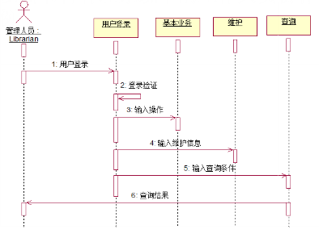
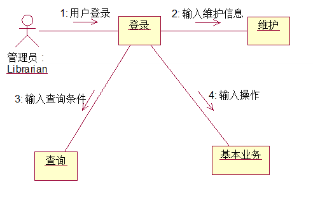
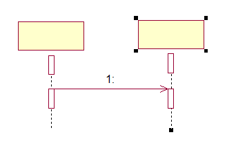
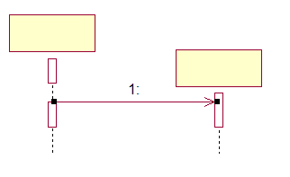
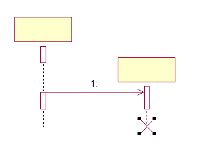
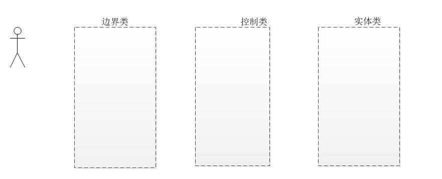
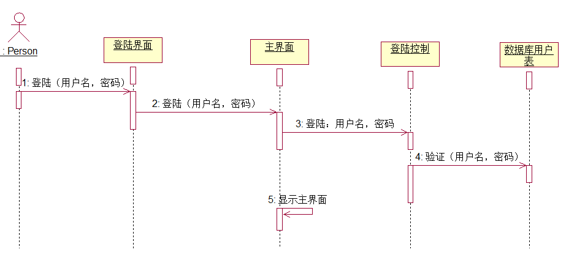
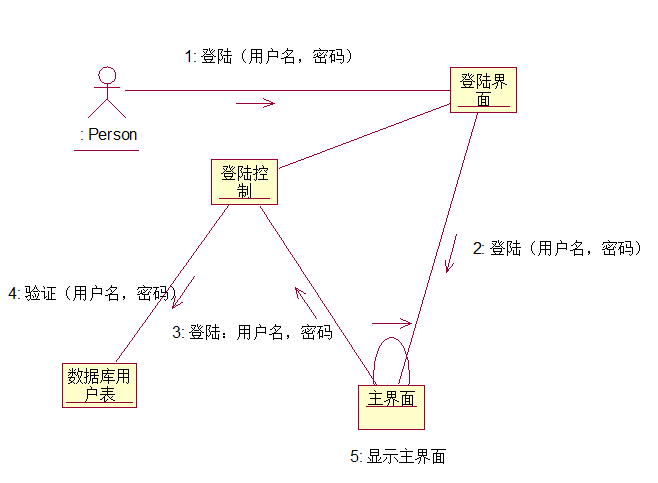
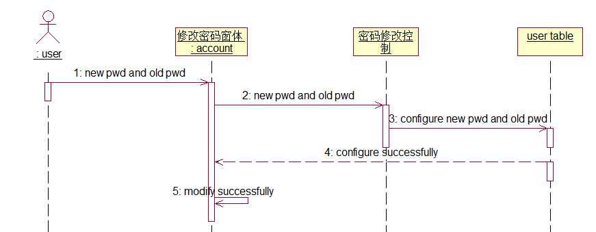
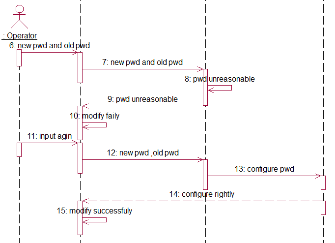

> 迁移来源 [博客园原文](https://www.cnblogs.com/xiuzhublog/p/13180344.html) · 原文发布于 `2020-06-23 09:23:00`（UTC+8）
> 旧文归档，保留当时的记录。

**一、什么是时序图**

序列图表示了系统在参与者互动执行某一个用例期间，系统内部的一群对象的协作情况。一个用例就对应一个时序图。序列图是对系统动态行为进行描述。用于用例分析和设计阶段。

 

**二、对比**

**1、序列图和协作图**

序列图跟协作图相似，两种图传递的意思是一样的。不同的是序列图强调的是消息的传递顺序，它将交互关系表示为一个二维图。纵向是时间轴，横轴是对象，对象的生命周期沿竖线向下延伸。而协作图强调的是系统间的组织结构，重在表现对象的角色，消息的传递顺序不明显。

看示例：

**时序图**

 

**协作图**

****

**2、时序图和类图、用例图**

用例图是系统外部对象（参与者）与系统这两大对象之间的互动，而类图是对系统中涉及到得所有对象，进行抽象描述。时序图是参与者和系统进行交互，系统内部对象之间的具体互动实现。SO，时序图关联了类图与用例图，可以通过用例图和类图进行整合。

 

**三、时序图的构成**

1、角色：参与者。

角色是类中的用户类，可以直接拖过来用，但是这里的角色应该是脱离系统之外的一个单纯的角色。类中定义的属性和操作可以不考虑。

 

2、对象：系统内部参与用例的一群对象。

 

对象的来源

1、类图。

开篇已经说过时序图其实可以是用例图和类图的整合。所以时序图中的对象大部分是已经存在的。

存在哪？在类图中。也就是说时序图中的对象是我们在类中已经创建好的，我们只需要拿来用。还有一点要注意：时序图中用到得是具体的对象，而非类，所以时序图中的对象是类图中类的实例化。

画法：

2、创建

还有一小部分对象是在交互过程中通过消息创建的。

画法：

当然有创建就有撤销：在生命线的末尾打岔。

 

3、消息：角色，跟对象，对象和对象之间信息的传递。

简单消息：

同步消息:发出消息后等待对方回应后，再去做别的事情。

异步消息：:发出消息后无需等待对方回应，可以先去做别的事情。

返回消息：

4、生命线：对象在某一用例中的生命周期。

激活期：生命线上不是虚线的部分，代表对象在某一用例过程中执行某一操作的时间。

 

**PS:**    一个用例，可以对应生成一个用例。

参与者对象只能跟边界对象互动。

实体对象不能发送消息给边界对象和控制对象。

如只是对数据增，删，该，查，可以不设置控制对象。

关系：序列图的一群对象来自类图，对象之间的交互来自用例描述。

 

**四、时序图怎么画？**

**采用BCE（boundary-control-entity patterns）模式绘制时序图。**

BCE 模型中将对象分为三类：边界类，控制类，实体类。

边界类：用来隔离系统内外，通常负责接收并响应系统内外消息，参与者与系统对象进行消息传递要通过边界类来实现。

控制类：一个用例会生成一个控制类。用来控制用例执行期间的复杂运算或者业务逻辑。

实体类：系统内部的对象。

他们的排列如下图所示。

步骤：1、找出参与者和添加用例控制类。

2、然后根据用例流程不断对边界类和实体类进行填充。

PS:控制类只有一个，边界类和实体类可以使多个。

 

分析下来，其实我们的具体实现是在做一道填空题。我们需要向B，C，E三个框中添加对象。

 

以下是对机房收费系统登陆用例的时序图:

按F5键同时生成的协作图:

 

修改密码示例：图一个为一次修改成功：

图二为二次修改成功

 

图二的画法不确定，请指正。
