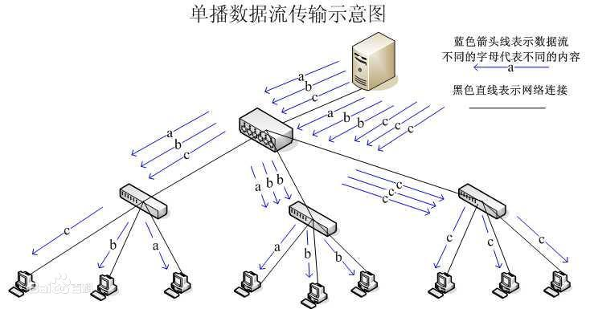

> 迁移来源 [博客园原文](https://www.cnblogs.com/xiuzhublog/p/13500707.html) · 原文发布于 `2020-08-14 10:17:00`（UTC+8）
> 旧文归档，保留当时的记录。

组播协议允许将一台主机发送的数据通过网络路由器和交换机复制到多个加入此组播的主机，是一种一对多的通讯方式。

**IP组播的好处、优势**

组播协议与现在广泛使用的单播协议的不同之处在于，一个主机用单播协议向 n 个主机发送相同的数据时，发送主机需要分别向 n 个主机发送，共发送 n 次。一个主机用组播协议向 n 个主机发送相同的数据时，只要发送 1 次，其数据由网络中的路由器和交换机逐级进行复制并发送给各个接收方，这样既节省服务器资源也节省网络主干的带宽资源。

与广播协议相比，只有组播接收方向路由器发出请求后，网络路由器才复制一份数据给接收方，从而节省接收方的带宽。而广播方式无论接收方是否需要，网络设备都将所有广播信息向所有设备发送，从而大量占据接收方的接入带宽。

**IP 组播历史**

在 1980 年代初斯坦福大学的一位博士生叫 Steve Deering ，在为其导师 David Cheriton 工作，设计一种叫做 Vsystem 的分布式操作系统。此操作系统允许一台计算机使用 MAC 层组播向在本地 Ethernet 段的一组其他计算机传递信息。

随着工作的扩展组播必须跨越路由器，所以必须将组播扩展到 OSI 模型的第三层，此历史重任落到了 Steve Deering 身上，他总结了组播路由的通信协议基础，并最终在 1991 年 12 月发表的博士论文中进行了详细的阐述。

                                                    [此处原图未能恢复，可查看源文章](https://www.cnblogs.com/xiuzhublog/p/13500707.html) 

组播协议的优势：

    组播协议的优势在于当需要将大量相同的数据传输到不同主机时，

1 ．能节省发送数据的主机的系统资源和带宽；

2 ．组播是有选择地复制给有要求的主机；

3.  组播可以穿越公网广泛传播，而广播则只能在局域网或专门的广播网内部传播 ；

4. 组播能节省网络主干的带宽；

组播协议的缺点：

    与单播协议相比，组播没有补包机制，因为组播采用的是 UDP 的传输方式，并且不是针对一个接受者，所以无法有针对的进行补包。所以直接组播协议传输的数据是不可靠的。

二、为什么宽带网必须使用组播协议

自从上世纪末长城宽带壮烈的宽带推广运动以来，宽带网一直面临种种问题，但这些问题归结起来就是一个问题，那就是客户端得不到与其接入带宽相称的足够的数据流。

最早的长城宽带面临的是“宽带无内容”的问题，客户得不到其承诺的视频点播等宽带娱乐，于是投诉、退户甚至诉诸法律。

电信凭借其雄厚的财力和电话线资源后来居上，但很快又面临网速慢、缺内容的投诉，电信网站上的视频点播似乎总是无尽的等待和缓冲。后来 P2P 软件的出现使得某些比较专业的用户似乎看到了希望，他们用 BT 、电驴等软件互传电影等娱乐信息也凑合了。没多久电信和网通就高举着和他们没什么关系的版权大旗封杀了 BT 、电驴等软件。[此处原图未能恢复，可查看源文章](https://www.cnblogs.com/xiuzhublog/p/13500707.html)

所有这些都是源于现在宽带网的“上下非对称”的金字塔结构，也就是 **网络主干的带宽远远小于所有用户带宽之和** ，但现在网络使用的单播通讯协议却要求**网络主干的带宽等于或接近所有用户带宽之和** 。现在的状况是一个城市或省的网络出口主干的带宽大约相当于其所有客户带宽之和的 5 ％，也就是说假如有5 ％的客户用 BT 软件通过网络全速传输数据，那其余 95 ％的客户就不要玩了。现在电信主干上的流量的75％都是P2P应用的流量，已经超过了电信所能承受的极限。

那么采用 CDN 技术，将网络内容在城域网内就近缓冲行不行呢？答案是：技术上可行经济上行不通。其需要的服务器是一个巨大的天文数字。现在的大中城市的宽带网用户数量都在 20 万以上，以此数量来计算光购置 CDN 服务器就需要 2 亿元左右！这就是为什么电信不用 CDN 技术来满足客户需求的原因。所以在服务器的服务能力和客户机的需求上也存在着严重的上下非对称结构。

那么这个死结是不是没法解开呢？当然不是，组播协议的数据流特点就是“上下非对称”的，也就是说，在网络主干上的一条数据流通过每层交换机的复制可以变成无数客户端的数据流，形成客户端数据流之和远大于主干数据流的金字塔结构。这一特点正好与现在的网络结构相符。所以说，基于组播协议的流媒体宽带娱乐可以解决这一问题。

举例来说，使用基于组播协议的直播系统可以用一台服务器支持数万客户收看一个或几个频道的网上电视直播。假设一共提供 100 个频道的电视节目，每个频道是 1M 的 MPEG4 高清晰码流，则无论有 1 万客户还是 100 万客户，其占用的网络主干都是 100M ，而 3 ～ 5 台服务器硬件的投资不到 100 万。

    如果采用我们专利技术的 基于组播的 VOD 系统 ，客户还可以享受到廉价的点播服务。由于其采用的是组播协议，无论对于网络主干还是 VOD 服务器的压力都很小。

**三、单播/组播/广播 通讯协议的特点及应用对比**

当前的网络中有三种通讯模式：单播、广播、组播，其中的组播出现时间最晚但同时具备单播和广播的优点，最具有发展前景。  

**一 、 单播：**

 主机之间 **“一对一”** 的通讯模式，网络中的交换机和路由器对数据只进行转发不进行复制。如果 10 个客户机需要相同的数据，则服务器需要逐一传送，重复 10 次相同的工作。但由于其能够针对每个客户的及时响应，所以现在的网页浏览全部都是采用 IP 单播协议。网络中的路由器和交换机根据其目标地址选择传输路径，将 IP 单播数据传送到其指定的目的地。

**单播的优点：**

> 1.    服务器及时响应客户机的请求
>
> 2.    服务器针对每个客户不通的请求发送不通的数据，容易实现个性化服务。

**单播的缺点 ：**     

1.  服务器针对每个客户机发送数据流， 服务器流量＝客户机数量×客户机流量 ；在客户数量大、每个客户机流量大的流媒体应用中服务器不堪重负。

2.   现有的网络带宽是金字塔结构，城际省际主干带宽仅仅相当于其所有用户带宽之和的 5％。如果全部使用单播协议，将造成网络主干不堪重负。现在的 P2P 应用就已经使主干经常阻塞，只要有 5 ％的客户在全速使用网络，其他人就不要玩了。而将主干扩展 20 倍几乎是不可能。

**二、  广播：**

 主机之间 **“一对所有”** 的通讯模式，网络对其中每一台主机发出的信号都进行无条件复制并转发，所有主机都可以接收到所有信息（不管你是否需要），由于其不用路径选择，所以其网络成本可以很低廉。有线电视网就是典型的广播型网络，我们的电视机实际上是接受到所有频道的信号，但只将一个频道的信号还原成画面。在数据网络中也允许广播的存在，但其被限制在二层交换机的局域网范围内，禁止广播数据穿过路由器，防止广播数据影响大面积的主机。

**广播的优点：**

1.  网络设备简单，维护简单，布网成本低廉

2.  由于服务器不用向每个客户机单独发送数据，所以服务器流量负载极低。

**广播的缺点：**

1. 无法针对每个客户的要求和时间及时提供个性化服务。

2.   网络允许服务器提供数据的带宽有限， **客户端的最大带宽＝服务总带宽** 。例如有线电视的客户端的线路支持 100 个频道（如果采用数字压缩技术，理论上可以提供 500 个频道），即使服务商有更大的财力配置更多的发送设备、改成光纤主干，也无法超过此极限。也就是说无法向众多客户提供更多样化、更加个性化的服务。

3.   广播禁止在 Internet 宽带网上传输。  

**三、 组播：**

        主机之间 **“一对一组”** 的通讯模式，也就是加入了同一个组的主机可以接受到此组内的所有数据，网络中的交换机和路由器只向有需求者复制并转发其所需数据。主机可以向路由器请求加入或退出某个组，网络中的路由器和交换机有选择的复制并传输数据，即只将组内数据传输给那些加入组的主机。这样既能一次将数据传输给多个有需要（加入组）的主机，又能保证不影响其他不需要（未加入组）的主机的其他通讯。

**组播的优点：**

1.   需要相同数据流的客户端加入相同的组共享一条数据流，节省了服务器的负载。具备广播所具备的优点。

2.   由于组播协议是根据接受者的需要对数据流进行复制转发，所以服务端的服务总带宽不受客户接入端带宽的限制。 IP 协议允许有 2 亿 6 千多万个（ 268435456 ）组播，所以其提供的服务可以非常丰富。   

3.   此协议和单播协议一样允许在 Internet 宽带网上传输。

**组播的缺点：**

1． 与单播协议相比没有纠错机制，发生丢包错包后难以弥补，但可以通过一定的容错机制和QOS 加以弥补。

2． 现行网络虽然都支持组播的传输，但在客户认证、 QOS 等方面还需要完善，这些缺点在理论上都有成熟的解决方案，只是需要逐步推广应用到现存网络当中。

四、IP组播路由协议详细介绍

**一、概述****1****、组播技术引入的必要性**    
随着宽带多媒体网络的不断发展，各种宽带网络应用层出不穷。 IP TV 、视频会议、数据和资料分发、网络音频应用、网络视频应用、多媒体远程教育等宽带应用都对现有宽带多媒体网络的承载能力提出了挑战。采用单播技术构建的传统网络已经无法满足新兴宽带网络应用在带宽和网络服务质量方面的要求，随之而来的是网络延时、数据丢失等等问题。此时通过引入 IP 组播技术，有助于解决以上问题。组播网络中，即使组播用户数量成倍增长，骨干网络中网络带宽也无需增加。简单来说，成百上千的组播应用用户和一个组播应用用户消耗的骨干网带宽是一样的，从而最大限度的解决目前宽带应用对带宽和网络服务质量的要求。     
  
**2** **、 IP 网络数据传输方式**组播技术是 IP 网络数据传输三种方式之一，在介绍 IP 组播技术之前，先对 IP 网络数据传输的单播、组播和广播方式做一个简单的介绍：     
  
**单播（ Unicast ）传输**： 在发送者和每一接收者之间实现点对点网络连接。   如果一台发送者同时给多个的接收者传输相同的数据，也必须相应的复制多份的相同数据包。如果有大量主机希望获得数据包的同一份拷贝时，   将导致发送者负担沉重、延迟长、网络拥塞；为保证一定的服务质量需增加硬件和带宽。     
  
**组播（ Multicast ）传输**：在发送者和每一接收者之间实现点对多点网络连接。   如果一台发送者同时给多个的接收者传输相同的数据，也只需复制一份的相同数据包。它提高了数据传送效率。减少了骨干网络出现拥塞的可能性。     
  
**广播（ Broadcast ）传输：**是指在 IP 子网内广播数据包，所有在子网内部的主机都将收到这些数据包。   广播意味着网络向子网每一个主机都投递一份数据包，不论这些主机是否乐于接收该数据包。所以广播的使用范围非常小，   只在本地子网内有效，通过路由器和交换机网络设备控制广播传输。

**二、组播技术**1 、  IP 组播技术体系结构     
组播协议分为主机 - 路由器之间的组成员关系协议和路由器 - 路由器之间的组播路由协议。组成员关系协议包括 IGMP( 互连网组管理协议 ) 。组播路由协议分为域内组播路由协议及域间组播路由协议。域内组播路由协议包括 PIM-SM 、 PIM-DM 、 DVMRP 等协议，域间组播路由协议包括 MBGP 、 MSDP 等协议。同时为了有效抑制组播数据在链路层的扩散，引入了 IGMP
Snooping 、 CGMP 等二层组播协议。     
IGMP 建立并且维护路由器直联网段的组成员关系信息。域内组播路由协议根据 IGMP 维护的这些组播组成员关系信息，运用一定的组播路由[算法](http://lib.csdn.net/base/31 "算法与数据结构知识库")构造组播分发树进行组播数据包转发。域间组播路由协议在各自治域间发布具有组播能力的路由信息以及组播源信息，以使组播数据在域间进行转发。     
  
**2****、   组播 IP 地址**组播 IP 地址用于标识一个 IP 组播组。 IANA 把 D 类地址空间分配给 IP 组播，其范围是从 224.0.0.0 到 239.255.255.255 。如下图所示 ( 二进制表示 ) ， IP 组播地址前四位均为 1110 。     
八位组（ 1 ）   八位组（ 2 ）   八位组（ 3 ）   八位组（ 4 ）     
1110XXXX XXXXXXXX XXXXXXXX XXXXXXXX    
  
**3****、   组成员关系协议****(IGMP)**  IGMP 协议运行于主机和与主机直接相连的组播路由器之间，主机通过此协议告诉本地路由器希望加入并接受某个特定组播组的信息，同时路由器通过此协议周期性地查询局域网内某个已知组的成员是否处于活动状态（即该网段是否仍有属于某个组播组的成员），实现所连网络组成员关系的收集与维护。 IGMP 有三个版本， IGMPv1 由RFC1112 定义，目前通用的是 IGMPv2 ，由 RFC2236 定义。 IGMPv3 目前仍然是一个草案。IGMPv1 中定义了基本的组成员查询和报告过程， IGMPv2 在此基础上添加了组成员快速离开的机制， IGMPv3 中增加的主要功能是成员可以指定接收或指定不接收某些组播源的报文。这里着重介绍 IGMPv2 协议的功能。     
IGMPv2 通过查询器选举机制为所连网段选举唯一的查询器。查询器周期性的发送普遍组查询消息进行成员关系查询；主机发送报告消息来应答查询。当要加入组播组时，主机不必等待查询消息，主动发送报告消息。当要离开组播组时，主机发送离开组消息；收到离开组消息后，查询器发送特定组查询消息来确定是否所有组成员都已离开。     
通过上述 IGMP 机制，在组播路由器里建立起一张表，其中包含路由器的各个端口以及在端口所对应的子网上都有哪些组的成员。当路由器接收到某个组 G 的数据报文后，只向那些有 G 的成员的端口上转发数据报文。至于数据报文在路由器之间如何转发则由路由协议决定， IGMP协议并不负责。     
  
**4****、   网络二层组播相关协议**网络二层组播相关协议包括 IGMP Snooping ,IGMP Proxy 和CGMP 协议。     
IGMP Snooping 的实现机理是：交换机通过侦听主机发向路由器的 IGMP

成员报告消息的方式，形成组成员和交换机接口的对应关系；交换机根据该对应关系将收到组播数据包只转给具有组成员的接口。     
IGMP Proxy 与 IGMP Snooping 实现功能相同但机理相异： IGMP snooping 只是通过侦听 IGMP的消息来获取有关信息，而 IGMP Proxy 则拦截了终端用户的 IGMP 请求并进行相关处理后，再将它转发给上层路由器。     
CGMP(Cisco Group Management Protocol) 是 Cisco 基于客户机 / 服务器模型开发的私有协议，在 CGMP 的支持下，组播路由器能够根据接收到的 IGMP 数据包通知交换机哪些主机何时加入和脱离组播组，交换机利用由这些信息所构建的转发表来确定将组播数据包向哪些接口转发。 GMRP 是主机到以太网交换机的标准协议，它使组播用户可以在第二层交换机上对组播成员进行注册。     
  
**5****、   组播路由协议   （ PIM-SM ）**众多的组播路由协议中，目前应用最多的协议是  PIM-SM 稀疏模式协议无关组播。     
在 PIM-SM 域中，运行 PIM-SM 协议的路由器周期性的发送 Hello 消息，用以发现邻接的 PIM 路由器，并且负责在多路访问网络中进行指定路由器 (DR) 的选举。这里， DR 负责为其直连组成员朝着组播分发树根节点的方向发送 " 加入 / 剪枝 " 消息，或是将直连组播源的数据发向组播分发树。   

PIM-SM 显式的加入机制

PIM-SM 通过建立组播分发树来进行组播数据包的转发。组播分发树分为两种：以组 G 的 RP为根的共享树（ Shared Tree ）和以组播源为根的最短路径树（ Shortest
Path Tree ）。

PIM-SM 通过显式的加入 / 剪枝机制来完成组播分发树的建立与维护。如上图所示：     
  
当 DR 收到一个发自接收端的加入（ Join ），它就会向着组 G 的 RP 方向逐跳组播发出一个（\* ， G ）加入信息用以加入共享树；     
  
源主机向组发送组播数据时，源的数据被封装在注册消息内，并由其 DR  单播至 RP ， RP 再将源的解封装数据包沿着共享树转发到各个组成员；     
  
RP 朝着源方向向第一跳路由器发送（ S ， G ）加入信息，用以加入此源的最短路径树，这样源的数据包将沿着其最短路径树不加封装地发送到 RP ；     
  
当第一个组播数据沿此树到达时， RP 向源的 DR 发送注册 - 停止消息，以使 DR 停止注册封装过程。此后，这个源的组播数据不再注册封装，而是先沿着源的最短路径树发送到 RP ，再由RP  将其沿着共享树转发到各个组成员。     
  
当不再需要组播数据时， DR 向着组 G 的 RP 逐跳组播剪枝消息用以剪枝共享树。     
PIM-SM 中还涉及到其根节点 RP 的选择机制。 PIM-SM 域内配置了一个或多个候选自举路由器(Candidate-BSR) 。应用一定的规则从中选出自举路由器 (BSR) 。 PIM-SM 域中还配置了候选 RP 路由器 (Candidate-RP) ，这些候选  RP 将包含了它们地址及可以服务的组播组等信息的包单播至自举路由器。 BSR  定期生成包括一系列候选  RP 以及相应的组地址的 " 自举 " 消息。 "自举 " 消息在整个域中逐跳发送。路由器接收并保存这些 " 自举 " 消息。若  DR  从直连主机收到了某组的成员关系报告后，如果它没有这个组的路由项， DR  将使用一个 hash 算法将组地址映射至一个可以为该组服务的候选  RP 。然后  DR  将朝 RP 方向逐跳组播 " 加入 / 剪枝 " 消息。若  DR 从直连主机收到组播数据包，如果它没有这个组的路由项， DR  将使用 hash 算法将组地址映射至一个可以为该组服务的候选  RP 。然后  DR 将组播数据封装在注册消息中单播到 RP 。

 

五、IP **组播地址**

组播协议的地址在 IP 协议中属于 D 类地址。 D 类地址是从 224.0.0.0 到 239.255.255.255 之间的 IP 地址其中 224.0.0.0 到 224.0.0.255 是被保留的地址。  

组播协议的地址范围类似于一般的单播地址，被划分为两个大的地址范围，

239.0.0.0 — 239.255.255.255 是私有地址，供各个内部网在内部使用，这个地址的组播不能上公网，类似于单播协议使用的 192.168.X.X 和 10.X.X.X 。

224.0.1.0 — 238.255.255.255 是公用的组播地址，可以用于 Internet 上。  

**下面是一些常见的有特殊用途的 IP 组播地址**

224.0.0.0  －  Base address

224.0.0.1  －   网段中所有支持多播的主机

224.0.0.2  －   网段中所有支持多播的路由器

224.0.0.4  －   网段中所有的 DVMRP 路由器

224.0.0.5  －   所有的 OSPF 路由器

224.0.0.6  －   所有的 OSPF 指派路由器

224.0.0.7  －   所有的 ST 路由器

224.0.0.8  －   所有的 ST 主机

224.0.0.9  －   所有 RIPv2 路由器

224.0.0.10  －   网段中所有支的路由器

224.0.0.11  －  Mobile-Agents

224.0.0.12  －  DHCP server / relay agent 服务专用地址

224.0.0.13  －   所有的 PIM 路由器

224.0.0.22  －   所有的 IGMP 路由器

224.0.0.251  －   所有的支持组播的 DNS 服务器

224.0.0.9 RIPv2 支持组播更新。

224.0.0.22  IGMPv2 使用此地址，这个协议的本意是减少广播，让组员以组播形式通信。

224.0.0.5  224.0.0.6 这两个是 ospf 协议使用的组播地址。

在 broadcast network 不论是 DR,BDR,DRother, 大家发送 hello packet 的时候目标地址都是AllSPFRouter(224.0.0.5) ； DRother 向 DR,BDR 发送 DD,LSA
request 或者 LSA UPdate 时目标地址是 AllDRouter(224.0.0.6) ； DR,BDR 向 DRother 发送 DD,LSA Request 或者 LSA Update 时目标地址是 AllSPFRouter(224.0.0.5) ； retransmit 的 LSA 都是 unicast,LSA
ACK 要看是 explicit ack(unicast) 还是 implicit ack(multicast 224.0.0.6) ；

**组播 IP 地址与以太网二层 MAC 地址的映射：**

IP 组播地址用于标识一个 IP 组播组。 IANA 把 D 类地址空间分配给 IP 组播，范围从224.0.0.0 到 239.255.255.255 ， IP 组播地址前四位均为 1110 。

从 224.0.0.0 至 224.0.0.255 被 IANA 保留为网络协议使用。例如： 244.0.0.1  全主机组244.0.0.2  全多播路由器组 244.0.0.3 全 DVMRP 路由器组 244.0.0.5  全 OSPF 路由器组。在这一范围的多播包不会被转发出本地网络，也不会考虑多播包的 TTL 值。

地址从 239.0.0.0 至 239.255.255.255 作为管理范围地址，保留为私有内部域使用。

如下图所示，以太网和 FDDI 的 MAC 地址 01:00:5E:00:00:00 到 01:00:5E:7F:FF:FF 用于将三层 IP 组播地址映射为二层地址，即 IP 组播地址中的低 23 位放入 IEEE
MAC 地址的低 23位。 IP 组播地址有 28 位地址空间，但只有 23 位被映射到 IEEE MAC 地址，这样会有 32 个 IP组播地址映射到同一 MAC 地址上。

[此处原图未能恢复，可查看源文章](https://www.cnblogs.com/xiuzhublog/p/13500707.html)

**六、如何构建支持组播协议的校园网**

一、       在校园网中构建支持组播协议的网络需要注意几点

1．      中心的三层交换机要支持组播协议（建议采用PIM稀疏SM模式）。

2．      直接连接三层交换机的汇聚层的二层交换机需要支持 IGMP SNOOPING 协议，一般的智能或带网管的交换机都具有此功能。需要注意的是二层交换机的处理能力， IGMP 侦听需要消耗交换机的处理能力，所以有些处理能力较差的二层交换机在数据流量较小的时候 IGMP 侦听能够做的很好的，一但数据流量较大时就侦听不到的情况，导致用户无法正常加入组播。

3．      最下级的接入层交换机最好用智能交换机，出于经济上的考虑也可以用一般的傻瓜交换机。但决不能用古老的共享式 HUB 集线器，因为共享式 HUB 会严重影响其他客户机的通讯。

4．      组播视频服务器最好直接连接核心的三层交换机，中间不要通过二层交换机级连。

5.   用我们 **下载页面**提供的组播测试工具测试组播协议是否连通。

6．     具体的组播原理和配置，请到 下载页面 下载组播原理和配置的资料包

7.         一个简化的拓扑结构如下图所示：

**二、**   关于防火墙问题

我们的建议是将组播协议的数据流旁路绕过防火墙，即连接一条不经过防火墙的链路，并在端口地址列表中只允许组播地址的数据包通过；或在防火墙内部设定透明穿透bypass，即对于组播地址的数据包不作分析处理，直接转发。其考虑基于如下几点：

1．            现在网络中使用的防火墙种类繁多、性能各异。但总体上来说对于处理视频信息这样的巨大流量都是力不从心的。

2．            组播数据流是非连接的 UDP ，而且需要客户机自己加入组播才能收到组播，所以发送数据者无通过组播定位攻击，目前为止还未出现以组播为载体的病毒和黑客程序。

**三、** 关于收费网关问题

收费网关一般位于最后的组播复制节点的更上层，所以通过原有的 BAS 收费网关系统对组播数据流进行复制是不现实的，一般是将组播数据流绕过现有的BAS收费网关，用另外的方式收费，解决方式有几种：

1．            采用可控组播协议的方式，现在的华为、中兴的交换机都支持此技术。

2．            采用包月计费的方式。

3．            采用免费收看用广告赚取收入的方式。

**如何构建支持组播协议的 城域网**

城域网的主干一般采用Ethernet over SDH，或直接采用以太网，他们支持IP组播问题不大。难点在于最后一公里的接入网部分，接入网有两种主流技术，以太网和ADSL,其中以太网接入很容易开通组播。

但是现在电信公网的接入以 ADSL 为主， ADSL 的物理基础是 ATM ，所以其原本是不支持IP 组播的，通过后来的一些技术改进才使其支持 IP 组播，其中的主流是 DSLAM技术。

一、       **ADSL 承载组播的特殊性**

由于 ADSL的底层不同于一般的以太网帧结构，因此在DSLAM上实现IP组播可以采用IGMP Proxy和IGMP Snooping两种方式。    
IGMP Proxy的实现机理：DSLAM靠拦截用户和路由器之间的IGMP报文建立组播表，Proxy设备的上联端口执行主机的角色，下联端口执行路由器的角色。    
IGMP Snooping的实现机理：DSLAM以侦听主机发向路由器IGMP成员报告消息的方式，形成组成员和交换机端口的对应关系，DSLAM则根据该对应关系，将收到的组播数据包转发到组成员的端口。    
早期的基于纯ATM交换内核的DSLAM，由于PVC的终结是在BAS上，DSLAM支持数据的透传，不能对数据进行任何的处理，所以只能实现IGMP Snooping功能，而不能支持IGMP Proxy功能。现在基于纯IP交换的第三代DSLAM，可以同时支持IGMP Proxy和IGMP Snooping功能。

**二、   DSLAM中IP组播性能的衡量**

DSLAM中实现IP组播性能的衡量主要分为功能和性能两部分。    
1.功能主要包括：    
(1)DSLAM组播流的转发。DSLAM能按组播转发表正确转发，也就是说只有被授权的用户板端口才能收到组播流，而其他非授权端口不能收到组播流；    
(2)多个组成员的加入不会影响到组内其他成员收看组播节目；同样，单个组成员的离开和单个组的离开也不会影响到组内其他成员和其他组的成员观看组播节目；    
(3)对组播权限的控制。对权限的控制应该是基于端口号、MAC地址或IP地址的灵活控制，而且控制的颗粒度应能控制某个用户可以加入此组播组但是不能加入彼组播组；    
(4)IP TV频道切换时延。时延在用户能接收的范围内与电视频道切换时间比较理想。    
2.其性能主要包括：    
(1)成员Join/Leave的时延。Join时延是指从待测路由器收到指定组播组的Join消息到它开始向该指定组播组转发组播流的时延；Leave时延是指从待测路由器收到组的Leave消息到它停止向该指定组转发组播流的时延。如果Join/Leave时延短则意味着在相同时间里加入/离开的组播组全面改造。其间对内容的分发是一个要重点考虑的问题，因为视频业务对带宽的占用是相当大的，如果分发不当不仅会影响到视频业务的质量，而且还会对原有业务产生负面的影响。建议内容分发网采用分级的分布式结构，这可以在一定程度上缓解IP城域网的压力；    
(2)单/多PVC下多业务的QoS。保证在同一条PVC或多条PVC上能传送不同的业务；    
(3)单板组播性能。该性能用于表征单用户板满情况下最大无差错转发时的组播流速率，速率的大小关系到组播源可以向用户提供的业务类型，如果速率不够大就有可能会限制某些业务的开展。
